# RNA-seq的count,TPM, FPKM/RPKM值的区别与转换

RNA-seq的counts值，RPKM, FPKM, TPM 的异同

现在常用的基因定量方法包括：RPKM, FPKM, TPM。这些表达量的主要区别是：通过不同的标准化方法为转录本丰度提供一个数值表示，以便于后续[差异分析](http://mp.weixin.qq.com/s?__biz=MzA4NDAzODkzMA==&mid=2651264493&idx=1&sn=2164cc4d202fc081551f8918c8cbd7a4&chksm=841ef190b36978866b9bd71a989960370614bf234453b3bd070a56fbe324deb4ecaea2305923&scene=21#wechat_redirect)。

标准化的主要目的是去除测序数据的技术偏差：测序深度和基因长度。

测序深度：同一条件下，测序深度越深，基因表达的read读数越多。

基因长度：同一条件下，不同的基因长度产生不对等的read读数，基因越长，该基因的read读数越高。

## 1.Count值

对给定的基因组参考区域，计算比对上的read数，又称为raw count（RC）。在RNAseq数据中，raw reads count一般是指mapped到基因外显子区域的reads数目。

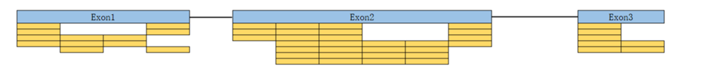

## 2.RPKM/FPKM

FPKM(Fragment Per Kilobase of transcript, per Million mapped reads）：每千碱基片段每百万映射读取的 reads 数)，是针对双端测序的一个normalization方法。通常来讲，当paired reads同时匹配到一个位置，记为fragment(注：即便是双端测序，RPKM也不完全是FPKM的2倍)。

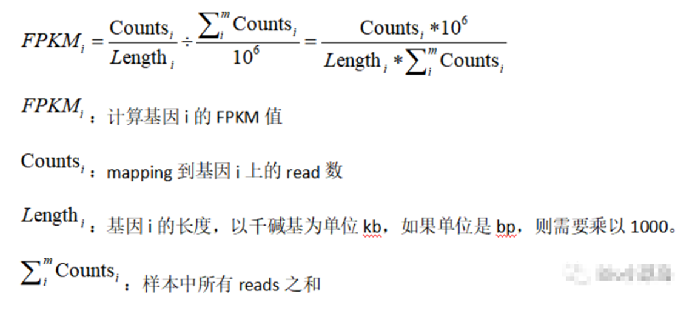

**RPKM: Reads Per Kilobase of exon model per Million mapped reads (每千个碱基的转录每百万映射读取的reads)**

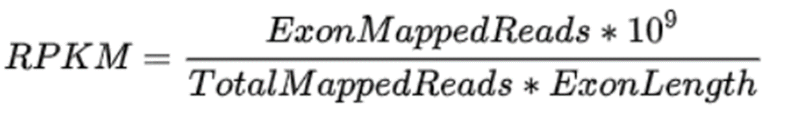

****

**RPKM/FPKM方法**：10^3标准化了基因长度的影响，10^6标准化了测序深度的影响。FPKM方法与RPKM类似，主要针对双末端RNA-seq实验的转录本定量。在双末端RNA-seq实验中，有左右两个对应的read来自相同的DNA片段。在进行双末端read进行比对时，来自同一DNA片段的高质量的一对或单个read可以定位到参考序列上。为避免混淆或多次计数，统计一对或单个read比对上的参考序列片段（Fragment），来计算FPKM，计算方法同RPKM。

**RPKM与FPKM的区别**：RPKM值适用于单末端RNA-seq实验数据，FPKM适用于双末端RNA-seq测序数据。

## 3.TPM (Transcript per million)

TPM（Transcripts Per Million） 是一种常用的基因表达量归一化方法，它将基因的表达量调整为每百万条转录本的数量。TPM 值考虑了基因的长度和测序深度，通过将每个基因的 Counts 值除以其长度，并进行适当的归一化，将基因的表达量转换为每百万转录本数，以便进行样本间的比较和分析。TPM 值消除了样本间测序深度的差异和基因长度的影响。

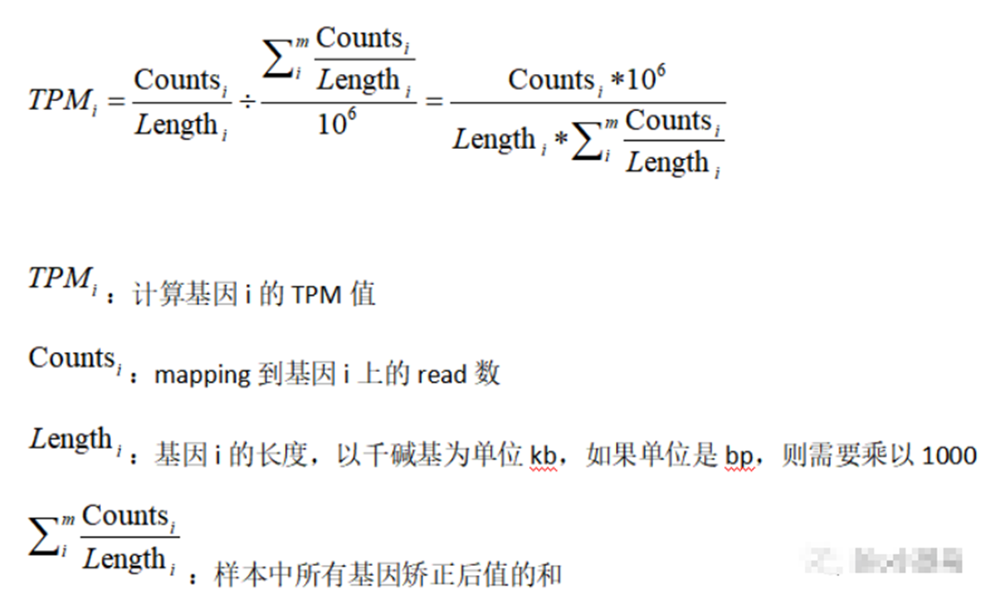

TPM的计算方法也同RPKM/FPKM类似，首先使用式2计算每个基因的表达值，去除基因长度的影响。随后计算每个基因的表达量的百分比，最后再乘以10^6，TPM可以看作是RPKM/FPKM值的百分比。

直接说事情，我有一个基因A，它在这个样本的转录组数据中被测序而且mapping到基因组了 5000个的reads，而这个基因A长度是10K，我们总测序文库是50M，所以这个基因A的RPKM值是 5000除以10，再除以50，为10. 就是把基因的reads数量根据基因长度和样本测序文库来normalization 。那么它的TPM值是多少呢？这个时候这些信息已经不够了，需要知道该样本其它基因的RPKM值是多少，加上该样本有3个基因，另外两个基因的RPKM值是5和35，那么我们的基因A的RPKM值为10需要换算成TPM值就是 1,000,000 *10/(5+10+35)=200,000，看起来是不是有点大呀，其实主要是因为我们假设的基因太少了，一般个体里面都有两万多个基因的，总和会大大的增加，这样TPM值跟RPKM值差别不会这么恐怖的。

相当于重新标准化的文库，保证每个样本中所有TPM的总和是相同的。

**TPM与RPKM/FPKM的区别**：从计算公式来说，唯一的不同是计算操作的顺序，TPM是先去除了基因长度的影响，而RPKM/FPKM是先去除测序深度的影响，具体可看这篇博文，有计算步骤的详细说明；TPM实际上改进了RPKM/FPKM方法在跨样品间定量的不准确性。

TPM的使用范围与RPKM/FPKM相同。

## 4.三者之间的比较

raw count作为原始的read计数矩阵是一个绝对值，而绝对值的特点是规模不同（基因长度、测序深度），不可以比较。进行这些基因标准化方法的目的是将count矩阵转变为相对值，去除技术偏差的影响，使后续的差异分析具有统计学的意义。

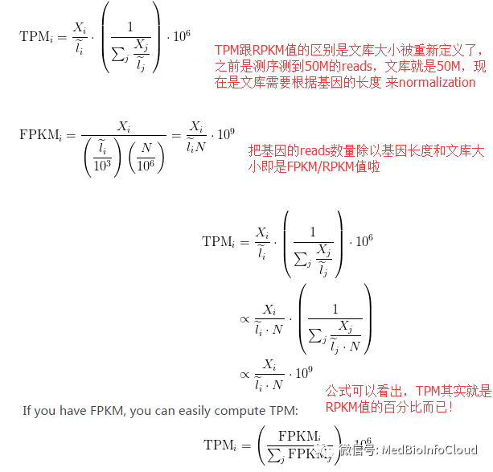

## 5.数据之间的转换

这里以一个案例来讲解，因为涉及到基因的长度，所以需要有每个基因的长度信息。对于有参考基因组的物种来说，可以从参考基因组的gtf文件中获取。

```r
library(GenomicFeatures)
txdb <- makeTxDbFromGFF("gencode.v22.annotation.gtf",format="gtf")
exons.list.per.gene <- exonsBy(txdb, by = "gene")
```

```r
#通过reduce函数避免重复计算重叠区
exonic.gene.sizes <- lapply(exons.list.per.gene,
                            function(x){sum(width(reduce(x)))})
#生成的geneID为ensemble编号
eff_length <- do.call(rbind,lapply(exonic.gene.sizes, data.frame))
eff_length <- data.frame(gene_id = rownames(eff_length),effLen = eff_length[,1])
rownames(eff_length)<-eff_length$gene_id
rownames(eff_length) <- do.call(rbind,strsplit(as.character(eff_length$gene_id),'\\.'))[,1]
head(eff_length)
```

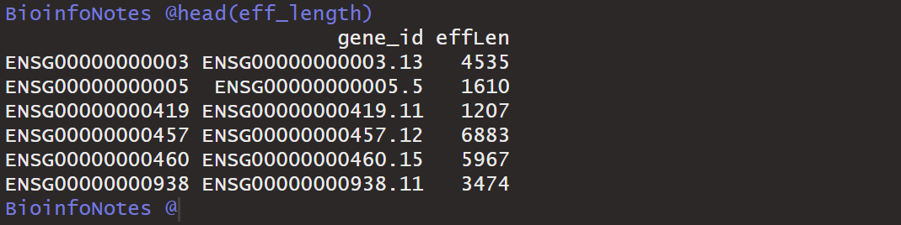

注意：这里指的基因长度指的是外显子，不包括内含子。

上面得到的基因id是ensemble编号，需要进行ID转换。参考文章：生信中各种ID转换。

这里我重点介绍这些数据的转换，我直接使用我已经处理好的人的基因的长度信息：

```r
###加载基因信息数据
load("hsaGeneInfo.Rdata")
```

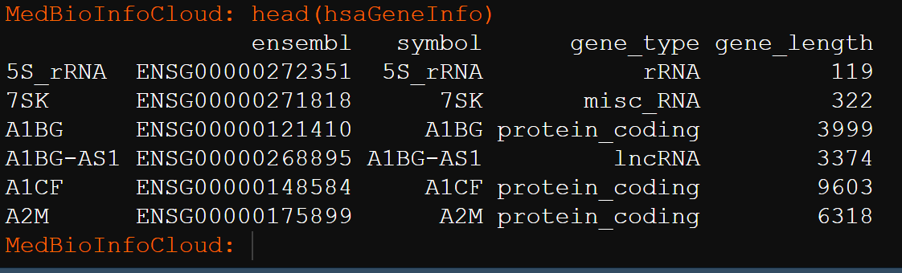

加载演示数据TCGA-UCS-STARdata.Rdata ,该数据来自TCGA数据库，TCGA数据库里面可以直接获取TPM的数据，这里我们自己用count转换后和下载的数据进行比较，看看转换有没有差异。

```r
### 加载RNAseq数据
load("TCGA-UCS-STARdata.Rdata")
count = STARdata[["count"]]
tpm = STARdata[["tpm"]]
```

我这里的演示数据，加载后的数据名称为STARdata，STARdata是一个list，包含count和tpm两个数据框。我这里查看一下前6行和前2列的数据。

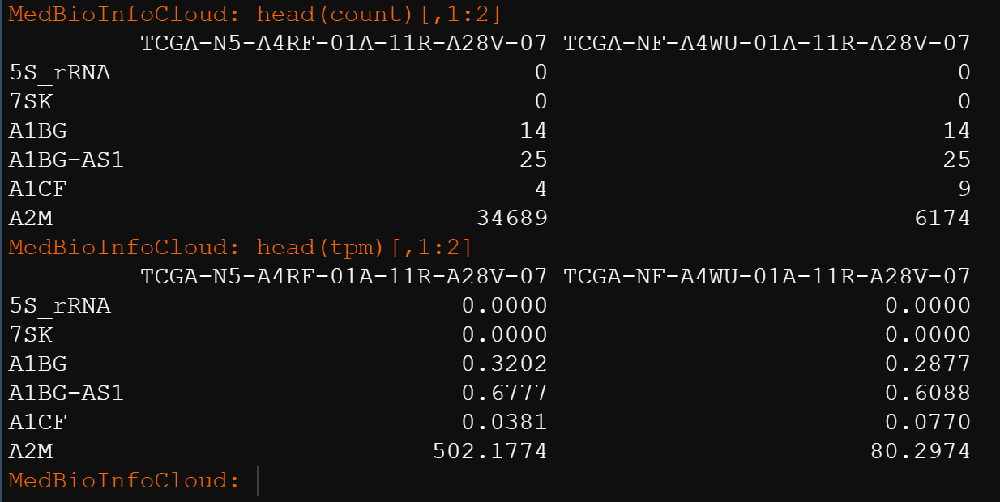

再进行转换时如果需要用到基因长度那么我们要保证基因长度的信息和表达矩阵的数据的基因对应起来。

```r
identical(rownames(count),rownames(hsaGeneInfo))
identical(rownames(tpm),rownames(hsaGeneInfo))
```

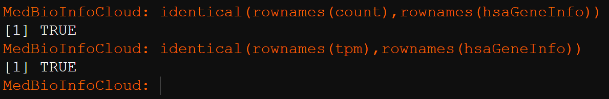

我们用到的是基因长度信息的那一列：

```r
effLen = hsaGeneInfo$gene_length
```

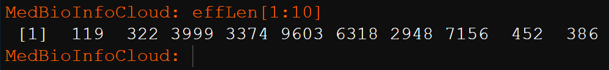

## （1）count转FPKM

这里需要根据FPKM的公式定义一个函数：

```r
# effLen基因长度，counts是基因的count数
Counts2FPKM <- function(counts, effLen){
  N <- sum(counts)
  exp( log(counts) + log(1e9) - log(effLen) - log(N) )
}
```

使用上面函数就可以转换了：

```plain
fpkms <- apply(count, 2, Counts2FPKM, effLen = effLen)
```

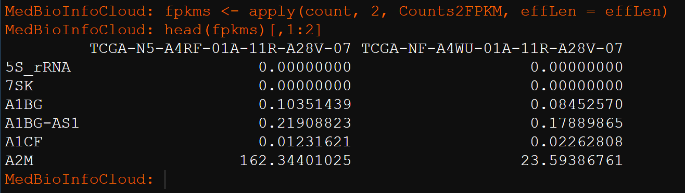

## （2）count转TPM

这里需要根据TPM的公式定义一个函数：

```r
# counts:转录组的count矩阵，行为基因，列为样本
# effLen：一个数值型向量，值是基因长度，顺序应该与count的列一致对应。Counts2TPM <- function(counts, effLen){
  rate <- log(counts) - log(effLen)
  denom <- log(sum(exp(rate)))
  exp(rate - denom + log(1e6))
}
```

使用上面函数进行转换：

```r
trans_tpm <- apply(count, 2, Counts2TPM, effLen = effLen)
head(trans_tpm)[,1:2]
```

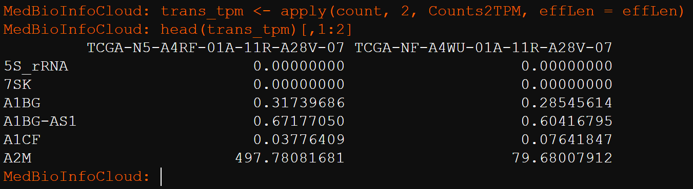

## （3）FPKM转TPM
```r
##3.FPKM转TPM
FPKM2TPM <- function(fpkm){
  exp(log(fpkm) - log(sum(fpkm)) + log(1e6))
}

##计算TPM值
trans_tpm3 <- apply(fpkms,2,FPKM2TPM)
head(trans_tpm3)[,1:2]
```

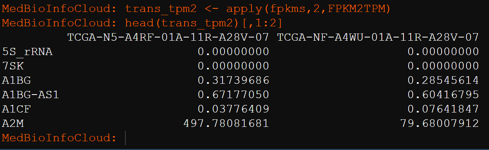

和下载的tpm比较：

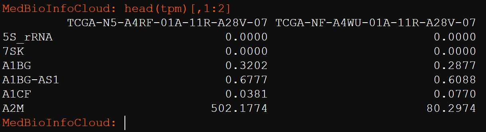

整体来说，差别不是很大。

> 更新: 2023-12-10 19:50:05
> 原文: <https://www.yuque.com/doublehelix/bioinfonotes/gpiwl9>
