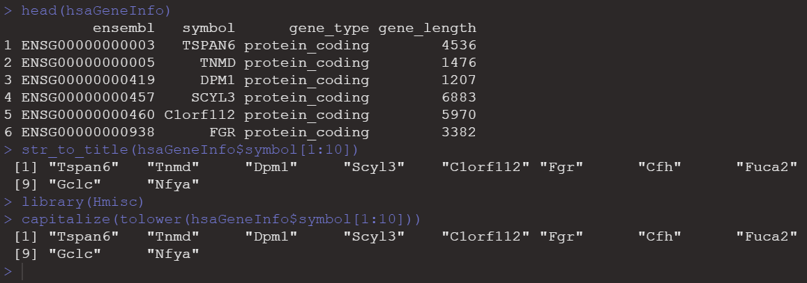
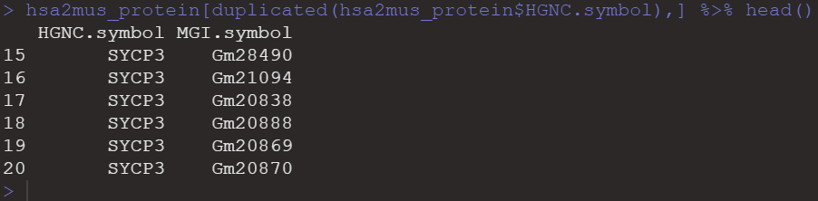

# 人-小鼠同源基因之间的转换

当我们做的转录组或者芯片的数据是小鼠的时候，对于下游的分析，比如gsea等分析要对生物学数据库注释，发现绝大部分数据库都是人类的基因名字，这个时候我们需要将小鼠的基因映射到人上，就是找小鼠与人直接的同源基因。有一个取巧的方法是把基因名字修改一下，人的基因名称几乎都是大写，小鼠首字母大写，其他小写。

对于大部分基因来说，直接变换大小写就可以啦。

简单粗暴的方法：

```r
load("K:/BioInfoFiles/hsaGeneInfo.Rdata")#hsaGeneInfo
head(hsaGeneInfo)

library(stringr)
str_to_title(hsaGeneInfo$symbol[1:10])

library(Hmisc)
capitalize(tolower(hsaGeneInfo$symbol[1:10]))
```



其实有相应的R包可以进行转换。这里从人到鼠进行转换。

```r
hsa2mus_all <- getLDS(attributes = c("hgnc_symbol"),
                filters = "hgnc_symbol",
                values = hsaGeneInfo$symbol,
                mart = human,
                attributesL = c("mgi_symbol"),
                martL = mouse,uniqueRows = T)
head(hsa2mus_all)
length(hsaGeneInfo$symbol)
nrow(hsa2mus_all)
```

```r
> head(hsa2mus_all)
  HGNC.symbol MGI.symbol
1      MT-CO1     mt-Co1
2      MT-CO2     mt-Co2
3      MT-ND2     mt-Nd2
4      MT-CO3     mt-Co3
5     MT-ATP8    mt-Atp8
6      MT-ND3     mt-Nd3
> length(hsaGeneInfo$symbol)
[1] 62427
> nrow(hsa2mus_all)
[1] 22616
```

总共6万多个基因，只有2万多个被映射到小鼠上。这6万多的基因包括了很假基因。

```r
unique(hsaGeneInfo$gene_type)
hsaGeneInfo$gene_type[match(hsa2mus_all$HGNC.symbol,hsaGeneInfo$symbol)] %>% unique()
```

只转换一下编码蛋白的基因。

```r
hsa_prot_coding <- hsaGeneInfo$symbol[hsaGeneInfo$gene_type=="protein_coding"]

hsa2mus_protein <- getLDS(attributes = c("hgnc_symbol"),
                      filters = "hgnc_symbol",
                      values = hsa_prot_coding ,
                      mart = human,
                      attributesL = c("mgi_symbol"),
                      martL = mouse,uniqueRows = T)

head(hsa2mus_protein)
length(hsa_prot_coding)
nrow(hsa2mus_protein)
```

发现基因变多了。多出了1000多个。

```r
> length(hsa_prot_coding)
[1] 20068
> nrow(hsa2mus_protein)
[1] 21167
```

说明一部分人的编码蛋白基因，映射到多个小鼠基因上。

```r
hsa2mus_protein[duplicated(hsa2mus_protein$HGNC.symbol),] %>% head()
```



可以根据前面的得到的对应关系，进行下游的分析。比如GSEA分析。在MSigDB（Molecular Signatures Database）数据库的全部基因集的下载。

+ http://bioinf.wehi.edu.au/software/MSigDB/human_H_v5p2.rdata
+ http://bioinf.wehi.edu.au/software/MSigDB/mouse_H_v5p2.rdata

加载这些数据集。将ID进行转换。

```r
library(clusterProfiler)
library(org.Hs.eg.db)
library(org.Mm.eg.db)
load("F:/BioInfoStudy/data/genesets/mouse_H_v5p2.rdata")
load("F:/BioInfoStudy/data/genesets/human_H_v5p2.rdata")

MSigDB_hsa_symb <- lapply(Hs.H, function(x){
  bitr(x,
       fromType = "ENTREZID",
       toType = "SYMBOL",
       OrgDb = org.Hs.eg.db)[,2]
})

MSigDB_mus_symb <- lapply(Mm.H, function(x){
  bitr(x,
       fromType = "ENTREZID",
       toType = "SYMBOL",
       OrgDb = org.Mm.eg.db)[,2]
})

```

找出人和小鼠之间的不是简单改变大小写的基因。

```r
h_m_diff <- lapply(names(MSigDB_hsa_symb), function(x){
  h = MSigDB_hsa_symb[[x]]
  m = toupper(MSigDB_mus_symb[[x]])
  hu = setdiff(h,m)})%>% unlist()
```

通过前面的方法进行转换。

```r
hsa2mus_diff <- getLDS(attributes = c("hgnc_symbol"),
                          filters = "hgnc_symbol",
                          values = h_m_diff ,
                          mart = human,
                          attributesL = c("mgi_symbol"),
                          martL = mouse,uniqueRows = T)

head(hsa2mus_diff)
```

的确，这些基因不是简单的大小写转换：

```r
> head(hsa2mus_diff)
  HGNC.symbol MGI.symbol
1      EIF2S3    Eif2s3y
2        H1-6       H1f6
3        H1-2       H1f2
4     SLCO1A2     Gm5724
5     SLCO1A2    Slco1a4
6     SLCO1A2    Slco1a1
```

> 更新: 2021-09-08 15:46:28
> 原文: <https://www.yuque.com/doublehelix/bioinfonotes/dy5rh4>
