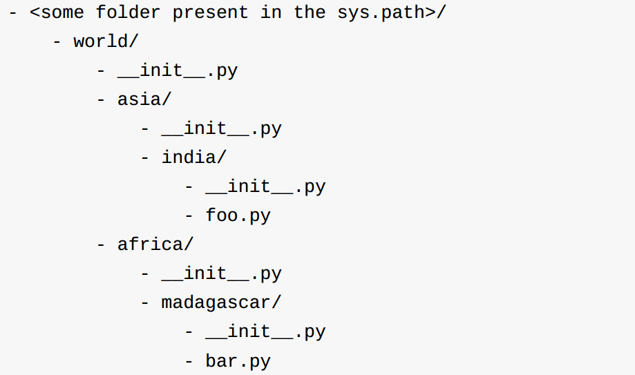
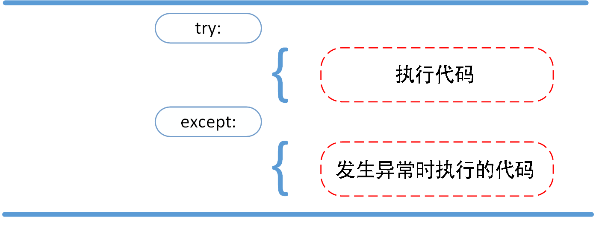
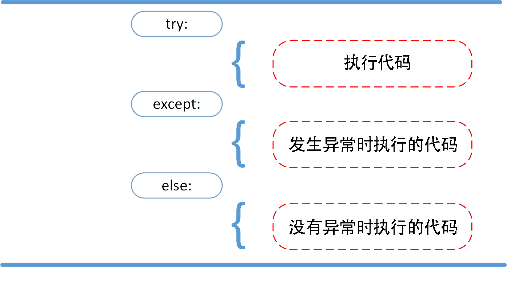
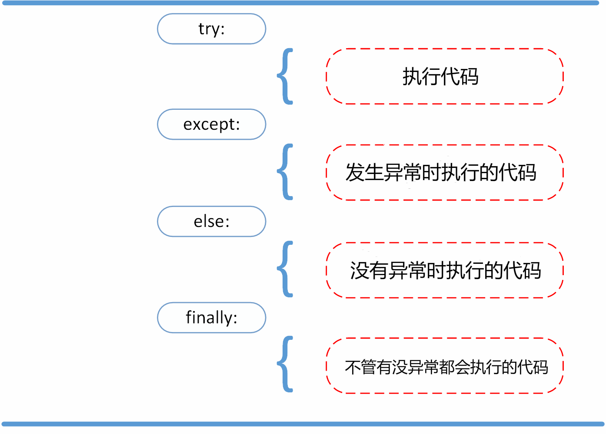
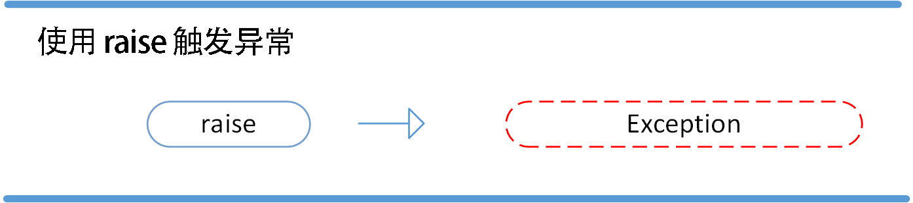
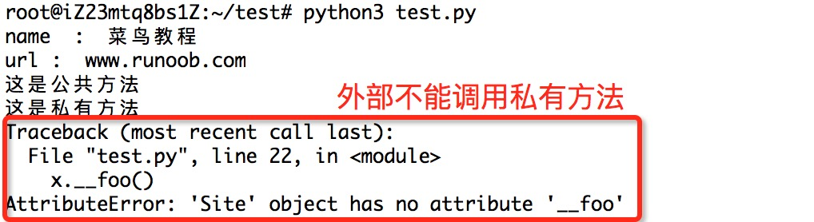

# Python快速入门手册

## 一.介绍

“Python库”包含几种不同类型的组件。它包含通常被认为是语言“核心”的一部分的数据类型，例如数字和列表。对于这些类型，Python语言核心定义了字面量的形式，并在它们的语义上放置了一些约束，但是没有完全定义语义。（另一方面，语言核心确定定义语法属性，如拼写和运算符的优先级。）该库还包含内置的函数和异常 ­ 可以由所有Python代码使用的对象，而不需要import语句。其中一些由核心语言定义，但是许多对于核心语义不是必需的，并且仅在这里描述。然而，库的大部分由模块的集合组成。有很多方法来剖析这个集合。一些模块用C编写，并内置到Python解释器中; 其他是用Python编写的，并以源代码形式导入。一些模块提供了高度特定于Python的接口，例如打印堆栈跟踪; 一些提供特定于特定操作系统的接口，例如对特定硬件的访问; 其他提供特定于特定应用领域的接口，例如万维网。一些模块可用于所有版本和Python的端口; 其他仅在底层系统支持或需要时可用; 还有一些只有在编译和安装Python时选择了特定的配置选项才可用。

本手册是“从内到外”：首先描述内置函数，数据类型和异常，最后是相关模块的章节中的模块。这意味着如果您从一开始就开始阅读本手册，并且当您感到无聊时，跳到下一章，您将获得Python库支持的可用模块和应用程序区域的合理概述。当然，你不要有像小说一样读它­你也可以浏览目录（在手册的前面），或者寻找在指数特定的功能，模块或长期（在后面）。最后，如果你喜欢学习随机主题，你可以选择一个随机页码（见模块 random）并阅读一两节。无论您阅读本手册各章节的顺序如何，都有助于从章节内置功能开始 ，因为本手册的其余部分假定您熟悉本教材。

## 二.数据结构

Python 中有四种内置的数据结构——列表（List） 、元组（Tuple） 、字典（Dictionary） 和集合（Set） 。

### 列表

列表 是一种用于保存一系列有序项目的集合，也就是说，你可以利用列表保存一串项目的序列。

#### 创建一个列表

只要把逗号分隔的不同的数据项使用方括号括起来即可。如下所示：

```plain
list1 = ['Google', 'Runoob', 1997, 2000];
list2 = [1, 2, 3, 4, 5 ];
list3 = ["a", "b", "c", "d"];
```

你可以对列表的数据项进行修改或更新，你也可以使用append()方法来添加列表项，如下所示：

```plain
list = ['Google', 'Runoob', 1997, 2000]
print ("第三个元素为 : ", list[2])
list[2] = 2001
print ("更新后的第三个元素为 : ", list[2])
```

输出结果为：

```plain
第三个元素为 :  1997
更新后的第三个元素为 :  2001
```

#### 将列表当做堆栈使用

列表方法使得列表可以很方便的作为一个堆栈来使用，堆栈作为特定的数据结构，最先进入的元素最后一个被释放（后进先出）。用 append() 方法可以把一个元素添加到堆栈顶。用不指定索引的 pop() 方法可以把一个元素从堆栈顶释放出来。例如：

```plain
>>> stack = [3, 4, 5]
>>> stack.append(6)
>>> stack.append(7)
>>> stack
[3, 4, 5, 6, 7]
>>> stack.pop()
7
>>> stack
[3, 4, 5, 6]
>>> stack.pop()
6
>>> stack.pop()
5
>>> stack
[3, 4]
```

#### 将列表当作队列使用

也可以把列表当做队列用，只是在队列里第一加入的元素，第一个取出来；但是拿列表用作这样的目的效率不高。在列表的最后添加或者弹出元素速度快，然而在列表里插入或者从头部弹出速度却不快（因为所有其他的元素都得一个一个地移动）。

```plain
>>> from collections import deque
>>> queue = deque(["Eric", "John", "Michael"])
>>> queue.append("Terry")           # Terry arrives
>>> queue.append("Graham")          # Graham arrives
>>> queue.popleft()                 # The first to arrive now leaves
'Eric'
>>> queue.popleft()                 # The second to arrive now leaves
'John'
>>> queue                           # Remaining queue in order of arrival
deque(['Michael', 'Terry', 'Graham'])
```

#### 列表对 + 和 * 的操作符

列表对 + 和 * 的操作符与字符串相似。+ 号用于组合列表，* 号用于重复列表。

如下所示：

| <br/>**Python 表达式** | <br/>**结果** | <br/>**描述** |
| :--- | :--- | :--- |
| <br/>len([1, 2, 3]) | <br/>3 | <br/>长度 |
| <br/>[1, 2, 3] + [4, 5, 6] | <br/>[1, 2, 3, 4, 5, 6] | <br/>组合 |
| <br/>['Hi!'] * 4 | <br/>['Hi!', 'Hi!', 'Hi!', 'Hi!'] | <br/>重复 |
| <br/>3 in [1, 2, 3] | <br/>True | <br/>元素是否存在于列表中 |
| <br/>for x in [1, 2, 3]: print(x, end=" ") | <br/>1 2 3 | <br/>迭代 |

#### 列表截取与字符串操作类型
```plain
L=['Google', 'Runoob', 'Taobao']
```

操作：

| <br/>**Python 表达式** | <br/>**结果** | <br/>**描述** |
| :--- | :--- | :--- |
| <br/>L[2] | <br/>'Taobao' | <br/>读取第三个元素 |
| <br/>L[-2] | <br/>'Runoob' | <br/>从右侧开始读取倒数第二个元素: count from the right |
| <br/>L[1:] | <br/>['Runoob', 'Taobao'] | <br/>输出从第二个元素开始后的所有元素 |

#### 遍历

在序列中遍历时，索引位置和对应值可以使用 enumerate() 函数同时得到：

```plain
>>> for i, v in enumerate(['tic', 'tac', 'toe']):
...     print(i, v)
...
0 tic
1 tac
2 toe
```

同时遍历两个或更多的序列，可以使用 zip() 组合：

```plain
>>> questions = ['name', 'quest', 'favorite color']
>>> answers = ['lancelot', 'the holy grail', 'blue']
>>> for q, a in zip(questions, answers):
...     print('What is your {0}?  It is {1}.'.format(q, a))
...
What is your name?  It is lancelot.
What is your quest?  It is the holy grail.
What is your favorite color?  It is blue.
```

要反向遍历一个序列，首先指定这个序列，然后调用 reversed() 函数：

```plain
>>> for i in reversed(range(1, 10, 2)):
...     print(i)
...
9
7
5
3
1
```

要按顺序遍历一个序列，使用 sorted() 函数返回一个已排序的序列，并不修改原值：

```plain
>>> basket = ['apple', 'orange', 'apple', 'pear', 'orange', 'banana']
>>> for f in sorted(set(basket)):
...     print(f)
...
apple
banana
orange
pear
```

#### 列表函数&方法

Python包含以下函数:

| <br/>**序号** | <br/>**函数** |
| :--- | :--- |
| <br/>1 | <br/>[len(list)](https://www.runoob.com/python3/python3-att-list-len.html)<br/>列表元素个数 |
| <br/>2 | <br/>[max(list)](https://www.runoob.com/python3/python3-att-list-max.html)<br/>返回列表元素最大值 |
| <br/>3 | <br/>[min(list)](https://www.runoob.com/python3/python3-att-list-min.html)<br/>返回列表元素最小值 |
| <br/>4 | <br/>[list(seq)](https://www.runoob.com/python3/python3-att-list-list.html)<br/>将元组转换为列表 |

Python包含以下方法:

| <br/>**序号** | <br/>**方法** |
| :--- | :--- |
| <br/>1 | <br/>[list.append(obj)](https://www.runoob.com/python3/python3-att-list-append.html)<br/>在列表末尾添加新的对象 |
| <br/>2 | <br/>[list.count(obj)](https://www.runoob.com/python3/python3-att-list-count.html)<br/>统计某个元素在列表中出现的次数 |
| <br/>3 | <br/>[list.extend(seq)](https://www.runoob.com/python3/python3-att-list-extend.html)<br/>在列表末尾一次性追加另一个序列中的多个值（用新列表扩展原来的列表） |
| <br/>4 | <br/>[list.index(obj)](https://www.runoob.com/python3/python3-att-list-index.html)<br/>从列表中找出某个值第一个匹配项的索引位置 |
| <br/>5 | <br/>[list.insert(index, obj)](https://www.runoob.com/python3/python3-att-list-insert.html)<br/>将对象插入列表 |
| <br/>6 | <br/>[list.pop([index=-1])](https://www.runoob.com/python3/python3-att-list-pop.html)<br/>移除列表中的一个元素（默认最后一个元素），并且返回该元素的值 |
| <br/>7 | <br/>[list.remove(obj)](https://www.runoob.com/python3/python3-att-list-remove.html)<br/>移除列表中某个值的第一个匹配项 |
| <br/>8 | <br/>[list.reverse()](https://www.runoob.com/python3/python3-att-list-reverse.html)<br/>反向列表中元素 |
| <br/>9 | <br/>[list.sort( key=None, reverse=False)](https://www.runoob.com/python3/python3-att-list-sort.html)<br/>对原列表进行排序 |
| <br/>10 | <br/>[list.clear()](https://www.runoob.com/python3/python3-att-list-clear.html)<br/>清空列表 |
| <br/>11 | <br/>[list.copy()](https://www.runoob.com/python3/python3-att-list-copy.html)<br/>复制列表 |

### 元组

元组（Tuple） 用于将多个对象保存到一起。你可以将它们近似地看作列表，但是元组不能提供列表类能够提供给你的广泛的功能。元组的一大特征类似于字符串，它们是不可变的，也就是说，你不能编辑或更改元组。

元组是通过特别指定项目来定义的，在指定项目时，你可以给它们加上括号，并在括号内部用逗号进行分隔。

元组通常用于保证某一语句或某一用户定义的函数可以安全地采用一组数值，意即元组内的数值不会改变。

Python 的元组与列表类似，不同之处在于元组的元素不能修改。

元组使用小括号，列表使用方括号。

元组创建很简单，只需要在括号中添加元素，并使用逗号隔开即可。

```plain
>>>tup1 = ('Google', 'Runoob', 1997, 2000)
>>> tup2 = (1, 2, 3, 4, 5 )
>>> tup3 = "a", "b", "c", "d"   #  不需要括号也可以
>>> type(tup3)
<class 'tuple'>
```

元组中只包含一个元素时，需要在元素后面添加逗号，否则括号会被当作运算符使用：

```plain
>>>tup1 = (50)
>>> type(tup1)     # 不加逗号，类型为整型
<class 'int'>

>>> tup1 = (50,)
>>> type(tup1)     # 加上逗号，类型为元组
<class 'tuple'>
```

元组可以使用下标索引来访问元组中的值，如下实例:

```plain
tup1 = ('Google', 'Runoob', 1997, 2000)
tup2 = (1, 2, 3, 4, 5, 6, 7 )
print ("tup1[0]: ", tup1[0])
print ("tup2[1:5]: ", tup2[1:5])
```

元组中的元素值是不允许修改的，但我们可以对元组进行连接组合，如下实例:

```plain
tup1 = (12, 34.56)
tup2 = ('abc', 'xyz')
# 以下修改元组元素操作是非法的。
# tup1[0] = 100
# 创建一个新的元组
tup3 = tup1 + tup2print (tup3)
```

以上实例输出结果：

```plain
(12, 34.56, 'abc', 'xyz')
```

元组中的元素值是不允许删除的，但我们可以使用del语句来删除整个元组，如下实例:

```plain
tup = ('Google', 'Runoob', 1997, 2000)
print (tup)del tupprint ("删除后的元组 tup : ")
print (tup)
```

#### 元组运算符

与字符串一样，元组之间可以使用 + 号和 * 号进行运算。这就意味着他们可以组合和复制，运算后会生成一个新的元组。

| <br/>**Python 表达式** | <br/>**结果** | <br/>**描述** |
| :--- | :--- | :--- |
| <br/>len((1, 2, 3)) | <br/>3 | <br/>计算元素个数 |
| <br/>(1, 2, 3) + (4, 5, 6) | <br/>(1, 2, 3, 4, 5, 6) | <br/>连接 |
| <br/>('Hi!',) * 4 | <br/>('Hi!', 'Hi!', 'Hi!', 'Hi!') | <br/>复制 |
| <br/>3 in (1, 2, 3) | <br/>True | <br/>元素是否存在 |
| <br/>for x in (1, 2, 3): print (x,) | <br/>1 2 3 | <br/>迭代 |

#### 元组索引，截取

因为元组也是一个序列，所以我们可以访问元组中的指定位置的元素，也可以截取索引中的一段元素，如下所示：

元组：

```plain
L = ('Google', 'Taobao', 'Runoob')
```

| <br/>**Python 表达式** | <br/>**结果** | <br/>**描述** |
| :--- | :--- | :--- |
| <br/>L[2] | <br/>'Runoob' | <br/>读取第三个元素 |
| <br/>L[-2] | <br/>'Taobao' | <br/>反向读取，读取倒数第二个元素 |
| <br/>L[1:] | <br/>('Taobao', 'Runoob') | <br/>截取元素，从第二个开始后的所有元素。 |

#### 元组内置函数

| <br/>**序号** | <br/>**方法及描述** | <br/>**实例** |
| :--- | :--- | :--- |
| <br/>1 | <br/>len(tuple)<br/>计算元组元素个数。 | <br/>>>> tuple1 = ('Google', 'Runoob', 'Taobao')>>> len(tuple1)3>>>  |
| <br/>2 | <br/>max(tuple)<br/>返回元组中元素最大值。 | <br/>>>> tuple2 = ('5', '4', '8')>>> max(tuple2)'8'>>>  |
| <br/>3 | <br/>min(tuple)<br/>返回元组中元素最小值。 | <br/>>>> tuple2 = ('5', '4', '8')>>> min(tuple2)'4'>>>  |
| <br/>4 | <br/>tuple(seq)<br/>将列表转换为元组。 | <br/>>>> list1= ['Google', 'Taobao', 'Runoob', 'Baidu']>>> tuple1=tuple(list1)>>> tuple1<br/>('Google', 'Taobao', 'Runoob', 'Baidu') |

#### 关于元组是不可变的

所谓元组的不可变指的是元组所指向的内存中的内容不可变。

```plain
>>> tup = ('r', 'u', 'n', 'o', 'o', 'b')
>>> tup[0] = 'g'     # 不支持修改元素
Traceback (most recent call last):
  File "<stdin>", line 1, in <module>
TypeError: 'tuple' object does not support item assignment
>>> id(tup)     # 查看内存地址
4440687904
>>> tup = (1,2,3)
>>> id(tup)
4441088800    # 内存地址不一样了
```

### 字典

在字典中，你可以通过使用符号构成 d = {key : value1 , key2 : value2} 这样的形式，来成对地指定键值与值。在这里要注意到成对的键值与值之间使用冒号分隔，而每一对键值与值则使用逗号进行区分，它们全都由一对花括号括起。

```plain
ab = {
    'Swaroop': 'swaroop@swaroopch.com',
    'Larry': 'larry@wall.org',
    'Matsumoto': 'matz@ruby-lang.org',
    'Spammer': 'spammer@hotmail.com'
    }
print("Swaroop's address is", ab['Swaroop'])
# 删除一对键值—值配对
del ab['Spammer']
print('\nThere are {} contacts in the address-book\n'.format(len(ab)))
for name, address in ab.items():
    print('Contact {} at {}'.format(name, address))
# 添加一对键值—值配对
ab['Guido'] = 'guido@python.org'
if 'Guido' in ab:
    print("\nGuido's address is", ab['Guido'])
```

键必须是唯一的，但值则不必。

值可以取任何数据类型，但键必须是不可变的，如字符串，数字或元组。

一个简单的字典实例：

```plain
dict = {'Alice': '2341', 'Beth': '9102', 'Cecil': '3258'}
```

#### 访问字典里的值

把相应的键放入到方括号中，如下实例:

```plain
dict = {'Name': 'Runoob', 'Age': 7, 'Class': 'First'}
print ("dict['Name']: ", dict['Name'])print ("dict['Age']: ", dict['Age'])
```

#### 修改字典

向字典添加新内容的方法是增加新的键/值对，修改或删除已有键/值对如下实例:

```plain
dict = {'Name': 'Runoob', 'Age': 7, 'Class': 'First'}
dict['Age'] = 8               # 更新 Age
dict['School'] = "菜鸟教程"  # 添加信息
print ("dict['Age']: ", dict['Age'])
print ("dict['School']: ", dict['School'])
```

#### 删除字典元素

能删单一的元素也能清空字典，清空只需一项操作。

显示删除一个字典用del命令，如下实例：

```plain
dict = {'Name': 'Runoob', 'Age': 7, 'Class': 'First'}

del dict['Name'] # 删除键 'Name'
dict.clear()     # 清空字典
del dict         # 删除字典
print ("dict['Age']: ", dict['Age'])
print ("dict['School']: ", dict['School'])
```

但这会引发一个异常，因为用执行 del 操作后字典不再存在。

#### 字典键的特性

字典值可以是任何的 python 对象，既可以是标准的对象，也可以是用户定义的，但键不行。

两个重要的点需要记住：

1. 不允许同一个键出现两次。创建时如果同一个键被赋值两次，后一个值会被记住。
2. 键必须不可变，所以可以用数字，字符串或元组充当，而用列表就不行。

#### 遍历技巧

在字典中遍历时，关键字和对应的值可以使用 items() 方法同时解读出来：

```plain
>>> knights = {'gallahad': 'the pure', 'robin': 'the brave'}
>>> for k, v in knights.items():
...     print(k, v)
...
gallahad the pure
robin the brave
```

#### 字典内置函数&方法

Python字典包含了以下内置函数：

| <br/>**序号** | <br/>**函数及描述** | <br/>**实例** |
| :--- | :--- | :--- |
| <br/>1 | <br/>len(dict)<br/>计算字典元素个数，即键的总数。 | <br/>>>> dict = {'Name': 'Runoob', 'Age': 7, 'Class': 'First'}>>> len(dict)3 |
| <br/>2 | <br/>str(dict)<br/>输出字典，以可打印的字符串表示。 | <br/>>>> dict = {'Name': 'Runoob', 'Age': 7, 'Class': 'First'}>>> str(dict)"{'Name': 'Runoob', 'Class': 'First', 'Age': 7}" |
| <br/>3 | <br/>type(variable)<br/>返回输入的变量类型，如果变量是字典就返回字典类型。 | <br/>>>> dict = {'Name': 'Runoob', 'Age': 7, 'Class': 'First'}>>> type(dict)<class 'dict'> |

Python字典包含了以下内置方法：

| <br/>**序号** | <br/>**函数及描述** |
| :--- | :--- |
| <br/>1 | <br/>[radiansdict.clear()](https://www.runoob.com/python3/python3-att-dictionary-clear.html)<br/>删除字典内所有元素 |
| <br/>2 | <br/>[radiansdict.copy()](https://www.runoob.com/python3/python3-att-dictionary-copy.html)<br/>返回一个字典的浅复制 |
| <br/>3 | <br/>[radiansdict.fromkeys()](https://www.runoob.com/python3/python3-att-dictionary-fromkeys.html)<br/>创建一个新字典，以序列seq中元素做字典的键，val为字典所有键对应的初始值 |
| <br/>4 | <br/>[radiansdict.get(key, default=None)](https://www.runoob.com/python3/python3-att-dictionary-get.html)<br/>返回指定键的值，如果值不在字典中返回default值 |
| <br/>5 | <br/>[key in dict](https://www.runoob.com/python3/python3-att-dictionary-in.html)<br/>如果键在字典dict里返回true，否则返回false |
| <br/>6 | <br/>[radiansdict.items()](https://www.runoob.com/python3/python3-att-dictionary-items.html)<br/>以列表返回可遍历的(键, 值) 元组数组 |
| <br/>7 | <br/>[radiansdict.keys()](https://www.runoob.com/python3/python3-att-dictionary-keys.html)<br/>返回一个迭代器，可以使用 list() 来转换为列表 |
| <br/>8 | <br/>[radiansdict.setdefault(key, default=None)](https://www.runoob.com/python3/python3-att-dictionary-setdefault.html)<br/>和get()类似, 但如果键不存在于字典中，将会添加键并将值设为default |
| <br/>9 | <br/>[radiansdict.update(dict2)](https://www.runoob.com/python3/python3-att-dictionary-update.html)<br/>把字典dict2的键/值对更新到dict里 |
| <br/>10 | <br/>[radiansdict.values()](https://www.runoob.com/python3/python3-att-dictionary-values.html)<br/>返回一个迭代器，可以使用 list() 来转换为列表 |
| <br/>11 | <br/>[pop(key[,default])](https://www.runoob.com/python3/python3-att-dictionary-pop.html)<br/>删除字典给定键 key 所对应的值，返回值为被删除的值。key值必须给出。 否则，返回default值。 |
| <br/>12 | <br/>[popitem()](https://www.runoob.com/python3/python3-att-dictionary-popitem.html)<br/>随机返回并删除字典中的最后一对键和值。 |

### 序列

```plain
shoplist = ['apple', 'mango', 'carrot', 'banana']
name = 'swaroop'
# Indexing or 'Subscription' operation #
# 索引或“下标（Subscription） ”操作符 #
print('Item 0 is', shoplist[0])
print('Item 1 is', shoplist[1])
print('Item 2 is', shoplist[2])
print('Item 3 is', shoplist[3])
print('Item -1 is', shoplist[-1])
print('Item -2 is', shoplist[-2])
print('Character 0 is', name[0])
# Slicing on a list #
print('Item 1 to 3 is', shoplist[1:3])
print('Item 2 to end is', shoplist[2:])
print('Item 1 to -1 is', shoplist[1:-1])
print('Item start to end is', shoplist[:])
# 从某一字符串中切片 #
print('characters 1 to 3 is', name[1:3])
print('characters 2 to end is', name[2:])
print('characters 1 to -1 is', name[1:-1])
print('characters start to end is', name[:])
```

### 集合

集合（Set） 是简单对象的无序集合（Collection） 。当集合中的项目存在与否比起次序或其出现次数更加重要时，我们就会使用集合。

通过使用集合，你可以测试某些对象的资格或情况，检查它们是否是其它集合的子集，找到两个集合的交集，等等。

集合（set）是一个无序的不重复元素序列。可以使用大括号 { } 或者 set() 函数创建集合，注意：创建一个空集合必须用 set() 而不是 { }，因为 { } 是用来创建一个空字典。创建格式：

```plain
parame = {value01,value02,...}
# 或者
set(value)
```

```plain
>>>basket = {'apple', 'orange', 'apple', 'pear', 'orange', 'banana'}
>>> print(basket)                      # 这里演示的是去重功能
{'orange', 'banana', 'pear', 'apple'}
>>> 'orange' in basket                 # 快速判断元素是否在集合内
True
>>> 'crabgrass' in basket
False

>>> # 下面展示两个集合间的运算.
...
>>> a = set('abracadabra')
>>> b = set('alacazam')
>>> a
{'a', 'r', 'b', 'c', 'd'}
>>> a - b                              # 集合a中包含而集合b中不包含的元素
{'r', 'd', 'b'}
>>> a | b                              # 集合a或b中包含的所有元素
{'a', 'c', 'r', 'd', 'b', 'm', 'z', 'l'}
>>> a & b                              # 集合a和b中都包含了的元素
{'a', 'c'}
>>> a ^ b                              # 不同时包含于a和b的元素
{'r', 'd', 'b', 'm', 'z', 'l'}
```

#### 集合的基本操作
##### 1、添加元素

s.add( x )将元素 x 添加到集合 s 中，如果元素已存在，则不进行任何操作。

```plain
>>>thisset = set(("Google", "Runoob", "Taobao"))
>>> thisset.add("Facebook")
>>> print(thisset)
{'Taobao', 'Facebook', 'Google', 'Runoob'}
```

还有一个方法，也可以添加元素，且参数可以是列表，元组，字典等，语法格式：s.update( x )，x 可以有多个，用逗号分开。

```plain
>>>thisset = set(("Google", "Runoob", "Taobao"))
>>> thisset.update({1,3})
>>> print(thisset)
{1, 3, 'Google', 'Taobao', 'Runoob'}
>>> thisset.update([1,4],[5,6])
>>> print(thisset)
{1, 3, 4, 5, 6, 'Google', 'Taobao', 'Runoob'}
>>>
```

##### 2、移除元素

s.remove( x )将元素 x 从集合 s 中移除，如果元素不存在，则会发生错误。

```plain
>>>thisset = set(("Google", "Runoob", "Taobao"))
>>> thisset.remove("Taobao")
>>> print(thisset)
{'Google', 'Runoob'}
>>> thisset.remove("Facebook")   # 不存在会发生错误Traceback (most recent call last):
  File "<stdin>", line 1, in <module>
KeyError: 'Facebook'
>>>
```

此外还有一个方法也是移除集合中的元素，且如果元素不存在，不会发生错误。格式：s.discard( x )。

```plain
>>>thisset = set(("Google", "Runoob", "Taobao"))
>>> thisset.discard("Facebook")  # 不存在不会发生错误
>>> print(thisset)
{'Taobao', 'Google', 'Runoob'}
```

我们也可以设置随机删除集合中的一个元素：s.pop() 。

```plain
thisset = set(("Google", "Runoob", "Taobao", "Facebook"))
x = thisset.pop()
print(x)
```

set 集合的 pop 方法会对集合进行无序的排列，然后将这个无序排列集合的左面第一个元素进行删除。

##### 3、计算集合元素个数

len(s)计算集合 s 元素个数。

```plain
>>>thisset = set(("Google", "Runoob", "Taobao"))
>>> len(thisset)
3
```

##### 4、清空集合
```plain
s.clear()#清空集合 s。
```

```plain
>>>thisset = set(("Google", "Runoob", "Taobao"))
>>> thisset.clear()
>>> print(thisset)
set()
```

##### 5、判断元素是否在集合中存在

x in s判断元素 x 是否在集合 s 中，存在返回 True，不存在返回 False。

```plain
>>>thisset = set(("Google", "Runoob", "Taobao"))
>>> "Runoob" in thissetTrue
>>> "Facebook" in thissetFalse
>>>
```

#### 集合内置方法完整列表

| <br/>**方法** | <br/>**描述** |
| :--- | :--- |
| <br/>[add()](https://www.runoob.com/python3/ref-set-add.html) | <br/>为集合添加元素 |
| <br/>[clear()](https://www.runoob.com/python3/ref-set-clear.html) | <br/>移除集合中的所有元素 |
| <br/>[copy()](https://www.runoob.com/python3/ref-set-copy.html) | <br/>拷贝一个集合 |
| <br/>[difference()](https://www.runoob.com/python3/ref-set-difference.html) | <br/>返回多个集合的差集 |
| <br/>[difference_update()](https://www.runoob.com/python3/ref-set-difference_update.html) | <br/>移除集合中的元素，该元素在指定的集合也存在。 |
| <br/>[discard()](https://www.runoob.com/python3/ref-set-discard.html) | <br/>删除集合中指定的元素 |
| <br/>[intersection()](https://www.runoob.com/python3/ref-set-intersection.html) | <br/>返回集合的交集 |
| <br/>[intersection_update()](https://www.runoob.com/python3/ref-set-intersection_update.html) | <br/>返回集合的交集。 |
| <br/>[isdisjoint()](https://www.runoob.com/python3/ref-set-isdisjoint.html) | <br/>判断两个集合是否包含相同的元素，如果没有返回 True，否则返回 False。 |
| <br/>[issubset()](https://www.runoob.com/python3/ref-set-issubset.html) | <br/>判断指定集合是否为该方法参数集合的子集。 |
| <br/>[issuperset()](https://www.runoob.com/python3/ref-set-issuperset.html) | <br/>判断该方法的参数集合是否为指定集合的子集 |
| <br/>[pop()](https://www.runoob.com/python3/ref-set-pop.html) | <br/>随机移除元素 |
| <br/>[remove()](https://www.runoob.com/python3/ref-set-remove.html) | <br/>移除指定元素 |
| <br/>[symmetric_difference()](https://www.runoob.com/python3/ref-set-symmetric_difference.html) | <br/>返回两个集合中不重复的元素集合。 |
| <br/>[symmetric_difference_update()](https://www.runoob.com/python3/ref-set-symmetric_difference_update.html) | <br/>移除当前集合中在另外一个指定集合相同的元素，并将另外一个指定集合中不同的元素插入到当前集合中。 |
| <br/>[union()](https://www.runoob.com/python3/ref-set-union.html) | <br/>返回两个集合的并集 |
| <br/>[update()](https://www.runoob.com/python3/ref-set-update.html) | <br/>给集合添加元素 |

## 三.格式化方法

有时候我们会想要从其他信息中构建字符串。这正是 format() 方法大有用武之地的地方。

```plain
age = 20
name = 'Swaroop'
print('{0} was {1} years old when he wrote this book'.format(name, age))
print('Why is {0} playing with that python?'.format(name))
```

输出：

```plain
Swaroop was 20 years old when he wrote this book
Why is Swaroop playing with that python?
```

```plain
# 对于浮点数 '0.333' 保留小数点(.)后三位
print('{0:.3f}'.format(1.0/3))
# 使用下划线填充文本，并保持文字处于中间位置
# 使用 (^) 定义 '___hello___'字符串长度为 11
print('{0:_^11}'.format('hello'))
# 基于关键词输出 'Swaroop wrote A Byte of Python'
print('{name} wrote {book}'.format(name='Swaroop', book='A Byte of Python'))
```

## 四.IF语句

ython中if语句的一般形式如下所示：

```plain
if condition_1:
    statement_block_1elif condition_2:
    statement_block_2else:
    statement_block_3
```

```plain
number = 23
guess = int(input('Enter an integer : '))
if guess == number:
    # 新块从这里开始
    print('Congratulations, you guessed it.')
    print('(but you do not win any prizes!)')
    # 新块在这里结束
    elif guess < number:
        # 另一代码块
        print('No, it is a little higher than that')
        # 你可以在此做任何你希望在该代码块内进行的事情
    else:
        print('No, it is a little lower than that')
        # 你必须通过猜测一个大于（>） 设置数的数字来到达这里。print('Done')
# 这最后一句语句将在
# if 语句执行完毕后执行。
```

## 五.while 语句
```plain
number = 23
running = True
while running:
    guess = int(input('Enter an integer : '))
    if guess == number:
        print('Congratulations, you guessed it.')
        # 这将导致 while 循环中止
        running = False
    elif guess < number:
        print('No, it is a little higher than that.')
    else:
        print('No, it is a little lower than that.')
    else:
    print('The while loop is over.')
    # 在这里你可以做你想做的任何事
print('Done')
```

while 循环使用 else 语句：在 while … else 在条件语句为 false 时执行 else 的语句块。语法格式如下：

语法格式如下：

```plain
while <expr>:
    <statement(s)>
else:
    <additional_statement(s)>
```

```plain
count = 0
while count < 5:
   print (count, " 小于 5")count = count + 1
else:
   print (count, " 大于或等于 5")
```

## 六.for 循环

Python for循环可以遍历任何序列的项目，如一个列表或者一个字符串。

for循环的一般格式如下：

```plain
for <variable> in <sequence>:
    <statements>
else:
    <statements>
```

range()函数：如果你需要遍历数字序列，可以使用内置range()函数。它会生成数列。

```plain
>>>for i in range(5):
...     print(i)
...
0
1
2
3
4
```

```plain
for i in range(1, 5):
    print(i)
    else:
        print('The for loop is over')
```

以下 for 实例中使用了 break 语句，break 语句用于跳出当前循环体：

```plain
#!/usr/bin/python3
sites = ["Baidu", "Google","Runoob","Taobao"]
for site in sites:
    if site == "Runoob":
        print("菜鸟教程!")
        break
        print("循环数据 " + site)
    else:
        print("没有循环数据!")
print("完成循环!")
```

## 七.break 语句

break 语句可以跳出 for 和 while 的循环体。如果你从 for 或 while 循环中终止，任何对应的循环 else 块将不执行。

```plain
while True:
    s = input('Enter something : ')
    if s == 'quit':
        break
    print('Length of the string is', len(s))
print('Done')
```

## 八.continue 语句

continue 语句被用来告诉 Python 跳过当前循环块中的剩余语句，然后继续进行下一轮循环。

```plain
while True:
s = input('Enter something : ')
if s == 'quit':
break
if len(s) < 3:
print('Too small')
continue
print('Input is of sufficient length')
# 自此处起继续进行其它任何处理
```

循环语句可以有 else 子句，它在穷尽列表（以for循环）或条件变为 false (以while循环)导致循环终止时被执行，但循环被 break 终止时不执行。

## 九.函数

函数可以通过关键字 def 来定义。这一关键字后跟一个函数的标识符名称，再跟一对圆括号，其中可以包括一些变量的名称，再以冒号结尾，结束这一行。随后而来的语句块是函数的一部分。下面的案例将会展示出这其实非常简单：

```plain
def say_hello():
    # 该块属于这一函数
    print('hello world')
# 函数结束
say_hello() # 调用函数
say_hello() # 再次调用函数
```

### 函数参数

函数中的参数通过将其放置在用以定义函数的一对圆括号中指定，并通过逗号予以分隔。当我们调用函数时，我们以同样的形式提供需要的值。要注意在此使用的术语——在定义函数时给定的名称称作“形参”（Parameters） ，在调用函数时你所提供给函数的值称作“实参”（Arguments） 。

```plain
def print_max(a, b):
    if a > b:
        print(a, 'is maximum')
    elif a == b:
        print(a, 'is equal to', b)
    else:
        print(b, 'is maximum')
# 直接传递字面值
print_max(3, 4)
x = 5
y = 7
# 以参数的形式传递变量
print_max(x, y)
```

### 局部变量

当你在一个函数的定义中声明变量时，它们不会以任何方式与身处函数之外但具有相同名称的变量产生关系，也就是说，这些变量名只存在于函数这一局部（Local） 。这被称为变量的作用域（Scope） 。所有变量的作用域是它们被定义的块，从定义它们的名字的定义点开始。

```plain
x = 50
def func(x):
    print('x is', x)
    x = 2
    print('Changed local x to', x)
func(x)
print('x is still', x)
```

### global 语句

如果你想给一个在程序顶层的变量赋值（也就是说它不存在于任何作用域中，无论是函数还是类） ，那么你必须告诉 Python 这一变量并非局部的，而是全局（Global） 的。我们需要通过 global 语句来完成这件事。因为在不使用 global 语句的情况下，不可能为一个定义于函数之外的变量赋值。

你可以使用定义于函数之外的变量的值（假设函数中没有具有相同名字的变量） 。然而，这种方式不会受到鼓励而且应该避免，因为它对于程序的读者来说是含糊不清的，无法弄清楚变量的定义究竟在哪。而通过使用 global 语句便可清楚看出这一变量是在最外边的代码块中定义的。

```plain
x = 50
def func():
    global x
    print('x is', x)
    x = 2
    print('Changed global x to', x)
func()
print('Value of x is', x)
```

global 语句用以声明 x 是一个全局变量——因此，当我们在函数中为 x 进行赋值时，这一改动将影响到我们在主代码块中使用的 x 的值。你可以在同一句 global 语句中指定不止一个的全局变量，例如 global x, y, z 。

### 关键字参数

如果你有一些具有许多参数的函数，而你又希望只对其中的一些进行指定，那么你可以通过命名它们来给这些参数赋值——这就是关键字参数（Keyword Arguments） ——我们使用命名（关键字） 而非位置（一直以来我们所使用的方式） 来指定函数中的参数。这样做有两大优点——其一，我们不再需要考虑参数的顺序，函数的使用将更加容易。其二，我们可以只对那些我们希望赋予的参数以赋值，只要其它的参数都具有默认参数值。

```plain
def func(a, b=5, c=10):
    print('a is', a, 'and b is', b, 'and c is', c)
func(3, 7)
func(25, c=24)
func(c=50, a=100)
```

### 可变参数

有时你可能想定义的函数里面能够有任意数量的变量，也就是参数数量是可变的，这可以通过使用星号来实现 。

```plain
def total(a=5, *numbers, **phonebook):
    print('a', a)
#遍历元组中的所有项目
    for single_item in numbers:
        print('single_item', single_item)
#遍历字典中的所有项目
    for first_part, second_part in phonebook.items():
        print(first_part,second_part)
print(total(10,1,2,3,Jack=1123,John=2231,Inge=1560))
```

## 十.return 语句

return 语句用于从函数中返回，也就是中断函数。我们也可以选择在中断函数时从函数中返回一个值。

```plain
def maximum(x, y):
    if x > y:
        return x
    elif x == y:
        return 'The numbers are equal'
    else:
        return y
print(maximum(2, 3))
```

## 十一.DocStrings

Python 有一个甚是优美的功能称作文档字符串（Documentation Strings） ，在称呼它时通常会使用另一个短一些的名字docstrings。DocStrings 是一款你应当使用的重要工具，它能够帮助你更好地记录程序并让其更加易于理解。令人惊叹的是，当程序实际运行时，我们甚至可以通过一个函数来获取文档！

```plain
def print_max(x, y):
    '''打印两个数值中的最大数。
    这两个数都应该是整数'''
    # 如果可能，将其转换至整数类型
    x = int(x)
    y = int(y)
    if x > y:
        print(x, 'is maximum')
    else:
        print(y, 'is maximum')
print_max(3, 5)
print(print_max.__doc__)
```

## 十二.模块

模块是一个包含所有你定义的函数和变量的文件，其后缀名是.py。模块可以被别的程序引入，以使用该模块中的函数等功能。这也是使用 python 标准库的方法。

下面是一个使用 python 标准库中模块的例子。

```plain
import sys
print('The command line arguments are:')
for i in sys.argv:
    print(i)
print('\n\nThe PYTHONPATH is', sys.path, '\n')
```

### from..import 语句

如果你希望直接将 argv 变量导入你的程序（为了避免每次都要输入 sys. ） ，那么你可以通过使用 from sys import argv 语句来实现这一点。

```plain
from math import sqrt
print("Square root of 16 is", sqrt(16))
```

### 模块的 __name__ 属性

一个模块被另一个程序第一次引入时，其主程序将运行。如果我们想在模块被引入时，模块中的某一程序块不执行，我们可以用__name__属性来使该程序块仅在该模块自身运行时执行。

```plain
if __name__ == '__main__':
print('This program is being run by itself')
else:
print('I am being imported from another module')
```

每一个 Python 模块都定义了它的 __name__ 属性。如果它与 __main__ 属性相同则代表这一模块是由用户独立运行的，因此我们便可以采取适当的行动。

## 十三.dir 函数

内置的 dir() 函数能够返回由对象所定义的名称列表。 如果这一对象是一个模块，则该列表会包括函数内所定义的函数、类与变量。该函数接受参数。 如果参数是模块名称，函数将返回这一指定模块的名称列表。 如果没有提供参数，函数将返回当前模块的名称列表。

## 十四.包

包是指一个包含模块与一个特殊的 __init__.py 文件的文件夹，后者向 Python 表明这一文件夹是特别的，因为其包含了 Python 模块。

创建一个名为“world”的包，其中还包含着 “asia”、“africa”等其它子包，同时这些子包都包含了诸如“india”、 “madagascar”等模块。 下面构建出的文件夹的结构：



## 十五.迭代器与生成器
### 迭代器

迭代是Python最强大的功能之一，是访问集合元素的一种方式。

迭代器是一个可以记住遍历的位置的对象。

迭代器对象从集合的第一个元素开始访问，直到所有的元素被访问完结束。迭代器只能往前不会后退。

迭代器有两个基本的方法：iter() 和 next()。

字符串，列表或元组对象都可用于创建迭代器：

```plain
>>> list=[1,2,3,4]
>>> it = iter(list)    # 创建迭代器对象
>>> print (next(it))   # 输出迭代器的下一个元素
1
>>> print (next(it))
2
>>>
```

迭代器对象可以使用常规for语句进行遍历：

```plain
list=[1,2,3,4]
it = iter(list)
# 创建迭代器对象
for x in it:
    print (x, end=" ")
```

也可以使用 next() 函数：

```plain
import sys         # 引入 sys 模块
list=[1,2,3,4]
it = iter(list)    # 创建迭代器对象
while True:
    try:
        print (next(it))except StopIteration:
        sys.exit()
```

#### 创建一个迭代器

把一个类作为一个迭代器使用需要在类中实现两个方法 __iter__() 与 __next__() 。

如果你已经了解的面向对象编程，就知道类都有一个构造函数，Python 的构造函数为 __init__(), 它会在对象初始化的时候执行。

更多内容查阅：[Python3 面向对象](https://www.runoob.com/python3/python3-class.html)

__iter__() 方法返回一个特殊的迭代器对象， 这个迭代器对象实现了 __next__() 方法并通过 StopIteration 异常标识迭代的完成。

__next__() 方法（Python 2 里是 next()）会返回下一个迭代器对象。

创建一个返回数字的迭代器，初始值为 1，逐步递增 1：

```plain
class MyNumbers:
    def __iter__(self):
        self.a = 1
        return self
    def __next__(self):
        x = self.a
        self.a += 1
        return x
myclass = MyNumbers()
myiter = iter(myclass)
print(next(myiter))
print(next(myiter))
print(next(myiter))
print(next(myiter))
print(next(myiter))
```

StopIteration 异常用于标识迭代的完成，防止出现无限循环的情况，在 __next__() 方法中我们可以设置在完成指定循环次数后触发 StopIteration 异常来结束迭代。

在 20 次迭代后停止执行：

```plain
class MyNumbers:
  def __iter__(self):
    self.a = 1
    return self

    def __next__(self):
    if self.a <= 20:
        x = self.a
        self.a += 1
        return x
    else:
        raise StopIteration
myclass = MyNumbers()
myiter = iter(myclass)
for x in myiter:
    print(x)
```

### 生成器

在 Python 中，使用了 yield 的函数被称为生成器（generator）。

跟普通函数不同的是，生成器是一个返回迭代器的函数，只能用于迭代操作，更简单点理解生成器就是一个迭代器。

在调用生成器运行的过程中，每次遇到 yield 时函数会暂停并保存当前所有的运行信息，返回 yield 的值, 并在下一次执行 next() 方法时从当前位置继续运行。

调用一个生成器函数，返回的是一个迭代器对象。

以下实例使用 yield 实现斐波那契数列：

```plain
import sys
def fibonacci(n): # 生成器函数 - 斐波那契
    a, b, counter = 0, 1, 0
    while True:
        if (counter > n):
            return n
        yield a
        a, b = b, a + b
        counter += 1
f = fibonacci(10) # f 是一个迭代器，由生成器返回生成
while True:
    try:
        print (next(f), end=" ")
    except StopIteration:
        sys.exit()
```

## 十六.输入和输出
### 输出格式美化

Python两种输出值的方式: 表达式语句和 print() 函数。

第三种方式是使用文件对象的 write() 方法，标准输出文件可以用 sys.stdout 引用。

如果你希望输出的形式更加多样，可以使用 str.format() 函数来格式化输出值。

如果你希望将输出的值转成字符串，可以使用 repr() 或 str() 函数来实现。

str()： 函数返回一个用户易读的表达形式。

repr()： 产生一个解释器易读的表达形式。

```plain
>>> s = 'Hello, Runoob'
>>> str(s)
'Hello, Runoob'
>>> repr(s)
"'Hello, Runoob'"
>>> str(1/7)
'0.14285714285714285'
>>> x = 10 * 3.25
>>> y = 200 * 200
>>> s = 'x 的值为： ' + repr(x) + ',  y 的值为：' + repr(y) + '...'
>>> print(s)
x 的值为： 32.5,  y 的值为：40000...
>>> #  repr() 函数可以转义字符串中的特殊字符
... hello = 'hello, runoob\n'
>>> hellos = repr(hello)
>>> print(hellos)
'hello, runoob\n'
>>> # repr() 的参数可以是 Python 的任何对象
... repr((x, y, ('Google', 'Runoob')))
"(32.5, 40000, ('Google', 'Runoob'))"
```

这里有两种方式输出一个平方与立方的表:

```plain
>>> for x in range(1, 11):
...     print(repr(x).rjust(2), repr(x*x).rjust(3), end=' ')
...     # 注意前一行 'end' 的使用
...     print(repr(x*x*x).rjust(4))
...
 1   1    1
 2   4    8
 3   9   27
 4  16   64
 5  25  125
 6  36  216
 7  49  343
 8  64  512
 9  81  729
10 100 1000
>>> for x in range(1, 11):
...     print('{0:2d} {1:3d} {2:4d}'.format(x, x*x, x*x*x))
...
 1   1    1
 2   4    8
 3   9   27
 4  16   64
 5  25  125
 6  36  216
 7  49  343
 8  64  512
 9  81  729
10 100 1000
```

这个例子展示了字符串对象的 rjust() 方法, 它可以将字符串靠右, 并在左边填充空格。

还有类似的方法, 如 ljust() 和 center()。 这些方法并不会写任何东西, 它们仅仅返回新的字符串。

另一个方法 zfill(), 它会在数字的左边填充 0，如下所示：

```plain
>>> '12'.zfill(5)
'00012'
>>> '-3.14'.zfill(7)
'-003.14'
>>> '3.14159265359'.zfill(5)
'3.14159265359'
```

str.format() 的基本使用如下:

```plain
>>> print('{}网址： "{}!"'.format('菜鸟教程', 'www.runoob.com'))
菜鸟教程网址： "www.runoob.com!"
```

括号及其里面的字符（称作格式化字段） 将会被 format() 中的参数替换。

在括号中的数字用于指向传入对象在 format() 中的位置，如下所示：

```plain
>>> print('{0} 和 {1}'.format('Google', 'Runoob'))
Google 和 Runoob
>>> print('{1} 和 {0}'.format('Google', 'Runoob'))
Runoob 和 Google
```

如果在 format() 中使用了关键字参数, 那么它们的值会指向使用该名字的参数。

```plain
>>> print('{name}网址： {site}'.format(name='菜鸟教程', site='www.runoob.com'))
菜鸟教程网址： www.runoob.com
```

位置及关键字参数可以任意的结合:

```plain
>>> print('站点列表 {0}, {1}, 和 {other}。'.format('Google', 'Runoob', other='Taobao'))
站点列表 Google, Runoob, 和 Taobao。
```

**!a** (使用 ascii()), **!s** (使用 str()) 和 **!r** (使用 repr()) 可以用于在格式化某个值之前对其进行转化:

```plain
>>> import math
>>> print('常量 PI 的值近似为： {}。'.format(math.pi))
常量 PI 的值近似为： 3.141592653589793。
>>> print('常量 PI 的值近似为： {!r}。'.format(math.pi))
常量 PI 的值近似为： 3.141592653589793。
```

可选项 **:** 和格式标识符可以跟着字段名。 这就允许对值进行更好的格式化。 下面的例子将 Pi 保留到小数点后三位：

```plain
>>> import math
>>> print('常量 PI 的值近似为 {0:.3f}。'.format(math.pi))
常量 PI 的值近似为 3.142。
```

在 **:** 后传入一个整数, 可以保证该域至少有这么多的宽度。 用于美化表格时很有用。

```plain
>>> table = {'Google': 1, 'Runoob': 2, 'Taobao': 3}
>>> for name, number in table.items():
...     print('{0:10} ==> {1:10d}'.format(name, number))
...
Google     ==>          1
Runoob     ==>          2
Taobao     ==>          3
```

如果你有一个很长的格式化字符串, 而你不想将它们分开, 那么在格式化时通过变量名而非位置会是很好的事情。

最简单的就是传入一个字典, 然后使用方括号 **[]** 来访问键值 :

```plain
>>> table = {'Google': 1, 'Runoob': 2, 'Taobao': 3}
>>> print('Runoob: {0[Runoob]:d}; Google: {0[Google]:d}; Taobao: {0[Taobao]:d}'.format(table))
Runoob: 2; Google: 1; Taobao: 3
```

也可以通过在 table 变量前使用 ****** 来实现相同的功能：

```plain
>>> table = {'Google': 1, 'Runoob': 2, 'Taobao': 3}
>>> print('Runoob: {Runoob:d}; Google: {Google:d}; Taobao: {Taobao:d}'.format(**table))
Runoob: 2; Google: 1; Taobao: 3
```

### 读取键盘输入

Python提供了 input() 内置函数从标准输入读入一行文本，默认的标准输入是键盘。

input 可以接收一个Python表达式作为输入，并将运算结果返回。

```plain
str = input("请输入：");
print ("你输入的内容是: ", str)
```

### 读和写文件

open() 将会返回一个 file 对象，基本语法格式如下:

```plain
open(file, mode='r', buffering=-1, encoding=None, errors=None, newline=None, closefd=True, opener=None)
```

参数说明:

file: 必需，文件路径（相对或者绝对路径）。

mode: 可选，文件打开模式

buffering: 设置缓冲

encoding: 一般使用utf8

errors: 报错级别

newline: 区分换行符

closefd: 传入的file参数类型

opener:

| <br/>**模式** | <br/>**描述** |
| :--- | :--- |
| <br/>r | <br/>以只读方式打开文件。文件的指针将会放在文件的开头。这是默认模式。 |
| <br/>rb | <br/>以二进制格式打开一个文件用于只读。文件指针将会放在文件的开头。 |
| <br/>r+ | <br/>打开一个文件用于读写。文件指针将会放在文件的开头。 |
| <br/>rb+ | <br/>以二进制格式打开一个文件用于读写。文件指针将会放在文件的开头。 |
| <br/>w | <br/>打开一个文件只用于写入。如果该文件已存在则打开文件，并从开头开始编辑，即原有内容会被删除。如果该文件不存在，创建新文件。 |
| <br/>wb | <br/>以二进制格式打开一个文件只用于写入。如果该文件已存在则打开文件，并从开头开始编辑，即原有内容会被删除。如果该文件不存在，创建新文件。 |
| <br/>w+ | <br/>打开一个文件用于读写。如果该文件已存在则打开文件，并从开头开始编辑，即原有内容会被删除。如果该文件不存在，创建新文件。 |
| <br/>wb+ | <br/>以二进制格式打开一个文件用于读写。如果该文件已存在则打开文件，并从开头开始编辑，即原有内容会被删除。如果该文件不存在，创建新文件。 |
| <br/>a | <br/>打开一个文件用于追加。如果该文件已存在，文件指针将会放在文件的结尾。也就是说，新的内容将会被写入到已有内容之后。如果该文件不存在，创建新文件进行写入。 |
| <br/>ab | <br/>以二进制格式打开一个文件用于追加。如果该文件已存在，文件指针将会放在文件的结尾。也就是说，新的内容将会被写入到已有内容之后。如果该文件不存在，创建新文件进行写入。 |
| <br/>a+ | <br/>打开一个文件用于读写。如果该文件已存在，文件指针将会放在文件的结尾。文件打开时会是追加模式。如果该文件不存在，创建新文件用于读写。 |
| <br/>ab+ | <br/>以二进制格式打开一个文件用于追加。如果该文件已存在，文件指针将会放在文件的结尾。如果该文件不存在，创建新文件用于读写。 |

```plain
# 打开一个文件
f = open("/tmp/foo.txt", "w")
f.write( "Python 是一个非常好的语言。\n是的，的确非常好!!\n" )
# 关闭打开的文件
f.close()
```

#### file 对象

file 对象使用 open 函数来创建，下表列出了 file 对象常用的函数：

| <br/>**序号** | <br/>**方法及描述** |
| :--- | :--- |
| <br/>1 | <br/>[file.close()](https://www.runoob.com/python3/python3-file-close.html)<br/>关闭文件。关闭后文件不能再进行读写操作。 |
| <br/>2 | <br/>[file.flush()](https://www.runoob.com/python3/python3-file-flush.html)<br/>刷新文件内部缓冲，直接把内部缓冲区的数据立刻写入文件, 而不是被动的等待输出缓冲区写入。 |
| <br/>3 | <br/>[file.fileno()](https://www.runoob.com/python3/python3-file-fileno.html)<br/>返回一个整型的文件描述符(file descriptor FD 整型), 可以用在如os模块的read方法等一些底层操作上。 |
| <br/>4 | <br/>[file.isatty()](https://www.runoob.com/python3/python3-file-isatty.html)<br/>如果文件连接到一个终端设备返回 True，否则返回 False。 |
| <br/>5 | <br/>[file.next()](https://www.runoob.com/python3/python3-file-next.html)<br/>Python 3 中的 File 对象不支持 next() 方法。<br/>返回文件下一行。 |
| <br/>6 | <br/>[file.read([size])](https://www.runoob.com/python3/python3-file-read.html)<br/>从文件读取指定的字节数，如果未给定或为负则读取所有。 |
| <br/>7 | <br/>[file.readline([size])](https://www.runoob.com/python3/python3-file-readline.html)<br/>读取整行，包括 "\n" 字符。 |
| <br/>8 | <br/>[file.readlines([sizeint])](https://www.runoob.com/python3/python3-file-readlines.html)<br/>读取所有行并返回列表，若给定sizeint>0，返回总和大约为sizeint字节的行, 实际读取值可能比 sizeint 较大, 因为需要填充缓冲区。 |
| <br/>9 | <br/>[file.seek(offset[, whence])](https://www.runoob.com/python3/python3-file-seek.html)<br/>移动文件读取指针到指定位置 |
| <br/>10 | <br/>[file.tell()](https://www.runoob.com/python3/python3-file-tell.html)<br/>返回文件当前位置。 |
| <br/>11 | <br/>[file.truncate([size])](https://www.runoob.com/python3/python3-file-truncate.html)<br/>从文件的首行首字符开始截断，截断文件为 size 个字符，无 size 表示从当前位置截断；截断之后后面的所有字符被删除，其中 Widnows 系统下的换行代表2个字符大小。 |
| <br/>12 | <br/>[file.write(str)](https://www.runoob.com/python3/python3-file-write.html)<br/>将字符串写入文件，返回的是写入的字符长度。 |
| <br/>13 | <br/>[file.writelines(sequence)](https://www.runoob.com/python3/python3-file-writelines.html)<br/>向文件写入一个序列字符串列表，如果需要换行则要自己加入每行的换行符。 |

#### 文件对象的方法
##### f.read()

为了读取一个文件的内容，调用 f.read(size), 这将读取一定数目的数据, 然后作为字符串或字节对象返回。

size 是一个可选的数字类型的参数。 当 size 被忽略了或者为负, 那么该文件的所有内容都将被读取并且返回。

以下实例假定文件 foo.txt 已存在（上面实例中已创建）：

```plain
# 打开一个文件
f = open("/tmp/foo.txt", "r")
str = f.read()
print(str)
# 关闭打开的文件
f.close()
```

##### f.readline()

f.readline() 会从文件中读取单独的一行。换行符为 '\n'。f.readline() 如果返回一个空字符串, 说明已经已经读取到最后一行。

```plain
# 打开一个文件
f = open("/tmp/foo.txt", "r")
str = f.readline()
print(str)
# 关闭打开的文件
f.close()
```

##### f.readlines()

f.readlines() 将返回该文件中包含的所有行。如果设置可选参数 sizehint, 则读取指定长度的字节, 并且将这些字节按行分割。

```plain
# 打开一个文件
f = open("/tmp/foo.txt", "r")
str = f.readlines()
print(str)
# 关闭打开的文件
f.close()
```

另一种方式是迭代一个文件对象然后读取每行:

```plain
# 打开一个文件
f = open("/tmp/foo.txt", "r")
for line in f:
    print(line, end='')
# 关闭打开的文件
f.close()
```

##### f.write()

f.write(string) 将 string 写入到文件中, 然后返回写入的字符数。

```plain
# 打开一个文件
f = open("/tmp/foo.txt", "w")
num = f.write( "Python 是一个非常好的语言。\n是的，的确非常好!!\n" )
print(num)
# 关闭打开的文件
f.close()
```

如果要写入一些不是字符串的东西, 那么将需要先进行转换:

```plain
# 打开一个文件
f = open("/tmp/foo1.txt", "w")
value = ('www.runoob.com', 14)
s = str(value)
f.write(s)
# 关闭打开的文件
f.close()
```

##### f.tell()

f.tell() 返回文件对象当前所处的位置, 它是从文件开头开始算起的字节数。

##### f.seek()

如果要改变文件当前的位置, 可以使用 f.seek(offset, from_what) 函数。

from_what 的值, 如果是 0 表示开头, 如果是 1 表示当前位置, 2 表示文件的结尾，例如：

seek(x,0) ： 从起始位置即文件首行首字符开始移动 x 个字符

seek(x,1) ： 表示从当前位置往后移动x个字符

seek(-x,2)：表示从文件的结尾往前移动x个字符

from_what 值为默认为0，即文件开头。下面给出一个完整的例子：

```plain
>>> f = open('/tmp/foo.txt', 'rb+')
>>> f.write(b'0123456789abcdef')
16
>>> f.seek(5)     # 移动到文件的第六个字节
5
>>> f.read(1)
b'5'
>>> f.seek(-3, 2) # 移动到文件的倒数第三字节
13
>>> f.read(1)
b'd'
```

##### f.close()

在文本文件中（那些打开文件的模式下没有 b 的）, 只会相对于文件起始位置进行定位。

当你处理完一个文件后, 调用 f.close() 来关闭文件并释放系统的资源，如果尝试再调用该文件，则会抛出异常。

```plain
>>> f.close()
>>> f.read()
Traceback (most recent call last):
  File "<stdin>", line 1, in ?
ValueError: I/O operation on closed file
```

当处理一个文件对象时, 使用 with 关键字是非常好的方式。在结束后, 它会帮你正确的关闭文件。 而且写起来也比 try - finally 语句块要简短:

```plain
>>> with open('/tmp/foo.txt', 'r') as f:
...     read_data = f.read()
>>> f.closed
True
```

##### pickle 模块

python的pickle模块实现了基本的数据序列和反序列化。

通过pickle模块的序列化操作我们能够将程序中运行的对象信息保存到文件中去，永久存储。

通过pickle模块的反序列化操作，我们能够从文件中创建上一次程序保存的对象。

基本接口：

```plain
pickle.dump(obj, file, [,protocol])
```

有了 pickle 这个对象, 就能对 file 以读取的形式打开:

```plain
x = pickle.load(file)
```

## 十七.OS 文件/目录方法

**os** 模块提供了非常丰富的方法用来处理文件和目录。常用的方法如下表所示：

| <br/>**序号** | <br/>**方法及描述** |
| :--- | :--- |
| <br/>1 | <br/>[os.access(path, mode)](https://www.runoob.com/python3/python3-os-access.html)<br/><br/>检验权限模式 |
| <br/>2 | <br/>[os.chdir(path)](https://www.runoob.com/python3/python3-os-chdir.html)<br/><br/>改变当前工作目录 |
| <br/>3 | <br/>[os.chflags(path, flags)](https://www.runoob.com/python3/python3-os-chflags.html)<br/><br/>设置路径的标记为数字标记。 |
| <br/>4 | <br/>[os.chmod(path, mode)](https://www.runoob.com/python3/python3-os-chmod.html)<br/><br/>更改权限 |
| <br/>5 | <br/>[os.chown(path, uid, gid)](https://www.runoob.com/python3/python3-os-chown.html)<br/><br/>更改文件所有者 |
| <br/>6 | <br/>[os.chroot(path)](https://www.runoob.com/python3/python3-os-chroot.html)<br/><br/>改变当前进程的根目录 |
| <br/>7 | <br/>[os.close(fd)](https://www.runoob.com/python3/python3-os-close.html)<br/><br/>关闭文件描述符 fd |
| <br/>8 | <br/>[os.closerange(fd_low, fd_high)](https://www.runoob.com/python3/python3-os-closerange.html)<br/><br/>关闭所有文件描述符，从 fd_low (包含) 到 fd_high (不包含), 错误会忽略 |
| <br/>9 | <br/>[os.dup(fd)](https://www.runoob.com/python3/python3-os-dup.html)<br/><br/>复制文件描述符 fd |
| <br/>10 | <br/>[os.dup2(fd, fd2)](https://www.runoob.com/python3/python3-os-dup2.html)<br/><br/>将一个文件描述符 fd 复制到另一个 fd2 |
| <br/>11 | <br/>[os.fchdir(fd)](https://www.runoob.com/python3/python3-os-fchdir.html)<br/><br/>通过文件描述符改变当前工作目录 |
| <br/>12 | <br/>[os.fchmod(fd, mode)](https://www.runoob.com/python3/python3-os-fchmod.html)<br/><br/>改变一个文件的访问权限，该文件由参数fd指定，参数mode是Unix下的文件访问权限。 |
| <br/>13 | <br/>[os.fchown(fd, uid, gid)](https://www.runoob.com/python3/python3-os-fchown.html)<br/><br/>修改一个文件的所有权，这个函数修改一个文件的用户ID和用户组ID，该文件由文件描述符fd指定。 |
| <br/>14 | <br/>[os.fdatasync(fd)](https://www.runoob.com/python3/python3-os-fdatasync.html)<br/><br/>强制将文件写入磁盘，该文件由文件描述符fd指定，但是不强制更新文件的状态信息。 |
| <br/>15 | <br/>[os.fdopen(fd[, mode[, bufsize]])](https://www.runoob.com/python3/python3-os-fdopen.html)<br/><br/>通过文件描述符 fd 创建一个文件对象，并返回这个文件对象 |
| <br/>16 | <br/>[os.fpathconf(fd, name)](https://www.runoob.com/python3/python3-os-fpathconf.html)<br/><br/>返回一个打开的文件的系统配置信息。name为检索的系统配置的值，它也许是一个定义系统值的字符串，这些名字在很多标准中指定（POSIX.1, Unix 95, Unix 98, 和其它）。 |
| <br/>17 | <br/>[os.fstat(fd)](https://www.runoob.com/python3/python3-os-fstat.html)<br/><br/>返回文件描述符fd的状态，像stat()。 |
| <br/>18 | <br/>[os.fstatvfs(fd)](https://www.runoob.com/python3/python3-os-fstatvfs.html)<br/><br/>返回包含文件描述符fd的文件的文件系统的信息，Python 3.3 相等于 statvfs()。 |
| <br/>19 | <br/>[os.fsync(fd)](https://www.runoob.com/python3/python3-os-fsync.html)<br/><br/>强制将文件描述符为fd的文件写入硬盘。 |
| <br/>20 | <br/>[os.ftruncate(fd, length)](https://www.runoob.com/python3/python3-os-ftruncate.html)<br/><br/>裁剪文件描述符fd对应的文件, 所以它最大不能超过文件大小。 |
| <br/>21 | <br/>[os.getcwd()](https://www.runoob.com/python3/python3-os-getcwd.html)<br/><br/>返回当前工作目录 |
| <br/>22 | <br/>[os.getcwdu()](https://www.runoob.com/python3/python3-os-getcwdu.html)<br/><br/>返回一个当前工作目录的Unicode对象 |
| <br/>23 | <br/>[os.isatty(fd)](https://www.runoob.com/python3/python3-os-isatty.html)<br/><br/>如果文件描述符fd是打开的，同时与tty(-like)设备相连，则返回true, 否则False。 |
| <br/>24 | <br/>[os.lchflags(path, flags)](https://www.runoob.com/python3/python3-os-lchflags.html)<br/><br/>设置路径的标记为数字标记，类似 chflags()，但是没有软链接 |
| <br/>25 | <br/>[os.lchmod(path, mode)](https://www.runoob.com/python3/python3-os-lchmod.html)<br/><br/>修改连接文件权限 |
| <br/>26 | <br/>[os.lchown(path, uid, gid)](https://www.runoob.com/python3/python3-os-lchown.html)<br/><br/>更改文件所有者，类似 chown，但是不追踪链接。 |
| <br/>27 | <br/>[os.link(src, dst)](https://www.runoob.com/python3/python3-os-link.html)<br/><br/>创建硬链接，名为参数 dst，指向参数 src |
| <br/>28 | <br/>[os.listdir(path)](https://www.runoob.com/python3/python3-os-listdir.html)<br/><br/>返回path指定的文件夹包含的文件或文件夹的名字的列表。 |
| <br/>29 | <br/>[os.lseek(fd, pos, how)](https://www.runoob.com/python3/python3-os-lseek.html)<br/><br/>设置文件描述符 fd当前位置为pos, how方式修改: SEEK_SET 或者 0 设置从文件开始的计算的pos; SEEK_CUR或者 1 则从当前位置计算; os.SEEK_END或者2则从文件尾部开始. 在unix，Windows中有效 |
| <br/>30 | <br/>[os.lstat(path)](https://www.runoob.com/python3/python3-os-lstat.html)<br/><br/>像stat(),但是没有软链接 |
| <br/>31 | <br/>[os.major(device)](https://www.runoob.com/python3/python3-os-major.html)<br/><br/>从原始的设备号中提取设备major号码 (使用stat中的st_dev或者st_rdev field)。 |
| <br/>32 | <br/>[os.makedev(major, minor)](https://www.runoob.com/python3/python3-os-makedev.html)<br/><br/>以major和minor设备号组成一个原始设备号 |
| <br/>33 | <br/>[os.makedirs(path[, mode])](https://www.runoob.com/python3/python3-os-makedirs.html)<br/><br/>递归文件夹创建函数。像mkdir(), 但创建的所有intermediate-level文件夹需要包含子文件夹。 |
| <br/>34 | <br/>[os.minor(device)](https://www.runoob.com/python3/python3-os-minor.html)<br/><br/>从原始的设备号中提取设备minor号码 (使用stat中的st_dev或者st_rdev field )。 |
| <br/>35 | <br/>[os.mkdir(path[, mode])](https://www.runoob.com/python3/python3-os-mkdir.html)<br/><br/>以数字mode的mode创建一个名为path的文件夹.默认的 mode 是 0777 (八进制)。 |
| <br/>36 | <br/>[os.mkfifo(path[, mode])](https://www.runoob.com/python3/python3-os-mkfifo.html)<br/><br/>创建命名管道，mode 为数字，默认为 0666 (八进制) |
| <br/>37 | <br/>[os.mknod(filename[, mode=0600, device])](https://www.runoob.com/python3/python3-os-mknod.html)<br/>创建一个名为filename文件系统节点（文件，设备特别文件或者命名pipe）。 |
| <br/>38 | <br/>[os.open(file, flags[, mode])](https://www.runoob.com/python3/python3-os-open.html)<br/><br/>打开一个文件，并且设置需要的打开选项，mode参数是可选的 |
| <br/>39 | <br/>[os.openpty()](https://www.runoob.com/python3/python3-os-openpty.html)<br/><br/>打开一个新的伪终端对。返回 pty 和 tty的文件描述符。 |
| <br/>40 | <br/>[os.pathconf(path, name)](https://www.runoob.com/python3/python3-os-pathconf.html)<br/><br/>返回相关文件的系统配置信息。 |
| <br/>41 | <br/>[os.pipe()](https://www.runoob.com/python3/python3-os-pipe.html)<br/><br/>创建一个管道. 返回一对文件描述符(r, w) 分别为读和写 |
| <br/>42 | <br/>[os.popen(command[, mode[, bufsize]])](https://www.runoob.com/python3/python3-os-popen.html)<br/><br/>从一个 command 打开一个管道 |
| <br/>43 | <br/>[os.read(fd, n)](https://www.runoob.com/python3/python3-os-read.html)<br/><br/>从文件描述符 fd 中读取最多 n 个字节，返回包含读取字节的字符串，文件描述符 fd对应文件已达到结尾, 返回一个空字符串。 |
| <br/>44 | <br/>[os.readlink(path)](https://www.runoob.com/python3/python3-os-readlink.html)<br/><br/>返回软链接所指向的文件 |
| <br/>45 | <br/>[os.remove(path)](https://www.runoob.com/python3/python3-os-remove.html)<br/><br/>删除路径为path的文件。如果path 是一个文件夹，将抛出OSError; 查看下面的rmdir()删除一个 directory。 |
| <br/>46 | <br/>[os.removedirs(path)](https://www.runoob.com/python3/python3-os-removedirs.html)<br/><br/>递归删除目录。 |
| <br/>47 | <br/>[os.rename(src, dst)](https://www.runoob.com/python3/python3-os-rename.html)<br/><br/>重命名文件或目录，从 src 到 dst |
| <br/>48 | <br/>[os.renames(old, new)](https://www.runoob.com/python3/python3-os-renames.html)<br/><br/>递归地对目录进行更名，也可以对文件进行更名。 |
| <br/>49 | <br/>[os.rmdir(path)](https://www.runoob.com/python3/python3-os-rmdir.html)<br/><br/>删除path指定的空目录，如果目录非空，则抛出一个OSError异常。 |
| <br/>50 | <br/>[os.stat(path)](https://www.runoob.com/python3/python3-os-stat.html)<br/><br/>获取path指定的路径的信息，功能等同于C API中的stat()系统调用。 |
| <br/>51 | <br/>[os.stat_float_times([newvalue])](https://www.runoob.com/python3/python3-os-stat_float_times.html)<br/>决定stat_result是否以float对象显示时间戳 |
| <br/>52 | <br/>[os.statvfs(path)](https://www.runoob.com/python3/python3-os-statvfs.html)<br/><br/>获取指定路径的文件系统统计信息 |
| <br/>53 | <br/>[os.symlink(src, dst)](https://www.runoob.com/python3/python3-os-symlink.html)<br/><br/>创建一个软链接 |
| <br/>54 | <br/>[os.tcgetpgrp(fd)](https://www.runoob.com/python3/python3-os-tcgetpgrp.html)<br/><br/>返回与终端fd（一个由os.open()返回的打开的文件描述符）关联的进程组 |
| <br/>55 | <br/>[os.tcsetpgrp(fd, pg)](https://www.runoob.com/python3/python3-os-tcsetpgrp.html)<br/><br/>设置与终端fd（一个由os.open()返回的打开的文件描述符）关联的进程组为pg。 |
| <br/>56 | <br/>os.tempnam([dir[, prefix]])<br/><br/>Python3 中已删除。返回唯一的路径名用于创建临时文件。 |
| <br/>57 | <br/>os.tmpfile()<br/><br/>Python3 中已删除。返回一个打开的模式为(w+b)的文件对象 .这文件对象没有文件夹入口，没有文件描述符，将会自动删除。 |
| <br/>58 | <br/>os.tmpnam()<br/><br/>Python3 中已删除。为创建一个临时文件返回一个唯一的路径 |
| <br/>59 | <br/>[os.ttyname(fd)](https://www.runoob.com/python3/python3-os-ttyname.html)<br/><br/>返回一个字符串，它表示与文件描述符fd 关联的终端设备。如果fd 没有与终端设备关联，则引发一个异常。 |
| <br/>60 | <br/>[os.unlink(path)](https://www.runoob.com/python3/python3-os-unlink.html)<br/><br/>删除文件路径 |
| <br/>61 | <br/>[os.utime(path, times)](https://www.runoob.com/python3/python3-os-utime.html)<br/><br/>返回指定的path文件的访问和修改的时间。 |
| <br/>62 | <br/>[os.walk(top[, topdown=True[, onerror=None[, followlinks=False]]])](https://www.runoob.com/python3/python3-os-walk.html)<br/><br/>输出在文件夹中的文件名通过在树中游走，向上或者向下。 |
| <br/>63 | <br/>[os.write(fd, str)](https://www.runoob.com/python3/python3-os-write.html)<br/><br/>写入字符串到文件描述符 fd中. 返回实际写入的字符串长度 |
| <br/>64 | <br/>[os.path 模块](https://www.runoob.com/python3/python3-os-path.html)<br/><br/>获取文件的属性信息。 |

## 十八.错误和异常

Python 有两种错误很容易辨认：语法错误和异常。

Python assert（断言）用于判断一个表达式，在表达式条件为 false 的时候触发异常。

### 语法错误

Python 的语法错误或者称之为解析错，是初学者经常碰到的，如下实例

```plain
>>>while True print('Hello world')
    File "<stdin>", line 1, in ?
        while True print('Hello world')
                   ^
SyntaxError: invalid syntax
```

这个例子中，函数 print() 被检查到有错误，是它前面缺少了一个冒号 **:** 。

语法分析器指出了出错的一行，并且在最先找到的错误的位置标记了一个小小的箭头。

### 异常

即便 Python 程序的语法是正确的，在运行它的时候，也有可能发生错误。运行期检测到的错误被称为异常。

大多数的异常都不会被程序处理，都以错误信息的形式展现在这里:

```plain
>>>10 * (1/0)             # 0 不能作为除数，触发异常Traceback (most recent call last):
  File "<stdin>", line 1, in ?
ZeroDivisionError: division by zero
>>> 4 + spam*3             # spam 未定义，触发异常Traceback (most recent call last):
  File "<stdin>", line 1, in ?
NameError: name 'spam' is not defined
>>> '2' + 2               # int 不能与 str 相加，触发异常Traceback (most recent call last):
  File "<stdin>", line 1, in ?
TypeError: Can't convert 'int' object to str implicitly
```

异常以不同的类型出现，这些类型都作为信息的一部分打印出来: 例子中的类型有 ZeroDivisionError，NameError 和 TypeError。

错误信息的前面部分显示了异常发生的上下文，并以调用栈的形式显示具体信息。

#### 异常处理
##### try/except

异常捕捉可以使用 **try/except** 语句。



以下例子中，让用户输入一个合法的整数，但是允许用户中断这个程序（使用 Control-C 或者操作系统提供的方法）。用户中断的信息会引发一个 KeyboardInterrupt 异常。

```plain
while True:
    try:
        x = int(input("请输入一个数字: "))breakexcept ValueError:
        print("您输入的不是数字，请再次尝试输入！")
```

try 语句按照如下方式工作；

首先，执行 try 子句（在关键字 try 和关键字 except 之间的语句）。

如果没有异常发生，忽略 except 子句，try 子句执行后结束。

如果在执行 try 子句的过程中发生了异常，那么 try 子句余下的部分将被忽略。如果异常的类型和 except 之后的名称相符，那么对应的 except 子句将被执行。

如果一个异常没有与任何的 excep 匹配，那么这个异常将会传递给上层的 try 中。

一个 try 语句可能包含多个except子句，分别来处理不同的特定的异常。最多只有一个分支会被执行。

处理程序将只针对对应的 try 子句中的异常进行处理，而不是其他的 try 的处理程序中的异常。

一个except子句可以同时处理多个异常，这些异常将被放在一个括号里成为一个元组，例如:

```plain
except (RuntimeError, TypeError, NameError):
    pass
```

最后一个except子句可以忽略异常的名称，它将被当作通配符使用。你可以使用这种方法打印一个错误信息，然后再次把异常抛出。

```plain
import sys
try:
    f = open('myfile.txt')
    s = f.readline()
    i = int(s.strip())
except OSError as err:
    print("OS error: {0}".format(err))
except ValueError:
    print("Could not convert data to an integer.")
except:
    print("Unexpected error:", sys.exc_info()[0])
    raise
```

##### try/except...else

**try/except** 语句还有一个可选的 else 子句，如果使用这个子句，那么必须放在所有的 except 子句之后。

else 子句将在 try 子句没有发生任何异常的时候执行。



以下实例在 try 语句中判断文件是否可以打开，如果打开文件时正常的没有发生异常则执行 else 部分的语句，读取文件内容：

```plain
for arg in sys.argv[1:]:
    try:
        f = open(arg, 'r')
    except IOError:
        print('cannot open', arg)
    else:
        print(arg, 'has', len(f.readlines()), 'lines')
        f.close()
```

使用 else 子句比把所有的语句都放在 try 子句里面要好，这样可以避免一些意想不到，而 except 又无法捕获的异常。

异常处理并不仅仅处理那些直接发生在 try 子句中的异常，而且还能处理子句中调用的函数（甚至间接调用的函数）里抛出的异常。例如:

```plain
>>>def this_fails():
        x = 1/0

>>> try:
        this_fails()except ZeroDivisionError as err:
        print('Handling run-time error:', err)Handling run-time error: int division or modulo by zero
```

##### try-finally 语句

try-finally 语句无论是否发生异常都将执行最后的代码。



以下实例中 finally 语句无论异常是否发生都会执行：

```plain
try:
    runoob()
except AssertionError as error:
    print(error)
else:
    try:
        with open('file.log') as file:
            read_data = file.read()
    except FileNotFoundError as fnf_error:
        print(fnf_error)
finally:
    print('这句话，无论异常是否发生都会执行。')
```

#### 抛出异常

Python 使用 raise 语句抛出一个指定的异常。

raise语法格式如下：

```plain
raise [Exception [, args [, traceback]]]
```



以下实例如果 x 大于 5 就触发异常:

```plain
x = 10if x > 5:
    raise Exception('x 不能大于 5。x 的值为: {}'.format(x))
```

raise 唯一的一个参数指定了要被抛出的异常。它必须是一个异常的实例或者是异常的类（也就是 Exception 的子类）。

如果你只想知道这是否抛出了一个异常，并不想去处理它，那么一个简单的 raise 语句就可以再次把它抛出。

```plain
>>>try:
        raise NameError('HiThere')except NameError:
        print('An exception flew by!')raiseAn exception flew by!
Traceback (most recent call last):
  File "<stdin>", line 2, in ?
NameError: HiThere
```

#### 用户自定义异常

可以通过创建一个新的异常类来拥有自己的异常。异常类继承自 Exception 类，可以直接继承，或者间接继承，例如:

```plain
>>>class MyError(Exception):
        def __init__(self, value):
            self.value = valuedef __str__(self):
            return repr(self.value)

>>> try:
        raise MyError(2*2)except MyError as e:
        print('My exception occurred, value:', e.value)My exception occurred, value: 4
>>> raise MyError('oops!')Traceback (most recent call last):
  File "<stdin>", line 1, in ?
__main__.MyError: 'oops!'
```

在这个例子中，类 Exception 默认的 __init__() 被覆盖。

当创建一个模块有可能抛出多种不同的异常时，一种通常的做法是为这个包建立一个基础异常类，然后基于这个基础类为不同的错误情况创建不同的子类:

```plain
class Error(Exception):
    """Base class for exceptions in this module."""passclass InputError(Error):
    """Exception raised for errors in the input.

    Attributes:
        expression -- input expression in which the error occurred
        message -- explanation of the error
    """def __init__(self, expression, message):
        self.expression = expressionself.message = messageclass TransitionError(Error):
    """Raised when an operation attempts a state transition that's not
    allowed.

    Attributes:
        previous -- state at beginning of transition
        next -- attempted new state
        message -- explanation of why the specific transition is not allowed
    """def __init__(self, previous, next, message):
        self.previous = previousself.next = nextself.message = message
```

大多数的异常的名字都以"Error"结尾，就跟标准的异常命名一样。

#### 定义清理行为

try 语句还有另外一个可选的子句，它定义了无论在任何情况下都会执行的清理行为。 例如:

```plain
>>>try:
...     raise KeyboardInterrupt
... finally:
...     print('Goodbye, world!')
...
Goodbye, world!
Traceback (most recent call last):
  File "<stdin>", line 2, in <module>
KeyboardInterrupt
```

以上例子不管 try 子句里面有没有发生异常，finally 子句都会执行。

如果一个异常在 try 子句里（或者在 except 和 else 子句里）被抛出，而又没有任何的 except 把它截住，那么这个异常会在 finally 子句执行后被抛出。

下面是一个更加复杂的例子（在同一个 try 语句里包含 except 和 finally 子句）:

```plain
>>>def divide(x, y):
        try:
            result = x / yexcept ZeroDivisionError:
            print("division by zero!")else:
            print("result is", result)finally:
            print("executing finally clause")

>>> divide(2, 1)result is 2.0executing finally clause
>>> divide(2, 0)division by zero!
executing finally clause
>>> divide("2", "1")executing finally clauseTraceback (most recent call last):
  File "<stdin>", line 1, in ?
  File "<stdin>", line 3, in divideTypeError: unsupported operand type(s) for /: 'str' and 'str'
```

#### 预定义的清理行为

一些对象定义了标准的清理行为，无论系统是否成功的使用了它，一旦不需要它了，那么这个标准的清理行为就会执行。

这面这个例子展示了尝试打开一个文件，然后把内容打印到屏幕上:

```plain
for line in open("myfile.txt"):
    print(line, end="")
```

以上这段代码的问题是，当执行完毕后，文件会保持打开状态，并没有被关闭。

关键词 with 语句就可以保证诸如文件之类的对象在使用完之后一定会正确的执行他的清理方法:

```plain
with open("myfile.txt") as f:
    for line in f:
        print(line, end="")
```

以上这段代码执行完毕后，就算在处理过程中出问题了，文件 f 总是会关闭。

## 十九.面向对象
### 面向对象技术简介

类（Class）: 用来描述具有相同的属性和方法的对象的集合。它定义了该集合中每个对象所共有的属性和方法。对象是类的实例。

方法：类中定义的函数。

类变量：类变量在整个实例化的对象中是公用的。类变量定义在类中且在函数体之外。类变量通常不作为实例变量使用。

数据成员：类变量或者实例变量用于处理类及其实例对象的相关的数据。

方法重写：如果从父类继承的方法不能满足子类的需求，可以对其进行改写，这个过程叫方法的覆盖（override），也称为方法的重写。

局部变量：定义在方法中的变量，只作用于当前实例的类。

实例变量：在类的声明中，属性是用变量来表示的，这种变量就称为实例变量，实例变量就是一个用 self 修饰的变量。

继承：即一个派生类（derived class）继承基类（base class）的字段和方法。继承也允许把一个派生类的对象作为一个基类对象对待。例如，有这样一个设计：一个Dog类型的对象派生自Animal类，这是模拟"是一个（is-a）"关系（例图，Dog是一个Animal）。

实例化：创建一个类的实例，类的具体对象。

对象：通过类定义的数据结构实例。对象包括两个数据成员（类变量和实例变量）和方法。

和其它编程语言相比，Python 在尽可能不增加新的语法和语义的情况下加入了类机制。

Python中的类提供了面向对象编程的所有基本功能：类的继承机制允许多个基类，派生类可以覆盖基类中的任何方法，方法中可以调用基类中的同名方法。

对象可以包含任意数量和类型的数据。

### 类定义

语法格式如下：

```plain
class ClassName:
    <statement-1>
    .
    .
    .
    <statement-N>
```

类实例化后，可以使用其属性，实际上，创建一个类之后，可以通过类名访问其属性。

### 类对象

类对象支持两种操作：属性引用和实例化。

属性引用使用和 Python 中所有的属性引用一样的标准语法：**obj.name**。

类对象创建后，类命名空间中所有的命名都是有效属性名。所以如果类定义是这样:

```plain
class MyClass:
    """一个简单的类实例"""i = 12345def f(self):
        return 'hello world'
# 实例化类
x = MyClass()
# 访问类的属性和方法
print("MyClass 类的属性 i 为：", x.i)
print("MyClass 类的方法 f 输出为：", x.f())
```

类有一个名为 __init__() 的特殊方法（构造方法），该方法在类实例化时会自动调用，像下面这样：

```plain
def __init__(self):
    self.data = []
```

类定义了 __init__() 方法，类的实例化操作会自动调用 __init__() 方法。如下实例化类 MyClass，对应的 __init__() 方法就会被调用:

```plain
x = MyClass()
```

当然， __init__() 方法可以有参数，参数通过 __init__() 传递到类的实例化操作上。例如:

```plain
class Complex:
    def __init__(self, realpart, imagpart):
        self.r = realpart
        self.i = imagpart
x = Complex(3.0, -4.5)
print(x.r, x.i)   # 输出结果：3.0 -4.5
```

self代表类的实例，而非类

类的方法与普通的函数只有一个特别的区别——它们必须有一个额外的第一个参数名称, 按照惯例它的名称是 self。

```plain
class Test:
    def prt(self):
        print(self)
        print(self.__class__)
t = Test()
t.prt()
```

以上实例执行结果为：

```plain
<__main__.Test instance at 0x100771878>
__main__.Test
```

从执行结果可以很明显的看出，self 代表的是类的实例，代表当前对象的地址，而 self.class 则指向类。

self 不是 python 关键字，我们把他换成 runoob 也是可以正常执行的:

```plain
class Test:
    def prt(runoob):
        print(runoob)
        print(runoob.__class__)
t = Test()
t.prt()
```

### 类的方法

在类的内部，使用 def 关键字来定义一个方法，与一般函数定义不同，类方法必须包含参数 self, 且为第一个参数，self 代表的是类的实例。

```plain
#类定义
class people:
    #定义基本属性
    name = ''
    age = 0
    #定义私有属性,私有属性在类外部无法直接进行访问
    __weight = 0
    #定义构造方法
    def __init__(self,n,a,w):
        self.name = n
        self.age = a
        self.__weight = w
        def speak(self):
        print("%s 说: 我 %d 岁。" %(self.name,self.age))
# 实例化类
p = people('runoob',10,30)
p.speak()
```

### 继承
```plain
class DerivedClassName(BaseClassName1):
    <statement-1>
    .
    .
    .
    <statement-N>
```

需要注意圆括号中基类的顺序，若是基类中有相同的方法名，而在子类使用时未指定，python从左至右搜索 即方法在子类中未找到时，从左到右查找基类中是否包含方法。

BaseClassName（示例中的基类名）必须与派生类定义在一个作用域内。除了类，还可以用表达式，基类定义在另一个模块中时这一点非常有用:

```plain
class DerivedClassName(modname.BaseClassName):
```

```plain
#类定义
class people:
    #定义基本属性name = ''age = 0#定义私有属性,私有属性在类外部无法直接进行访问
    __weight = 0#定义构造方法
    def __init__(self,n,a,w):
        self.name = n
        self.age = a
        self.__weight = w
    def speak(self):
        print("%s 说: 我 %d 岁。" %(self.name,self.age))
#单继承示例
class student(people):
    grade = ''
    def __init__(self,n,a,w,g):
    #调用父类的构函
        people.__init__(self,n,a,w)
        self.grade = g
    #覆写父类的方法
    def speak(self):
        print("%s 说: 我 %d 岁了，我在读 %d 年级"%(self.name,self.age,self.grade))
s = student('ken',10,60,3)s.speak()
```

#### 多继承

Python同样有限的支持多继承形式。多继承的类定义形如下例:

```plain
class DerivedClassName(Base1, Base2, Base3):
    <statement-1>
    .
    .
    .
    <statement-N>
```

需要注意圆括号中父类的顺序，若是父类中有相同的方法名，而在子类使用时未指定，python从左至右搜索 即方法在子类中未找到时，从左到右查找父类中是否包含方法。

```plain
#类定义
class people:
    #定义基本属性
    name = ''age = 0#定义私有属性,私有属性在类外部无法直接进行访问
    __weight = 0#定义构造方法
    def __init__(self,n,a,w):
        self.name = n
        self.age = a
        self.__weight = w
        def speak(self):
        print("%s 说: 我 %d 岁。" %(self.name,self.age))
        #单继承示例class student(people):
    grade = ''def __init__(self,n,a,w,g):
        #调用父类的构函people.__init__(self,n,a,w)
        self.grade = g
        #覆写父类的方法
        def speak(self):
            print("%s 说: 我 %d 岁了，我在读 %d 年级"%(self.name,self.age,self.grade))
#另一个类，多重继承之前的准备
class speaker():
    topic = ''name = ''
    def __init__(self,n,t):
        self.name = nself.topic = tdef speak(self):
        print("我叫 %s，我是一个演说家，我演讲的主题是 %s"%(self.name,self.topic))
#多重继承class sample(speaker,student):
    a =''
    def __init__(self,n,a,w,g,t):
        student.__init__(self,n,a,w,g)
        speaker.__init__(self,n,t)
test = sample("Tim",25,80,4,"Python")
test.speak()   #方法名同，默认调用的是在括号中排前地父类的方法
```

#### 方法重写

如果你的父类方法的功能不能满足你的需求，你可以在子类重写你父类的方法，实例如下：

```plain
class Parent:        # 定义父类
    def myMethod(self):
        print ('调用父类方法')
class Child(Parent): # 定义子类
    def myMethod(self):
        print ('调用子类方法')
c = Child()          # 子类实例
c.myMethod()         # 子类调用重写方法
super(Child,c).myMethod() #用子类对象调用父类已被覆盖的方法
```

[super() 函数](https://www.runoob.com/python/python-func-super.html)是用于调用父类(超类)的一个方法。

### 类属性与方法
#### 类的私有属性

__private_attrs：两个下划线开头，声明该属性为私有，不能在类的外部被使用或直接访问。在类内部的方法中使用时 self.__private_attrs。

```plain
class JustCounter:
    __secretCount = 0  # 私有变量
    publicCount = 0    # 公开变量
    def count(self):
        self.__secretCount += 1
        self.publicCount += 1
        print (self.__secretCount)
counter = JustCounter()
counter.count()
counter.count()
print (counter.publicCount)
print (counter.__secretCount)  # 报错，实例不能访问私有变量
```

#### 类的方法

在类的内部，使用 def 关键字来定义一个方法，与一般函数定义不同，类方法必须包含参数 **self**，且为第一个参数，**self** 代表的是类的实例。

**self** 的名字并不是规定死的，也可以使用 **this**，但是最好还是按照约定是用 **self**。

#### 类的私有方法

__private_method：两个下划线开头，声明该方法为私有方法，只能在类的内部调用 ，不能在类的外部调用。self.__private_methods。

```plain
class Site:
    def __init__(self, name, url):
        self.name = name       # public
        self.__url = url   # private
    def who(self):
        print('name  : ', self.name)
        print('url : ', self.__url)
    def __foo(self):          # 私有方法
        print('这是私有方法')
    def foo(self):            # 公共方法
        print('这是公共方法')
        self.__foo()
x = Site('菜鸟教程', 'www.runoob.com')
x.who()        # 正常输出
x.foo()        # 正常输出
x.__foo()      # 报错
```



#### 类的专有方法：

__init__ : 构造函数，在生成对象时调用

__del__ : 析构函数，释放对象时使用

__repr__ : 打印，转换

__setitem__ : 按照索引赋值

__getitem__: 按照索引获取值

__len__: 获得长度

__cmp__: 比较运算

__call__: 函数调用

__add__: 加运算

__sub__: 减运算

__mul__: 乘运算

__truediv__: 除运算

__mod__: 求余运算

__pow__: 乘方

### 运算符重载

Python同样支持运算符重载，我们可以对类的专有方法进行重载，实例如下：

```plain
class Vector:
   def __init__(self, a, b):
      self.a = a
      self.b = b
  def __str__(self):
      return 'Vector (%d, %d)' % (self.a, self.b)
  def __add__(self,other):
      return Vector(self.a + other.a, self.b + other.b)
v1 = Vector(2,10)
v2 = Vector(5,-2)
print (v1 + v2)
```

以上代码执行结果如下所示:

```plain
Vector(7,8)
```

> 更新: 2022-07-20 10:46:28
> 原文: <https://www.yuque.com/doublehelix/bioinfonotes/iowp5f>
