# ggplot2绘图思想

## 一.R绘图系统

在 R 里，主要有两大底层图形系统，一是 base 图形系统，二是 grid 图形系统。 lattice 包与 ggplot2包正是基于 grid 图形系统构建的，它们都有自己独特的图形语法。

```plain
install.packages("shiny")
install.packages("ggsci")
install.packages("esquisse")
```

在 R 里，主要有两大底层图形系统，一是 base 图形系统，二是 grid 图形系统。 lattice 包与 ggplot2包正是基于 grid 图形系统构建的，它们都有自己独特的图形语法。grid 图形系统可以很容易地控制图形基础单元，给予编程者创作图形极大的灵活性。 grid 图形系统还可以产生可编辑的图形组件，这些图形组件可以被复用和重组，并能通过 grid.layout()等函数，把图形输出到指定的位置上。但是因为 grid 包中没有提供生成统计图形及完整绘图的函数，因此很少直接采用 grid 包来分析与展示数据。lattice 包通过一维、二维或三维条件绘图，即所谓的栅栏（trellis）图来对多元变量关系进行直

观展示。 相比于 base()函数是直接在图形设备上绘图的，lattice()函数是返回 trellis 对象。在命令执行的时候，栅栏图会被自动打印，所以看起来就像是 lattice()函数直接完成了绘图。 更多关于 base、grid 和 lattice 的语法可以参考 Murrell 和 Paul 所撰写的书籍 R graphics。ggplot2 包则基于一种全面的图形语法，提供了一种全新的图形创建方式，这套图形语法把绘图过程归纳为数据（data）、转换（transformation）、 度量（scale）、 坐标系（coordinate）、元素（element）、指引（guide）、显示（display）等一系列独立的步骤，通过将这些步骤搭配组合，来实现个性化的统计绘图。于是，得益于该图形语法，Hadley Wickham 所开发的 ggplot2 包是如此人性化，不同于 R base基础绘图和先前的 lattice 包那样参数繁多，而是摈弃了诸多烦琐细节，并以人性化的思维进行高质量作图。在 ggplot2 包中，加号（+）的引入是革命性的，这个神奇的符号完成了一系列图形语法叠加。 更多 ggplot2 的使用与学习可以参考两本关于 ggplot2 的经典书籍：ggplot2 Elegant Graphicsfor Data Analysis 和 R Graphics Cookbook。R 语言基础安装中就包含 base、 grid 和 lattice 三个包，无须另外下载。但是除了 base 包，其他包依旧需要使用 library()函数加载后，才能被使用。

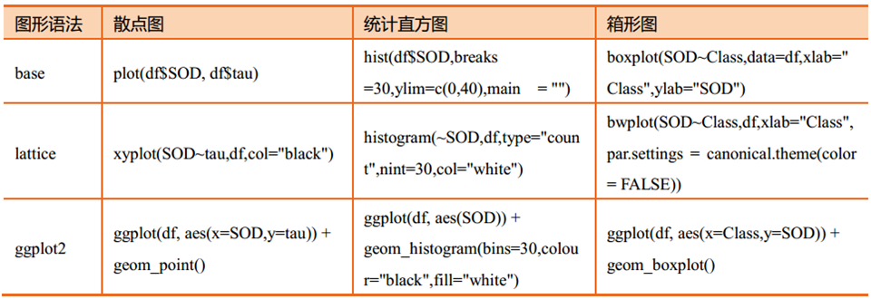

### 1.base系统

• 由Ross Ihaka编写

• base图形是最古老的系统，在R的初期就存在

• 容易上手

• 修改方便，使用灵活

• 不一定非常美观，需要调整参数修改

• 使用较多

```plain
###-------------1.基础绘图函数plot绘制散点图
rm(list = ls())
x <- runif(100,0,2)
y <- runif(100,0,2)
plot(x, y, type="n", xlab="", ylab="", axes=F)
points(x,y) #添加坐标点
axis(1) #添加横轴
axis(at=seq(0,2,0.5), side=2) #添加纵轴
box() #补齐散点图的边框
title(main="散点图", sub="subtitle", xlab="x轴", ylab="y轴")
abline(h=1,v=1,col="red")
```

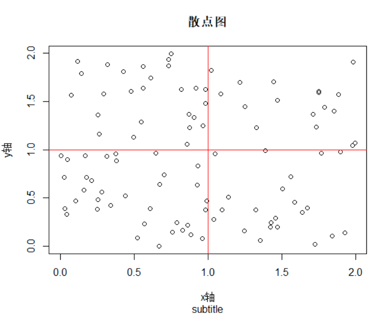

### 2.grid系统

grid 图形系统可以很容易地控制图形基础单元，由Paul Murrell（2006）编写，给予编程者创作图形极大的灵活性。 grid 图形系统还可以产生可编辑的图形组件，这些图形组件可以被复用和重组，并能通过 grid.layout()等函数，把图形输出到指定的位置上。但是因为 grid 包中没有提供生成统计图形及完整绘图的函数，因此很少直接采用 grid 包来分析与展示数据。

### 3.lattice系统

lattice 包通过一维、二维或三维条件绘图，即所谓的栅栏（trellis）图来对多元变量关系进行直观展示。 相比于 base()函数是直接在图形设备上绘图的，lattice()函数是返回 trellis 对象。在命令执行的时候，栅栏图会被自动打印，所以看起来就像是 lattice()函数直接完成了绘图。 更多关于 base、grid 和 lattice 的语法可以参考 Murrell 和 Paul 所撰写的书籍 R graphics。

```plain
###-------------2.利用lattice包xyplot函数绘制散点图
library(lattice)
z <- rnorm(100)
df <- data.frame(z=z,y=y,g=c("A","B"))
xyplot(y~z,df)
title(main="散点图", sub="subtitle", xlab="x轴", ylab="y轴")
```

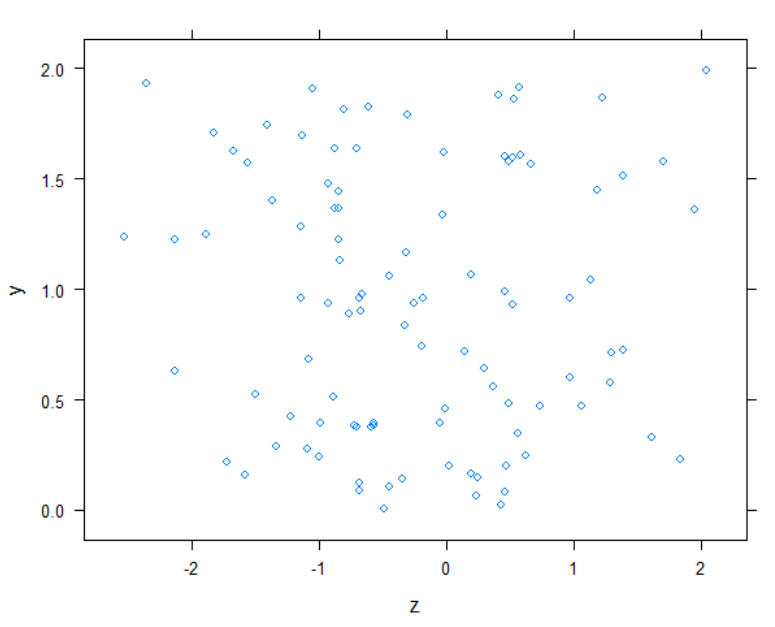

```plain
###2.2 统计直方图
histogram(~z,df,type = "count")
```

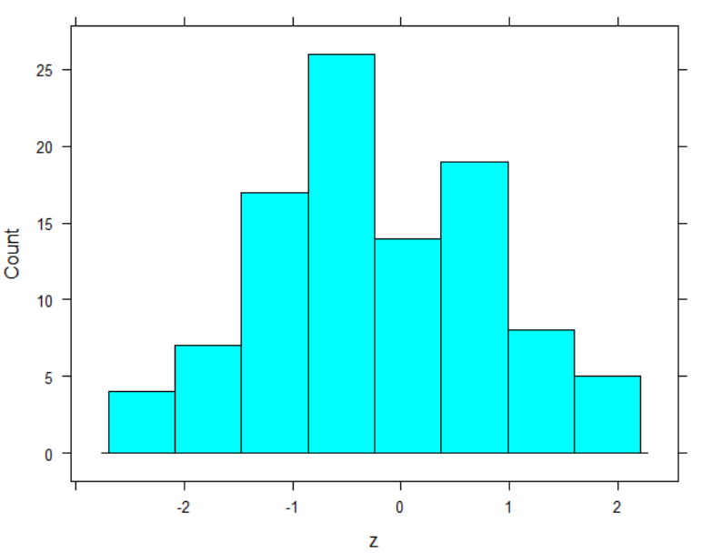

### 4.ggplot2系统

ggplot2 是一个功能强大且灵活的 R 包，由 Hadley Wickham 编写，它可以生成优雅而实用的图形。 ggplot2 中的 gg 表示图形语法（grammar of graphic），这是一个通过使用“语法” 来绘图的图形概念。 ggplot2 主张模块间的协调与分工，整个 ggplot2 的语法框架如下图所示，主要包括数据绘图部分与美化细节部分。 R ggplot2 图形语法的主要特点如下所示。

（1）采用图层的设计方式，有利于结构化思维实现数据可视化。有明确的起始（ggplot()开始）与终止，图层之间的叠加是靠“+”实现的，越往后，其图层越在上方。通常一条 geom_xxx()函数或 stat_xxx()函数可以绘制一个图层。

（2）将表征数据和图形细节分开，能快速将图形表现出来，使创造性的绘图更加容易实现。而且通过 stat_xxx()函数将常见的统计变换融入绘图中。

（3）图形美观，扩展包（extension package）丰富，有专门调整颜色（color）、字体（font）和主题（theme）等辅助包。可以帮助用户快读定制个性化的图表。

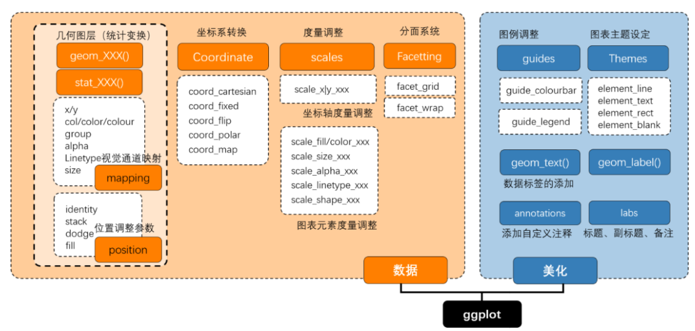

ggplot2 的绘图基本语法结构如上图所示。其中所需的图表输入信息如下所示。

（1）ggplot()：底层绘图函数。 DATA 为数据集，主要是数据框（data.frame）格式的数据集；MAPPINGS 变量的视觉通道映射，用来表示变量 x 和 y，还可以用来控制颜色（color）、大小（size）或形状（shape）等视觉通道；STAT 表示统计变换，与 stat_xxx()相对应，默认为"identity"（无数据变换）；POSITION 表示绘图数据系列的位置调整，默认为"identity"（无位置调整）。

（2）geom_xxx() | stat_xxx()：几何图层或统计变换，比如常见的 geom_point()（散点图）、geom_bar()（柱形图）、 geom_histogram()（统计直方图）、 geom_ boxplot()（箱形图）、 geom_line()（折线图）等。我们通常使用 geom_xxx()函数就可以绘制大部分图表，有时候通过设定 stat 参数可以先实现统计变换。

可选的图表输入信息包括如下 5 个部分，主要是实现图表的美化与变换等。

（1）scale_xxx()：度量调整，调整具体的度量，包括颜色（color）、大小（size）或形状（shape）等，跟 MAPPINGS 的映射变量相对应；

（2）coord_xxx()：坐标变换，默认笛卡儿坐标系，还包括极坐标系、地理空间坐标系等；

（3）facet_xxx()：分面系统，将某个变量进行分面变换，包括按行、列和网格等形式分面绘图。

（4）guides()：图例调整，主要包括连续型和离散型两种类型的图例。

（5）theme()：主题设定，主要用于调整图表的细节，包括图表背景颜色、网格线的间隔与颜色等。

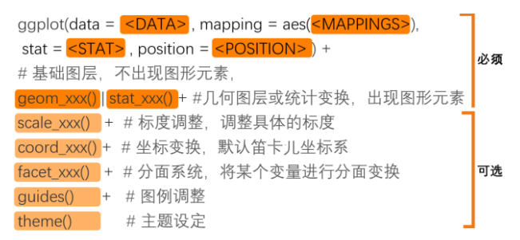

### 5.常见的绘图参数

低水平绘图函数

```plain
lines() 添加线
curve() 添加曲线
abline() 添加给定斜率的线
points() 添加点
segments() 折线
arrows() 箭头
axis() 坐标轴
box() 外框
title() 标题
text() 文字
mtext() 图边文字
```

高水平绘图函数

```plain
plot() 绘制散点图等多种图形
hist() 直方图
boxplot() 箱线图
stripchart() 点图
barplot() 条形图
dotplot() 点图
piechart() 饼图
interaction.plot()
matplot()
```

常用的绘图参数

参数用在函数内部，在没有设定值时使用默认值。

```plain
font= 字体
lty= 线类型
lwd= 线宽度
pch= 点的类型
xlab= 横坐标
ylab= 纵坐标
xlim= 横坐标范围
ylim= 纵坐标范围
```

```plain
pch：指定绘制点所使用的符号，取值范围[0, 24]，其中4是“差号”，20是“点”
cex：指定符号的大小。cex是一个数值，表示pch的倍数，默认是1.5倍
lty：指定线条类型。lty=1代表实线，2至6都是虚线，虚的程度不一样
lwd：指定线条宽度，默认值为lwd=1，可以适当修改1.5倍、2倍等
```

```plain
col：默认绘图颜色。某些函数(如lines、pie)可以接受一个含有颜色值的向量，并自动循环使用。
       例如：col=c("red", "blue")需要绘制三条线，那么三条颜色分别为red、blue、red
col.axis：坐标轴刻度文字的颜色，不是坐标轴的颜色
col.lab：坐标轴标签(名称)的颜色
col.main：标题的颜色
col.sub：副标题的颜色
fg：图形的前景色
bg：图形的背景色
```

```plain
cex.axis：坐标轴刻度文字的缩放倍数
cex.lab：坐标轴标签(名称)的缩放倍数
cex.main：标题的缩放倍数
cex.sub：副标题的缩放倍数
font：整数。用于指定字体样式。1常规、2粗体、3斜体、4粗斜体
```

```plain
pin：以英寸表示图形的宽和高
mai：以数值向量表示边界大小，顺序为"下、左、上、右"，单位为英寸
mar：以数值向量表示边界大小，顺序为"下、左、上、右"，单位为英分，默认值c(5, 4, 4, 2)+0.1
```

```plain
主标题可以使用函数title，格式为：
 title(main = " ", sub = " ", xlab = " ",  ylab = " ")
```

## 二.ggplot2绘图框架
### 1. geom\_\*() 与 stat\_\*()

`geom_*()` 相关函数如下：

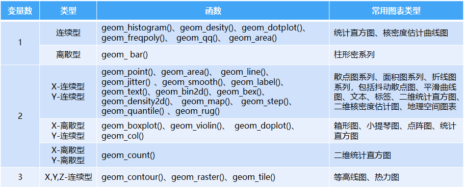

其他的可通过下面代码查看：

```plain
library(ggplot2)
#查看在ggplot2包中有什么geom_**()开头的函数
ls(pattern = "^geom_", env = as.environment("package:ggplot2"))
```

`stat_*()` 相关函数如下：

```plain
ls(pattern = "^stat_", env = as.environment("package:ggplot2"))
```

| <br/>函数 | <br/>函数说明 |
| :--- | :--- |
| <br/>stat_bin | <br/>Histograms   and frequency polygons |
| <br/>stat_bin2d | <br/>Heatmap   of 2d bin counts |
| <br/>stat_binhex | <br/>Hexagonal   heatmap of 2d bin counts |
| <br/>stat_bin_2d | <br/>Heatmap   of 2d bin counts |
| <br/>stat_bin_hex | <br/>Hexagonal   heatmap of 2d bin counts |
| <br/>stat_boxplot | <br/>A   box and whiskers plot (in the style of Tukey) |
| <br/>stat_contour | <br/>2d   contours of a 3d surface |
| <br/>stat_count | <br/>Bar   charts |
| <br/>stat_density | <br/>Smoothed   density estimates |
| <br/>stat_density2d | <br/>Contours   of a 2d density estimate |
| <br/>stat_density_2d | <br/>Contours   of a 2d density estimate |
| <br/>stat_ecdf | <br/>Compute   empirical cumulative distribution |
| <br/>stat_ellipse | <br/>Compute   normal confidence ellipses |
| <br/>stat_function | <br/>Compute   function for each x value |
| <br/>stat_identity | <br/>Leave   data as is |
| <br/>stat_qq | <br/>A   quantile-quantile plot |
| <br/>stat_qq_line | <br/>A   quantile-quantile plot |
| <br/>stat_quantile | <br/>Quantile   regression |
| <br/>stat_sf | <br/>Visualise   sf objects |
| <br/>stat_sf_coordinates | <br/>Extract   coordinates from 'sf' objects |
| <br/>stat_smooth | <br/>Smoothed   conditional means |
| <br/>stat_spoke | <br/>Line   segments parameterised by location, direction and distance |
| <br/>stat_sum | <br/>Count   overlapping points |
| <br/>stat_summary | <br/>Summarise   y values at unique/binned x |
| <br/>stat_summary2d | <br/>Bin   and summarise in 2d (rectangle & hexagons) |
| <br/>stat_summary_2d | <br/>Bin   and summarise in 2d (rectangle & hexagons) |
| <br/>stat_summary_bin | <br/>Summarise   y values at unique/binned x |
| <br/>stat_summary_hex | <br/>Bin   and summarise in 2d (rectangle & hexagons) |
| <br/>stat_unique | <br/>Remove   duplicates |
| <br/>stat_ydensity | <br/>Violin   plot |

```plain
set.seed(1492)
ggplot(data.frame(x = rnorm(100)), aes(x)) +
  geom_density() +
  stat_function(fun = dnorm, colour = "red")
ggplot(data.frame(x = c(-5, 5)), aes(x))+
  stat_function(fun = dnorm)
```

### 2.视觉通道

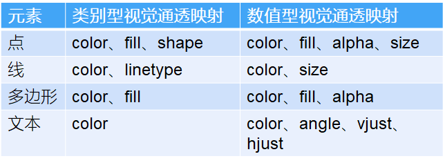

绘制几个图看看：

```plain
f1 <- ggplot(df, aes(x=SOD,y=tau,size=age)) +
  geom_point(shape=21,color="black",fill="#336A97",stroke=0.25)
f2 <- ggplot(df, aes(SOD,tau,fill=age,size=age)) +
  geom_point(shape=21,colour="black",stroke=0.25,
             alpha=0.8)
f3 <- ggplot(df, aes(x=SOD,y=tau,fill=Class)) +
  geom_point(shape=21,size=3,colour="black",stroke=0.25)
f4 <- ggplot(df, aes(SOD,tau,fill=Class,size=age)) +
  geom_point(shape=21,colour="black",stroke=0.5,
             alpha=0.8)
f1 + f2 + f3 + f4
library(gridExtra)
grid.arrange(f1,f2,f3,f4, ncol = 2, nrow =2)
```

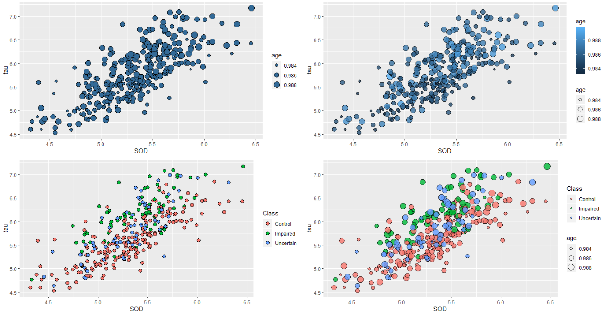

### 3.度量调整

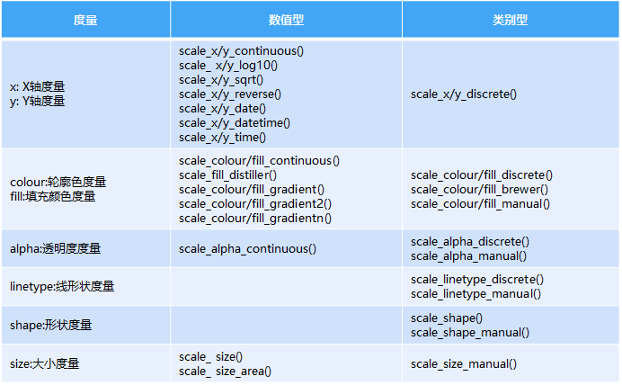

```plain
###4.度量调整-------------------
head(df)
ggplot(df, aes(x=SOD,y=tau,size=age)) +
  geom_point(shape=21,color="black",fill="#E53F2F",stroke=0.25,alpha=0.8)+
  scale_size(range = c(1, 8))#range:长度为2的数字向量，指定转换后绘图符号的最小和最大大小。ggplot(df, aes(SOD,tau,fill=age,size=age)) +
  geom_point(shape=21,colour="black",stroke=0.25,
             alpha=1)+
  scale_size(range = c(1,8))+
  scale_fill_distiller(palette="Reds")
ggplot(df, aes(x=SOD,y=tau,fill=Class,shape=Class)) +
  geom_point(size=3,colour="black",stroke=0.25)+
  scale_fill_manual(values=c("#36BED9","#FF0000","#FBAD01"))+
  scale_shape_manual(values=c(21,22,23))
ggplot(df, aes(SOD,tau,fill=Class,size=age)) +
  geom_point(shape=21,colour="black",stroke=0.25,
             alpha=0.8) +
  scale_fill_manual(values=c("#36BED9","#FF0000","#FBAD01"))+
  scale_size(range = c(1, 8))
```

### 4.坐标系

ggplot2的直角坐标系包括coord_cartesian()、coord_fixed()、coord.fip()和coord_ trans()四种类型。ggplot2中的默认类型为coord.cartesian() ,我们在绘制条形图或者水平箱形图时，需要使用coord_fip()翻转坐标系。它会将X轴和Y轴坐标对换，从而可以将竖直的柱形图转换成水平的条形图。

### 5.图例

图例作为图表背景信息的重要组成部分，对图表的完整与正确表达尤为重要。ggplot2 的guide_colorbar()/guide_colourbar()函数用于调整连续变量的图例; guide_legend()函数用于离散变量的图例，也可以用于连续变量。guides()函数将guide_colorbar()和guide_colourbar()两种图例嵌套进去，方面映射处理，如：guides(fill = guide_colourbar())，对多个图例共同处理尤为有效。

### 6.分面系统
```plain
##-------------6.分面系统
ls(pattern = "^facet_", env = as.environment("package:ggplot2"))
head(mpg)
ggplot(mpg, aes(displ, cty)) + geom_point()
ggplot(mpg, aes(displ, cty)) +
  geom_point()+
  facet_grid(rows = vars(drv))
ggplot(mpg, aes(drv, model)) +
  geom_point() +
  facet_grid(manufacturer ~ ., scales = "free", space = "free") +
  theme(strip.text.y = element_text(angle = 0))
ggplot(mpg, aes(displ, hwy)) + geom_point()
# Use vars() to supply faceting variables:
ggplot(mpg, aes(displ, hwy)) +
  geom_point() +
  facet_wrap(vars(class))
# The historical interface with formulas is also available:
ggplot(mpg, aes(displ, hwy)) +
  geom_point() +
  facet_wrap(~class)
# Control the number of rows and columns with nrow and ncol
ggplot(mpg, aes(displ, hwy)) +
  geom_point() +
  facet_wrap(vars(class), nrow = 4)
# You can facet by multiple variables
ggplot(mpg, aes(displ, hwy)) +
  geom_point() +
  facet_wrap(vars(cyl, drv))
View(mpg)
```

### 7.主题

主题系统包括绘图区背景、网格线、坐标轴线条等图表的细节部分，而图表风格主要是指绘图区背景、网格线、坐标轴线条等的格式设定所展现的效果。ggplot2图表的主题系统的主要对象包括文本（text）、矩形（rect） 和线条（line ）三大类，对应的函数包括element _text()、element_rect()、element_line()， 另外还有element_blank()表示该对象设置为无，具体如表所示。其中，我们使用比较多的系统对象是坐标轴的标签（ axis.text.x、axis.text.y ）、图例的位置与背景（ legend.position 和legend.background）。X轴标签（axis.text.x）在绘制极坐标柱形图和径向柱形图时会用于调整X轴标签的旋转角度，Y轴标签（ axis.text.y）也会用于时间序列峰峦图的Y轴标签的替换等，具体可见后面图表案例的讲解。

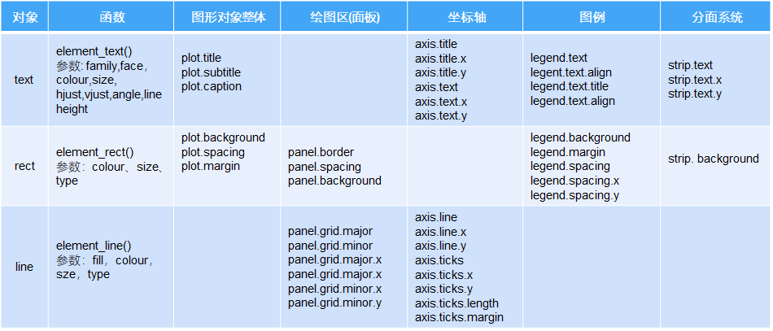

一些主题相关包:ggThemeAssist,ggthemes,ggtech,ggthemer,**ggsci**,cowplot等。

### 8.位置调整

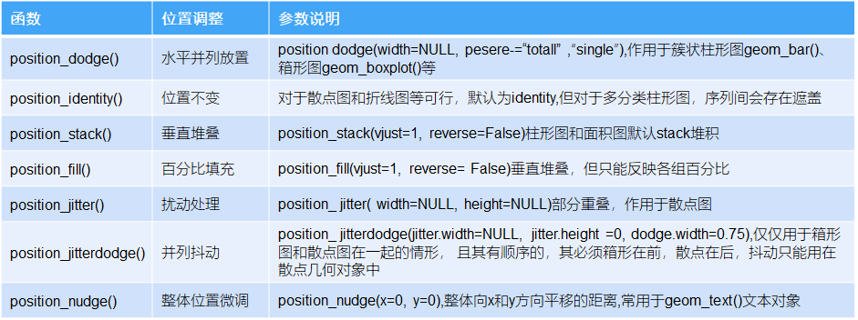

### 9.学术文章图标配色

RColorBrewer包是比较常用的调色板，来自网站:[https://colorbrewer2.org/](https://colorbrewer2.org/)

brewer.pal()函数获取颜色

```plain
brewer.pal(n, name)#使颜色调色板；Name的值：Blues BuGn BuPu GnBu Greens Greys Oranges OrRd PuBu PuBuGn PuRd Purples RdPu Reds YlGn YlGnBu YlOrBr YlOrRd
```

display.brewer.pal() 函数在图形窗口中显示选定的调色板，在图形窗口中同时显示一些调色板。有3种类型的调色板:sequential, diverging, and qualitative。display.brewer.all(n=NULL, type="all", select=NULL, exact.n=TRUE, colorblindFriendly=FALSE)。

brewer.pal.info #将可用调色板的信息作为数据文件返回

colorfavs工具链接：[http://www.colorfavs.com/](http://www.colorfavs.com/)

### 10.排版布局

ggplot2组合图形布局可以使用Rmisc包的multiplot()函数，也可以使用ggpubr包的ggarrange()函数。

patchwork包中用来调整排版设置的函数有plot_annotation()函数、plot_layout()函数、plot_spacer()函数等，下面一个一个看。

plot_annotation()函数

可以使用title、subtitle、caption等参数来控制图形标题和副标题等。使用tag_levels参数表示添加图形的标签，可以指定水平值为a、A、1、i、I等，分别表示小写字母、大写字母、数字、小写罗马数字、大写罗马数字等。

plot_layout()函数排版

上面的plot_annotation()函数是用于添加组合图形的标签、标题等。而plot_layout()函数可以用于组合图形的布局。

library(easyGgplot2) 包的ggplot2.multiplot函数

用gredExtra包grid.arrange函数

用cowplot包的plot_grid函数

```plain
library(Rmisc)
multiplot(fig1,fig2,fig3,fig4, cols = 2)
multiplot(fig1,fig2,fig5, layout = matrix(c(1,2,3,3),ncol = 2,byrow = T))
#ggpubr包的ggarrange()函数
ggarrange(fig1,fig2,fig3,fig2,# 要布局的图形
          ncol = 2,nrow = 2) # 图形排版为2列
#patchwork包的plot_layout()函数
fig1 + fig3 + fig2 +
  plot_layout(ncol = 2, byrow = TRUE)
#除了用+号运算来排版图形外，还可以使用/号来排版。fig1/fig2
fig3 | (fig1/fig2)
(fig1 + fig3)/ fig5 +
  plot_annotation(tag_levels = "A",
                  title = "组合图形排版",
                  caption = "公众号:BioInfoNotes")
#图形设置为两列，默认按行填充，两列之间相对宽度比为1：2
fig1 + fig3 + fig2 + plot_layout(ncol = 2, widths = c(1, 2))
#plot_spacer()函数就是在前后图形中创建一个空的透明网格
fig1 + fig3 + plot_spacer()+fig2
library(gridExtra)
grid.arrange(fig1,fig2,fig5, ncol = 2, nrow =2,layout_matrix=matrix(c(1,2,3,3),ncol = 2,byrow = T))
```

## 三.散点图
### 1.利用plot()绘制散点图

R语言中plot()函数的基本格式如下：

```plain
plot(x,y,...)
```

plot函数中，x和y分别表示所绘图形的横坐标和纵坐标；函数中的...为附加的参数。

plot函数默认的使用格式如下：

```plain
plot(x, y = NULL, type = "p", xlim = NULL, ylim = NULL, log = "", main = NULL, sub = NULL, xlab = NULL, ylab = NULL, ann = par("ann"), axes = TRUE, frame.plot = axes, panel.first = NULL, panel.last = NULL, asp = NA, ...)
```

主要参数的含义如下：

（1）type为一个字符的字符串，用于给定绘图的类型，可选的值如下：

"p"：绘点（默认值）；

"l"：绘制线；

"b"：同时绘制点和线；

"c"：仅绘制参数"b"所示的线；

"o"：同时绘制点和线，且线穿过点；

"h"：绘制出点到横坐标轴的垂直线；

"s"：绘制出阶梯图（先横后纵）；

"S"：绘制出阶梯图（先纵后竖）；

"n"：作空图。

（2）main参数 字符串，给出图形的标题；

（3）sub参数 字符串，给出图形的子标题；

（4）xlab 和 ylab参数 字符串，用于给出x轴和y轴的标签。

（5）xlim 和 ylim参数 都是二维向量，分别表示x轴和y轴的取值范围。

（6）pch参数：

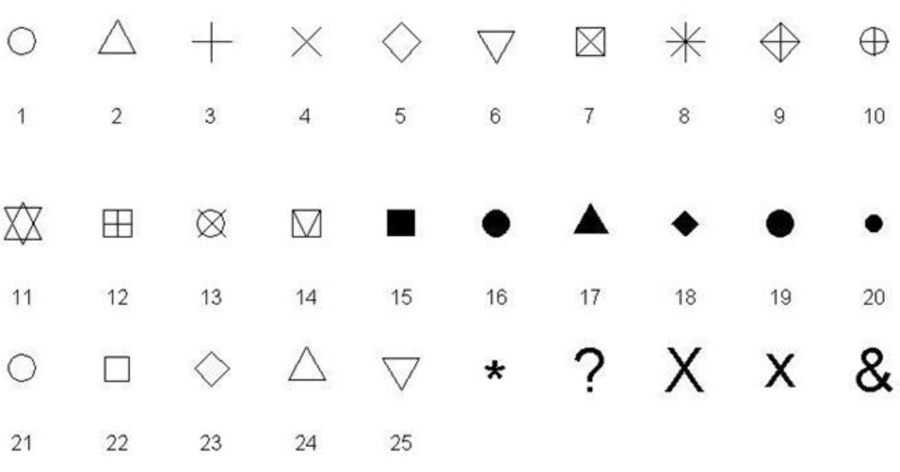

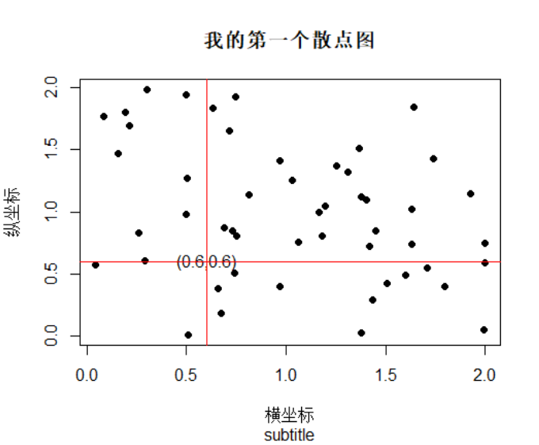

```plain
####第二个图
x <- runif(50,0,2)
y <- runif(50,0,2)
plot(x, y, type="n", xlab="", ylab="", axes=F)
points(x,y) #添加坐标点
axis(1) #添加横轴
axis(at=seq(0,2,0.5), side=2) #添加纵轴
box() #补齐散点图的边框
title(main="散点图", sub="subtitle", xlab="x轴", ylab="y轴")
abline(h=0.6,v=0.6,col="red")
```

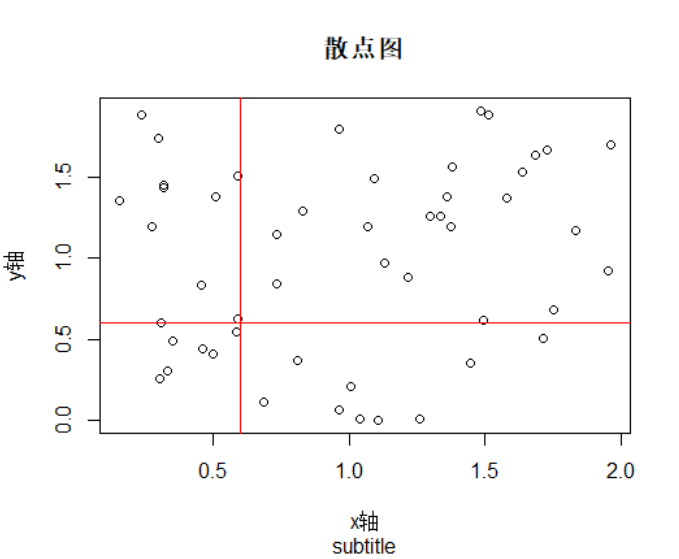

```plain
data(trees) # 加载数据集
head(trees) # 预览数据集
```

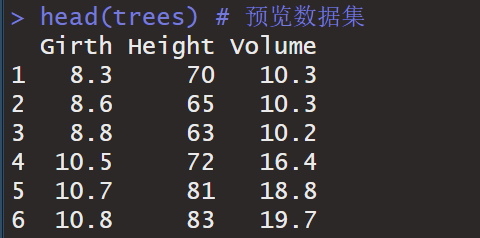

### 2.ggplot2()绘制散点图

利用ggplot2绘图，请记住下面这个格式，因为这个格式ggplot2绘制其他图形都是这一格式。

```plain
ggplot(data, aes(x, y)) + geom_point()
```

aes中的x,y值分别表示在x,y轴的变量；geom_point表示增加散点图图层。

散点图分组有两种方式，一种利用shape,以点的形状来区分各种；一种用color，以点的颜色来区分，但是得记住，分组的变量必须为因子变量或者字符串。

```plain
ggplot(data, aes(x, y, colour)) + geom_point()#设置colour参数以颜色区分
ggplot(data, aes(x, y, shape)) + geom_point()#设置shape参数以形状区分
```

```plain
###第三个图
library(ggplot2)
#read in data
#钻石克拉数和价格
data = read.table("scatter_plot.txt", header=T, sep="\t")
class(data)
head(data)
###只绘制10个点
ggplot(data[1:10,], aes(x=carat,y=price)) +
  geom_point()
```

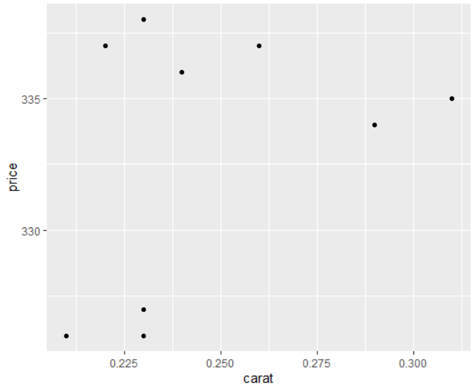

```plain
##画出所有的点
ggplot(data, aes(x=carat,y=price)) +
  geom_point()
```

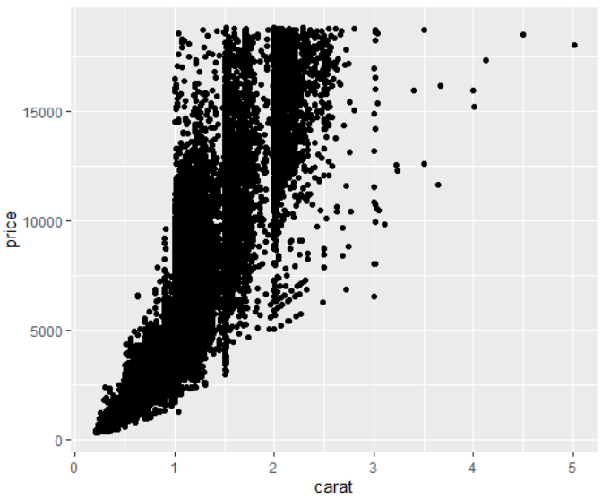

当点的密度大时，我们可以改变点的透明度来区分各个点。

当然我们可以使用bin的方法来区分，这种方法是把点的形状设定为长方形，密度越大的长方形区域越透明。

```plain
ggplot(data, aes(x=carat,y=price)) +
  geom_point(alpha=0.05)
```

通过alpha参数设置透明度，alpha是从0(完全透明)到1(不透明)的值。

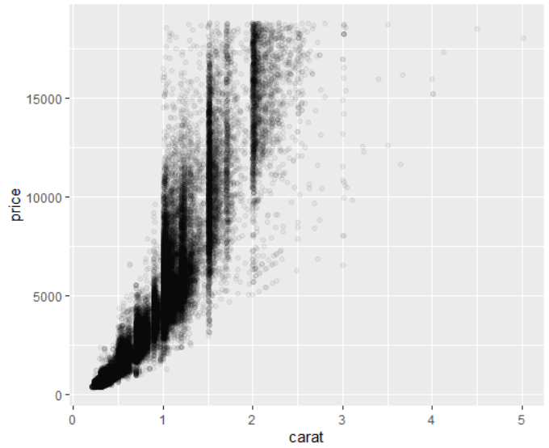

另一种方法是把点切到不同的箱子里。

```plain
ggplot(data, aes(x=carat,y=price)) +
  stat_bin2d()
```

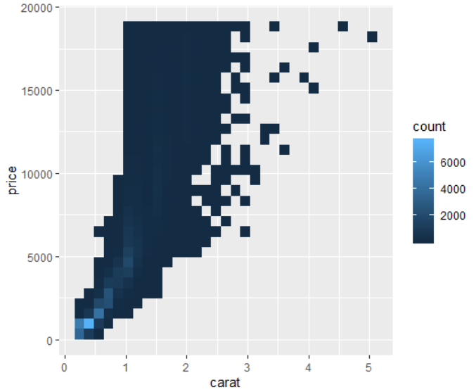

```plain
ggplot(data, aes(x=carat,y=price)) +
  stat_bin2d(bins=50) +
  scale_fill_gradient(low="lightblue", high="red" ,limits=c(0,5000))
```

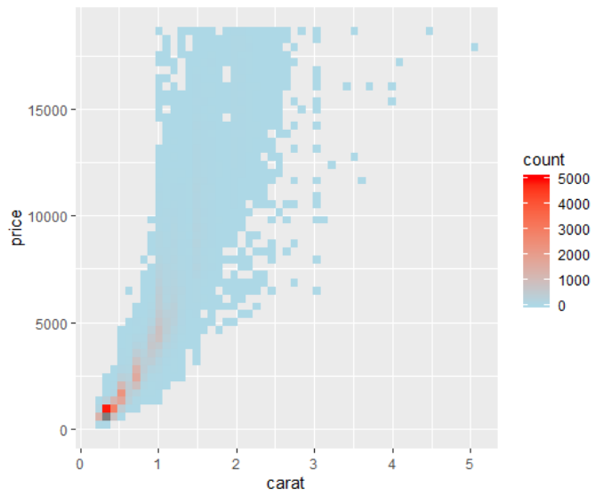

```plain
#show the bins in hexagon using package hexbin
library(hexbin)
ggplot(data, aes(x=carat,y=price)) +
  stat_binhex() +
  scale_fill_gradient(low="lightblue", high="red",
                      breaks=c(0, 250, 500, 1000, 2000, 4000, 6000),
                      limits=c(0,6000))
```

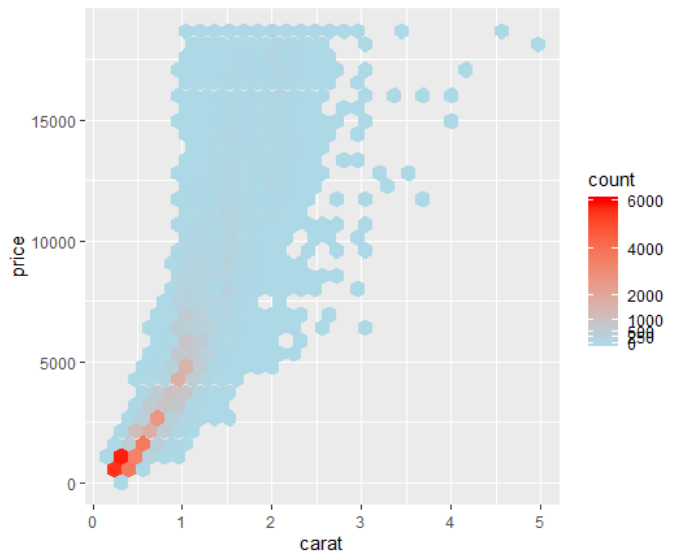

## 四.柱状图
```plain
library(ggplot2)
library(RColorBrewer)
```

我们可以通过将 geom_bar() 中的参数指定为 colour="black" 为条形添加黑色边框线；可以通过 scale_fill_brewer() 或者 scale_fill_manual() 函数对图形颜色进行设置。颜色的映射设定是在 aes() 内部完成的，而颜色的重新设定是在 aes() 外部完成的

### 01.单数据系列柱形图
```plain
mydata<-data.frame(Cut=c("Fair","Good","Very Good","Premium","Ideal"),
                    Price=c(4300,3800,3950,4700,3500))
#mydata$Cut <- factor(mydata$Cut, levels = mydata$Cut[order(mydata$Order)])
ggplot(data=mydata,aes(x=Cut,y=Price))+
  geom_bar(stat = "identity",
           width = 0.8,colour="black",size=0.25,
           fill="#FC4E07",alpha=1)+
  ylim(0, 6000)+
  theme(
    axis.title=element_text(size=15,face="plain",color="black"),
    axis.text = element_text(size=12,face="plain",color="black")
  )
```

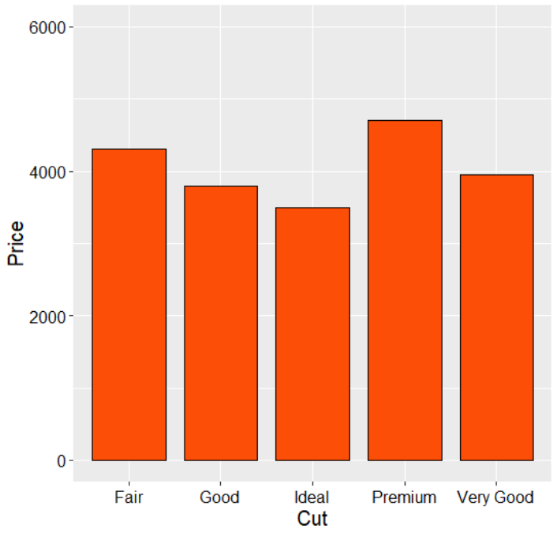

图形排序

```plain
#排序方法1：基于数据框data.frame
library(dplyr)
mydata2<-arrange(mydata,desc(Price))
mydata$Cut <- factor(mydata$Cut, levels = mydata2$Cut)
ggplot(data=mydata,aes(Cut,Price))+
  geom_bar(stat = "identity", width = 0.8,
           colour="black",size=0.25,fill="#FC4E07",alpha=1)
#排序方法2：基于向量vector
order<-sort(mydata$Price,index.return=TRUE,decreasing = TRUE)
mydata$Cut <- factor(mydata$Cut, levels = mydata$Cut[order$ix])
ggplot(data=mydata,aes(Cut,Price))+
  geom_bar(stat = "identity", width = 0.8,
           colour="black",size=0.25,fill="#FC4E07",alpha=1)
```

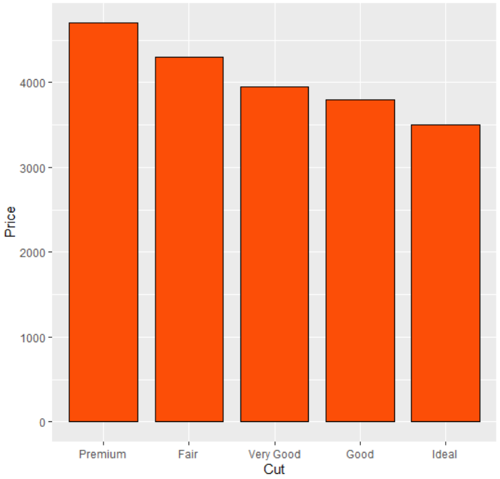

如果需要横向显示，加上coord_flip()语句

```plain
mydata<-read.csv("Stackedbar_Data.csv",sep=",",na.strings="NA",stringsAsFactors=FALSE)
mydata$Country <- factor(mydata$Country, levels = mydata$Country[order(mydata$Pensions)])
ggplot(data=mydata,aes(Country,Pensions))+
  geom_bar(stat="identity", color="black", width=0.6,fill="#FC4E07",size=0.25) +#"#00AFBB"
  scale_fill_manual(values=brewer.pal(9,"YlOrRd")[c(6:2)])+
  coord_flip()+
  theme(
    axis.title=element_text(size=15,face="plain",color="black"),
    axis.text = element_text(size=12,face="plain",color="black"),
    legend.title=element_text(size=13,face="plain",color="black"),
    legend.position = "right"# c(0.83,0.15)
  )
```

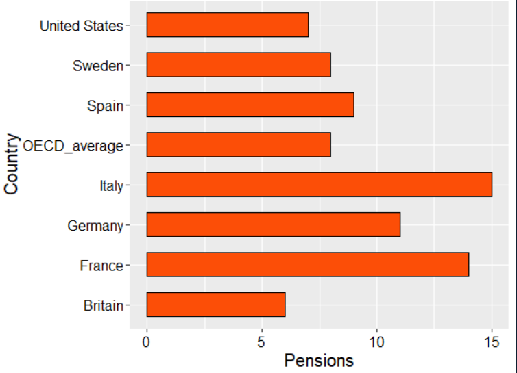

```plain
> mydata
        Country Pensions Income Health Other.services
1        France       14      5      9              3
2        Sweden        8      6      7              8
3         Italy       15      4      7              1
4       Germany       11      5      8              3
5         Spain        9      7      7              2
6       Britain        6      6      8              4
7  OECD_average        8      5      6              3
8 United States        7      3      8              1
```

### 02.双数据系列柱形图

mydata的数据格式：

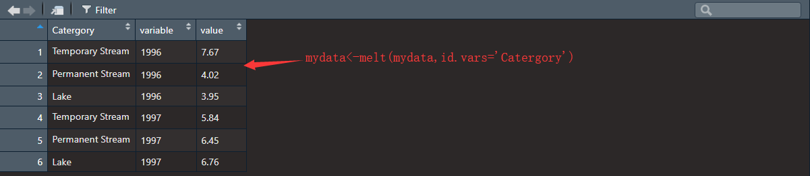

下面是代码

```plain
library(reshape2)
mydata <- data.frame(Catergory = c("Temporary\nStream","Permanent\nStream","Lake"),
                     year1996 = c(7.67,4.02,3.95),
                     year1997 = c(5.84,6.45,6.76),stringsAsFactors=FALSE)
colnames(mydata) <- c("Catergory","1996","1997")
mydata<-melt(mydata,id.vars='Catergory')
# c("#00AFBB", "#FC4E07") 颜色
ggplot(data=mydata,aes(Catergory,value,fill=variable))+
  geom_bar(stat="identity",position=position_dodge(),
           color="black",width=0.7,size=0.25)+
  scale_fill_manual(values=c("#A61CE6", "#E81CA4"))+
  ylim(0, 10)+
  theme(
    axis.title=element_text(size=15,face="plain",color="black"),
    axis.text = element_text(size=12,face="plain",color="black"),
    legend.title=element_text(size=14,face="plain",color="black"),
    legend.background  =element_blank(),
    legend.position = c(0.88,0.88)
  )
```

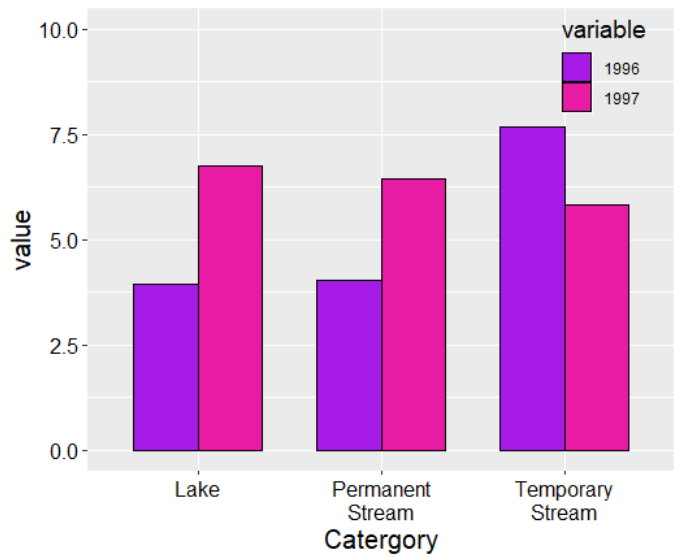

```plain
###排序
mydata <- data.frame(Catergory = c("Temporary\nStream","Permanent\nStream","Lake"),
                     year1996 = c(7.67,4.02,3.95),
                     year1997 = c(5.84,6.45,6.76),stringsAsFactors=FALSE)
colnames(mydata) <- c("Catergory","1996","1997")
mydata$Catergory<- factor(mydata$Catergory, levels = mydata$Catergory[order(mydata[,"1996"],decreasing = TRUE)])
mydata<-melt(mydata,id.vars='Catergory')
ggplot(data=mydata,aes(Catergory,value,fill=variable))+
  geom_bar(stat="identity", color="black", position=position_dodge(),width=0.7,size=0.25)+
  scale_fill_manual(values=c("#00AFBB", "#E7B800"))+
  ylim(0, 10)+
  theme(
    axis.title=element_text(size=15,face="plain",color="black"),
    axis.text = element_text(size=12,face="plain",color="black"),
    legend.title=element_text(size=14,face="plain",color="black"),
    legend.background  =element_blank(),
    legend.position = c(0.88,0.88)
  )
```

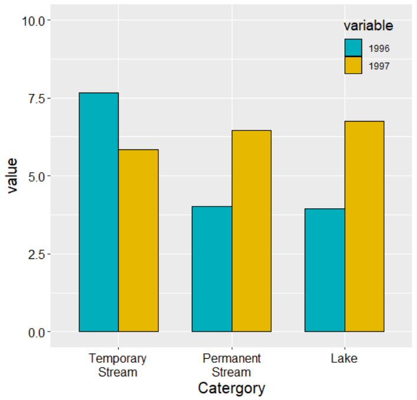

横向的柱状图

```plain
library(reshape)
mydata<-read.csv("Stackedbar_Data.csv",sep=",",na.strings="NA",stringsAsFactors=FALSE)
mydata<-mydata[,c(1,3,2)]
mydata$Country <- factor(mydata$Country, levels = mydata$Country[order(mydata$Pensions)])
mydata<-melt(mydata,id.vars='Country')
ggplot(data=mydata,aes(Country,value,fill=variable))+
  geom_bar(stat="identity", color="black", position=position_dodge(),width=0.7,size=0.25)+
  scale_fill_manual(values=c("#B311BF", "#4411C2"))+
  coord_flip()+
  theme(
    axis.title=element_text(size=15,face="plain",color="black"),
    axis.text = element_text(size=12,face="plain",color="black"),
    legend.title=element_text(size=14,face="plain",color="black"),
    legend.background  =element_blank(),
    legend.position = c(0.83,0.12)
  )
```

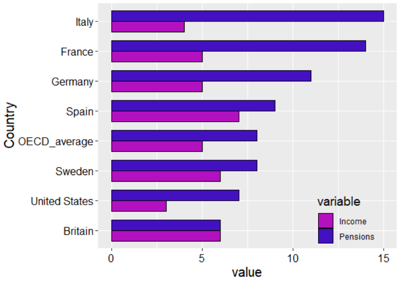

### 03.堆积柱形图

madata数据格式

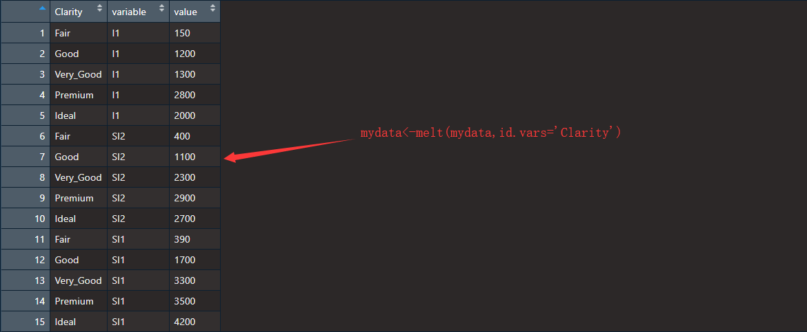

代码：

```plain
mydata <- data.frame(Clarity = c("Fair","Good","Very_Good","Premium","Ideal"),
                     I1 = c(150,1200,1300,2800,2000),
                     SI2 =c(400,1100,2300,2900,2700),
                     SI1 = c(390,1700,3300,3500,4200),
                     VS2 = c(300,900,1900,2800,3300),
                     VS1 = c(130,790,1800,3000,4200),
                     S2 = c(100,1300,1900,1800,2700),
                     s1 = c(100,1200,1700,1600,2100),
                     IF = c(150,1100,1300,1280,1300),stringsAsFactors=FALSE)
mydata<-melt(mydata,id.vars='Clarity')
ggplot(data=mydata,aes(variable,value,fill=Clarity))+
  geom_bar(stat="identity",position="stack", color="black", width=0.7,size=0.25)+
  scale_fill_manual(values=brewer.pal(9,"YlOrRd")[c(6:2)])+
  ylim(0, 15000)+
  theme(
    axis.title=element_text(size=15,face="plain",color="black"),
    axis.text = element_text(size=12,face="plain",color="black"),
    legend.title=element_text(size=14,face="plain",color="black"),
    legend.background  =element_blank(),
    legend.position = c(0.85,0.82)
  )
```

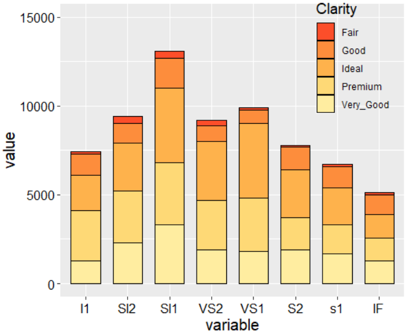

```plain
###排序
mydata <- data.frame(Clarity = c("Fair","Good","Very_Good","Premium","Ideal"),
                     I1 = c(150,1200,1300,2800,2000),
                     SI2 =c(400,1100,2300,2900,2700),
                     SI1 = c(390,1700,3300,3500,4200),
                     VS2 = c(300,900,1900,2800,3300),
                     VS1 = c(130,790,1800,3000,4200),
                     S2 = c(100,1300,1900,1800,2700),
                     s1 = c(100,1200,1700,1600,2100),
                     IF = c(150,1100,1300,1280,1300),stringsAsFactors=FALSE)
sum<-sort(rowSums(mydata[,2:ncol(mydata)]),index.return=TRUE)
colsum<-sort(colSums(mydata[,2:ncol(mydata)]),index.return=TRUE,decreasing = TRUE)
mydata<-mydata[,c(1,colsum$ix+1)]
mydata$Clarity <- factor(mydata$Clarity, levels = mydata$Clarity[order(sum$ix)])
mydata<-melt(mydata,id.vars='Clarity')
ggplot(data=mydata,aes(variable,value,fill=Clarity))+
  geom_bar(stat="identity",position="stack", color="black", width=0.7,size=0.25)+
  scale_fill_manual(values=brewer.pal(9,"YlOrRd")[c(6:2)])+
  ylim(0, 15000)+
  theme(
    axis.title=element_text(size=15,face="plain",color="black"),
    axis.text = element_text(size=12,face="plain",color="black"),
    legend.title=element_text(size=14,face="plain",color="black"),
    legend.background  =element_blank(),
    legend.position = c(0.85,0.82)
  )
```

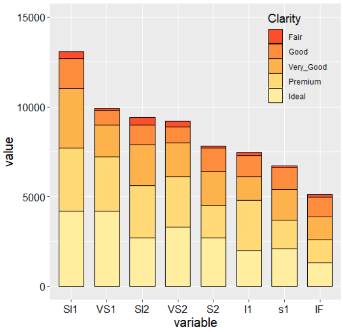

```plain
mydata<-read.csv("Stackedbar_Data.csv",sep=",",na.strings="NA",stringsAsFactors=FALSE)
rowsum<-sort(rowSums(mydata[,2:ncol(mydata)]),index.return=TRUE)
mydata$Country <- factor(mydata$Country, levels = mydata$Country[order(rowsum$ix)])
mydata<-melt(mydata,id.vars='Country')
ggplot(data=mydata,aes(Country,value,fill=variable))+
  geom_bar(stat="identity",position="stack", color="black", width=0.65,size=0.25)+
  scale_fill_manual(values=brewer.pal(9,"YlOrRd")[c(9:5)])+
  ylim(0, 35)+
  coord_flip()+
  theme(
    #text=element_text(size=15,face="plain",color="black"),
    axis.title=element_text(size=15,face="plain",color="black"),
    axis.text = element_text(size=12,face="plain",color="black"),
    legend.title=element_text(size=13,face="plain",color="black"),
    legend.position = "right"# c(0.83,0.15)
  )
```

```plain
> mydata
         Country       variable value
1         France       Pensions    14
2         Sweden       Pensions     8
3          Italy       Pensions    15
4        Germany       Pensions    11
5          Spain       Pensions     9
6        Britain       Pensions     6
7   OECD_average       Pensions     8
8  United States       Pensions     7
9         France         Income     5
10        Sweden         Income     6
11         Italy         Income     4
12       Germany         Income     5
13         Spain         Income     7
14       Britain         Income     6
15  OECD_average         Income     5
16 United States         Income     3
17        France         Health     9
18        Sweden         Health     7
19         Italy         Health     7
20       Germany         Health     8
21         Spain         Health     7
22       Britain         Health     8
23  OECD_average         Health     6
24 United States         Health     8
25        France Other.services     3
26        Sweden Other.services     8
27         Italy Other.services     1
28       Germany Other.services     3
29         Spain Other.services     2
30       Britain Other.services     4
31  OECD_average Other.services     3
32 United States Other.services     1
```

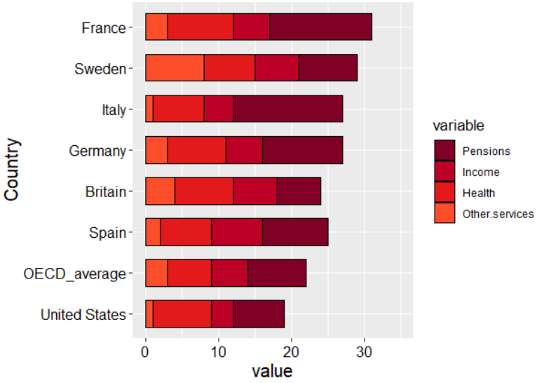

### 04.百分比堆积柱形图

数据同堆积柱形图，下面是代码

```plain
mydata <- data.frame(Clarity = c("Fair","Good","Very_Good","Premium","Ideal"),
                     I1 = c(150,1200,1300,2800,2000),
                     SI2 =c(400,1100,2300,2900,2700),
                     SI1 = c(390,1700,3300,3500,4200),
                     VS2 = c(300,900,1900,2800,3300),
                     VS1 = c(130,790,1800,3000,4200),
                     S2 = c(100,1300,1900,1800,2700),
                     s1 = c(100,1200,1700,1600,2100),
                     IF = c(150,1100,1300,1280,1300),stringsAsFactors=FALSE)
mydata<-melt(mydata,id.vars='Clarity')
ggplot(data=mydata,aes(variable,value,fill=Clarity))+
  geom_bar(stat="identity", position="fill",color="black", width=0.8,size=0.25)+
  scale_fill_manual(values=brewer.pal(9,"GnBu")[c(7:2)])+
  theme(
    axis.title=element_text(size=15,face="plain",color="black"),
    axis.text = element_text(size=12,face="plain",color="black"),
    legend.title=element_text(size=14,face="plain",color="black"),
    legend.position = "right"
  )
```

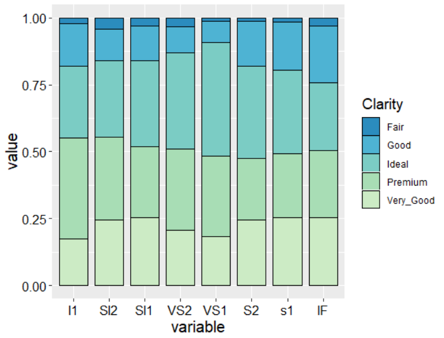

```plain
#排序
mydata <- data.frame(Clarity = c("Fair","Good","Very_Good","Premium","Ideal"),
                     I1 = c(150,1200,1300,2800,2000),
                     SI2 =c(400,1100,2300,2900,2700),
                     SI1 = c(390,1700,3300,3500,4200),
                     VS2 = c(300,900,1900,2800,3300),
                     VS1 = c(130,790,1800,3000,4200),
                     S2 = c(100,1300,1900,1800,2700),
                     s1 = c(100,1200,1700,1600,2100),
                     IF = c(150,1100,1300,1280,1300),stringsAsFactors=FALSE)
Per<-(as.matrix(mydata[5,2:ncol(mydata)])) / t(as.matrix(colSums(mydata[,2:ncol(mydata)])))
Ideal<-sort(as.numeric(Per),index.return=TRUE,decreasing = TRUE)
mydata<-mydata[,c(1,Ideal$ix+1)]
mydata$Clarity <- factor(mydata$Clarity, levels = mydata$Clarity[c(1:5)])
mydata<-melt(mydata,id.vars='Clarity')
ggplot(data=mydata,aes(variable,value,fill=Clarity))+
  geom_bar(stat="identity", position="fill",color="black", width=0.8,size=0.25)+
  scale_fill_manual(values=brewer.pal(9,"GnBu")[c(7:2)])+
  theme(
    axis.title=element_text(size=15,face="plain",color="black"),
    axis.text = element_text(size=12,face="plain",color="black"),
    legend.title=element_text(size=14,face="plain",color="black"),
    legend.position = "right"
  )
```

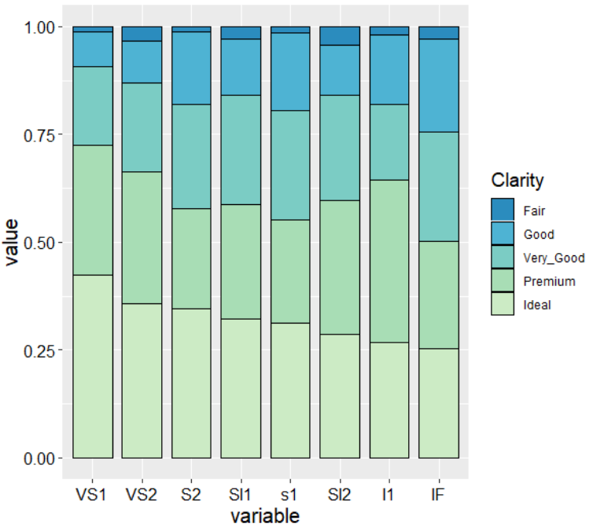

横向：

```plain
mydata<-read.csv("Stackedbar_Data.csv",sep=",",na.strings="NA",stringsAsFactors=FALSE)
sum<-sort(rowSums(mydata[,2:ncol(mydata)]),index.return=TRUE)
mydata$Country <- factor(mydata$Country, levels = mydata$Country[order(sum$ix)])
mydata<-melt(mydata,id.vars='Country')
library(RColorBrewer)
ggplot(data=mydata,aes(Country,value,fill=variable))+
  geom_bar(stat="identity",position="fill", color="black", width=0.65,size=0.25)+
  scale_fill_manual(values=brewer.pal(9,"Greens")[c(9:5)])+
  coord_flip()+
  theme(
    axis.title=element_text(size=15,face="plain",color="black"),
    axis.text = element_text(size=12,face="plain",color="black"),
    legend.title=element_text(size=13,face="plain",color="black"),
    legend.position = "right"
  )
```

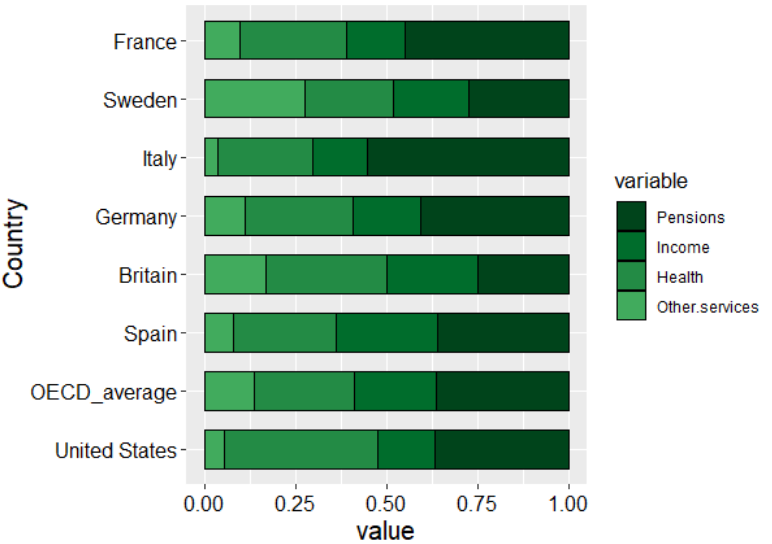

```plain
> mydata
         Country       variable value
1         France       Pensions    14
2         Sweden       Pensions     8
3          Italy       Pensions    15
4        Germany       Pensions    11
5          Spain       Pensions     9
6        Britain       Pensions     6
7   OECD_average       Pensions     8
8  United States       Pensions     7
9         France         Income     5
10        Sweden         Income     6
11         Italy         Income     4
12       Germany         Income     5
13         Spain         Income     7
14       Britain         Income     6
15  OECD_average         Income     5
16 United States         Income     3
17        France         Health     9
18        Sweden         Health     7
19         Italy         Health     7
20       Germany         Health     8
21         Spain         Health     7
22       Britain         Health     8
23  OECD_average         Health     6
24 United States         Health     8
25        France Other.services     3
26        Sweden Other.services     8
27         Italy Other.services     1
28       Germany Other.services     3
29         Spain Other.services     2
30       Britain Other.services     4
31  OECD_average Other.services     3
32 United States Other.services     1
```

### 05.不等宽柱形图

geom_rect()函数可以根据右下角坐标（xmin,ymin）和左上角坐标（xmax,ymax）绘制矩形，矩形宽度（width）为max~xmin对应X轴变量的数值大小矩形的高度（height）为ymax~ymin对应Y轴的数值大小。

```plain
##不等宽柱形图
library(ggplot2)
#install.packages("Cairo")
library(Cairo)
#install.packages("showtext")
library(showtext)
mydata<-data.frame(Name=paste0("Project",1:5),Scale=c(35,30,20,10,5),ARPU=c(56,37,63,57,59))
mydata$xmin<-0
for (i in 2:5){
  mydata$xmin[i]<-sum(mydata$Scale[1:i-1])
}
#构造矩形X轴的终点（最大点）
for (i in 1:5){
  mydata$xmax[i]<-sum(mydata$Scale[1:i])
}
#构造数据标签的横坐标：
for (i in 1:5){
  mydata$label[i]<-sum(mydata$Scale[1:i])-mydata$Scale[i]/2
}
#CairoPDF(file="不等宽柱形图.pdf",width=4.89,height=5.53)
#showtext.begin()
#windowsFonts(myFont = windowsFont("微软雅黑"))
ggplot(mydata)+
  geom_rect(aes(xmin=xmin,xmax=xmax,ymin=0,ymax=ARPU,fill=Name),colour="black",size=0.25)+
  geom_text(aes(x=label,y=ARPU+3,label=ARPU),size=4,col="black")+
  geom_text(aes(x=label,y=-2.5,label=Name),size=4,col="black")+
  ylab("ARPU")+
  xlab("scale")+
  ylim(-5,80)+
  theme(panel.background=element_rect(fill="white",colour=NA),
        panel.grid.major = element_line(colour = "grey60",size=.25,linetype ="dotted" ),
        panel.grid.minor = element_line(colour = "grey60",size=.25,linetype ="dotted" ),
        text=element_text(size=15),
        plot.title=element_text(size=15,hjust=.5),#family="myfont",
        legend.position="none"
  )
#showtext.end()
#dev.off()
```

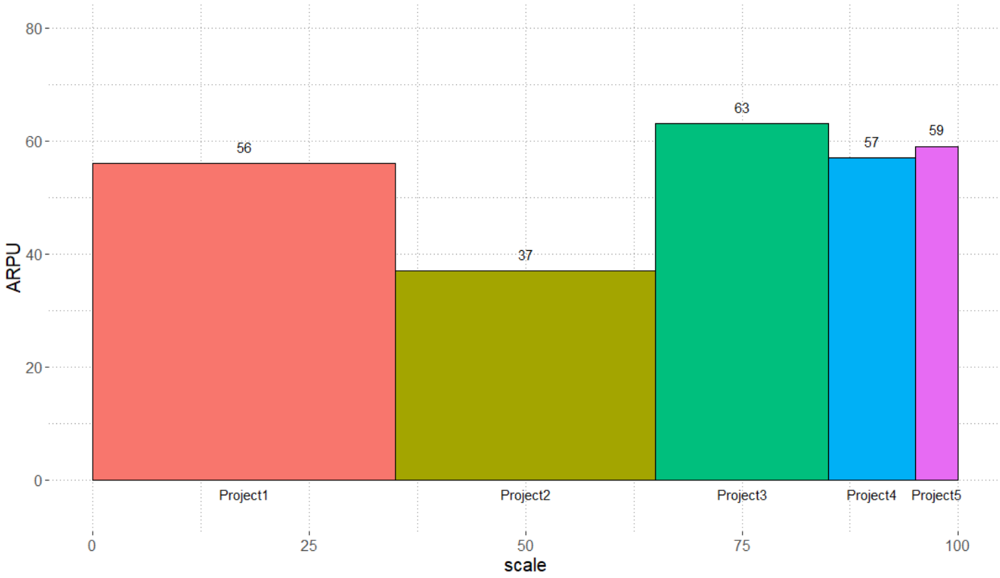

### 06.棒棒糖图

就是一根柱子加上一个圆，其实类似传统的柱状图。但是它可以给我们更多的信息，因为圆和下面的棒子可以代表同一组数据，也可以代表两组数据。“糖”和“棒子”的颜色也一样，可以表示同一个信息也可以表示不同维度的信息。

```plain
library(ggplot2)
library(reshape2)
#-------------------------------- (a)棒棒糖图 ----------------------------------------------
mydata<-read.csv("DotPlots_Data.csv",sep=",",na.strings="NA",stringsAsFactors=FALSE)
mydata$sum<-rowSums(mydata[,2:3])
order<-sort(mydata$sum,index.return=TRUE,decreasing = FALSE)
mydata$City<- factor(mydata$City, levels = mydata$City[order$ix])
ggplot(mydata, aes(sum, City)) +
  geom_segment(aes(x=0,
                   xend=sum,
                   y=City,
                   yend=City))+
  geom_point(shape=21,size=3,colour="black",fill="#FC4E07")+
  theme(
    axis.title=element_text(size=13,face="plain",color="black"),
    axis.text = element_text(size=10,face="plain",color="black"),
    legend.title=element_text(size=14,face="plain",color="black")
  )
```

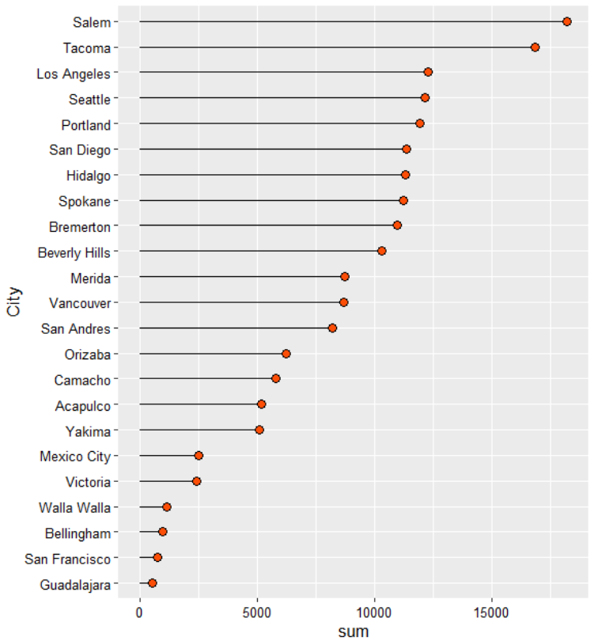

绘制棒棒糖图，有一个专门的包ggpubr

```plain
data("mtcars")
dfm <- mtcars
# 转为factor类型的数据
dfm$cyl <- as.factor(dfm$cyl)# 增加一列name
dfm$name <- rownames(dfm)
library(ggpubr)
ggdotchart(dfm, x = "name", y = "mpg",
           color = "cyl",                                # 按照cyl填充颜色
           palette = c("#00AFBB", "#E7B800", "#FC4E07"), # 修改颜色
           sorting = "ascending",
           add = "segments",                             # 添加棒子
           ggtheme = theme_pubr(),                        # 改变主题
           xlab=""
)
```

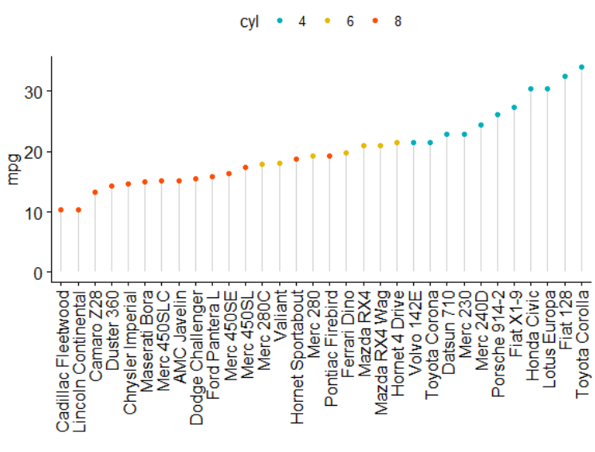

```plain
ggdotchart(dfm, x = "name", y = "mpg",
           color = "cyl",                                # 按照cyl填充颜色
           palette = c("#00AFBB", "#E7B800", "#FC4E07"), # 修改颜色
           sorting = "descending",
           add = "segments",                             # 添加棒子
           add.params = list(color = "lightgray", size = 1.5),#改变棒子参数
           rotate = TRUE,                                # 方向转为垂直
           group = "cyl",
           dot.size = 6,                                 # 改变点的大小
           label = round(dfm$mpg),                       # 添加label
           font.label = list(color = "white", size = 9,
                             vjust = 0.5),               # 设置label参数
           ggtheme = theme_pubr(),                        # 改变主题
           xlab="")
```

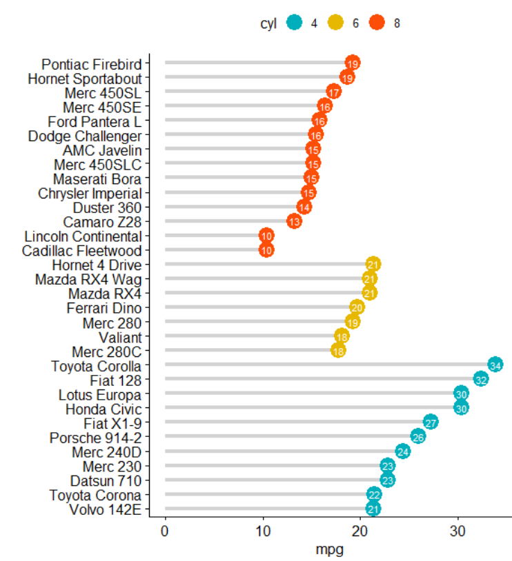

### 07.克里兰夫点图

克利夫兰点图（Cleveland'sDot Plots）：也就是我们常用的滑珠散点图，非常类似于棒棒糖图，只是没有连接的线条，重点强调数据的排序展示以及互相之间的差距。克利夫兰点图一般都是横向展示，所以Y轴变量一般为类别型变量。

```plain
###克里兰夫点图
mydata<-read.csv("DotPlots_Data.csv",sep=",",na.strings="NA",stringsAsFactors=FALSE)
mydata$sum<-rowSums(mydata[,2:3])
order<-sort(mydata$sum,index.return=TRUE,decreasing = FALSE)
mydata$City<- factor(mydata$City, levels = mydata$City[order$ix])
ggplot(mydata, aes(sum, City)) +
  geom_point(shape=21,size=3,colour="black",fill="#FC4E07")+
  theme(
    axis.title=element_text(size=13,face="plain",color="black"),
    axis.text = element_text(size=10,face="plain",color="black"),
    legend.title=element_text(size=14,face="plain",color="black")
  )
```

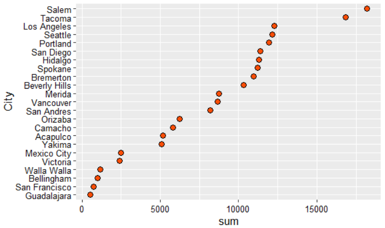

### 08.哑铃图（DumbbellPlot）

可以看成多数据系列的克利夫兰点图，只是使用直线连接了两个数据系列的数据点。哑铃图可以主要用于：1.展示在同一时间段两个数据点的相对位置（增加或者减少），2.比较两个类别之间的数据值差别。如图所示，就是展示了男性（male）和女性（Female）两个类别的数值差别，以女性（Female）数据系列的数值排序显示。

```plain
mydata<-read.csv("DotPlots_Data.csv",sep=",",na.strings="NA",stringsAsFactors=FALSE)
mydata$City <- factor(mydata$City, levels = mydata$City[order(mydata$Female)])
mydata<-melt(mydata,id.vars='City')
ggplot(mydata, aes(value,City,fill=variable)) +
  geom_line(aes(group = City)) +
  geom_point(shape=21,size=3,colour="black")+
  scale_fill_manual(values=c("#00AFBB", "#FC4E07","#36BED9"))+
  theme(
    axis.title=element_text(size=13,face="plain",color="black"),
    axis.text = element_text(size=10,face="plain",color="black"),
    legend.title=element_text(size=12,face="plain",color="black"),
    legend.background = element_blank(),
    legend.position = c(0.85,0.12)
  )
```

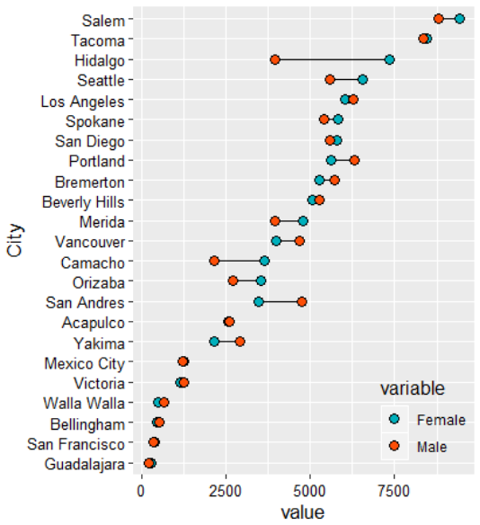

### 09.坡度图
```plain
library(ggplot2)
library(scales)
library(reshape)
#--------------------------------------(a)两年份对比---------------------------------------------------------------
df <- read.csv("Slopecharts_Data1.csv")
colnames(df) <- c("continent", "1952", "1957")
left_label <- paste(df$continent, round(df$`1952`),sep=", ")
right_label <- paste(df$continent, round(df$`1957`),sep=", ")
df$class <- ifelse((df$`1957` - df$`1952`) < 0, "red", "green")
p <- ggplot(df) +
  geom_segment(aes(x=1, xend=2, y=`1952`, yend=`1957`, col=class), size=.75, show.legend=F) +  #连接线
  geom_vline(xintercept=1, linetype="solid", size=.1) + # 1952年的垂直直线
  geom_vline(xintercept=2, linetype="solid", size=.1) + # 1957年的垂直直线
  geom_point(aes(x=1, y=`1952`), size=3,shape=21,fill="grey80",color="black") + # 1952年的数据点
  geom_point(aes(x=2, y=`1957`), size=3,shape=21,fill="grey80",color="black") + # 1957年的数据点
  scale_color_manual(labels = c("Up", "Down"), values = c("green"="#A6D854","red"="#FC4E07")) +
  xlim(.5, 2.5)
# 添加文本信息
p <- p + geom_text(label=left_label, y=df$`1952`, x=rep(1, NROW(df)), hjust=1.1, size=3.5)
p <- p + geom_text(label=right_label, y=df$`1957`, x=rep(2, NROW(df)), hjust=-0.1, size=3.5)
p <- p + geom_text(label="1952", x=1, y=1.02*(max(df$`1952`, df$`1957`)), hjust=1.2, size=5)
p <- p + geom_text(label="1957", x=2, y=1.02*(max(df$`1952`, df$`1957`)), hjust=-0.1, size=5)
p<-p+theme_void()
p
```

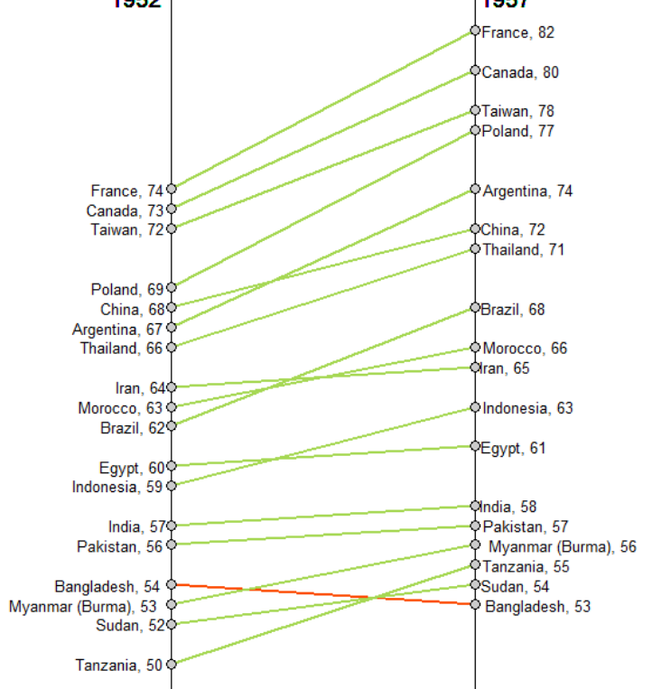

```plain
install.packages("ggalt")
library(ggalt)
df <- read.csv("Slopecharts_Data2.csv")
colnames(df) <- c("continent", 2007:2013)
df2<-melt(df, id="continent")
df2$value<-as.numeric(df2$value)
df2$variable<-as.numeric(df2$variable)
left_label<-paste(df2$continent,  round(df2$value),sep=", ")
right_label<-paste(df2$continent, round(df2$value),sep=", ")
left_point<-df2$value
right_point<-df2$value
class<-df2$variable
for (i in 1:nrow(df2))
{
  if (df2$variable[i]!=1)
  {
    left_label[i]<-""
    left_point[i]<-NaN
  }
  if (df2$variable[i]!=7)
  {
    right_label[i]<-""
    right_point[i]<-NaN
  }

  if (df[df$continent==df2$continent[i],2]>df[df$continent==df2$continent[i],8])
  {
    class[i]<-"green"
  }
  else
  {
    class[i]<-"red"
  }

}
p <- ggplot(df2) +
  geom_xspline(aes(x=variable, y=value,group=continent, colour=class),size=.75) +
  geom_vline(xintercept=1, linetype="solid", size=.1) +
  geom_vline(xintercept=7, linetype="solid", size=.1) +
  geom_point(aes(x=variable, y=left_point), size=3,shape=21,fill="grey80",color="black") +
  geom_point(aes(x=variable, y=right_point), size=3,shape=21,fill="grey80",color="black") +
  scale_color_manual(labels = c("Up", "Down"), values = c("green"="#FC4E07",  "red"="#A6D854")) +
  xlim(-4, 12)
p <- p + geom_text(label=left_label, y=df2$value, x=rep(1, NROW(df2)), hjust=1.1, size=3.5)
p <- p + geom_text(label=right_label, y=df2$value, x=rep(7, NROW(df2)), hjust=-0.1, size=3.5)
p <- p + geom_text(label="2007", x=1, y=1.02*(max(df2$value)), hjust=1.2, size=5)  # title
p <- p + geom_text(label="2013", x=7, y=1.02*(max(df2$value)), hjust=-0.1, size=5)  # title
p<-p+theme_void()+
  theme(legend.position = "none")
p
```

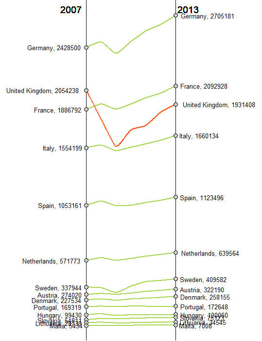

### 10.南丁格尔玫瑰图
```plain
library(ggplot2)
#----------------------------------单数据系列极坐标柱形图-----------------------------------------
mydata <- data.frame( a=c("Monday","Tuesday","Wednesday","Thursday","Friday","Saturday","Sunday"),
                      b=c(50, 60, 70, 20,90,110,30))
myAngle <-seq(-20,-340,length.out =7)
ggplot(mydata) +
  geom_bar(aes(x=a, y=b),width = 1,stat="identity",
           colour = "black",fill="#F8766D") +
  geom_text(aes(x=a,y = b-8,label = b),color="white") +
  coord_polar(theta = "x",start=0) +
  ylim(c(0,120))+
  theme_light()+
  theme( panel.background = element_blank(),
         panel.grid.major = element_line(colour = "grey80",size=.25),
         axis.text.y = element_text(size = 12,colour="black"),
         axis.line.y = element_line(size=0.25),
         axis.text.x=element_text(size = 13,colour="black",angle = myAngle))
```

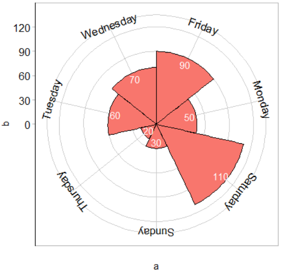

```plain
#--------------------------------多数据系列极坐标柱形图-------------------------------------------
diamonds<-cbind(diamonds,Cou=rep(1,nrow(diamonds)))
sum_clarity<-aggregate(Cou~clarity,diamonds,sum)
sort_clarity<-arrange(sum_clarity,desc(Cou))
diamonds$clarity<- factor(diamonds$clarity, levels = sort_clarity$clarity)
myAngle <-seq(-20,-340,length.out = 8)
ggplot(diamonds,aes(x=clarity,fill=color))+
  geom_bar(width=1.0,colour="black",size=0.25)+
  coord_polar(theta = "x",start=0)+
  scale_fill_brewer(palette="GnBu")+
  guides(fill=guide_legend(reverse=TRUE,title=NULL))+
  ylim(c(0,12000))+
  theme_light()+
  theme( panel.background = element_blank(),
         panel.grid.major = element_line(colour = "grey80",size=.25),
         axis.text.y = element_text(size = 12,colour="black"),
         axis.line.y = element_line(size=0.25),
         axis.text.x=element_text(size = 13,colour="black",angle = myAngle))
ggplot(diamonds,aes(x=clarity,fill=color))+
  geom_bar(width=1.0,colour="black",size=0.25)+
  coord_polar(theta = "x",start=0)+
  scale_fill_brewer(palette="Reds")+
  guides(fill=guide_legend(reverse=TRUE,title="Color"))+
  ylim(c(-2000,12000))+
  theme_light()+
  theme( panel.background = element_blank(),
         panel.grid.major = element_line(colour = "grey80",size=.25),
         axis.text.y = element_text(size = 12,colour="black"),
         axis.line.y = element_line(size=0.25),
         axis.text.x=element_text(size = 13,colour="black",angle = myAngle))
```

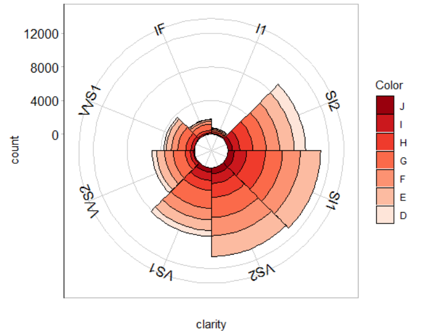

### 11.径向柱形图
```plain
library(ggplot2)
library(RColorBrewer)
df <- data.frame(item=rep(LETTERS[1:10], 5),
                 score=rep(letters[1:5], each=10),
                 value=rep((1:5), each=10) + rnorm(50, 0, .5))
myAng <-seq(-20,-340,length.out =10)
ggplot(data=df,aes(item,value,fill=score))+
  geom_bar(stat="identity", color="black", position=position_dodge(),width=0.7,size=0.25)+
  coord_polar(theta = "x",start=0) +
  ylim(c(-3,6))+
  scale_fill_brewer(palette="YlGnBu")+
  theme_light()+
  theme( panel.background = element_blank(),
         panel.grid.major = element_line(colour = "grey80",size=.25),
         axis.text.y = element_text(size = 12,colour="black"),
         axis.line.y = element_line(size=0.25),
         axis.text.x=element_text(size = 13,colour="black",angle = myAng))
```

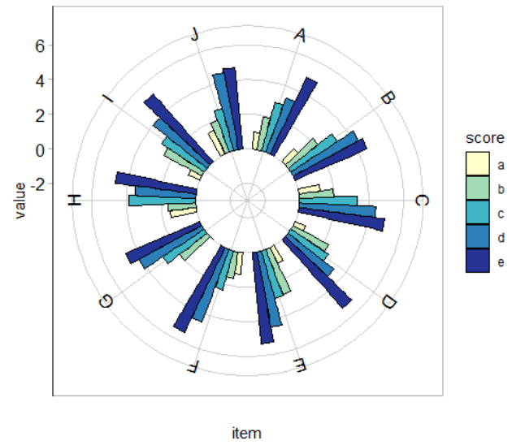

12.雷达图

```plain
library(ggplot2)
#--------------------------------------------雷达图实现原理-------------------------------------------------------
#Reference:https://github.com/cardiomoon/ggplot2new/blob/4e50b7dcfee3246a169702f88f7dd46cbf933f4b/coord_radar.R
coord_radar <- function (theta = "x", start = 0, direction = 1)
{  theta <- match.arg(theta, c("x", "y"))
r <- if (theta == "x")
  "y"
else "x"
ggproto("CoordRadar", CoordPolar, theta = theta, r = r, start = start,
        direction = sign(direction),
        is_linear = function(coord) TRUE)}
#----------------------------------------单数据系列--------------------------------------------------------------
label_data<-data.frame(car=c("Math" , "English" , "Biology" , "Music" , "R-Coding" ),
                       id=c(1:5) ,
                       value=c(12 , 2 ,14 ,20, 18))
AddRow<-c(NA,nrow(label_data)+1,label_data[1,ncol(label_data)])
mydata<-rbind(label_data,AddRow)
myAngle<- 360- 360 * (label_data$id-1) /nrow(label_data)
ggplot() +
  geom_polygon(data=mydata,aes(x=id, y=value),color = "black", fill=brewer.pal(7,"Set1")[1],alpha=0.1)+
  geom_point(data=mydata,aes(x=id, y=value),size=5,shape=21,color = 'black', fill=brewer.pal(7,"Set1")[1])+
  coord_polar() + #实现为图3-8-1(c) 的圆形雷达图
  ylim(0,22)+
  theme_light()+
  theme(axis.text.x=element_text(size = 11,colour="black"))
ggplot() +
  geom_polygon(data=mydata,aes(x=id, y=value),color = "black", fill=brewer.pal(7,"Set1")[1],alpha=0.1)+
  geom_point(data=mydata,aes(x=id, y=value),size=5,shape=21,color = 'black', fill=brewer.pal(7,"Set1")[1])+
  coord_polar() + #实现为图3-8-1(c) 的圆形雷达图
  #coord_radar()+  #
  scale_x_continuous(breaks =label_data$id,labels=label_data$car)+
  ylim(0,22)+
  theme_light()+
  theme(axis.text.x=element_text(size = 11,colour="black",angle = myAngle))
```

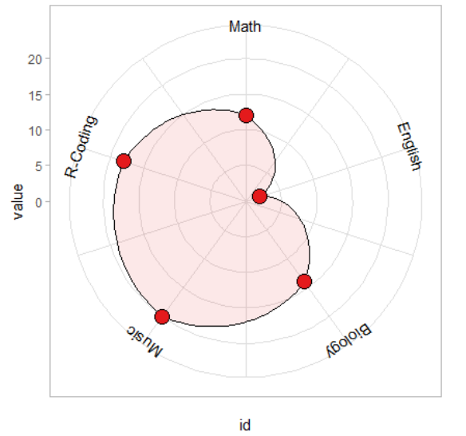

```plain
###---------------多序列数据雷达图
coord_radar <- function (theta = "x", start = 0, direction = 1)
{  theta <- match.arg(theta, c("x", "y"))
r <- if (theta == "x")
  "y"
else "x"
ggproto("CoordRadar", CoordPolar, theta = theta, r = r, start = start,
        direction = sign(direction),
        is_linear = function(coord) TRUE)}
#--------------------------------------------多数据系列-------------------------------------------------------
label_data<-data.frame(
  car=c("biology" , "english" ,"math" ,  "music" , "R-coding" ),
  id=c(1:5) ,
  v1=sample( 0:20,5, replace=T),
  v2=sample( 0:20,5, replace=T)
)
AddRow<-c(NA,nrow(label_data)+1,label_data[1,ncol(label_data)-1],label_data[1,ncol(label_data)])
mydata<-rbind(label_data,AddRow)
myAngle<- 360- 360 * (label_data$id-1) /nrow(label_data)
mydata<-melt(mydata,id=c("car", "id"))
ggplot(data=mydata,aes(x=id, y=value,group=variable,fill=variable)) +
  geom_polygon(colour="black",alpha=0.1)+
  geom_point(size=4,shape=21,color = 'black')+
  coord_radar()+
  #coord_polar() +
  scale_x_continuous(breaks =label_data$id,labels=label_data$car)+
  theme_bw() +
  ylim(0,22)+
  theme(axis.text.x=element_text(size = 11,colour="black",angle = myAngle),
        axis.title=element_text(size=15,face="plain",color="black"),
        axis.text = element_text(size=12,face="plain",color="black"),
        panel.grid.major = element_line(color="grey80"),
        axis.line = element_line(color="black"),
        axis.ticks =  element_line(color="black"))
```

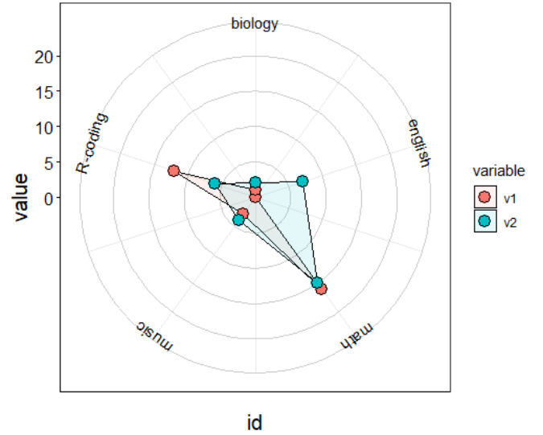

### 12.词云图

代码有错误

```plain
#install.packages("tm")
#install.packages("wordcloud")
library(tm)
library(wordcloud)
Paper1<-paste(scan("Paper1.txt", what = character(0),sep = ""), collapse = " ")
Paper2<-paste(scan("Paper2.txt", what = character(0),sep = ""), collapse = " ")
tmpText<- data.frame(c(Paper1, Paper2),row.names=c("Text1","Text2"))
df_title <- data.frame(doc_id=row.names(tmpText),
                       text=tmpText$c.Paper1..Paper2.)
ds <- DataframeSource(df_title)
corp = Corpus(ds)
corp = tm_map(corp,removePunctuation)
corp = tm_map(corp,PlainTextDocument)
corp = tm_map(corp,removeNumbers)
corp = tm_map(corp, function(x){removeWords(x,stopwords())})
term.matrix <- TermDocumentMatrix(corp)
term.matrix <- as.matrix(term.matrix)
colnames(term.matrix) <- c("Paper1","paper2")
#------------------------------------------------------------------------------------------------------
comparison.cloud(term.matrix, max.words=300, random.order=FALSE, rot.per=.15, c(4,0.4), title.size=1.4)
comparison.cloud(term.matrix,max.words=300,random.order=FALSE,colors=c("#00B2FF", "red"))
commonality.cloud(term.matrix,max.words=100,random.order=FALSE,color="#E7298A")
# comparison cloud
comparison.cloud(term.matrix, random.order=FALSE,
                 colors = c("#00B2FF", "red", "#FF0099", "#6600CC"),
                 title.size=1.5, max.words=500)
#------------------------------------------------------------------------------------------------------
df<-data.frame(term.matrix)
#Colors<-colorRampPalette(rev(brewer.pal(9,'RdBu')))(length(df$Paper1>10))
wordcloud(row.names(df) , df$Paper1 , min.freq=10,col=brewer.pal(8, "Dark2"), rot.per=0.3 )
```

## 五.箱型图
```plain
> head(InsectSprays)
  count spray
1    10     A
2     7     A
3    20     A
4    14     A
5    14     A
6    12     A
```

```plain
boxplot(count ~ spray, data = InsectSprays, col = "lightgray")
```

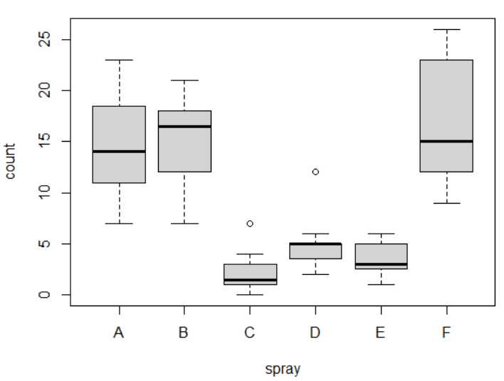

```plain
boxplot(count ~ spray, data = InsectSprays,
        notch = TRUE, add = TRUE, col = "blue")
```

notch为TRUE，在图中添加缺口，add = TRUE，添加箱线图到当前图。

```plain
boxplot(decrease ~ treatment, data = OrchardSprays, col = "bisque",log = "y")
```

log指定x轴和y轴是否以log值绘制。


```plain
boxplot(decrease ~ treatment, data = OrchardSprays, col = "bisque",log = "x", horizontal=TRUE)
```

horizontal指定横向还是纵向。

```plain
rb <- boxplot(decrease ~ treatment, data = OrchardSprays, col = "bisque")
title("Comparing boxplot()s and non-robust mean +/- SD")
mn.t <- tapply(OrchardSprays$decrease, OrchardSprays$treatment, mean)
sd.t <- tapply(OrchardSprays$decrease, OrchardSprays$treatment, sd)
xi <- 0.3 + seq(rb$n)
points(xi, mn.t, col = "orange", pch = 18)
arrows(xi, mn.t - sd.t, xi, mn.t + sd.t,
       code = 3, col = "pink", angle = 75, length = .1)
```

title添加标题，points添加点，arrows添加箭头。

```plain
mat <- cbind(Uni05 = (1:100)/21, Norm = rnorm(100),
             `5T` = rt(100, df = 5), Gam2 = rgamma(100, shape = 2))
boxplot(mat)
```

```plain
> head(mat)
          Uni05       Norm         5T      Gam2
[1,] 0.04761905 -0.8023008 -0.9392075 1.3200652
[2,] 0.09523810 -0.9918310 -0.7544264 1.7215554
[3,] 0.14285714  1.0443386  0.5406036 2.6018986
[4,] 0.19047619  0.7212886  1.2623940 4.4606805
[5,] 0.23809524  0.1094451 -0.1583871 0.3623623
[6,] 0.28571429 -0.7407029 -2.2104001 0.3264808
```


```plain
boxplot(len ~ dose, data = ToothGrowth,
        boxwex = 0.25, at = 1:3 - 0.2,
        subset = supp == "VC", col = "yellow",
        main = "Guinea Pigs' Tooth Growth",
        xlab = "Vitamin C dose mg",
        ylab = "tooth length",
        xlim = c(0.5, 3.5), ylim = c(0, 35), yaxs = "i")
```

```plain
> head(ToothGrowth)
   len supp dose
1  4.2   VC  0.5
2 11.5   VC  0.5
3  7.3   VC  0.5
4  5.8   VC  0.5
5  6.4   VC  0.5
6 10.0   VC  0.5
```


boxwex指定盒子的宽度，at是数值向量，给出框图应该绘制的位置，特别是当add = TRUE时;默认值为1:n，其中n是盒子的数量。

```plain
boxplot(len ~ dose, data = ToothGrowth, add = TRUE,
        boxwex = 0.25, at = 1:3 + 0.2,
        subset = supp == "OJ", col = "orange")
```

 subset：一种可选向量，指定用于绘图的观测值子集。


```plain
legend(2, 9, c("Ascorbic acid", "Orange juice"),
       fill = c("yellow", "orange"))
```

legend添加图注。


```plain
boxplot(len ~ dose:supp, data = ToothGrowth,
        boxwex = 0.5, col = c("orange", "yellow"),
        main = "Guinea Pigs' Tooth Growth",
        xlab = "Vitamin C dose mg", ylab = "tooth length",
        sep = ":", lex.order = TRUE, ylim = c(0, 35), yaxs = "i")
```


其他参数：

na.action：一个函数，指示当数据包含NAs时应该发生什么。默认情况是忽略响应或组中缺失的值。

names：分组标签，将打印在每个箱线图下。可以是字符向量或表达式。

一张图中绘制几个图

```plain
require(stats)
set.seed(753)
(bx.p <- boxplot(split(rt(100, 4), gl(5, 20))))
op <- par(mfrow =  c(2, 2))
bxp(bx.p, xaxt = "n")
bxp(bx.p, notch = TRUE, axes = FALSE, pch = 4, boxfill = 1:5)
bxp(bx.p, notch = TRUE, boxfill = "lightblue", frame = FALSE,
    outl = FALSE, main = "bxp(*, frame= FALSE, outl= FALSE)")
bxp(bx.p, notch = TRUE, boxfill = "lightblue", border = 2:6,
    ylim = c(-4,4), pch = 22, bg = "green", log = "x",
    main = "... log = 'x', ylim = *")
par(op)
op <- par(mfrow = c(1, 2))
## single group -- no label
boxplot (weight ~ group, data = PlantGrowth, subset = group == "ctrl")
## with label
bx <- boxplot(weight ~ group, data = PlantGrowth,
              subset = group == "ctrl", plot = FALSE)
bxp(bx, show.names=TRUE)
par(op)
```


## 六.热图绘制

数据20行，10列的数据如下：


```plain
test = matrix(rnorm(200), 20, 10)
test[1:10, seq(1, 10, 2)] = test[1:10, seq(1, 10, 2)] + 3
test[11:20, seq(2, 10, 2)] = test[11:20, seq(2, 10, 2)] + 2
test[15:20, seq(2, 10, 2)] = test[15:20, seq(2, 10, 2)] + 4
colnames(test) = paste("Test", 1:10, sep = "")
rownames(test) = paste("Gene", 1:20, sep = "")
```

最简单粗暴的绘图

```plain
pheatmap(test)
```


```plain
pheatmap(test, kmeans_k = 4)
```

kmeans_k参数按行指定聚类个数。


字符串，指示值应按行方向或列方向居中和缩放，或不按行方向缩放。对应的值是“row”、“column”和“none”

```plain
pheatmap(test, scale = "row", clustering_distance_rows = "correlation")
```


指定颜色：

```plain
pheatmap(test, color = colorRampPalette(c("navy", "white", "firebrick3"))(50))
```


cluster_row参数指定行是否聚类

```plain
pheatmap(test, cluster_row = FALSE)
```


cluster_cols指定列是否聚类

```plain
pheatmap(test, cluster_cols = FALSE)
```


legend指定是否显示图例

```plain
pheatmap(test, legend = FALSE)
```


display_numbers指定是否显示数值，fontsize_number指定字体大小。

```plain
pheatmap(test, display_numbers = TRUE)
```


number_format参数可以设置数值格式，比如保留几位小数。

```plain
pheatmap(test, display_numbers = TRUE, number_format = "\%.1e")
```

也可以指定显示的什么，什么位置显示。

```plain
pheatmap(test, display_numbers = matrix(ifelse(test > 5, "*", ""), nrow(test)))
```


legend_breaks 和legend_labels指定图例数值和标签

```plain
pheatmap(test, cluster_row = FALSE, legend_breaks = -1:4,
         legend_labels = c("0","1e-4", "1e-3", "1e-2", "1e-1", "1"))
```


cellwidth和cellheight指定小方块的宽和高，main指定图的标题，fontsize指定字体大小。

```plain
pheatmap(test, cellwidth = 15, cellheight = 12, main = "Example heatmap")
```


为行和列生成注释，说白了就是分组信息

```plain
annotation_col = data.frame(
  CellType = factor(rep(c("CT1", "CT2"), 5)),
  Time = 1:5
)
rownames(annotation_col) = paste("Test", 1:10, sep = "")
```


```plain
annotation_row = data.frame(
  GeneClass = factor(rep(c("Path1", "Path2", "Path3"), c(10, 4, 6)))
)
rownames(annotation_row) = paste("Gene", 1:20, sep = "")
```


这样就有列注释啦

```plain
pheatmap(test, annotation_col = annotation_col)
```


```plain
pheatmap(test, annotation_col = annotation_col, annotation_row = annotation_row)
```


annotation_legend就用来指定注释信息

```plain
pheatmap(test, annotation_col = annotation_col, annotation_legend = FALSE)
```


angle_col指定列标签角度。

```plain
pheatmap(test, annotation_col = annotation_col, annotation_row = annotation_row, angle_col = "45")
```


自定义注释颜色

```plain
ann_colors = list(
  Time = c("white", "firebrick"),
  CellType = c(CT1 = "#1B9E77", CT2 = "#D95F02"),
  GeneClass = c(Path1 = "#7570B3", Path2 = "#E7298A", Path3 = "#66A61E")
)
```

```plain
pheatmap(test, annotation_col = annotation_col, annotation_row = annotation_row,
         annotation_colors = ann_colors)
```


```plain
pheatmap(test, annotation_col = annotation_col, annotation_colors = ann_colors[2])
```


gaps_row:向量的行指数，显示了在热图中把差距。仅在不聚类行时使用。

```plain
pheatmap(test, annotation_col = annotation_col, cluster_rows = FALSE, gaps_row = c(10, 14))
```


cutree_col和cutree_rows根据层次聚类（使用cutree）将行划分为多少个集群，如果没有对行进行聚类，则忽略参数。

```plain
pheatmap(test, annotation_col = annotation_col, cluster_rows = FALSE, gaps_row = c(10, 14),
         cutree_col = 2)
```


labels_row和labels_col重新定义行/列标签。

```plain
labels_row = c("", "", "", "", "", "", "", "", "", "", "", "", "", "", "",
               "", "", "Il10", "Il15", "Il1b")
pheatmap(test, annotation_col = annotation_col, labels_row = labels_row)
```


指定行列的聚类算法，默认皮尔森相关。这里的dist()函数计算并返回使用指定的距离度量来计算数据矩阵的行之间的距离所计算的距离矩阵。

```plain
drows = dist(test, method = "minkowski")
dcols = dist(t(test), method = "minkowski")
pheatmap(test, clustering_distance_rows = drows, clustering_distance_cols = dcols)
```


其他参数，自行探索啦，如：show_rownames，show_colnames是否显示行列名。

下面是使用ComplexHeatmap包绘图。

参考：[https://mp.weixin.qq.com/s/jUTf1rfTZcXtxxU-KFW_ZQ](https://mp.weixin.qq.com/s/jUTf1rfTZcXtxxU-KFW_ZQ)

```r
pdf("~/Downloads/hm.pdf")

set.seed(123)
mat <- matrix(
  rnorm(50*50),
  nrow = 50
  )

group <- c(
  "MAPK",
  "PI3K-Akt",
  "ErbB",
  "Cell cycle",
  "Apoptosis"
)

split = rep(1:5, each = 10)

ha <- HeatmapAnnotation(
  empty = anno_empty(border = FALSE),
  foo = anno_block(
    gp = gpar(fill = 2:6),
    labels = group
    )
)

Heatmap(
  mat, name = "mat",
  column_split = split,
  top_annotation = ha,
  column_title = NULL
  )

library(glue)
block_group_anno <- function(group, empty_anno, gp = gpar(),
                             label = NULL, label_gp = gpar()) {
  # 获取最左侧 viewport
  seekViewport(glue(
    'annotation_{anno}_{slice}',
    slice = min(group),
    anno = empty_anno)
    )
  # 获取左下角坐标点
  loc1 <- deviceLoc(
    x = unit(0, "npc"),
    y = unit(0, "npc")
  )
  # 获取最右侧 viewport
  seekViewport(glue(
    'annotation_{anno}_{slice}',
    slice = max(group),
    anno = empty_anno)
  )
  # 获取右上角坐标点
  loc2 <- deviceLoc(
    x = unit(1, "npc"),
    y = unit(1, "npc")
  )
  # 切换到全局 viewport
  seekViewport("global")
  # 绘制矩形
  grid.rect(
    loc1$x, loc1$y,
    width = loc2$x - loc1$x,
    height = loc2$y - loc1$y,
    just = c("left", "bottom"),
    gp = gp
  )
  # 如果传递了标签，则添加标签
  if (!is.null(label)) {
    grid.text(
      label,
      x = (loc1$x + loc2$x) * 0.5,
      y = (loc1$y + loc2$y) * 0.5,
      gp = label_gp
    )
  }
}
# 将前三个热图块作为一组
block_group_anno(1:3, "empty", gp = gpar(fill = "red"), label = "Signal transduction")
# 后两个作为一组
block_group_anno(4:5, "empty", gp = gpar(fill = "green"), label = "Cellular Processes")

dev.off()
```

## 七.生存曲线

```plain
require("survival")
fit<- survfit(Surv(time, status) ~ sex, data = lung)
# Basic survival curves
ggsurvplot(fit, data = lung)
```


```plain
ggsurvplot(fit, data = lung,
           # 用于在中位生存值绘制水平/垂直线的字符向量。允许的值包括
           # c("none", "hv", "h", "v"). v: vertical, h:horizontal.中的一个
           surv.median.line = "hv", # Add medians survival

           # 修改标题和标签
           legend.title = "Sex",
           legend.labs = c("Male", "Female"),
           # Add p-value and tervals
           pval = TRUE,

           conf.int = TRUE,#如果为真，则绘制置信区间。
           # Add risk table
           risk.table = TRUE,#指定是否显示风险表的TRUE或FALSE。默认是假的。
           tables.height = 0.2,
           tables.theme = theme_cleantable(),

           # Color palettes. Use custom color: c("#E7B800", "#2E9FDF"),
           # or brewer color (e.g.: "Dark2"), or ggsci color (e.g.: "jco")
           palette = c("#E7B800", "#2E9FDF"),
           ggtheme = theme_bw() # Change ggplot2 theme
)
```


改变字体大小，风格和颜色

```plain
ggsurvplot(fit, data = lung,  main = "Survival curve",
           font.main = c(16, "bold", "darkblue"),
           font.x = c(14, "bold.italic", "red"),
           font.y = c(14, "bold.italic", "darkred"),
           font.tickslab = c(12, "plain", "darkgreen"))
```


## 八.火山图
```plain
colr <- brewer.pal(9,"Set1")[c(3,9,1)]
ggplot(data = diff, aes(x = logFC, y = logP, color = Group)) +
  geom_point(alpha=0.8, size = 2) +
  theme_bw(base_size = 15) +
  theme(panel.grid.minor = element_blank(),
        panel.grid.major = element_blank()) +
  scale_color_manual(values=colr)+
  scale_fill_manual(values =colr)+
  labs(x="log(Fold change)",y="-log(P value)")+
  theme(legend.title = element_blank(),
        legend.text = element_text(size = 8, face = "bold"),
        legend.margin = margin(t = 0, r = 0, b = 0, l = 0, unit = "pt"),
        legend.direction = "horizontal",
        legend.position = c(0.5,0.96),
        legend.background = element_blank(),
        panel.background = element_rect(fill = "transparent",colour = "black"),
        plot.background = element_blank())
```

> 更新: 2026-11-01 11:56:33
> 原文: <https://www.yuque.com/doublehelix/bioinfonotes/dgktlz>
