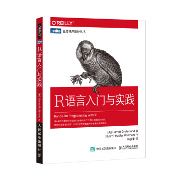
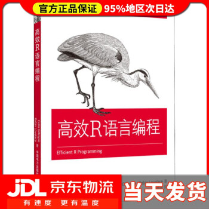
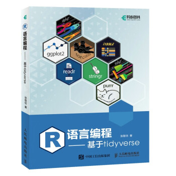
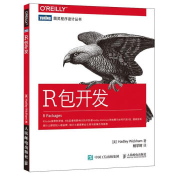
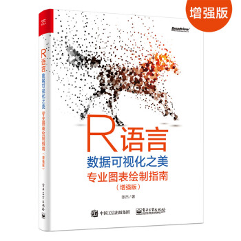

# 参考书籍

参考书籍：

R语言入门与实践：京东优惠购买链接：[https://u.jd.com/js67zAf](https://u.jd.com/js67zAf)

高效R语言编程：[https://u.jd.com/jz6lqOp](https://u.jd.com/jz6lqOp)

[https://u.jd.com/jz6XtHh](https://u.jd.com/jz6XtHh)

R包开发：京东优惠购买链接：[https://u.jd.com/ju6cEMs](https://u.jd.com/ju6cEMs)

R语言数据可视化：[https://u.jd.com/jq676Pr](https://u.jd.com/jq676Pr)

> 更新: 2024-02-05 18:01:36
> 原文: <https://www.yuque.com/doublehelix/bioinfonotes/gz6po96qv1n9bbcu>
