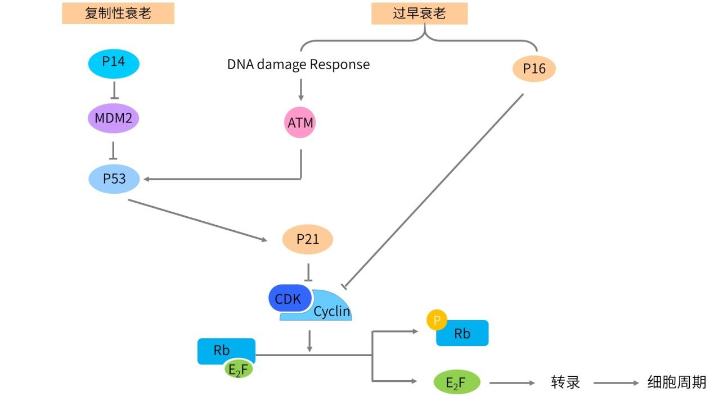

# 细胞衰老

## 一.细胞衰老现象的发现及分类
### 1、细胞衰老的发现——Hayflick 极限

细胞衰老现象最早在 1961 年被报道。因为在 1961 年，美国生物学家 Leonard Hayflick 在体外培养正常人的成纤维细胞时发现，即使给予细胞生长最适宜的条件，细胞分裂至一定代数时也会发生衰竭，从而使细胞周期进入了一种“不可逆”的停滞状态。基于此种现象，Hayflick 首次提出了细胞衰老的概念（cellular senescence）。而这种细胞的增殖能力的极限，则被称为 Hayflick 极限（Hayflick limit）。机制研究表明，这种现象是因为细胞随着复制次数越来越多，从而导致端粒的缩短和端粒酶活性的降低。后来，随着研究的深入，研究人员发现，有很多因素都可能导致细胞衰老，除了端粒缩短而导致的细胞衰老之外，其他的体外刺激，也同样可以诱导细胞发生衰老现象，常见的体外刺激包括活性氧自由基的产生、癌基因的表达或抑癌基因的失活、化疗和放疗以及诱导细胞发生重编程等刺激。细胞衰老已经成为生命科学和医学研究中的一个热门研究领域。目前，关于细胞衰老相关的文献报道不断增加。特别是在 2000 年以后，研究衰老的相关文献更是有了突飞猛进的发展。

### 2、细胞衰老的分类

目前，对于细胞衰老（cellular senescence）的定义是，随着时间的推移或面临外界应激压力时，细胞的正常生理功能和增殖能力发生逐渐地衰退，从而脱离细胞周期的过程。整个细胞衰老过程和机体的衰老及疾病等，都具有重要的关联。最初研究人员认识到正常培养的成纤维细胞发生衰老的主要原因是因为端粒的缩短--即 Hayflick 极限。但是随着对于细胞衰老现象的研究不断地深入，发现各种对细胞的刺激，应激反应以及 DNA 损伤等刺激，都可能引起细胞的衰老。因此，按照细胞衰老的诱发因素进行分类，衰老可以细分为：1.端粒诱导的细胞衰老（Telomere-induced senescence）；
2.癌基因诱导的衰老（Oncogene-induced senescence，OIS）；
3.氧化应激诱导的细胞衰老（Oxidative stess-induced senescence）；
4.治疗诱导的细胞衰老（Treatment-induced senescence，TIS）；
5.重编程诱导的细胞衰老（Reprogramming-induced senescence，RIS）等等。这些发现逐渐丰富了我们对于细胞衰老发生原因的认识，而且促进了细胞衰老领域内分子机制的研究。但是按照细胞衰老的诱发因素进行分类，显得太过于琐碎，而且新的能诱发细胞衰老的诱因，还在不断地被发现，因此这种分类方法极易引起混淆。所以，有学者干脆按照细胞发生衰老的机制进行了分类。因为正常培养的细胞之所以发生细胞衰老，是因为细胞多次增殖分裂之后，端粒缩短，使得细胞达到了正常细胞分裂的极限，也就是 Hayflick 极限，因此，有学者把这种由生理性原因引起的细胞衰老，称之为复制性细胞衰老（Replicative senescence）。而其他诱因导致的细胞衰老，都是由于各种各样的其他刺激（例如，癌基因突变，氧化应激刺激，治疗刺激等等），从而导致细胞在达到 Hayflick 极限之前，就开始了细胞的衰老过程。如果说细胞在达到 Hayflick 极限之后，发生衰老现象是正常的衰老过程的话，那么由于外在的各种刺激导致细胞在 Hayflick 极限之前就发生了衰老现象，被称之为过早衰老（premature senescence），也被称之为加速衰老现象（accelerated senescence）。因此，上述按照细胞衰老的诱因而进行的分类，可以将端粒诱导的细胞衰老归入复制性细胞衰老；而其他外在刺激诱导的细胞衰老，都可以统一归入过早衰老的范畴。

#### 1）复制性衰老

复制性衰老现象是由于细胞因为不断地分裂导致端粒缩短，从而诱导细胞发生衰老的现象。端粒是位于染色体末端的 DNA 重复序列（在脊椎动物细胞中，其序列是 TTAGGG）以及结合在这段 DNA 重复序列之上的核蛋白复合物所共同组成的复杂结构。端粒的作用是在染色体末端维持基因组的稳定性。正常细胞端粒的长度会随着 DNA 的复制而不断地缩短。当端粒 DNA 缩短到一定程度时，细胞会自动开启衰老程序，这个过程就被称之为端粒缩短诱导的细胞衰老（Telomere-induced senescence），也可以被称之为复制性细胞衰老（Replicative senescence）。现在认为，端粒缩短和功能异常可能会引起细胞 DNA 损伤应答（DNA damage response，DDR），导致的细胞衰老的发生；相反，如果过表达端粒逆转录酶（Telomere reverse transcriptase，TERT）则可以推迟或者避免正常细胞发生复制性衰老，从而使得细胞产生永生化。但是端粒酶活性的增加，并不能阻断癌基因诱导的细胞衰老或者其他应激反应引起的细胞衰老。这说明，由端粒诱导的复制性细胞衰老现象和由应激反应而诱导的过早衰老现象，其下游的机制是不同的。

#### 2）过早衰老

由于外在的各种刺激，导致细胞在 Hayflick 极限之前就发生了衰老现象，被称之为过早衰老（premature senescence），也被称之为加速衰老现象（accelerated senescence）。常见的过早衰老现象包括癌基因诱导的细胞衰老、氧化应激诱导的细胞衰老、治疗诱导的细胞衰老和细胞重编程诱导的细胞衰老现象。

##### a）癌基因诱导的细胞衰老

1997 年，有学者将癌基因 Ras 分别转入人和小鼠的成纤维细胞，结果这些转入了癌基因的细胞大部分都变得扁平，并且发生了永久性的 G1 期细胞周期阻滞现象。除此之外，细胞内还发生了 p53、p16 等蛋白过度积累的情况。这种现象就是后来被命名为癌基因诱导的细胞衰老现象（Oncogen-induced senescence，OIS）。而在细胞内过表达 Ras 也成为了诱导 OIS 最常用的细胞模型。此外，其他的癌基因，例如 c-Myc、BRAFE600 等癌基因的活化，也被报道在特定条件下可以诱导细胞发生衰老。除了癌基因的激活之外，抑癌基因 PTEN 的失活，也可以诱导细胞发生衰老。因此，这种现象虽然被称为癌基因诱导的细胞衰老现象，但是抑癌基因的失活诱导的细胞衰老现象，也被包含在这个概念之中，因此，不要被名字所迷惑。有观点认为癌基因诱导的细胞衰老过程中，同样激活了 DNA 损伤反应（DNA damage response，DDR），从而导致了细胞衰老现象的发生。另有观点认为，癌基因激活后（或者抑癌基因失活后），还可以在某些处于癌前病变的细胞内，诱导端粒功能的紊乱，加速了细胞衰老的产生。随着研究不断地深化，癌基因诱导的细胞衰老现象，已经被认为是体内抵抗肿瘤发生的重要屏障，细胞衰老和肿瘤的发生/发展现象之间具有复杂的相互关联。

 所以总结一下，衰老现象可以根据发生的机制，分为复制性衰老和过早衰老。所谓的复制性衰老指的是细胞由于不断地分裂，造成端粒缩短，从而达到 Hayflick 极限，导致细胞退出细胞周期的现象。如果由于外界的刺激，导致细胞在达到 Hayflick 极限之前，就开始进入衰老过程，这种现象被成为细胞的过早衰老现象。能导致细胞过早衰老的刺激有：癌基因诱导的细胞衰老、氧化应激诱导的细胞衰老、治疗诱导的细胞衰老和细胞重编程诱导的细胞衰老等等。

##### b）氧化应激诱导的细胞衰老

同样在 197 年，另有研究人员在培养的成纤维细胞内，加入了 H2O（过氧化氢，双氧水），之后观察到细胞受到 H2O 刺激，出现氧化应激反应之后，出现类似衰老的现象。在研究由癌基因 Ras 过表达而诱导的细胞衰老过程中，研究人员也发现在不同氧气浓度条件下，Ras 诱导细胞发生衰老现象的能力也是不同的。以上两种现象，促使研究人员意识到氧化应激反应对细胞衰老现象具有促进作用。产生氧化应激的主要原因是细胞内游离的活性氧自由基 ROS。在细胞培养基中加入 H2O，或者通过抑制超氧化物歧化酶 SOD1，从而间接在细胞内提高 ROS 的浓度，都可以诱导细胞衰老的发生。活性氧自由基 ROS 可以通过两种途径引起细胞衰老：1）第一种方式是 ROS 氧化细胞内的 DNA、脂类物质、蛋白等生物大分子，从而破坏细胞的结构和功能，诱导细胞发生衰老；2）第二种方式是 ROS 直接作为细胞内的第二信使，调节细胞内的信号传导通路，诱导细胞发生衰老现象。

##### c）治疗诱导的细胞衰老

肿瘤患者常接受放疗和化疗作为治疗肿瘤的手段。研究发现，肿瘤的放化疗都可以诱导细胞发生衰老现象。常见的放化疗处理有顺铂处理，阿霉素处理或者伽马射线等。有意思的是，当化疗采用较低的药物浓度或者放疗采用较低的放射强度时，这样的放化疗处理能诱导细胞发生衰老现象；反之，如果采用较高的化疗药物浓度或者较强的放射强度，往诱导细胞发生凋亡。放化疗治疗诱导的细胞衰老的主要原因，也是导致了细胞内 DNA 的损伤，而部分化疗药物引起细胞内 ROS 的产生或者因放化疗而在细胞内导致了端粒酶活性受到抑制，从而同样参与诱导细胞衰老，并且有可能加速了细胞的衰老过程。有学者特别提出，在机体接受放化疗治疗之后，虽然肿瘤细胞发生衰老，退出细胞周期，丧失了增殖能力，但是这些细胞具有潜在的致瘤性，而且肿瘤细胞在发生衰老现象后，可能会通过 SAP 现象（也就是衰老相关分泌表型 senscene asociated secrtion phenotype，在后面的内容中我们会进一步介绍），促进肿瘤的进展或者转移。

##### d）细胞重编程诱导的细胞衰老

在 2006 年，日本京都大学的山中伸弥教授带领的科研团队，从胚胎干细胞相关的很多候选基因中筛选出四个基因—Oct4、Sox2、KLF4 和 c-Myc，然后通过逆转录病毒将这四个基因导入小鼠胚胎成纤维细胞之内，结果发现这四个基因导入后的胚胎成纤维细胞会发生重编程现象，形成类似胚胎干细胞的细胞，被称为诱导多能干细胞（induced pluripoten stem cel，iPSC）。iPSC 的产生效率非常低下，原因是细胞衰老现象是抑制重编程效率的重要原因之一。如果抑制细胞衰老相关通路，可以显著地提高 iPSC 的重编程效率。另外，还有研究人员发现，在产生 iPSC 的过程中，导入了这四个重编程因子之后，会诱导细胞发生衰老现象，从而阻碍 iPSC 的产生效率，这种现象就被称为重编程诱导的细胞衰老。

## 二.细胞衰老的基本特征

虽然引起细胞衰老的诱导因素很多，介导不同类型细胞衰老的分子机制也差异很大，但是发生衰老现象的细胞，依然表现出了一系列类似且特异性的特点，这些特点可以作为判断细胞衰老的标准。

### 1.细胞周期阻滞

细胞衰老最基本的特征之一，就是细胞长久地处于细胞周期的阻滞现象或者永久退出细胞周期，因此细胞周期阻滞现象是在体外鉴定细胞衰老最基本也是最不可或缺的指标之一。有研究表明，发生衰老的成纤维细胞在体外持续培养超过 12 个月，成纤维细胞依然无法重新进入细胞周期，甚至在有丝分裂原的刺激之下依然不能进行细胞分裂。检测细胞是否发生细胞周期阻滞的方法有很多。例如，通过检测 Ki67 反应细胞的增殖状态；通过 Brdu 渗入实验检测细胞内 DNA 的复制合成情况，或者通过流式细胞术结合 PI 染色的方法检测细胞在不同细胞周期内的分布情况等。这些都是常用的用于检测细胞周期阻滞的方法，在我们之前的内容中，都有所涉及，不再过多叙述。

### 2.细胞形态的改变

发生衰老的细胞和正常细胞相比，在形态上具有显著不同的特征。例如，衰老细胞通常会表现出细胞变得扁平，整个细胞的胞体和细胞核的体积会变大，细胞质内出现的颗粒会明显增加。产生这些形态学变化的主要原因，可能是因为在衰老的细胞内，蛋白质的降解体系受到抑制，从而导致蛋白质在衰老细胞的胞浆内持续地积累，以及衰老细胞中高尔基体和溶酶体增多造成的。但是需要注意的是，上述这些典型性的细胞形态学变化并非绝对的。因为在不同类型的细胞内诱导衰老所形成的形态变化是不同的。而且即便是同一类型的细胞，由不同原因而导致的细胞衰老现象，表现出来的形态学变化也是不同的。因此，细胞在衰老后的形态学变化只能作为判断细胞衰老的辅助性证据。

### 3.端粒缩短

端粒是位于生物体内染色体末端的一段特殊的 DNA 片段。在这段片段中含有许多简单的重复序列。在正常情况下哺乳动物体细胞中，可以合成端粒的端粒酶的活性是受到抑制的，因此随着细胞分裂次数增加，染色体末端的端粒长度不断地缩短，细胞分裂和 DNA 的复制能力越来越受到限制。因此，检测端粒的缩短现象是细胞衰老的特征之一。检测端粒长度的经典方法是 southern 限制性内切酶酶切产生末端片段。但是这种方法所需样品量多，操作费时费力。更加需要注意的是，有些过表达了 p16 的细胞中并没有发生衰老现象，但是有时也可以检测到端粒缩短和端粒的功能紊乱。而且由应激引起的细胞衰老现象中并没有端粒缩短现象的出现，所以端粒缩短现象不算是一个很好、很可靠的细胞衰老的标志物，只能说具有一定的参考价值。

### 4.衰老相关异染色质集落的形成（SAHF）

细胞要具备正常的生理功能和机能，依赖于细胞基因组的完整性。在某些外界刺激作用下，例如紫外线照射、化疗药物处理或者过氧化物刺激之后，细胞内产生多种信号，增加了细胞内活性氧自由基 ROS 的水平，或者引起了细胞内 DNA 的损伤、DNA 片段的丢失、DNA 链断裂、染色体移位等，从而导致发生衰老的细胞内，产生衰老相关异染色质集落（senscen asociated hetrochromatic foci，SAHF）。SAHF 现象在衰老的细胞内，主要表现为细胞内染色质凝集，DNA 凝结成散在的、致密的、大小不均一的异染色质颗粒。可以在细胞内通过 DAPI 染料对衰老细胞的 DNA 进行染色标记，在荧光显微镜下可以观察到在衰老细胞内有这种异染色质集落的形成现象。有观点认为，SAHF 的形成和 p16 信号通路密切相关。SAHF 的形成和维持过程中，组蛋白的甲基化修饰以及组蛋白相互结合蛋白的一系列变化。这些变化包括在发生衰老的细胞内，1）H3 组蛋白第 9 位赖氨酸的三甲基化（H3K9me3）水平会提高；2）异染色质蛋白 1（hetrochromatin protein 1，HP1）、高迁移率 A 族蛋白（ hig-mobilty group A protein, HMGA ）和组蛋白甲基转移酶 Suv39h1（supresorf variegation 3-9 homlog 1）等分子的表达都有变化。这些分子及 H3K9 的甲基化水平的变化，都可以作为检测细胞发生衰老的标志。

### 5.衰老相关分泌表型（SAP）

衰老的细胞除了表型出一定的特征性的细胞和分子的表征之外，还可以分泌一系列细胞因子，这些细胞因子通过自分泌或者旁分泌的方式作用于衰老细胞本身，或者作用于衰老细胞周围的其他细胞，从而改变了衰老细胞及其周围的微环境。细胞由于发生衰老现象，从而分泌的一系列的细胞因子，并改变衰老细胞自身或者周边微环境的现象，就被称为衰老相关分泌表型（ senscen asociated secrtory phenotype ，SAP ），或者被称为衰老信息分泌组（senscen-mesagin secrtome，SMS）。衰老细胞可以分泌的细胞因子很多，例如，胰岛素样生长因子（insulin-ke growth factor，IGF）、转化生长因子β（transformingrowth factor- β，TGF-β）、白介素（interlukin，IL）、I 型纤溶酶原激活物抑制剂（Plasminogen activator inhbitor 1，PAI-1）等。其中，IL-6（白介素-6）是非常重要的由衰老细胞所分泌的细胞因子。IL-6 的分泌直接由 DNA 损伤信号通路调控，被认为和细胞衰老密切相关。衰老细胞通过 SAP 机制从而将衰老细胞和其周围的细胞微环境联系在了一起。尤其在肿瘤发生过程中，SAP 机制被认为具有双重的调控作用，一方面发生衰老的细胞，通过 SAP 机制加速衰老细胞的生长停滞，促进机体启动免疫系统清除衰老的细胞，避免肿瘤的形成；但是另一方面，衰老细胞通过 SAP 机制所分泌的细胞因子通常可以引起炎症反应，参与破坏组织结构的完整性，甚至诱导细胞发生上皮间质转化 EMT 现象，也可能促进细胞癌变和癌细胞的增殖。但是 SAP 现象只能作为判断衰老的一个辅助标准，因为一些长期细胞或者病毒的感染、或者伤口愈合过程以及肿瘤发生过程中，受到感染或者发生癌变的细胞，同样可以分泌细胞因子，这类因子和衰老细胞通过 SAP 机制而分泌的细胞因子很相似。因此仅只是通过分析由细胞所分泌的细胞因子的种类，是不能准确判定细胞是否发生衰老现象的，因此 SAP 现象只是衰老现象的一个辅助指标。

### 6.衰老相关分子的变化（分子标志物）

在衰老过程中会有一些特异性的分子标志物的表达变化，通过检测这些特异性的分子标志物，可以对衰老现象进行鉴别。接下来，我们就开始介绍和衰老相关的分子标志物。需要特别说明的是，即便检测了衰老相关的分子标志物，也需要和其他衰老相关的特征相互结合，才能准确判定细胞衰老现象。任何依靠单一指标的检测，都是不全面的。

#### （1）衰老相关 β-半乳糖苷酶活性的改变

首先介绍的就是大名鼎鼎的 SA-β-gal。这个分子的全称是 senescence-associated β galactosidase，衰老相关-β-半乳糖苷酶。它是目前应用最为广泛的细胞衰老的标志物之一，可以将发生衰老的细胞和处于分裂静息期或者是终末分化状态的细胞区分开来。在衰老的细胞内，SA-β-gal 是由细胞溶酶体中的 β-gal（β-半乳糖苷酶）衍生而来的。β-gal 在正常的人体细胞中主要表达在溶酶体中，最适宜的 pH 范围是 4-4.5。但是在发生衰老的细胞内，细胞的溶酶体开始膨胀，数量也增加，β-半乳糖苷酶在溶酶体中积聚，而且使得 β-gal 的最适 pH 范围发生了迁移，从正常细胞内的 4-4.5 迁移到衰老细胞内的 pH 6.0。因此，当细胞发生衰老时，β-gal 在 pH6.0 时，表现出高的酶活性。在检测衰老细胞时，可以人为给予 β-gal 的作用底物 X-gal 和 pH6.0 的环境，结果衰老细胞可以在 β-半乳糖苷酶的作用下，将底物转变为深蓝色的产物，使得发生衰老的细胞在普通光学显微镜下即可观察到。检测 SA-β-gal 的方法操作简单，但是这种方法具有一定的局限性。首先，β-gal 在正常生理条件下也表达于一些非衰老的细胞中，例如破骨细胞、成熟的巨噬细胞等。其次，正常情况下在中性的 pH 环境下，β-gal 几乎不表达；但是在细胞接受强的电离辐射之后，在 1 个小时内细胞内的 β-gal 就可以表现出极高的酶活性，因此会给细胞衰老的判断带来极大的干扰。所以通过检测 SA-β-gal 的方法鉴定细胞衰老，需要谨慎，尤其是研究溶酶体活动旺盛的细胞、或者研究 DNA 受到损伤的细胞、与炎症和肿瘤相关的巨噬细胞时，要防止误判。

#### （2）和细胞周期相关的分子标志物

细胞衰老的主要的特征之一就是细胞永久性地退出细胞周期。因此很多细胞周期相关蛋白都在细胞衰老过程中起到重要的作用，可以作为细胞衰老的标志物。

##### A）p16/p14

我们之前介绍了细胞周期相关的分子，其中提到了一个基因叫做 CDKN2A，cylin-depndent kinase inhbitor 2A，细胞周期素依赖性蛋白激酶抑制因子 2A。我们还特别提到这个 CDKN2A 基因编码了两个重要的细胞周期调控蛋白 p14 和 p16。p14 和 p16 是两个不同的蛋白，发挥不同的功能。p14 和 p16 相比，有共同的外显子 2 和 3，但是它们的外显子 1 是不同的。P14 是外显子 1β；而 p16 是外显子 1α。由于 p14 和 p16 的外显子 1 不同，而且发生了读码框的移位，导致 p14 和 p16 的蛋白序列也是不同的。P16 的分子量是 16 kD，由 156 个氨基酸残基组成，大约 75% 的癌细胞株中都存在 p16 蛋白的缺失或者突变。在衰老的细胞内，P16 调控了 CDK4 和 CDK6 进而影响了 Rb 信号通路，阻断细胞周期，促使细胞发生细胞衰老现象，因而 p16 分子可以作为细胞衰老的标志物之一。有研究发现，在通常情况下,p16 蛋白在健康且没有应激压力反应的组织细胞内，表达量很低，但是在衰老的细胞，受到损伤的细胞和初期的肿瘤细胞内，p16 的表达会明显地升高，因此 p16 的表达具有明显的动态特性。如果作为细胞衰老的标志物，p16 具有较大的局限性。第一，某些没有衰老的细胞，例如部分免疫细胞或者肿瘤细胞内，同样高表达 p16。譬如，多次复制的 T 细胞内就积累了大量的 p16 蛋白，但是细胞却并不表达其他的衰老标志物。而且分离出这类高表达 p16 的细胞后，如果给予这些细胞以适宜的细胞培养条件，细胞能重新进入细胞周期。由此可知，单纯检测 p16 蛋白的高表达，不能准确判定细胞的衰老状态；其次，某些类型的衰老细胞中却不表达或者低表达 p16 蛋白。所以，使用 p16 作为衰老标志物需要谨慎。CDKN2A 基因所编码的另一个蛋白 p14，可以作为 p53 信号的上游信号通路，通过 p14-MDM2-p53 信号通路，从而参与调控细胞的衰老过程。因此，有些学者也认为，p14 分子也可以作为细胞衰老的标志物之一。但是，我们不推荐使用 p14 作为细胞衰老的标志物，因为 p14 作为调控 p53 信号通路的关键调控因子之一，广泛参与 p53 通路的调控。而 p53 通路的作用范围又是如此地广泛，会导致几乎所有发生 p53 通路发生变化的细胞内，几乎都可以检测到 p14 蛋白的变化。因此，检测 p14 的蛋白变化，根本不能表征细胞衰老的现象，反而只能带来干扰。

##### B）p21

编码 p21 的基因是 CDKN1A，cylin-depndent kinase inhbitor 1A，细胞周期素依赖性蛋白激酶抑制因子 1A，基因位于人 6 号染色体上，分子量是 21 kD，由三个外显子编码的 164 个氨基酸残基组成。P21 的表达受到 p53 的调控，并且参与了细胞周期和衰老相关的信号传递通路。有研究发现，在小鼠中敲除 CDKN1A 基因后，小鼠细胞内出现 G1-S 和 G2-M 检查点（check point）的功能紊乱，从而导致小鼠体内产生更多的肿瘤。进一步的研究发现，p16 也同样介导了细胞的衰老现象。具体的通路和机制，我们会在“细胞衰老相关信号通路”

这部分内容中进行介绍。

#### （3）其他标志物分子

在细胞发生衰老现象之后，衰老细胞会表达一系列的分子水平的特征性变化，主要包括了肿瘤抑制分子网络和细胞周期抑制通路的变化。在细胞衰老过程中，p53-p21 通路和 p16-Rb 通路是介导大多数细胞衰老现象的最主要的信号通路，也是肿瘤抑制分子网络的主要组成部分。在这个信号网络中主要的分子除了有上面我们提到的 p14、p16、p21 之外，其他的分子还有 p53、p27、Rb 等等。除此之外，还有一些其他的分子可以作为体内外判断细胞衰老的分子标志物，例如 DCR2 （decoy death receptor 2）、DEC1（differentiated embryo-chondrocyte expressed gene 1）以及 HP-1、HMGA 等分子，它们的表达变化也可以作为检测细胞衰老的标志物。此外，近年来，还有研究发现在细胞衰老时，衰老细胞的某些骨架蛋白发生了特异性的改变。采用激光扫描细胞仪（LSC，laser scanning cytometer）观察和比较正常细胞和衰老细胞的细胞核的相对大小，同样可以区分衰老细胞和正常细胞。总而言之，无论是采用经典的方法，还是最新的技术，细胞衰老的各种特征不是绝对特异的。不能仅仅根据细胞衰老的某一个特征来检测和判断细胞的衰老现象。因此，在研究细胞衰老现象时，需要根据细胞的多种特性综合而全面地分析，从而才能正确判断细胞是否发生了衰老现象。

## 三.细胞衰老相关信号通路

细胞衰老现象的出现是由于细胞因为某种自身或者外界的刺激，从而导致细胞永久性地退出细胞周期的现象和过程。因此，介导细胞衰老的通路和介导抑制细胞周期的通路具有极高的相似性。

我们先细胞周期中介绍过的一些知识点：

1)MDM2-p53 相互作用：在正常的细胞内 MDM2 和 p53 相互结合，并且抑制了 p53 的功能和活性，促进了 p53 的蛋白降解，从而始终在正常细胞内保持 p53 的低表达。

2）Rb 通路：当细胞处于非分裂状态时，细胞内的 Rb 处于非磷酸化的状态，而且非磷酸化的 Rb 和转录因子 E2F 相互结合，从而绑定了 E2F，抑制了 E2F 转录的活性。在细胞发生正常分裂时，生长因子或者有丝分裂原和相应的受体结合，通过信号通路传递促进 cyclin 基因表达；随后 cyclin 和相应的 CDK 相互结合，形成 cyclin-CDK 激酶复合物，促进 Rb 蛋白的磷酸化，形成磷酸化 Rb---即 pRb。磷酸化的 pRb 和 E2F 分离，重获自由的转录因子 E2F 进入细胞核内，调控了下游基因的转录，这些受到 E2F 转录调控的基因产物促使细胞进入细胞周期。在了解了上述知识点之后，我们来看看，当细胞发生衰老时，衰老的细胞内究竟发生了什么样的信号传导。

### 1.复制性衰老的通路

首先，当细胞随着增殖和分裂的次数越来越多，细胞内染色体上的端粒末端的序列也不断地丢失，导致端粒的序列越来越短。当端粒缩短到无法维持染色体结构的完整性的时候，细胞内的 p14 被激活。激活的 p14 能抑制 MDM2 的活性，从而间接地促进了 p53 的稳定并激活了 p53 的活性。激活后的 p53 可以入核，调控下游基因的转录表达。在 p53 的下游基因中，最重要的就是 CDKN1A 以及由 CDKN1A 基因编码的 p21 蛋白。p21 表达升高后，抑制了 cyclinE/CDK2 复合物的活性，使得磷酸化的 pRb 蛋白转变为非磷酸化的 Rb 蛋白。非磷酸化的 Rb 蛋白重新结合转录因子 E2F，使得 E2F 不能激活细胞周期所必需的基因表达，促使细胞发生 G0/G1 期细胞周期阻滞，无法进入 S 期，也无法启动染色体复制，抑制了细胞的分裂和增殖，最终启动细胞的复制性衰老。当细胞发生衰老现象时，通过 p14-MDM2-p53-p21-pRb 通路，促使细胞退出细胞周期，并启动细胞衰老的进程，在整个过程中，p14 的激活是整个通路的上游起始诱因，通过下游的 p53 通路和 Rb 通路，最终实现细胞退出细胞周期并开始衰老的整个过程。

### 2.过早衰老的通路

上述提到的通路主要介导细胞的复制性衰老，主要由端粒缩短到无法维持染色体的结构完整性而激活 p14 开始，最终实现激活 p53 通路和 Rb 通路，介导了细胞的复制性衰老过程。但是当细胞受到外界刺激而发生过早衰老时，下游的信号通路和复制性衰老的通路略有差异。在细胞受到外界刺激时，往往会导致细胞内的 DNA 发生损伤，从而引起 DNA 损伤反应（DNA damage response），在这个过程中 ATM 基因被 DNA 损伤反应所激活。ATM 激活后，促进了 p53 的磷酸化，并激活 p53 的功能。随后 p53 调控下游 p21 的转录，使得 p21 表达升高。表达升高后的 p21 再通过 Rb 通路，抑制 E2F，促使细胞退出细胞周期并开始衰老过程。在这条通路中，除了 p53 的激活，由 ATM 激活之外，p53 及其下游通路和复制性衰老过程中的通路是类似的。差别只是在激活 p53 的起始诱因上的差异：当细胞发生复制性衰老时，细胞内 p14 激活，然后通过 MDM2 间接地激活 p53；而当细胞发生过早衰老时，细胞内发生 DNA 损伤反应，激活 ATM 再激活 p53 通路。在细胞发生过早衰老时，除了上面提到的 ATM-p53-p21-Rb 通路之外，发生过早衰老的细胞还能促进细胞内 p16 的表达上升和功能激活。p16 是一种 CKI，也就是 CDK4 和 CDK6 的活性抑制剂。因此，当 p16 表达升高后，通过抑制 CDK，进而抑制了 CDK/cyclin 复合物，从而促使磷酸化的 pRb 转变为非磷酸化的 Rb。非磷酸化的 Rb 结合转录因子 E2F，抑制了 E2F 下游的基因转录，从而使细胞停滞于 G0/G1 期，并退出细胞周期，启动细胞衰老过程。

总结一下，当细胞发生复制性衰老时，细胞内发生 p14-p53-p21-Rb 通路，从而启动细胞衰老过程；当细胞内发生过早衰老时，细胞内可以发生两条通路：1）一条是 ATM-p53-p21-Rb 通路；2）另一条是 p16-Rb 通路。具体的信号传导通路，见下图。

## 四.细胞衰老现象与肿瘤

肿瘤的典型性特征之一就是持续的分裂和增殖的能力。而细胞衰老过程却恰恰使细胞永久性地退出细胞周期。因此，很早之前，就有研究人员认为细胞衰老是防止细胞发生癌变的第三道保障。第一道保障是细胞内 DNA 的损伤修复机制；第二道保障是诱导细胞凋亡的能力；第三道保障是诱导细胞发生衰老。所以长久以来，大多数的研究人员都认为细胞衰老对于肿瘤发生具有抑制作用。

### 1.细胞衰老对于肿瘤发生的抑制作用

细胞衰老是现在研究得很热门的一种抗癌机制。细胞衰老过程中，Rb 和 p53 蛋白在诱导细胞发生衰老时起到了至关重要的作用。而 Rb 蛋白和 p53 蛋白又是非常关键的抑癌基因，抑制了细胞发生癌变的过程。很多肿瘤的发生都是由于抑癌基因的失活而导致的。研究表明，Rb 和 p53 蛋白的活性增强，可以启动细胞进入衰老过程。因此，如果细胞要发生癌变，那么规避衰老现象是细胞发生癌变的必要条件。因此，现在越来越多的研究，开始关注如何启动细胞衰老现象从而抑制肿瘤的发生发展。有研究发现，在 PTEN 基因失活的小鼠前列腺模型中，可以在癌前病变的小鼠组织中检测到细胞衰老现象，但是在发生了恶性前列腺癌的小鼠组织中却没有检测到细胞衰老现象。而这种差异的关键在于 p53 信号是否激活。另有研究发现，在小鼠模型中高表达 K-Rasv12 癌基因，可以诱导癌前病变、多发腺瘤，甚至是恶性的腺癌。在癌前病变和腺瘤组织中可以检测到细胞衰老，以及 p16、Dec1 以及 HP-1 等衰老标志分子，但是在腺癌细胞中不能检测到细胞的衰老现象。这些研究结果都提示激活的癌基因在小鼠体内诱导细胞衰老，但是由于少数细胞内的突变积累导致极少数的细胞突破了衰老防线，并进一步发展为恶性肿瘤。

### 2.细胞衰老对于肿瘤发生的促进作用

尽管上述的研究表明，体内的衰老现象是一种重要的抗肿瘤防卫机制，但是由于衰老细胞仍然保留基本的细胞代谢过程，同时发生衰老的细胞可以产生各种活性蛋白和细胞因子（也就是 SASP 现象）也可能对肿瘤发生产生了促进的作用。衰老细胞可以不断积累产生各种细胞炎性因子以及上皮生长因子，从而对衰老细胞周围的微环境的结构和功能造成了破坏，因此衰老细胞可以通过 SASP 现象而间接地对细胞造成损伤，甚至诱导细胞恶性增殖并发生癌变。衰老不足可能引起肿瘤的发生，但是过度地衰老也可以导致肿瘤的发生。如何平衡这两者的矛盾，需要我们不断深入进行研究。目前学术界提出了“拮抗性多效假说”（antagonistic pleiotropy hypothesis），认为衰老在早期可以保护机体不至于发生肿瘤，而到了机体的老年时期则促进衰老表型，促使肿瘤的形成。当然这种理论，目前还是一种假说，需要更深入的研究和确实的实验证据。

## 五.全文总结

1.衰老现象在 1960 年代，由 Hayflick 提出。因为他的研究发现，细胞即使在最适宜的培养条件下培养，也不能无限地增殖；等到细胞分裂达到一定的代次，细胞会出现永久性退出细胞周期的现象。这种现象就被称为细胞衰老。这种细胞分裂周期的极限，也被称为 Hayflick 极限。

2.按照细胞衰老的发生机制，可以将细胞衰老分为两类：1）复制性衰老；2）过早衰老。复制性衰老现象是由于细胞因为不断地分裂，导致端粒缩短，从而诱导细胞发生衰老的现象。可以认为复制性衰老是细胞生理性的一种衰老现象。过早衰老现象是指，由于外在的各种刺激，导致细胞在 Hayflick 极限之前就发生了衰老现象，也可以被称为加速衰老现象。常见的过早衰老现象包括，癌基因诱导的细胞衰老、氧化应激诱导的细胞衰老、治疗诱导的细胞衰老和细胞重编程诱导的细胞衰老现象。

3.细胞的衰老现象，表现出了一系列类似且特异性的特点，这些特点包括：细胞周期阻滞、细胞形态的改变、端粒的缩短现象、衰老相关异染色质集落的形成（SAHF）；衰老相关分泌表型（SASP）和衰老相关分子的变化。

4.和衰老相关的分子标志物有很多，常见的有 1）衰老相关 β-半乳糖苷酶活性的变化；2）和细胞周期相关的分子标志物（例如 p14、p16、p21 等）；3）以及一些其他类型的分子标志物，例如 DCR2 、DEC1、HP-1、HMGA 等分子。但是需要大家注意的是，无论是采用经典的方法，还是最新的技术，细胞衰老的各种特征不是绝对特异的。不能仅仅根据细胞衰老的某一个特征来检测和判断细胞的衰老现象。因此，在研究细胞衰老现象时，需要根据细胞的多种特性综合而全面地分析，才能正确判断细胞是否发生了衰老现象。

5.当细胞发生复制性衰老时，细胞内发生 p14-p53-p21-Rb 通路，从而启动细胞衰老过程；当细胞内发生过早衰老时，细胞内可以发生两条通路：1）一条是 ATM-p53-p21-Rb 通路；2）另一条是 p16-Rb 通路。

6.肿瘤的典型性特征之一就是持续的分裂和增殖的能力。而细胞衰老过程却可以使细胞永久性地退出细胞周期。因此，研究人员认为细胞衰老是防止细胞发生癌变的第三道保障。但是，仍然有研究显示，发生衰老的细胞可以通过 SASP 机制间接地对细胞造成损伤，甚至诱导细胞的恶性增殖。因此，衰老不足可能引起肿瘤的发生，但是过度地衰老也可以导致肿瘤的发生。

> 更新: 2020-12-25 20:43:14
> 原文: <https://www.yuque.com/doublehelix/bioinfonotes/vbwrf6>
