# clusterProfiler包进行KEGG,GO,GSEA富集分析


[**TCGA**](https://mp.weixin.qq.com/mp/appmsgalbum?action=getalbum&album_id=1338047035672526848&__biz=MzA4NDAzODkzMA==#wechat_redirect) | [**GEO**](https://mp.weixin.qq.com/mp/appmsgalbum?action=getalbum&album_id=1385753371944239106&__biz=MzA4NDAzODkzMA==#wechat_redirect) | [**文献阅读**](https://mp.weixin.qq.com/mp/appmsgalbum?action=getalbum&album_id=1338481272770953216&__biz=MzA4NDAzODkzMA==#wechat_redirect) | [**数据库**](https://mp.weixin.qq.com/mp/appmsgalbum?action=getalbum&album_id=1338487030963142656&__biz=MzA4NDAzODkzMA==#wechat_redirect) | [**理论知识**](https://mp.weixin.qq.com/mp/appmsgalbum?action=getalbum&album_id=1338473418617946113&__biz=MzA4NDAzODkzMA==#wechat_redirect)

[**R语言**](https://mp.weixin.qq.com/mp/appmsgalbum?action=getalbum&album_id=1337050529440104449&__biz=MzA4NDAzODkzMA==#wechat_redirect) | [**Bioconductor**](https://mp.weixin.qq.com/mp/appmsgalbum?action=getalbum&album_id=1369789283514761218&__biz=MzA4NDAzODkzMA==#wechat_redirect)

---

我们前面介绍了[**TCGA**](https://mp.weixin.qq.com/mp/appmsgalbum?action=getalbum&album_id=1338047035672526848&__biz=MzA4NDAzODkzMA==#wechat_redirect)数据库的各种数据下载与整理，获得的表达矩阵可以[**绘制热图**](http://mp.weixin.qq.com/s?__biz=MzA4NDAzODkzMA==&mid=2651264534&idx=1&sn=6d5ef1279972e730878d65742e56c855&chksm=841ef26bb3697b7d426e76b16fbe0365aa6ad5da7f86ca7d14dcb72ca47ada25ffba021d9ba8&scene=21#wechat_redirect)，可以进[**差异分析**](http://mp.weixin.qq.com/s?__biz=MzA4NDAzODkzMA==&mid=2651264898&idx=1&sn=f6287d98fe0b0fb48a96d2905ca0bb4f&chksm=841ef3ffb3697ae9505b6e795a1fe842b2dd32b82f6b5ed4c3e68569c0459bff57319c08e0e2&scene=21#wechat_redirect)，[**生存分析**](http://mp.weixin.qq.com/s?__biz=MzA4NDAzODkzMA==&mid=2651265358&idx=1&sn=a9bf8f96c942a0926c996ca3af88bb81&chksm=841efd33b36974250c2b1d0c57fbd3432cce3863163ecb33c2c92b2baa76ab81a2ccb5ffefce&scene=21#wechat_redirect)。还有就是利用[**FunRich工具**](http://mp.weixin.qq.com/s?__biz=MzA4NDAzODkzMA==&mid=2651265340&idx=1&sn=5c3608661698d2332b992269a8721833&chksm=841efd41b3697457f96ace4eecc682cbbbe3fdf3955f0060d3aafcdff0a2d85c225d5ce3f784&scene=21#wechat_redirect)进行富集分析。在文章:[**为什么选择GSEA分析？和KEGG和GO分析有什么区别？**](http://mp.weixin.qq.com/s?__biz=MzA4NDAzODkzMA==&mid=2651265618&idx=1&sn=3c5365ed2c437d3b7b034431ab4ac934&chksm=841efe2fb3697739ca349e9570aecdb0f4b0b5291c6dad8efcaca4777b631819e2951cdc5840&scene=21#wechat_redirect)介绍了GSEA分析中MSigDB（Molecular Signatures Database）数据库中定义了已知的基因集合：[http://software.broadinstitute.org/gsea/msigdb](http://software.broadinstitute.org/gsea/msigdb)

**本地的KEGG分析参考文章：**[**KEGG数据库使用及通路分析教程**](http://mp.weixin.qq.com/s?__biz=MzA4NDAzODkzMA==&mid=2651263326&idx=1&sn=044ed62daac16a0bd8c1f2f5e891c303&chksm=841ef523b3697c354d4e7d7717e2fd9eb78c9173926fcc00d7c211416dde75261f3bda8bb8bc&scene=21#wechat_redirect)**,GO参考文章：**[**FunRich数据库：一个主要用于基因和蛋白质的功能富集以及相互作用网络分析的独立的软件工具**](http://mp.weixin.qq.com/s?__biz=MzA4NDAzODkzMA==&mid=2651265340&idx=1&sn=5c3608661698d2332b992269a8721833&chksm=841efd41b3697457f96ace4eecc682cbbbe3fdf3955f0060d3aafcdff0a2d85c225d5ce3f784&scene=21#wechat_redirect)**，当然该工具不止可以进行富集分析，具体去看文章吧。**

这里就先介绍一下本地GSEA分析

我们前文说过，GSEA分析是基于表达矩阵的。所以我们首先得有一个基因表达矩阵。除此以外，我们至少还需要一个表型文件，其实就是表达数据的分组信息而已。

**对于表达数据的文件格式有4种：**

+ GCT：基因簇文本文件格式（* .gct）
+ RES：ExpRESsion（带P和A调用）文件格式（* .res）
+ PCL：斯坦福cDNA文件格式（* .pcl）
+ TXT：表达式数据集的文本文件格式（* .txt）

**可能我们最常用的就是txt格式的数据文件。我们这里以txt的文件讲解。格式如下：**

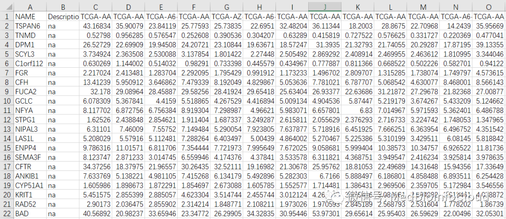

第一列是基因名称，也就是symbol，第二列是描述性信息，可以都是na，其他列都是不同样本标准化后的表达数据。

对于另外3个格式文件，大家可以参考其他公众号的文章，这里给大家分享一篇：[**手把手教你GSEA分析**](http://mp.weixin.qq.com/s?__biz=MzIyNzIyNTczNA==&mid=2247485580&idx=1&sn=7c87c8ae3d66df1660cabe2836b80a49&chksm=e8653165df12b87385f917bb23202180e96bd815673a43ebe0cc8d974d8e949a991da7e53363&scene=21#wechat_redirect)。也不用你自己再去搜索了，我再写一遍也没有意义。

第二个文件是表型文件，格式是cls格式文件，此文件可以根据样品对应的表型按照下面文件格式自己制作，但是，文件后缀必须为*. cls，且用tab或者空格分割的文本文件。

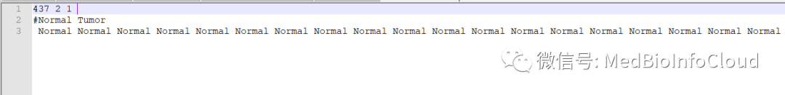

第一行是3个数字，第一个数值数我们样本数，第二个是我们分组个数，我们这里只有Normal 和Tumor组所以是2，第三个是1，这是固定不变的，写上就行。

第二行是以#号开头，后面就是我们的分组名称。

第三行就是我们437个样本是Normal还是Tumor，顺序和表达数据文件中的一样。

我们以之前上传的[**TCGA数据库33个Project的RNA-Seq转录组数据**](http://mp.weixin.qq.com/s?__biz=MzA4NDAzODkzMA==&mid=2651264583&idx=1&sn=f94bf8d77402677ee67f5d6336088254&chksm=841ef23ab3697b2c10ddf8477f41b99c2d801899e3c280f2b1ad6e34b7f6efae005ab4902013&scene=21#wechat_redirect)为例，选择TCGA-COAD进行分析，TCGA转录组数据处理方式，参考文章：[**TCGA数据库：RNA-Seq数据的下载与处理**](http://mp.weixin.qq.com/s?__biz=MzA4NDAzODkzMA==&mid=2651265067&idx=1&sn=39c75f795ad560540e2309569a68c718&chksm=841efc56b3697540fc2443869d615ea48acd5e7c11f6ed5f910963bcb0dda613bdb69ef0da72&scene=21#wechat_redirect)。

```plain
rm(list = ls())
options(stringsAsFactors = F)
load("F:/TCGA/HTSeq-FPKM/Rdata/data/TCGA-COAD-Exp.Rdata")
protExp <- transomeData[["proteinCodingExpData"]][["Exp"]]
protExp <- data.matrix(protExp) %>% as.data.frame()
protExp <- protExp[apply(t(protExp),2,var)!=0,]
GSEAExp <- data.frame(NAME = rownames(protExp),Description = "na",protExp,check.names = F)
GSEAExp[1:5,1:4]
write.table(GSEAExp,file= "GSEAExp.txt",sep = "\t",row.names = F,quote = F)
NormalNum <- transomeData[["proteinCodingExpData"]][["sampleNum"]][["NormalNum"]]
TumorNum <-transomeData[["proteinCodingExpData"]][["sampleNum"]][["TumorNum"]]
cat(file = "GSEAExp.cls",paste((ncol(GSEAExp)-2),2,1),"\n#Normal Tumor\n",rep("Normal",NormalNum),rep("Tumor",TumorNum))
```

上面代码是处理之前准备的数据，每个人的数据可能不一样，所以代码会不同，总之，我们处理后会得到上面2个作为GSEA分析的输入文件。

**一.本地软件GSEA分析**

本地分析的话，需要下载软件。或者谷歌/百度搜一下。

官网：[https://www.gsea-msigdb.org/gsea/index.jsp](https://www.gsea-msigdb.org/gsea/index.jsp)

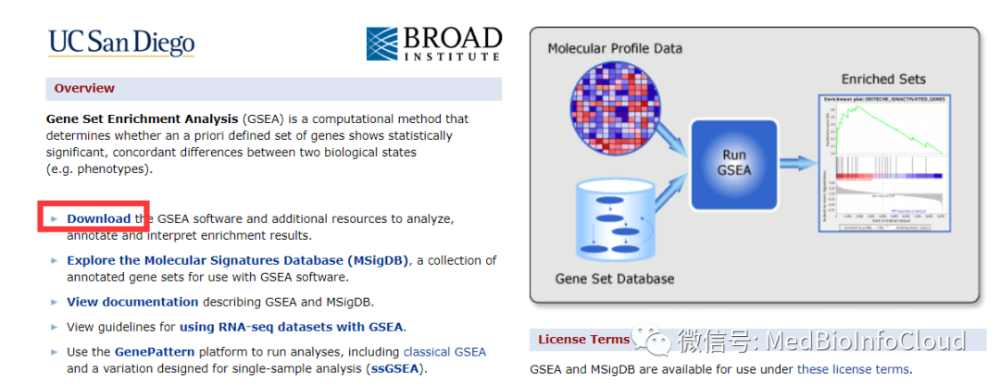

如果第一次使用需要点击“Click here” 注册，注册过后登录，只需要在文本框内输入注册邮箱，点击login登录即可。

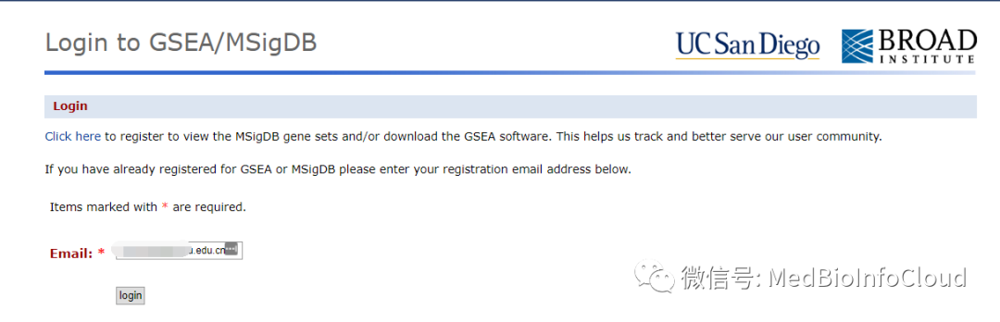

根据你的系统选择下载安装：

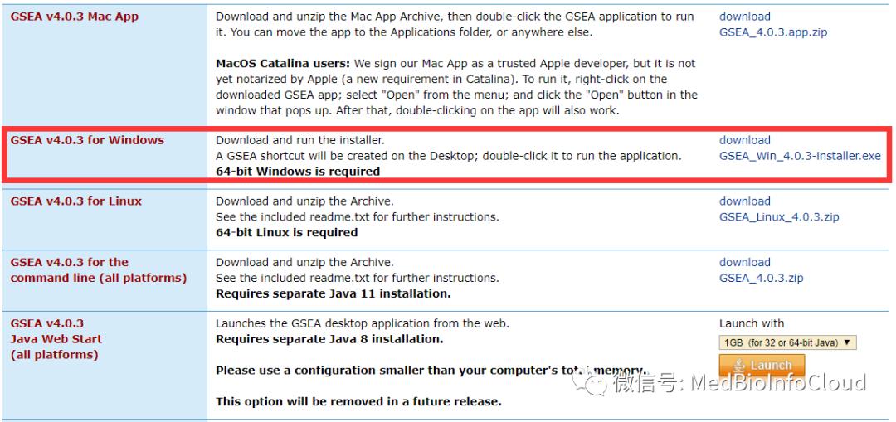

安装后打开软件：

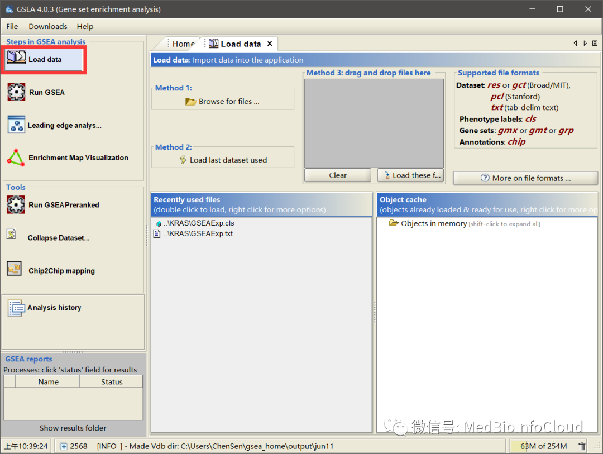

load data我们的数据。GSEAExp.txt是我们的表示数据，GSEAExp.cls是分组信息。

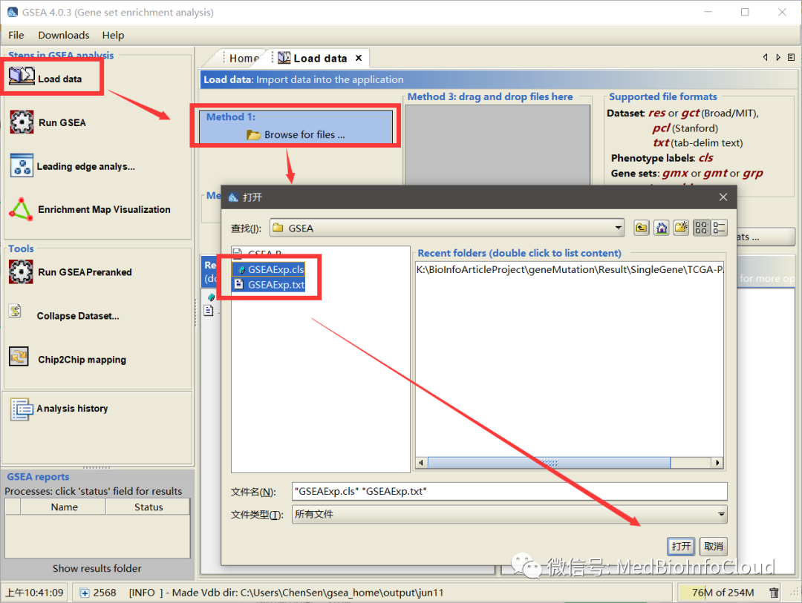

加载数据后，如果我们的数据没有问题，就会提示成功：

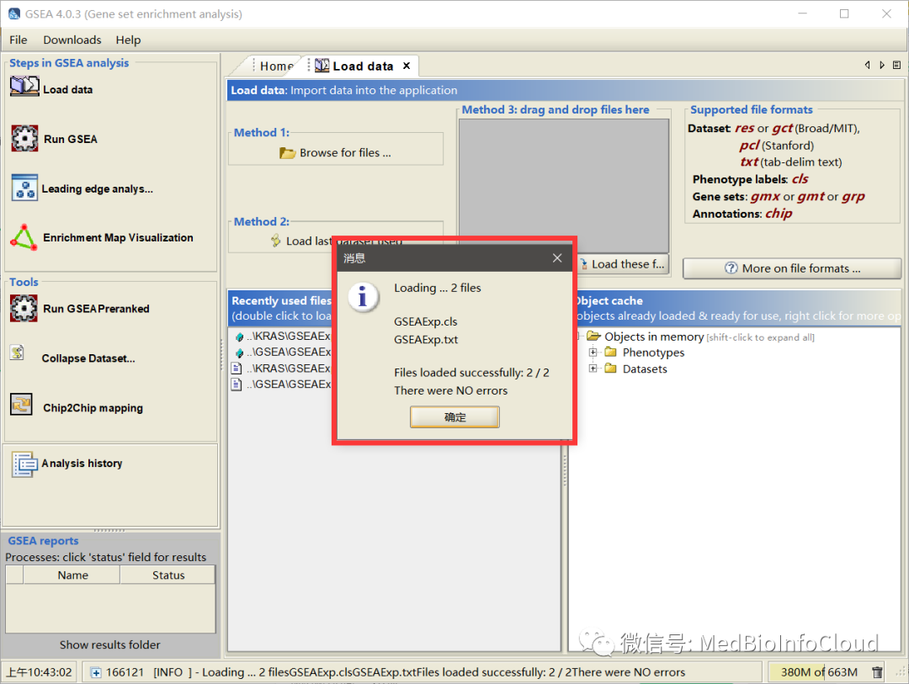

在Run GSEA窗口设置参数。

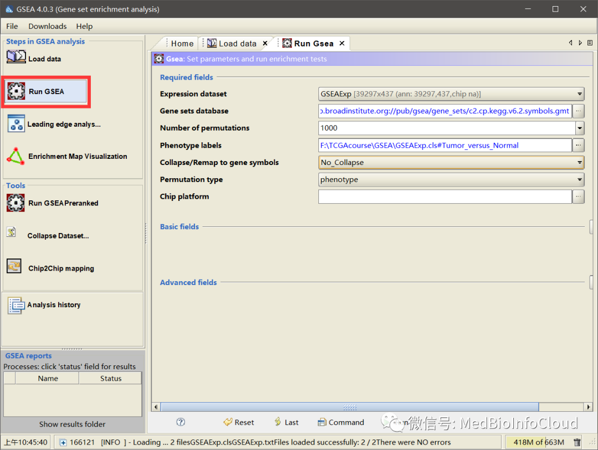

Expression dataset（表达文件）：选择上一步上传的GSEAExp.txt文件

Gene sets database （功能基因集数据库）：GSEA包含了MSigDB数据库中的功能基因集，可以从中选择感兴趣的通路、癌症标记、转录因子数据库等。我们在前面文章:[**为什么选择GSEA分析？和KEGG和GO分析有什么区别？**](http://mp.weixin.qq.com/s?__biz=MzA4NDAzODkzMA==&mid=2651265618&idx=1&sn=3c5365ed2c437d3b7b034431ab4ac934&chksm=841efe2fb3697739ca349e9570aecdb0f4b0b5291c6dad8efcaca4777b631819e2951cdc5840&scene=21#wechat_redirect)中就介绍了这些数据集，当然，这个数据集我们可以自己准备，多数情况下，我们是选择数据库给我们定义好的数据集，所以直接用就好了。我们这里选择：c2.cp.kegg.v6.2.symbols.gmt

Number of permutations（扰动／随机次数）：通常设置1000，此参数不可过小。默认就行。

Phenotypes labels(样品表型分类文件)：选择上一步上传的表型cls文件

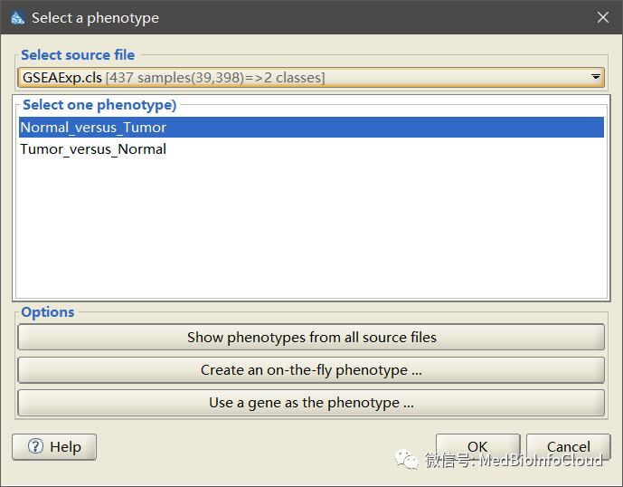

我们选择一个就行，2个分组的话，其实没多大区别。

Collapse dataset to gene symbols：我们选择No_Collapse

Permutation type(扰动类型)：通常选择phenotype，如果样品数目较少可以选择gene_set。

Chip platform(芯片类型)：如果表达gct文件的第一列为芯片探针id则此处需要选择对应的芯片平台，如果是基因symbol则无需选择。

然后点击Run,左下角就可以看见程序开始运行了,时间可能很久。

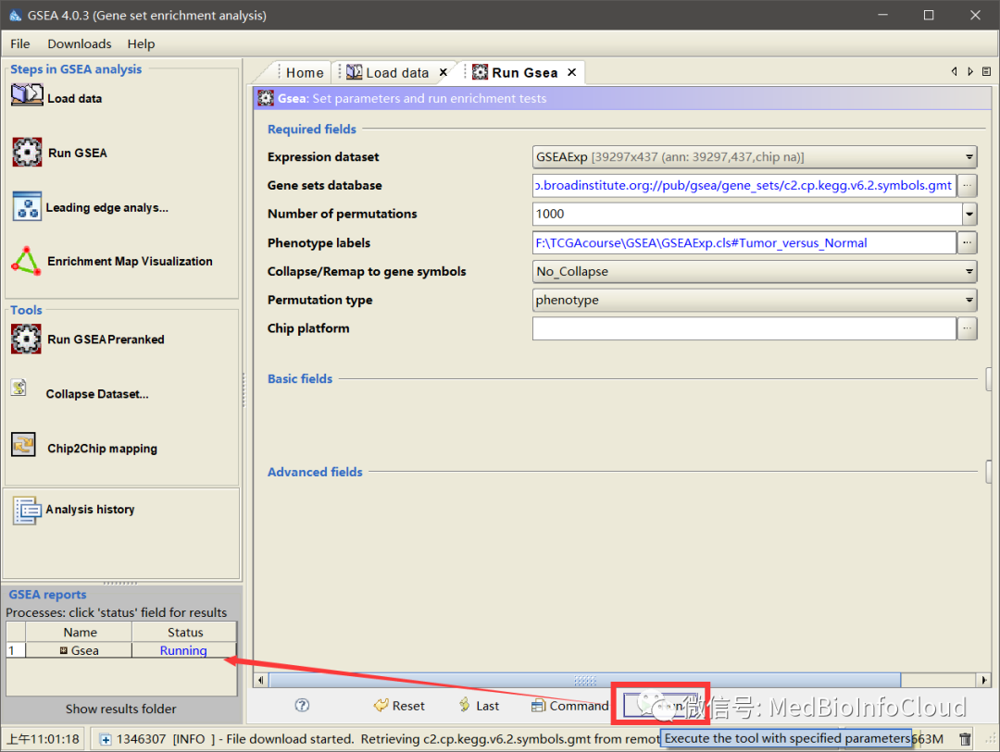

运行结束后显示成功，点击我们就可以进入一个页面。就是我们的分析结果。

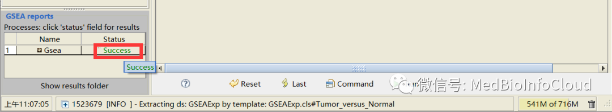

文件也在本地找的到，就是在我们电脑的用户名文件下的gsea_home/output中，比如：

<code>gsea_home/output/…/my_analysis.Gsea/index.html</code>

部分结果如下：

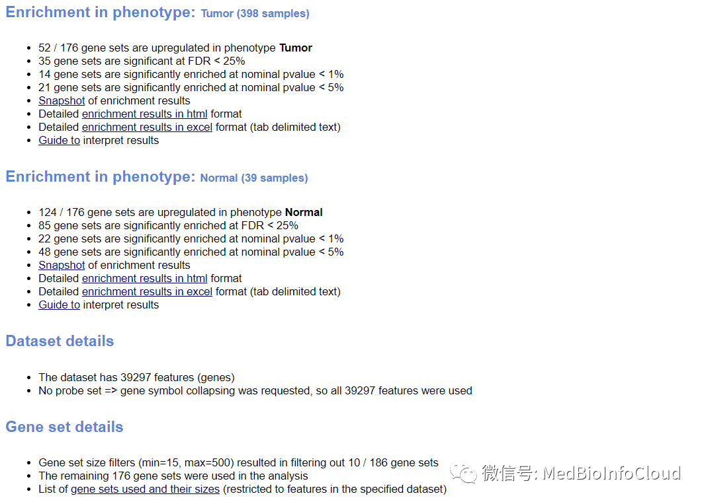

经过各项参数筛选后剩下176个基因集的条目，其中有124个条目在Tumor组中上调（ES值为正）；有35个基因集的False Discovery Rate （FDR）小于0.25，是有意义的。在未校正的p<0.01下，有14个基因集富集显著，在未校正的p<0.05下，有21个基因集富集显著；富集结果浏览，可点击**Snapshot**展示了ES绝对值最大的20个基因集的图。点击**enrichment results in html format查看**详细的网页形式的富集分析结果。点击 **enrichment results in excel**查看详细的Excel表格形式的富集结果。点击**Guide to**的网页链接查看官方对结果解读的指导文档。

对于Enrichment in phenotype: Normal (39 samples)解释和上面一样。

---

点击**Snapshot**可以查看富集结果:

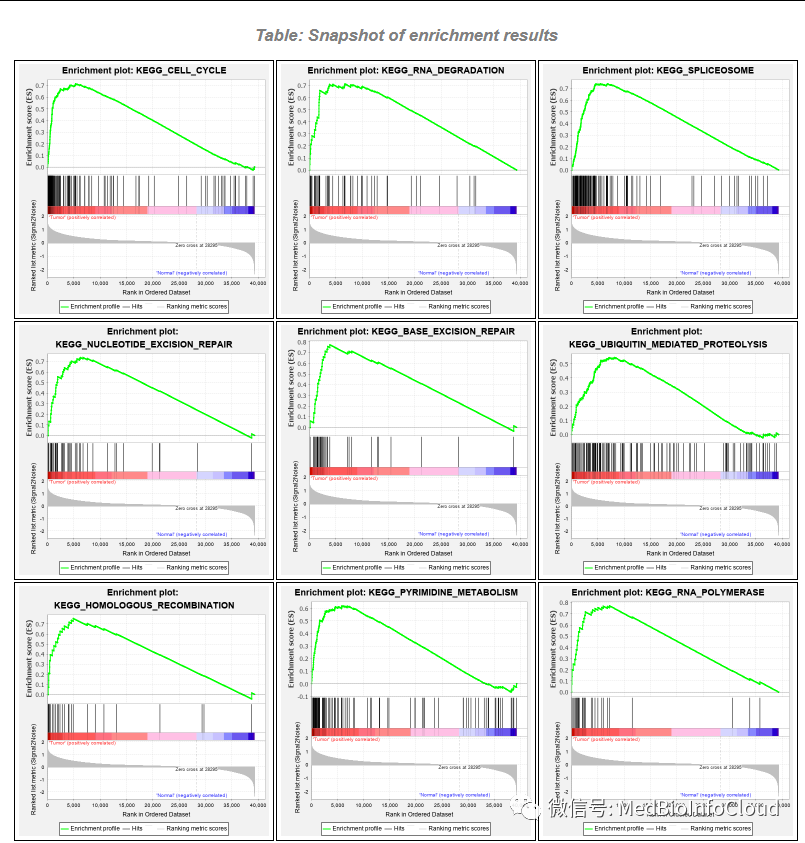

可以点击其中一个图，查看更详细的信息：

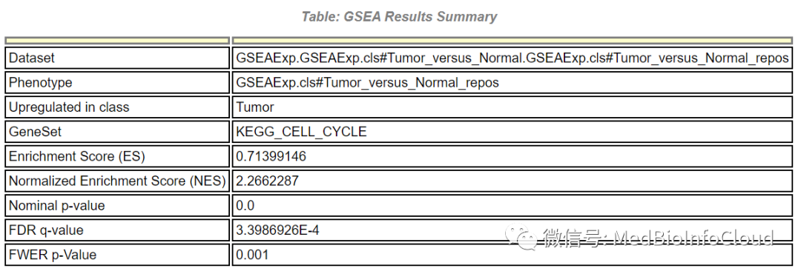

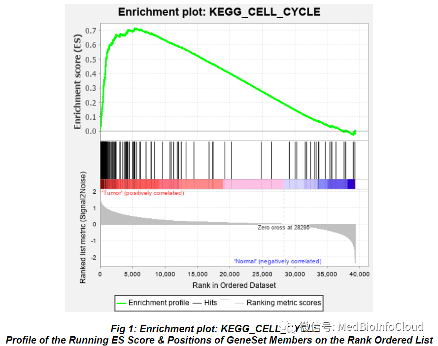

富集分析的主要图形，常见于发表的文献，包括三部分：

• Enrichment score折线图：ES值的动态展示。峰值就是表格中该基因集的

Enrichment Score (ES)值。

• 黑色竖线：表示预定义基因集中的基因在排序列表中的位置。

• 排序后所有基因rank值的分布，红色部分对应的基因在Tumor中高表达，蓝色部分对应的基因在Normal中高表达。

主要关注ES峰值的位置是在排序基因集的顶部还是底部；顶部表示该基因集在Tumor组中上调，底部表示该基因集在Normal组中上调。

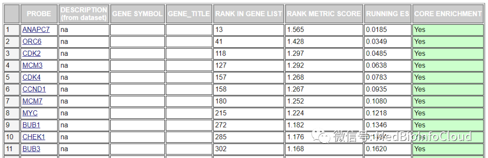

基因集中，每个基因的详细统计表

• RANK IN GENE LIST表示基因在排序基因列表中的位置

• RANK METRIC SCORE表示基因排序的评分

• RUNNING ES表示GSEA分析过程中的动态ES值

• CORE ENRICHMENT表示对ES有重要贡献的基因，即Leading edge subset，以绿色标记，值为Yes。

回到首页，点击**enrichment results in html**查看富集结果：

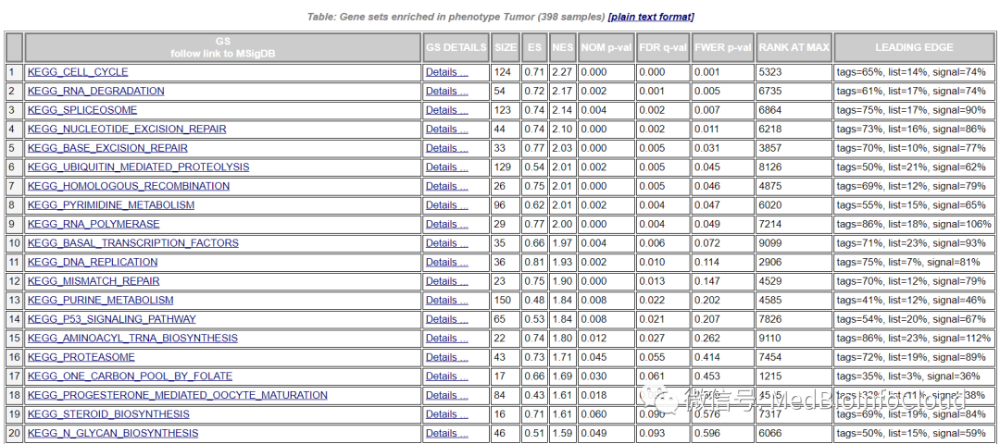

• GS：基因集的名称。

• GS DETAILS：提供该条目富集的详细说明，点击可跳转

• SIZE：基因集条目中包含表达矩阵基因集的基因数目

• ES：富集分数

• NES：经过归一化校正的ES值，通过基因集的数据进行标准化

• NOM p-val：对ES值进行统计分析获得的p value，表示结果的可信度

• FDR q-val：结果假阳性的概率，为多重假设检验校正后的p值，越小越显著。

• FWER p-val：用FWER法（Bonferonni校正）校正后的P值

• RANK AT MAX：ES最大值时对应的基因在列表的排名

• LEADING EDGE：定义Leading edge subset的参数，包括Tags，List，

Signal这三个统计值：

• Tags表示核心基因占该基因集基因总数的百分比

• List表示核心基因占所有基因的百分比

• Signal基于前两项统计数据计算的富集信号强度

**二. 利用clusterProfiler包进行富集分析**

**我们以差异分析的结果继续讲解，不会差异分析的参考文章：**

[**【1】一文就会TCGA数据库基因表达差异分析**](http://mp.weixin.qq.com/s?__biz=MzA4NDAzODkzMA==&mid=2651264898&idx=1&sn=f6287d98fe0b0fb48a96d2905ca0bb4f&chksm=841ef3ffb3697ae9505b6e795a1fe842b2dd32b82f6b5ed4c3e68569c0459bff57319c08e0e2&scene=21#wechat_redirect)

[**【2】TCGA数据库：GDCRNATools包下载数据、处理数据以及差异分析**](http://mp.weixin.qq.com/s?__biz=MzA4NDAzODkzMA==&mid=2651265127&idx=2&sn=8c866e064995e6feb251a5db00282fd2&chksm=841efc1ab369750c01bd1794b30a7f5d3a6033df518f7f5a10cb12b5c2a6b6a8c280b304e345&scene=21#wechat_redirect)

都是差异分析，文章2仅仅适合TCGA数据库的数据分析，文章1虽然也是以TCGA数据库讲解，但适用于所有表达矩阵。

**1.包的安装与加载**

```r
if (!requireNamespace("BiocManager", quietly = TRUE))
  install.packages("BiocManager")
BiocManager::install("clusterProfiler")
library(clusterProfiler)
```

关于包的安装，其实比较多余，大家熟悉后都会知道怎么安装的，都是一样。

但这个包还是挺大的，如果前期没有装一些依赖包的话，是有些费时间。如果后续运行出错，也可能是有一些包没有安装上。

**2.GO分析**

go分析的话用enrichGO函数。

```r
enrichGO(  gene,  OrgDb,  keyType = "ENTREZID",  ont = "MF",
         pvalueCutoff = 0.05,  pAdjustMethod = "BH",
         universe,  qvalueCutoff = 0.2,  minGSSize = 10,
         maxGSSize = 500,  readable = FALSE,  pool = FALSE)
```

**重要参数解释如下：**

gene ：entrez gene id的向量.

OrgDb ：注释数据库，比如人的是org.Hs.eg.db

keyType ：就是我们进行GO分析选择 "BP", "MF"还是 "CC" ，如果三个一起的就是'All"。

pvalueCutoff :筛选时p值的选择，一般是0.05或者0.01.

pAdjustMethod：p值的校正方法： "holm", "hochberg", "hommel", "bonferroni", "BH", "BY", "fdr", "none"。

universe ：背景基因，如果没有,利用数据库中所有基因作为背景。

readable ：是否将基因映射到基因名。

qvalueCutoff：对p值进行统计学检验的q值

---

我们进行GO或者KEGG分析，首先是得拿到一串基因，可以来自差异分析的基因，一般也是如此，也可以是某个药物预测靶点的的基因集。总之就是一串基因名。我这里读入了一个差异分析的结果：

```r
diff <- read.table("RNA_dePC_limma.txt", header = T,sep ="",check.names = F)
```

读入的diff如下：

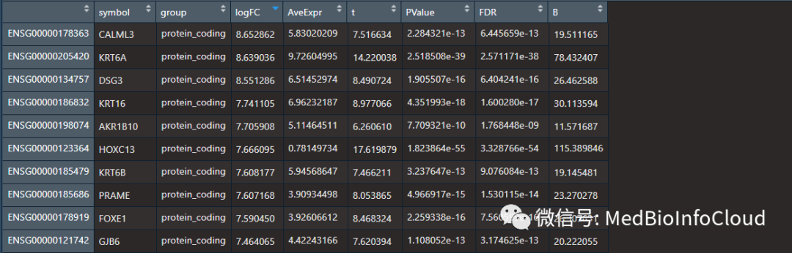

这也通常是差异分析的结果文件，我们只需要第一列的基因SYMBOL。我们需要进行ID转换，将SYMBOL转换为ENTREZ ID，关于基因ID转换不熟悉，可参考文章：[**生信中各种ID转换**](http://mp.weixin.qq.com/s?__biz=MzA4NDAzODkzMA==&mid=2651265466&idx=1&sn=021a10503d338e09abe07b578e734566&chksm=841efdc7b36974d13b7ad95e2272d293089d49adff9b74667bbeed78306328f0a42b0259c030&scene=21#wechat_redirect)。

```r
SYMBOL <- diff[,1]
gene <-select(org.Hs.eg.db, #.db是这个数据对应的注释包
              keys=SYMBOL,columns="ENTREZID",
              keytype="SYMBOL" )
```

```plain
> head(gene)
   SYMBOL ENTREZID
1 NOSTRIN   115677
2  CLEC3B     7123
3  HIGD1B    51751
4   TCF21     6943
5   KANK3   256949
6  MCEMP1   199675
```

如果上面代码错误，用下面这句，上面代码有时候不会错，关了R重新启动又没问题，我也不知道是不是依赖包或者R版本的问题。有时报错，有时不会。

```r
gene <- bitr(SYMBOL, fromType="SYMBOL", toType="ENTREZID", OrgDb="org.Hs.eg.db")
```

有时，我们转换后的ENTREZ ID有缺失值，也就是我们输入的SYMBOL没有匹配到ENTREZ ID，原因是一个ENTREZ ID对于的基因可能有多个SYMBOL名称，还有就是我输入的基因有些是编码lncRNA的基因。当然，我们在分析时可以不转换，也或者大家在进行差异分析的时候就先不要转换成SYMBOL，如果是TCGA的数据，可以同时保存ENSEMBL，用ENSEMBL转化为ENTREZ ID会好一些。[**TCGA数据库：GDCRNATools包下载数据、处理数据以及差异分析**](http://mp.weixin.qq.com/s?__biz=MzA4NDAzODkzMA==&mid=2651265127&idx=2&sn=8c866e064995e6feb251a5db00282fd2&chksm=841efc1ab369750c01bd1794b30a7f5d3a6033df518f7f5a10cb12b5c2a6b6a8c280b304e345&scene=21#wechat_redirect)文章中的分析方式就保留了ENSEMBL。差异分析后最好把编码蛋白的和ncRNA的区分开。当然，一般也不影响，看自己的分析。

我们先把缺失值删除，然后再将基因排个序。

```r
dlgene <- na.omit(gene)##删除缺失值
```

删除缺失值后，我还要告诉大家，检查一下，有没有重复的，要不然后面会报错，为什么呢？这也是我发现的一个问题，我处理的数据中刚好有一个重复值。

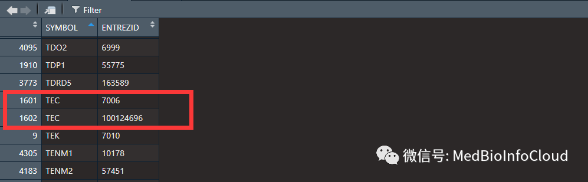

我一开始以为是不是注释包的问题，然后在NCBI包里面审核了一下，发现genen SYMBOL叫TEC的，的确有2个。一个是HGNC提供的，叫Official Symbol，关于基因ID的介绍，可以参考文章：[**常用生物信息 ID的介绍**](http://mp.weixin.qq.com/s?__biz=MzA4NDAzODkzMA==&mid=2651265423&idx=2&sn=288f3c8acaad8670d35a031cd9794d58&chksm=841efdf2b36974e40e29d906fe4f3a46528ea5a84d17f656ad6119f612059489b9df1416c337&scene=21#wechat_redirect)。有时候这些ID的确让人头疼。

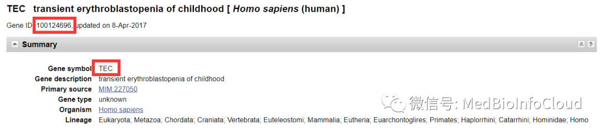

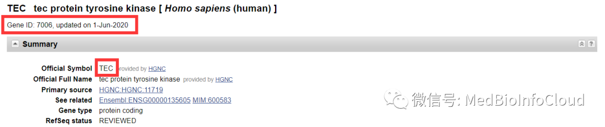

我们去个重吧。

```plain
dlgene <- dlgene[!duplicated(dlgene$SYMBOL),]
```

然后取我们转换后的基因，在差异表达分析中的交集，因为有些基因可能没有转换成功，极少数，大多数还是都能转换的。看一下行数就知道。

```plain
> nrow(diff)
[1] 4335
> nrow(dlgene)
[1] 4291
```

我们对数据按照logFC排个序（**降序**）。

```plain
sordiff <- diff[(diff$symbol %in% dlgene$SYMBOL),]
sordiff <- data.frame(ENTREZID = dlgene$ENTREZID,sordiff)
sordiff <- arrange(sordiff, desc(logFC))
```

我们这里排序是因为后面做GSEA分析的时候，需要根据logFC按降序排序，一般的GO和KEGG，没有顺序。所以在这里说明一下。

获得ENTREZ ID后就可以进行GO分析了。

```plain
ENTREZ_ID <- sordiff$ENTREZID
go_BP <- enrichGO(ENTREZ_ID, 'org.Hs.eg.db', ont="BP", pvalueCutoff=0.01)
go_MF <- enrichGO(ENTREZ_ID, 'org.Hs.eg.db', ont="MF", pvalueCutoff=0.01)
go_CC <- enrichGO(ENTREZ_ID, 'org.Hs.eg.db', ont="CC", pvalueCutoff=0.01)
```

分析结果是一个S4类的对象，我们可以通过@result获取，总共有9列，我们看名称就知道每一列的意思啦。

```plain
go_MFR <- go_MF@result
```

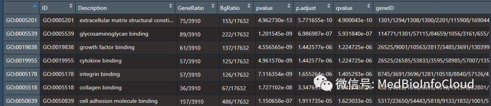

看gene ID那一列，还是我们输入的ENTREZ ID，如果想知道什么基因的话，readable指定为TRUE，就可以啦。

```plain
go_BP <- enrichGO(ENTREZ_ID, 'org.Hs.eg.db', ont="BP", pvalueCutoff=0.01,readable =T)
go_BPRe <- go_BP@result
```

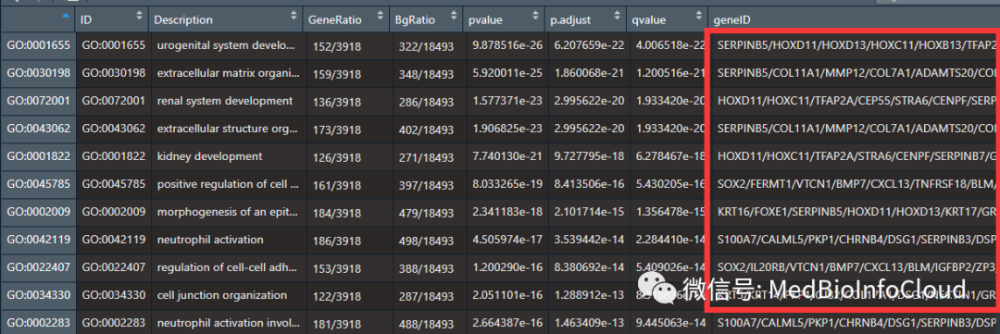

clusterProfiler包还提供了基于GSEA的GO分析：

```plain
gseGO(
  geneList,
  ont = "BP",
  OrgDb,
  keyType = "ENTREZID",
  exponent = 1,
  minGSSize = 10,
  maxGSSize = 500,
  eps = 1e-10,
  pvalueCutoff = 0.05,
  pAdjustMethod = "BH",
  verbose = TRUE,
  seed = FALSE,
  by = "fgsea",
  ...
)
```

重要参数如下：

genelist：geneList要求是数值型向量，可以是fold change，或者logFC，数值型向量的名字是基因ID，数字从高到低排序。

exponent：每一步的权重，默认就行。

by：是通过 fgsea还是 DOSE包进行分析，默认 fgsea。

其他参数同enrichGO。

---

由于genelist需要排序（**从大到小**），我们前面已经排序过了，本地分析的时候，我们提供的是表达矩阵，这里我们只需要差异分析后的logFC。

```plain
gsedf <- as.vector(sordiff$logFC)
names(gsedf) <- sordiff$ENTREZID
```

处理后的数据是这样的：logFC这一列是从大到小排列的。

```plain
> head(gsedf)
     810     3853     1830     3868    57016     3229
8.652862 8.639036 8.551286 7.741105 7.705908 7.666095
```

刚刚说了genelist是一个数值型向量，而且有名字，我们这里用ENTREZID作为名称。

```plain
gseGO_BP <- gseGO(gsedf, 'org.Hs.eg.db', ont="BP",
                   keyType = "ENTREZID",pvalueCutoff=0.05)
```

其他参数和上面一样。**重点是genelist**。

同样的方法提取结果：

```plain
gseGO_BPR1 <- gseGO_BP@result
```

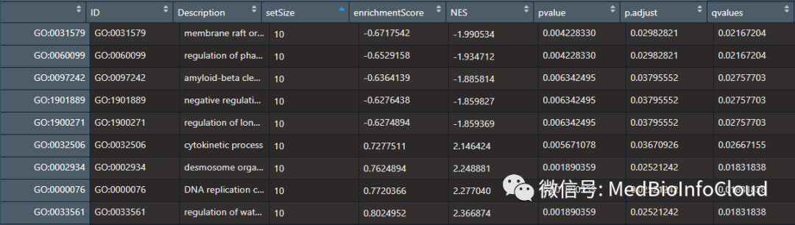

同样我们可以gene SYMBOL作为名称输入，通过keyType参数指定就行啦！！

```plain
gsedf <- as.vector(sordiff$logFC)
names(gsedf) <- sordiff$symbol
gseGO_BP <- gseGO(gsedf, 'org.Hs.eg.db', ont="BP",
                  keyType = "SYMBOL",pvalueCutoff=0.05)
gseGO_BPR2 <- gseGO_BP@result
```

**3.KEGG分析**

KEGG分析利用enrichKEGG函数，参数和enrichGO的差不多，就不多解释了。

```plain
enrichKEGG(
  gene,
  organism = "hsa",
  keyType = "kegg",
  pvalueCutoff = 0.05,
  pAdjustMethod = "BH",
  universe,
  minGSSize = 10,
  maxGSSize = 500,
  qvalueCutoff = 0.2,
  use_internal_data = FALSE
)
```

organism：指定物种，人:hsa，具体可看官网：

[http://www.genome.jp/kegg/catalog/org_list.html](http://www.genome.jp/kegg/catalog/org_list.html)

部分截图如下：

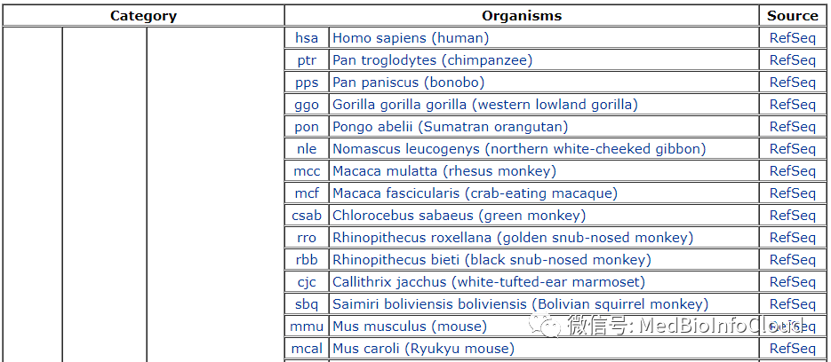

keyType： "kegg", "ncbi-geneid", "ncib-proteinid" 和 "uniprot"中的一种，我们默认kegg就可以了。

```plain
eKEGG <- enrichKEGG(ENTREZ_ID, organism = "hsa", pvalueCutoff=0.01)
eKEGG_R <- eKEGG@result
```

和GO一样，结果也是9列。部分截图如下：

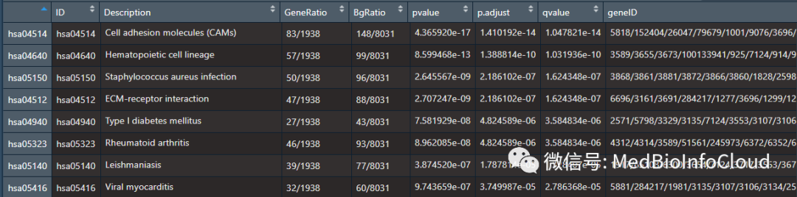

同样的，gseKEGG和gseGO差不多。

```plain
gseKEGG(
  geneList,
  organism = "hsa",
  keyType = "kegg",
  exponent = 1,
  minGSSize = 10,
  maxGSSize = 500,
  eps = 1e-10,
  pvalueCutoff = 0.05,
  pAdjustMethod = "BH",
  verbose = TRUE,
  use_internal_data = FALSE,
  seed = FALSE,
  by = "fgsea",
  ...
)
```

```plain
gsedf <- as.vector(sordiff$log2FoldChange)
names(gsedf) <- sordiff$ENTREZID
head(gsedf)
gse_KEGG <- gseKEGG(geneList=gsedf, organism = "hsa",
                   keyType = "kegg",pvalueCutoff=0.05)
gse_KEGGR <- gse_KEGG@result
```

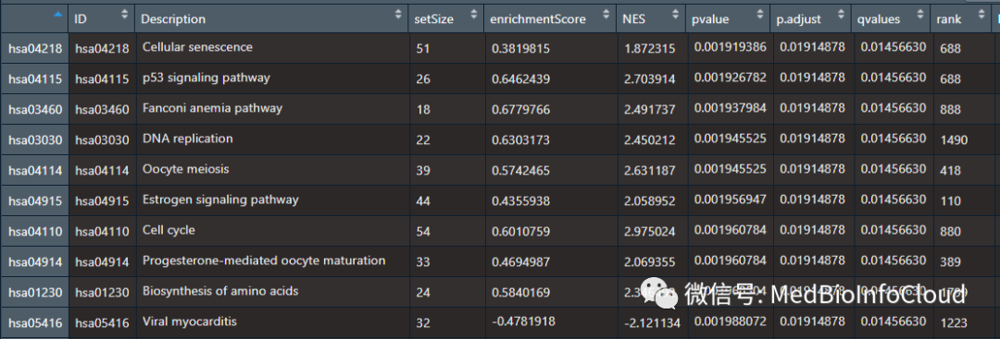

这里给大家说一下，每此运行的结果是不一样的，但整体差别不大。对于我们有时候输入的基因太少，会出现下面这种情况，但基因数量少，做富集分析也没有什么意义。就是给大家提一下。下面是我曾经用少量基因做的分析截图，认识一下就行。

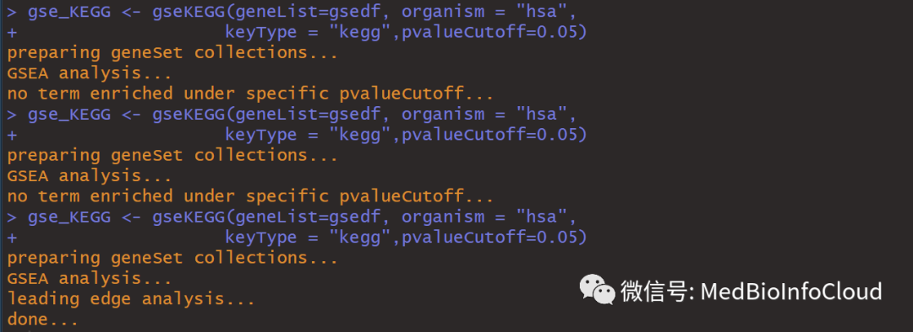

我前2次运行没有富集结果，但第三次就有3个富集结果。

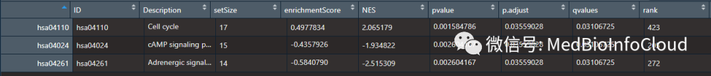

如果出现这样的情况，又想要结果，要么你可以调整一下p值。

对于KEGG分析，还有一个函数：enrichMKEGG。

```plain
enrichMKEGG(
  gene,
  organism = "hsa",
  keyType = "kegg",
  pvalueCutoff = 0.05,
  pAdjustMethod = "BH",
  universe,
  minGSSize = 10,
  maxGSSize = 500,
  qvalueCutoff = 0.2
)
```

参数和前面介绍的一样。看看这个函数的说明：KEGG Module Enrichment Analysis of a gene set. Given a vector of genes, this function will return the enrichment KEGG Module categories with FDR control.

他返回的是一个Module富集结果。KEGG Module是人工定义的功能单元模块，用于已测序的基因组的注释和功能解释。

```plain
gse_MKEGG <- enrichMKEGG(gene=sordiff$ENTREZID, organism = "hsa", keyType = "kegg",                         pvalueCutoff = 0.05,  pAdjustMethod = "BH")
gMK <- gse_MKEGG@result
```

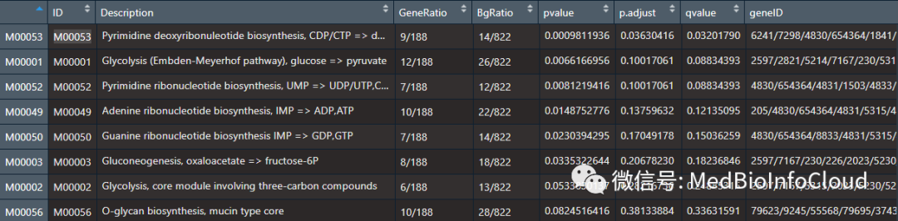

我们输入的基因涉及的功能，排在第一个的是：Pyrimidine deoxyribonuleotide 生物合成。

KEGG数据库子库很多，也不是每个人都对所有的都了如指掌，具体KEGG数据库介绍，阅读文章：[**KEGG数据库使用及通路分析教程**](http://mp.weixin.qq.com/s?__biz=MzA4NDAzODkzMA==&mid=2651263326&idx=1&sn=044ed62daac16a0bd8c1f2f5e891c303&chksm=841ef523b3697c354d4e7d7717e2fd9eb78c9173926fcc00d7c211416dde75261f3bda8bb8bc&scene=21#wechat_redirect)。

**4.GSEA分析**

GSEA分析的话，就一个函数GSEA。

```plain
GSEA(
  geneList,
  exponent = 1,
  minGSSize = 10,
  maxGSSize = 500,
  eps = 1e-10,
  pvalueCutoff = 0.05,
  pAdjustMethod = "BH",
  TERM2GENE,
  TERM2NAME = NA,
  verbose = TRUE,
  seed = FALSE,
  by = "fgsea",
  ...
)
```

参数和上面的差不多，不过这里我们需要制定TERM2GENE这个参数，也就是我们的背景基因集，还记得我们本地是怎么选择的吗？我们在文章：[为什么选择GSEA分析？和KEGG和GO分析有什么区别？](http://mp.weixin.qq.com/s?__biz=MzA4NDAzODkzMA==&mid=2651265618&idx=1&sn=3c5365ed2c437d3b7b034431ab4ac934&chksm=841efe2fb3697739ca349e9570aecdb0f4b0b5291c6dad8efcaca4777b631819e2951cdc5840&scene=21#wechat_redirect)介绍了MSigDB数据库中的各种数据集。根据自己需要选择，我这里的数据是TCGA数据的数据，我就可以选择自己需要的数据集。

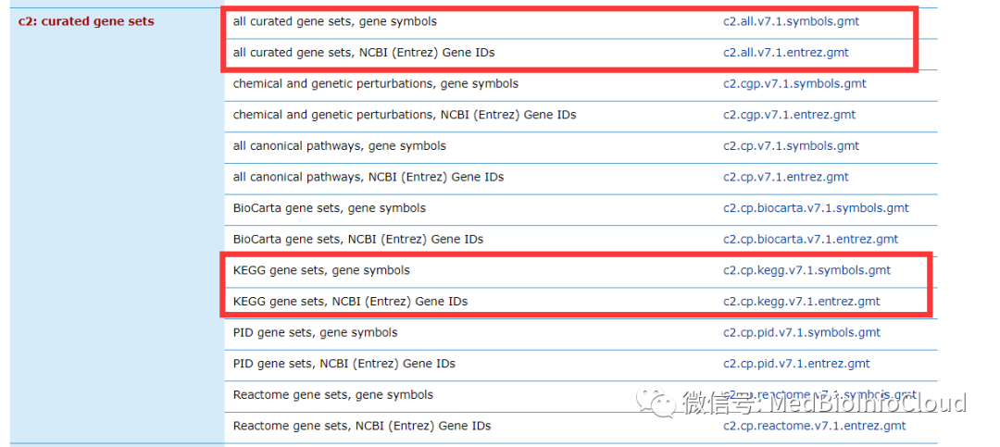

官方英文参数解释TERM2GENE：user input annotation of TERM TO GENE mapping, a data.frame of 2 column with term and gene。也就是一个注释，第二列就是基因的SYMBOL，所以我们输入的基因是SYMBOL，而不是ENTREZ ID。这也是我们下载的基因集所导致的，我们可以看看上图中红色圈里面是gmt文件名称，其实一个是用SYMBOL，一个是用ENTREZ ID。所以我们输入的gene和这个文件还是有关系的。要对应起来。

```plain
c2_1 <- read.gmt("c2.cp.kegg.v7.1.symbols.gmt")
c2_2 <- read.gmt("c2.cp.kegg.v7.1.entrez.gmt"
```

```plain
> head(c2_1)
ont  gene1
KEGG_GLYCOLYSIS_GLUCONEOGENESIS ACSS22 KEGG_GLYCOLYSIS_GLUCONEOGENESIS   GCK3 KEGG_GLYCOLYSIS_GLUCONEOGENESIS  PGK24 KEGG_GLYCOLYSIS_GLUCONEOGENESIS  PGK15 KEGG_GLYCOLYSIS_GLUCONEOGENESIS  PDHB6 KEGG_GLYCOLYSIS_GLUCONEOGENESIS PDHA1
> head(c2_2)
ont  gene1
KEGG_GLYCOLYSIS_GLUCONEOGENESIS 559022 KEGG_GLYCOLYSIS_GLUCONEOGENESIS  26453 KEGG_GLYCOLYSIS_GLUCONEOGENESIS  52324 KEGG_GLYCOLYSIS_GLUCONEOGENESIS  52305 KEGG_GLYCOLYSIS_GLUCONEOGENESIS  51626 KEGG_GLYCOLYSIS_GLUCONEOGENESIS  5160
```

不信，我们在NCBI验证一下：55902就是ACSS2。

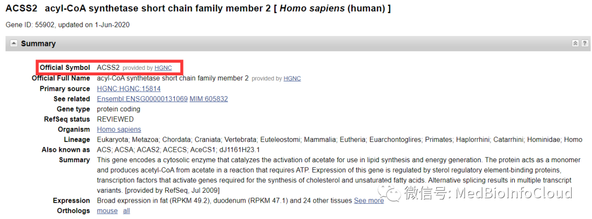

所以我们选择的背景基因集合和我们输入的geneList要一致。

```plain
gsedf <- as.vector(sordiff$logFC)
names(gsedf) <- sordiff$symbol
egmt <- GSEA(geneList=gsedf, TERM2GENE=c2_1,verbose=FALSE,pvalueCutoff=1)
egmtR <- egmt@resulthead(egmtR)
```

**5.可视化**

可视化就很简单了。groupGO、rich GO、rich KEGG、rich DO、rich Pathway和Enricer的函数调用一致，所有的输出都可以通过条形图、富集图和类别基因网络图进行可视化。条形图或气泡图是在富集结果中是非常常见的。

```plain
barplot(go_BP, drop=TRUE, showCategory=12)
```

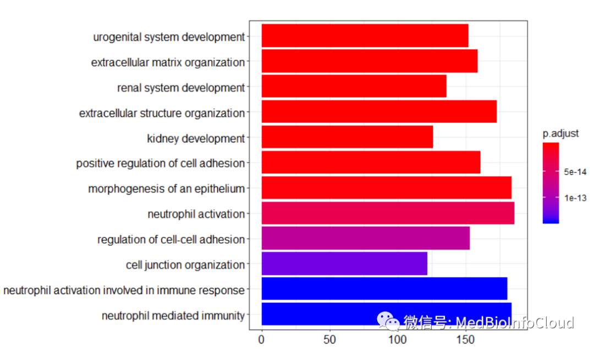

```plain
barplot(go_MF, drop=TRUE, showCategory=12)
```

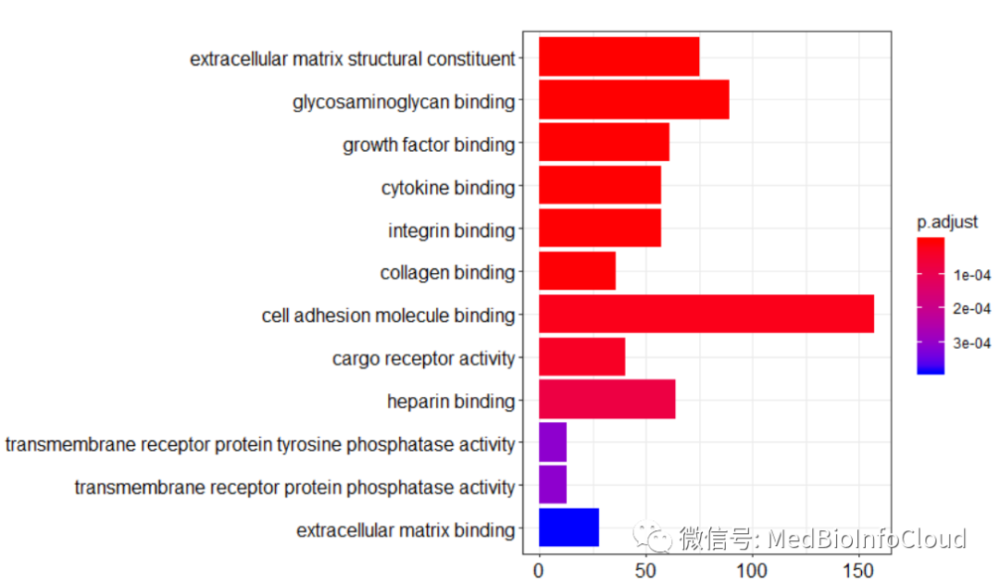

```plain
barplot(go_CC, drop=TRUE, showCategory=12)
```

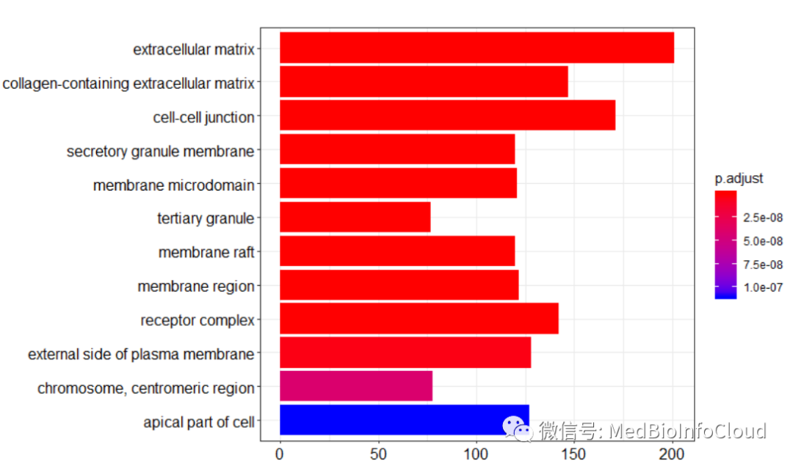

```plain
dotplot(go_BP)
```

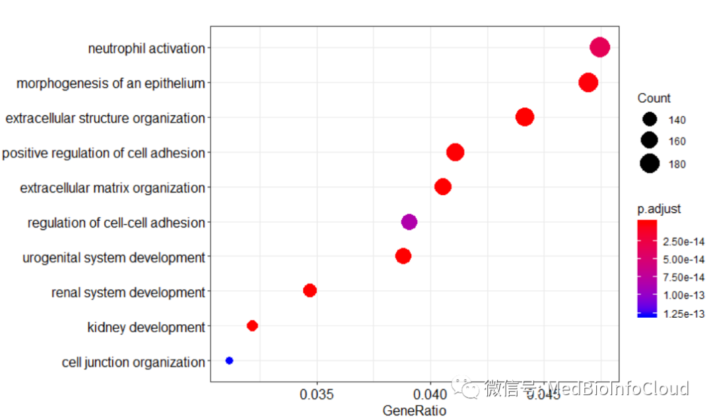

```plain
dotplot(go_MF)
```

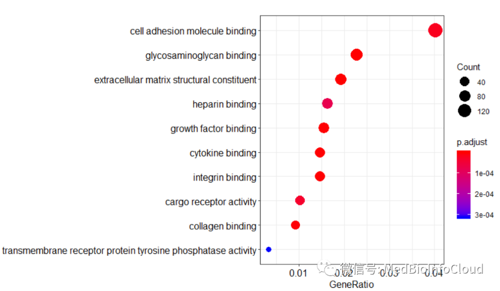

利用emapplot可以将富集图谱可视化，这也支持超几何检验和基因集富集分析的结果。

```plain
emapplot(go_BP)
emapplot(go_MF)
emapplot(go_CC)
```

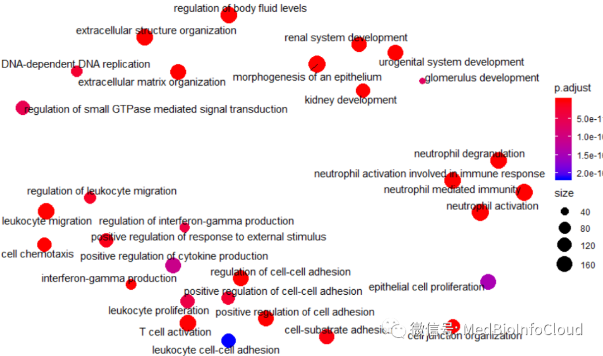

但我觉得这个图，对于GO/KEGG富集分析来说。没太大意义。一般文章中也就是柱状图和气泡图。

```plain
goplot(go_CC)
```

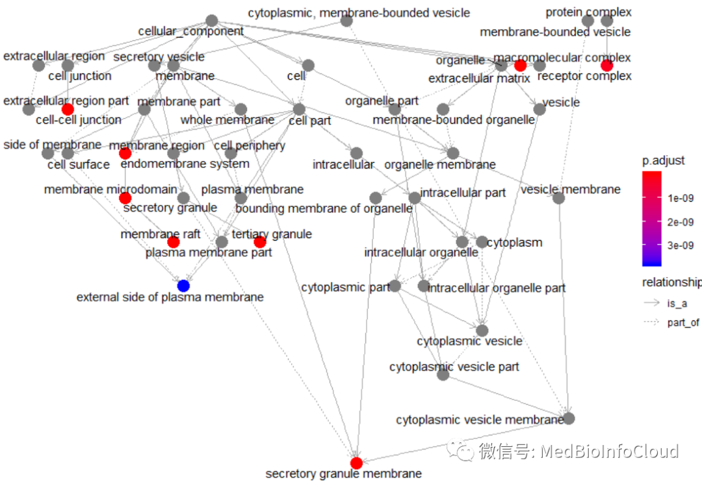

考虑到一个基因可能属于多个注释类别的潜在生物学复杂性，并在可能的情况下提供数字变化的信息，cnetlot函数可以提取复杂的关联可视化。

```plain
gsedf <- as.vector(sordiff$logFC)
names(gsedf) <- sordiff$symbol
egmt <- GSEA(geneList=gsedf, TERM2GENE=c2_1,verbose=FALSE,pvalueCutoff=1)
cnetplot(egmt, categorySize="pvalue", foldChange=gsedf)
```

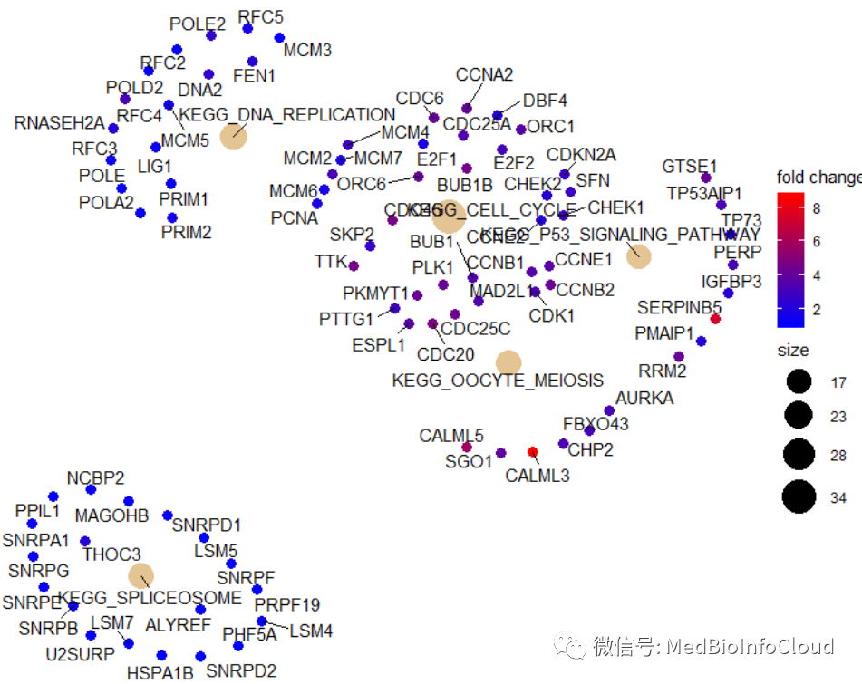

```plain
barplot(eKEGG, drop=TRUE, showCategory=12)
```

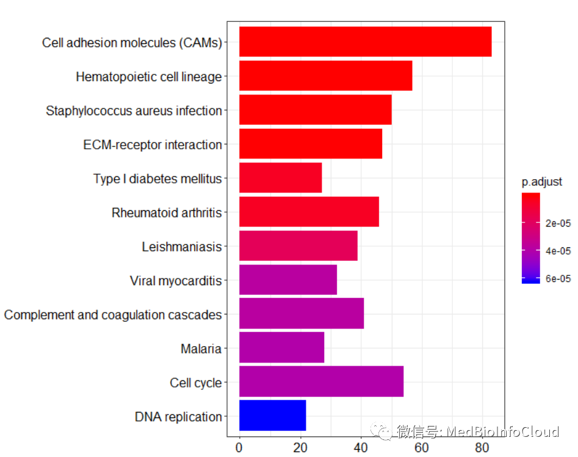

我们查看前面KEGG富集的通路：

```plain
head(gse_KEGGR$ID)
```

```plain
> head(gse_KEGGR$ID)
[1] "hsa04218" "hsa04115" "hsa03460" "hsa03030" "hsa04114" "hsa04915"
```

基因集富集分析的富集分数及其与表型的关联可以通过gseaplot可视化。我们选择第一个绘图geneSetID就是用来指定我们KEGG的通路的ID。

```plain
gseaplot(gse_KEGG, geneSetID = "hsa04218")
```

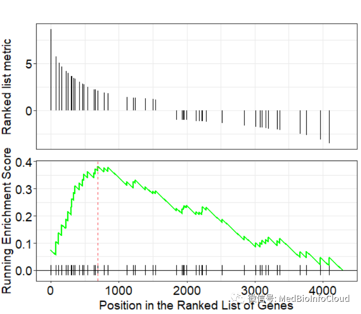

上面这个图，我们选择的是 gseKEGG函数富集的结果。我们利用GSEA分析的结果再绘制一个图。对于 gseKEGG函数富集结果我们可以通过 geneSetID参数设置，但是GSEA的富集结果不能通过指定 geneSetID参数，可以直接用数值，就是富集结果的第一个还是第二个。

```plain
gseaplot(egmt, 1)
```

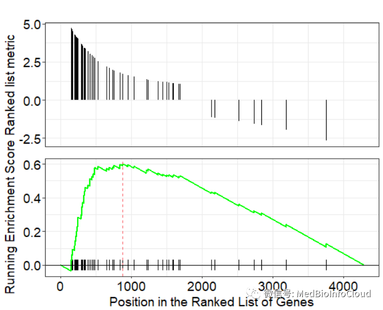

通过title指定标题，by是 "runningScore"、 "preranked"和"all"中的一个。all表示2者都绘制。

```plain
gseaplot(egmt, geneSetID = 1, by = "runningScore", title = egmt$Description[1])
```

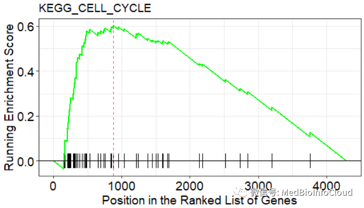

```plain
gseaplot(egmt, geneSetID = 1, by = "preranked", title = egmt$Description[1])
```

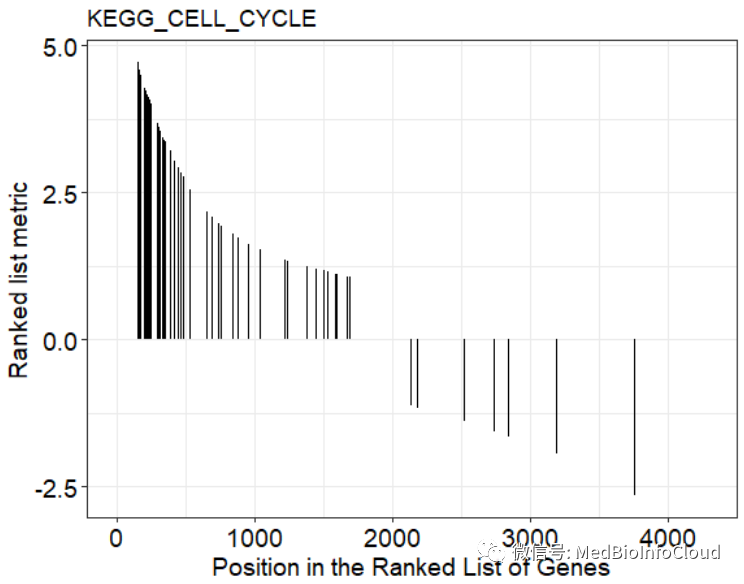

```plain
gseaplot(egmt, geneSetID = 1, by = "all", title = egmt$Description[1])
```

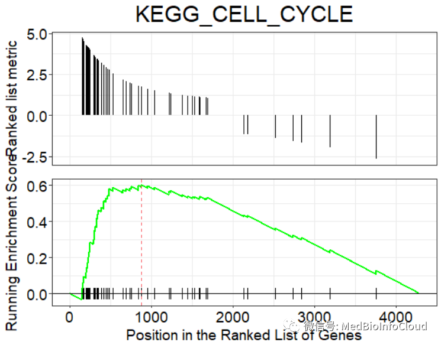

除了自带的包以外，我们可以借助其他包绘图。enrichplot包的gseaplot2函数也可以绘制。

```plain
library(enrichplot)gseaplot2(egmt,1)
```

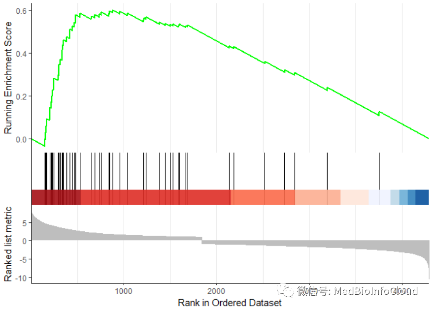

这个函数的优点在于一次可以将几个富集结果绘制到同一图中。

```plain
gseaplot2(egmt,1:3)
```

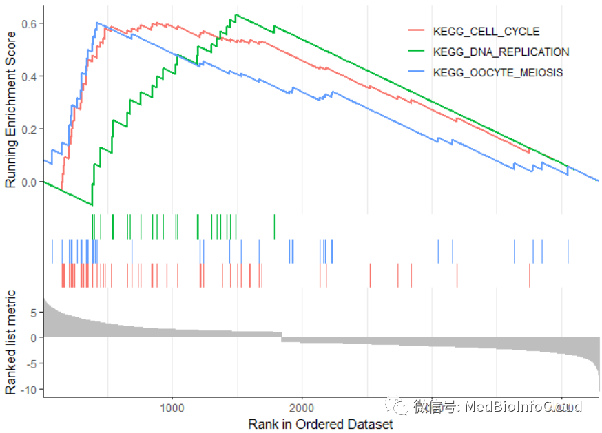

```plain
gseaplot2(gse_KEGG,1:3)
```

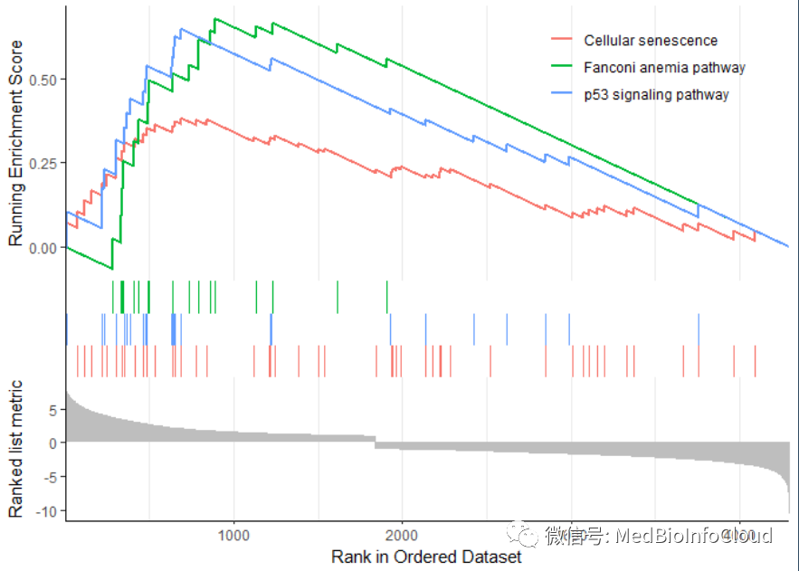

好了，关于这个包的富集分析就介绍到这里了。


提取码：**95h6**

如果失效，后台回复：**cluKGGSEA**

文件GESA-2.R是官方的案例代码，大家也可以取运行一下看看。

> 更新: 2024-01-11 10:39:39
> 原文: <https://www.yuque.com/doublehelix/bioinfonotes/nfhbqr>
