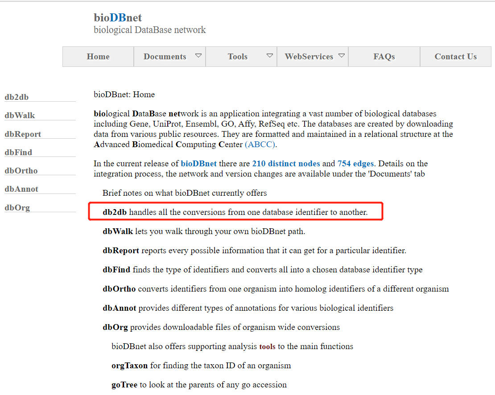
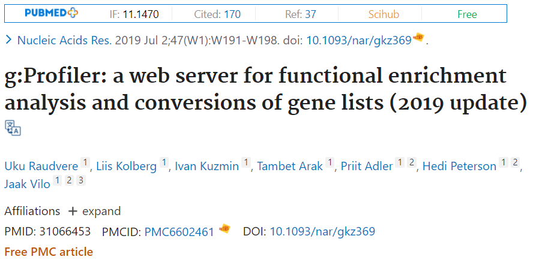
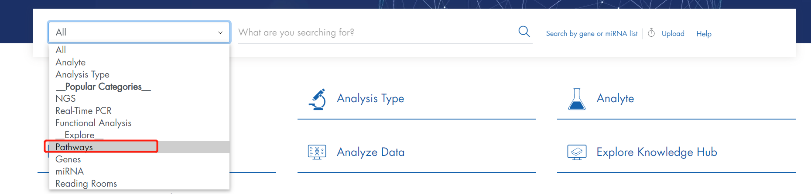
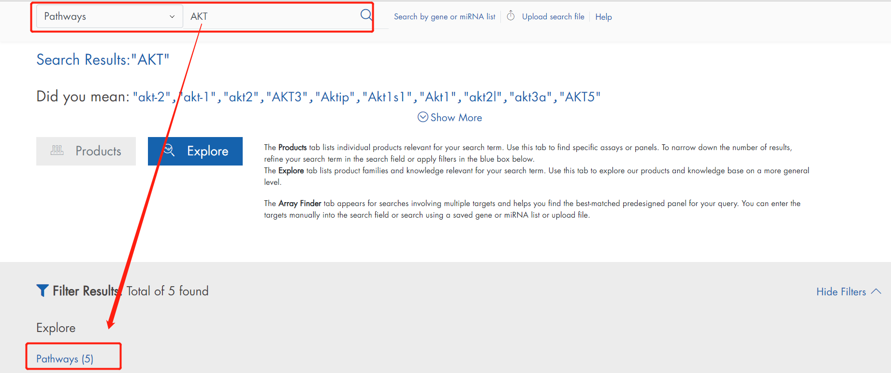
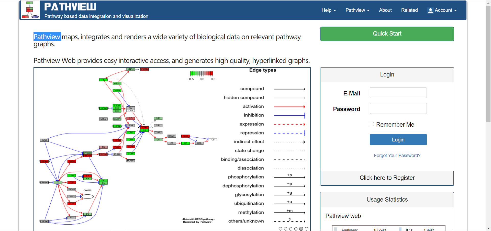
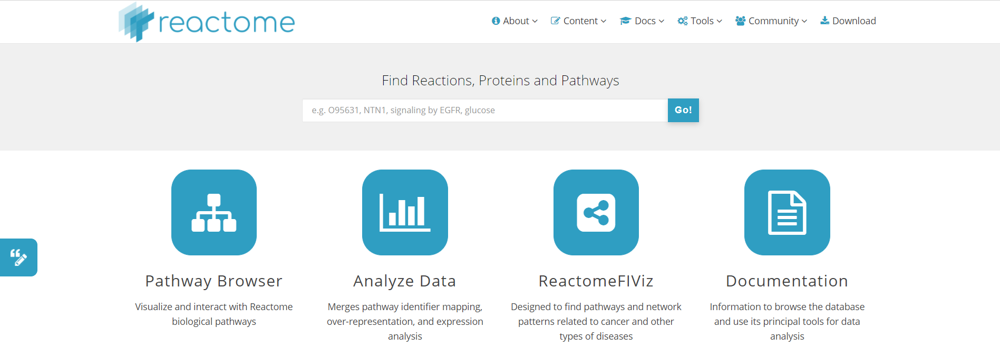
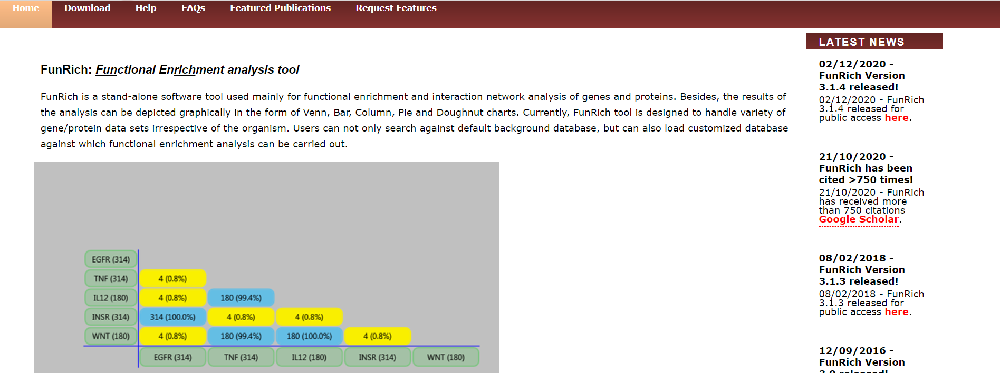
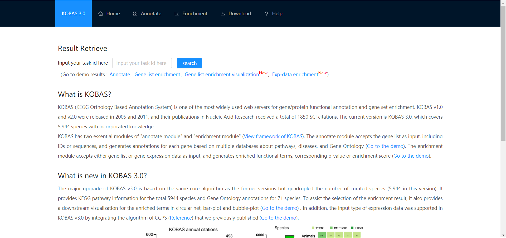
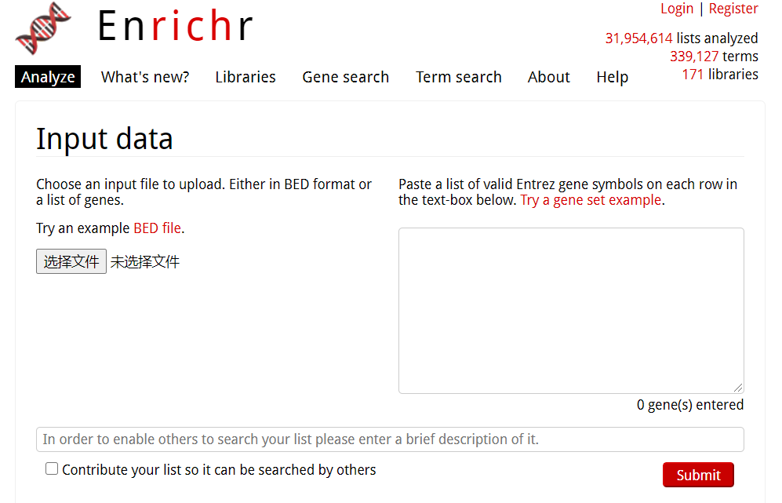

# 在线分析工具

## 一.ID转换工具
### 1.bioDBnet

地址：[https://biodbnet-abcc.ncifcrf.gov/](https://biodbnet-abcc.ncifcrf.gov/)

bioDBnet（生物数据库网络）是一个集成了Gene、UniProt、Ensembl、GO、Affy、RefSeq等众多生物数据库的应用程序。数据库是通过从各种公共资源下载数据创建的。

### 2.g:Profiler

地址：[https://biit.cs.ut.ee/gprofiler/gost](https://biit.cs.ut.ee/gprofiler/gost)

g:Profiler是一个用于功能丰富分析和基因列表转换的Web服务器，与最常见的DAVID相比，速度更快，界面也更友好，交互式的画面对非生信人员也很容易操作。这个工具的文献【[下载](https://pubmed.ncbi.nlm.nih.gov/31066453/)】，11分。

用法很简单，只需要在Query下输入要富集的基因list，并可以选择这个基因list是否已经根据重要性排序，选择物种，然后Run query即可。

结果图中可以通过交互式气泡图看到各个显著通路，依次点击想要的通路，气泡图会按点击顺序标记序号，并在下面显示选中的通路。

3.

## 二.通路数据库

常见的pathway数据由KEGG、Reactome、Biocarta等。对比KEGG，记载BIOCARTA数据库的资料不多，今天跟大家一起学习一下BIOCARTA数据库。

### 1.KEGG数据库

### 2.BioCarta

地址：[https://mitelmandatabase.isb-cgc.org/](https://mitelmandatabase.isb-cgc.org/)  [https://cgap.nci.nih.gov/cgap_mitelman_retire_notice.html](https://cgap.nci.nih.gov/cgap_mitelman_retire_notice.html)

该数据库的特点是对通路数据，用来进行分子互作关系、富集分析、通路为基础的研究等。观察基因如何相互作用的动态图形化模型。从分子的关系角度描绘了一个网络图模型。是“开源”数据库的典型代表法，通过社区论坛而成长起来的数据库，通过不断整合蛋白质组信息迅速发展壮大起来。它还提供了目录并且总结了12万多个多物种的基因信息的重要资源。发现了过去的已有的通路的同时也发现了一些新的通路。

这个数据库可以说是和KEGG数据库齐名，尽管其数据量目前可能没有KEGG的多，但在一些通路相关的研究中，这个数据库也和KEGG一道用来研究基因的功能，注释信息，进行富集分析等。

### 3.QIAGEN

[https://geneglobe.qiagen.com/cn/](https://geneglobe.qiagen.com/cn/)

### 4.Pathview

地址：[https://pathview.uncc.edu/](https://pathview.uncc.edu/)

### 5.Reactome

地址：[https://reactome.org/](https://reactome.org/)

### 6.Funrich

地址：[http://funrich.org/index.html](http://funrich.org/index.html)

使用教程:[FunRich数据库：一个主要用于基因和蛋白质的功能富集以及相互作用网络分析的独立的软件工具](https://mp.weixin.qq.com/s?__biz=MzA4NDAzODkzMA==&mid=2651265340&idx=1&sn=5c3608661698d2332b992269a8721833&chksm=841efd41b3697457f96ace4eecc682cbbbe3fdf3955f0060d3aafcdff0a2d85c225d5ce3f784&scene=21#wechat_redirect)

### 7.KOBAS

地址：[http://kobas.cbi.pku.edu.cn/kobas3](http://kobas.cbi.pku.edu.cn/kobas3)

### 8.Enrichr

地址：[https://maayanlab.cloud/Enrichr/](https://maayanlab.cloud/Enrichr/)

> 更新: 2021-02-06 13:10:32
> 原文: <https://www.yuque.com/doublehelix/bioinfonotes/vswe7f>
