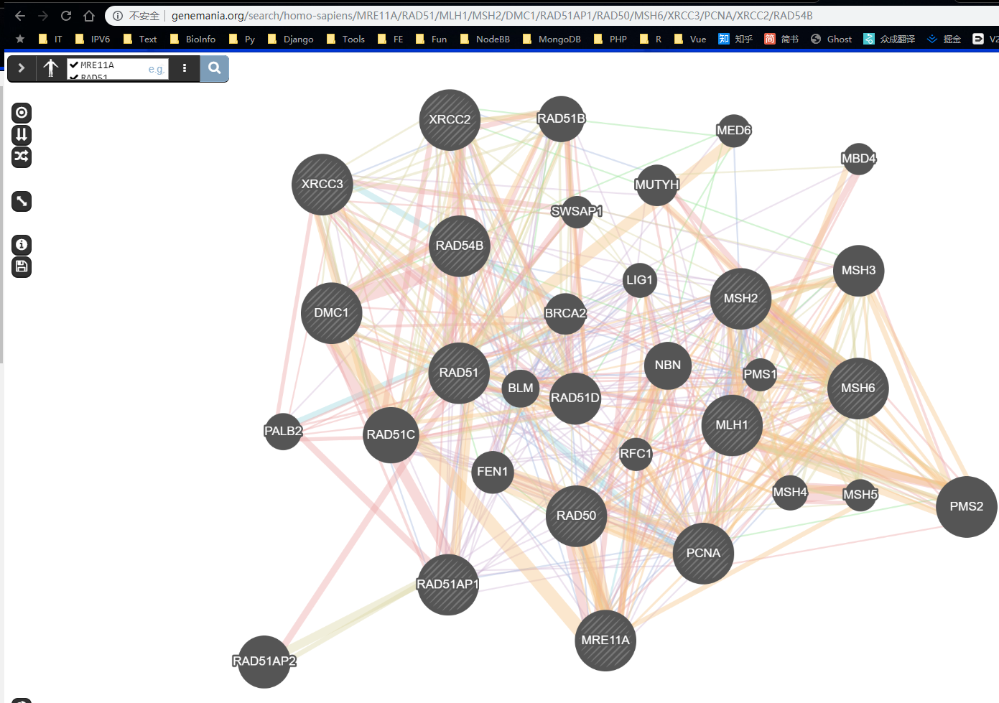
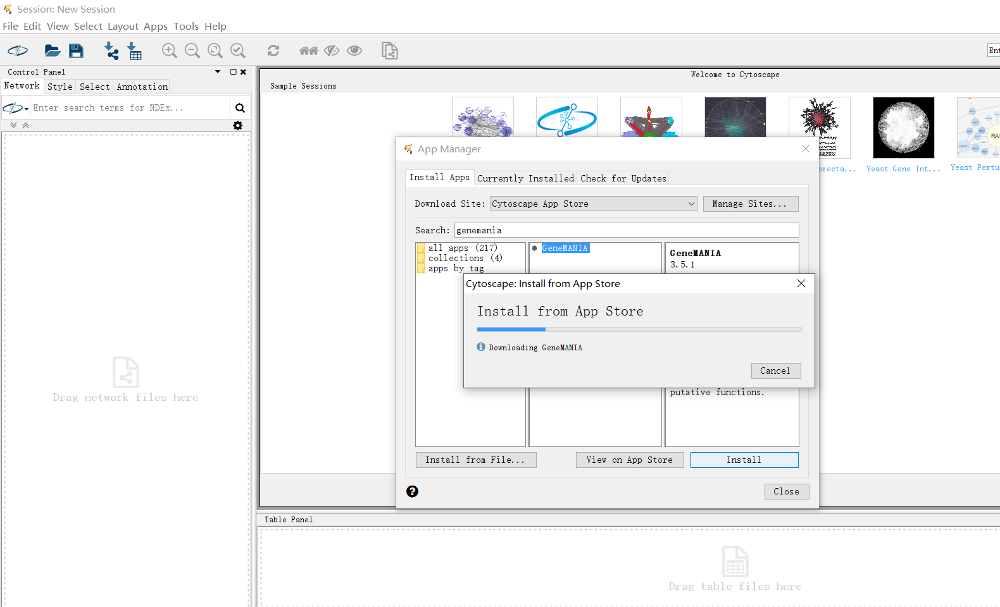
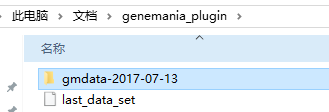
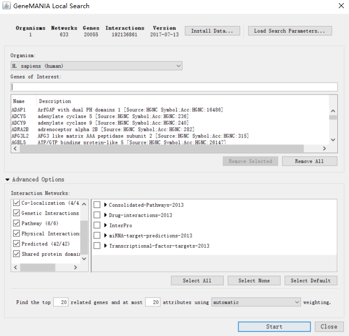
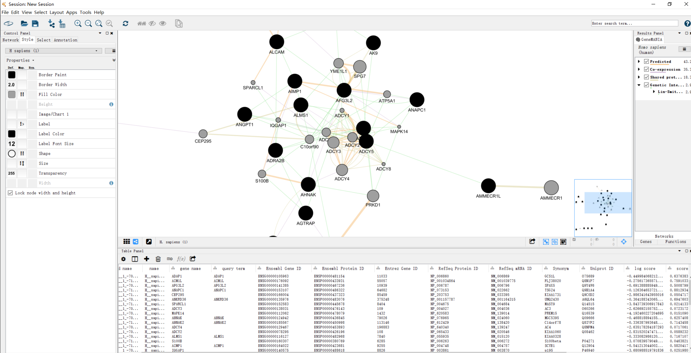
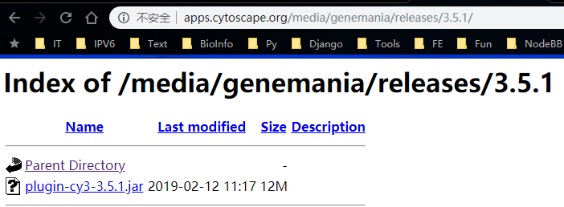
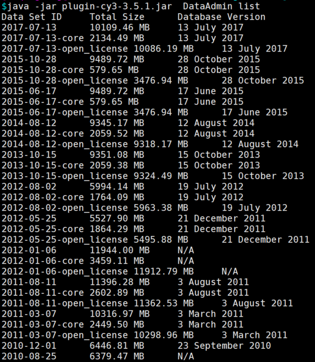
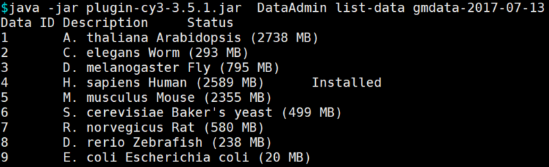
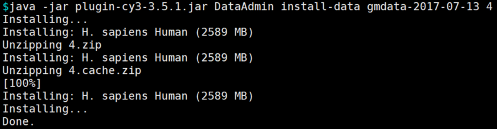
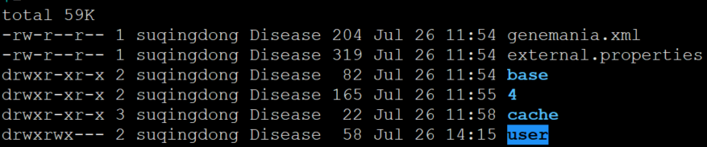

# 蛋白互作分析

## 一.蛋白质互作湿实验验证

蛋白互作3个实验研究方法:一个是质谱，是用来鉴定蛋白的， 相当于查蛋白身份证。 每个蛋白都有其唯一的身份证号， 可用质谱鉴定。 另外一个关键的实验叫 co-IP——免疫共沉淀。 最后一个叫 pulldown。琼脂糖珠不能叫琼脂糖珠， 得叫 agarose beads， 磁珠得叫 magnetic beads 。

IP 拉下来目的蛋白之后去打质谱， 这样可以分析蛋白是否有磷酸化、 甲基化、 糖基化、 乙酰化等修饰作用。 在没有针对修饰的特异性抗体的情况下， 也可以检测蛋白修饰。

一个成功的 Co-IP 实验需要证明靶蛋白和预测的相互作用的蛋白存在于免疫沉淀完了的蛋白样品中， 这个沉淀完的蛋白样品就称为 Input。 我们需要证明 input 中同时有两个蛋白的存在， 用于沉淀靶蛋白的抗体叫 IP 抗体， 所以文章里 IP后面标的名字， 就是告诉你用了什么蛋白抗体包被 beads 去拉的。 IB， B 是 blot， 是指用什么抗体去检测沉淀下来的蛋白。 co-IP 结果要可靠还需要设置几种阴阳性参照， 比如只加 beads 不加 IP 抗体的阴性对照， 再比如用没有特异性结合的 IgG 来替代 IP 抗体的阴性对照。 当然也需要设置阳性对照， A 抗体做 IP拉下来的沉淀， 检测 B 的时候用 A 的抗体做 Western 检测， 证明 IP 的效果是 OK 的。

IP 的时候用 Tag 的抗体也能够把带标签的蛋白给拉下来。 比较常见的标签有 His、 Flag、 HA、 Myc 四种， His 是 6 个组氨酸组成的， Flag 是 8 个氨基酸， HA 是9 个氨基酸， Myc 标签是 10 个氨基酸， 都很小。 目的蛋白没有好用抗体的时候， 这些标签做个融合蛋白能救你的命。 还有其他一些常用标签， 片段长一点而且带有功能的， 其中最重要的是 GFP， 绿色荧光蛋白。 还有 eGFP， 前面加个 e 是 enhanced， 增强型绿色荧光蛋白。

GST（谷胱甘肽巯基转移酶） ， 它的特性， 第一是能够把融合蛋白变成高度水溶性的蛋白。 第二可以特异性结合谷胱甘肽， 方便纯化融合蛋白，第三要去除融合蛋白中 GST 融合部分， 可用位点特异性蛋白酶切除， 很方便。 第四它也是标签， 也可以用 GST 特异性抗体来检测。

做蛋白-蛋白相互作用的时候除了 co-IP， 另一个经典的实验就是 GST pull-down。 pulldown 里面最常用的 tag 是 GST， 主要是利用了 GST 与底物结合特异性非常高的特点。 GST pull-down 是这么做的， 先用基因重组的方法构建一个 GST 和目的基因的融合蛋白，把 GST 融合蛋白与谷胱甘肽的特异性结合，制备到固相载体也就是层析柱上， 这相当于一个钓鱼竿上挂上了诱饵， 在 pulldown 里有个专门的词叫 bait。 接下来把细胞裂解液通过层析柱， 这时相互作用蛋白就能被吸附， 然后换个溶液洗脱就得到了互作蛋白。 pulldown 可以用于筛选， 洗下来的互作蛋白打质谱鉴定能知道是什么东西， 也可以用于已知的相互作用验证， 拉下来之后做 Western 也是可以的。 所以pull-down 的图在文章里出现的时候也是 western 结果， 以细胞裂解液作为 input， 以单纯 GST没有融合目的基因的作为阴性对照， 以 GST 融合蛋白作为 bait， 以相互作用蛋白的特异性抗体作为 blot 检测的抗体， 能产生杂交的阳性信号就说明有相互作用。

做蛋白互作的方法其实很多， 常见的还有酵母双杂交 Y2H、噬菌体展示 Phage display、表面等离子共振 SPR、荧光共振能量转移 FRET、还有蛋白芯片。

在 co-IP 沉淀的复合物里， 我们只能用 western 证明有结合蛋白存在，不能证明是否直接结合， 也可能是通过第三者蛋白介导， 所以比较严谨的话， 还要做一个GST-pulldown 证明是直接相互作用。

## 二.String数据库分析蛋白质互作

## 三.其他蛋白质互作数据库

[https://inbio-discover.com/index.html](https://inbio-discover.com/index.html)

[http://pages.genemania.org/](http://pages.genemania.org/)

## 四.GeneMANIA分析蛋白质互作
## 1 在线使用

> 直接选择物种，输入基因列表即可
>



## 2 Cytoscope中使用GeneMANIA插件
#### 2.1 安装插件

安装java -> 安装Cytoscope -> 安装GeneMANIA插件（在线安装），也可以从jar文件手动安装



#### 2.2 下载数据集

在线下载：Apps -> GeneMANIA -> Choose Another Data Set ...

手动下载gmdata目录：放到 文档/genemania_plugin 目录下， Apps -> GeneMANIA -> Load Data Set ...



#### 2.3 使用示例

Apps -> GeneMANIA -> Local Search ...

输入基因列表 -> start





## 3 [命令行模式](http://pages.genemania.org/command-line-tools/)
#### 3.1 脚本下载：[http://apps.cytoscape.org/media/genemania/releases/](http://apps.cytoscape.org/media/genemania/releases/)



```bash
wget http://apps.cytoscape.org/media/genemania/releases/3.5.1/plugin-cy3-3.5.1.jar
```

#### 3.2 库文件下载

查看可下载的库文件

```bash
java -jar plugin-cy3-3.5.1.jar  DataAdmin list
```



查看指定版本库文件的内容

```bash
java -jar plugin-cy3-3.5.1.jar  DataAdmin list-data gmdata-2017-07-13
```



下载指定物种的库文件

```bash
java -jar plugin-cy3-3.5.1.jar DataAdmin install-data gmdata-2017-07-13 4
```



> PS: 也可以手动下载解压 [http://plugin.genemania.org/data/gmdata-2017-07-13/](http://plugin.genemania.org/data/gmdata-2017-07-13/)
>

```bash
set -e
# rm -rf gmdata-2017-07-13

# base
wget http://plugin.genemania.org/data/gmdata-2017-07-13.zip
unzip gmdata-2017-07-13.zip
rm -f gmdata-2017-07-13.zip

# 4
wget http://plugin.genemania.org/data/gmdata-2017-07-13/4.zip
unzip 4.zip
mv 4 gmdata-2017-07-13
rm -f 4.zip

# cache
wget http://plugin.genemania.org/data/gmdata-2017-07-13/4.cache.zip
unzip 4.cache.zip
rm -f 4.cache.zip
mkdir gmdata-2017-07-13/cache
mv CORE gmdata-2017-07-13/cache
```

最终目录结构如下



其中user目录是首次运行时生成的，要想同组的人可以使用，需要开放写权限

#### 3.3 使用示例 [QueryRunner](http://pages.genemania.org/command-line-tools/#query-runner)
```bash
(
  echo -e 9606
  cat genelist | sort -u | tr '\n' '\t'
  echo
  echo all
  echo 20
  echo bp
) > query.flat


java -Xmx3G \
  -jar ../jar/plugin-cy3-3.5.1.jar QueryRunner \
  --data ../gmdata/gmdata-2017-07-13 \
  --out flat \
  --results . \
  --threads 2 \
  --verbose \
  query.flat
```

默认输入格式为[flat](http://pages.genemania.org/command-line-tools/#flat-example)，每行解释如下

| 行 | 内容 | 说明 |
| --- | --- | --- |
| 1 | [organism-name](http://pages.genemania.org/command-line-tools/#available-organisms) | 物种名或Taxonomy ID |
| 2 | gene1\tgene2\tgene3... | Tab分隔的基因列表 |
| 3 | [networks](http://pages.genemania.org/command-line-tools/#available-networks) | 网络类型，可选一个或逗号分隔的多个 |
| 4 | related-gene-limit | 相关基因个数的限制 |
| 5（可选） | [[combining-method](http://pages.genemania.org/command-line-tools/#available-combining-methods)] | 权重计算方法， |

> 更新: 2021-02-16 13:21:36
> 原文: <https://www.yuque.com/doublehelix/bioinfonotes/veakfg>
