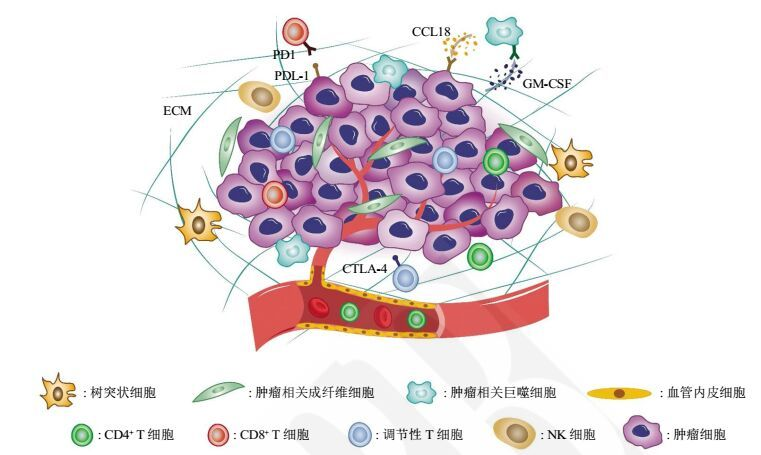
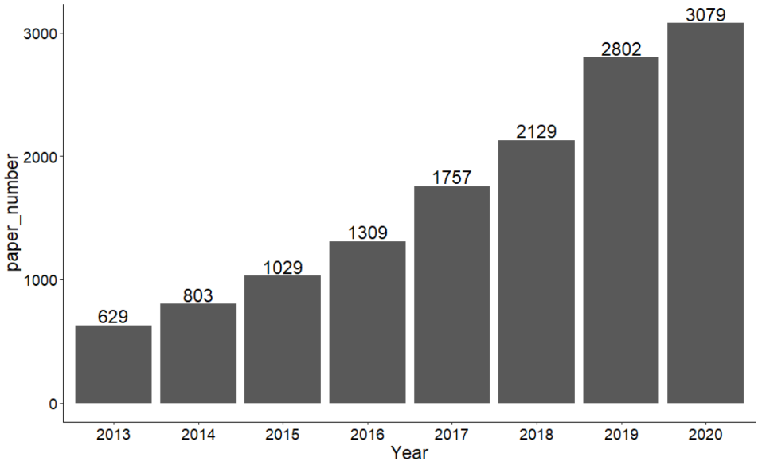
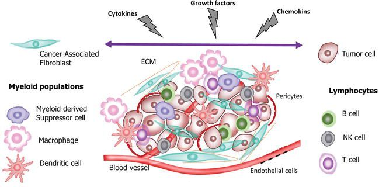
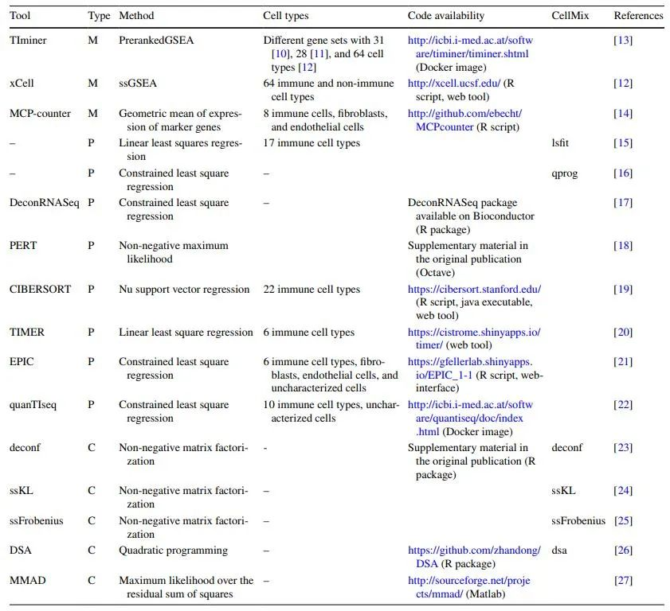
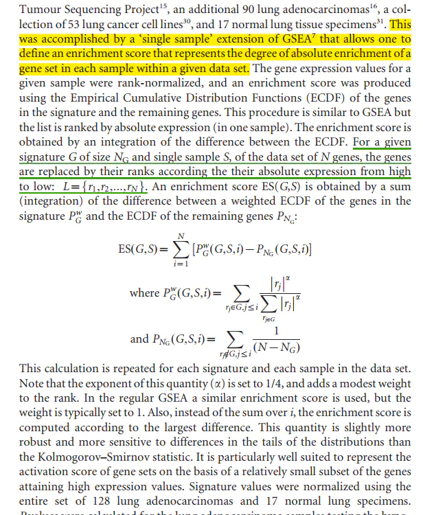
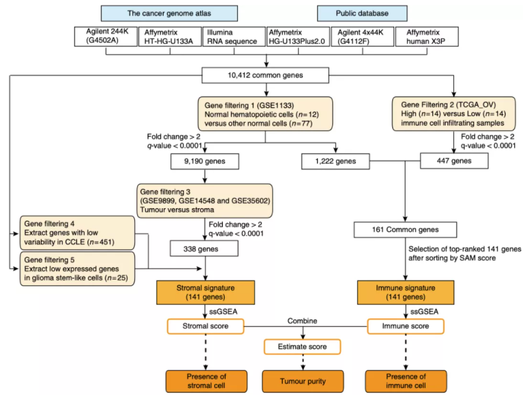
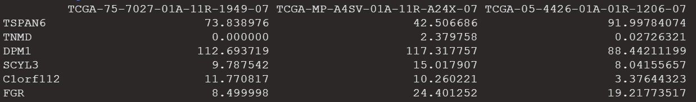
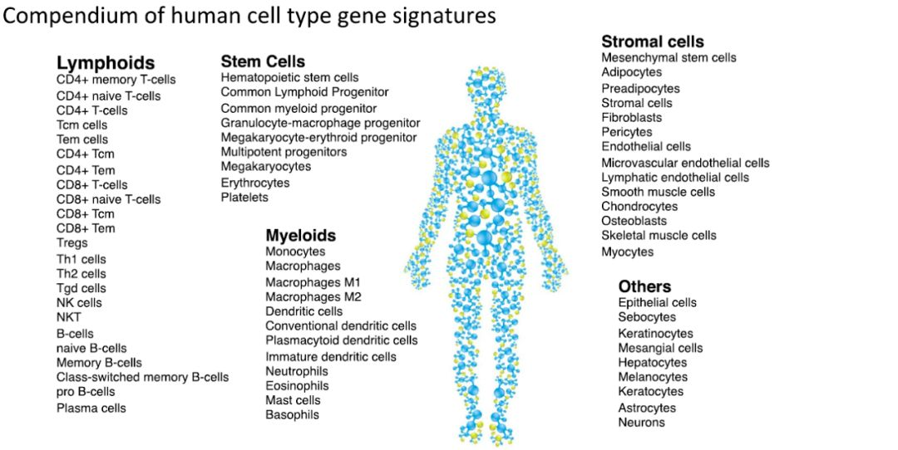

# 肿瘤相关免疫细胞浸润评估

## 一.什么是免疫微环境？

肿瘤免疫微环境（Tumor immune microenvironment）是指肿瘤细胞存在的周围微环境，包括周围的血管、免疫细胞、成纤维细胞、骨髓源性炎性细胞、各种信号分子和细胞外基质。肿瘤和周围环境密切相关，不断进行交互作用，肿瘤可以通过释放细胞信号分子影响其微环境，促进肿瘤的血管生成和诱导免疫耐受，而微环境中的免疫细胞可影响癌细胞增长和发育。



对于免疫微环境有一个流行的学说——“种子与土壤”学说，肿瘤的发生发展是肿瘤细胞与其微环境相互影响、共同进化的结果。肿瘤微环境由不同种类的间质细胞和炎性介质以及细胞外基质（ECM）组成。其中肿瘤相关成纤维细胞是最主要的间质细胞；血管内皮细胞介导的血管新生为肿瘤生长和转移提供必需的营养；免疫浸润包括树突状细胞、巨噬细胞、NK细胞及不同亚型的T细胞等等。肿瘤相关巨噬细胞与肿瘤细胞可以通过分泌特殊的细胞因子形成正反馈循环促进肿瘤恶性表型的形成和维持。肿瘤微环境在肿瘤恶性进展、免疫逃逸和治疗抵抗中发挥重要作用,我们统计了近8年（截至2020.11）pubmed 收录的关于肿瘤免疫浸润的文章数目，可见一直呈增长趋势，热度未减。



肿瘤细胞和基质成分之间相互作用，形成了功能复杂的TME。肿瘤相关成纤维细胞（CAFs）主要分布于血管周围或肿瘤外周纤维间质内，分泌细胞因子、ECM成分及相关酶分子。TME中有多种免疫浸润细胞，其中CD8+或细胞毒性T淋巴细胞（CTL）发挥肿瘤杀伤功能，而调节型T细胞（Treg）减弱T细胞活性，促进TME免疫抑制。一般M1型巨噬细胞发挥促炎和抗瘤作用，但TME中的肿瘤相关巨噬细胞（TAM）为M2型，通过分泌Th2细胞因子促进血管生成和肿瘤侵袭。我们所熟知的NK细胞会释放颗粒酶和穿孔素杀伤靶细胞，但在TME中富集的TGF-β会抑制其杀伤活性。而树突状细胞（DC）也会受到TME中的缺氧和炎症影响消弱其抗原呈递活性。基质细胞类型和富集程度决定了TME特性，进一步影响着肿瘤进展和免疫应答情况。



TME的异质性使得个体间肿瘤进展存在很大差异；肿瘤的免疫微环境一般分为豁免型和炎症型。炎症型肿瘤微环境中富集有活化的T细胞和髓系细胞，并由趋化因子、I型干扰素信号表达。相反“冷肿瘤”，既是免疫豁免型TME中，仅存在少量免疫细胞或抑制性亚群，如Treg、MDSC和TAM，而效应型免疫细胞无法有效浸润至肿瘤微环境。仅分布在外周基质，难以发挥抑癌作用。

首先，让我们来给免疫浸润分析下一个宏观的定义，**来回答一下究竟什么是免疫浸润分析呢？**

其实我们可以很简单的理解，免疫浸润分析其实就是为了明确免疫细胞在人体微环境内的组成情况，进而明确究竟是哪种免疫细胞在疾病的发生发展中产生了重要作用，这就是免疫浸润分析

好了，了解了概念，我们下面再来提出一个问题：**我们通过什么算法来明确免疫细胞的组成呢？**

大体的算法思想我们可以归结为两类：

+ marker gene；
+ 反卷积思想

算法本身的逻辑不需要掌握，只需要知道两种算法得到的免疫浸润结果是不同的

反卷积算法得到的是每个样本免疫细胞的比例。

marker gene算法得到的是每一个样本某个细胞的富集分数。

也就是说尽管免疫浸润的方法有很多，但是基本上都是基于以上两种算法核心开发出来的。

然后我们继续往下探索，**那么目前来说免疫浸润分析都有哪些方法呢？**

目前来说，我们用的最多的就是：CIBERSORT、ssGSEA、Xcell、MCPcounter、immundeconv等等

这里我们主要介绍的就是CIBERSORT、ssGSEA、以及MCPcounter，相信掌握了以上免疫浸润分析的方法，会让你的文章有一个更广阔的天空。



## 一. ssGSEA分析

单样本基因集富集分析（single sample gene set enrichment analysis, ssGSEA），是GSEA方法的扩展，主要是针对单个样本无法做GSEA而设计。算法概括来说就是首先对给定样本的基因表达值进行秩次标准化，然后利用经验累积分布函数计算富集分数（ES）。

首先有一个样本的表达数据，一列为基因，一列为表达值。然后对样本的所有基因按表达水平进行排序，获得所有基因中的秩次rank，这些基因的集合为BG（背景基因集，background gene）。假设要对其进行KEGG的分析，首先我们需要在GSEA官网找到KEGG对应的gmt文件，gmt文件主要格式是：每行表示一个通路，第一列为通路ID，第二列为通路对应的描述，第三列开始到最后一列为该通路中的基因。那么对于任意的一个通路A，可以拿到这个通路内的基因列表GL（Gene List），从GL中寻找BG里存在的基因计数为NC，并将这些基因的表达水平加和为SG。

然后开始计算ES（富集分数）：对于任意一个BG中的基因G，如果G是集合GL中的基因，则他的ES等于该基因的表达水平除以SG，即该基因的表达量/BG和GL共有基因的表达量加和；如果G不是集合GL中的基因，则该基因的ES等于1/(基因集合BG总个数减去NC)，如果NC很小，ES就会很小。依次计算每个BG中的基因的ES值，找到其中绝对值最大的ES作为通路A的A.ES。

之后需要一个统计学方法来评估该ES是否是显著的，即非随机的：按照上述计算ES的方法，先随机打乱表达谱中基因的表达顺序，然后再依次计算ES值，如此重复一千次，得到一千个ES值，我们根据这一千个ES值的分布，来计算A.ES在这个分布中所处的位置及出现在该位置时的概率即得到了p值。依次我们分别计算每个通路的ES及p值，然后使用多重检验矫正得到每个通路的FDR。



设给定基因集为G，包含基因数为NG，给定单个样本为S，表达谱包含基因数为N，N个基因按它们绝对表达值从高到低确定秩次。i 从1赋值到N，依此计算PGw和PNG。

28种免疫细胞的基因集出自文章：

Pan-cancer Immunogenomic Analyses Reveal Genotype-Immunophenotype Relationships and Predictors of Response to Checkpoint Blockade

其中这28 subpopulations of TILs可以分成2大类：

adaptive immunity: activated T cells, central memory (Tcm), effector memory (Tem) CD4+ and CD8+ T cells, gamma delta T (Tγδ) cells, T helper 1 (Th1) cells, Th2 cells, Th17 cells, regulatory T cells (Treg), follicular helper T cells (Tfh), activated, immature, and memory B cells

innate immunity, such as macrophages, monocytes, mast cells, eosinophils, neutrophils, activated, plasmacytoid, and immature dendritic cells (DCs), NK cells, natural killer T (NKT) cells, and MDSCs.

这28个细胞类型基因集数据来源：Download spreadsheet (22KB)   Table S5. List of Microarray Data from 37 Studies for Identifying Immune-Related Genes.

全部的基因列表：Download spreadsheet (32KB)  Table S6. List of Pan-cancer Immune Metagenes.

代码：

```r

rm(list=ls())
library(GSVA)
library(limma)
library(GSEABase)
ifelse(dir.exists("004-ssGSEA"),print("文件夹004-ssGSEA已经存在"),dir.create("004-ssGSEA"))
#读取输入文件，并对输入文件处理
load("001-preparedData/lungcancerRNASeqData-geneGroupData.Rdata")
exp_data = lungcancerRNASeqData[["LungCncerTPM"]]
dimnames=list(rownames(exp_data),colnames(exp_data))

exp_data1 = matrix(as.numeric(as.matrix(exp_data)),
                   nrow=nrow(exp_data),
                   dimnames=dimnames)
exp_data1 = avereps(exp_data1)
exp_data1 = exp_data1[rowMeans(exp_data1)>0,]

#读取我们所提供的免疫细胞基因文件
geneSet = getGmt("000-data/immune cell.gmt", geneIdType=SymbolIdentifier())

ssGSEA_Score = gsva(exp_data1, geneSet,
                    method='ssgsea',
                    kcdf='Gaussian',
                    abs.ranking=TRUE)#ssGSEA计算
normalize=function(x){
  return((x-min(x))/(max(x)-min(x)))}#定义ssGSEA_Score矫正函数

norm_ssGSEA_Score=normalize(ssGSEA_Score)#对ssGSEA_Score进行矫正
norm_ssGSEA_Score=rbind(id=colnames(norm_ssGSEA_Score),norm_ssGSEA_Score)
write.table(norm_ssGSEA_Score,file="004-ssGSEA/norm_ssGSEA_Score.txt",sep="\t",quote=F,col.names=F)#此处的输出文件即为ssGSEA富集得分文件


screen=sapply(strsplit(colnames(norm_ssGSEA_Score),"\\-"),"[",4)
screen=sapply(strsplit(screen,""),"[",1)
screen=gsub("2","1",screen)
data=norm_ssGSEA_Score[,screen==0]#对肿瘤样品分组，TCGA的命名规则可以复习一波

h_cluster = hclust(dist(t(norm_ssGSEA_Score)))#计算样品距离并聚类
cluster_result=cutree(h_cluster,2)#将聚类结果分成低，中，高免疫三组
library(pheatmap)
norm_ssGSEA_Score1=read.table("004-ssGSEA/norm_ssGSEA_Score.txt",sep="\t",header=T,row.names=1,check.names=F)#读取结果文件
V1<-names(cluster_result)
V2<-as.integer(cluster_result)
category<-data.frame(V1,V2)
category$V1<-as.character(category$V1)
category[,2]=paste0("Cluster",category[,2])
category=category[order(category[,2]),]

norm_ssGSEA_Score1=norm_ssGSEA_Score1[,as.vector(category[,1])]
cluster=as.data.frame(category[,2])
row.names(cluster)=category[,1]
colnames(cluster)="Cluster"

expression = lungcancerRNASeqData[["samples_meta"]]
color.key<-c("#3300CC","#3399FF","white","#FF3333","#CC0000")

pdf("004-ssGSEA/heatmap.pdf",height=5,width=9)
pheatmap(norm_ssGSEA_Score1,
         annotation=expression,
         color =colorRampPalette(color.key)(50),
         cluster_cols =F,
         fontsize=8,
         fontsize_row=8,
         scale="row",
         show_colnames=F,
         fontsize_col=3,
         main = "Example heatmap")
dev.off()

color.key <- c("#3300CC", "#3399FF", "white", "#FF3333", "#CC0000")
pheatmap(
  norm_ssGSEA_Score1,
  color = colorRampPalette(color.key)(50),
  border_color = NA,
  annotation_col = cluster,
  labels_row = NULL,
  scale="row",
  #clustering_method = "ward.D2",
  show_rownames = T,
  show_colnames = F,
  fontsize_col = 5
  )
```

[1] GSVA: The Gene Set Variation Analysis package for microarray and RNA-seq data

[2] Xue Y, Tong L, LiuAnwei Liu F, et al. Tumor‑infiltrating M2 macrophages driven by specific genomic alterations are associated with prognosis in bladder cancer. Oncol Rep. 2019;42(2):581-594. doi:10.3892/or.2019.7196

[3] Jia Q, Wu W, Wang Y, et al. Local mutational diversity drives intratumoral immune heterogeneity in non-small cell lung cancer. Nat Commun. 2018;9(1):5361. Published 2018 Dec 18. doi:10.1038/s41467-018-07767

## 二. 免疫微环境评分-estimate包

Estimate是2013年发表在Nature communication杂志上的一种推断肿瘤微环境中免疫得分，基质得分及免疫微环境得分的工具。主要是利用能够表征基质和免疫细胞的基因集的表达信号进行估算。

ESTIMATE方法估计是基于TCGA数据库中的各种平台检测的样本表达量数据得到的10412个基因集，经过过滤最终确定基质信号基因集的141个基因和免疫信号的141个基因，通过这两个基因集的表达量通过ssGSEA算法最终确定Stromal score和Immune score,这两个得分相加即可得到Estimate score;这三个得分分别表征着免疫微环境中基质细胞的占比、免疫细胞的占比和肿瘤纯度。

肿瘤组织中的正常细胞不仅在分子生物学研究中影响肿瘤信号，而且在癌症生物学研究中也起到重要作用。  estimate全称Estimation of STromal and Immune cells in MAlignant Tumours using Expression data, estimate包使用基因表达数据预测恶性肿瘤组织中的间质细胞和免疫细胞的含量。



•   estimate官网 1: [https://r-forge.r-project.org/projects/estimate/](https://r-forge.r-project.org/projects/estimate/)

•   estimate官网2: [https://bioinformatics.mdanderson.org/public-software/estimate/](https://bioinformatics.mdanderson.org/public-software/estimate/)

如果是根据具体某个基因表达量把病人分组，那么tpm或者fpkm跟我们的logCPM值并不会有区别，就是说差异分析，生存分析都没有问题。

但是呢，现在我们做的是estimate分析，它本质上是ssGSEA，这个分析依赖于同一个样品内部基因的排序，所以tpm或者fpkm的归一化会改变样品内基因的排序，所以结果会有差异！

任何数据分析结果都需要辅助合理的生物学解释，但是这个estimate算法本身就是一个很粗糙的，虽然可以根据表达量矩阵去量化肿瘤样品里面的基质细胞和免疫细胞的比例，但是可信度也是存疑。

参考文献：

Yoshihara, K., Shahmoradgoli, M., Martínez, E., Vegesna, R., Kim, H., Torres-Garcia, W., ... & Verhaak, R. G. (2013). Inferring tumour purity and stromal and immune cell admixture from expression data. Nature communications, 4(1), 1-11.

肿瘤纯度计算： Tumour purity=cos (0.6049872018+0.0001467884 X ESTIMATE score).

### 1.包的安装
```r
library(utils)
rforge <- "http://r-forge.r-project.org"#开发中的包
if(!"estimate" %in% installed.packages()){
  install.packages("estimate", repos=rforge, dependencies=TRUE)#装不上的话应该是网络问题
}
```

estimate包的两个主要函数：filterCommonGenes和estimateScore。

filterCommonGenes(input.f, output.f, id=c("GeneSymbol”， "EntrezID”))

•   input.f：输入文件所在路径；

•   output.f：输出文件所在路径；

•   id：识别Gene Symbol和Entrez ID，可以不用设置。 estimateScore(input.ds, output.ds, platform = c(”affymetrix”， ”agilent”， ”illumina”))

•   input.ds：输入文件所在路径，要求格式get，即filterCommonGenes的输出文件；

•   output.ds：输出文件所在路径；

•   platform：有affymetrix, agilent, illumina三个平台选项，根据自己的数据进行选择。



### 2.分析
```r
# 加载estimate包
library(estimate)
ifelse(dir.exists("005-estimate"),print("文件夹005-estimate已经存在"),dir.create("005-estimate"))
input.f <- "001-preparedData/lungcancerRNASeqTPM.txt"
```

```r
filterCommonGenes(input.f=input.f,
                  output.f="005-estimate/estimate_input.gct",
                  id="GeneSymbol")#过滤掉细胞中共有的基因

### 计算免疫浸润打分 ###
estimateScore("005-estimate/estimate_input.gct",
              "005-estimate/estimate_score.gct",
              platform="illumina")#计算肿瘤微环境的评分
```

## 三. CIBERSORT

为了方便用户的使用，CIBERSORT被开发成一个网页版的工具，其网址链接：http://cibersort.stanford.edu/.不过，由于CIBERSORT初期版本不支持单细胞测序数据的分析，所以近期又升级到了CIBERSORTX，升级版的网址链接为：https://cibersortx.stanford.edu/

文献：Determining cell type abundance and expression from bulk tissues with digital cytometry

1.不可以有缺失值和负数；

2.不可以取log（CIBERSORT会对于数据是否取过log有一个判断，简单来说就是如果取了log也会给你去掉，因为输入数据接受的是没有log的形式），这个在CIBERSORT函数的源代码中讲解的很清楚，至于为什么要取log，其实我们可以去看我们的参考数据集本身就是没有log的，我们是要通过表达量彼此映照来分析的，所以不需要log

3.芯片数据对应不同平台有不同的要求，Affymetrix芯片建议进行RMA标准化，illumina芯片建议用limma包进行标准化处理，Agilent芯片建议用limma包进行标准化处理

4.对于测序数据，不支持原始数据，而是建议使用TPM或者FPKM都可以。

LM22——这个数据集来自**Robust enumeration of cell subsets from tissue expression profiles**，这篇文献对于这个数据集有一个比较清晰的解答：we designed and validated a leukocyte gene signature matrix, termed LM22. It contains 547 genes that distinguish 22 human hematopoietic cell phenotypes, including seven T cell types, naïve and memory B cells, plasma cells, NK cells, and myeloid subsets ，简单的理解，这个数据集的构建并没有划归恶性还是良性，所以**肿瘤和非肿瘤，物种为人的时候我们都可以使用CIBERSORT算法**进行免疫浸润分析（LM22作为参考数据集）。

mice——这个数据集来自**Inference of immune cell composition on the expression profiles of mouse tissue**，这篇文献中的参考数据集是一个小鼠的免疫细胞数据集，可以替换LM22来**进行肿瘤和非肿瘤，物种为小鼠的免疫浸润分析**，当然这篇文献也提出了一种方法**ImmunCC**

## 四.MCPcounter

我们通过对方法学文献**Estimating the population abundance of tissue-infiltrating immune and stromal cell populations using gene expression**的阅读，对该免疫浸润的输入数据进行定义

1.数据来源为转录组（芯片、测序均可）；

2.MCP-counter is the first validated computational method that enables the robust quantification of the abundance of multiple immune and non-immune stromal populations **in the transcriptome of cellularly heterogeneous tissues such as normal or malignant tissues**（即MCPcounter可以针对肿瘤/非肿瘤组织，物种为人）

3.MCPcounter估计是“单一样本”的分数，因为它们是在每个样本上独立计算的。这些分数可以用来直接比较队列中不同样本中相应细胞类型的丰度（即该方法可以比较同一个细胞类型在不同sample的丰度，但是不能用于不同细胞类型之间的比较）

4.从方法学中我们可以明确（Already-normalized “level 3” data were downloaded separately for each project）即针对测序数据需要经过标准化的处理（TPM即可），芯片数据我们依旧可以选择RMA方法标准化后的数据

## 五. xCell

xCell (http://xcell.ucsf.edu/) 是2017年发表在Genome Biology杂志上公布的基于ssGSEA的方法工具，该方法通过反褶积整合了基因富集分析的优势，可以评估64种细胞类型，涉及多个适应性和先天免疫细胞、造血祖细胞、上皮细胞和细胞外基质细胞，**其中包括48种肿瘤微环境相关细胞**。xCell基于从不同项目和研究的大规模表达数据中提取的489个基因集（FANTOM5, ENCODE, Blueprint, IRIS, Human Primary Cell Atlas (HPCA)和Novershtern等人的文章）。对于每种细胞类型，通过四个主要步骤计算xCell丰度得分：（1）使用R包GSVA对489个基因集单独进行ssGSEA；（2）在属于一种细胞类型的所有基因集的ES进行平均；（3）将特定平台的ES转换为丰度分数；（4）使用类似于用于流式细胞术数据分析的spillover方法校正紧密相关的细胞类型之间的相关性。尽管最终的xCell丰度分数不能直接解释为细胞分数，但它们与真实的细胞比例具有很高的相关性。

原文题目为：xCell: digitally portraying the tissue cellularheterogeneity landscape.



```r
options(stringsAsFactors = F)
Sys.setlocale("LC_ALL","English")
devtools::install_github('dviraran/xCell')
library(xCell)
```

xCell使用的是表达水平排序而不是实际值，因此归一化没有效果，但是需要归一化到基因长度（RPKM/FPKM/TPM/RSEM）。案例：

```r
	proj = "TCGA-LUAD"
  message(proj)
  load(FilePath[grep(proj,FilePath)])#STARdata
  tpm <- STARdata[["tpm"]]
  tpm <- filterGeneTypeExpr(expr = tpm,
                            fil_col = "gene_type",
                            filter = FALSE)
  ##过滤不表达的基因
  tpm <- tpm[apply(tpm,1,var) !=0,]
  ##正常组织样本ID
  SamN <- TCGAquery_SampleTypes(barcode = colnames(tpm),
                                typesample = c("NT","NB","NBC","NEBV","NBM"))

  ##肿瘤组织样本ID
  SamT <- setdiff(colnames(tpm),SamN)

  ###去除重复样本
  tur_exp <- del_dup_sample(tpm[,SamT],col_rename = T)

  # 进行xCell分析
  xCell <- xCellAnalysis(tur_exp)
  ## 如果是RNA-seq数据，则
  xCell_RNAseq <- xCellAnalysis(tur_exp,rnaseq = T)
```

## 六.ImmuneCellAI

[http://bioinfo.life.hust.edu.cn/ImmuCellAI#!/](http://bioinfo.life.hust.edu.cn/ImmuCellAI#!/)

## 七.其他
### 1.qyanTISEQ
### 2.EPIC

[https://gfellerlab.shinyapps.io/EPIC_1-1/](https://gfellerlab.shinyapps.io/EPIC_1-1/)

_**ESTIMA**_

> 更新: 2022-10-05 10:41:25
> 原文: <https://www.yuque.com/doublehelix/bioinfonotes/fo63yv>
