# pyTorch环境安装

## 1.GPU版本的安装

在安装软件之前，先查看CUDA官网和pyTorch官网的软件版本信息：

先查看目前pyTorch支持的系统以及CUDA和Python的版本：

<https://pytorch.org/get-started/locally/>

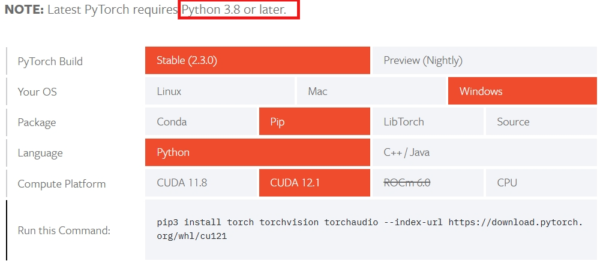

从上图可以看到，最新的 PyTorch 需要 Python 3.8 或更高版本。CUDA支持11.8和12.1。

然后在CUDA官网查看相关版本，选择12.1的版本进行下载和安装：

<https://developer.nvidia.com/cuda-toolkit-archive>

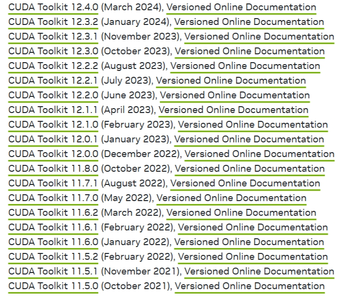

安装Visual Studio：<https://visualstudio.microsoft.com/zh-hans/vs/older-downloads/>

下载CUDA 12.1版本，还有根据自己的电脑系统版本选择下载，这里的我的系统是Win10。

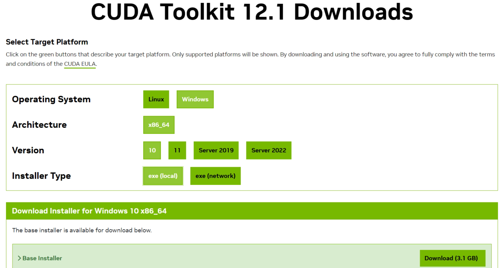

下载后点击安装程序，弹出这个，临时抽取文件放置位置的，直接点击ok、随后进入系统兼容性的检查，就是看你是否下错安装包了。可以修改路径。

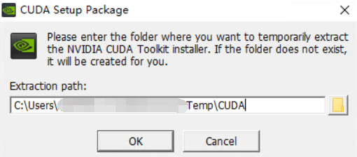

接下来会弹出下面页面：

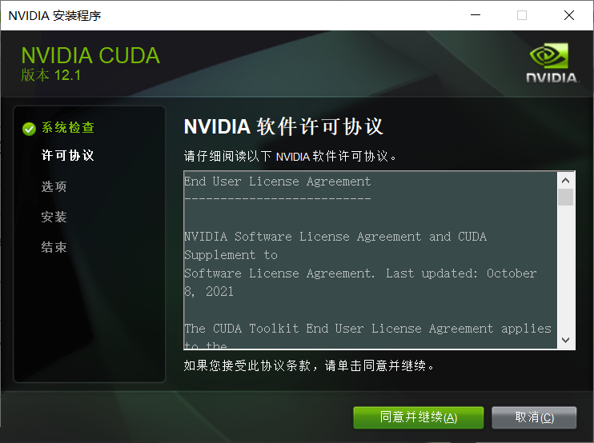

点击同意并继续后，选择自定义。

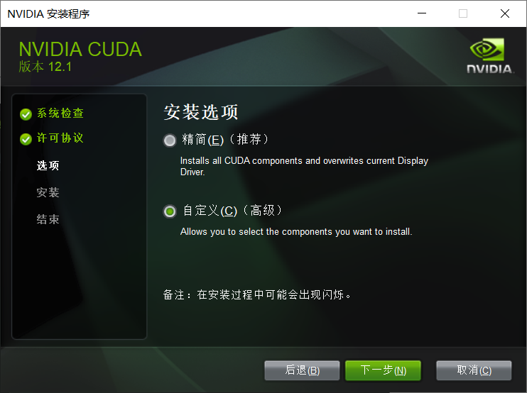

点击下一步后，弹出下面窗口，把CUDA选一下，还需要注意一点，如果 你前面没有安装Visual Studio，直接安装的这个，需要把CUDA里面的Visual Studio Integration取消勾选，否则会安装不成功。

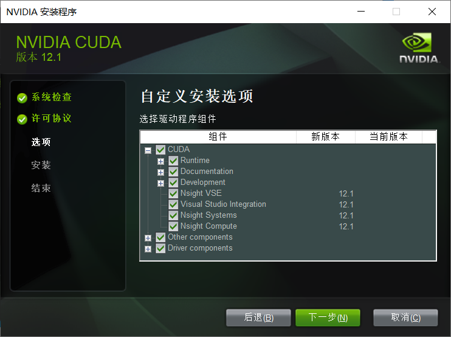

点击下一步：

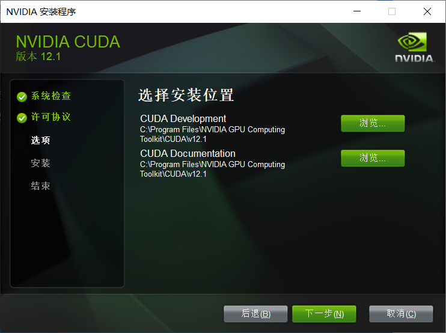

点击下一步。

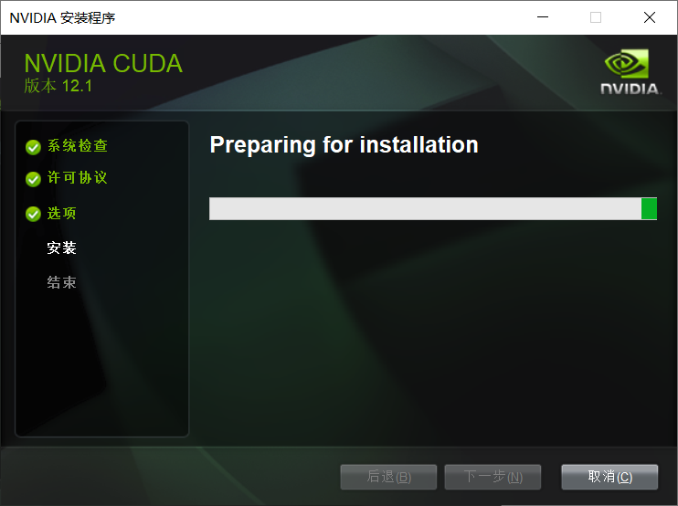

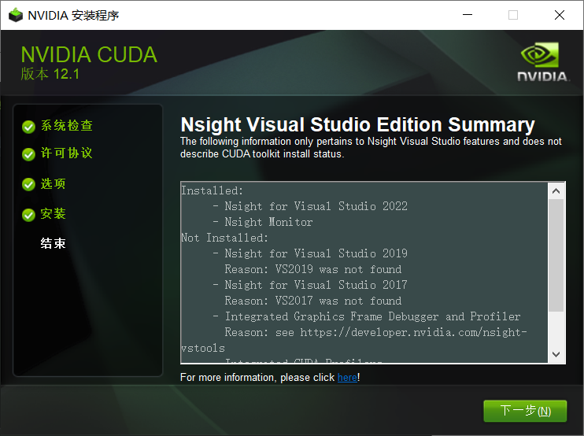

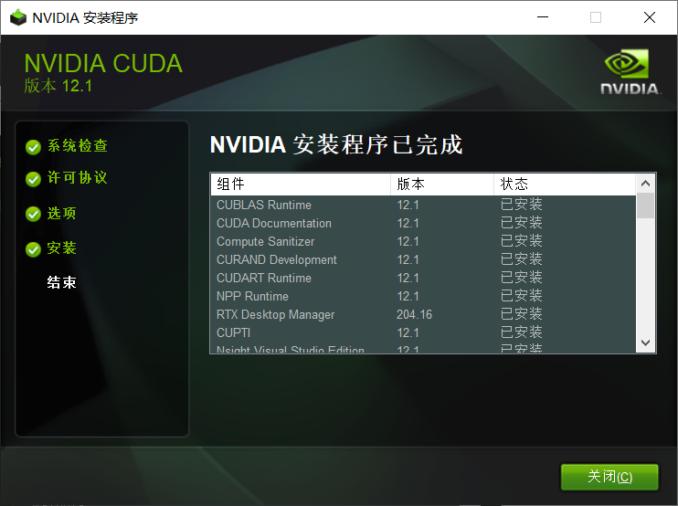

下面测试安装是否成功：

打开DOS窗口，输入`nvcc -V`，如果出现版本信息，证明安装成功。

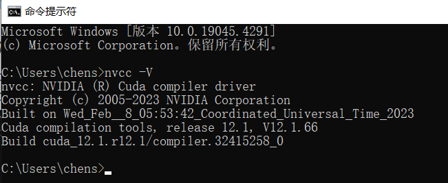

如果提示没有nvcc命令，需要将nvcc路径（`C:\Program Files\NVIDIA GPU Computing Toolkit\CUDA\v12.1\bin`）添加至环境变量中。

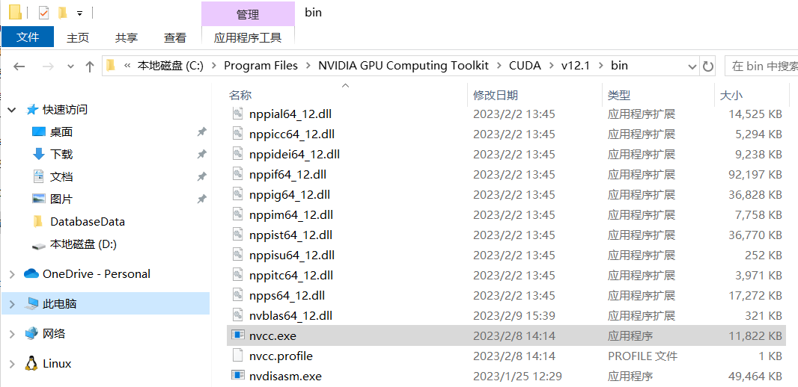

CUDA里面有个demo_suite文件夹中有些工具，让我们测试，我们一起来试试吧 ，定位安装目录的demo_suite文件夹，我的是`C:\Program Files\NVIDIA GPU Computing Toolkit\CUDA\v12.1\extras\demo_suite`。

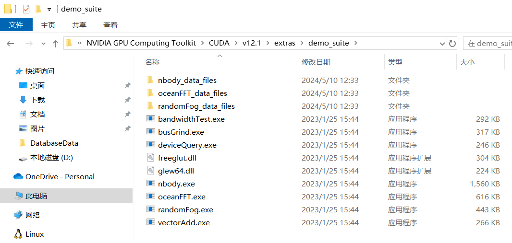

进入该文佳佳，输入<code>deviceQuery</code>，查询一下本机的gpu设备。

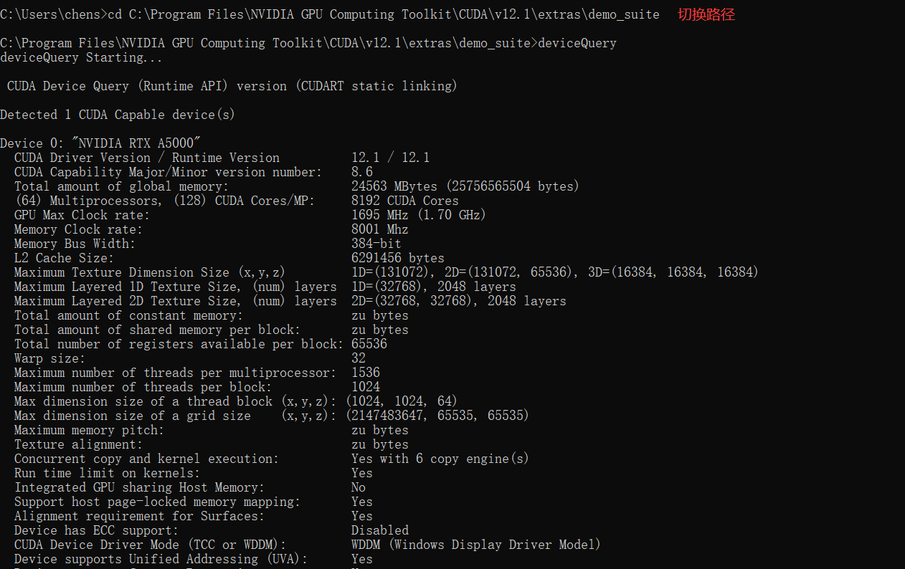

再来测试一下带宽，输入`bandwidthTest`。

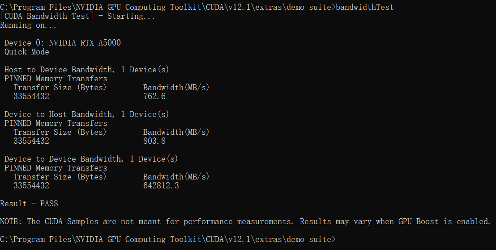

接下来，就可以安装pyTorch。

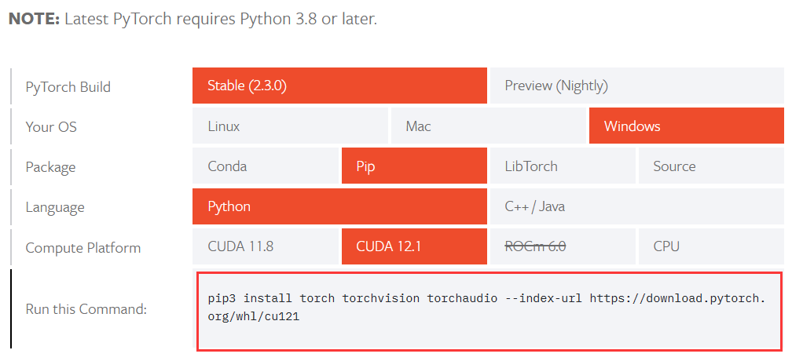

安装可以直接复制上面命令直接安装，我们这里先创建一个虚拟环境后再进行安装。

在创建环境时，需要指定好安装的python版本，这里安装的 PyTorch 需要 Python 3.8 或更高版本。Python相关版本：<https://www.python.org/downloads/windows/>

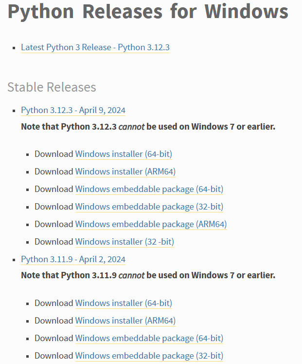

这里我选择安装11.9的版本。

```plain
conda create -n pyTorchGPU python=3.11.9
conda activate pyTorchGPU
```

```plain
pip3 install torch torchvision torchaudio --index-url https://download.pytorch.org/whl/cu121
```

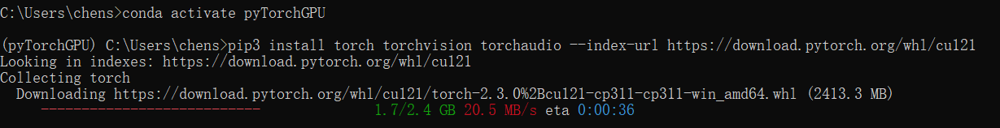

> 更新: 2024-05-10 14:07:23
> 原文: <https://www.yuque.com/doublehelix/bioinfonotes/cy0ntgkmg02pfsu6>
