# Scanpy：Python 单细胞分析

官网：[https://scanpy.readthedocs.io/en/latest/](https://scanpy.readthedocs.io/en/latest/)

## 1.安装

conda安装

```shell
conda install -c conda-forge scanpy python-igraph leidenalg
```

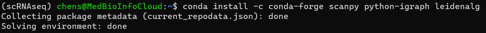

从PyPI中拉出Scanpy（Python 3）

```shell
pip install scanpy
```

## 2.AnnData对象

在scanpy中，我们最常见的数据结构是AnnData，它是一个用于存储数据的对象，其数据结构可以描述如下：

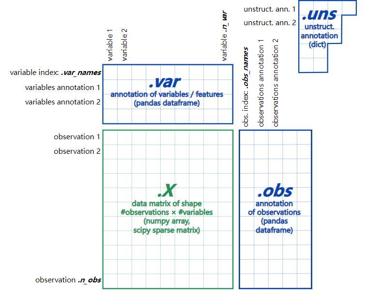

我们把上面这个对象记作 adata，我们需要了解以下几个部分：

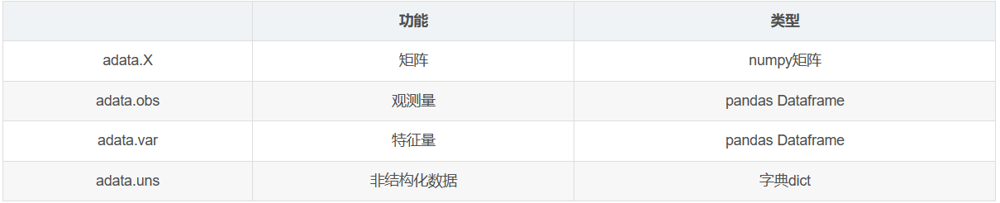

.X这个部分储存的是矩阵信息，数据结构是numpy array，和seurat对象一样，基因variable *细胞observation的稀疏矩阵。但是.X的结构ndarray，是一个数组，是没有行名列名消息的。行名和列名消息存储在.obs和.var里。

.obs存储的是细胞的信息，数据结构是pandas dataframe。相当于Seurat对象中的metadata

.X这个部分储存的是矩阵信息，数据结构是numpy array，和seurat对象一样，基因variable *细胞observation的稀疏矩阵。但是.X的结构ndarray，是一个数组，是没有行名列名消息的。

.obs存储的是细胞的信息，数据结构是pandas dataframe。

相当于Seurat对象中的metadata

.uns存储的是后续添加的非结构信息，数据结构是dict，有序字典。

obsm对观测的多维的注释，m指的就是multi-dim多个维度。它是2-多维的ndarray，长度为n_obs。（obs是一个维度可以都放在一个数据框下）

varm对特征的多维的注释，与obsm相对。

obsp针对观测的配对的注释，前两维都是n_obs。比如点与点之间的距离和连通性。

layers在做速率分析的时候，还可以看到adata中有layers这一部分的信息。

显示在所有细胞中，每个细胞中产生最高count分数的那些基因。

```python
# 数据数目统计
adata.n_obs  # 返回细胞数 2695
adata.n_vars  # 返回基因数 18270
adata.shape # (2695, 18270)

# 数据键值提取
adata.obs_keys() # 细胞注释信息的keys，比如 ['ClusterID', 'ClusterName', 'SCT_snn_res_0_8', 'nCount_SCT', 'nCount_Spatial', 'nFeature_SCT', 'nFeature_Spatial', 'orig_ident', 'seurat_clusters', 'imagecol', 'imagerow'']
adata.obs_names  # 返回细胞ID 数据类型是object
adata.var.index  # 返回基因 数据类型是object
adata.var_names.to_list()  # 返回基因 数据类型是list
adata.obs.head() # 查看前5行的数据

# 其他的数据组成也可以使用

```

所有的属性和方法

```python
['T',
 'X',
 '_BACKED_ATTRS',
 '_H5_ALIASES',
 '_H5_ALIASES_NAMES',
 '_X',
 '__class__',
 '__contains__',
 '__delattr__',
 '__delitem__',
 '__dict__',
 '__dir__',
 '__doc__',
 '__eq__',
 '__format__',
 '__ge__',
 '__getattribute__',
 '__getitem__',
 '__gt__',
 '__hash__',
 '__init__',
 '__init_subclass__',
 '__le__',
 '__len__',
 '__lt__',
 '__module__',
 '__ne__',
 '__new__',
 '__reduce__',
 '__reduce_ex__',
 '__repr__',
 '__setattr__',
 '__setitem__',
 '__sizeof__',
 '__str__',
 '__subclasshook__',
 '__weakref__',
 '_adata_ref',
 '_check_dimensions',
 '_check_uniqueness',
 '_clean_up_old_format',
 '_gen_repr',
 '_get_X',
 '_get_and_delete_multicol_field',
 '_get_obs_array',
 '_get_var_array',
 '_has_X',
 '_init_as_actual',
 '_init_as_view',
 '_inplace_subset_obs',
 '_inplace_subset_var',
 '_is_view',
 '_layers',
 '_mutated_copy',
 '_n_obs',
 '_n_vars',
 '_normalize_indices',
 '_obs',
 '_obsm',
 '_obsp',
 '_oidx',
 '_prep_dim_index',
 '_raw',
 '_remove_unused_categories',
 '_sanitize',
 '_set_backed',
 '_set_dim_df',
 '_set_dim_index',
 '_uns',
 '_var',
 '_varm',
 '_varp',
 '_vidx',
 'chunk_X',
 'chunked_X',
 'concatenate',
 'copy',
 'file',
 'filename',
 'is_view',
 'isbacked',
 'isview',
 'layers',
 'n_obs',
 'n_vars',
 'obs',
 'obs_keys',
 'obs_names',
 'obs_names_make_unique',
 'obs_vector',
 'obsm',
 'obsm_keys',
 'obsp',
 'raw',
 'rename_categories',
 'shape',
 'strings_to_categoricals',
 'to_df',
 'to_memory',
 'transpose',
 'uns',
 'uns_keys',
 'var',
 'var_keys',
 'var_names',
 'var_names_make_unique',
 'var_vector',
 'varm',
 'varm_keys',
 'varp',
 'write',
 'write_csvs',
 'write_h5ad',
 'write_loom',
 'write_zarr']
```

## 3.使用教程
### 3.1 案例数据

下载

```python
mkdir scRNAseq
wget http://cf.10xgenomics.com/samples/cell-exp/1.1.0/pbmc3k/pbmc3k_filtered_gene_bc_matrices.tar.gz -O scRNAseq/pbmc3k_filtered_gene_bc_matrices.tar.gz
```

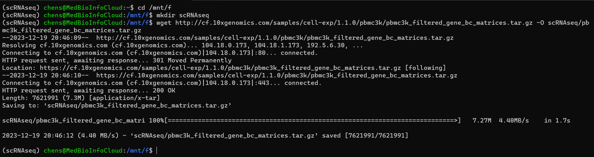

解压数据

```python
cd scRNAseq
tar -xzf pbmc3k_filtered_gene_bc_matrices.tar.gz
```

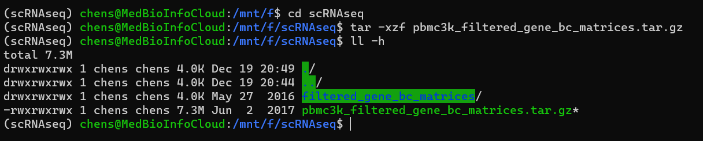

解压后的文件。

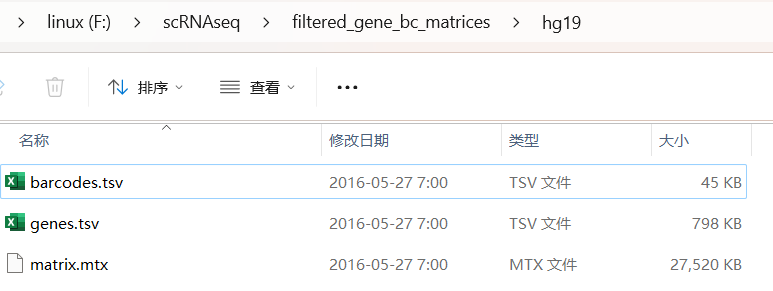

### 3.2 读入数据

方式一

```python
adata = sc.read_10x_mtx(
    './filtered_gene_bc_matrices/hg19/',  # the directory with the `.mtx` file
    var_names='gene_symbols',                # use gene symbols for the variable names (variables-axis index)
    cache=True)                              # write a cache file for faster subsequent reading
```

这行代码使用Scanpy库中的read_10x_mtx函数，从10x Genomics公司的数据文件中读取单细胞基因表达数据，存储为AnnData对象并将其赋值给变量adata。读取的数据来自于目录’data/filtered_gene_bc_matrices/hg19/‘，该目录包含了已经预处理好的、过滤后的基因表达矩阵数据。在读取数据时，将var_names参数设置为’gene_symbols’，表示使用基因符号（gene symbols）作为变量名称；将cache参数设置为True，表示在内存中缓存数据，以便后续的快速访问和操作。

```python
adata.var_names_make_unique()  # this is unnecessary if using `var_names='gene_ids'` in `sc.read_10x_mtx`
adata
```

这行代码是用于确保AnnData对象adata的变量名称（var_names）唯一的方法。在单细胞基因表达数据中，变量通常指基因，每个基因都有一个唯一的名称。但是，有些数据文件中可能存在重复的基因名称，或者读取多个数据文件后变量名称可能存在重复。这可能会导致后续的数据分析出现错误或不准确。因此，可以使用adata.var_names_make_unique()方法，对变量名称进行去重。该方法将自动在变量名称后面添加一个数字，使得所有变量名称都是唯一的。这样做可以避免后续数据分析中的命名冲突问题。

方式二：

```python
cellinfo = pd.read_csv('./filtered_gene_bc_matrices/hg19/barcode.tsv',index_col=0,header = None)
geneinfo = pd.read_csv('./filtered_gene_bc_matrices/hg19/genes.tsv',index_col=0,header=None)
adata = sc.read('./filtered_gene_bc_matrices/hg19/matrix.mtx',cache = False)
adata = adata.T
adata = sc.AnnData(adata.X.todense(),obs=cellinfo,var = geneinfo)
sce.obs_names.name = 'cell'
sce.var_names.name = 'gene'
```

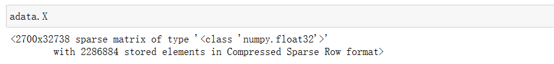

```python
sc.pl.highest_expr_genes(adata, n_top=20, )
```

这行代码使用Scanpy库中的highest_expr_genes函数，对AnnData对象adata中的基因表达矩阵进行分析，并将分析结果以图形的形式展示出来。

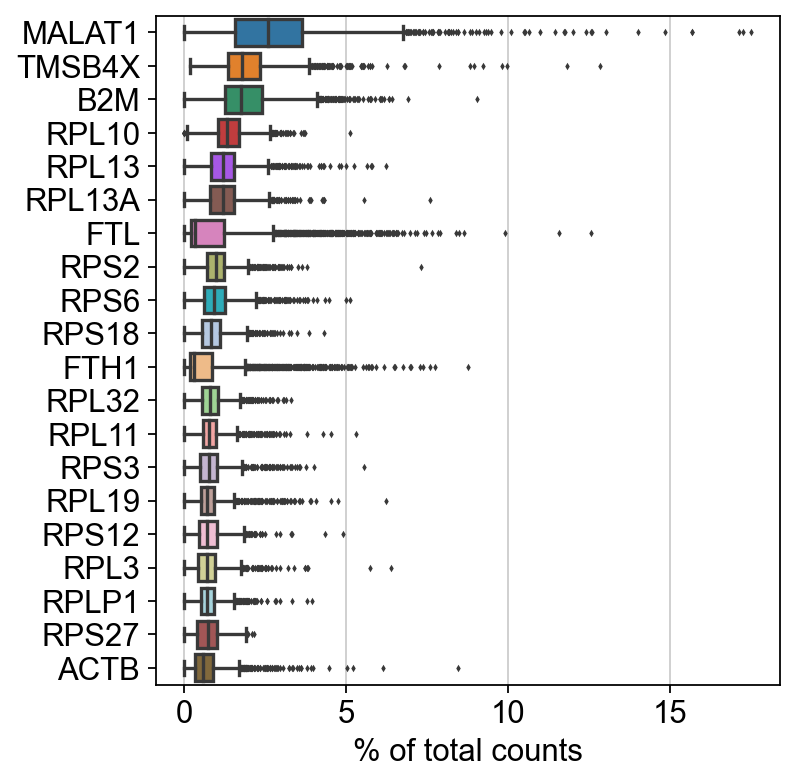

### 3.3 数据过滤

细胞：空的液滴过滤，每个细胞中至少有200个基因表达。

基因：低表达基因过滤，每个基因至少在三个细胞中表达。

```python
sc.pp.filter_cells(adata, min_genes=200)
sc.pp.filter_genes(adata, min_cells=3)
```

线粒体基因含量高的问题（Lun, McCarthy & Marioni, 2017）：高比例表明细胞质量差（Islam et al. 2014; Ilicic et al. 2016） ，可能是因为穿孔细胞失去了细胞质 RNA，而线粒体比单个转录分子大，不太可能通过细胞膜上的裂口逃脱。

```python
adata.var['mt'] = adata.var_names.str.startswith('MT-')  # annotate the group of mitochondrial genes as 'mt'
sc.pp.calculate_qc_metrics(adata, qc_vars=['mt'], percent_top=None, log1p=False, inplace=True)
```

```python
sc.pl.violin(adata, ['n_genes_by_counts', 'total_counts', 'pct_counts_mt'],
             jitter=0.4, multi_panel=True)
```

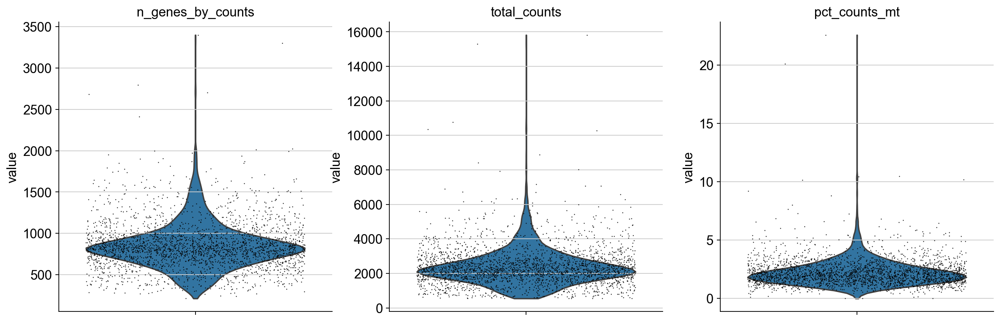

除线粒体基因表达过多或总数过多的细胞。

```python
adata = adata[adata.obs.n_genes_by_counts < 2500, :]
adata = adata[adata.obs.pct_counts_mt < 5, :]
```

Total-count normalize (library-size correct) the data matrix X to 10,000 reads per cell, so that counts become comparable among cells.

```python
sc.pp.normalize_total(adata, target_sum=1e4)
```

对数据取对数:

```python
sc.pp.log1p(adata)
```

识别高度可变的基因。

```python
sc.pp.highly_variable_genes(adata, min_mean=0.0125, max_mean=3, min_disp=0.5)
```

```python
sc.pl.highly_variable_genes(adata)
```

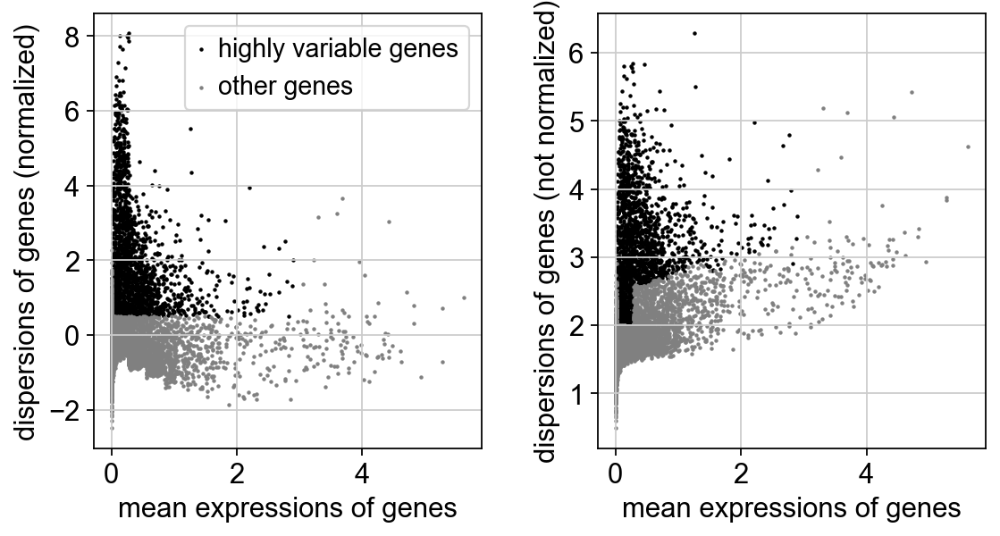

将AnnData对象的.raw属性设置为经过归一化和对数转换的原始基因表达数据，以供后续用于差异检测和基因表达的可视化。这只会冻结AnnData对象的状态。您可以通过调用.raw.to_adata()方法来获取.raw属性中的AnnData对象。

```python
adata.raw = adata
```

如果你不继续使用 sc.pp.regress_out 纠正数据，并通过 sc.pp.scale 进行缩放，你也可以完全不使用 .raw。

之前高度可变基因检测的结果作为注释存储在 .var.highly_variable 中，并由 PCA 自动检测，因此也由 sc.pp.neighbors 和后续的流形/图工具自动检测。在这种情况下，下面实际进行过滤的步骤也是不必要的。

通过主成分分析（PCA）对数据进行降维，揭示数据的主要变化轴，对数据进行降噪处理。

```python
adata = adata[:, adata.var.highly_variable]
adata
```

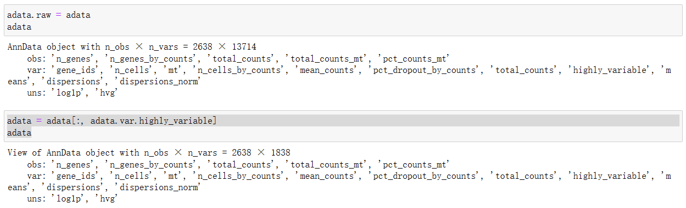

剔除每个细胞总计数和线粒体基因表达百分比的影响。将数据缩放到单位方差。

```python
sc.pp.regress_out(adata, ['total_counts', 'pct_counts_mt'])
```

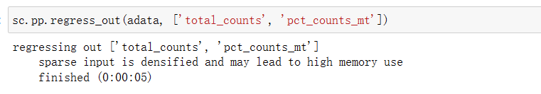

Scale each gene to unit variance. Clip values exceeding standard deviation 10.

```python
sc.pp.scale(adata, max_value=10)
```

### 3.4 主成分分析

通过主成分分析（PCA）对数据进行降维，揭示数据的主要变化轴，对数据进行降噪处理。

```python
sc.tl.pca(adata, svd_solver='arpack')
```

我们可以在PCA坐标中制作散点图。

```python
sc.pl.pca(adata, color='CST3')
```

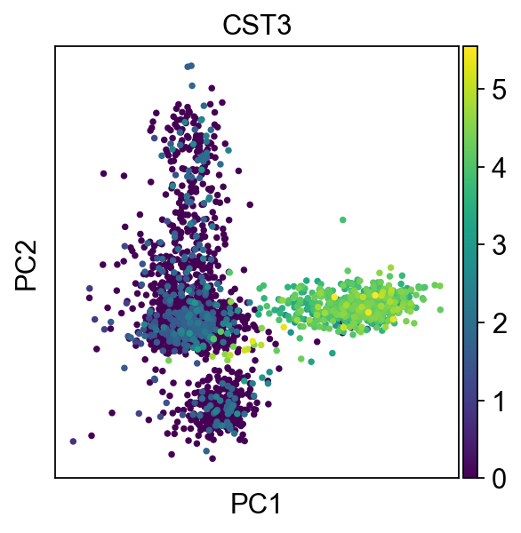

让我们检查单个PC对数据总方差的贡献。这为我们提供了有关我们应该考虑多少个PC的信息，以便计算细胞的邻域关系，例如在聚类函数sc.tl.louvain()或tSNE sc.tl.tsne()中使用。根据我们的经验，粗略估计PC的数量通常就可以了。

```python
sc.pl.pca_variance_ratio(adata, log=True)
```

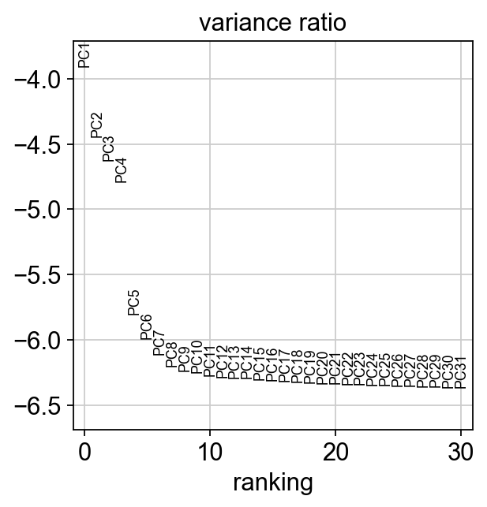

### 3.4 计算邻域图（Computing the neighborhood graph）

计算邻域图是单细胞分析中的一种常见方法，用于确定细胞之间的相似性和相关性。在邻域图中，每个细胞都被表示为一个节点，而连接两个节点的边表示这两个细胞之间的相似性或相关性。边的权重通常基于细胞之间的基因表达相似性或其他指标。

通过计算邻域图，可以识别细胞群体中的亚群，并了解不同亚群之间的相互作用和关系。此外，邻域图还可以用于进一步的分析，如聚类分析、网络分析等，以深入了解细胞群体的结构和功能。

```python
sc.pp.neighbors(adata, n_neighbors=10, n_pcs=40)
```

### 3.5 嵌入邻域图（Embedding the neighborhood graph）

在单细胞分析中，嵌入邻域图（Embedding the neighborhood graph）是指将邻域图中的节点和边信息转化为一个低维的空间表示，以便进行可视化和进一步的分析。

邻域图是一种网络结构，用于描述细胞之间的关系。然而，这种结构很难直接用于可视化和直观的理解。因此，将邻域图嵌入到一个低维的空间中，可以将细胞之间的复杂关系转化为易于理解的几何形状，从而方便我们进行可视化、聚类分析、模式识别等后续工作。

在单细胞分析中，常用的嵌入方法包括UMAP（Uniform Manifold Approximation and Projection）和t-SNE（t-Distributed Stochastic Neighbor Embedding）。这些方法可以将高维的细胞数据映射到低维的空间中，同时保留细胞之间的相似性和相关性。

```python
# Embedding the neighborhood graph
sc.tl.umap(adata)
sc.pl.umap(adata, color=['CST3', 'NKG7', 'PPBP'])
```

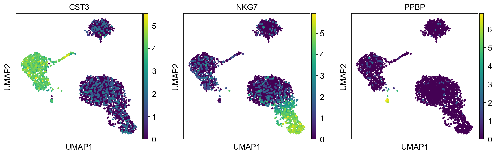

当我们设置 adata 的 .raw 属性时，之前的图显示了“原始”（归一化、对数化但未校正）基因表达。您还可以通过明确声明不使用 .raw 来绘制缩放和校正的基因表达。

```python
sc.pl.umap(adata, color=['CST3', 'NKG7', 'PPBP'], use_raw=False)
```

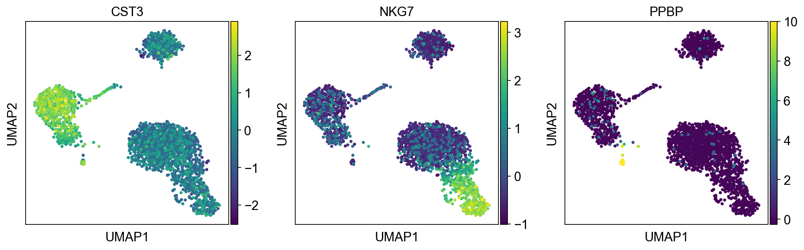

### 3.6 域图进行聚类（Clustering the neighborhood graph）

在单细胞分析中，对邻域图进行聚类（Clustering the neighborhood graph）是指利用聚类算法对邻域图中的细胞进行分组，以识别不同的细胞亚群。

在单细胞分析中，常用的聚类方法包括K-means聚类、层次聚类、DBSCAN聚类等。这些方法可以根据细胞的相似性和相关性，将邻域图中的细胞分成不同的组或簇。通过对这些簇进行分析，可以揭示细胞群体的结构和功能特征，进一步了解细胞之间的相互作用和分化过程。与Seurat和许多其他框架一样，我们推荐Traag等人（2018）的Leiden图聚类方法（community detection based on optimizing modularity）。注意，Leiden聚类直接对单元的邻域图进行聚类，我们已经在前一节中计算过了。

```python
sc.tl.leiden(adata)
sc.pl.umap(adata, color=['leiden', 'CST3', 'NKG7'])
```

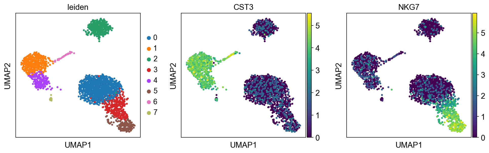

### 3.7 寻找标记基因（Finding marker genes）

让我们为每个集群中高度差异的基因计算一个排名。为此，默认情况下，如果AnnData已经初始化，将使用其.raw属性。最简单和最快的方法是t检验。

```python
sc.tl.rank_genes_groups(adata, 'leiden', method='t-test')
sc.pl.rank_genes_groups(adata, n_genes=25, sharey=False)
```

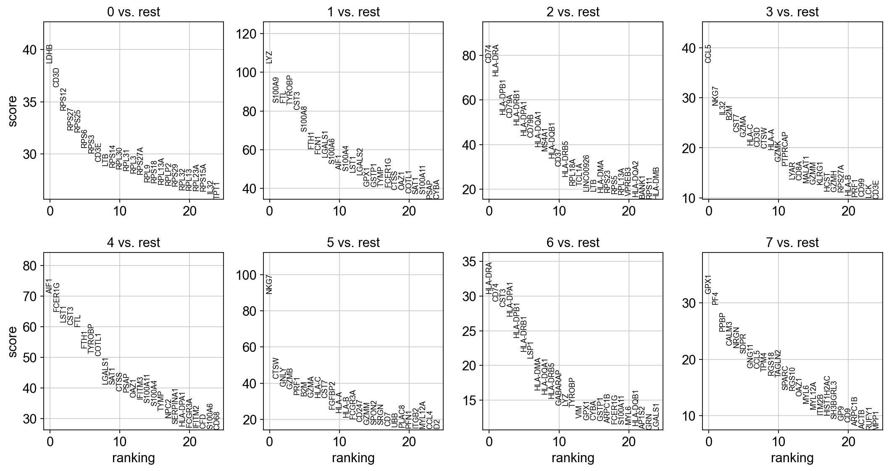

```python
sc.settings.verbosity = 2  # reduce the verbosity
```

Wilcoxon秩和检验（Mann-Whitney-U检验）的结果非常相似。我们建议在出版物中使用后者，例如Sonison和Robinson（2018）。您还可以考虑使用更强大的差异检测包，如MAST、limma、DESeq2，以及最近发布的Python包diffxpy。

```python
sc.tl.rank_genes_groups(adata, 'leiden', method='wilcoxon')
sc.pl.rank_genes_groups(adata, n_genes=25, sharey=False)
```

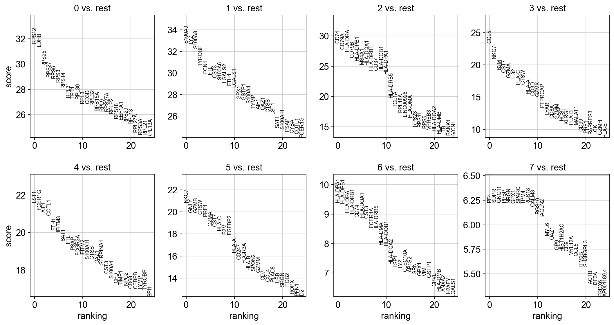

作为一种替代方法，让我们使用逻辑回归对基因进行排名。例如，[Natranos等人](https://doi.org/10.1101/258566)（2018）提出了这一建议。根本区别在于，我们使用多元方法，而传统的差异检验是单变量的。[Clark等人](https://doi.org/10.1186/1471-2105-15-79)（2014）提供了更多细节。

除了仅通过t检验发现的IL7R和仅通过其他两种方法发现的FCER1A之外，所有标记基因都在所有方法中恢复。

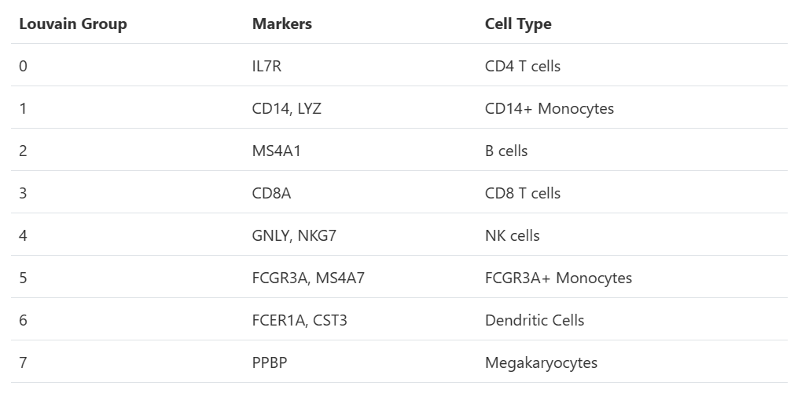

显示数据框中每簇0、1、…、7中排名最高的10个基因。

```python
marker_genes = ['IL7R', 'CD79A', 'MS4A1', 'CD8A', 'CD8B', 'LYZ', 'CD14',
                'LGALS3', 'S100A8', 'GNLY', 'NKG7', 'KLRB1',
                'FCGR3A', 'MS4A7', 'FCER1A', 'CST3', 'PPBP']
pd.DataFrame(adata.uns['rank_genes_groups']['names']).head(5)
```

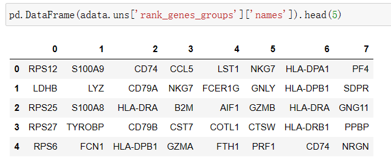

获取一张有比分和分组的表格。

```python
result = adata.uns['rank_genes_groups']
groups = result['names'].dtype.names
pd.DataFrame(
    {group + '_' + key[:1]: result[key][group]
    for group in groups for key in ['names', 'pvals']}).head(5)
```

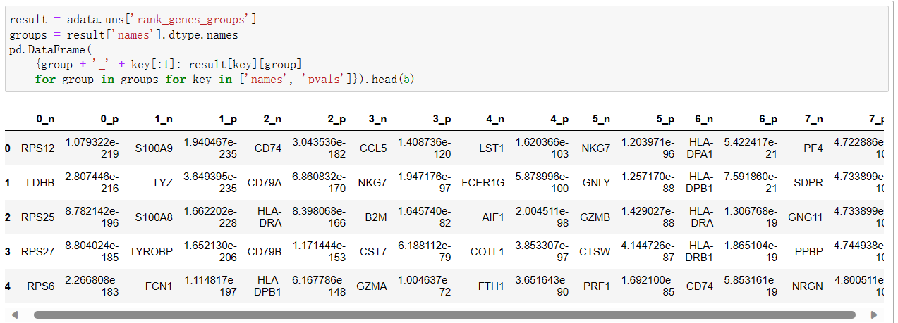

Compare to a single cluster:

```python
sc.tl.rank_genes_groups(adata, 'leiden', groups=['0'], reference='1', method='wilcoxon')
sc.pl.rank_genes_groups(adata, groups=['0'], n_genes=20)
```

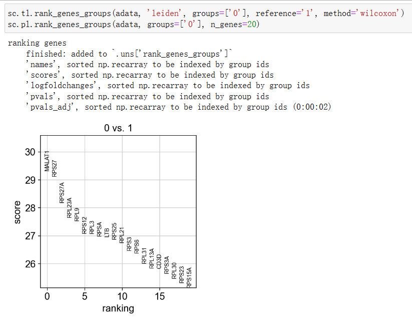

如果我们想要一个特定组的更详细的视图，使用sc.pl.rank_genes_groups_violin。

```python
sc.pl.rank_genes_groups_violin(adata, groups='0', n_genes=8)
```

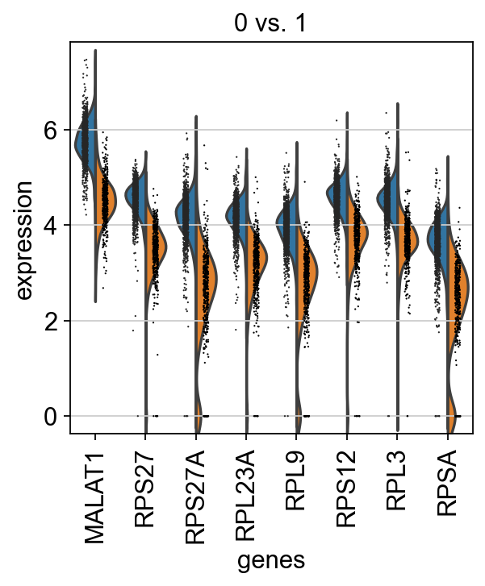

如果你想在不同的组间比较某个基因，使用下面的方法。

```python
sc.pl.violin(adata, ['RNH1', 'NKG7', 'PPBP'], groupby='leiden')
```

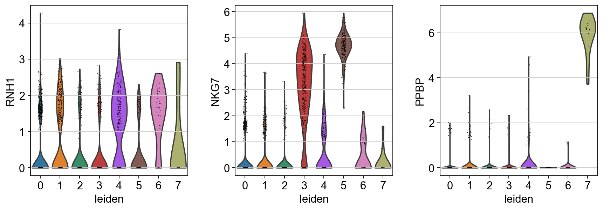

```python
sc.pl.violin(adata, ['CST3', 'NKG7', 'PPBP'], groupby='leiden')
```

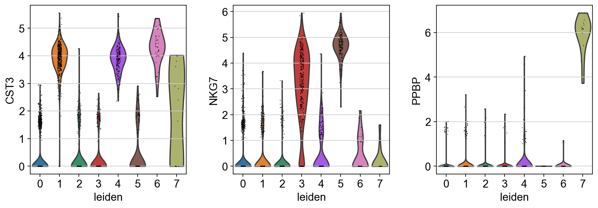

标记细胞类型。

```python
new_cluster_names = [
    'CD4 T', 'CD14 Monocytes',
    'B', 'CD8 T',
    'NK', 'FCGR3A Monocytes',
    'Dendritic', 'Megakaryocytes']
adata.rename_categories('leiden', new_cluster_names)
```

```python
sc.pl.umap(adata, color='leiden', legend_loc='on data', title='', frameon=False, save='.pdf')
```

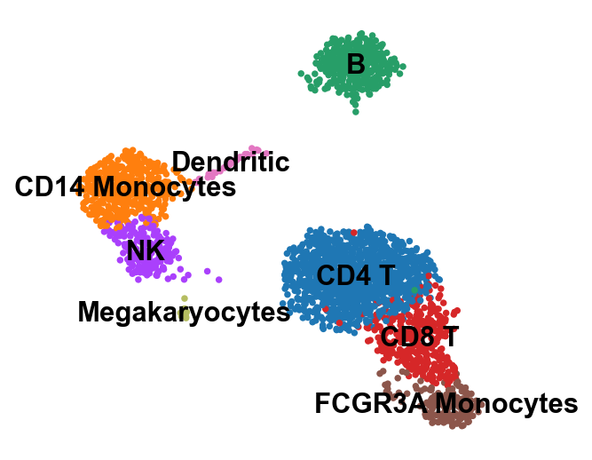

现在我们注释了细胞类型，让我们可视化标记基因。

```python
sc.pl.dotplot(adata, marker_genes, groupby='leiden')
```

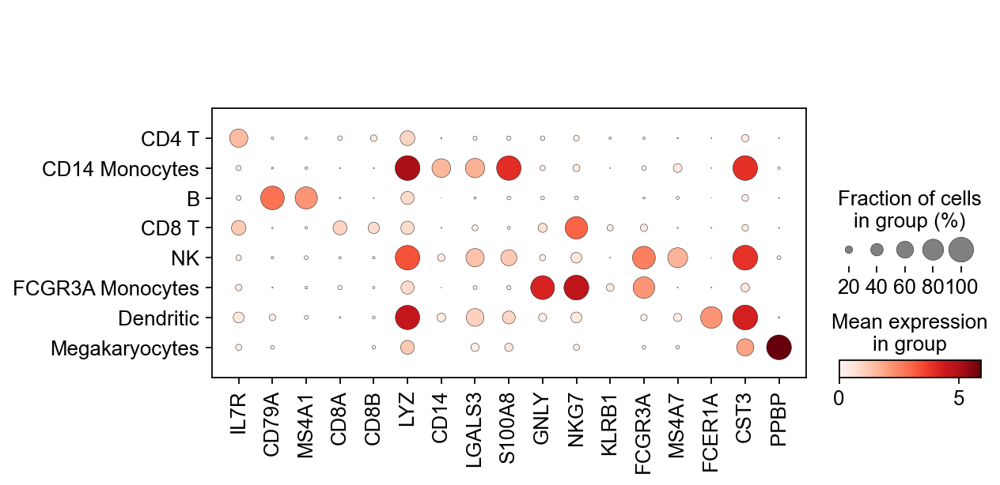

```python
sc.pl.stacked_violin(adata, marker_genes, groupby='leiden', rotation=90);
```

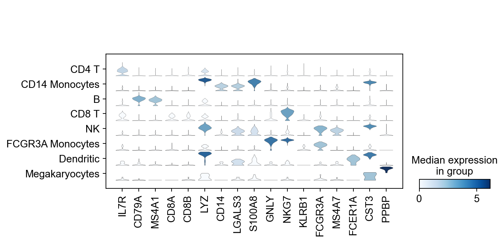

在此分析过程中，AnnData积累了以下注释。

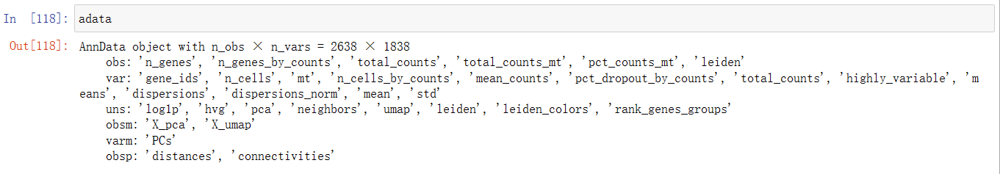

> 更新: 2023-12-21 17:05:12
> 原文: <https://www.yuque.com/doublehelix/bioinfonotes/ggw2kbv370p3q59n>
