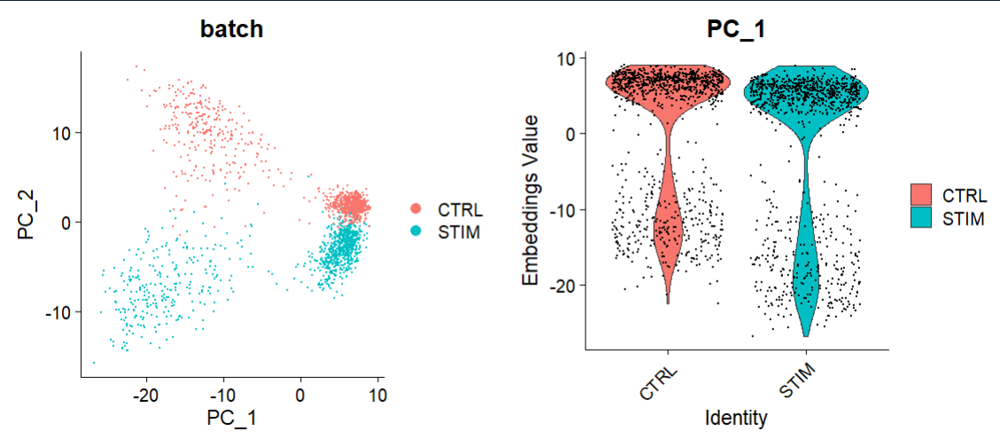
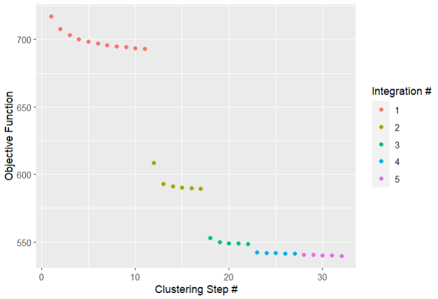
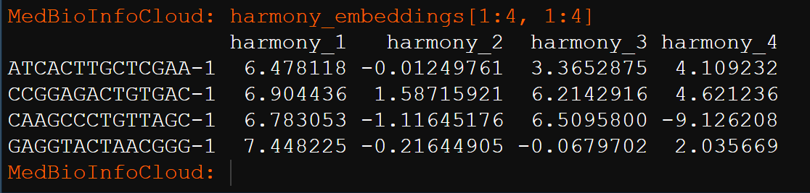
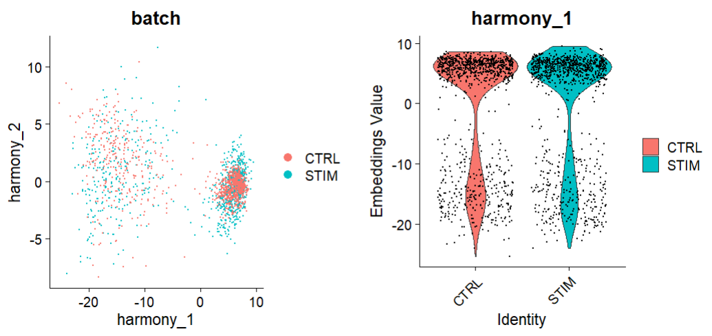
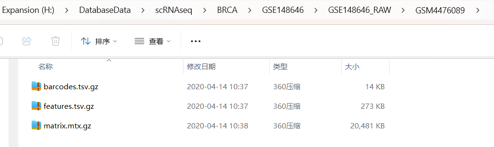
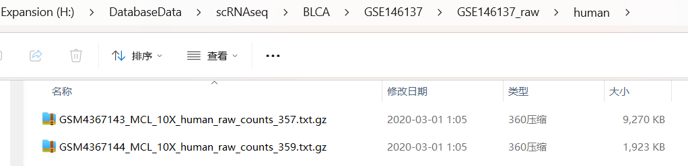

# 单细胞相关分析技能

## 1.批次效应去除

### 1.1 方法文献

Korsunsky, I., Millard, N., Fan, J. et al. Fast, sensitive and accurate integration of single-cell data with Harmony. Nat Methods 16, 1289–1296 (2019). <https://doi.org/10.1038/s41592-019-0619-0>

### 1.2 使用案例

https://github.com/immunogenomics/harmony

#### (1) 加载案例数据，并构建Seurat对象

pbmc.stim, pbmc.ctrl是2给批次的单细胞数据。

```r
library(Seurat)
data("pbmc_stim")
pbmc <- CreateSeuratObject(counts = cbind(pbmc.stim, pbmc.ctrl),
                           project = "PBMC", min.cells = 5)
```

#### (2) 添加批次信息

```r
## Separate conditions
pbmc@meta.data$batch <- c(rep("STIM", ncol(pbmc.stim)), rep("CTRL", ncol(pbmc.ctrl)))
```

#### (3) 数据的归一化

```python
pbmc <- pbmc %>%
  NormalizeData(verbose = FALSE)
VariableFeatures(pbmc) <- split(row.names(pbmc@meta.data), pbmc@meta.data$batch) %>% lapply(function(cells_use) {
  pbmc[,cells_use] %>%
    FindVariableFeatures(selection.method = "vst", nfeatures = 2000) %>%
    VariableFeatures()
}) %>% unlist %>% unique
```

#### (4) PCA降维

```python
pbmc <- pbmc %>%
  ScaleData(verbose = FALSE) %>%
  RunPCA(features = VariableFeatures(pbmc), npcs = 20, verbose = FALSE)
```

#### (5) 去除批次效应前的可视化

```python
## 未进行批次效应校正
library(cowplot)
options(repr.plot.height = 5, repr.plot.width = 12)
p1 <- DimPlot(object = pbmc, reduction = "pca", pt.size = .1, group.by = "batch")
p2 <- VlnPlot(object = pbmc, features = "PC_1", group.by = "batch", pt.size = .1)
plot_grid(p1,p2)
```



#### (6) 运行RunHarmony去除批次效应

bacth就是分组变量，相当于2个批次效应的单细胞数据分组信息`pbmc@meta.data$bacth`。

```python
pbmc <- pbmc %>%
  RunHarmony("batch", plot_convergence = TRUE,
             nclust = 50, max_iter = 10, early_stop = T)
```



通过设置plot_converge=TRUE，Harmony将生成一个显示整合流程的目标图。每个点代表经过一轮聚类后测量的成本。不同的颜色代表由max_iter控制的不同Harmony迭代（假设early_stop=FALSE）。这里max_iter=10，预期最多有10个修正步骤。然而，由于early_stop=TRUE，Harmony将在成本达到稳定后停止。

RunHarmony函数中主要参数：

group.by.vars：

* 参数类型：字符向量（character vector）
* 描述：该参数用于指定按照哪些变量对数据进行分组，以便进行整合。
* 示例：如果数据集包含批次信息和其他变量，可以将批次信息放在一个变量中，并将该变量传递给group.by.vars参数，以便根据批次信息对数据进行整合。

max.iter.harmony：

* 参数类型：数值型（numeric）
* 描述：设置Harmony算法的最大迭代次数。默认值为10。
* 示例：如果您希望算法运行更多或更少的迭代次数，可以调整此参数的值。

lambda：

* 参数类型：数值型（numeric）
* 默认值：1
* 描述：决定了Harmony整合的力度。lambda值越小，整合力度越大；反之，lambda值越大，整合力度越小。调整范围一般在0.5-2之间。
* 示例：如果您希望增强整合力度，可以将lambda值调小；如果您希望减小整合力度，可以将lambda值调大。

theta：

* 参数类型：数值型（numeric）
* 描述：Diversity clustering penalty parameter。为group.by.vars中的每个变量指定。默认theta=2。theta=0不鼓励多样性。较大的theta值导致更多样化的集群。
* 示例：根据您的数据和研究目的，可以调整theta的值以获得不同的聚类效果。

dims.use：

* 参数类型：数值型向量（numeric vector）或字符型向量（character vector）
* 描述：指定用于Harmony的PCA维度。默认情况下，使用所有PCA维度。
* 示例：如果您只对PCA的前几个维度感兴趣，可以将dims.use参数设置为一个数值向量，例如dims.use = c(1, 2)。

sigma：

参数类型：数值型（numeric）

* 默认值：0.1
* 描述：软k均值聚类的宽度。它决定了从单个细胞到聚类中心的距离。较大的sigma值导致细胞被分配到更多的聚类中，而较小的sigma值使软k均值聚类接近于硬聚类。
* 示例：根据您的数据和聚类需求，可以调整sigma的值以获得不同的聚类效果。

这些参数共同决定了Harmony算法在运行时的行为和结果。根据您的具体需求和数据特征，您可能需要调整这些参数以获得最佳的分析效果。在使用Harmony包时，请确保仔细阅读相关文档和教程，以便更好地理解这些参数的作用和最佳实践方法。

RunHarmony的运行结果在`pbmc@reductions$harmony`中。

使用Embeddings命令访问新的Harmony embeddings。

```r
harmony_embeddings <- Embeddings(pbmc, 'harmony')
harmony_embeddings[1:4, 1:4]
```



#### (7) 去除批次效应后的可视化

```r
options(repr.plot.height = 5, repr.plot.width = 12)
p1 <- DimPlot(object = pbmc, reduction = "harmony", pt.size = .1,
              group.by = "batch")
p2 <- VlnPlot(object = pbmc, features = "harmony_1",
              group.by = "batch", pt.size = .1)
plot_grid(p1,p2)
```



### 1.3 参考资料

<https://github.com/immunogenomics/harmony>

<https://htmlpreview.github.io/?https://github.com/immunogenomics/harmony/blob/master/doc/Seurat.html>

<https://htmlpreview.github.io/?https://github.com/immunogenomics/harmony/blob/master/doc/detailedWalkthrough.html>

## 2.CopyKAT——恶性和非恶性上皮细胞的识别

### 2.1 方法文献

Gao, R., Bai, S., Henderson, Y.C. et al. Delineating copy number and clonal substructure in human tumors from single-cell transcriptomes. Nat Biotechnol 39, 599–608 (2021). [ttps://doi.org/10.1038/s41587-020-00795-2](https://doi.org/10.1038/s41587-020-00795-2)

### 2.2 使用案例

#### (1) 包的安装

```r
library(devtools)
install_github("navinlabcode/copykat")
```

#### (2) 读入单细胞数据

单细胞数据的两种读入方式



```r
library(Seurat)
library(copykat)
dirpath = "H:/DatabaseData/scRNAseq/BRCA"
raw <- Read10X(dirpath)
raw <- CreateSeuratObject(counts = raw, project = "copycat.test", min.cells = 0, min.features = 0)
exp.rawdata <- as.matrix(raw@assays$RNA@counts)

```



```r
folder = "H:/DatabaseData/scRNAseq/BLCA/GSE146137/GSE146137_raw/human"
samples=list.files(folder)
samples
# pro <- samples[1]

sceList = lapply(samples,function(pro){
  folder= file.path(folder,pro)
  raw.data <- read.table(folder,sep = "\t",header = T,
                         row.names = 1,check.names = F)
  CreateSeuratObject(counts = raw.data,
                     project = unlist(strsplit(pro,"_"))[1] )
})
sce.big <- merge(sceList[[1]],
                 y = c(sceList[[2]]),
                 add.cell.ids = samples,
                 project = "GSE146137")
exp.rawdata <- as.matrix(sce.big@assays$RNA@counts)
```

#### (3) 执行copykat

```r
library(copykat)
copykat.test <- copykat(rawmat=exp.rawdata, id.type="S",
                        ngene.chr=5, win.size=25, KS.cut=0.1,
                        sam.name="test", distance="euclidean",
                        norm.cell.names="",
                        output.seg="FLASE", plot.genes="TRUE",
                        genome="hg20",n.cores=1)
```

Cellranger输出的默认基因ID是基因符号，所以id.type为“Symbol”或“S”。为了过滤细胞，ngene.chr要求每个染色体中至少有5个基因来计算DNA拷贝数。可以将其调低为ngene.chr=1以保留尽可能多的细胞，但使用少于5个基因来代表一个染色体并不是很严格。为了过滤基因，我可以调整参数只保留在LOW.DR到UP.DR细胞分数中表达的基因。我设置默认的LOW.DR=0.05，UP.DR=0.2。我可以调低这些值以在分析中保留更多的基因。不过我需要确保LOW.DR小于UP.DR。

要求copykat每个片段至少取25个基因。我可以尝试其他选项，每个bin的范围是15-150个基因。KS.cut是分割参数，范围从0到1。增加KS.cut会降低敏感性，即减少片段/断点。通常它的工作范围是0.05-0.15。

在这里，我通过设置n.cores = 4进行并行计算。默认值是1。

我还通过设置sam.name="test"给出了一个样本名称。

```r
pred.test <- data.frame(copykat.test$prediction)
pred.test <- pred.test[-which(pred.test$copykat.pred=="not.defined"),]  ##remove undefined cells
CNA.test <- data.frame(copykat.test$CNAmat)
```

预测的结果正常细胞（diploid）还是肿瘤细胞（aneuploid），每个CNV segment在每个细胞的表达量。

#### (4) navigate prediction results

```r
  my_palette <- colorRampPalette(rev(RColorBrewer::brewer.pal(n = 3, name = "RdBu")))(n = 999)

  chr <- as.numeric(CNA.test$chrom) %% 2+1
  rbPal1 <- colorRampPalette(c('black','grey'))
  CHR <- rbPal1(2)[as.numeric(chr)]
  chr1 <- cbind(CHR,CHR)

  rbPal5 <- colorRampPalette(RColorBrewer::brewer.pal(n = 8, name = "Dark2")[2:1])
  com.preN <- pred.test$copykat.pred
  pred <- rbPal5(2)[as.numeric(factor(com.preN))]

  cells <- rbind(pred,pred)
  col_breaks = c(seq(-1,-0.4,length=50),seq(-0.4,-0.2,length=150),seq(-0.2,0.2,length=600),seq(0.2,0.4,length=150),seq(0.4, 1,length=50))

heatmap.3(t(CNA.test[,4:ncol(CNA.test)]),dendrogram="r", distfun = function(x) parallelDist::parDist(x,threads =4, method = "euclidean"), hclustfun = function(x) hclust(x, method="ward.D2"),
            ColSideColors=chr1,RowSideColors=cells,Colv=NA, Rowv=TRUE,
            notecol="black",col=my_palette,breaks=col_breaks, key=TRUE,
            keysize=1, density.info="none", trace="none",
            cexRow=0.1,cexCol=0.1,cex.main=1,cex.lab=0.1,
            symm=F,symkey=F,symbreaks=T,cex=1, cex.main=4, margins=c(10,10))

  legend("topright", paste("pred.",names(table(com.preN)),sep=""), pch=15,col=RColorBrewer::brewer.pal(n = 8, name = "Dark2")[2:1], cex=0.6, bty="n")

```

#### (5) define subpopulations of aneuploid tumor cells

```r
tumor.cells <- pred.test$cell.names[which(pred.test$copykat.pred=="aneuploid")]
tumor.mat <- CNA.test[, which(colnames(CNA.test) %in% tumor.cells)]
hcc <- hclust(parallelDist::parDist(t(tumor.mat),threads =4, method = "euclidean"), method = "ward.D2")
hc.umap <- cutree(hcc,2)

rbPal6 <- colorRampPalette(RColorBrewer::brewer.pal(n = 8, name = "Dark2")[3:4])
subpop <- rbPal6(2)[as.numeric(factor(hc.umap))]
cells <- rbind(subpop,subpop)

heatmap.3(t(tumor.mat),dendrogram="r", distfun = function(x) parallelDist::parDist(x,threads =4, method = "euclidean"), hclustfun = function(x) hclust(x, method="ward.D2"),
            ColSideColors=chr1,RowSideColors=cells,Colv=NA, Rowv=TRUE,
            notecol="black",col=my_palette,breaks=col_breaks, key=TRUE,
            keysize=1, density.info="none", trace="none",
            cexRow=0.1,cexCol=0.1,cex.main=1,cex.lab=0.1,
            symm=F,symkey=F,symbreaks=T,cex=1, cex.main=4, margins=c(10,10))

  legend("topright", c("c1","c2"), pch=15,col=RColorBrewer::brewer.pal(n = 8, name = "Dark2")[3:4], cex=0.9, bty='n')

```

### 2.3 参考资料

<https://github.com/navinlabcode/copykat>

> 更新: 2023-12-23 15:05:12
> 原文: <https://www.yuque.com/doublehelix/bioinfonotes/snlx1hu2cnsir1dh>
