# GEO数据库表达数据的提取以及limma包进行差异分析


[**TCGA**](https://mp.weixin.qq.com/mp/appmsgalbum?action=getalbum&album_id=1338047035672526848&__biz=MzA4NDAzODkzMA==#wechat_redirect)** | **[**GEO**](https://mp.weixin.qq.com/mp/appmsgalbum?action=getalbum&album_id=1385753371944239106&__biz=MzA4NDAzODkzMA==#wechat_redirect)** | **[**文献阅读**](https://mp.weixin.qq.com/mp/appmsgalbum?action=getalbum&album_id=1338481272770953216&__biz=MzA4NDAzODkzMA==#wechat_redirect)** | **[**数据库**](https://mp.weixin.qq.com/mp/appmsgalbum?action=getalbum&album_id=1338487030963142656&__biz=MzA4NDAzODkzMA==#wechat_redirect)[** **](https://mp.weixin.qq.com/mp/appmsgalbum?action=getalbum&album_id=1338487030963142656&__biz=MzA4NDAzODkzMA==#wechat_redirect)**| **[**理论知识**](https://mp.weixin.qq.com/mp/appmsgalbum?action=getalbum&album_id=1338473418617946113&__biz=MzA4NDAzODkzMA==#wechat_redirect)

[**R语言**](https://mp.weixin.qq.com/mp/appmsgalbum?action=getalbum&album_id=1337050529440104449&__biz=MzA4NDAzODkzMA==#wechat_redirect)** | **[**Bioconductor**](https://mp.weixin.qq.com/mp/appmsgalbum?action=getalbum&album_id=1369789283514761218&__biz=MzA4NDAzODkzMA==#wechat_redirect)

---

关于GEO数据库认识和在线使用教程，参考文章:[**G****EO数据库使用教程及在线数据分析工具**](http://mp.weixin.qq.com/s?__biz=MzA4NDAzODkzMA==&mid=2651263601&idx=1&sn=443d0dddebb12f21cfd976d50473856b&chksm=841ef60cb3697f1aecc6c310ee3a77e6182a728d5b6711a5cc8f49f0739feaba904f565ce176&scene=21#wechat_redirect)。关于GEO数据库的R包：[**Bioconductor：GEOquery包**](http://mp.weixin.qq.com/s?__biz=MzA4NDAzODkzMA==&mid=2651266556&idx=1&sn=05fe660c9241f3a850584d73b5e8e665&chksm=841ef981b36970976f4310b412f53823afeda1e9a5be5c49c8213525db9cd0b852a96daba4cc&scene=21#wechat_redirect)**，**我们前面已经介绍，当然是官方案例，我们这里实战一下。

大家可以先通过网页搜索GSE152509数据集，对该数据集有一个基本的认识：

[<u>https://www.ncbi.nlm.nih.gov/geo/query/acc.cgi?acc=GSE152509</u>](https://www.ncbi.nlm.nih.gov/geo/query/acc.cgi?acc=GSE152509)

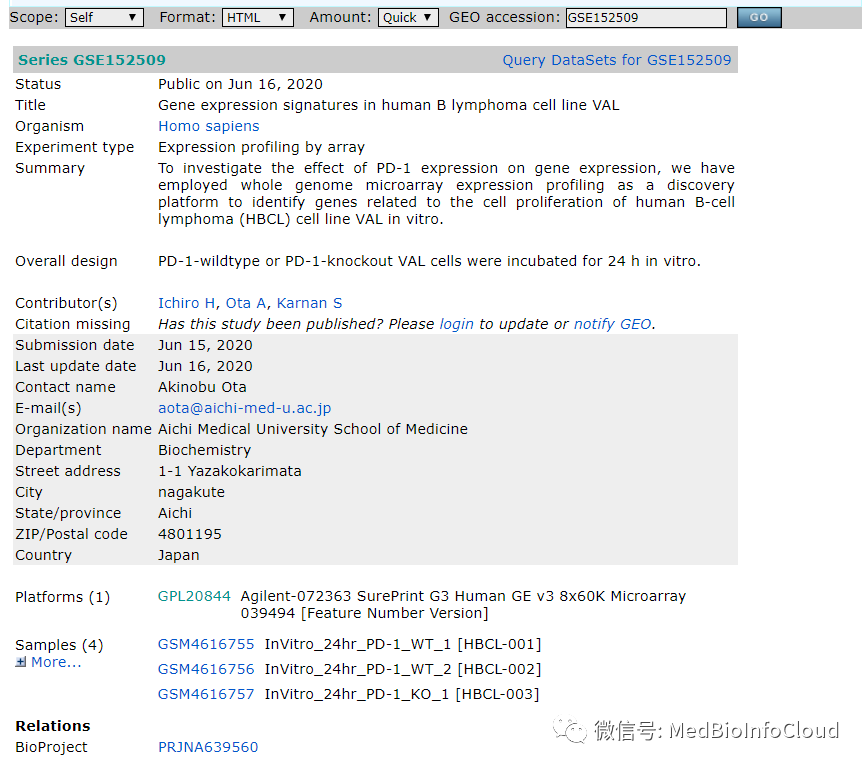

下载数据,利用getGEO函数，前文有介绍：[**Bioconductor：GEOquery包**](http://mp.weixin.qq.com/s?__biz=MzA4NDAzODkzMA==&mid=2651266556&idx=1&sn=05fe660c9241f3a850584d73b5e8e665&chksm=841ef981b36970976f4310b412f53823afeda1e9a5be5c49c8213525db9cd0b852a96daba4cc&scene=21#wechat_redirect)

```plain
getGEO(GEO = NULL, filename = NULL, destdir = tempdir(),
       GSElimits = NULL, GSEMatrix = TRUE, AnnotGPL = FALSE, getGPL = TRUE,
       parseCharacteristics = TRUE)
```

GEO：就是我们需要下载的GSE/GDS/GPL登录号，通常我们只会利用GSE。

filename：以前下载的GEO软格式文件的文件名或其gzip表示形式(在这种情况下，文件名必须以.gz结尾)。可以指定GEO或FILENAME中的任何一个，但不能同时指定两者。还处理GEO系列矩阵文件。注意，由于解析的是单个文件，因此在解析GSE矩阵文件时，返回值不是ESET列表，而是单个ESET。说白了，本地文件的话，设置filename，网络下载设置GEO。

destdir：指定下载数据存放目录。默认为体系结构相关的临时目录。如果要保存文件以供以后使用，您可能需要指定其他目录。

GSElimits：此参数只能用于从GSE加载GSM的连续子集。它应该被指定为长度为2的向量，指定要加载的起始和结束(包括)GSM。例如，这对于将大型GSE拆分成更易于管理的部分可能很有用。

GSEMatrix：告知GEO查询是否使用GEO中的GSE系列矩阵文件的布尔值。

这些文件的解析速度可能比解析GSE SOFT格式文件快许多个数量级。默认值为TRUE，表示不会进行SOFT 格式解析；如果出于某种原因需要GSE记录中的其他列，则设置为FALSE。

AnnotGPL：关于是否使用注释GPL信息默认为False的布尔值。这些文件很好用，因为它们包含定期从Entrez Gene重新映射的最新信息。但是，它们并不适用于所有GPLS；通常，它们仅适用于GDS引用的GPLs。所以有时候我们需要单独下载处理，其实就是用于探针注释。

getGPL：在获取GSEMatrix文件时是否下载并包含GPL信息的布尔值，默认值为TRUE。如果您知道要使用BioConductor工具而不是依赖于通过NCBI GEO提供的信息来注释Feature Data，则可能需要将其设置为False。通过指定FALSE，还可以大大减少下载时间。

parseCharacteristics：关于是否解析GSE矩阵文件的特征信息(如果可用)的布尔默认值为TRUE。如果在解析特征时遇到问题，请将其设置为FALSE。

---

参数介绍完了，开始下载我们的数据

```plain
options(stringsAsFactors = F)
library(GEOquery)
gset1 <- getGEO(GEO = "GSE152509",  AnnotGPL=TRUE ,  destdir = ".")
```

下载后，数据会存储到指定文件路径,同时解析并赋值给gset1

我们得到的数据是一个list。

```plain
> class(gset1)
[1] "list"
```

我们看看这个数据结构

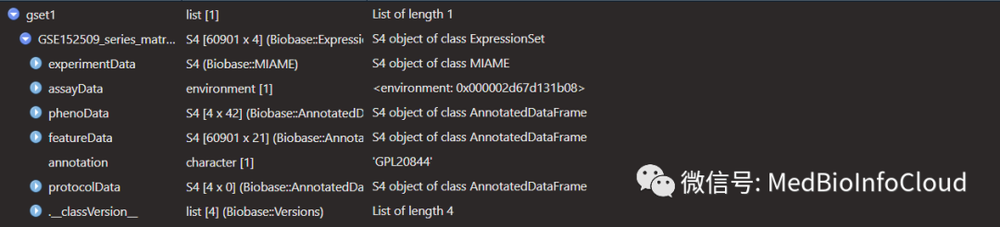

通过list的方式把数据对象取出来

```plain
gse1 <- gset1[[1]]##ExpressionSet
```

```plain
> gse1
ExpressionSet (storageMode: lockedEnvironment)
assayData: 60901 features, 4 samples
  element names: exprs
protocolData: none
phenoData
  sampleNames: GSM4616755 GSM4616756 GSM4616757 GSM4616758
  varLabels: title geo_accession ... source gender:ch1 (42 total)
  varMetadata: labelDescription
featureData
  featureNames: 4 5 ... NA.58913 (60901 total)
  fvarLabels: ID COL ... SPOT_ID_1 (21 total)
  fvarMetadata: Column Description labelDescription
experimentData: use 'experimentData(object)'
Annotation: GPL20844
```

我们可以看见ges1的整体描述信息。60901 features，4个样本，平台是GPL20844。我们一个一个的看看数据。

```plain
ExperimentData <-ges1@experimentData
```

ExperimentData 这里的信息都是描述性的信息，你可以和网页上比较一下。一样的。

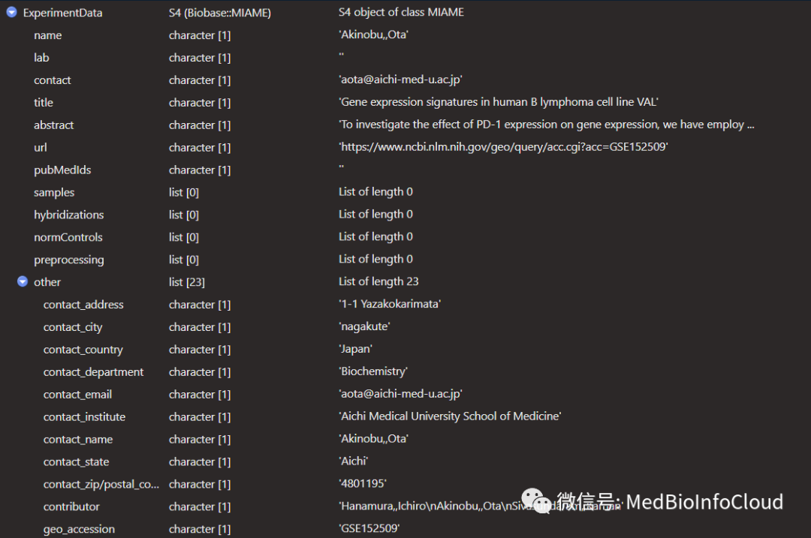

```plain
assayData <- ges1@assay
Dataexp1 <- assayData$exprs
```


assayData 中就一个表达数据，我们可以提取出来。

```plain
> head(exp1)
  GSM4616755 GSM4616756 GSM4616757 GSM4616758
4       35.4       29.5       36.2       11.3
5        7.7        7.7        8.4        5.7
6       11.9        7.7        8.3        5.7
7     1040.5     1159.6     1046.3      944.7
8    19242.0    20201.0    19216.3    17039.8
9        7.6        7.7       11.5        5.6
```

phenoData中是表型数据。

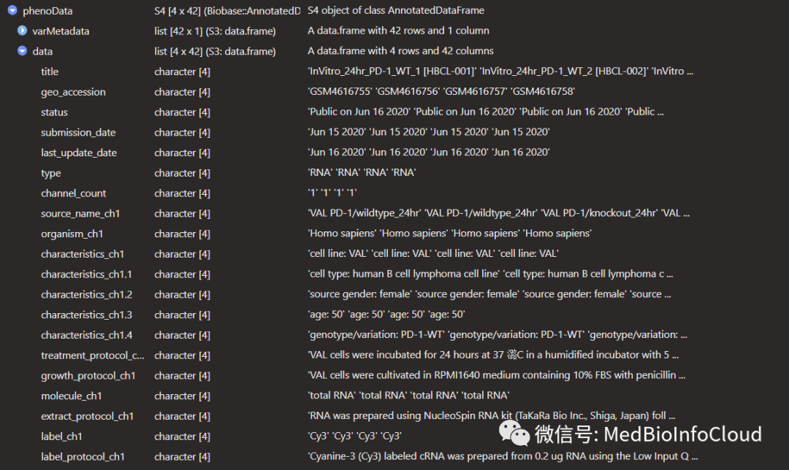

你可以一个一个的取出来看看是什么东西。我们这里取phenoData。

```plain
phenoData <- ges1@phenoData
pphenoData <-phenoData@data
```

比如title，一看就是表示该GSM样本是什么样本。野生型和敲除的。

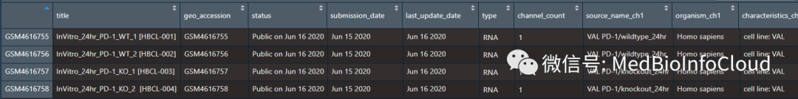

featureData里面注意是注释信息，这个用于探针注释。

```plain
featureData <- gse1@featureData
```

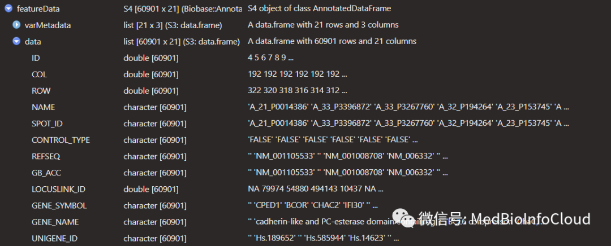

protocolData里面，看名称就应该知道，就是实验protocol的信息。

```plain
protocolData <- gse1@protocolData
```


我们前面介绍数据是直接利用list的取值方式，但GEOquery提供了操作对象的一些函数，我们充分利用。

pData函数提取表型数据。

```plain
##提取第一个数据集的phenodata
dim(pData(gse1))
metdata<-pData(gse1)
```

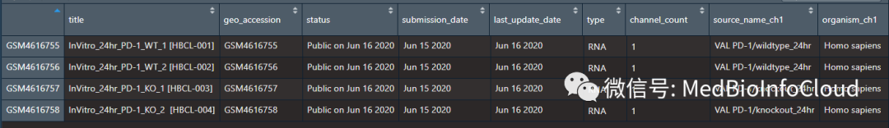

和前面用列表方式提取一样的，phenodata信息很多，但用得上的很少。

```plain
> colnames(metdata)##phenodata信息很多，但用得上的很少
 [1] "title"                   "geo_accession"           "status"
 [4] "submission_date"         "last_update_date"        "type"
 [7] "channel_count"           "source_name_ch1"         "organism_ch1"
[10] "characteristics_ch1"     "molecule_ch1"            "extract_protocol_ch1"
[13] "label_ch1"               "label_protocol_ch1"      "taxid_ch1"
[16] "hyb_protocol"            "scan_protocol"           "data_processing"
[19] "platform_id"             "contact_name"            "contact_email"
[22] "contact_laboratory"      "contact_department"      "contact_institute"
[25] "contact_address"         "contact_city"            "contact_state"
[28] "contact_zip/postal_code" "contact_country"         "supplementary_file"
[31] "data_row_count"          "cell line:ch1"
```

实验描述性信息，用experimentData函数提取。

```plain
edata <- experimentData(gse1)
```

exprs函数提取表达数据。这个是我们想要的。

```plain
exp1 <- exprs(ges1)
```

```plain
> head(exp1)
  GSM4616755 GSM4616756 GSM4616757 GSM4616758
4       35.4       29.5       36.2       11.3
5        7.7        7.7        8.4        5.7
6       11.9        7.7        8.3        5.7
7     1040.5     1159.6     1046.3      944.7
8    19242.0    20201.0    19216.3    17039.8
9        7.6        7.7       11.5        5.6
```

行名就是探针ID。通过我们获取的featureData数据中的注释信息来进行ID转换。

```plain
fd1 <- gse1@featureData@data
```

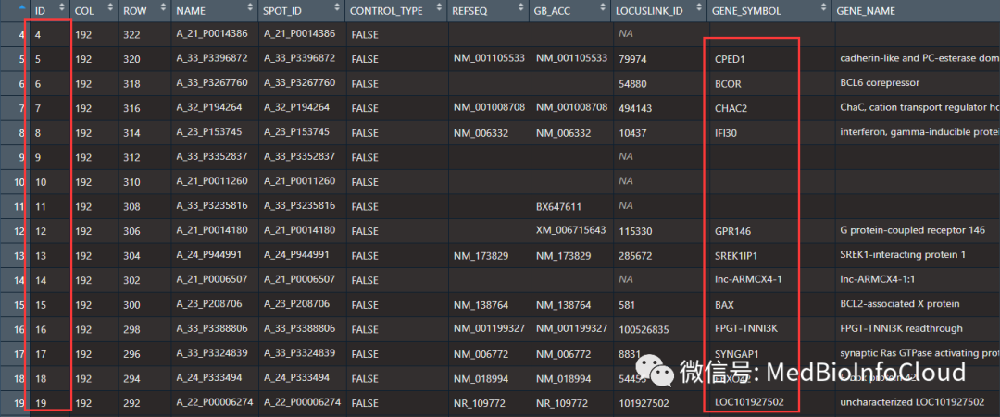

然后我们就可以通过这个对应关系进行探针注释了。

---

我们再介绍另外一个数据集：GSE7765。

```plain
gset2 <- getGEO(GEO = "GSE7765",
                AnnotGPL=TRUE ,
                destdir = ".")
exp2 <- exprs(gset2[[1]])
```

```plain
> exp2[1:5,1:4]
          GSM188013 GSM188014 GSM188016 GSM188018
1007_s_at 15630.200 17048.800 13667.500 15138.800
1053_at    3614.400  3563.220  2604.650  1945.710
117_at     1032.670  1164.150   510.692  5061.200
121_at     5917.800  6826.670  4562.440  5870.130
1255_g_at   224.525   395.025   207.087   164.835
```

我们看看featureData中的data。

```plain
fd2 <- gset2[["GSE7765-GPL96_series_matrix.txt.gz"]]@featureData@data
```

其实这个就是探针的注释信息。GSE7765获取的数据集中有2个数据对象。

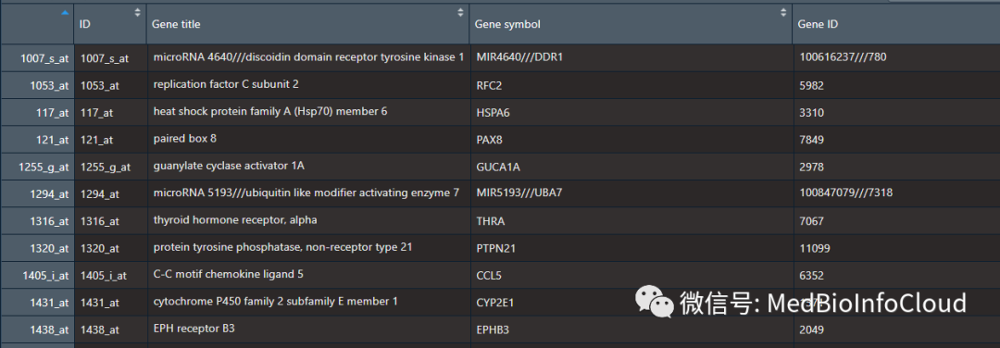

不过，这里我们还要说明一下，

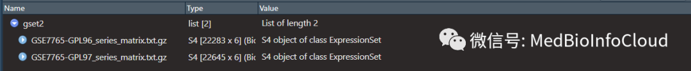

那是因为该数据集利用了2个平台。我们刚刚只是提取了第一个平台的数据。这也是我为什么要介绍数据集的原因，有时候一个GSE是可以有多个平台的。

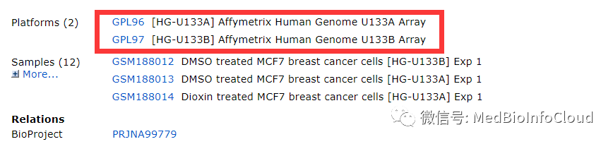

我们先注释exp2。我们获取的fd2数据框就是GPL96平台的注释信息。我们选择"ID","Gene symbol","Gene ID"这3列。

```plain
probeAno<- fd2 %>% select("ID","Gene symbol","Gene ID")
```

```plain
> head(probeAno)
                 ID    Gene symbol          Gene ID
1007_s_at 1007_s_at MIR4640///DDR1  100616237///780
1053_at     1053_at           RFC2             5982
117_at       117_at          HSPA6             3310
121_at       121_at           PAX8             7849
1255_g_at 1255_g_at         GUCA1A             2978
1294_at     1294_at MIR5193///UBA7 100847079///7318
```

我们发现。Gene symbol和 Gene ID中有点有"///"分割，表示该探针对应多个基因，特异性不好，所以注释前，我们需要删除，我自己是删除处理。注意列名，不同芯片可能列名多少有点区别。

```plain
index <-grep("1",unlist(lapply(strsplit(probeAno$`Gene symbol`,"///"),length)))
proAno <- probeAno[index,]
proAno <- na.omit(proAno)
```

```plain
> head(proAno)                 ID Gene symbol Gene ID1053_at     1053_at        RFC2    5982117_at       117_at       HSPA6    3310121_at       121_at        PAX8    78491255_g_at 1255_g_at      GUCA1A    29781316_at     1316_at        THRA    70671320_at     1320_at      PTPN21   11099
```

然后根据这个注释信息，将表达矩阵的探针名称换成我们能看的懂的Gene symbol。

```plain
ID<-rownames(exp2)
exp2l<-apply(exp2,1,function(x){log2(x+1)})
exp2l<-t(exp2l)
eset<-exp2l[ID %in% proAno$ID,] %>% cbind(proAno)
```

```plain
> head(eset)
          GSM188013 GSM188014 GSM188016 GSM188018 GSM188020 GSM188022        ID Gene symbol Gene ID
1053_at   11.819940 11.799371 11.347428 10.926822 11.719513 11.734566   1053_at        RFC2    5982
117_at    10.013560 10.186300  8.999132 12.305549  8.823896  8.649174    117_at       HSPA6    3310
121_at    12.531089 12.737178 12.155906 12.519422 11.918297 11.846054    121_at        PAX8    7849
1255_g_at  7.817144  8.629448  7.701043  7.373605  6.815178  7.034777 1255_g_at      GUCA1A    2978
1316_at    9.497459  9.868281  8.831323  9.211346  8.453592  9.039884   1316_at        THRA    7067
1320_at    7.090525  6.663473  8.469634  7.849180  7.852642  8.415999   1320_at      PTPN21   11099
```

然后我们将Gene symbol这一列作为行名就可以了。

```plain
rownames(eset) <- eset$`Gene symbol`
```

发现会报错。

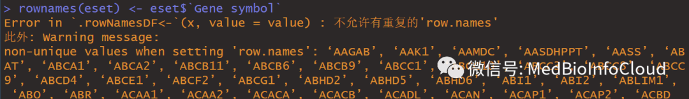

原因是一个基因可能对应多个探针。所以会有重复。我们先看另外一种注释方法。我比较喜欢这样。

```plain
exp2ll <- data.frame(ID =rownames(exp2),exp2)
eset <- merge(proAno,exp2ll,by = "ID")
```

```plain
> head(eset)
         ID Gene symbol Gene ID GSM188013 GSM188014 GSM188016 GSM188018 GSM188020 GSM188022
1   1053_at        RFC2    5982  3614.400  3563.220  2604.650  1945.710  3371.290  3406.660
2    117_at       HSPA6    3310  1032.670  1164.150   510.692  5061.200   452.166   400.477
3    121_at        PAX8    7849  5917.800  6826.670  4562.440  5870.130  3869.480  3680.440
4 1255_g_at      GUCA1A    2978   224.525   395.025   207.087   164.835   111.609   130.123
5   1316_at        THRA    7067   721.803   933.649   454.505   591.777   349.578   525.352
6   1320_at      PTPN21   11099   135.289   100.369   353.498   229.589   230.143   340.561
```

仔细看一下代码，数值和第一次差别很大，我们第一次转换的时候，进行了log2转换。第二中方法只是融合了数据，并没有进行log2转换。为什么要进行log2转换。我们先去重了，再说。

```plain
eset <- eset %>% as.matrix()
rownames(eset) <- eset[,"Gene symbol"]
```

我们借助limma包的avereps函数去重，并取均值。

```plain
> nrow(eset)
[1] 19952
```

```plain
library(limma)
eset <- eset[,-c(1:3)]
eset <- avereps(eset)
```

```plain
> nrow(eset)
[1] 12515
```

行数变少了好几千，说明重复的不少呀。这样我们就获得表达数据了。

```plain
> head(eset)
       GSM188013     GSM188014     GSM188016     GSM188018     GSM188020     GSM188022
RFC2   "3.61440e+03" "3.56322e+03" " 2604.65000" "1.94571e+03" "3.37129e+03" "3.40666e+03"
HSPA6  "1.03267e+03" "1.16415e+03" "  510.69200" "5.06120e+03" "4.52166e+02" "4.00477e+02"
PAX8   "5.91780e+03" "6.82667e+03" " 4562.44000" "5.87013e+03" "3.86948e+03" "3.68044e+03"
GUCA1A "2.24525e+02" "3.95025e+02" "  207.08700" "1.64835e+02" "1.11609e+02" "1.30123e+02"
THRA   "7.21803e+02" "9.33649e+02" "  454.50500" "5.91777e+02" "3.49578e+02" "5.25352e+02"
PTPN21 "1.35289e+02" "1.00369e+02" "  353.49800" "2.29589e+02" "2.30143e+02" "3.40561e+02"
```

但是，发现我们的数据变成了字符串。转换一下。

```plain
eset <- as.data.frame(eset) %>% data.matrix() %>% as.data.frame()
```

```plain
> head(eset)
       GSM188013 GSM188014 GSM188016 GSM188018 GSM188020 GSM188022
RFC2    3614.400  3563.220  2604.650  1945.710  3371.290  3406.660
HSPA6   1032.670  1164.150   510.692  5061.200   452.166   400.477
PAX8    5917.800  6826.670  4562.440  5870.130  3869.480  3680.440
GUCA1A   224.525   395.025   207.087   164.835   111.609   130.123
THRA     721.803   933.649   454.505   591.777   349.578   525.352
PTPN21   135.289   100.369   353.498   229.589   230.143   340.561
```

好了，我们接着说，为什么要进行log2转换。

GEO中的Series Matrix File(s)通常是经过了标准化和对数转换的数据。但不全是。在实际应用的时候需要根据情况判断一下。对于芯片数据，可能作者将.cel的文件处理成未标准化的数据直接上传。一般来说，在判断counts是否需要重新标准化以及是否需要log2时，可以根据数值大小粗略估计。如果表达量的数值在50以内，通常是经过log2转化后的。如果数字在几百几千，则是未经转化的。因为2的几十次方已经非常巨大，如果2的几百次方，则不符合实际情况。我们上面的矩阵，我们肉眼就能看到数值都是个位数字，最大上千，这就是没有经过log处理过的，所以我们需要处理。前面处理的时候为什么+1？就是避免有0的值，取不了log值，所以加1再取log值，这对整体影响不大，这是个中学数学问题。

```plain
eset <- log2(eset +1)
```

```plain
> head(eset)
       GSM188013 GSM188014 GSM188016 GSM188018 GSM188020 GSM188022
RFC2   11.819940 11.799371 11.347428 10.926822 11.719513 11.734566
HSPA6  10.013560 10.186300  8.999132 12.305549  8.823896  8.649174
PAX8   12.531089 12.737178 12.155906 12.519422 11.918297 11.846054
GUCA1A  7.817144  8.629448  7.701043  7.373605  6.815178  7.034777
THRA    9.497459  9.868281  8.831323  9.211346  8.453592  9.039884
PTPN21  7.090525  6.663473  8.469634  7.849180  7.852642  8.415999
```

可能肉眼估计你自己都不太相信，那就看看作者的处理方式。GSE数据下载界面中的SOFT文件和Series Matrix File(s)文件中均有描述该系列的数据是如何进行标准化处理的，常见的标准化处理方法有3种：RMA算法、GC-RMA算法、MAS5算法，其中前两中算法的返回值已经经过log2转换，可直接进行差异表达分析，第三种算法返回值未经过log2转换，需要自行进行log2转换。

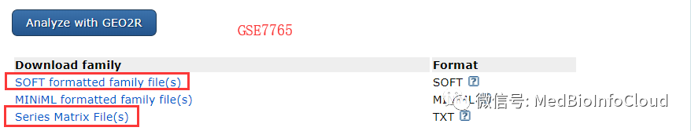

好了，我们提取数据后，就可以进行后续的分析了，比如[**差异分析**](http://mp.weixin.qq.com/s?__biz=MzA4NDAzODkzMA==&mid=2651264898&idx=1&sn=f6287d98fe0b0fb48a96d2905ca0bb4f&chksm=841ef3ffb3697ae9505b6e795a1fe842b2dd32b82f6b5ed4c3e68569c0459bff57319c08e0e2&scene=21#wechat_redirect)、[**表达谱热图绘制**](http://mp.weixin.qq.com/s?__biz=MzA4NDAzODkzMA==&mid=2651264534&idx=1&sn=6d5ef1279972e730878d65742e56c855&chksm=841ef26bb3697b7d426e76b16fbe0365aa6ad5da7f86ca7d14dcb72ca47ada25ffba021d9ba8&scene=21#wechat_redirect)了。但差异分析是不是还要分组，所以我们还得知道每个GSM是那一组，比如对照和实验组。

我们提取表型数据。

```plain
pdata <- pData(gset2[[1]])
```

```plain
> pdata[,1:2]
                                                             title geo_accession
GSM188013   DMSO treated MCF7 breast cancer cells [HG-U133A] Exp 1     GSM188013
GSM188014 Dioxin treated MCF7 breast cancer cells [HG-U133A] Exp 1     GSM188014
GSM188016   DMSO treated MCF7 breast cancer cells [HG-U133A] Exp 2     GSM188016
GSM188018 Dioxin treated MCF7 breast cancer cells [HG-U133A] Exp 2     GSM188018
GSM188020   DMSO treated MCF7 breast cancer cells [HG-U133A] Exp 3     GSM188020
GSM188022 Dioxin treated MCF7 breast cancer cells [HG-U133A] Exp 3     GSM188022
```

可以看的出来，DMSO处理组就是对照，Dioxin处理组就是实验组。就可以设计分组，进行差异分析了。如果我们获得的数据是原始的Counts数，可以利用[**edgeR包和DESeq2包进行差异分析**](http://mp.weixin.qq.com/s?__biz=MzA4NDAzODkzMA==&mid=2651264898&idx=1&sn=f6287d98fe0b0fb48a96d2905ca0bb4f&chksm=841ef3ffb3697ae9505b6e795a1fe842b2dd32b82f6b5ed4c3e68569c0459bff57319c08e0e2&scene=21#wechat_redirect)，可以参考我在TCGA数据库差异分析的文章，在哪里，我也说过，尽管那是TCGA数据库的教程，但仅仅是提取表达数据的方法不同，只要获取了表达矩阵，后面的分析都一样。下面是之前的文章：

[**一文就会TCGA数据库基因表达差异分析**](http://mp.weixin.qq.com/s?__biz=MzA4NDAzODkzMA==&mid=2651264898&idx=1&sn=f6287d98fe0b0fb48a96d2905ca0bb4f&chksm=841ef3ffb3697ae9505b6e795a1fe842b2dd32b82f6b5ed4c3e68569c0459bff57319c08e0e2&scene=21#wechat_redirect)

我们这里介绍limma包进行差异表达分析。

首先，我们根据表型信息，设计好分组

```plain
library(limma)
library(dplyr)
group_list <- rep(c("Control","Treat"),3)
design <- model.matrix(~0+factor(group_list))
colnames(design)=levels(factor(group_list))
contrast.matrix<-makeContrasts("Treat-Control",
                               levels = design)
```

```plain
> design
  Control Treat
1       1     0
2       0     1
3       1     0
4       0     1
5       1     0
6       0     1
attr(,"assign")
[1] 1 1
attr(,"contrasts")
attr(,"contrasts")$`factor(group_list)`
[1] "contr.treatment"
```

```plain
## 拟合模型
fit <- lmFit(eset,design)
fit2 <- contrasts.fit(fit, contrast.matrix)
fit2 <- eBayes(fit2)
DiffEG<-topTable(fit2, coef=1, n=Inf) %>% na.omit()
```

```plain
> head(DiffEG)
            logFC   AveExpr         t      P.Value adj.P.Val         B
ALDH3A1  3.227263 10.302323 10.518234 5.229177e-05 0.3477712 -4.081677
CYP1B1   4.129858 11.037828 10.403837 5.557670e-05 0.3477712 -4.082412
CYP1A1   9.003353 11.481268  8.328115 1.892272e-04 0.7893928 -4.100856
CXCR4   -2.674212  8.907395 -7.217072 4.086538e-04 0.8704705 -4.116912
HHLA2    1.550587  6.595658  7.202013 4.132158e-04 0.8704705 -4.117174
SLC7A5   2.470333 13.628775  7.188611 4.173250e-04 0.8704705 -4.117409
```

完成差异分析，我们就可以利用火山图进行可视化了，得到的基因还可以进行下一步的分析，比如富集分析。相关文章：

[**FunRich数据库：一个主要用于基因和蛋白质的功能富集以及相互作用网络分析的独立的软件工具**](http://mp.weixin.qq.com/s?__biz=MzA4NDAzODkzMA==&mid=2651265340&idx=1&sn=5c3608661698d2332b992269a8721833&chksm=841efd41b3697457f96ace4eecc682cbbbe3fdf3955f0060d3aafcdff0a2d85c225d5ce3f784&scene=21#wechat_redirect)

[**为什么选择GSEA分析？和KEGG和GO分析有什么区别？**](http://mp.weixin.qq.com/s?__biz=MzA4NDAzODkzMA==&mid=2651265618&idx=1&sn=3c5365ed2c437d3b7b034431ab4ac934&chksm=841efe2fb3697739ca349e9570aecdb0f4b0b5291c6dad8efcaca4777b631819e2951cdc5840&scene=21#wechat_redirect)

[**clusterProfiler包进行KEGG,GO,GSEA富集分析**](http://mp.weixin.qq.com/s?__biz=MzA4NDAzODkzMA==&mid=2651266484&idx=1&sn=b3fdeca6d8df8b6f4b2baae83b5dcd3c&chksm=841ef9c9b36970df3602f567018f10ccd037fa9742ed3b4020315914043a57432f1d9ae8de8a&scene=21#wechat_redirect)

---

**付费提示：**设置付费仅仅是为了避免被复制，感觉对你有用就当是赞赏了，也当是对我的鼓励。


提取码：yhkn

如果码失效，后台回复：**GEOquery-limma**

> 更新: 2021-01-16 12:57:57
> 原文: <https://www.yuque.com/doublehelix/bioinfonotes/uwgxsp>
