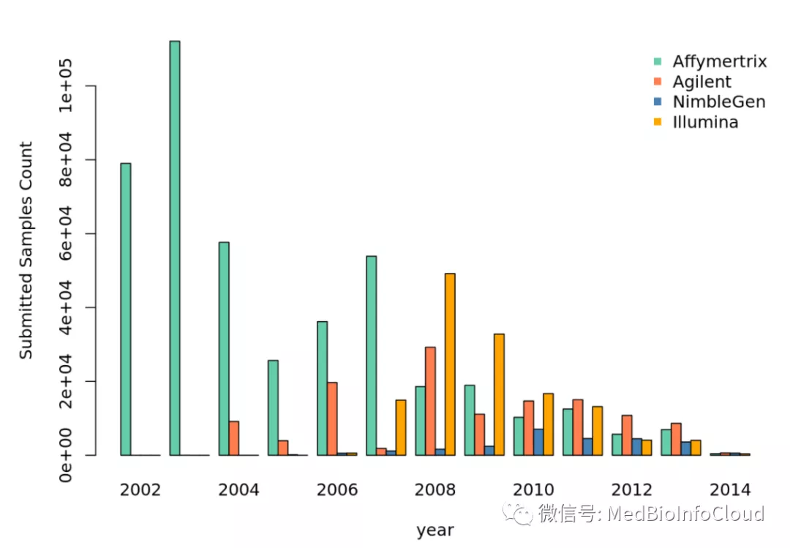
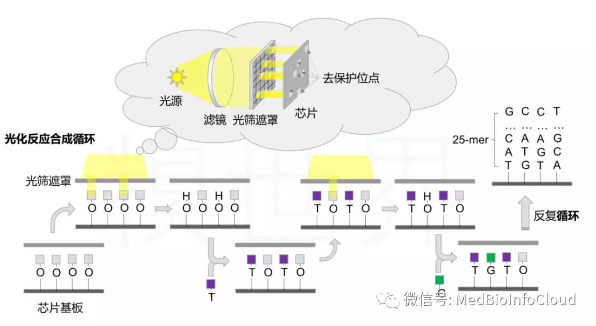

# 基因芯片与GEOquery包

关于芯片数据分析，我们之前的文章：[基因芯片数据挖掘分析表达差异基因](http://mp.weixin.qq.com/s?__biz=MzA4NDAzODkzMA==&mid=2651263385&idx=1&sn=63528ffd7901f36387cd4f484c99e188&chksm=841ef5e4b3697cf28e4590d3509be675bc5d44fe1a1cb6f54fe6ad5cc419139c8720a5fb299d&scene=21#wechat_redirect)中也介绍过芯片的基础知识，这里我们将使用R系统性的讲解芯片的数据分析。不想用R语言的可以阅读文章：[GEO数据库使用教程及在线数据分析工具](http://mp.weixin.qq.com/s?__biz=MzA4NDAzODkzMA==&mid=2651263601&idx=1&sn=443d0dddebb12f21cfd976d50473856b&chksm=841ef60cb3697f1aecc6c310ee3a77e6182a728d5b6711a5cc8f49f0739feaba904f565ce176&scene=21#wechat_redirect)，因为NCBI的GEO数据库([<u>https://www.ncbi.nlm.nih.gov/geo/</u>](https://www.ncbi.nlm.nih.gov/geo/))，ArrayExpress数据库([<u>https://www.ebi.ac.uk/arrayexpress/</u>](https://www.ebi.ac.uk/arrayexpress/))，和TCGA数据库([<u>https://cancergenome.nih.gov/</u>](https://cancergenome.nih.gov/))等等，记录和储存着大量芯片相关的数据，其中GEO数据库是目前最大最全的数据库，可供科研人员查询和下载相关数据。我们还有TCGA数据库的使用教程：[TCGA数据库使用教程](http://mp.weixin.qq.com/s?__biz=MzA4NDAzODkzMA==&mid=2651263330&idx=1&sn=ff440567bbacae48dd41fb3d1daa8751&chksm=841ef51fb3697c098f2c84276930d46884bcb51663f11f2c1c01d822427fed9c4a5c7fe0cf2c&scene=21#wechat_redirect)。可供初学者学习，我们之前也有TCGA数据挖掘的系列教程，读者可关注本公众号，通过菜单栏找到相应的课程学习，也可通过我们的网站查询（公众号后台有网址）。从本文开始，我们将系列性讲解基因芯片数据分析，下面简单对基因芯片的知识进行简单的概述，作为前面文章的一个补充。

## 基因芯片概述

简单地讲，基因芯片就是一系列微小特征序列的（通常是DNA探针，也可能是蛋白质）的集合，它们可以被用于定性或者定量检查样品内特异分子的成份。比如说，基因芯片可以检测几十个gene marker在细胞样品中的表达量。现在最常见的是用于整个基因组的表达量分析。它的雏形来自于同位素杂交技术，又如Southern blots或者dot blots。在上世纪九十年代，2维的具有现代意义的基因芯片才在实验室里诞生。基因芯片自问世以来，已经有超过23年（至2014年）了。现在，世界上主流的芯片制造商有4家，分别是Affymetrix，Agilent，Nimblegen以及Illumina。下图为历年来提交至Gene Expression Omnibus数据库的主流芯片厂商的芯片数据统计分布图（数据截止日期为2014年3月1日）。从下图中可以看出，Affymetrix制造的基因芯片在2008年以前占据了市场的主流，在2008年，因为illumina BeadArray的推广，它的市场份额有较大的攀升，但是2年以后就下降至与Affymetrix公司类似的份额。而Agilent却在2010年以后成为芯片市场份额最大的一家。市场份额的变化有价格的因素，质量的因素，使用习惯的因素，也有受到第二代测序技术冲击的因素。



基因芯片的原理大同小异，都是将生物分子固定在某种介质上，比如平面介质，微管，微槽以及微粒等，用于检测目标样品中一批生物分子的含量。使用玻璃介质的好处是经济，稳定，有利于杂交，并且背景荧光小。我们能够最直观想象的基因芯片制造方法就是象打印机印刷一样，通过将来自于不同墨盒里的DNA探针喷印或者吸印至玻璃平板上。在检测的时候，因为每组探针在介质上的位置是已知的，通过不同位置荧光强度与生物分子浓度的对应关系，就不难了解目的片断的表达强度了。这种方法其实就是基因芯片最初的制造方法。这种方法制造的芯片，密度不可能太高。

Affymetrix公司在基因芯片的高密度生产上做出了里程碑式的贡献，它们首创了在石英介质上原位合成oligo短序的工艺，这一工艺极大地提高了基因芯片探针的排布密度。那么oligonucleotide是在原位如何合成的呢？首先，合成位点被对UV光敏感 的化学物质保护起来，当受到UV光照的时候，合成位点被打开，这时候可以把A, C, G或者T碱基连接在合成位点上。而后再去掉光源，位点关闭，洗脱。之后再UV光照打开。如此反复，oligonucleotide的原位合成就完成了。

参考文献:[PMID: 19822891]




[**TCGA**](https://mp.weixin.qq.com/mp/appmsgalbum?action=getalbum&album_id=1338047035672526848&__biz=MzA4NDAzODkzMA==#wechat_redirect)** | **[**GEO**](https://mp.weixin.qq.com/mp/appmsgalbum?action=getalbum&album_id=1385753371944239106&__biz=MzA4NDAzODkzMA==#wechat_redirect)** | **[**文献阅读**](https://mp.weixin.qq.com/mp/appmsgalbum?action=getalbum&album_id=1338481272770953216&__biz=MzA4NDAzODkzMA==#wechat_redirect)** | **[**数据库**](https://mp.weixin.qq.com/mp/appmsgalbum?action=getalbum&album_id=1338487030963142656&__biz=MzA4NDAzODkzMA==#wechat_redirect)[** **](https://mp.weixin.qq.com/mp/appmsgalbum?action=getalbum&album_id=1338487030963142656&__biz=MzA4NDAzODkzMA==#wechat_redirect)**| **[**理论知识**](https://mp.weixin.qq.com/mp/appmsgalbum?action=getalbum&album_id=1338473418617946113&__biz=MzA4NDAzODkzMA==#wechat_redirect)

[**R语言**](https://mp.weixin.qq.com/mp/appmsgalbum?action=getalbum&album_id=1337050529440104449&__biz=MzA4NDAzODkzMA==#wechat_redirect)** | **[**Bioconductor**](https://mp.weixin.qq.com/mp/appmsgalbum?action=getalbum&album_id=1369789283514761218&__biz=MzA4NDAzODkzMA==#wechat_redirect)

---

关于GEO数据库的基本认识和在线使用，可阅读文章：[**GEO数据库使用教程及在线数据分析工具**](http://mp.weixin.qq.com/s?__biz=MzA4NDAzODkzMA==&mid=2651263601&idx=1&sn=443d0dddebb12f21cfd976d50473856b&chksm=841ef60cb3697f1aecc6c310ee3a77e6182a728d5b6711a5cc8f49f0739feaba904f565ce176&scene=21#wechat_redirect)。本文介绍GEOquery这个包，官方教程地址：

[<u>http://www.bioconductor.org/packages/release/bioc/vignettes/GEOquery/inst/doc/GEOquery.html</u>](http://www.bioconductor.org/packages/release/bioc/vignettes/GEOquery/inst/doc/GEOquery.html)

本文相当于官方教程的译文吧，再加上我个人的理解，可能翻译不是那么准确。请多多指教！！

**1 GEO概述**

NCBI基因表达综合库（GEO）可以用作各种高通量实验数据的公共存储库。这些数据包括测量mRNA，基因组DNA和蛋白质丰度的基于单通道和双通道微阵列的实验，以及非阵列技术，例如基因表达的串行分析（SAGE），质谱蛋白质组学数据和高通量测序数据。

在GEO的最基本组织层次上，有四种基本实体类型。前三个（样本，平台和系列）由用户提供；第四个是数据集，由GEO员工根据用户提交的数据进行编译和整理。有关更多信息，请参见GEO主页([<u>https://www.ncbi.nlm.nih.gov/geo/</u>](https://www.ncbi.nlm.nih.gov/geo/))。

**1.1平台**

平台记录描述了阵列上的元素列表（例如cDNA，寡核苷酸探针集，ORF，抗体），或在该实验中可以检测和定量的元素列表（例如SAGE标签，肽）。每个平台记录都分配有一个唯一且稳定的GEO登录号（GPLxxx）。平台可以引用由多个提交者提交的许多样本。

**1.2样品**

样品记录描述了处理单个样品的条件，进行的操作以及从中得出的每个元素的丰度测量。每个样本记录都分配有一个唯一且稳定的GEO登录号（GSMxxx）。样本实体只能引用一个平台，并且可以包含在多个系列中。

**1.3系列**

系列记录定义了一组相关的样本，这些样本被视为组的一部分，这些样本的关联方式以及它们是否有序和如何排序。系列作为一个整体提供了实验的重点和描述。系列记录还可以包含描述提取的数据、总结结论或分析的表格。每个系列记录都分配有一个唯一且稳定的GEO登录号(GSExxx)。系列记录有两种格式，由GEOquery独立处理。较小的新GSEMatrix文件解析起来非常快。GEOquery使用一个简单的标志来选择使用GSEMatrix文件（请参见下文）。

**1.4数据集**

GEO数据集（GDSxxx）是GEO样本数据的精选集。GDS记录代表了生物学和统计上可比的GEO样本的集合，并构成了GEO数据显示和分析工具套件的基础。GDS中的样本引用相同的平台，也就是说，它们共享一组通用的探针元素。假定以等效方式计算GDS中每个样本的值测量值，也就是说，诸如背景处理和规范化之类的考虑在整个数据集中是一致的。通过GDS子集提供反映实验设计的信息。

**2.开始使用GEOquery**

从GEO获取数据确实非常容易。只需一个命令getGEO。这个函数解释它的输入以确定如何从GEO获取数据，然后将数据解析成有用的R数据结构。用法非常简单。

如果没有安装GEOquery包的话，先安装。

```plain
if (!requireNamespace("BiocManager", quietly = TRUE))
    install.packages("BiocManager")
BiocManager::install("GEOquery")
```

加载这个包。

```plain
library(GEOquery)
```

现在，我们可以自由地访问任何GEO文件。下面代码是使用GEOquery包打包的文件，而不是从网上下载。通常，我们会使用GEO登录号下载数据，如代码注释中所述。

```plain
# If you have network access, the more typical way to do this
# would be to use this:
# gds <- getGEO("GDS507")
gds <- getGEO(filename=system.file("extdata/GDS507.soft.gz",package="GEOquery"))
```

也就是说，我们要从网络上下载数据的话，使用下面代码就行了。

```plain
gds <- getGEO("GDS507")
```

同样的，我们也可以通过样品的登录号获取。

```plain
# If you have network access, the more typical way to do this
# would be to use this:
# gds <- getGEO("GSM11805")
gsm <- getGEO(filename=system.file("extdata/GSM11805.txt.gz",package="GEOquery"))
```

**3.GEOquery数据结构**

GEOquery数据结构实际上有两种形式。第一种，包括GDS、GPL和GSM，这三种数据结构比较类似，getGEO对他们请求是也类似。第四个GEOquery数据结构是GSE，GSE是由GSM和GPL对象组合而成的复合数据类型。

**3.1 GDS、GSM和GPL类**

这些类中的每一个都由元数据标头（几乎从SOFT格式标头中逐字获取）和GEODataTable组成。GEODataTable有两个简单的部分，一个Columns部分，它描述Table部分的列标题。**show**每个类都有一个方法。例如，使用上面的gsm：

```plain
> head(Meta(gsm))
$channel_count
[1] "1"

$comment
[1] "Raw data provided as supplementary file"

$contact_address
[1] "715 Albany Street, E613B"

$contact_city
[1] "Boston"

$contact_country
[1] "USA"

$contact_department
[1] "Genetics and Genomics"
```

```plain
> Table(gsm)[1:5,]
          ID_REF  VALUE ABS_CALL
1 AFFX-BioB-5_at  953.9        P
2 AFFX-BioB-M_at 2982.8        P
3 AFFX-BioB-3_at 1657.9        P
4 AFFX-BioC-5_at 2652.7        P
5 AFFX-BioC-3_at 2019.5        P
```

```plain
> Columns(gsm)
    Column
1   ID_REF
2    VALUE
3 ABS_CALL
                                                                 Description
1
2                         MAS 5.0 Statistical Algorithm (mean scaled to 500)
3 MAS 5.0 Absent, Marginal, Present call  with Alpha1 = 0.05, Alpha2 = 0.065
```

GPL类的行为与GSM类完全相同。但是，GDS类有更多与列方法关联的信息。

```plain
> Columns(gds)[,1:3]
     sample disease.state individual
1  GSM11815           RCC        035
2  GSM11832           RCC        023
3  GSM12069           RCC        001
4  GSM12083           RCC        005
5  GSM12101           RCC        011
6  GSM12106           RCC        032
7  GSM12274           RCC          2
8  GSM12299           RCC          3
9  GSM12412           RCC          4
10 GSM11810        normal        035
11 GSM11827        normal        023
12 GSM12078        normal        001
13 GSM12099        normal        005
14 GSM12269        normal          1
15 GSM12287        normal          2
16 GSM12301        normal          3
17 GSM12448        normal          4
```

**3.2 GSE类**

GSE实例是GEO实例中最容易混淆的。一个GSE条目可以表示在任意数量的平台上运行的任意数量的样本。与其他类一样，GSE类有一个元数据部分。但是，它没有GEODataTable。相反，它包含两个列表，可以使用GPLList和GSMList方法访问，这两个列表分别是GPL和GSM对象的列表。

```plain
# Again, with good network access, one would do:
# gse <- getGEO("GSE781",GSEMatrix=FALSE)
gse <- getGEO(filename=system.file("extdata/GSE781_family.soft.gz",package="GEOquery"))
```

```plain
> head(Meta(gse))
$contact_address
[1] "715 Albany Street, E613B"
$contact_city
[1] "Boston"
$contact_country
[1] "USA"
$contact_department
[1] "Genetics and Genomics"
$contact_email
[1] "mlenburg@bu.edu"
$contact_fax
[1] "617-414-1646"
```

Meta(gse)提取的信息就是网页上的信息。你可以网页上查看该数据集看看。

[<u>https://www.ncbi.nlm.nih.gov/geo/query/acc.cgi?acc=GSE781</u>](https://www.ncbi.nlm.nih.gov/geo/query/acc.cgi?acc=GSE781)


我们可以利用GSMList函数提取GSM对象。

```plain
# GSE中包含的所有GSM对象的名称
names(GSMList(gse))
```

```plain
# 并获取列表中的第一个GSM对象
GSMList(gse)[[1]]
```

同样，GPLList函数提取GPL对象。

```plain
names(GPLList(gse))
```

**4. 转化为 BioConductor的 ExpressionSets 和 limma MALists对象**

GEO数据集(与其他一些GEO实例不同)非常类似于LIMMA数据结构的MAList对象和BioBase数据结构的ExpressionSet对象。因此，有两个函数GDS2MA和GDS2eSet可以完成转换任务。

**4.1 获取作为ExpressionSets的GSE系列矩阵文件**

GEO系列是相关实验的集合。除了可以作为相当大的软格式文件提供之外，NCBI GEO还准备了一个基于制表符分隔文本的更简单的格式文件。getGEO函数可以处理这种格式，并且可以相当快地解析非常大的GSE。此解析返回的数据结构是ExpressionSet列表。作为示例，我们下载并解析GSE2553。

```plain
gse2553 <- getGEO('GSE2553',GSEMatrix=TRUE)
```

```plain
> show(gse2553)
$GSE2553_series_matrix.txt.gz
ExpressionSet (storageMode: lockedEnvironment)
assayData: 12600 features, 181 samples
  element names: exprs
protocolData: none
phenoData
  sampleNames: GSM48681 GSM48682 ... GSM48861 (181 total)
  varLabels: title geo_accession ... data_row_count (30 total)
  varMetadata: labelDescription
featureData
  featureNames: 1 2 ... 12600 (12600 total)
  fvarLabels: ID PenAt ... Chimeric_Cluster_IDs (13 total)
  fvarMetadata: Column Description labelDescription
experimentData: use 'experimentData(object)'
  pubMedIds: 16230383
Annotation: GPL1977
```

```plain
> show(pData(phenoData(gse2553[[1]]))[1:5,c(1,6,8)])
                                                                 title
GSM48681                      Patient sample ST18, Dermatofibrosarcoma
GSM48682                           Patient sample ST410, Ewing Sarcoma
GSM48683                            Patient sample ST130, Sarcoma, NOS
GSM48684 Patient sample ST293, Malignant Peripheral Nerve Sheath Tumor
GSM48685                             Patient sample ST367, Liposarcoma
         type                         source_name_ch1
GSM48681  RNA                     Dermatofibrosarcoma
GSM48682  RNA                           Ewing Sarcoma
GSM48683  RNA                            Sarcoma, NOS
GSM48684  RNA Malignant Peripheral Nerve Sheath Tumor
GSM48685  RNA                             Liposarcoma
```

**4.2 将GDS转换为ExpressionSet**

```plain
eset <- GDS2eSet(gds,do.log2=TRUE)
```

现在，eset是一个ExpressionSet包含相同的信息作为GEO数据集，包括样品信息，我们可以在这里看到：

```plain
> head(eset)[,1:5]
                GSM1071862 GSM1071863 GSM1071864 GSM1071865 GSM1071866
1053_3p_at        2.453620   2.045711   2.780113   2.417370   2.260668
117_3p_at         4.745937   4.030957   5.365418   5.536504   3.275881
1494_3p_f_at      5.756770   5.614358   7.382213   6.912064   7.034421
1552275_3p_s_at   2.070568   2.657432   3.915170   3.250838   2.428128
1552281_3p_at     6.523435   6.436356   7.873713   6.567717   6.913835
1552296_3p_at     1.614668   3.412571   1.741802   2.345888   4.213399
```

**4.3 转换GDS为MAList**

ExpressionSet通常未获取任何注释信息（GEO称其为平台信息），但是，很容易获得此信息。首先，我们需要知道此GDS使用的平台。然后，再次通过getGEO将获得我们所需的东西。

```plain
> Meta(gds)$platform[1] "GPL97"
```

```plain
gpl <- getGEO(filename=system.file("extdata/GPL97.annot.gz",package="GEOquery"))
```

因此，gpl现在包含来自GEO的GPL5信息。与ExpressionSetlimma 不同，limma MAList确实存储了基因注释信息，因此我们可以利用GDS2MA来新创建含gpl的GPL类。

```plain
MA <- GDS2MA(gds,GPL=gpl)
```

```plain
> class(MA)
[1] "MAList"
attr(,"package")
[1] "limma"
```

现在，MA属于MAList类，不仅包含数据，还包含与GDS507相关的样本信息和基因信息。

```plain
ano <- MA[["genes"]]
```

```plain
> ano[1:5,1:4]
           ID                                         Gene title     Gene symbol          Gene ID
1 200000_s_at                       pre-mRNA processing factor 8           PRPF8            10594
2   200001_at                            calpain small subunit 1          CAPNS1              826
3   200002_at                              ribosomal protein L35           RPL35            11224
4 200003_s_at              microRNA 6805///ribosomal protein L28 MIR6805///RPL28 102465483///6158
5   200004_at eukaryotic translation initiation factor 4 gamma 2          EIF4G2             1982
```

**4.4 GSE转化为 ExpressionSet**

```plain
gsmplatforms <- lapply(GSMList(gse),function(x) {Meta(x)$platform_id})
```

```plain
> head(gsmplatforms)
$GSM11805
[1] "GPL96"
$GSM11810
[1] "GPL97"
$GSM11814
[1] "GPL96"
$GSM11815
[1] "GPL97"
$GSM11823
[1] "GPL96"
$GSM11827
[1] "GPL97"
```

确实，有两个GPL，即GPL96和GPL97，作为它们的平台（我们可以通过查看GPLList来确定它们gse）。我们可以过滤原始的GSMList，使其仅包含那些具有GPL96平台的GSM，并将此列表用于进一步处理。

```plain
gsmlist = Filter(function(gsm) {Meta(gsm)$platform_id=='GPL96'},GSMList(gse))
```

```plain
> length(gsmlist)
[1] 17
```

所以，现在我们想知道哪一列代表我们想要提取的数据。查看单个GSM的表的前几行可能会给我们一个概念(顺便说一句，GEO使用了一个约定，即包含每个数组的单个度量的列称为值列，如果我们不知道其他哪些列最相关，可以使用它)。

```plain
> Table(gsmlist[[1]])[1:5,]
          ID_REF  VALUE ABS_CALL
1 AFFX-BioB-5_at  953.9        P
2 AFFX-BioB-M_at 2982.8        P
3 AFFX-BioB-3_at 1657.9        P
4 AFFX-BioC-5_at 2652.7        P
5 AFFX-BioC-3_at 2019.5        P
```

```plain
> Columns(gsmlist[[1]])[1:5,]
       Column                                                                Description
1      ID_REF
2       VALUE                         MAS 5.0 Statistical Algorithm (mean scaled to 500)
3    ABS_CALL MAS 5.0 Absent, Marginal, Present call  with Alpha1 = 0.05, Alpha2 = 0.065
NA       <NA>                                                                       <NA>
NA.1     <NA>                                                                       <NA>
```

我们将使用VALUE列。然后，我们想做一个矩阵，这些值如下:

```plain
# get the probeset ordering
probesets <- Table(GPLList(gse)[[1]])$ID
# make the data matrix from the VALUE columns from each GSM
# being careful to match the order of the probesets in the platform
# with those in the GSMs
data.matrix <- do.call('cbind',lapply(gsmlist,function(x)
{tab <- Table(x)
mymatch <- match(probesets,tab$ID_REF)
return(tab$VALUE[mymatch])
}))
data.matrix <- apply(data.matrix,2,function(x) {as.numeric(as.character(x))})
data.matrix <- log2(data.matrix)
```

```plain
> data.matrix[1:5,1:5]
      GSM11805  GSM11814  GSM11823  GSM11830  GSM12067
[1,] 10.926963 11.105254 11.275019 11.438636 11.424376
[2,]  5.749534  7.908092  7.093814  7.514122  7.901470
[3,]  7.066089  7.750205  7.244126  7.962896  7.337176
[4,] 12.660353 12.479755 12.215897 11.458355 11.397568
[5,]  6.195741  6.061776  6.565293  6.583459  6.877744
```

```plain
require(Biobase)
# go through the necessary steps to make a compliant ExpressionSet
rownames(data.matrix) <- probesets
colnames(data.matrix) <- names(gsmlist)
pdata <- data.frame(samples=names(gsmlist))
rownames(pdata) <- names(gsmlist)
pheno <- as(pdata,"AnnotatedDataFrame")
eset2 <- new('ExpressionSet',exprs=data.matrix,phenoData=pheno)
eset2
```

注意，我们要做的match是确保值和平台信息的顺序相同。最后，制作ExpressionSet对象。

**5.从GEO获取原始数据**

NCBI GEO接受（但并非总是需要）原始数据，例如.CEL文件，.CDF文件，图像等。有时，快速访问此类数据很有用。单个函数getGEOSuppFiles可以将GEO加入作为参数，并将下载与该加入相关的所有原始数据。默认情况下，该函数将在当前工作目录中创建一个目录，以存储所选GEO入藏的原始数据。结合使用简单的sapply语句或其他循环结构，getGEOSuppFiles可以以一种非常简单的方式快速轻松地获取原始数据，而无需了解GEO原始数据URL的细节。

```plain
a <- getGEOSuppFiles('GSM1137', fetch_files = FALSE)
```

---

上面内容来自官方文档的教程，加上我个人的理解，后续我们在[**GEO专辑**](https://mp.weixin.qq.com/mp/appmsgalbum?action=getalbum&album_id=1385753371944239106&__biz=MzA4NDAzODkzMA==#wechat_redirect)实战中进行应用。

原文地址：

[<u>http://www.bioconductor.org/packages/release/bioc/vignettes/GEOquery/inst/doc/GEOquery.html</u>](http://www.bioconductor.org/packages/release/bioc/vignettes/GEOquery/inst/doc/GEOquery.html)

<u></u>

<u></u>

<u></u>

<u></u>

<u></u>

> 更新: 2022-03-27 14:29:16
> 原文: <https://www.yuque.com/doublehelix/bioinfonotes/it6bra>
