# TCGAbiolinks包-新版本

[\
](https://mp.weixin.qq.com/s?__biz=MzA4NDAzODkzMA==\&mid=2651263886\&idx=1\&sn=1c433a1b2144328a52c0d2d8af5c35ff\&chksm=841ef7f3b3697ee5a7190693b0786633e618f7dc29612f3bd014d0be33bc4f92edb6a9d248cf\&token=1937927307\&lang=zh_CN\&scene=21#wechat_redirect)肿瘤基因组图谱（TCGA）计划是由美国National Cancer Institute（NCI）和National Human Genome Research Institute（NHGRI）于2006年联合启动的项目，研究的癌症类型从最开始的多形性成胶质细胞瘤（GBM）到现在为止共有39种，涉及29种癌症器官，1万多个肿瘤样本，27万多份文件，当然其项目也将于2017年接近尾声。

网址：<https://portal.gdc.cancer.gov/>

对于肿瘤研究者来说，TCGA数据库就是一个资源宝库，里面有很多有价值的信息可以挖掘，关于TCGA数据挖掘的工具很多，包括在线工具和R包。

我们推荐本文要介绍的TCGAbiolinks包。这个包的功能很强大，学会了这个包几乎就已经够用，不用在学其他包。

地址：<http://www.bioconductor.org/packages/release/bioc/html/TCGAbiolinks.html>

tcgabiollinks提供了一些搜索GDC数据库的功能。本节首先解释了不同的GDC资源(Harmonized和Legacy Archive)，然后是一些如何访问它们的例子。

TCGA条形码由一组标识符组成。每个都明确地标识一个TCGA数据元素。有关元数据标识符如何组成条形码的说明，请参阅下图。分隔符条码包含最多的标识符。

以下是使用tcgabiolink下载GDC数据的两个可用来源:

GDC Legacy Archive : 提供访问以前存储在CGHub和TCGA数据门户(由TCGA数据协调中心(DCC)托管)的未经修改的数据副本，在TCGA数据协调中心(DCC)使用参考GRCh37 (hg19)和GRCh36 (hg18)。

GDC harmonized database:可利用的数据与GRCh38 (hg38)使用GDC生物信息学管道进行协调，该管道为生物标本和临床数据的标准化提供了方法。

1）对于legacy数据（与hg19对齐的数据），TCGAbiolinks正在使用GRCh37.p13进行注释；

2）对于harmonized数据（与hg38对齐的数据），TCGAbiolinks正在使用GRCh38.p7 (May 2017)进行注释。

## 一.TCGAbiolinks包

### 1.GDCquery()函数

```r
GDCquery(
  project,
  data.category,
  data.type,
  workflow.type,
  legacy = FALSE,
  access,
  platform,
  file.type,
  barcode,
  data.format,
  experimental.strategy,
  sample.type
)
```

（1）project

有效项目的列表可通过`getGDCprojects()$project_id`查看。

```r
> getGDCprojects()$project_id
 [1] "GENIE-MSK"             "TCGA-UCEC"             "TCGA-LGG"
 [4] "TCGA-SARC"             "TCGA-PAAD"             "TCGA-ESCA"
 [7] "TCGA-PRAD"             "GENIE-VICC"            "TCGA-LAML"
[10] "TCGA-KIRC"             "TCGA-PCPG"             "TCGA-HNSC"
[13] "GENIE-JHU"             "TCGA-OV"               "TCGA-GBM"
[16] "TCGA-UCS"              "TCGA-MESO"             "TCGA-TGCT"
[19] "TCGA-KICH"             "TCGA-READ"             "TCGA-UVM"
[22] "TCGA-THCA"             "OHSU-CNL"              "GENIE-DFCI"
[25] "GENIE-NKI"             "GENIE-GRCC"            "FM-AD"
[28] "GENIE-UHN"             "GENIE-MDA"             "TCGA-LIHC"
[31] "TCGA-THYM"             "TCGA-CHOL"             "TARGET-ALL-P1"
[34] "ORGANOID-PANCREATIC"   "TCGA-DLBC"             "TCGA-KIRP"
[37] "TCGA-BLCA"             "TARGET-ALL-P3"         "TARGET-CCSK"
[40] "TARGET-NBL"            "TARGET-AML"            "TARGET-ALL-P2"
[43] "NCICCR-DLBCL"          "CTSP-DLBCL1"           "TARGET-RT"
[46] "TARGET-OS"             "TCGA-BRCA"             "TCGA-COAD"
[49] "TCGA-CESC"             "TCGA-LUSC"             "TCGA-STAD"
[52] "TCGA-SKCM"             "TCGA-LUAD"             "TARGET-WT"
[55] "TCGA-ACC"              "BEATAML1.0-CRENOLANIB" "BEATAML1.0-COHORT"
[58] "VAREPOP-APOLLO"        "MMRF-COMMPASS"         "WCDT-MCRPC"
[61] "CGCI-HTMCP-CC"         "CMI-ASC"               "CMI-MPC"
[64] "CMI-MBC"               "CPTAC-2"               "CGCI-BLGSP"
[67] "CPTAC-3"               "HCMI-CMDC"
```

（2）data.category

可以使用`TCGAbiolinks:::getProjectSummary(project)`查看project中有哪些数据类型，如查询`"TCGA-LUAD"`，有9种数据类型，`case_count`为病人数，`file_count`为对应的文件数。要下载表达谱，可以设置`data.category="Transcriptome Profiling"`。

```r
MedBioInfoCloud: TCGAbiolinks:::getProjectSummary("TCGA-LUAD")
$file_count
[1] 29733

$data_categories
  file_count case_count               data_category
1       4266        582            Sequencing Reads
2       2731        585                 Biospecimen
3       4553        518       Copy Number Variation
4       9967        571 Simple Nucleotide Variation
5       2334        519     Transcriptome Profiling
6       1971        579             DNA Methylation
7       1146        585                    Clinical
8       2400        517        Structural Variation
9        365        365          Proteome Profiling

$case_count
[1] 585

$file_size
[1] 1.349824e+14
```

（3）data.type

筛选要下载的文件的数据类型。没有命令可以查看`data.type`里都有哪些数据类型， 但是根据官网连接，查看`data.type`有29种，但设置参数的时候不代表所有的`project`和`data.category`都对应29种。这个数据会随着数据库的更新而变化。

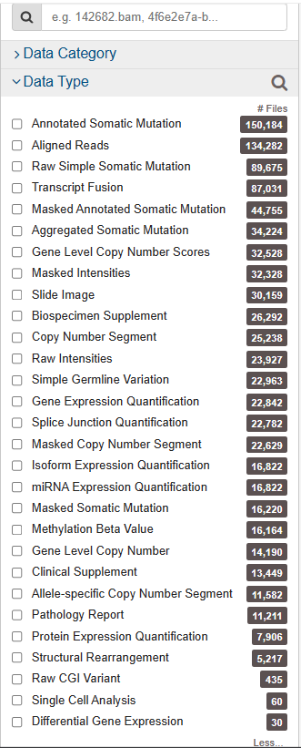

```r
#下载rna-seq的数据
data.type = "Gene Expression Quantification"
#下载miRNA数据
data.type = "miRNA Expression Quantification"
#下载Copy Number Variation数据
data.type = "Copy Number Segment"
```

（4）workflow.type

该数据类型有很多种，根据`data.type`的不同而不同，不同的数据类型，有其对应的参数可供选择。比如`Gene Expression Quantification`的RNA-Seq数据类型下`workflow.type` 为<code>[STAR - Counts](https://portal.gdc.cancer.gov/repository?facetTab=files&filters=%7B%22op%22%3A%22and%22%2C%22content%22%3A%5B%7B%22op%22%3A%22in%22%2C%22content%22%3A%7B%22field%22%3A%22files.analysis.workflow_type%22%2C%22value%22%3A%5B%22STAR%20-%20Counts%22%5D%7D%7D%2C%7B%22op%22%3A%22in%22%2C%22content%22%3A%7B%22field%22%3A%22files.data_category%22%2C%22value%22%3A%5B%22transcriptome%20profiling%22%5D%7D%7D%2C%7B%22op%22%3A%22in%22%2C%22content%22%3A%7B%22field%22%3A%22files.data_type%22%2C%22value%22%3A%5B%22Gene%20Expression%20Quantification%22%5D%7D%7D%2C%7B%22op%22%3A%22in%22%2C%22content%22%3A%7B%22field%22%3A%22files.experimental_strategy%22%2C%22value%22%3A%5B%22RNA-Seq%22%5D%7D%7D%5D%7D)</code>。在原来老版本中有4种类型分别为：

* HTSeq - FPKM-UQ：FPKM上四分位数标准化值
* HTSeq - FPKM：FPKM值/表达量值
* HTSeq - Counts：原始count数
* STAR - Counts

现在版本数据都融合在STAR - Counts中，也就是一个文件里面有 Counts、FPKM和TMP的值。

（5）legacy

这个参数主要是因为TCGA数据有两个入口可以下载，GDC Legacy Archive 和 GDC Data Portal，区别主要是注释参考基因组版本不同分别是：GDC Legacy Archive（hg19和GDC Data Portal（hg38）。参数默认为FALSE，下载GDC Data Portal（hg38）。

（6）access

数据开放和不开放，有两个参数:`controlled`, `open`。

（7）platform

这里涉及到的平台种类非常多，可以具体去官网看每种数据都有什么平台的可以下载。这个参数可以省略不设置。

（8）file.type

主要是在GDC Legacy Archive下载数据的时候使用，可以参考官网说明。在GDC Data Portal下载数据，该参数省略不设置。

（9）barcode

TCGA条形码由一组标识符组成。每个都明确地标识一个TCGA数据元素。有关元数据标识符如何组成条形码的说明，分隔符条码包含最多的标识符。

* Aliquot barcode: TCGA-G4-6317-02A-11D-2064-05
* Participant: TCGA-G4-6317
* Sample: TCGA-G4-6317-02

具体可以查看：<https://docs.gdc.cancer.gov/Encyclopedia/pages/TCGA_Barcode/>

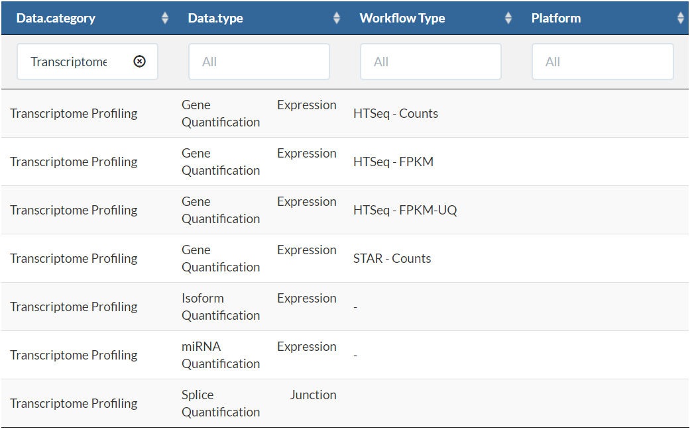

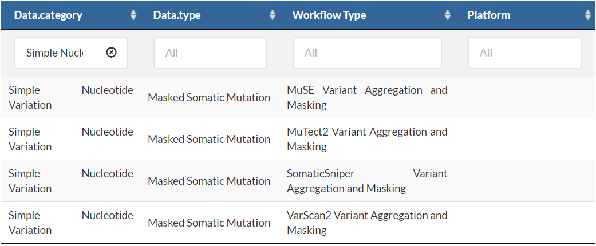

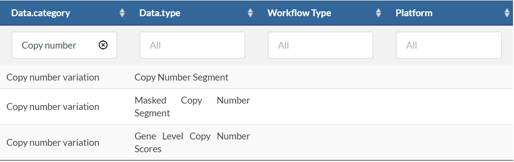

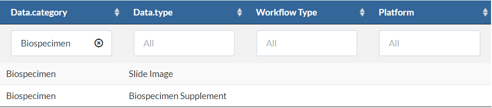

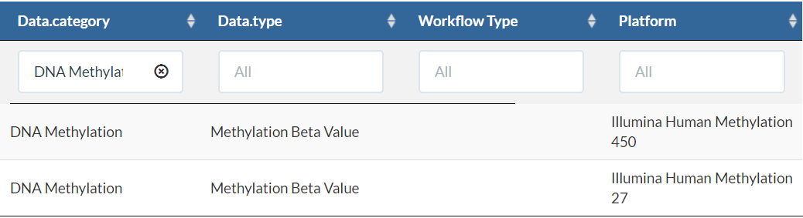

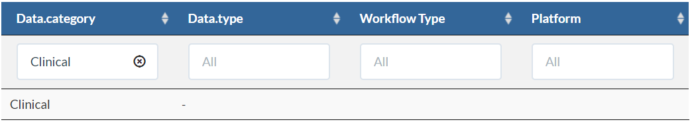

案例：

```r
library(TCGAbiolinks)
query <- GDCquery(
  project = "TCGA-LUAD",
  data.category = "Transcriptome Profiling",
  data.type = "Gene Expression Quantification",
  workflow.type = "STAR - Counts"
)
```

### 2.getResults()函数

```r
getResults(query, rows, cols)
```

该函数从GDCquery函数查询的结果中获取结果表，它可以使用cols参数选择列，并使用rows参数返回若干行。

* query	A object from GDCquery
* rows	Rows identifiers (row numbers)
* cols		Columns identifiers (col names)

```r
> class(query)
[1] "data.frame"
```

GDCquery函数请求的结果是一个数据框。

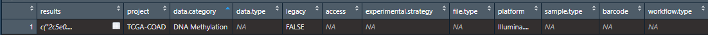

除了results列，其他列都是GDCquery函数设置的参数，results列是我们请求的结果，该列是一个AsIs对象。

```r
> class(query[,1])
[1] "AsIs"
```

取值出来看，类似于长度为1的列表：

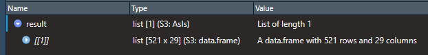

取值出来后就是一个数据框。

```r
query_result = query[,1][[1]]
head(query_result)[,1:3]
```

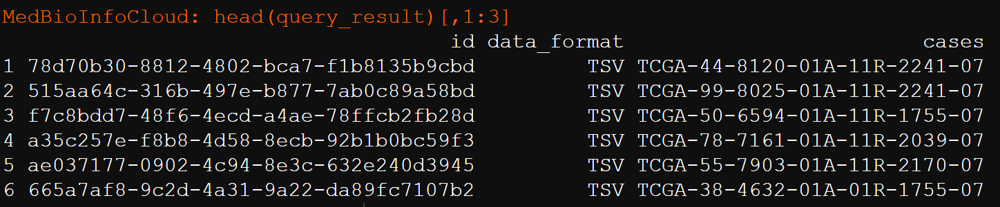

`getResults()`函数就是从这个数据框中取值。

```r
sampCases <- getResults(query,cols=c("cases"))
```

### 3.TCGAquery_SampleTypes()函数

```r
TCGAquery_SampleTypes(barcode, typesample)
```

该函数，就是给`barcode`，区别样本类型，根据GDC数据库对`barcode`编号规则来区别的。

```r
# sampCases中筛选出TP（	PRIMARY SOLID TUMOR）样本的cases
dataSmTP <- TCGAquery_SampleTypes(barcode = sampCases,
                                  typesample = "TP")
# sampCases中筛选出NT(Solid Tissue Normal)样本的cases
dataSmNT <- TCGAquery_SampleTypes(barcode = sampCases,
                                  typesample = "NT")
```

组织样本类型如下：

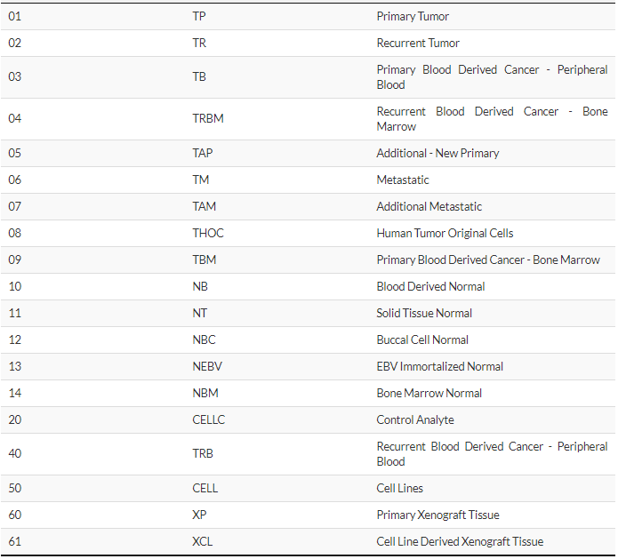

### 4.GDCdownload()函数

有两种方法可以使用`TCGAbiolinks`下载GDC数据。

client：这种方法创建一个MANIFEST文件，并使用GDC数据传输工具下载数据。这种方法更可靠，但它可能比api方法慢。

api：该方法使用GDC API (Application Programming Interface)下载数据。这将创建一个MANIFEST文件，下载的数据将被压缩到tar.gz文件中。如果文件的大小和数量太大，这个tar.gz将太大，这可能有很高的概率下载失败。为了解决这个问题，我们创建了`files.per.chunk`参数，该参数将文件分成小块，例如，如果`files.per.chunk=10`，我们将在每个tar.gz中只下载10个文件。

```r
GDCdownload(
  query,
  token.file,
  method = "api",
  directory = "GDCdata",
  files.per.chunk = NULL
)
```

（1）query

由GDCquery()函数生成的对象。

（2）token.file

用于下载受控数据的令牌文件(仅适用于`method = " client "`)

（3）method

使用API或GDC client工具。选择`"api"`,`"client"`。API更快，但是数据可能会在下载过程中损坏。

（4）directory

下载数据的目录/文件夹。默认值:GDCdata

（5）files.per.chunk

这将使API方法一次只下载n个(`files.per.chunk`)文件。当数据大小太大时，这个参数将设置每个`tar.gz`中只下载的文件个数，每个这可能会减少下载可能出现的问题。

下面是下载前面请求的数据案例

```r
GDCdownload(query = query)
```

下载的转录组数据会在下面路径下，不同类型的数据文件夹命名不一样。

```r
./GDCdata/TCGA-LUAD/harmonized/Transcriptome_Profiling/Gene_Expression_Quantification/
```

### 5.GDCprepare()函数

```r
GDCprepare(
  query,
  save = FALSE,
  save.filename,
  directory = "GDCdata",
  summarizedExperiment = TRUE,
  remove.files.prepared = FALSE,
  add.gistic2.mut = NULL,
  mut.pipeline = "mutect2",
  mutant_variant_classification = c("Frame_Shift_Del", "Frame_Shift_Ins",
    "Missense_Mutation", "Nonsense_Mutation", "Splice_Site", "In_Frame_Del",
    "In_Frame_Ins", "Translation_Start_Site", "Nonstop_Mutation")
)
```

（1）query

由GDCquery()函数生成的对象。

（2）save

保存结果为RData对象?

（3）save.filename

要保存的文件的名称，如果为空，将自动创建。

（4）remove.files.prepared

删除读取的文件?默认值:FALSE仅当save参数设置为true时，该参数才会被考虑。

（5）add.gistic2.mut

If a list of genes (gene symbol) is given, columns with gistic2 results from GDAC firehose (hg19) and a column indicating if there is or not mutation in that gene (hg38) (TRUE or FALSE - use the MAF file for more information) will be added to the sample matrix in the summarized Experiment object.

（6）mut.pipeline

If add.gistic2.mut is not NULL this field will be taken in consideration. Four separate variant calling pipelines are implemented for GDC data harmonization. Options: muse, varscan2, somaticsniper, MuTect2. For more information: <https://gdc-docs.nci.nih.gov/Data/Bioinformatics_Pipelines/DNA_Seq_Variant_Calling_Pipeline/>

（7）mutant_variant_classification

List of mutant_variant_classification that will be consider a sample mutant or not. Default: “Frame_Shift_Del”, “Frame_Shift_Ins”, “Missense_Mutation”, “Nonsense_Mutation”, “Splice_Site”, “In_Frame_Del”, “In_Frame_Ins”, “Translation_Start_Site”, “Nonstop_Mutation”

下面是准备下面下载的数据案例：

```r
expRda <- GDCprepare(query,
                     save = F,
                     summarizedExperiment = T)##
class(expRda)
```

`GDCprepare`函数，处理转录组的数据，得到的就是一个SummarizedExperiment对象。该对象的主体内容如下：

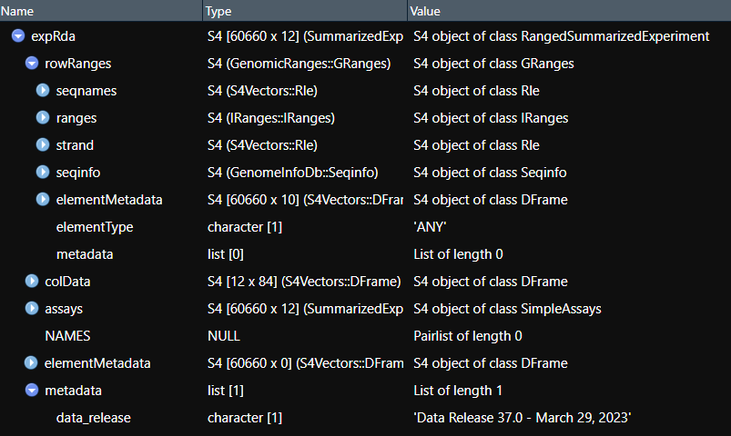

### 6.TCGAanalyze_Preprocessing函数()

TCGAanalyze_Preprocessing执行Array Array Intensity correlation (AAIC)。它定义了一个方对称的样本间spearman相关性矩阵。根据相关样本的矩阵和箱线图，有可能找到低相关的样本，可识别为可能的异常值。

```r
TCGAanalyze_Preprocessing(
  object,
  cor.cut = 0,
  filename = NULL,
  width = 1000,
  height = 1000,
  datatype = names(assays(object))[1]
)
```

（1）object

TCGAprepare函数处理得到的RangedSummarizedExperiment对象

（2）cor.cut

是根据样本之间的spearman相关性对样本进行过滤的阈值，默认 `cor.cut= 0`。

（3）filename	，width，height

图片文件的文件名，默认NULL，width和height指定图片的宽和高

（4）datatype

一个来自RangedSummarizedExperiment assay的字符串。

对于转录组数据，有下面几种：

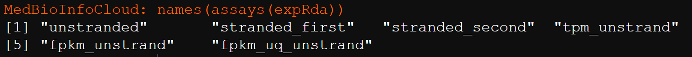

"unstranded"是count数据。比如我们这里提取TPM的数据。

```r
expDataTPM <- TCGAanalyze_Preprocessing(object = expRda,
                                        cor.cut = 0,
                                        datatype = names(assays(expRda))[4])

head(expDataTPM)[,1:2]
```

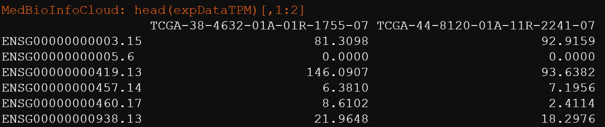

提取count数据：

```r
expDataCounts <- TCGAanalyze_Preprocessing(object = expRda,
                                        cor.cut = 0,
                                        datatype = names(assays(expRda))[1])
```

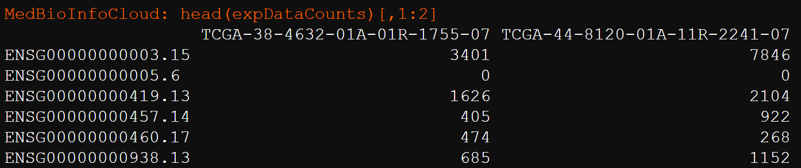

这样得到的就是我们的表达矩阵。就可以用于我们后续的分析啦！

RangedSummarizedExperiment对象的基因名称是ensmbol。需要转换为我们常用的ID名称。

```r
# df <- as.data.frame(rowData(data1))
# identical(rownames(expDataCounts),rownames(df))

rownames(expDataTPM) = rowData(expRda)@listData[["gene_name"]]
rownames(expDataCounts) = rowData(expRda)@listData[["gene_name"]]
```

### 7.TCGAtumor_purity()函数

```r
TCGAtumor_purity(barcodes, estimate, absolute, lump, ihc, cpe)
```

该函数利用5中方法过滤肿瘤纯度，给的值是一个`barcodes`向量。返回值是一个list，有2个值，一个是纯度搞的`barcodes`，一个是被过滤的纯度降低的`barcodes`。也就是说filtered 为被过滤的数据， pure_barcodes是我们要的数据。

```r
# 5种方法过滤肿瘤纯度，这5个值是estimate, absolute, lump, ihc, cpe，这里设置cpe=0.6
purityDATA <- TCGAtumor_purity(colnames(expRda), 0, 0, 0, 0, 0.6)
Purity.barcodes <- purityDATA$pure_barcodes
```

### 8.TCGA_MolecularSubtype()

```r
TCGA_MolecularSubtype(barcodes)
```

```r
MolSub <- TCGA_MolecularSubtype(Purity.barcodes)
```

### 9.GDCquery_clinic下载临床数据

```r
```

## 二.数据下载

### 1.下载临床数据

```r
##方式一
queryClin <- GDCquery(project = "TCGA-LUAD",
                      data.format = "bcr xml",
                      data.category = "Clinical")
GDCdownload(queryClin)

clini_follow_up <- GDCprepare_clinic(queryClin,clinical.info = "follow_up")

```

**clinical.info**：Which information should be retrieved. Options Clinical: drug, admin, follow_up,radiation, patient, stage_event or new_tumor_event Options Biospecimen: protocol, admin, aliquot, analyte, bio_patient, sample, portion, slide.

```r
allInfo_clindata <- GDCquery_clinic("TCGA-LUAD",
                                    type = "clinical",
                                    save.csv = F)
```

### 2.转录组数据下载

```r
library(TCGAbiolinks)
#下载转录组数据
query <- GDCquery(
  project = "TCGA-LUAD",
  data.category = "Transcriptome Profiling",
  data.type = "Gene Expression Quantification",
  workflow.type = "STAR - Counts"
)
GDCdownload(query = query)

expRda <- GDCprepare(query_temp,
                     save = F,
                     summarizedExperiment = T)##
class(expRda)

names(assays(expRda))
expDataTPM <- TCGAanalyze_Preprocessing(object = expRda,
                                        cor.cut = 0,
                                        datatype = names(assays(expRda))[4])

expDataCounts <- TCGAanalyze_Preprocessing(object = expRda,
                                        cor.cut = 0,
                                        datatype = names(assays(expRda))[1])

rownames(expDataTPM) = rowData(expRda)@listData[["gene_name"]]
rownames(expDataCounts) = rowData(expRda)@listData[["gene_name"]]
```

```r
sampCases <- getResults(query,cols=c("cases"))
# sampCases中筛选出TP（	PRIMARY SOLID TUMOR）样本的cases
dataSmTP <- TCGAquery_SampleTypes(barcode = sampCases,
                                  typesample = "TP")
# sampCases中筛选出NT(Solid Tissue Normal)样本的cases
dataSmNT <- TCGAquery_SampleTypes(barcode = sampCases,
                                  typesample = "NT")
```

### 3.下载甲基化数据

```r
#下载甲基化数据
query_COAD_met <- GDCquery(project = "TCGA-COAD",
                      data.category = "DNA Methylation",
                      legacy = FALSE,
                      platform = c("Illumina Human Methylation 450"))

GDCdownload(query_COAD_met)
COAD_met <- GDCprepare(query_COAD_met)
```

> 更新: 2023-08-15 10:23:56
> 原文: <https://www.yuque.com/doublehelix/bioinfonotes/sy7vge>
