# TCGA数据下载与整理

# 一. 转录组数据处理
	前面已经介绍过[miRNA数据下载与整理](http://mp.weixin.qq.com/s?__biz=MzA4NDAzODkzMA==&mid=2651264993&idx=1&sn=8681cbce6c7314b6db27ad465434cf18&chksm=841ef39cb3697a8a1a64403e8a03317fbb19693dc547f674cbb9e0110eb4ba613d2713bf7aae&scene=21#wechat_redirect)，[ATAC-Seq数据的下载整理及其可视化](http://mp.weixin.qq.com/s?__biz=MzA4NDAzODkzMA==&mid=2651265040&idx=2&sn=a617872e041cda6a90a7c7fb270e8a09&chksm=841efc6db369757b41989830a159d1e211a4e6f97290dab7dca7ef0151dcd182b4bbf5938bcb&scene=21#wechat_redirect)，本文介绍**RNA-Seq数据的下载与处理。**尽管我们前面在[**差异分析**](http://mp.weixin.qq.com/s?__biz=MzA4NDAzODkzMA==&mid=2651264898&idx=1&sn=f6287d98fe0b0fb48a96d2905ca0bb4f&chksm=841ef3ffb3697ae9505b6e795a1fe842b2dd32b82f6b5ed4c3e68569c0459bff57319c08e0e2&scene=21#wechat_redirect)**【视频地址：**[https://www.bilibili.com/video/BV117411Z7Cq](https://www.bilibili.com/video/BV117411Z7Cq)**】**这一篇文章中介绍了的**RNA-Seq**数据的处理，但对基因并没有详细的分类，就直接进行差异分析了。那些基因包括编码蛋白的基因，编码lncRNA和其他非编码蛋白的非编码RNA的基因。所以我这里介绍一下，代码也不会像之前那么复杂，移动解压这些步骤完全没有啦。

**下面是视频讲解**

视频地址：[https://www.bilibili.com/video/BV1Az4y1R7gJ/](https://www.bilibili.com/video/BV1Az4y1R7gJ/)

[bilibili](https://player.bilibili.com/player.html?bvid=BV1Az4y1R7gJ)

介绍这个处理方式呢，主要是为了后续的教程，如果自己已经会处理的，可以忽略此文章，但有时候我们要进行特殊分析的时候，我们都是要自己写一些代码的，我的教程会不断深入，当能够自己写代码处理数据后，后期也不需要自己写太多代码，直接用一些R包进行处理，自己写一下代码也有一些好处，特别是对于初学者，巩固了[R语言](http://mp.weixin.qq.com/s?__biz=MzA4NDAzODkzMA==&mid=2651264971&idx=1&sn=3f97d49331809b1799a5d4a5019d94d0&chksm=841ef3b6b3697aa016626af76c3d7e80ceb269864362e1a59f2e927d2276a614d1693e00a1d6&scene=21#wechat_redirect)。自己了解分析过程中的细节，在深入学习一些分析包的时候，出错自己也知道所以然。

```r
rm(list = ls())
options(stringsAsFactors = F)
# 作者：DoubleHelix，微信公众号:MedBioInfoCloud
library(rjson) #没有安装事先安装
library(dplyr) #没有安装事先安装
library(limma) #没有安装事先安装
library(stringr) #没有安装事先安装
###---------------------------数据下载-------------------------#
​
####网页在线下载数据是最新的
​
###---------------------------数据处理-------------------------#
###---1.处理json文件----------------------
jsonFile <- fromJSON(file="./metadata.cart.2020-05-10.json")
filesNameToBarcode <- data.frame(filesName = c(),TCGA_Barcode = c())
for(i in 1:length(jsonFile)){
  TCGA_Barcode <- jsonFile[[i]][["associated_entities"]][[1]][["entity_submitter_id"]]
  file_name <- jsonFile[[i]][["file_name"]]
  filesNameToBarcode <- rbind(filesNameToBarcode,data.frame(filesName = file_name,TCGA_Barcode = TCGA_Barcode))
}
rownames(filesNameToBarcode) <- filesNameToBarcode[,1]
​
###-----2.读入转录组数据-----------
filepath <- dir(path ="./data",pattern=".gz$",full.names = TRUE,recursive = T)
exp <- data.frame()
for(wd in filepath){
  read.table(wd,header = F,sep = "\t")
  #每一个循环读取一个文件
  oneSampExp <- read.table(wd,header =FALSE)
  tempPath <- unlist(strsplit(wd,"/"))
  filename <- tempPath[length(tempPath)]
  print(paste0("微信公众号:MedBioInfoCloud提示:正在读入文件:",filename,""))
  # 根据filesNameToBarcode文件中文件名称与barcode对应关系，命名列名
  colnames(oneSampExp) <- c("Ensembl",filesNameToBarcode[filename,"TCGA_Barcode"])
  if (dim(exp)[1]== 0){
    exp <- oneSampExp
  }
  else 
  {exp <- merge(exp,oneSampExp,by = "Ensembl")}
}
exp$Ensembl <- substr(exp[,"Ensembl"],1,15)
​
###-------3.处理gtf文件(用于基因注释文件)
# 一个函数，通过gtf文件获取Ensemble_ID与基因名称的对应关系
#gtf文件下载地址：https://www.gencodegenes.org/ 微信公众号:MedBioInfoCloud
get_map = function(input) {
  if (is.character(input)) {
    if(!file.exists(input)) stop("Bad input file.")
    message("Treat input as file")
    input = data.table::fread(input, header = FALSE)
  } else {
    data.table::setDT(input)
  }
  input = input[input[[3]] == "gene", ]
  pattern_id = ".*gene_id \"([^;]+)\";.*"
  pattern_name = ".*gene_name \"([^;]+)\";.*"
  pattern_type = ".*gene_type \"([^;]+)\";.*"
  gene_id = sub(pattern_id, "\\1", input[[9]])
  gene_name = sub(pattern_name, "\\1", input[[9]])
  gene_type = sub(pattern_type, "\\1", input[[9]])
  EnsemblTOGenename <- data.frame(Ensembl = gene_id,
                                  gene_name = gene_name,
                                  gene_type = gene_type,
                                  stringsAsFactors = FALSE)
  return(EnsemblTOGenename)
}
EnsemblTOGenename <- get_map(".\\human.v33lift37.annotation.gtf") 
EnsemblTOGenename$Ensembl <- substr(EnsemblTOGenename[,"Ensembl"],1,15)
​
protein_coding <- EnsemblTOGenename[EnsemblTOGenename$gene_type == "protein_coding",]
lncRNA <- EnsemblTOGenename[EnsemblTOGenename$gene_type  == "lncRNA",]
ncRNA <- EnsemblTOGenename[grep("RNA$",EnsemblTOGenename$gene_type),]
​
#-------3.融合数据
allGenesExp <- merge(protein_coding,exp,by="Ensembl")#包括假基因在内,后续不处理
pcExp <- merge(protein_coding,exp,by="Ensembl") #编码蛋白的表达数据
lncRNAExp <- merge(lncRNA,exp,by="Ensembl")#lncRNA的表达数据
ncRNAExp <- merge(ncRNA,exp,by="Ensembl")#所有非编码RNA的表达数据
​
​
#-------4.处理表达数据
DLExpData <- function(Exp){ #处理表达数据的函数，返回一个列表
  Exp <- as.matrix(Exp)
  rownames(Exp) <- Exp[,"gene_name"]
  Exp <- Exp[,-c(1:3)] %>%  avereps() %>% as.data.frame()
  TumorBarcode <-c()
  NormalBarcode <-c()
  for (id in colnames(Exp)) {
    ids <- str_split(id,'-',simplify = T)[4]
    ids <- as.numeric(substr(ids,1,1))
    
    if(ids == 0){
      TumorBarcode <- c(TumorBarcode,id)
    }else if (ids == 1) {
      NormalBarcode <-c(NormalBarcode,id)
    }
  }
  sampleNum <- data.frame(NormalNum = length(NormalBarcode),
                          TumorNum = length(TumorBarcode))
  sampleList <- data.frame(ID = c(NormalBarcode,TumorBarcode),
                           Type = c(rep("Normal",length(NormalBarcode)),
                           rep("Tumor",length(TumorBarcode))))
  return(list(Exp = Exp[,c(NormalBarcode,TumorBarcode)],
              BarcodeSort = c(NormalBarcode,TumorBarcode),
              TumorBarcode = TumorBarcode,
              NormalBarcode = NormalBarcode,
              sampleNum = sampleNum ,sampleList = sampleList,
              note = "The column order in Exp is normal sample first,tumor sample last"))
}
​
#-------4.1.处理编码蛋白的表达数据
pcExpdata <- DLExpData(Exp = pcExp)
save(pcExpdata,file = "pcExpdata.Rdata")
​
#-------4.2.处理lncRNA的表达数据
lncRNAExpData <- DLExpData(Exp = lncRNAExp)
save(lncRNAExpData,file = "lncRNAExpData.Rdata")
#-------4.3.处理所有非编码RNA的表达数据
ncRNAExpData  <- DLExpData(Exp = ncRNAExp)
save(ncRNAExpData,file = "ncRNAExpData.Rdata")
```

下载代码：


提取码：szkw，如果码失效，后台回复：**<font style="color:#FF2941;">TCGA-RNA-Seq</font>**

gtf文件网盘下载链接：[https://pan.baidu.com/s/1jdz5bsSshArSowsbxIlL0g](https://pan.baidu.com/s/1jdz5bsSshArSowsbxIlL0g) 提取码：xpcg ，建议从官网下载：[https://www.gencodegenes.org/human/](https://www.gencodegenes.org/human/)

---

**<font style="color:#F5222D;">下面是使用TCGAbiolinks包进行批量下载</font>**

```r
options(stringsAsFactors = F)
library(TCGAbiolinks)
library(SummarizedExperiment)
library(dplyr)
library(stringr)
#下载转录组数据
#
ifelse(dir.exists("processedTCGAdata"),print("文件夹已存在"),dir.create("processedTCGAdata"))
project <- getGDCprojects()$project_id
project <- project[grep("TCGA-",project)]

####----------------------------------下载转录组数据---------------------
###---------1.HTSeq - Counts
for(proj in project){
  message(paste0("=====================",proj," Starting====================="))
  query <- GDCquery(project = proj,
                    data.category = "Transcriptome Profiling",
                    data.type = "Gene Expression Quantification",
                    workflow.type = "HTSeq - Counts")

  GDCdownload(query = query,files.per.chunk=10)
  expRdaCounts <- GDCprepare(query,save = TRUE,
                             #修改路径
                             save.filename = paste0("K:/database.data/GDCdata/RNASeq_Counts/",proj,"_RNASeq_Counts.rda"),
                             summarizedExperiment = TRUE)##保存的数据对象加载后名称为data

  expDataCounts <- TCGAanalyze_Preprocessing(object = expRdaCounts,
                                             cor.cut = 0.2,
                                             datatype = "HTSeq - Counts")
  rownames(expDataCounts)<-rowData(expRdaCounts)$external_gene_name#library(SummarizedExperiment)
  save(expDataCounts,file = paste0("processedTCGAdata/TCGA-RNASeq-Count/",proj,"_RNASeq_Counts.RData"))
  message(paste0("=====================",proj," Finish====================="))
}

###---------2.HTSeq - FPKM
FPKM2TPM <- function(fpkm){##将FPKM的数据转换成TPM的函数
  exp(log(fpkm) - log(sum(fpkm)) + log(1e6))
}

for(proj in project){##循环下载HTSeq - FPKM的数据，并装换成TPM
  message(paste0("=====================",proj," Starting====================="))
  query <- GDCquery(project = proj,
                    data.category = "Transcriptome Profiling",
                    data.type = "Gene Expression Quantification",
                    workflow.type = "HTSeq - FPKM")

  GDCdownload(query = query,files.per.chunk=6)
  expRdaFPKM <- GDCprepare(query,save = TRUE,
                           save.filename = paste0("K:/database.data/GDCdata/RNASeq_FPKM/",proj,"_RNASeq_FPKM.rda"),
                           summarizedExperiment = TRUE)

  expDataFPKM <- TCGAanalyze_Preprocessing(object = expRdaFPKM,
                                           cor.cut = 0.2,
                                           datatype = "HTSeq - FPKM")
  rownames(expDataFPKM)<-rowData(expRdaFPKM)$external_gene_name#library(SummarizedExperiment)
  expDataTPM <- apply(expDataFPKM,2,FUN = FPKM2TPM <- function(fpkm){
    exp(log(fpkm) - log(sum(fpkm)) + log(1e6))
  })
  save(expDataTPM,file = paste0("processedTCGAdata/TCGA-RNASeq-TPM/",proj,"_RNASeq_TPM.RData"))
  save(expDataFPKM,file = paste0("processedTCGAdata/TCGA-RNASeq-FPKM/",proj,"_RNASeq_FPKM.RData"))
  message(paste0("=====================",proj," Finish====================="))
}

```

# 二. miRNA的数据下载与整理
本部分内容来自下面文章;

[1] [TCGA数据库：miRNA数据下载与整理](http://mp.weixin.qq.com/s?__biz=MzA4NDAzODkzMA==&mid=2651264993&idx=1&sn=8681cbce6c7314b6db27ad465434cf18&chksm=841ef39cb3697a8a1a64403e8a03317fbb19693dc547f674cbb9e0110eb4ba613d2713bf7aae&scene=21#wechat_redirect)

[2] [TCGA数据库：miRNA数据下载与整理(2)](https://mp.weixin.qq.com/s/-FH0Vi4PaCjhPbEq4-lxbg)

[3] [TCGA数据库：miRNA的数据下载与整理【视频】](https://mp.weixin.qq.com/s/axoGSe7k5BnGcZW5ok8IdQ)

TCGA官网：[<u>https://portal.gdc.cancer.gov/</u>](https://portal.gdc.cancer.gov/)

关于miRNA的基础知识可参考文章：[生物学基础知识:非编码RNA](https://www.yuque.com/docs/share/701482fb-252b-4ce5-8490-1d6c952814fc?# 《非编码RNA》)。

关于下载的方式很多，也可以参考[差异分析的视频](http://mp.weixin.qq.com/s?__biz=MzA4NDAzODkzMA==&mid=2651264898&idx=1&sn=f6287d98fe0b0fb48a96d2905ca0bb4f&chksm=841ef3ffb3697ae9505b6e795a1fe842b2dd32b82f6b5ed4c3e68569c0459bff57319c08e0e2&scene=21#wechat_redirect)，特别是R包([R语言课程](http://mp.weixin.qq.com/s?__biz=MzA4NDAzODkzMA==&mid=2651264971&idx=1&sn=3f97d49331809b1799a5d4a5019d94d0&chksm=841ef3b6b3697aa016626af76c3d7e80ceb269864362e1a59f2e927d2276a614d1693e00a1d6&scene=21#wechat_redirect)），后续会不段深入介绍，不过这里，我们介绍网页在线下载后自己处理数据。

网页筛选条件，Flies栏按下图筛选：

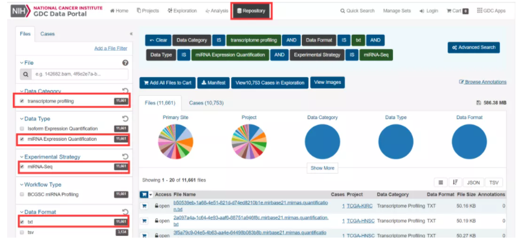

切换到case栏，选择我们要分析的肿瘤，这里下载TCGA-COAD的数据。

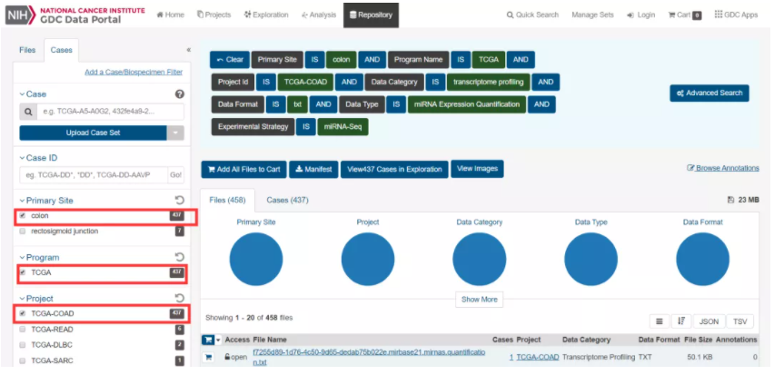

其他的信息，比如疾病类型，性别等根据自己需要选择。

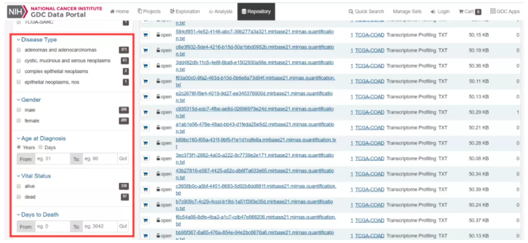

筛选数据后，添加到cart。

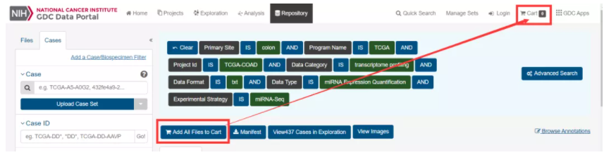

Downloadcart文件，和metadata文件(json格式），json文件用于找到文件名与barcode之间的对于关系。

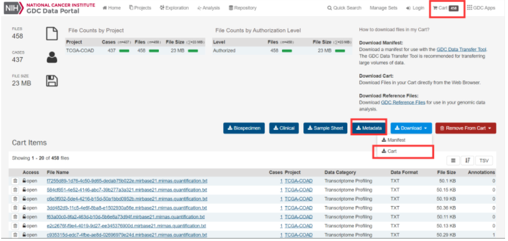

下载后的2个文件：


我们解压压缩包后，就可以是很多文件夹：

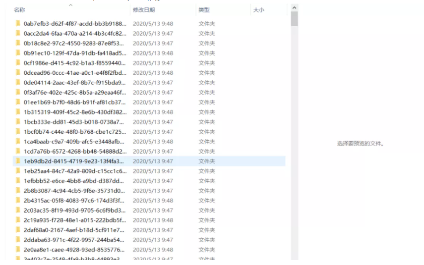

每一个文件夹中的txt文件就是一个病人的数据。

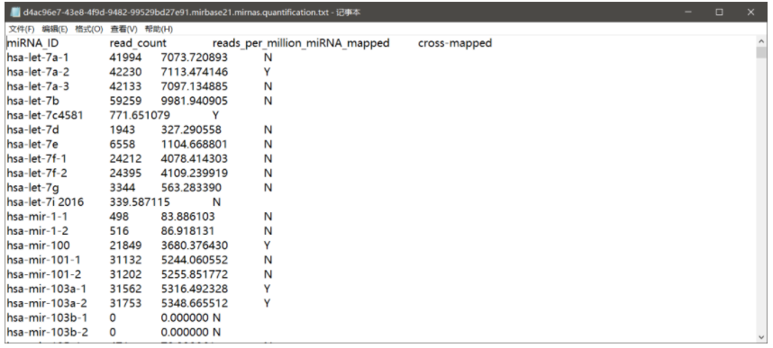

miRNA_ID：miRBase v21数据库中收录的miRNA名称

read_count：miRNA原始reads数，用于表达定量；

reads_per_million_miRNA_mapped：每百万reads中来自于该miRNA的reads数，简称RPM；具体可参考文章：[RNA-seq的counts,RPM, RPKM, FPK值到底有什么区别？](http://mp.weixin.qq.com/s?__biz=MzA4NDAzODkzMA==&mid=2651264575&idx=2&sn=69b45012dbfe61d7574446de00ec9a7b&chksm=841ef242b3697b54484a64f82bba4372a8fb2b4d411b1c1fc2bc68d12aa44756f96c3b8e48f5&scene=21#wechat_redirect)

cross-mapped：miRNA是否比对到多个位置；

miRNA表达数据下载就算完成了！

重要的是，数据的整理，我们需要整理成下面这样的数据。

Counts数据。

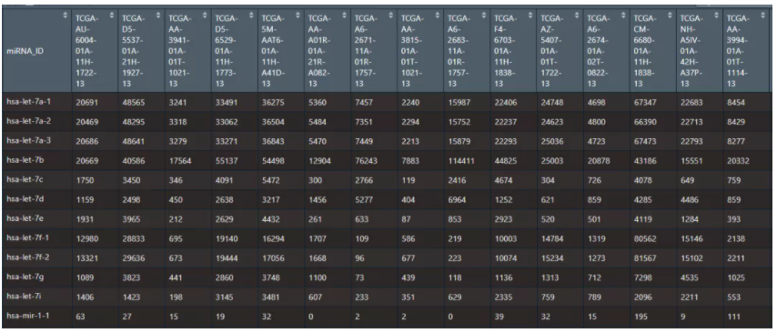

RPM数据

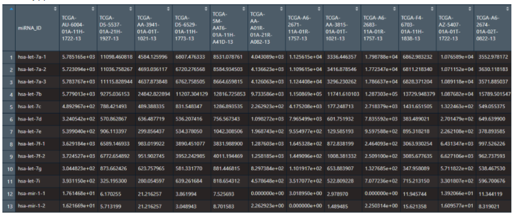

然后我们就可以进行后续的分析了，比如：

差异分析：[一文就会TCGA数据库基因表达差异分析](http://mp.weixin.qq.com/s?__biz=MzA4NDAzODkzMA==&mid=2651264898&idx=1&sn=f6287d98fe0b0fb48a96d2905ca0bb4f&chksm=841ef3ffb3697ae9505b6e795a1fe842b2dd32b82f6b5ed4c3e68569c0459bff57319c08e0e2&scene=21#wechat_redirect)。

与临床数据结合的分析：[一个R脚本解决某类功能基因(比如m6A甲基化)临床预后模型分析流程](http://mp.weixin.qq.com/s?__biz=MzA4NDAzODkzMA==&mid=2651264561&idx=1&sn=9803278a0720ef02119f91841df44b70&chksm=841ef24cb3697b5ac4c1760012b0a48739a888130cc4c53e0909ff29a137f2c9c434b870ac58&scene=21#wechat_redirect).等。

此外，TCGA数据库中处理直接下载的miRNA-Seq之外，Gene Expression Quantification里面的RNA-Seq数据中也有非编码RNA的数据，比如lncRNA等。**<font style="color:#FF2941;">这里介绍miRNA数据的处理。具体的数据处理代码如下。</font>**

```r
rm(list = ls())
options(stringsAsFactors = F)
# 作者：DoubleHelix，微信公众号:MedBioInfoCloud
library(rjson) #没有安装事先安装
library(dplyr) #没有安装事先安装
library(limma) #没有安装事先安装
library(stringr) #没有安装事先安装
###---------------------------数据下载-------------------------#

####网页在线下载数据是最新的

###---------------------------数据处理-------------------------#
###---1.处理json文件----------------------
jsonFile <- fromJSON(file="./metadata.cart.2020-05-13.json")#下载的json文件地址
filesNameToBarcode <- data.frame(filesName = c(),TCGA_Barcode = c())
for(i in 1:length(jsonFile)){
  TCGA_Barcode <- jsonFile[[i]][["associated_entities"]][[1]][["entity_submitter_id"]]
  file_name <- jsonFile[[i]][["file_name"]]
  filesNameToBarcode <- rbind(filesNameToBarcode,data.frame(filesName = file_name,TCGA_Barcode = TCGA_Barcode))
}
rownames(filesNameToBarcode) <- filesNameToBarcode[,1]

###-----2.读入miRNA数据-----------
#注意解压后的文件地址。
filepath <- dir(path ="./COAD-miRNAData",pattern=".mirnas.quantification.txt$",full.names = TRUE,recursive = T)
counts <- data.frame()
rpm <- data.frame()
for(wd in filepath){
  read.table(wd,header = F,sep = "\t")
  #每一个循环读取一个文件
  oneSampExp <- read.table(wd,header = T)
  tempPath <- unlist(strsplit(wd,"/"))
  filename <- tempPath[length(tempPath)]
  print(paste0("微信公众号:MedBioInfoCloud提示:正在读入文件:",filename,""))
  # 根据filesNameToBarcode文件中文件名称与barcode对应关系，命名列名
  oneSampcounts <- oneSampExp[,1:2]
  oneSampRPM <- oneSampExp[,c(1,3)]
  colnames(oneSampcounts) <- c("miRNA_ID",filesNameToBarcode[filename,"TCGA_Barcode"])
  colnames(oneSampRPM) <- c("miRNA_ID",filesNameToBarcode[filename,"TCGA_Barcode"])
  if (dim(counts)[1]== 0){
    counts <- oneSampcounts
    rpm <- oneSampRPM
  }
  else {
    counts <- merge(counts,oneSampcounts,by = "miRNA_ID")
    rpm <- merge(rpm,oneSampRPM,by = "miRNA_ID")
  }
}
#-------处理表达数据
DLExpData <- function(Exp){ #一个函数，处理表达数据的函数，返回一个列表
  Exp <- as.matrix(Exp)
  rownames(Exp) <- Exp[,"miRNA_ID"]
  Exp <- Exp[,-1] %>%  avereps() %>% as.data.frame()
  TumorBarcode <-c()
  NormalBarcode <-c()
  for (id in colnames(Exp)) {
    ids <- str_split(id,'-',simplify = T)[4]
    ids <- as.numeric(substr(ids,1,1))
    
    if(ids == 0){
      TumorBarcode <- c(TumorBarcode,id)
    }else if (ids == 1) {
      NormalBarcode <-c(NormalBarcode,id)
    }#代码很繁琐，其实有更简单的方法。
  }
  sampleNum <- data.frame(NormalNum = length(NormalBarcode),
                          TumorNum = length(TumorBarcode))
  sampleList <- data.frame(ID = c(NormalBarcode,TumorBarcode),
                           Type = c(rep("Normal",length(NormalBarcode)),
                           rep("Tumor",length(TumorBarcode))))
  return(list(Exp = Exp[,c(NormalBarcode,TumorBarcode)],
              BarcodeSort = c(NormalBarcode,TumorBarcode),
              TumorBarcode = TumorBarcode,
              NormalBarcode = NormalBarcode,
              sampleNum = sampleNum ,sampleList = sampleList,
              note = "The column order in Exp is normal sample first,tumor sample last"))
}
#-------处理表达数据
miRNACountsExpdata <- DLExpData(Exp = counts)
miRNA_RPM_Expdata <- DLExpData(Exp = rpm)
miRNAdata <- list(miRNACountsExpdata = miRNACountsExpdata,
                  miRNA_RPM_Expdata = miRNA_RPM_Expdata)
save(miRNAdata,file = "miRNAdata.Rdata")
```

<font style="color:#F5222D;">后台回复：TCGA-miRNA-d 获取上面代码</font>

我前面介绍TCGA数据库中miRNA数据的下载与整理的文章【[TCGA数据库：miRNA数据下载与整理](http://mp.weixin.qq.com/s?__biz=MzA4NDAzODkzMA==&mid=2651264993&idx=1&sn=8681cbce6c7314b6db27ad465434cf18&chksm=841ef39cb3697a8a1a64403e8a03317fbb19693dc547f674cbb9e0110eb4ba613d2713bf7aae&scene=21#wechat_redirect)】，在这篇文章中，我们下载的数据是miRNA Expression Quantification数据。

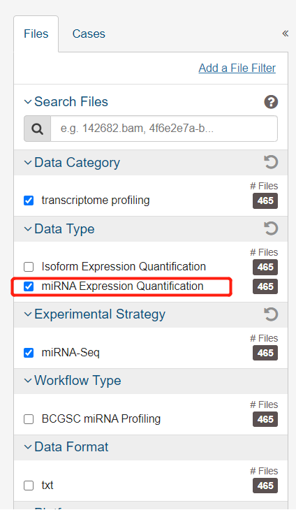

我整理得到的数据结果是这样的。

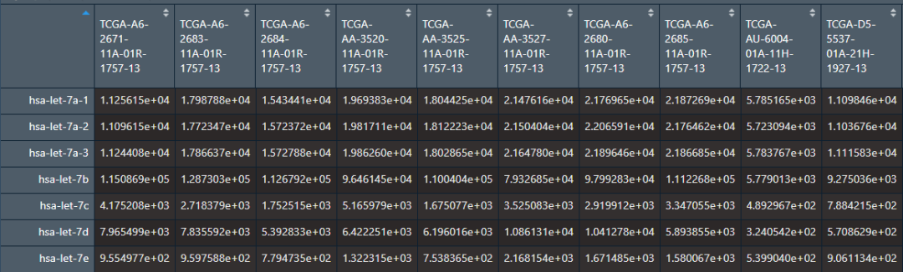

这里我们可以发现，miRNA的前体可能对应多个成熟的miRNA，比如hsa-let-7a-1，有两个对应的成熟体，MIMAT0000062(hsa-let-7a-5p)和MIMAT0004481(hsa-let-7a-3p)。这里的值是对所有成熟体miRNA求和的结果。

如果我们想要得到成熟体miRNA的数据，我们需要下载Isoform Expression Quantification的数据。

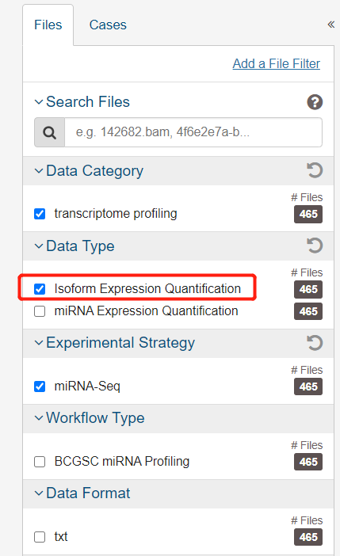

下载后的数据处理方式和前面文章差不多。下载后的数据，我们打开单个文件看一下，比miRNA Expression Quantification数据多了2列。在miRNA_region列中就有是否成熟的信息。我们可以参考前面的文章【[miRNA注释包:miRBaseVersions.db](http://mp.weixin.qq.com/s?__biz=MzA4NDAzODkzMA==&mid=2651275464&idx=1&sn=ec20ca96dcaf40f7380253fa038bb696&chksm=841ea4b5b3692da363095e21fbd2daa962af0568fe8f13ca46b6aff632c0facc85b1634bbbf6&scene=21#wechat_redirect)】进行转换为我们常用的名称，比如：hsa-let-7a-5p。

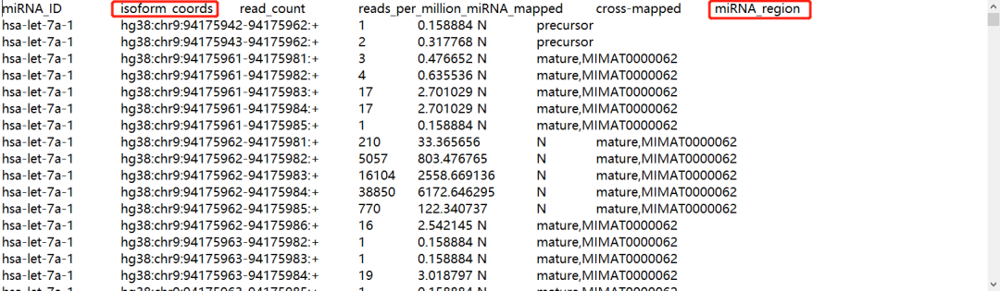

下面我们来看一下，这些数据的差异。

加载一些需要用到的R包

```plain
rm(list = ls())
options(stringsAsFactors = F)
# 作者：DoubleHelix，微信公众号:MedBioInfoCloud
library(rjson) #没有安装事先安装
library(dplyr) #没有安装事先安装
library(tidyr)
library(limma) #没有安装事先安装
library(stringr) #没有安装事先安装
library(miRBaseVersions.db)
```

处理一下json文件。

```plain
###---1.处理json文件----------------------
jsonFile <- fromJSON(file="./metadata.cart.2021-03-10.json")
filesNameToBarcode <- data.frame(filesName = c(),TCGA_Barcode = c())
for(i in 1:length(jsonFile)){
  TCGA_Barcode <- jsonFile[[i]][["associated_entities"]][[1]][["entity_submitter_id"]]
  file_name <- jsonFile[[i]][["file_name"]]
  filesNameToBarcode <- rbind(filesNameToBarcode,data.frame(filesName = file_name,TCGA_Barcode = TCGA_Barcode))
}
rownames(filesNameToBarcode) <- filesNameToBarcode[,1]
```

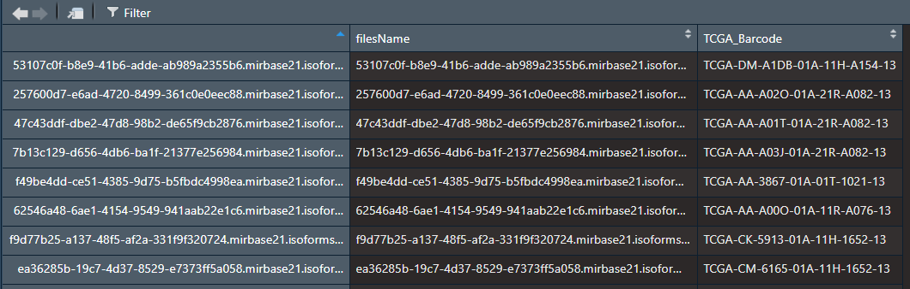

这个和前文【[TCGA数据库：miRNA数据下载与整理](http://mp.weixin.qq.com/s?__biz=MzA4NDAzODkzMA==&mid=2651264993&idx=1&sn=8681cbce6c7314b6db27ad465434cf18&chksm=841ef39cb3697a8a1a64403e8a03317fbb19693dc547f674cbb9e0110eb4ba613d2713bf7aae&scene=21#wechat_redirect)】中一样的。

这里读入其中一个文件：

```plain
filepath <- dir(path ="./raw",pattern=".isoforms.quantification.txt$",full.names = TRUE,recursive = T)
oneSampExp <- read.table(filepath[1],header = T,check.names = F)
```

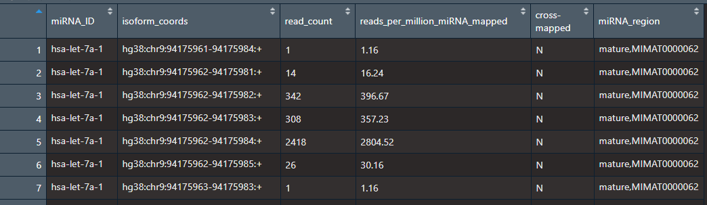

选择我们需要的列，并重新命名。

```plain
oneSampExp <- oneSampExp[grep("mature",oneSampExp$miRNA_region),]
oneSampExp <- separate(oneSampExp,into=c("State","ACCESSION"),col="miRNA_region",sep=",")
oneSampExp <- oneSampExp[c("miRNA_ID","ACCESSION","read_count","reads_per_million_miRNA_mapped")]
colnames(oneSampExp)<- c("miRNA_ID","ACCESSION","count","RPM")
```

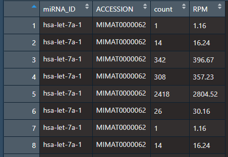

在众多前体下，这里获得536个成熟体。据我自己所知，目前已知的miRNA成熟体应该有2000多，这里一个样本只检测到500多，是因为不是所有miRNA在一个样本中都能检测到，你把所有的样本加起来统计大概也就2000多个。

```plain
acc <- oneSampExp$ACCESSION
acc <- acc[!duplicated(acc)]
length(acc)
```

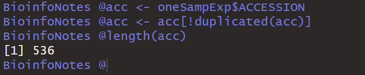

我们可以通过miRBaseVersions.db包进行转换。

```plain
ano <- select(miRBaseVersions.db, 
                 keys = acc, 
                 keytype = "VW-MIMAT-22.0", 
                 columns = c("ACCESSION","NAME"))
head(ano)
```

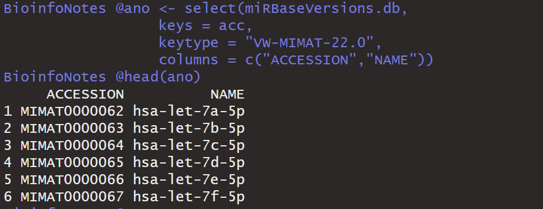

与前面的数据融合。

```plain
data <- merge(ano,oneSampExp,by= "ACCESSION")
head(data)
```

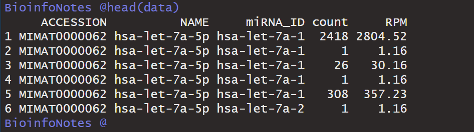

我们只提取hsa-let-7a-1的RPM数据。求和是3670。

```plain
temp <- data[data$miRNA_ID=="hsa-let-7a-1",]
sum(temp$RPM)
```

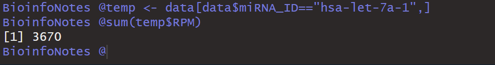

这里只是一个病人的数据，该病人的ID是：TCGA-AA-3531-01A-01T-0822-13

```plain
tempPath <- unlist(strsplit(filepath[1],"/"))
filename <- tempPath[length(tempPath)]
filesNameToBarcode[filename,2]
```

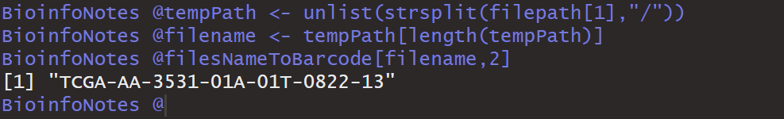

利用这个ID，我们加载前面通过文章【[TCGA数据库：miRNA数据下载与整理](http://mp.weixin.qq.com/s?__biz=MzA4NDAzODkzMA==&mid=2651264993&idx=1&sn=8681cbce6c7314b6db27ad465434cf18&chksm=841ef39cb3697a8a1a64403e8a03317fbb19693dc547f674cbb9e0110eb4ba613d2713bf7aae&scene=21#wechat_redirect)】得到的数据。提取该病人的RPM数据。当然，个别miRNA可能会有点出入，值没多大区别。

```plain
load("miRNAdata.Rdata")
rpm <- miRNAdata[["miRNA_RPM_Expdata"]][["Exp"]]
rpm["hsa-let-7a-1",filesNameToBarcode[filename,2]]%>%as.numeric()
```

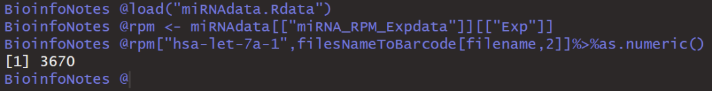

这里的值就是一样的。也就是说，我们通过miRNA Expression Quantification数据得到的是miRNA前体的数据。一个miRNA前体可能有多个成熟体，一个成熟体可能来自多个前体。

当然，还有其他处理方式，比如利用TCGAbiolinks包，关于TCGAbiolinks包我在很久前的一篇文章【[TCGA数据挖掘（一）：TCGAbiolinks包介绍](http://mp.weixin.qq.com/s?__biz=MzA4NDAzODkzMA==&mid=2651263886&idx=1&sn=1c433a1b2144328a52c0d2d8af5c35ff&chksm=841ef7f3b3697ee5a7190693b0786633e618f7dc29612f3bd014d0be33bc4f92edb6a9d248cf&scene=21#wechat_redirect)】中有介绍，同时，也有差异分析的教程【[TCGAbiolinks包下载TCGA数据进行表达差异分析-乳腺癌案例](http://mp.weixin.qq.com/s?__biz=MzA4NDAzODkzMA==&mid=2651263344&idx=1&sn=add608d265600768d3f25ee30dc4365a&chksm=841ef50db3697c1b1752d19a2a875aed07c9c19b388a8f1b4da4f05e938de0ef9487fb868f09&scene=21#wechat_redirect)】，但是现在这个包下载数据是真的感人，完全看GDC的心情，而且下载很慢，所以我是自己下载数据处理，我也发了自己下载提取数据进行差异分析的文章【[一文就会TCGA数据库基因表达差异分析](http://mp.weixin.qq.com/s?__biz=MzA4NDAzODkzMA==&mid=2651264898&idx=1&sn=f6287d98fe0b0fb48a96d2905ca0bb4f&chksm=841ef3ffb3697ae9505b6e795a1fe842b2dd32b82f6b5ed4c3e68569c0459bff57319c08e0e2&scene=21#wechat_redirect)】，当然还有GDCRNATools包【[TCGA数据库：GDCRNATools包下载数据、处理数据以及差异分析](http://mp.weixin.qq.com/s?__biz=MzA4NDAzODkzMA==&mid=2651265127&idx=2&sn=8c866e064995e6feb251a5db00282fd2&chksm=841efc1ab369750c01bd1794b30a7f5d3a6033df518f7f5a10cb12b5c2a6b6a8c280b304e345&scene=21#wechat_redirect)】。这个包下载数据的时候有时候也会挂，开VPN有时候可以解决。但我们可以自己下载数据后用该包的函数提取数据。如果你想偷懒，那么你可以在一些数据库中直接下载，比如：GDAC Firehose数据库，以及UCSC数据库【[UCSC数据库下载TCGA数据需要注意的细节](http://mp.weixin.qq.com/s?__biz=MzA4NDAzODkzMA==&mid=2651273247&idx=1&sn=008928dbfc6c6976d53369cd20c26f87&chksm=841edc62b3695574739a6db6af267b279808c9ea82e9947a461da2e3bf02a8db215204cf65e9&scene=21#wechat_redirect)】，但从UCSC下载的数据和我们前面处理的一样，是miRNA Expression Quantification的数据，而不是Isoform Expression Quantification。当然还是TCGAbiolinks包好用。

最后说明，上面我只是读入一个样本的数据来进行讲解，你可以写一个循环，把所有文件遍历读入，处理合并就行，和前文【[TCGA数据库：miRNA数据下载与整理](http://mp.weixin.qq.com/s?__biz=MzA4NDAzODkzMA==&mid=2651264993&idx=1&sn=8681cbce6c7314b6db27ad465434cf18&chksm=841ef39cb3697a8a1a64403e8a03317fbb19693dc547f674cbb9e0110eb4ba613d2713bf7aae&scene=21#wechat_redirect)】介绍的差不多，那样我们会得到如下这样的数据。

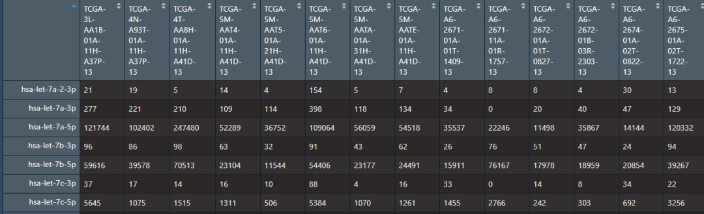

```bash
rm(list = ls())
options(stringsAsFactors = F)
# 作者：DoubleHelix，微信公众号:MedBioInfoCloud
library(rjson) #没有安装事先安装
library(dplyr) #没有安装事先安装
library(tidyr)
library(limma) #没有安装事先安装
library(stringr) #没有安装事先安装
library(miRBaseVersions.db)
library(GDCRNATools)
###---------------------------数据下载-------------------------#

####网页在线下载数据是最新的

###---------------------------数据处理-------------------------#
###---1.处理json文件----------------------
jsonFile <- fromJSON(file="./metadata.cart.2021-03-10.json")
filesNameToBarcode <- data.frame(filesName = c(),TCGA_Barcode = c())
for(i in 1:length(jsonFile)){
  TCGA_Barcode <- jsonFile[[i]][["associated_entities"]][[1]][["entity_submitter_id"]]
  file_name <- jsonFile[[i]][["file_name"]]
  filesNameToBarcode <- rbind(filesNameToBarcode,data.frame(filesName = file_name,TCGA_Barcode = TCGA_Barcode))
}
rownames(filesNameToBarcode) <- filesNameToBarcode[,1]

###-----2.读入miRNA数据-----------
##注意文件路径
filepath <- dir(path ="./raw",pattern=".isoforms.quantification.txt$",full.names = TRUE,recursive = T)

mirdata <- data.frame()
wd=filepath[1]
for(wd in filepath){
  #每一个循环读取一个文件
  tempPath <- unlist(strsplit(wd,"/"))
  filename <- tempPath[length(tempPath)]
  barcode <- filesNameToBarcode[filename,2]
  oneSampExp <- read.table(wd,header = T,check.names = F)
  oneSampExp <- oneSampExp[grep("mature",oneSampExp$miRNA_region),]
  oneSampExp <- separate(oneSampExp,into=c("State","ACCESSION"),col="miRNA_region",sep=",")
  oneSampExp <- oneSampExp[c("miRNA_ID","ACCESSION","read_count","reads_per_million_miRNA_mapped")]
  colnames(oneSampExp)<- c("miRNA_ID","ACCESSION","count","RPM")
  
  acc <- oneSampExp$ACCESSION
  acc <- acc[!duplicated(acc)]
  ano <- select(miRBaseVersions.db, 
                keys = acc, 
                keytype = "VW-MIMAT-21.0", 
                columns = c("ACCESSION","NAME"))
  mdata <- merge(ano,oneSampExp,by= "ACCESSION")
  ##对同一成熟的miRNA的count数求和
  mcount <- mdata %>%
    group_by(NAME) %>%
    summarize(count= sum(count))
  ##对同一成熟的miRNA的RPM数求和
  mRPM <- mdata %>%
    group_by(NAME) %>%
    summarize(RPM= sum(RPM))
  data <- merge(mcount,mRPM,by = "NAME")
  data$barcode <- barcode
  mirdata <- rbind(data,mirdata)
}

mirnames <- mirdata$NAME
length(mirnames[!duplicated(mirnames)])
colnames(mirdata)
mirCount <- mirdata[,c("NAME","count","barcode")]
##不表达的数据用0填充
mirCount <- spread(mirCount,barcode,count,fill =0)
rownames(mirCount) <- mirCount$NAME
mirCount <- mirCount[,-1]

mirRPM <- mirdata[,c("NAME","RPM","barcode")]
mirRPM <- spread(mirRPM,barcode,RPM,fill =0)
rownames(mirRPM) <- mirRPM$NAME
mirRPM <- mirRPM[,-1]

load("TCGA-COAD_miRNAs_data_DEA.Rdata")
gdc <- miRNAsData[["rawCounts"]]
gdc["hsa-let-7a-5p","TCGA-3L-AA1B-01"]
mirCount["hsa-let-7a-5p",grep("TCGA-3L-AA1B-01",colnames(mirCount))]


#-------处理表达数据
############一个函数，一个Barcode向量，区分正常组织和肿瘤组织的barcode
getSampleInfo <- function(Barcode){
  TumorBarcode <- Barcode[grep("-0[1-9][A-F]-",Barcode)]
  NormalBarcode <- Barcode[-grep("-0[1-9][A-F]-",Barcode)]
  sampleNum <- data.frame(NormalBarcode = length(NormalBarcode),TumorBarcode = length(TumorBarcode))
  sampleList <- data.frame(ID = c(NormalBarcode,TumorBarcode),Type = c(rep("Normal",length(NormalBarcode)),
                                                                       rep("Tumor",length(TumorBarcode))))
  return(list(BarcodeSort = c(NormalBarcode,TumorBarcode),
              sampleNum = sampleNum ,sampleList = sampleList,
              TumorBarcode=TumorBarcode,NormalBarcode=NormalBarcode))
}
samplesInfo <- getSampleInfo(colnames(mirCount))
mirRPM <- mirRPM[,samplesInfo[["BarcodeSort"]]]##正常样本在前
mirCount <- mirCount[,samplesInfo[["BarcodeSort"]]]
save(mirRPM,mirCount,samplesInfo,file = "TCGA-COAD-miR.Rdata")


###GDCRNATools包有可能会挂

##区分正常组织还是肿瘤组织，可以借助相关包，但有时候这些包就是连不上GDC。
##GDCRNATools包中的gdcParseMetadata函数可以获取样本的信息。有时候可行，
#但gdcRNADownload函数下载数据，之前很好用的，现在没法下载。
#要不然这是一个分析RNASeq数据比较好用的包
metaMatrix.MIR <- gdcParseMetadata(project.id = "TCGA-COAD",
                                   data.type = "miRNAs", 
                                   write.meta = FALSE)
### 过滤RNAseq元数据中的重复样本
metaMatrix.MIR <- gdcFilterDuplicate(metaMatrix.MIR)
##得到的数据中sample_type列就是样本是原发位肿瘤还是正常组织的信息。
head(metaMatrix.MIR$sample_type)
##entity_submitter_id列就是完整的barcode，你可以根据这个对应关系区分
head(metaMatrix.MIR$entity_submitter_id) 
##取共同的barcode
barcode <- intersect(colnames(mirCount),metaMatrix.MIR$entity_submitter_id)
length(colnames(mirCount))##
dim(metaMatrix.MIR)
##列名顺序与metaMatrix.MIR行顺序一样
countExp <- mirCount[,barcode]
RPMExp <- mirRPM[,barcode]
metaMatrix.MIR <- metaMatrix.MIR[match(barcode,metaMatrix.MIR$entity_submitter_id),]
head(metaMatrix.MIR$entity_submitter_id) 
head(colnames(mirCount))
save(countExp,RPMExp,metaMatrix.MIR,file = "TCGA-COAD-miR-GDCRNATools.Rdata")
```

# 三. 临床数据的下载与整理
关于TCGA的数据下载与整理，我之前已经发布了：[TCGA数据库：miRNA数据下载与整理](http://mp.weixin.qq.com/s?__biz=MzA4NDAzODkzMA==&mid=2651264993&idx=1&sn=8681cbce6c7314b6db27ad465434cf18&chksm=841ef39cb3697a8a1a64403e8a03317fbb19693dc547f674cbb9e0110eb4ba613d2713bf7aae&scene=21#wechat_redirect)[、ATAC-Seq数据的下载整理及其可视化](http://mp.weixin.qq.com/s?__biz=MzA4NDAzODkzMA==&mid=2651265040&idx=2&sn=a617872e041cda6a90a7c7fb270e8a09&chksm=841efc6db369757b41989830a159d1e211a4e6f97290dab7dca7ef0151dcd182b4bbf5938bcb&scene=21#wechat_redirect)、[、RNA-Seq数据的下载与处理](http://mp.weixin.qq.com/s?__biz=MzA4NDAzODkzMA==&mid=2651265067&idx=1&sn=39c75f795ad560540e2309569a68c718&chksm=841efc56b3697540fc2443869d615ea48acd5e7c11f6ed5f910963bcb0dda613bdb69ef0da72&scene=21#wechat_redirect)，这里我介绍临床数据的下载与整理。本文是在之前的文章：[一文解决TCGA数据库临床数据下载与整理](http://mp.weixin.qq.com/s?__biz=MzA4NDAzODkzMA==&mid=2651264504&idx=1&sn=634bd925786a3193977342634b03acc3&chksm=841ef185b369789346bfbfbc315b9976bd14b9e25ed365c26522469e1ee102212c4b005bfb86&scene=21#wechat_redirect)的基础上在进一步处理，得到我们可以结合其他数据的进行分析的结果，**<font style="color:#FF2941;">我的计划是，先把所有的数据下载整理介绍结束后，再进行后续的分析教程，因为很多分析都是很类似的，也没有必要单独的又弄一次，所以近期的文章都是数据的下载与处理。如果自己看代码就能看的懂，就参考文章：</font>**[**<font style="color:#FF2941;">一个R脚本解决某类功能基因(比如m6A甲基化)临床预后模型分析流程</font>**](http://mp.weixin.qq.com/s?__biz=MzA4NDAzODkzMA==&mid=2651264561&idx=1&sn=9803278a0720ef02119f91841df44b70&chksm=841ef24cb3697b5ac4c1760012b0a48739a888130cc4c53e0909ff29a137f2c9c434b870ac58&scene=21#wechat_redirect)**<font style="color:#FF2941;">和</font>**[**<font style="color:#FF2941;">肿瘤免疫细胞浸润与临床相关性分析</font>**](http://mp.weixin.qq.com/s?__biz=MzA4NDAzODkzMA==&mid=2651264605&idx=1&sn=4c00f321b50a7a74d2842ed7cf097f7e&chksm=841ef220b3697b36b15486349d609b47dc2dbe21410a9cbad9071b15a6b4d40f671c62a2dcc4&scene=21#wechat_redirect)**<font style="color:#FF2941;">，这也是我目前提供的分析的代码。但好像没有讲解，很多人是不懂的，特别是连R语言都不熟悉的同学，所以自己掂量一下，不行就一步一步走吧，希望我这个菜鸟也能教给别人一些目前网上找不到的基础教程。</font>**

[bilibili](https://player.bilibili.com/player.html?bvid=BV12p4y1D7cQ)

[bilibili](https://player.bilibili.com/player.html?bvid=BV17Z4y1H75y)

```r
rm(list = ls())
options(stringsAsFactors = F)
setwd("F:/TCGAcourse/01-dataDownload/ClinData")#注意你的路径
####### Info of the Project ########
project <- 'TCGA-COAD'
clinicaldir <- "./data/Clindata"
####### --------------------下载临床数据-------------- #######
###--------方式一：网页下载，忽略
###--------方式二：GDCRNATools包下载
library(GDCRNATools)#没安装自己安装
gdcClinicalDownload(project.id = project, 
                    write.manifest = FALSE,
                    method = 'gdc-client',
                    directory = clinicaldir)
####-----------------------xml格式的临床数据整理----------------
###-------方式一
library(XML)
library(methods)
xmlFileNames<-dir(path = clinicaldir,full.names = T,
                  pattern="xml$",recursive = T) #list.files()函数也行
AllPatiCliniList <- lapply(xmlFileNames,
                           function(x){#x=xmlFileNames[1]
                             result <- xmlParse(file = x) 
                             rootnode <- xmlRoot(result)  
                             xmldataframe <- xmlToDataFrame(rootnode[2]) 
                             return(t(xmldataframe))})
AllPatiCliniList  <- t(do.call(cbind,AllPatiCliniList))
pClinData <- data.frame(Barcode = AllPatiCliniList[,"bcr_patient_barcode"],
                        Vital_status = AllPatiCliniList[,"vital_status"],
                        days_to_death = AllPatiCliniList[,"days_to_death"],
                        days_to_last_known_alive = AllPatiCliniList[,"days_to_last_known_alive"],
                        lastFollowupTime = AllPatiCliniList[,"days_to_last_followup"],
                        Stage = AllPatiCliniList[,"stage_event"])
rownames(pClinData ) <- pClinData [,"Barcode"]
splitStage <- function(Stage){###用来切割"stage_event"列的数据
  stage <- unlist(strsplit(Stage,split = "[S]"))[2]
  stage <- unlist(strsplit(stage, split = "T"))[1]
  stage <- paste("S",stage,sep = "")
  Tstage <- unlist(strsplit(Stage,split = "[T]"))[2]
  Tstage <- unlist(strsplit(Tstage, split = "N"))[1]
  Tstage <- paste("T",Tstage,sep = "")
  Nstage <- unlist(strsplit(Stage,split = "[N]"))[2]
  Nstage <- unlist(strsplit(Nstage, split = "M"))[1]
  Nstage <- paste("N",Nstage,sep = "")
  Mstage <- unlist(strsplit(Stage,split = "[M]"))[2]
  Mstage <- paste("M",Mstage,sep = "")
  return(data.frame(stage,Tstage,Nstage,Mstage))
}

SurvivalTime <-c()
Stage <-c()
T_Stage <-c()
N_Stage <-c()
M_Stage <-c()
for(id in rownames(pClinData)){
  days_to_death = as.numeric(pClinData[id,"days_to_death"])
  lastFollowupTime = as.numeric(pClinData[id,"lastFollowupTime"])
  PatientsSurvivalTime <- c()
  if(!is.na(days_to_death) ){
    PatientsSurvivalTime <- c(days_to_death)
  }else {PatientsSurvivalTime <- c(lastFollowupTime) }
  SurvivalTime <- c(SurvivalTime,PatientsSurvivalTime)
  TNMStage <- splitStage(Stage = pClinData[id,"Stage"])
  Stage <-c(Stage,TNMStage[1,"stage"])
  T_Stage <- c(T_Stage,TNMStage[1,"Tstage"])
  N_Stage <- c(N_Stage,TNMStage[1,"Nstage"]) 
  M_Stage <- c(M_Stage,TNMStage[1,"Mstage"])
}

getClinicalData <- function(pClinData){
  tempdata <-pClinData
  finallypClinData <-data.frame(Barcode = tempdata[,"Barcode"],
                                                    Vital_status = tempdata[,"Vital_status"],
                                                    SurvivalTime = SurvivalTime,
                                                    AllStage = tempdata[,"Stage"],
                                                    Stage = Stage,
                                                    T_Stage = T_Stage,
                                                    N_Stage = N_Stage,
                                                    M_Stage = M_Stage)
  return(finallypClinData)
}
tidypClinData <-getClinicalData(pClinData)
###方式二：
clinicalData <- gdcClinicalMerge(path = clinicaldir, key.info = TRUE)
####方式三
tsvClinData <- read.table("./data/TCGA-COAD-clinical.tsv", header = T,sep="\t")

clin3 <- tsvClinData[,c("submitter_id","vital_status","days_to_last_follow_up",
                 "ajcc_pathologic_m","ajcc_pathologic_n",
                 "ajcc_pathologic_stage","ajcc_pathologic_t")]
colnames(clin3) <- c("sample","vitalStatus","follow","M","N","Stage","T")

clin3 <- clin3[clin3$M != "--",]
clin3 <- clin3[clin3$N != "--",]
clin3 <- clin3[clin3$T != "--",]
clin3 <- clin3[clin3$Stage != "--",]
clin3 <- clin3[clin3$follow != "--",]

clin3$M <- gsub(pattern = "[a-d]","",clin3$M)
clin3$N <- gsub(pattern = "[a-d]","",clin3$N)
clin3$Stage <- gsub(pattern = "[A-D]","",clin3$Stage)
clin3$T <- gsub(pattern = "[a-d]","",clin3$T)

clin4 <- clin3
clin4$vitalStatus <- clin4$vitalStatus <- ifelse(clin4$vitalStatus == "Alive",0,1)
```

# 四.SNP的数据下载与整理
## 1.背景知识
单核苷酸多态性主要是指在基因组水平上由单个核苷酸的变异所引起的DNA序列多态性。它是人类可遗传的变异中最常见的一种，占所有已知多态性的90%以上。SNP在人类基因组中广泛存在，平均每300个碱基对中就有1个，估计其总数可达300万个甚至更多。SNP是一种二态的标记，由单个碱基的转换或颠换所引起，也可由碱基的插入或缺失所致。SNP既可能在基因序列内，也可能在基因以外的非编码序列上。

SNP所表现的多态性只涉及到单个碱基的变异，这种变异可由单个碱基的转换(transition)或颠换(transversion)所引起，也可由碱基的插入或缺失所致。但通常所说的SNP并不包括后两种情况。

理论上讲，SNP既可能是二等位多态性，也可能是3个或4个等位多态性，但实际上，后两者非常少见，几乎可以忽略。因此，通常所说的SNP都是二等位多态性的。这种变异可能是转换(C←→T，在其互补链上则为G←→A)，也可能是颠换(C←→A，G←→T，C←→G，A←→T)。转换的发生率总是明显高于其它几种变异，具有转换型变异的SNP约占2/3，其它几种变异的发生几率相似。Wang等的研究也证明了这一点。转换的几率之所以高，可能是因为CpG二核苷酸上的胞嘧啶残基是人类基因组中最易发生突变的位点，其中大多数是甲基化的，可自发地脱去氨基而形成胸腺嘧啶。

在基因组DNA中，任何碱基均有可能发生变异，因此SNP既有可能在基因序列内，也有可能在基因以外的非编码序列上。总的来说，位于编码区内的SNP(coding SNP,cSNP)比较少，因为在外显子内，其变异率仅及周围序列的1/5。但它在遗传性疾病研究中却具有重要意义，因此cSNP的研究更受关注。

从对生物的遗传性状的影响上来看，cSNP又可分为2种：一种是同义cSNP(synonymous cSNP),即SNP所致的编码序列的改变并不影响其所翻译的蛋白质的氨基酸序列，突变碱基与未突变碱基的含义相同；另一种是非同义cSNP(non-synonymous cSNP),指碱基序列的改变可使以其为蓝本翻译的蛋白质序列发生改变，从而影响了蛋白质的功能。这种改变常是导致生物性状改变的直接原因。cSNP中约有一半为非同义cSNP。

先形成的SNP在人群中常有更高的频率，后形成的SNP所占的比率较低。各地各民族人群中特定SNP并非一定都存在，其所占比率也不尽相同，但大约有85%应是共通的。****

## 2.数据下载
这里下载方式采用网页筛选下载的方法，具体和之前的文章筛选条件一样。

[TCGA数据库：miRNA数据下载与整理](http://mp.weixin.qq.com/s?__biz=MzA4NDAzODkzMA==&mid=2651264993&idx=1&sn=8681cbce6c7314b6db27ad465434cf18&chksm=841ef39cb3697a8a1a64403e8a03317fbb19693dc547f674cbb9e0110eb4ba613d2713bf7aae&scene=21#wechat_redirect)****

[TCGA数据库：ATAC-Seq数据的下载整理及其可视化](http://mp.weixin.qq.com/s?__biz=MzA4NDAzODkzMA==&mid=2651265040&idx=2&sn=a617872e041cda6a90a7c7fb270e8a09&chksm=841efc6db369757b41989830a159d1e211a4e6f97290dab7dca7ef0151dcd182b4bbf5938bcb&scene=21#wechat_redirect)

[TCGA数据库：RNA-Seq数据的下载与处理](http://mp.weixin.qq.com/s?__biz=MzA4NDAzODkzMA==&mid=2651265067&idx=1&sn=39c75f795ad560540e2309569a68c718&chksm=841efc56b3697540fc2443869d615ea48acd5e7c11f6ed5f910963bcb0dda613bdb69ef0da72&scene=21#wechat_redirect)

[TCGA数据库：临床数据下载与整理](http://mp.weixin.qq.com/s?__biz=MzA4NDAzODkzMA==&mid=2651265078&idx=1&sn=1d6e6365a19762d18005380d56dc623b&chksm=841efc4bb369755d0cf25ac9f4cbde3fbec5bb6141eab39c0920eb560cf04273bcbd0c6f9375&scene=21#wechat_redirect)

不过，这里需要说明的是SNP的数据类型只能下载Masked Somatic Mutation，其他数据类型需要申请。所以我们这里下载的是Masked Somatic Mutation 的数据。

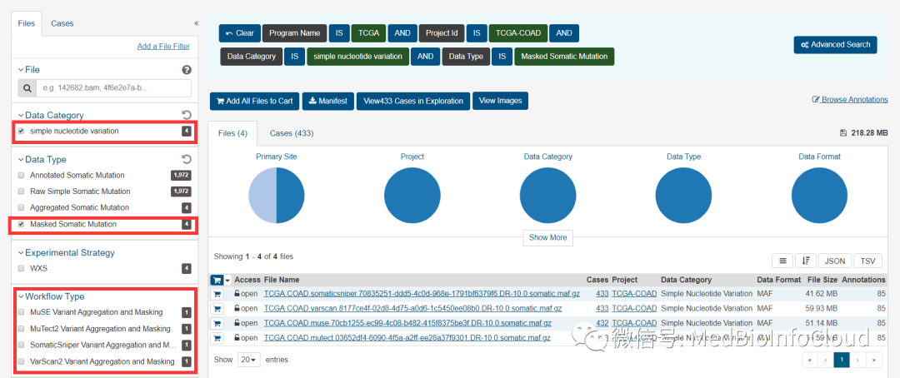

此外，在Workflow Type里面存在四个选项，MuSE Variant Aggregation and Masking，MuTect2 Variant Aggregation and Masking，SomaticSniper Variant Aggregation and Masking，VarScan2 Variant Aggregation and Masking，分别代表用四个软件计算出来的SNP的信息，四个软件分别采用四个不同的流程来处理数据计算得出的SNP信息，我们可以选择一种进行下载，比如我们选择VarScan2 Variant Aggregation and Masking，也可以下载所有的数据。

不过下载数据的时候，我们同时也要下载TSV格式的临床数据。因为整理SNP的数据需要结合临床数据一起整理。


关于临床数据的下载，参考文章：[TCGA数据库：临床数据下载与整理](http://mp.weixin.qq.com/s?__biz=MzA4NDAzODkzMA==&mid=2651265078&idx=1&sn=1d6e6365a19762d18005380d56dc623b&chksm=841efc4bb369755d0cf25ac9f4cbde3fbec5bb6141eab39c0920eb560cf04273bcbd0c6f9375&scene=21#wechat_redirect)。

下载后的数据解压会得到4个文件夹，也就是上面提到的4个软件分析的数据。我们选择其中一个(VarScan2 Variant Aggregation and Masking)进行讲解。

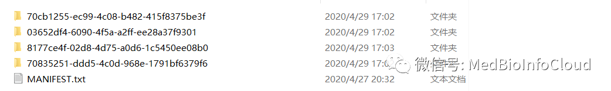

## 3.数据的整理
**（1）.设置工作路径**

我们下载的数据是个压缩文件，解压后是maf的格式文件。所以注意文件的输入与输出路径。

```plain
rm(list = ls())
options(stringsAsFactors = F)
setwd("F:\\TCGAcourse\\01-dataDownload\\SNP")
```

**（2）****.读入临床数据**

选择其中一部分进行演示，更多处理参考：[TCGA数据库：临床数据下载与整理](http://mp.weixin.qq.com/s?__biz=MzA4NDAzODkzMA==&mid=2651265078&idx=1&sn=1d6e6365a19762d18005380d56dc623b&chksm=841efc4bb369755d0cf25ac9f4cbde3fbec5bb6141eab39c0920eb560cf04273bcbd0c6f9375&scene=21#wechat_redirect)，也要注意临床数据的路径。

```plain
# 处理临床数据
clin = read.table(".\\COAD\\clinical.cart\\clinical.tsv",header = T,sep = "\t")
clin1 <- clin[,c("case_id","submitter_id","vital_status","days_to_last_follow_up",
                 "ajcc_pathologic_m","ajcc_pathologic_n",
                 "ajcc_pathologic_stage","ajcc_pathologic_t")]
colnames(clin1) = c("case_id","Tumor_Sample_Barcode","vital_status","days_to_last_follow_up",
                    "ajcc_pathologic_m","ajcc_pathologic_n",
                    "ajcc_pathologic_stage","ajcc_pathologic_t")
clin1 <- clin1[clin1$days_to_last_follow_up!= "--",]
clin1$days_to_last_follow_up <- as.numeric(clin1$days_to_last_follow_up)
clin1 <- clin1[clin1$vital_status!= "--",]
clin1$vital_status <- ifelse(clin1$vital_status== "Alive",0,1)
```

**（3）****.读入数据**

读入数据我们需要maftools包中的read.maf函数。<font style="background-color:rgba(0, 0, 0, 0.03);">clinicalDa</font><font style="background-color:rgba(0, 0, 0, 0.03);">ta</font>就是上一步读入的临床数据

```plain
library(maftools)
laml = read.maf(maf = ".\\COAD\\TCGA.COAD.varscan.somatic.maf",
                clinicalData = clin1,
                isTCGA = TRUE)
```

读入的数据是一个列表类型的数据。

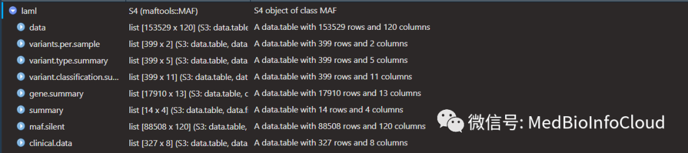

我们可以提取SNP中病人对应的临床数据：

```plain
clindata = laml@clinical.data ###提取SNP中对应病人的临床数据
```

可以通过plotmafSummary函数查看整体统计摘要。

```plain
plotmafSummary(laml, rmOutlier = TRUE, dashboard = TRUE,
               titvRaw = TRUE, addStat = NULL, showBarcodes = FALSE, fs = 0.8,
               textSize = 0.8, color = NULL, titleSize = c(0.8, 0.6),
               titvColor = NULL, top = 10)
```

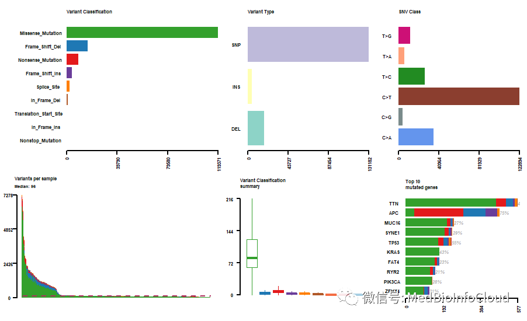

也可以提取特定基因的突变信息：

```plain
# 提取肿瘤样本中特定基因的SNP统计数据
tp53 = genesToBarcodes(laml, genes = "TP53")[[1]]
```

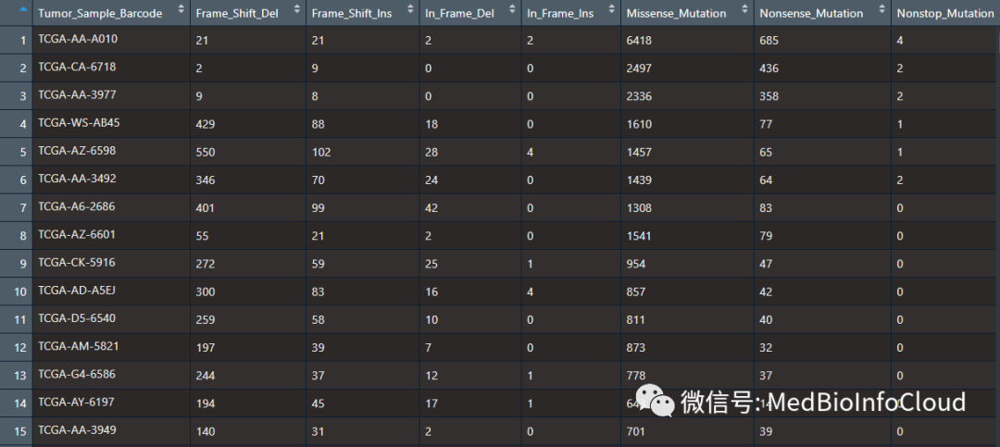

下面这些函数，运行一下就知道是什么意思啦。

```plain
#使用等位基因频率或按突变状态创建基因型矩阵。
KRAS = genotypeMatrix(maf = laml, genes = "KRAS")
# 从MAF对象中提取注释,其实就是Barcode
Clin = getClinicalData(laml)
#其实就是lama对象中data的列名
colNM = getFields(laml)
##
mafCompare(laml,laml)
###总结基因和样本，不考虑改变的类型。
mafs <- mafSummary(laml)
#基因突变数据摘要
lamaGene = getGeneSummary(laml)
#样本突变数据摘要
lamaSample = getSampleSummary(laml)
```

可能重要的是我们需要提取数据

```plain
tidydata <- snpdata[,c("Hugo_Symbol","Variant_Type",
                       "Variant_Classification","Tumor_Sample_Barcode")]
```

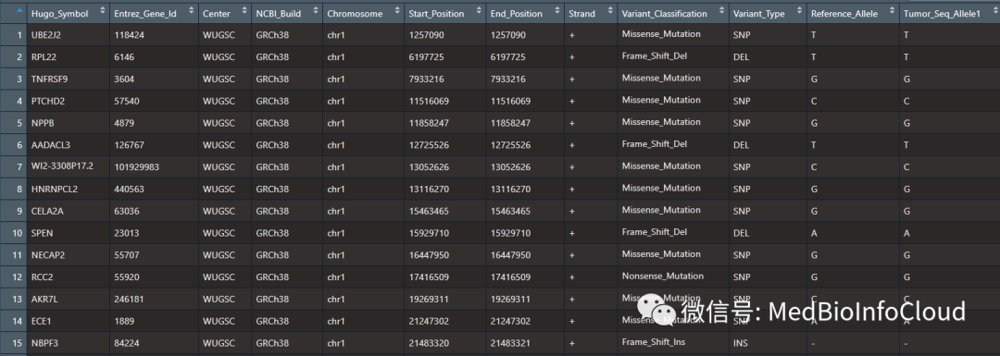

关于列名，看名称就能看的懂，Variant_Type这一列就突变类型。

**4.数据整理**

我们只提取下面4列

```plain
tidydata <- snpdata[,c("Hugo_Symbol","Variant_Type",
                       "Variant_Classification","Tumor_Sample_Barcode")]
```

删除无义突变，因为这个没有意义。

```plain
#删除无义突变
tidydata <- tidydata[which(tidydata$Variant_Type != "Nonsense_Mutation"),
                     c("Hugo_Symbol","Variant_Type","Tumor_Sample_Barcode")]
```

然后我们利用reshape2包对数据进行重塑。0代表野生型，其他数字代表有突变，1表示该基因在该病人中有1个突变，2代表有2个突变。

```plain
library(reshape2)
rsdata = dcast(tidydata, Hugo_Symbol~Tumor_Sample_Barcode)
rownames(rsdata) <- rsdata$Hugo_Symbol
rsdata <- rsdata[,-1] #0代表野生型，其他数字代表有突变
```

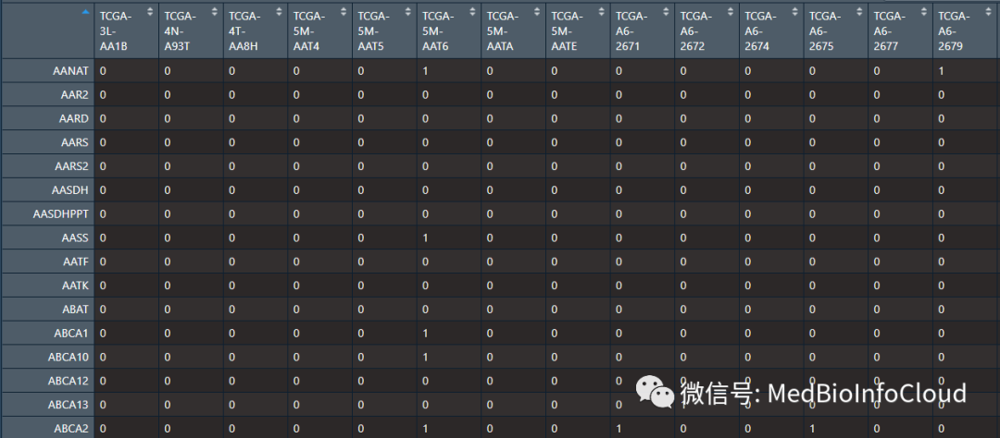

得到这样的数据后，我们就可以进行后续的分析，比如结合[临床数据](http://mp.weixin.qq.com/s?__biz=MzA4NDAzODkzMA==&mid=2651265078&idx=1&sn=1d6e6365a19762d18005380d56dc623b&chksm=841efc4bb369755d0cf25ac9f4cbde3fbec5bb6141eab39c0920eb560cf04273bcbd0c6f9375&scene=21#wechat_redirect)的分析。也可以结合[RNA-Seq](http://mp.weixin.qq.com/s?__biz=MzA4NDAzODkzMA==&mid=2651265067&idx=1&sn=39c75f795ad560540e2309569a68c718&chksm=841efc56b3697540fc2443869d615ea48acd5e7c11f6ed5f910963bcb0dda613bdb69ef0da72&scene=21#wechat_redirect)进行分析等。后续再慢慢介绍吧。

---

**<font style="color:#FF2941;">付费提示：</font>**下面仅仅是上文的代码的下载链接，感觉有用的话付费就当打赏啦！代码不是万能的，不会R先学习R语言：[生物专业学生0基础入门R语言语法视频教程](http://mp.weixin.qq.com/s?__biz=MzA4NDAzODkzMA==&mid=2651264971&idx=1&sn=3f97d49331809b1799a5d4a5019d94d0&chksm=841ef3b6b3697aa016626af76c3d7e80ceb269864362e1a59f2e927d2276a614d1693e00a1d6&scene=21#wechat_redirect)

---


提取码：cyre

如果码失效，后台回复：<font style="color:#FF2941;">DL-SNP</font>

# <font style="color:#000000;">五.</font><font style="color:#000000;">ATAC-Seq数据的下载整理</font><font style="color:#FF2941;"></font>
## 1. 背景知识
每一条染色单体由单个线性DNA分子组成。细胞核中的DNA是经过高度有序的包装，否则就是一团乱麻，不利于DNA复制和表达调控。这种有序的状态才能保证基因组的复制和表达调控能准确和高效进行。

包装分为多个水平，核小体核心颗粒(nucleosome core particle)、染色小体(chromatosome)、 30 nm水平染色质纤丝(30 nm fibre)和高于30 nm水平的染色体包装。在细胞周期的不同时期，DNA的浓缩程度不同，间期表现为染色质具有转录活性，而中期染色体是转录惰性。细胞主要处于分裂间期，所以DNA大部分时间都是染色质而不是染色体，只不过大家喜欢用染色体泛指染色质和染色体。

很久之前大家喜欢研究中期的染色体，原因是光学显微镜只能看的到这种高度浓缩状态的DNA结构。不过中期染色体在转录上是惰性的，没有研究间期染色体的意义大。后来技术发展了，大家就开始通过荧光蛋白标记技术以及显微镜技术研究间期染色质的三维结构和动态。比如说，间期染色体其实并非随机地弥漫在细胞核中，不同的染色体占据相对独立的空间，染色体在细胞核所占的空间称之为染色体领地(chromosome territory, CT)。研究发现，贫基因(gene-porr)的染色体领域一般倾向于靠近核膜，而富含基因(gene-rich)的染色体领地通常位于细胞核内部。这也反应了人类社会的情况，富人处于核心区，穷人在边缘地带。

除了染色体细胞核内的三维结构外，还需要谈谈和转录调控相关的染色质的核小体。用内切核糖酶--微球菌核酸酶(micrococcal nuclease, MNase, MN酶)处理染色质可以得到单个核小体。核小体是染色质的基本结构，由DNA、蛋白质和RNA组成的一种致密结构。组蛋白是由2个H3-H4二聚体，2个H2A-H2B二聚体形成的八聚体，直径约为10 nm， 组蛋白八聚体和DNA结合在一起形成的核心颗粒包含146bp DNA。DNA暴露在核小体表面使得其能被特定的核酸酶接近并切割。

染色质结构改变会发生在与转录起始相关或与DNA的某种结构特征相关的特定位点。当染色质用DNA酶I(DNase)消化时，第一个效果就是在双链体中特定的超敏位点(hypersenitive site)引入缺口，这种敏感性可以反应染色质中DNA的可及性(accessible)，也就是说这些是染色质中DNA由于未组装成通常核小体结构而特别暴露出的结构。

许多超敏位点与基因表达有关。每个活性基因在启动子区域都存在一个超敏位点。大部分超敏位点仅存在于相关基因正在被表达的或正在准备表达的细胞染色中；基因表达不活跃时他们则不出现。

ATAC-seq (Assay for Transposase-Accessible Chromatin withhigh throughput sequencing)是由斯坦福大学William J.Greenleaf和Howard Y. Chang实验室开发的用于研究染色质开放性(可及性)的方法，原理是通过Tn5转座酶切割暴露的DNA并同时连接上特异性的adapters，然后连接上adapters的DNA片段被分离出来用于二代测序。

真核生物的核DNA与组蛋白结合形成染色体的基本结构单位核小体，核小体再经逐步的压缩折叠最终形成染色体高级结构。DNA的复制，或基因的转录都需要将DNA的紧密结构打开，从而允许一些调控因子结合(转录因子或其他调控因子)。这部分打开的染色质， 就叫开放染色质，打开的染色质允许其他调控因子(启动子、增强子、绝缘子、沉默子等)结合的特性称为染色质的可及性。

MNase：能切割出单个核小体, DNase能识别超敏位点，ATAC-Seq所需要的Tn5 transposase

文献：Transposition of native chromatin for fast and sensitive epigenomic profiling of open chromatin, DNDNA-binding proteins and nucleosome position.

<font style="color:#0052FF;">背景知识，来自网络资料总结。</font>

## 2.数据下载
数据下载地址：

[<u>https://gdc.cancer.gov/about-data/publications/ATACseq-AWG</u>](https://gdc.cancer.gov/about-data/publications/ATACseq-AWG)

我们从TCGA官网下载ATAC-seq数据，下载界面如下。我们可以选择红色部分，可以下载raw count，也可以下载normalize count。下载了数据的话，我们就可以得到每个肿瘤的ATAC数据矩阵。原始数据下载比较麻烦，需要申请，而且分析也比较麻烦，需要Linux系统，我们这里下载标准化后的数据，同时，也要下载Lookup table for various TCGA sample identifiers文件，这个用于样本名称的转换。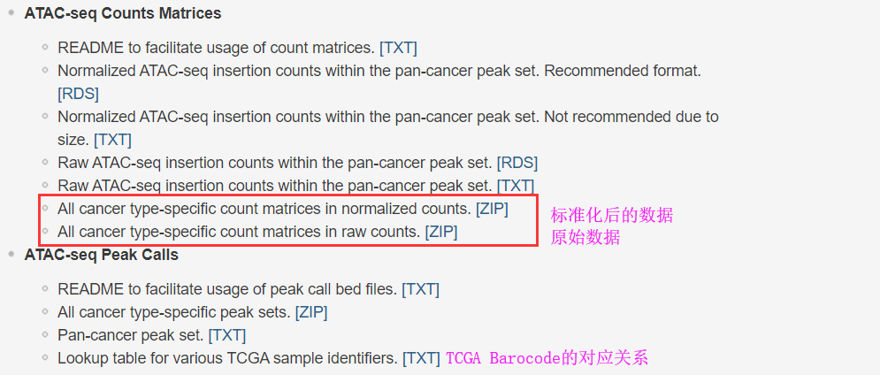

下载后的数据压缩包解压后，就可以得到各种癌症ATAC的数据。

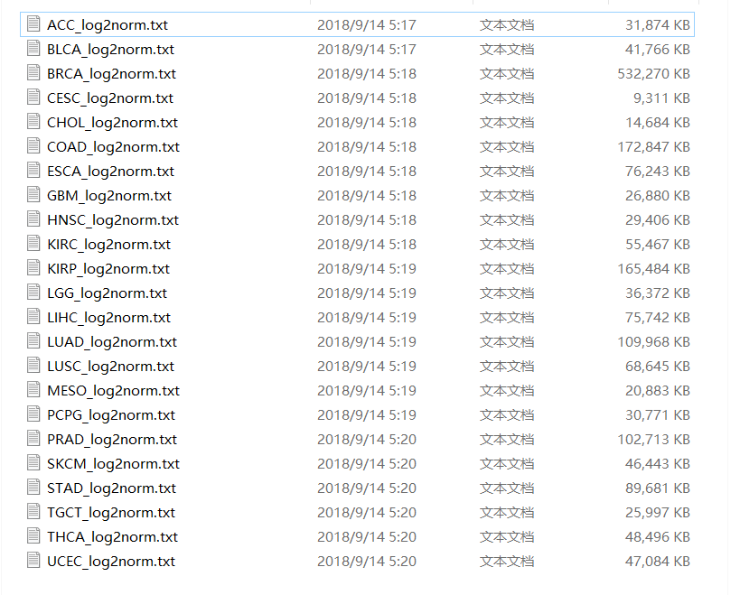

我们随便打开一个看一下。

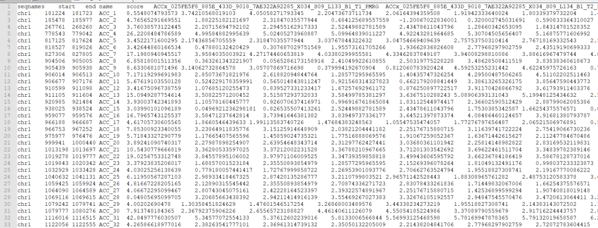

seqnames表示染色体，start和end分别表示peak的起始位置，	name表示peak的名字，score越高说明查找的peak越准确。其他列表示每个样品在peak中的表达量(标准化后的）。

下载的Lookup table for various TCGA sample identifiers文件我们打开看一看。


```plain
bam_prefix  stanfordUUID  aliquot_id  Case_UUID  Case_ID
BRCA-000CFD9F-ADDF-4304-9E60-6041549E189C-X017-S06-L011-B1-T1-P040  000CFD9F-ADDF-4304-9E60-6041549E189C  TCGA-A7-A13F-01A-31-A615-42  2cf68894-168b-458b-af4f-53cad72989a8  TCGA-A7-A13F-01A-31-A615-42
BRCA-000CFD9F-ADDF-4304-9E60-6041549E189C-X017-S06-L012-B1-T2-P046  000CFD9F-ADDF-4304-9E60-6041549E189C  TCGA-A7-A13F-01A-31-A615-42  2cf68894-168b-458b-af4f-53cad72989a8  TCGA-A7-A13F-01A-31-A615-42
PCPG-007124EC-1F9B-4FCB-BC6E-DB8C25FD9146-X033-S03-L098-B1-T1-P073  007124EC-1F9B-4FCB-BC6E-DB8C25FD9146  TCGA-RM-A68W-01A-31-A644-42  1a1cf490-8bd4-4a99-bf3a-34f06435de86  TCGA-RM-A68W-01A-31-A644-42
PCPG-007124EC-1F9B-4FCB-BC6E-DB8C25FD9146-X033-S03-L100-B1-T2-P077  007124EC-1F9B-4FCB-BC6E-DB8C25FD9146  TCGA-RM-A68W-01A-31-A644-42  1a1cf490-8bd4-4a99-bf3a-34f06435de86  TCGA-RM-A68W-01A-31-A644-42
STAD-00DFAA4D-DE64-4476-9546-18E728653046-X029-S06-L011-B1-T1-P072  00DFAA4D-DE64-4476-9546-18E728653046  TCGA-BR-A4J1-01A-31-A646-42  e9a98a44-83f2-490c-b053-1e953ebd4e7e  TCGA-BR-A4J1-01A-31-A646-42
STAD-00DFAA4D-DE64-4476-9546-18E728653046-X029-S06-L012-B1-T2-P077  00DFAA4D-DE64-4476-9546-18E728653046  TCGA-BR-A4J1-01A-31-A646-42  e9a98a44-83f2-490c-b053-1e953ebd4e7e  TCGA-BR-A4J1-01A-31-A646-42
```

bam_prefix栏是ATAC-Seq样本中，样品的名称，Case_ID就是TCGA病人的Barcode。

了解文件信息后，我们就需要利用[R语言](http://mp.weixin.qq.com/s?__biz=MzA4NDAzODkzMA==&mid=2651264971&idx=1&sn=3f97d49331809b1799a5d4a5019d94d0&chksm=841ef3b6b3697aa016626af76c3d7e80ceb269864362e1a59f2e927d2276a614d1693e00a1d6&scene=21#wechat_redirect)整理数据。需要整理成下面几个类型的数据。

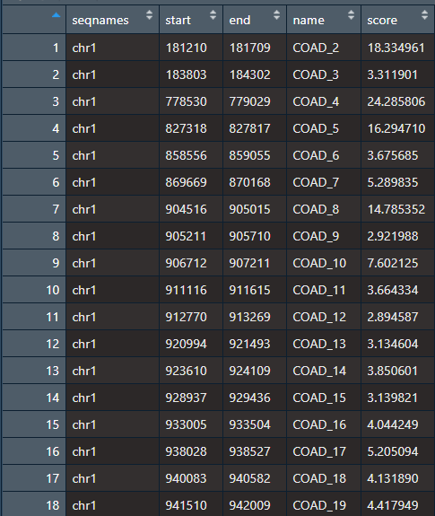

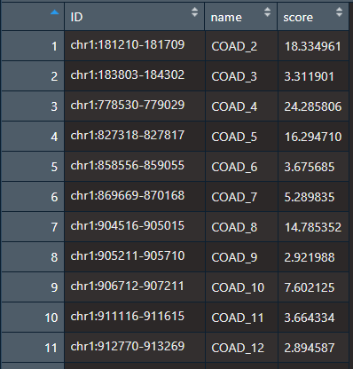

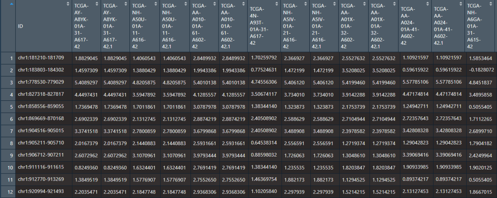

## 3.数据的整理
```plain
rm(list = ls())
options(stringsAsFactors = F)
Project = "TCGA-COAD" #这里以COAD为例，注意相关文件地址
ATACDataPath = "K:\\TCGA\\ATAC-seq\\data\\COAD_log2norm.txt"
IDmapFilePath = "K:\\TCGA\\ATAC-seq\\TCGA_identifier_mapping.txt"
######数据整理
ATACData = read.table(ATACDataPath,header = T,
                      sep = "\t",check.names = F)
TCGA_IDmap = read.table(IDmapFilePath,header = T,
                        sep = "\t",check.names = F)
TCGA_IDmap = TCGA_IDmap[grep("COAD.*",TCGA_IDmap$bam_prefix),]#注意分析的癌症
tidyDATA = ATACData[,c("seqnames","start","end","name","score",
                       gsub(pattern="-",replacement="_",TCGA_IDmap$bam_prefix))]
colnames(tidyDATA) = c("seqnames","start","end","name","score",TCGA_IDmap$Case_ID)
peakData = tidyDATA[,1:5]
write.table(peakData,file = paste0(Project,"-peakData.bed"),sep = "\t",
            col.names = F,row.names = F)
library(tidyr)
peak = tidyr::unite(peakData,"ID", seqnames:start, sep = ":")
peak = tidyr::unite(peak,"ID", ID:end, sep = "-")
peakMatrix = data.frame(ID = peak$ID,tidyDATA[,TCGA_IDmap$Case_ID],
                        check.names = F)
ATAC_COAD_data <- list(peakData=peakData,peak=peak,peakMatrix=peakMatrix)
save(ATAC_COAD_data,file = "ATAC_COAD_data.Rdata")
```

## 4.可视化
**(1).覆盖度图**

```plain
####覆盖度绘图
#if (!requireNamespace("BiocManager", quietly = TRUE))
#    install.packages("BiocManager")
# BiocManager::install("BSgenome.Hsapiens.UCSC.hg38")3.5版本的R
#if (!requireNamespace("BiocManager", quietly = TRUE))
#    install.packages("BiocManager")
# BiocManager::install("karyoploteR")
library(karyoploteR)#3.5版本的R
coveragedata = peakData
colnames(coveragedata) = c("chr","start","end","peak","value")
data.points = makeGRangesFromDataFrame(coveragedata)#转化为绘图的数据
mcols(data.points) = data.frame(y=coveragedata[,5])
pdf(file = paste0(Project,"-coverage.pdf"),width=12,height=8)
kp = plotKaryotype("hg38", plot.type=1) 
kpDataBackground(kp, data.panel=1) 
kpArea(kp, data = data.points,border="#0E0AF7",ymin=0,ymax=100)
kpAddBaseNumbers(kp, tick.dist=10000000, minor.tick.dist=1000000)
dev.off()
```

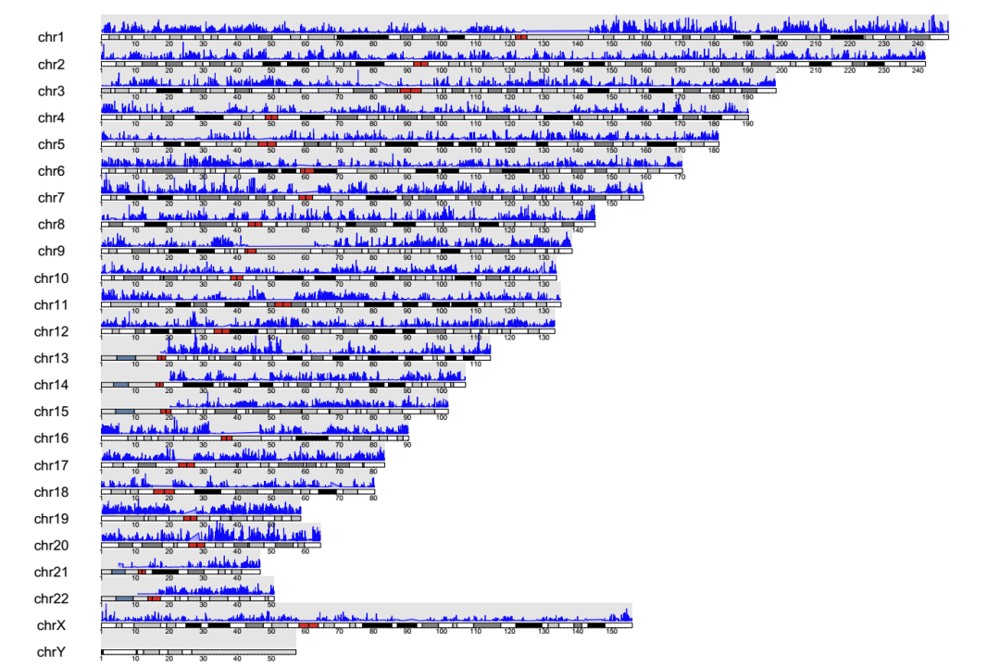

蓝色的峰值越密集，说明测到的序列就越多。

**(2)****.基因组特征图**

```plain
#####基因组特征图
#if (!requireNamespace("BiocManager", quietly = TRUE))
#    install.packages("BiocManager")
#BiocManager::install("ChIPseeker", version = "3.8")
​
#if (!requireNamespace("BiocManager", quietly = TRUE))
#    install.packages("BiocManager")
#BiocManager::install("TxDb.Hsapiens.UCSC.hg38.knownGene", version = "3.8")
​
#if (!requireNamespace("BiocManager", quietly = TRUE))
#    install.packages("BiocManager")
#BiocManager::install("org.Hs.eg.db", version = "3.8")

#if (!requireNamespace("BiocManager", quietly = TRUE))
#    install.packages("BiocManager")
#
library(ChIPseeker)
library(TxDb.Hsapiens.UCSC.hg38.knownGene)
library(org.Hs.eg.db)
library(clusterProfiler)
library(RColorBrewer)
inputpeak = paste0(Project,"-peakData.bed")
txdb <- TxDb.Hsapiens.UCSC.hg38.knownGene
peakAnno <- annotatePeak(inputpeak, tssRegion=c(-3000, 3000),
                         TxDb=txdb, annoDb="org.Hs.eg.db")
pdf(paste0(Project,"-pie.pdf"),height=8,width=8)
plotAnnoPie(peakAnno,col = brewer.pal(11,"Spectral"))
dev.off()

pdf(paste0(Project,"-bar.pdf"),height=8,width=14)
plotAnnoBar(peakAnno)
dev.off()

pdf(paste0(Project,"-vennpie.pdf"),height=12,width=12)
vennpie(peakAnno,r = 0.2)##r修改半径
dev.off()
```

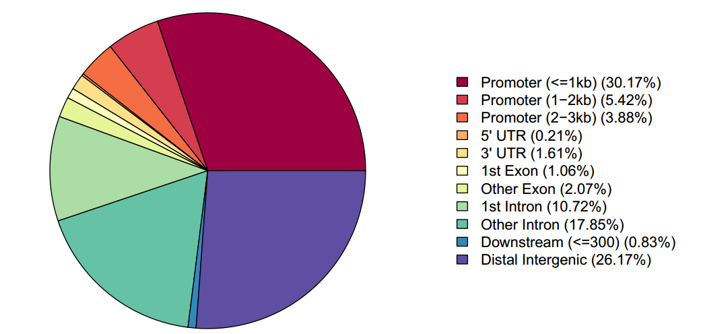

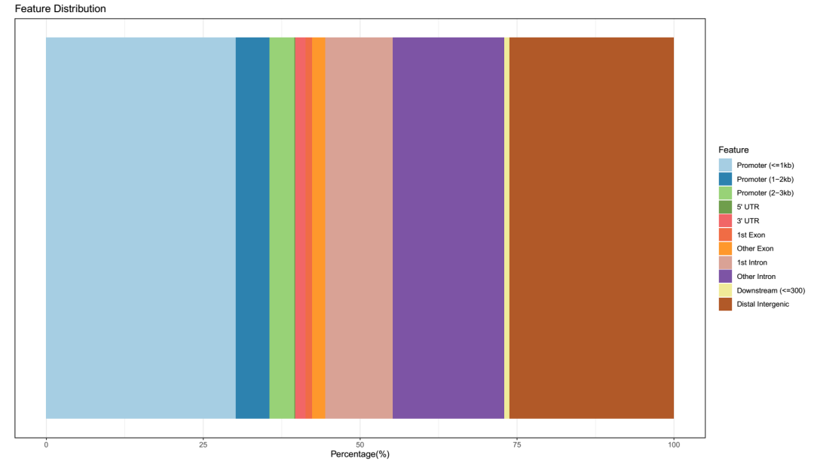

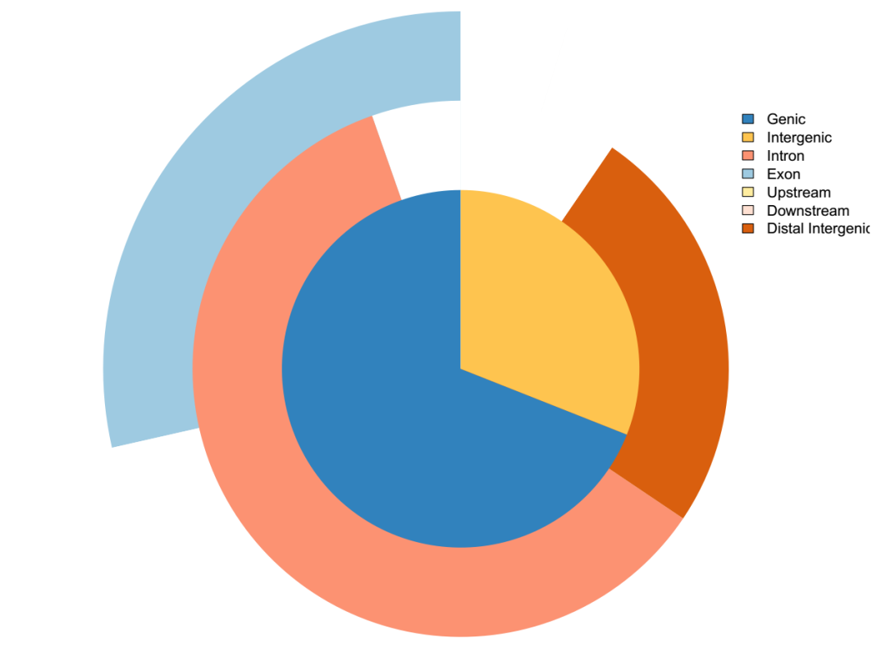

**(3)****.upset图**

```plain
####upset图
inputpeak = "./TCGA-COAD-peakData.bed" #注意文件路径
library(ChIPseeker)
library(TxDb.Hsapiens.UCSC.hg38.knownGene)
library(org.Hs.eg.db)
library(clusterProfiler)
txdb <- TxDb.Hsapiens.UCSC.hg38.knownGene
#inputpeak必须是一个文件，直接赋值不行
peakAnno <- annotatePeak(inputpeak, tssRegion=c(-3000, 3000),
                         TxDb=txdb, annoDb="org.Hs.eg.db")
pdf(paste0(Project,"-upsetplot.pdf"),height=10,width=12)
upsetplot(peakAnno)
dev.off()
```

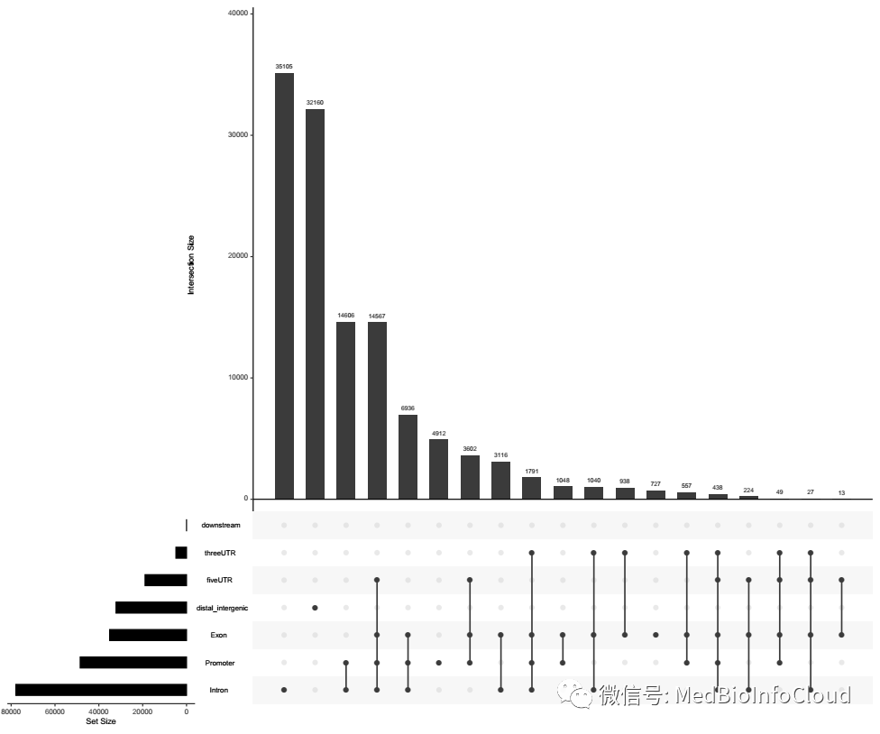

**(4)****.热图**<font style="background-color:rgba(0, 0, 0, 0.03);">‍</font>

```plain
######热图
library(ChIPseeker)
library(TxDb.Hsapiens.UCSC.hg38.knownGene)
library(clusterProfiler)
inputpeak = "./TCGA-COAD-peakData.bed"
txdb <- TxDb.Hsapiens.UCSC.hg38.knownGene
peak <- readPeakFile(inputpeak)
promoter <- getPromoters(TxDb=txdb, upstream=3000, downstream=3000)
tagMatrix <- getTagMatrix(peak, windows=promoter)

pdf(paste0(Project,"-tagHeatmap.pdf"),height=12,width=12)
tagHeatmap(tagMatrix, xlim=c(-3000, 3000), color="#1F24B5")
dev.off()
```

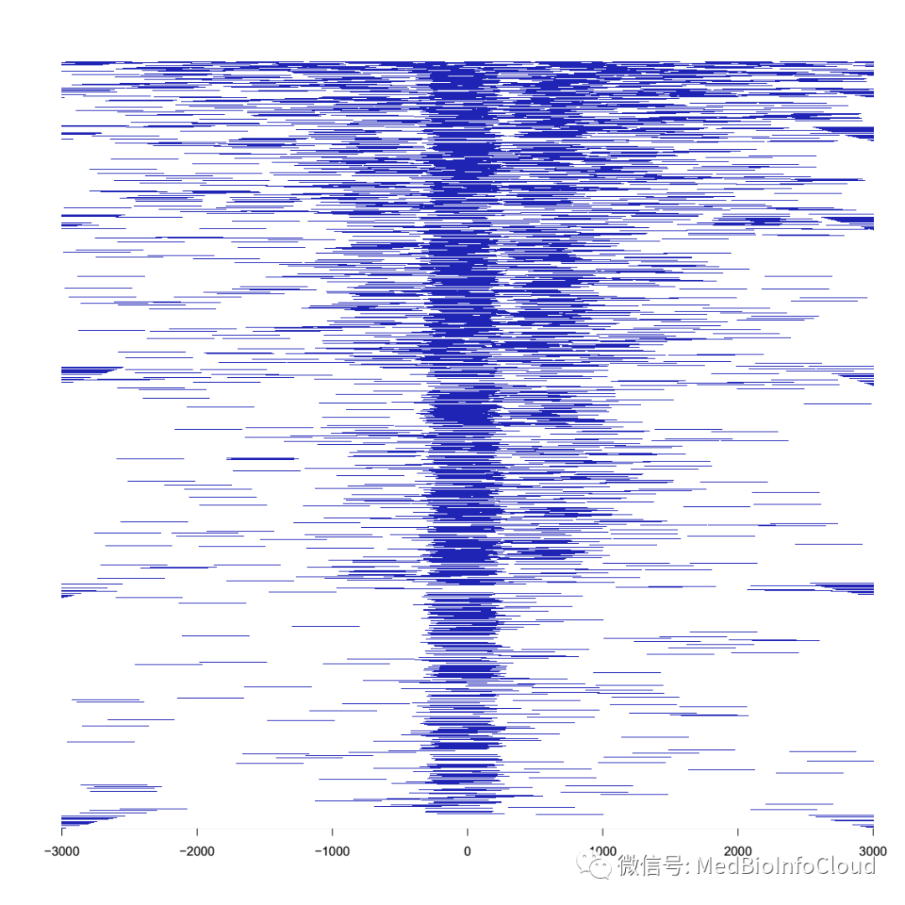

---

上面是对整理的数据的简单可视化，重要的是下游的分析，比如GO,KEGG，结合基因表达量的分析等等，后续再做介绍。

---


链接：[https://pan.baidu.com/s/10Vtu7tIncpEb0_9q9to_KQ](https://pan.baidu.com/s/10Vtu7tIncpEb0_9q9to_KQ)

提取码：3nzm

如果码失效,后台回复：ATAC-Seq1


> 更新: 2021-08-20 11:05:00  
> 原文: <https://www.yuque.com/doublehelix/bioinfonotes/qwznpt>