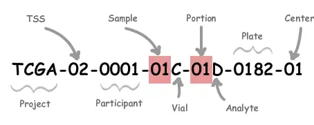

# TCGA数据库介绍

# 一.TCGA基本介绍

肿瘤基因组图谱（TCGA）计划是由美国National Cancer Institute（NCI）和National Human Genome Research Institute（NHGRI）于2006年联合启动的项目，研究的癌症类型从最开始的多形性成胶质细胞瘤（GBM）到现在为止共有39种，涉及29种癌症器官，1万多个肿瘤样本，27万多份文件，当然其项目也将于2017年接近尾声。

网址：[https://portal.gdc.cancer.gov/](https://portal.gdc.cancer.gov/)

对于肿瘤研究者来说，TCGA数据库就是一个资源宝库，里面有很多有价值的信息可以挖掘，关于TCGA数据挖掘的工具很多，包括在线工具和R包。这里我们主要是通过R语言进行挖掘，所以需要有一点R语言基础。

关于利用R包下载，我主要用过TCGAbiolinks和GDCRNATools，**但是这2个包有些函数现在好像有些问题**，所以这部分你自己关注，这里主要是自己下载后从头整理，只需要关注官网在线下载部分。

```r
缩写	英文名称	中文名称
ACC	Adrenocortical carcinoma	肾上腺皮质癌
BLCA	Bladder Urothelial Carcinoma	膀胱尿路上皮癌
BRCA	Breast invasive carcinoma	乳腺浸润癌
CESC	Cervical squamous cell carcinoma and endocervical adenocarcinoma	宫颈鳞癌和腺癌
CHOL	Cholangiocarcinoma	胆管癌
COAD	Colon adenocarcinoma	结肠癌
COADREAD	Colon adenocarcinoma/Rectum adenocarcinoma Esophageal carcinoma	结直肠癌
DLBC	Lymphoid Neoplasm Diffuse Large B-cell Lymphoma	弥漫性大B细胞淋巴瘤
ESCA	Esophageal carcinoma	食管癌
FPPP	FFPE Pilot Phase II	FFPE试点二期
GBM	Glioblastoma multiforme	多形成性胶质细胞瘤
GBMLGG	Glioma	胶质瘤
HNSC	Head and Neck squamous cell carcinoma 	头颈鳞状细胞癌
KICH	Kidney Chromophobe	肾嫌色细胞癌
KIRC 	Kidney renal clear cell carcinoma	肾透明细胞癌
KIRP	Kidney renal papillary cell carcinoma 	肾乳头状细胞癌
LAML	Acute Myeloid Leukemia	急性髓细胞样白血病
LGG	Brain Lower Grade Glioma	脑低级别胶质瘤
LIHC	Liver hepatocellular carcinoma	肝细胞肝癌
LUAD	Lung adenocarcinoma	肺腺癌
LUSC	Lung squamous cell carcinoma	肺鳞癌
MESO	Mesothelioma	间皮瘤
OV	Ovarian serous cystadenocarcinoma	卵巢浆液性囊腺癌
PAAD	Pancreatic adenocarcinoma	胰腺癌
PCPG	Pheochromocytoma and Paraganglioma	嗜铬细胞瘤和副神经节瘤
PRAD	Prostate adenocarcinoma	前列腺癌
READ	Rectum adenocarcinoma	直肠腺癌
SARC	Sarcoma	肉瘤
SKCM	Skin Cutaneous Melanoma	皮肤黑色素瘤
STAD	Stomach adenocarcinoma	胃癌
STES	Stomach and Esophageal carcinoma	胃和食管癌
TGCT	Testicular Germ Cell Tumors	睾丸癌
THCA	Thyroid carcinoma	甲状腺癌
THYM	Thymoma	胸腺癌
UCEC	Uterine Corpus Endometrial Carcinoma	子宫内膜癌
UCS	Uterine Carcinosarcoma	子宫肉瘤
UVM	Uveal Melanoma	葡萄膜黑色素瘤
AML	Acute Myeloid Leukemia	急性髓系白血病
CCSK	Clear Cell Sarcoma of the Kidney	肾透明细胞肉瘤
NBL	Neuroblastoma	神经母细胞瘤
OS	Osteosarcoma	骨肉瘤
RT	Rhabdoid Tumor	横纹肌样瘤
WT	High-Risk Wilms Tumor	高危肾母细胞瘤
```



| <br/>Label | <br/>Identifier for | <br/>解释 |
| :--- | :--- | :--- |
| <br/>Project | <br/>Project name | <br/>来自哪个项目: 如TCGA、TARGET等等 |
| <br/>TSS | <br/>Tissue source site | <br/>样品来自哪个组织机构：01 代表International Genomics Consortium, 更多见：[<u>TSS</u>](https://www.omicsclass.com/article/1079) |
| <br/>Participant | <br/>Study participant | <br/>样品唯一编号(可以理解为一个病人唯一编号） |
| <br/>Sample | <br/>Sample type | <br/>样品来自人体组织类型，如：01代表Primary Solid Tumor， 更多见：[<u>SampleType</u>](https://www.omicsclass.com/article/1080) |
| <br/>Vial | <br/>Order of sample in a sequence of samples | <br/>一份样品被分割成好几份，表示第几份，通常是A-Z编号 |
| <br/>Portion | <br/>Order of portion in a sequence of 100-120 mg sample portions | <br/>每份样品再分割成不同的小样品：01-99等等编号，代表第几份 |
| <br/>Analyte | <br/>Molecular type of analyte for analysis | <br/>实验数据来源分子类型，如R代表 RNA，D代表DNA等等，更多见：[<u>Portion / Analyte Codes</u>](https://gdc.cancer.gov/resources-tcga-users/tcga-code-tables/portion-analyte-codes) |
| <br/>Plate | <br/>Order of plate in a sequence of 96-well plates | <br/>96孔序列中板的顺序，4个数字组成 |
| <br/>Center | <br/>Sequencing or characterization center that will receive the aliquot for analysis | <br/>数据由哪个机构分析：如 01代表The Broad Institute GCC,更多见：[<u>Center</u>](https://www.omicsclass.com/article/1081) |

# 二.分析TCGA的在线工具

1.Oncomine：[https://www.oncomine.org/resource/main.html](https://www.oncomine.org/resource/main.html)

2.GEPIA：[http://gepia.cancer-pku.cn/](http://gepia.cancer-pku.cn/)

> 更新: 2021-02-04 20:48:55
> 原文: <https://www.yuque.com/doublehelix/bioinfonotes/uehobs>
