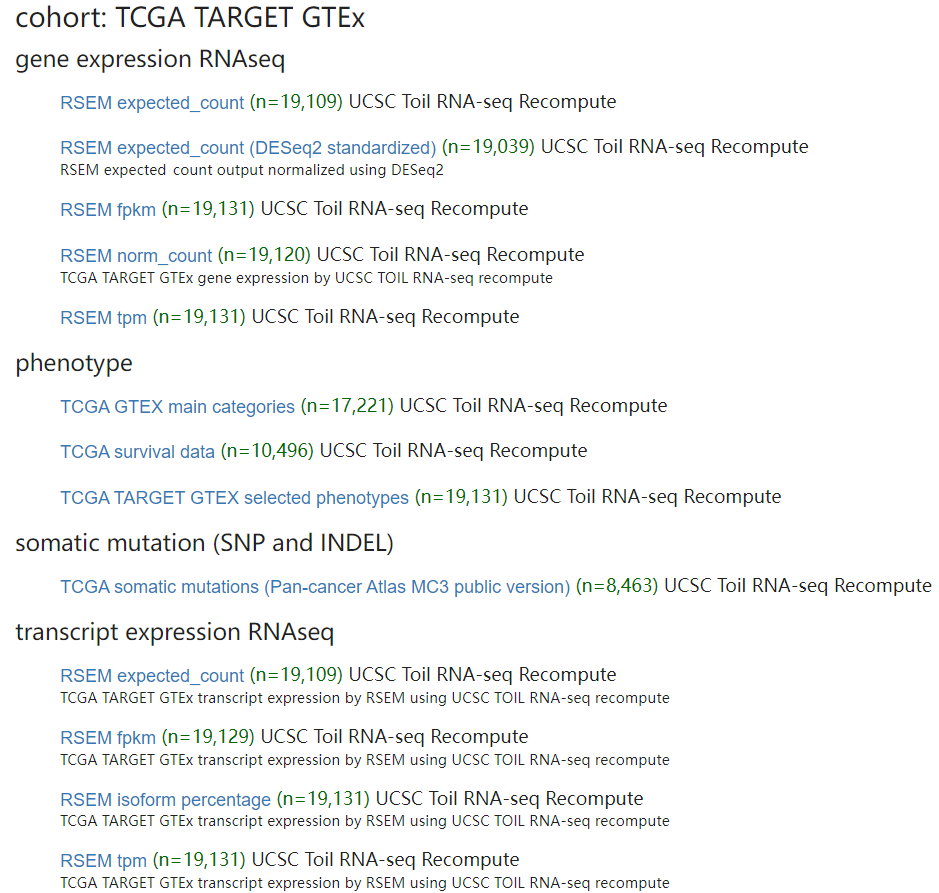

# TCGA数据库的癌症没有正常样本怎么办？

虽然在我公众号有介绍了TCGA数据库的好多文章【[TCGA数据库基础的数据分析](http://mp.weixin.qq.com/s?__biz=MzA4NDAzODkzMA==&mid=2651276349&idx=1&sn=2d38c5081f3611386d8d979e905145a3&chksm=841ea040b3692956f0a3804e10d4b7928a4d4f4ad2134b6c28cd89caf8edcc1dffd90a662801&scene=21#wechat_redirect)】，数据下载都是自己下载处理的。
我也介绍过从UCSC数据库下载处理好的数据[UCSC数据库下载TCGA数据需要注意的细节](http://mp.weixin.qq.com/s?__biz=MzA4NDAzODkzMA==&mid=2651273247&idx=1&sn=008928dbfc6c6976d53369cd20c26f87&chksm=841edc62b3695574739a6db6af267b279808c9ea82e9947a461da2e3bf02a8db215204cf65e9&scene=21#wechat_redirect)。
但是TCGA数据库中有些癌症的数据是没有正常样本的，或者只有几个。
但有时候我们又想进行癌症与正常样本的比较，怎么办呢？
？

如果你只是简单的看几个基因的话，很多在线工具就可以帮你解决了，最好用的当然是GEPIA【<u>http://gepia2.cancer-pku.cn/#index</u>】了，而且可以获取癌症与正常组织想比所有差异表达的结果。
但如果我们想进行其他的分析，那么GTEx【<u>http://www.gtexportal.org/home/</u>】这个数据库里面的正常样本是可以作为对照的，但由于数据库来源不一样，数据处理流程不一样，所以也不是简单的合并使用，具体怎么处理可参考文献：Comprehensive analysis of normal adjacent to tumor transcriptomes ，里面有详细的处理流程介绍。
**不想处理，那就下载现成的**。

UCSC官网：[https://xenabrowser.net/datapages/](https://xenabrowser.net/datapages/)

可以直接在UCSC下载:

<u>https://xenabrowser.net/datapages/?cohort=TCGA%20TARGET%20GTEx&removeHub=https%3A%2F%2Fxena.treehouse.gi.ucsc.edu%3A443</u>



这里有标准化后的和没有标准化的数据都有。你可以直接下载标准化后的数据，就可以直接进行下游的数据分析了。

```r
##数据下载地址
#https://xenabrowser.net/datapages/?cohort=TCGA%20TARGET%20GTEx&removeHub=https%3A%2F%2Fxena.treehouse.gi.ucsc.edu%3A443

###=====================处理标准化后的===========
library(data.table)
library(dplyr)
norm_count = fread("K:/database.data/TCGA_TARGET_GTEx/TcgaTargetGtex_RSEM_Hugo_norm_count.gz",
             data.table = F)
head(norm_count)[,1:3]
colnames(norm_count)[1] = "symbol"

info = fread("K:/database.data/TCGA_TARGET_GTEx/TCGA_GTEX_category.txt")


sam_info = table(info$TCGA_GTEX_main_category) %>% as.data.frame()

GTEX_Lung_sample = info$sample[info$TCGA_GTEX_main_category == "GTEX Lung"]
TCGA_LUAD_sample = info$sample[info$TCGA_GTEX_main_category == "TCGA Lung Adenocarcinoma"]
TCGA_LUSC_sample = info$sample[info$TCGA_GTEX_main_category == "TCGA Lung Squamous Cell Carcinoma"]

#这里来自TCGA数据库中的样本已经不包含癌旁组织了！

lung_cancer_norm_count = norm_count %>% dplyr::select(symbol,all_of(c(GTEX_Lung_sample,TCGA_LUAD_sample,TCGA_LUSC_sample)))

lung_cancer_norm_count[1:10,1:3]

lung_cancer_norm_count = lung_cancer_norm_count[!duplicated(lung_cancer_norm_count$symbol),]
rownames(lung_cancer_norm_count) = lung_cancer_norm_count$symbol
lung_cancer_norm_count = lung_cancer_norm_count[,-1]
lung_cancer_norm_count = round(2^lung_cancer_norm_count - 1)

##创建分组=============
group_info = data.frame(group = c(rep("Normal",length(GTEX_Lung_sample)),
                                rep("Tumor",length(c(TCGA_LUAD_sample,TCGA_LUSC_sample)))))
rownames(group_info) =  colnames(lung_cancer_norm_count)
save(lung_cancer_norm_count,group_info,
     file = "K:/database.data/TCGA_TARGET_GTEx/TcgaTargetGtex_RSEM_Hugo_lung_cancer_count.Rdata")
```

> 更新: 2021-10-12 21:15:03
> 原文: <https://www.yuque.com/doublehelix/bioinfonotes/gszak3>
