# NMF(非负矩阵分解)替代层次聚类进行肿瘤分型


[**<font style="color:#0052FF;">TCGA</font>**](https://mp.weixin.qq.com/mp/appmsgalbum?action=getalbum&album_id=1338047035672526848&__biz=MzA4NDAzODkzMA==#wechat_redirect)**<font style="color:#0052FF;"> | </font>**[**<font style="color:#0052FF;">GEO</font>**](https://mp.weixin.qq.com/mp/appmsgalbum?action=getalbum&album_id=1385753371944239106&__biz=MzA4NDAzODkzMA==#wechat_redirect)**<font style="color:#0052FF;"> | </font>**[**<font style="color:#0052FF;">文献阅读</font>**](https://mp.weixin.qq.com/mp/appmsgalbum?action=getalbum&album_id=1338481272770953216&__biz=MzA4NDAzODkzMA==#wechat_redirect)**<font style="color:#0052FF;"> | </font>**[**<font style="color:#0052FF;">数据库</font>**](https://mp.weixin.qq.com/mp/appmsgalbum?action=getalbum&album_id=1338487030963142656&__biz=MzA4NDAzODkzMA==#wechat_redirect)[**<font style="color:#0052FF;"> </font>**](https://mp.weixin.qq.com/mp/appmsgalbum?action=getalbum&album_id=1338487030963142656&__biz=MzA4NDAzODkzMA==#wechat_redirect)**<font style="color:#0052FF;">| </font>**[**<font style="color:#0052FF;">理论知识</font>**](https://mp.weixin.qq.com/mp/appmsgalbum?action=getalbum&album_id=1338473418617946113&__biz=MzA4NDAzODkzMA==#wechat_redirect)

[**<font style="color:#0052FF;">R语言</font>**](https://mp.weixin.qq.com/mp/appmsgalbum?action=getalbum&album_id=1337050529440104449&__biz=MzA4NDAzODkzMA==#wechat_redirect)**<font style="color:#0052FF;"> |</font>****<font style="color:#0052FF;"> </font>**[**<font style="color:#0052FF;">Bioconductor</font>**](https://mp.weixin.qq.com/mp/appmsgalbum?action=getalbum&album_id=1369789283514761218&__biz=MzA4NDAzODkzMA==#wechat_redirect)**<font style="color:#0052FF;"> | 服务器与</font>**[**<font style="color:#0052FF;">Linux</font>**](https://mp.weixin.qq.com/mp/appmsgalbum?action=getalbum&album_id=1410264757734817793&__biz=MzA4NDAzODkzMA==#wechat_redirect)

---

# 一.原理
NMF(Non-negative matrix factorization，非负矩阵分解)，即对于任意给定的一个非负矩阵V，其能够寻找到一个非负矩阵W和一个非负矩阵H，满足条件V=W*H,从而将一个非负的矩阵分解为左右两个非负矩阵的乘积。其中，V矩阵中每一列代表一个观测(observation)，每一行代表一个特征(feature)，**<font style="color:#021EAA;">比如RNAseq的样本（列）和基因（行）的表达矩阵</font>**；W矩阵称为基矩阵，H矩阵称为系数矩阵或权重矩阵。这时用系数矩阵H代替原始矩阵，就可以实现对原始矩阵进行降维，得到数据特征的降维矩阵，从而减少存储空间。过程如下图所示：

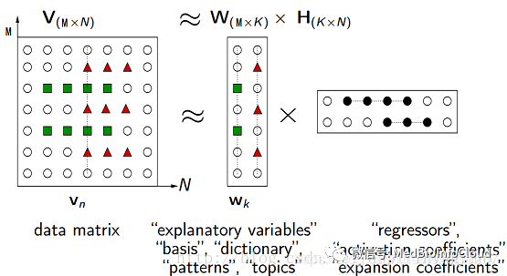


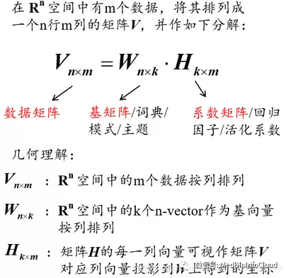

**<font style="color:#FF4C41;">下面用数学语言对NMF进行描述，并直接给出求解NMF的迭代公式。</font>**

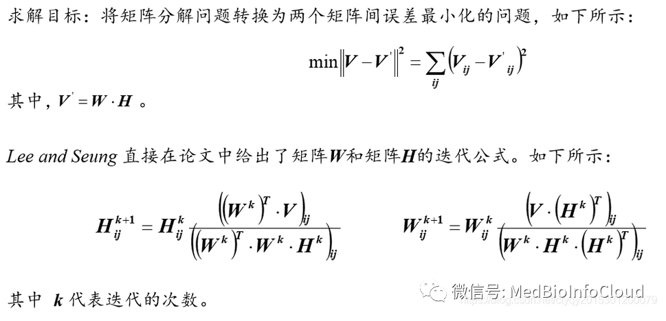

NMF的本质是通过一个矩阵去求解两个为止矩阵。上图采用的是迭代法，一步步逼近最终的结果，当计算得到的两个矩阵W和H收敛时，就说明分解成功。需要注意的是，原矩阵和分解之后两个矩阵的乘积并不要求完全相等，可以存在一定程度上的误差。

如果要在计算机中实现NMF，则可以根据下图所示的步骤进行。

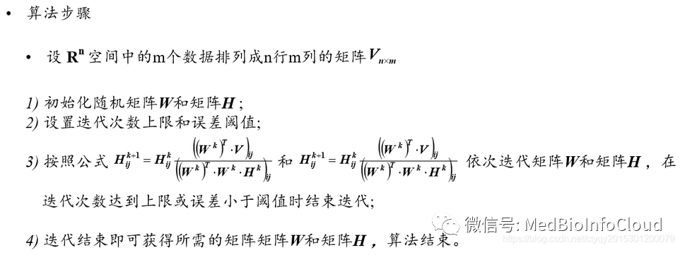


nmf更详尽的原理可以参考维基百科：**Non-negative matrix factorization。**

NMF的计算机实现可以用python、Java和R，作为生信专业的我们，用python和R估计会多一些，**<font style="color:#021EAA;">我后面会介绍怎么用R实现NMF</font>**。

本文参考文章:

【1】[<u>https://blog.csdn.net/jeffery0207/article/details/84348117</u>](https://blog.csdn.net/jeffery0207/article/details/84348117)<u></u>

【2】[<u>https://blog.csdn.net/ctyqy2015301200079/article/details/86725427</u>](https://blog.csdn.net/ctyqy2015301200079/article/details/86725427)

# 二.实战
随着芯片和测序水平的发展，使得我们研究所有基因在整个基因组里的表达情况成为了可能。合理地利用和解释这些数据，能够帮助我们探索相关的生物过程和人类疾病的机制。目前已经有一些软件或方法，可以将具有相似表达模式的基因或者样本进行聚类，但是都有自身的限制。NMF包基于非负矩阵分解(non-negative matrix factorization，以下简称NMF)方法，提取基因表达矩阵内数据的生物相关系数，通过对基因和样本进行组织，抓住数据的内部结构特征，从而对样本进行分组，目前在疾病分型方面受到广泛应用。我前面已经介绍过了NMF的基本原理【[<font style="color:#021EAA;">NMF(非负矩阵分解)的算法原理</font>](http://mp.weixin.qq.com/s?__biz=MzA4NDAzODkzMA==&mid=2651273259&idx=1&sn=87c9756cbc8ed78cb1a771e81cf1eec8&chksm=841edc56b369554051851c71c77a21c40936cb3c3608d2c55a869b7bdcad9c29ff82dbd12d45&scene=21#wechat_redirect)】，这里我介绍R语言实现NMF。下面是一篇今年刚发的一篇纯生信的分析文章，用的就是NMF这个方法来对肿瘤进行分型。影响因子为4.8。

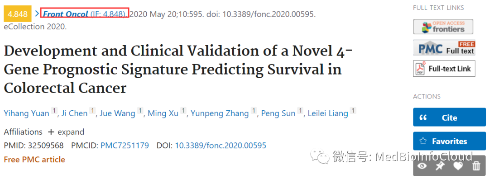

文章大家自己去下载：<font style="color:#021EAA;">Development and Clinical Validation of a Novel 4-Gene Prognostic Signature Predicting Survival in Colorectal Cancer</font>。

这篇文章做的是结直肠癌。用了2个数据集，一个来自TCGA-COAD，一个GEO数据库：GSE39582，我们就以这篇文章来介绍NMF。

## 1.NMF包介绍
首先得安装包NMF，这个包属于生物导体包，普通安装方法就行。

```plain
install.packages("NMF")   # 安装包的命令
library(NMF) # 加NMF包
```

用法：

```plain
nmf(x, rank,
    method, seed = nmf.getOption("default.seed"),
    rng = NULL, nrun = if (length(rank) > 1) 30 else 1,
    model = NULL, .options = list(),
    .pbackend = nmf.getOption("pbackend"),
    .callback = NULL, ...)
```

接下来我们看下nmf函数的主要参数：

x：就是我们的表达矩阵；

rank：因式分解秩的说明。它通常是一个单一的数值，但也可能是其他类型的值(例如矩阵)，为其实现特定的方法。你可以理解成分几群。

method:就是NMF算法的选择，总共有11种，可通过nmfAlgorithm()函数查看，默认brunet。

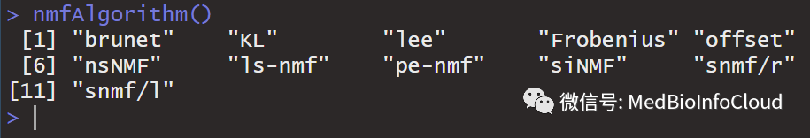

关键算法的如下：

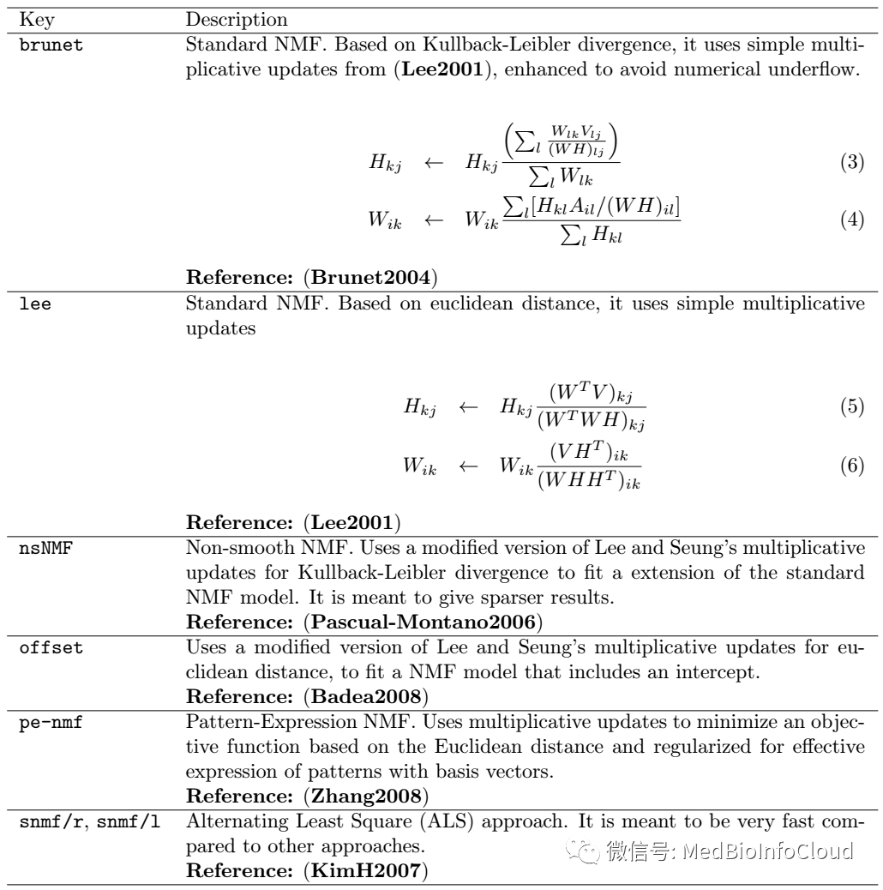

nrun：范围内每个值的迭代次数；

model：如果有已经构建好的模型，那就是直接把模型写在这里，优化等级计算。构建模型的函数是nmfModel（rank,c(features,samples)）或者是nmfModel（rank,data,W,H）。

.options:可以设置是否保留每次的运算结果：keep.all=T。例：.options=list(keep.all=TRUE);

## 2.加载RNAseq数据
下面是该文章的TCGA数据处理方式。

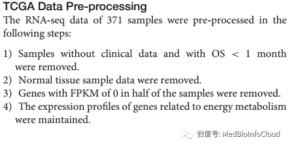

TCGA-COAD的RNAseq数据和临床数据可以从UCSC下载，可参考文章【[<font style="color:#021EAA;">UCSC数据库下载TCGA数据需要注意的细节</font>](http://mp.weixin.qq.com/s?__biz=MzA4NDAzODkzMA==&mid=2651273247&idx=1&sn=008928dbfc6c6976d53369cd20c26f87&chksm=841edc62b3695574739a6db6af267b279808c9ea82e9947a461da2e3bf02a8db215204cf65e9&scene=21#wechat_redirect)】，也可以直接从TCGA数据库下载，自己整理，我之前也把处理过的数据处理过【[<font style="color:#021EAA;">TCGA数据库33个Project的RNA-Seq转录组数据为你整理打包好了</font>](http://mp.weixin.qq.com/s?__biz=MzA4NDAzODkzMA==&mid=2651264583&idx=1&sn=f94bf8d77402677ee67f5d6336088254&chksm=841ef23ab3697b2c10ddf8477f41b99c2d801899e3c280f2b1ad6e34b7f6efae005ab4902013&scene=21#wechat_redirect)】。

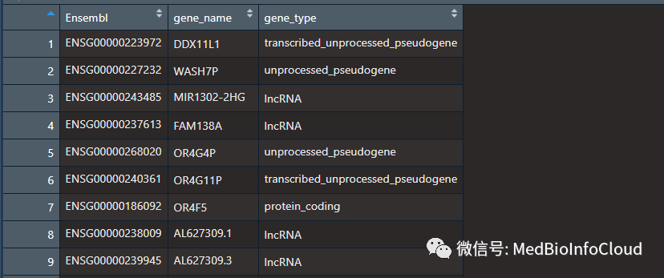

好了，开始...

```plain
rm(list = ls())
options(stringsAsFactors = F)
setwd("K:/MedBioInfoCloud/NMF")
```

```plain
###---------加载从UCSC下载的RNA-Seq-FPKM数据
ucsc.coad.fpkm <- read.table("TCGA-COAD.htseq_fpkm.tsv",header = T,check.names = F)
ucsc.coad.fpkm$Ensembl_ID <- substr(ucsc.coad.fpkm$Ensembl_ID,1,15)
load("K:/BioInfoFiles/hsaEnsembl2Symbol.Rdata")
coad.fpkm <- merge(hsaEnsembl2Symbol[,1:2],ucsc.coad.fpkm,by.x ="Ensembl",by.y = "Ensembl_ID")
coad.fpkm <- coad.fpkm[!duplicated(coad.fpkm$gene_name),]
rownames(coad.fpkm) <- coad.fpkm$gene_name
coad.fpkm <- coad.fpkm[,-c(1:2)]
```

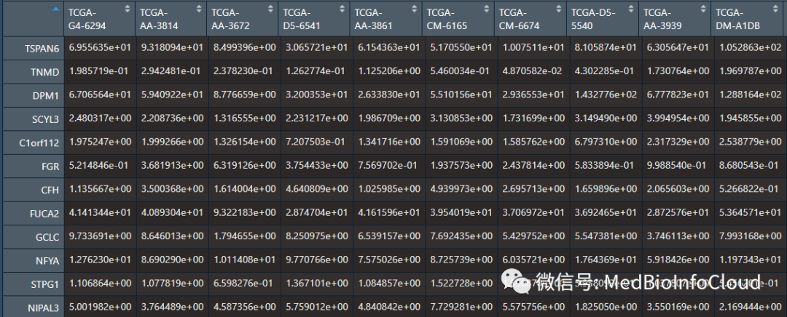

我这里用的是从UCSC下载的数据，从UCSC下载的数据需要自己注释。hsaEnsembl2Symbol这个数据框是我自己注释过的人Ensembl和Symbol之间的对应关系文件。自己注释，参考文章【[生信中各种ID转换](http://mp.weixin.qq.com/s?__biz=MzA4NDAzODkzMA==&mid=2651265466&idx=1&sn=021a10503d338e09abe07b578e734566&chksm=841efdc7b36974d13b7ad95e2272d293089d49adff9b74667bbeed78306328f0a42b0259c030&scene=21#wechat_redirect)】。

## 3.读入临床数据
这里的临床数据我是从UCSC下载的【[<font style="color:#021EAA;">UCSC数据库下载TCGA数据需要注意的细节</font>](http://mp.weixin.qq.com/s?__biz=MzA4NDAzODkzMA==&mid=2651273247&idx=1&sn=008928dbfc6c6976d53369cd20c26f87&chksm=841edc62b3695574739a6db6af267b279808c9ea82e9947a461da2e3bf02a8db215204cf65e9&scene=21#wechat_redirect)】，你可以自己去下载，我也会上传到文章【[<font style="color:#021EAA;">TCGA数据库33个Project的RNA-Seq转录组数据为你整理打包好了</font>](http://mp.weixin.qq.com/s?__biz=MzA4NDAzODkzMA==&mid=2651264583&idx=1&sn=f94bf8d77402677ee67f5d6336088254&chksm=841ef23ab3697b2c10ddf8477f41b99c2d801899e3c280f2b1ad6e34b7f6efae005ab4902013&scene=21#wechat_redirect)】中对应的网盘中。

```plain
###---------读入临床数据
clin <- read.table("TCGA-COAD.survival.tsv",header = T)
coad.clin <- clin[grep("-01A$",clin$sample),]##删除正常样本
coad.clin <- coad.clin[coad.clin$OS.time>=30,]
coad.clin <- coad.clin[!duplicated(coad.clin$sample),]#去重
```

## 4.读入基因文件
上面得到的数据是TCGA-COAD所有肿瘤所有基因的FPKM数据，这篇文章做的是能量代谢相关通路的基因，基因信息如下图，自己可以去Reactome数据库搜集。

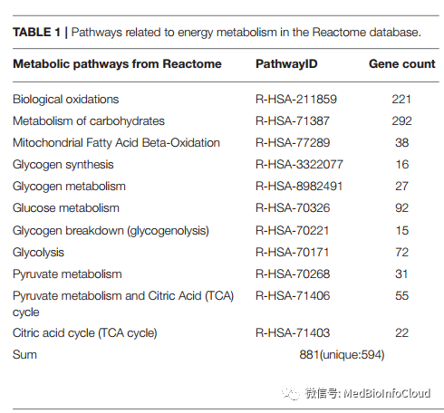

当然，我这里也准备好了，直接读入数据。

```plain
protein <- read.csv(file = "enengy_protein.csv",header = T)
```

由于搜集数据的时间不同，我搜集的基因是593个，文章是594个，差不多。

```plain
> dim(protein)
[1] 593   3
```

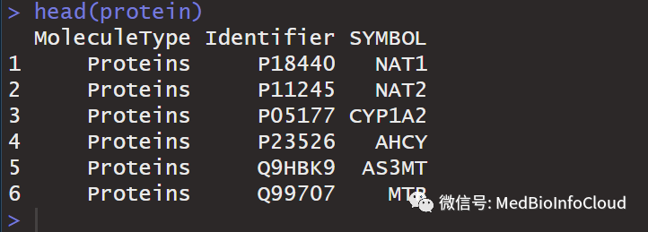

## 5.融合数据
将数据与表达矩阵融合。其实也就是只要能量代谢相关基因的表达数据。

```plain
###---------融合数据
gene <- intersect(protein$SYMBOL,rownames(coad.fpkm))
sample <- intersect(coad.clin$sample,colnames(coad.fpkm))
enengyTurExp <- coad.fpkm[gene,sample]
dim(enengyTurExp)
##Genes with FPKM of 0 in half of the samples were removed.
library(tidyr)
genetable <- lapply(as.data.frame(t(enengyTurExp)),function(r){
  sum(r==0)}) %>% as.data.frame()
enengyTurExp <- enengyTurExp[colnames(genetable)[genetable[1,] < length(colnames(enengyTurExp))/2],]
sum(is.na(enengyTurExp))##看看有没有空值
```

先看一下表达矩阵的维度

```plain
> dim(enengyTurExp)
[1] 540 421
```

540个基因、421个样本被纳入分析，文章中是371样本。怎么作者少了那么多，我也不知道。

## 6.NMF进行肿瘤分型
这里我们可以看文章的处理方式。方法用的是brunet，迭代次数=50，ranks为2到10。

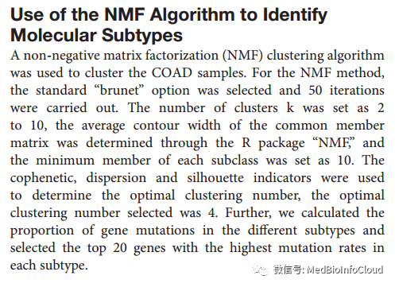

因为我们不知道分几个亚群合适，所以设置ranks为2到10，以找到合适的ranks。

```plain
library(NMF)
coad.log2fpkm.enengy <- enengyTurExp##
ranks <- 2:10
estim.coad <- nmf(coad.log2fpkm.enengy,ranks, nrun=50)
duplicated(colnames(coad.log2fpkm.enengy))
```

选择合适的rank。

```plain
#Estimation of the rank: Quality measures computed from 10 runs for each value of r.
plot(estim.coad)
```

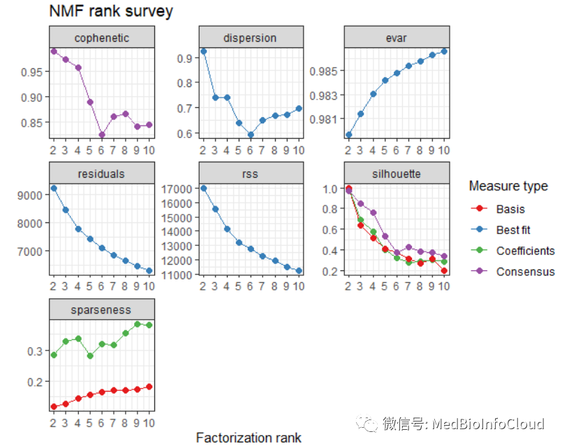

具体怎么选择rank，官方文档是这样建议的：

(Brunet2004) proposed to take the first value of r for which the cophenetic coefficient starts decreasing, (Hutchins2008) suggested to choose the first value where the RSS curve presents aninflection point, and (Frigyesi2008) considered the smallest value at which the decrease in the RSS is lower than the decrease of the RSS obtained from random data.

文章用了三个指标：cophenetic, dispersion 和silhouette。判断最佳rank值的准则就是，cophenetic值随K变化的最大变动的前点，上面结果中cophenetic值在rank为4-5时是第一个变化最大的拐点，所以选择最佳rank值为4。文章中也是4。

```plain
#再次NMF,rank=4
seed = 2020820
nmf.rank4 <- nmf(coad.log2fpkm.enengy, 
                 rank = 4, 
                 nrun=50,
                 seed = seed, 
                 method = "brunet")
```

绘制分群热图。

```plain
#设置颜色
jco <- c("#2874C5","#EABF00","#C6524A","#868686")
index <- extractFeatures(nmf.rank4,"max") 
sig.order <- unlist(index)
NMF.Exp.rank4 <- coad.log2fpkm.enengy[sig.order,]
NMF.Exp.rank4 <- na.omit(NMF.Exp.rank4) #sig.order有时候会有缺失值
group <- predict(nmf.rank4) # 提出亚型
table(group)
consensusmap(nmf.rank4,
             labRow = NA,
             labCol = NA,
             annCol = data.frame("cluster"=group[colnames(NMF.Exp.rank4)]),
             annColors = list(cluster=c("1"=jco[1],"2"=jco[2],"3"=jco[3],"4"=jco[4])))
```

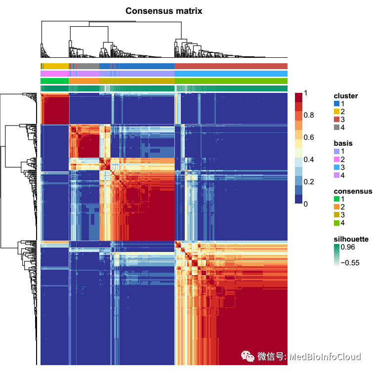

从结果来看，分4个亚群还是可以的。

文章中只给出了consensus matrix这个图（如下）。


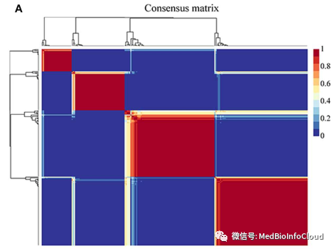

得到分群后，就可以进行下游分分析了，可以参考之前TCGA数据库的相关文章[**<font style="color:#0052FF;">【</font>**](https://mp.weixin.qq.com/mp/appmsgalbum?action=getalbum&album_id=1338047035672526848&__biz=MzA4NDAzODkzMA==#wechat_redirect)[**<font style="color:#0052FF;">TCGA</font>**](https://mp.weixin.qq.com/mp/appmsgalbum?action=getalbum&album_id=1338047035672526848&__biz=MzA4NDAzODkzMA==#wechat_redirect)**】****<font style="color:#0052FF;"> </font>**。

全部代码：

```plain
options(stringsAsFactors = F)
setwd("K:/BioInfoArticleProject/MedBioInfoCloud/COAD")
Molecule <- read.table("protein.txt",header = T,sep = "\t")
protein <- Molecule[Molecule$MoleculeType == "Proteins",]
library(tidyr)
colnames(protein)
protein <- separate(protein,MoleculeName,into = c("UniProt","SYMBOL"),
                    sep = " ",remove = TRUE)
protein <- protein[,c(1,2,4)]

protein <- protein[!duplicated(protein$SYMBOL),]
###---------加载RNA-Seq-FPKM数据
load("F:/TCGA/HTSeq-FPKM/Rdata/data/TCGA-COAD-Exp.Rdata")
coadExp <- transomeData[["proteinCodingExpData"]][["Exp"]]
TurExp <- coadExp[,transomeData[["proteinCodingExpData"]][["TumorBarcode"]]]
TurExp <- TurExp %>% data.matrix() %>% as.data.frame()
colnames(TurExp) <- gsub("(.*?)-(.*?)-(.*?)-(.*?)-.*","\\1-\\2-\\3",
                         colnames(TurExp))
###将FPKM转换为TPM,文章中也不知道有没有转换
FPKM2TPM <- function(fpkm){
  exp(log(fpkm) - log(sum(fpkm)) + log(1e6))
}
TurExp <- apply(TurExp,2,FPKM2TPM)

if(!dir.exists("outputdata")){dir.create("outputdata")}
write.csv(TurExp,file = "./outputdata/TurExp.csv")


###---------加载临床数据
load("F:/TCGA/clinicalData/tidyAllCancerData/ TCGA-COAD -Clindata.Rdata")
coadclin <- clinData[clinData$follow != "--",]
coadclin <- coadclin[as.numeric(coadclin$follow)>30,]

###---------融合数据
gene <- intersect(protein$SYMBOL,rownames(TurExp))
sample <- intersect(colnames(TurExp),coadclin$sample)
enengyTurExp <- TurExp[gene,sample]
TurallGeneExp <- TurExp[,sample]##用于后续的差异分析
sum(is.na(enengyTurExp))
##Genes with FPKM of 0 in half of the samples were removed.
genetable <- lapply(as.data.frame(t(enengyTurExp)),function(r){
  sum(r==0)}) %>% as.data.frame()
enengyTurExp <- enengyTurExp[colnames(genetable)[genetable[1,] < length(colnames(enengyTurExp))/2],]
#head(enengyTurExp)[,1:2]
write.csv(enengyTurExp,file = "./outputdata/enengyTurExp.csv")#输出TIMER的输入文件


library(NMF)
nmf.input <- enengyTurExp
ranks <- 2:10
estim <- lapply(ranks, function(r){
  # nrun设置为50,文章也是50
  fit <- nmf(nmf.input, r, nrun = 50, seed = 10, method = "brunet") 
  list(fit = fit, consensus = consensus(fit), .opt = "vp",coph = cophcor(fit))
})

names(estim) <- paste('rank', ranks)
sapply(estim, '[[', 'coph')
if(!dir.exists("NMF")){dir.create("NMF")}
png("NMF/Cophenetic coefficient for seleting optimal nmf rank.png")
par(cex.axis=1.5)
plot(ranks, sapply(estim, '[[', 'coph'), 
     xlab="", ylab="", type="b", 
     col="red", lwd=4,xaxt="n")
axis(side = 1, at=1:10)
title(xlab="number of clusters", ylab="Cophenetic coefficient", cex.lab=1.5)
dev.off()

rank <- 4###根据图选择，4是最好的，文章也是4
seed <- 2019620
#rownames(nmf.input) <- gsub("Signature","Sig",rownames(nmf.input)) # 行名简化
mut.nmf <- nmf(nmf.input, 
               rank = rank, 
               seed = seed, 
               method = "lee") 
index <- extractFeatures(mut.nmf,"max") 
sig.order <- unlist(index)


NMF.Exp <- nmf.input[sig.order,]
NMF.Exp <- na.omit(NMF.Exp) #有时候会有缺失值
library(pheatmap)
pheatmap(NMF.Exp,cluster_rows = T,cluster_cols = F)

mut.nmf2 <- nmf(NMF.Exp, 
                rank = rank, 
                seed = seed, 
                method = "lee") 
group <- predict(mut.nmf2) # 提出亚型
table(group)

sample.order <- names(group[order(group)])
#设置颜色
jco <- c("#2874C5","#EABF00","#C6524A","#868686")

png(file = "NMF/consensusmap.png")
consensusmap(mut.nmf2,
             labRow = NA,
             labCol = NA,
             annCol = data.frame("cluster"=group[colnames(nmf.input)]),
             annColors = list(cluster=c("1"=jco[1],"2"=jco[2],"3"=jco[3],"4"=jco[4])))
dev.off()

png(file = "NMF/basismap.png" ) 
# 从这张图可以比较清晰地看到各亚型中的驱动signature（深色），与下面的nmf heatmap对应

basismap(mut.nmf2,
         cexCol = 1,
         cexRow = 0.3,
         annColors=list(c("1"=jco[1],"2"=jco[2],"3"=jco[3],"4"=jco[4])))
dev.off()

aheatmap(as.matrix(NMF.Exp[,sample.order]), 
         Rowv=NA, 
         Colv=NA, 
         annCol = data.frame("cluster"=group[sample.order]),
         annColors = list(cluster=c("1"=jco[1],"2"=jco[2],"3"=jco[3],"4"=jco[4])),
         color=c("#EAF0FA","#6081C3","#3454A7"), # 例文的蓝色渐变
         revC=TRUE, 
         cexCol = 0.3, 
         cexRow = 0.3,
         filename = "NMF/NMF_heatmap.pdf")

ac <- data.frame(group=paste0('C',group))
rownames(ac)=colnames(NMF.Exp)
pheatmap(NMF.Exp,show_colnames = F,annotation_col = ac)
pheatmap(NMF.Exp[,sample.order],
         show_colnames = F,cluster_cols = F,annotation_col = ac)

pheatmap(NMF.Exp,show_colnames = F,annotation_col = ac,
         filename = "NMF/NMF_heatmap1.pdf")
pheatmap(NMF.Exp[,sample.order],
         show_colnames = F,cluster_cols = F,annotation_col = ac,
         filename = "NMF/NMF_heatmap2.pdf")
dev.off()

library(dplyr)
ClassGene <- as.data.frame(group)
idorder <- c(rownames(ClassGene)[ClassGene==1],rownames(ClassGene)[ClassGene==2],
             rownames(ClassGene)[ClassGene==3],rownames(ClassGene)[ClassGene==4])
phdata <- log2(enengyTurExp[,idorder]+1)
phdata <- (phdata/(max(phdata)-min(phdata)))*3 - 1.5
pheatmap(phdata,show_colnames = F,show_rownames = F,annotation_col = ac,
         color = colorRampPalette(c("blue", "white", "red"))(50),
         cluster_cols = F,filename = "NMF/NMF_heatmap3.pdf")


###生存分析
NMFcalss <- as.data.frame(group)
NMFcalss <- data.frame(sample = rownames(NMFcalss),NMFcalss)
NMFsurdata <- merge(NMFcalss,coadclin,by ="sample")
NMFsurdata$follow <- as.numeric(NMFsurdata$follow)
library(survival)
diff <- survdiff(Surv(follow, survivalState) ~ group,data = NMFsurdata)
pValue <- 1-pchisq(diff$chisq,df=rank-1)# df为自由度n-1
if(pValue<0.001){
  pValue <- signif(pValue,4)
  pValue <- format(pValue, scientific = TRUE)
}else{
  pValue <- round(pValue,3)
}

fit <- survfit(Surv(follow, survivalState) ~ group, data = NMFsurdata)
summary(fit)# 查看5年生存率
library(survminer)

pdf(file="NMF/NMF_ClassSurCurve.pdf",width = 5.5,height =6)
ggsurvplot(fit,palette = c("#FF008C","#0900FF","#00FF5E","#EAFF00"),
           xlab ="Time in Day", ylim=c(0.6,1),
           risk.table = T
)
dev.off()


###SNP数据
library(maftools)
laml = read.maf(maf = "./SNP/TCGA.COAD.varscan.somatic.maf",isTCGA = TRUE)
plotmafSummary(laml, rmOutlier = TRUE, dashboard = TRUE,
               titvRaw = TRUE, addStat = NULL, showBarcodes = FALSE, fs = 0.8,
               textSize = 0.8, color = NULL, titleSize = c(0.8, 0.6),
               titvColor = NULL, top = 10)
##提取SNP数据-----------------
snpdata <- laml@data
conSNPid <- intersect(snpdata$Tumor_Sample_Barcode,idorder)
tidydata <- snpdata[which(snpdata$Tumor_Sample_Barcode%in%idorder),c("Hugo_Symbol","Variant_Type",
                       "Variant_Classification","Tumor_Sample_Barcode")]%>%as.data.frame()
#删除无义突变
tidydata <- tidydata[which(tidydata$Variant_Type != "Nonsense_Mutation"),
                     c("Hugo_Symbol","Variant_Type","Tumor_Sample_Barcode")]
##整理数据
library(reshape2)
rsdata = dcast(tidydata, Hugo_Symbol~Tumor_Sample_Barcode)
rownames(rsdata) <- rsdata$Hugo_Symbol
rsdata <- rsdata[,-1] #0代表野生型，其他数字代表有突变
SNPClass <- data.frame(sample=rownames(ac),ac)
SNPClass <- SNPClass[conSNPid,]
SNPClass <- SNPClass[order(SNPClass$group),]
annotation_col <- data.frame(group=SNPClass$group)
rownames(annotation_col) <- rownames(SNPClass)
SNPSumma <- apply(rsdata, 1, sum) %>% as.data.frame()
colnames(SNPSumma) <- "SNPCounts"
top20SNP <- rownames(SNPSumma)[order(SNPSumma$SNPCounts,decreasing = T)][1:20]
ptSNPdata <- rsdata[top20SNP,rownames(annotation_col)]
ptSNPdata <- ifelse(ptSNPdata==0,0,1)
pheatmap(ptSNPdata,
         show_colnames = F,
         show_rownames = T,
         annotation_col = annotation_col,
         color = colorRampPalette(c("white", "blue"))(50),
         cluster_cols = F,
         filename = "NMF/NMF_snp-heatmap.pdf")

#读入TIMER的输入文件
TIMERSocore <- read.csv("infiltration_estimation_for_tcga.csv",check.names = F)[,1:7]
nc <- data.frame(sampleID=rownames(ac),ac)##后面分析会用到nc这个值
nc$sampleID <- paste0(nc$sampleID,"-01")
tsData <- merge(TIMERSocore,nc,by.x = "cell_type",by.y = "sampleID")
rownames(tsData) <- tsData$cell_type
tsData <- tsData[,-1]
colnames(tsData) <- c(paste0(c("B cell","CD4 T cell", "CD8 T cell",
                           "Neutrophil","Macrophage","dendritic")," score"),"group")
boxplot()
colnames(tsData)[1]
library(ggplot2)
library(RColorBrewer)
library(SuppDists) #提供rJohnson()函数
tsData <-arrange(tsData,group)
colnames(tsData)
if(!dir.exists("TIMER")){dir.create("TIMER")}
pdf(file="TIMER/TIMER-box.pdf",width = 10,height =8)
layout(matrix(c(1:6),2,3,byrow = TRUE))#op <- par(mfrow = c(2,3))
{boxplot(`B cell score`~group,data = tsData,
        varwidth=TRUE,
        col=c(brewer.pal(7,"Set2")[c(1,2,4,5)]),
        outline=FALSE,
        names=c("C1","C2","C3","C4"),
        horizontal=FALSE ,
        xlab="",ylab="",
        main="B cell score")
boxplot(`CD4 T cell score`~group,data = tsData,
        varwidth=TRUE,
        col=c(brewer.pal(7,"Set2")[c(1,2,4,5)]),
        outline=FALSE,
        names=c("C1","C2","C3","C4"),
        horizontal=FALSE ,
        xlab="",ylab="",
        main="CD4 T cell score")
boxplot(`CD8 T cell score`~group,data = tsData,
        varwidth=TRUE,
        col=c(brewer.pal(7,"Set2")[c(1,2,4,5)]),
        outline=FALSE,
        names=c("C1","C2","C3","C4"),
        horizontal=FALSE ,
        xlab="",ylab="",
        main="CD8 T cell score")
boxplot(`Neutrophil score`~group,data = tsData,
        varwidth=TRUE,
        col=c(brewer.pal(7,"Set2")[c(1,2,4,5)]),
        outline=FALSE,
        names=c("C1","C2","C3","C4"),
        horizontal=FALSE ,
        xlab="",ylab="",
        main="Neutrophil score")
boxplot(`Macrophage score`~group,data = tsData,
        varwidth=TRUE,
        col=c(brewer.pal(7,"Set2")[c(1,2,4,5)]),
        outline=FALSE,
        names=c("C1","C2","C3","C4"),
        horizontal=FALSE ,
        xlab="",ylab="",
        main="Macrophage score")
boxplot(`dendritic score`~group,data = tsData,
        varwidth=TRUE,
        col=c(brewer.pal(7,"Set2")[c(1,2,4,5)]),
        outline=FALSE,
        names=c("C1","C2","C3","C4"),
        horizontal=FALSE ,
        xlab="",ylab="",
        main="Dendritic score")
}
#par(op)
dev.off()

pdf(file="box.pdf",width = 5.5,height =6)
ggplot(tsData, aes(group, B_cell_score))+ 
  stat_summary(mapping=aes(fill = group),fun.y=mean, fun.args = list(mult=1),geom='bar',colour="black",width=.7) +
  stat_summary(fun.data = mean_sdl, fun.args = list(mult=1),geom='errorbar', color='black',width=.2) +    
  scale_fill_manual(values=c(brewer.pal(7,"Set2")[c(1,2,4,5)]))+
  ylim(0,max(tsData[,1]))+
  theme_classic()+
  theme(panel.background=element_rect(fill="white",colour="black",size=0.25),
        axis.line=element_line(colour="black",size=0.25),
        axis.title=element_text(size=13,face="plain",color="black"),
        axis.text = element_text(size=12,face="plain",color="black"),
        legend.position="none"
  )
dev.off()

#####差异分析
##加载RNASeq-Counts数据
load("K:/TCGA/RNASeqCounts/RNAseqResult/TCGA-COAD-RNASeq.Rdata")

diffdata <- RNASeqAnalyData[["rawcounts"]]
diffdata <- diffdata [apply(diffdata,1,var)!=0,]##删除0方差的基因
diffdata <- diffdata[,nc$sampleID]
library(DESeq2)
C1Samp <- nc$sampleID[nc$group=="C1"]
C2Samp <- nc$sampleID[nc$group=="C2"]
C3Samp <- nc$sampleID[nc$group=="C3"]
C4Samp <- nc$sampleID[nc$group=="C4"]


##TurExp <- log2(TurExp+0.000001)
library(limma)
library(dplyr)
# C1l <- rep("C1",length(C1Samp))
# C2l <- rep("C2",length(C2Samp))
# C3l <- rep("C3",length(C3Samp))
# C4l <- rep("C4",length(C4Samp))

# DEA <- function(control,test){##定义差异分析的函数，DESeq2包分析，时间长
#   ####创建分组
#   Counts <- diffdata[,c(control,test)]
#   # 在DESeq2中，对照组是control样本，实验组是case。
#   DESeq2group <- c(rep("control",length(control)),rep("case",length(test)))
#   # 创建实验分组
#   colData <- data.frame(row.names = names(Counts),
#                         condition =factor(DESeq2group,
#                                           levels = c("control","case")))
#   dds <- DESeqDataSetFromMatrix(countData = Counts, colData = colData,
#                                 design = ~ condition)
#   
#   # 函数分析差异
#   dds <- DESeq(dds)
#   # 计算标准化因子
#   sizeFactors(dds)
#   #提取差异表达结果
#   res <- results(dds)
#   res <- as.data.frame(res)
#   return(res)
# }
library( "edgeR" )
DEA <- function(control,test){##定义差异分析的函数，利用edgeR包
  ####创建分组
  Counts <- diffdata[,c(control,test)]
  # 在DESeq2中，对照组是control样本，实验组是case。
  group <- c(rep(1,length(control)),rep(0,length(test)))
  # 创建DGEList类型变量
  y<-DGEList(counts=Counts,group=group)
  # 数据过滤
  keep <- filterByExpr(y)
  y<-y[keep,,keep.lib.sizes=FALSE]
  # 计算标准化因子
  y <- calcNormFactors(y)
  # 计算离散度
  y <- estimateDisp(y)
  # 显著性检验
  et <- exactTest(y)
  # 获取排名靠前的基因，这里设置n=100000是为了输出所以基因
  et <- topTags(et, n=100000)
  # 转换为数据框类型
  et <- as.data.frame(et)
  # 将行名粘贴为数据框的第一列
  et <- cbind(rownames(et),et)
  # 指定列名
  colnames(et) <- c("gene_id", "logFC", "log2CPM", "PValue", "FDR")
  # 保存数据到本地
  return(et)
}
C2toC1Diff <- DEA(control=C2Samp,test = C1Samp)
C2toC3Diff <- DEA(control=C2Samp,test = C3Samp)
C2toC4Diff <- DEA(control=C2Samp,test = C4Samp)
###------------------------------
##注释文件
load("./inputdata/hsaEnsembl2Symbol.Rdata")
geneAnno <- hsaEnsembl2Symbol[hsaEnsembl2Symbol$gene_type=="protein_coding",]
C2toC1Diff <- merge(geneAnno,C2toC1Diff,by.x="Ensembl",by.y="gene_id")
C2toC3Diff <- merge(geneAnno,C2toC3Diff,by.x="Ensembl",by.y="gene_id")
C2toC4Diff <- merge(geneAnno,C2toC4Diff,by.x="Ensembl",by.y="gene_id")
###绘制火山图
library(ggpubr)
library(ggthemes)
library(ggplot2)
C2toC1Diff$logP <- -log10(C2toC1Diff$FDR)
C2toC1Diff$Group <- "not-significant"
C2toC1Diff$Group[which((C2toC1Diff$logFC > 1) & (C2toC1Diff$FDR<0.05))]="up-regulated"
C2toC1Diff$Group[which((C2toC1Diff$logFC < -1) & (C2toC1Diff$FDR<0.05))]="down-regulated"

C2toC3Diff$logP <- -log10(C2toC3Diff$FDR)
C2toC3Diff$Group <- "not-significant"
C2toC3Diff$Group[which((C2toC3Diff$logFC > 1) & (C2toC3Diff$FDR<0.05))]="up-regulated"
C2toC3Diff$Group[which((C2toC3Diff$logFC < -1) & (C2toC3Diff$FDR<0.05))]="down-regulated"

C2toC4Diff$logP <- -log10(C2toC4Diff$FDR)
C2toC4Diff$Group <- "not-significant"
C2toC4Diff$Group[which((C2toC4Diff$logFC > 1) & (C2toC4Diff$FDR<0.05))]="up-regulated"
C2toC4Diff$Group[which((C2toC4Diff$logFC < -1) & (C2toC4Diff$FDR<0.05))]="down-regulated"

pdf(file = "./vol.pdf",width = 12,height =3)
#layout(matrix(c(1:3),1,3,byrow = TRUE))
f1 <- ggscatter(C2toC1Diff,x="logFC",y="logP",color = "Group",
          palette = c("#2f5688","black","#CC0000"), main = "C2/C1",
          xlab = "log2(foldchange)",ylab = "-log10FDR")
f2 <- ggscatter(C2toC3Diff,x="logFC",y="logP",color = "Group",
          palette = c("#2f5688","black","#CC0000"),main = "C2/C3",
          xlab = "log2(foldchange)",ylab = "-log10FDR")
f3 <- ggscatter(C2toC4Diff,x="logFC",y="logP",color = "Group",
          palette = c("#2f5688","black","#CC0000"),main = "C2/C4",
          xlab = "log2(foldchange)",ylab = "-log10FDR")
require(grid)
pushViewport(viewport(layout = grid.layout(1,3)))
vplayout = function(x,y)viewport(layout.pos.row = x,layout.pos.col = y)
print(f1,vp = vplayout(1,1))
print(f2,vp = vplayout(1,2))
print(f3,vp = vplayout(1,3))
dev.off()
##所有表达差异的基因
diffgene <- union(C2toC1Diff$gene_name[which(C2toC1Diff$Group!="not-significant")],
                  union(C2toC3Diff$gene_name[which(C2toC3Diff$Group!="not-significant")],
                  C2toC4Diff$gene_name[which(C2toC4Diff$Group!="not-significant")])
                  )

library(clusterProfiler)
library(AnnotationDbi)
library(org.Hs.eg.db)
gene <- select(org.Hs.eg.db, #.db是这个芯片数据对应的注释包
               keys=diffgene,columns="ENTREZID", 
               keytype="SYMBOL" )
#gene <- bitr(SYMBOL, fromType="SYMBOL", toType="ENTREZID", OrgDb="org.Hs.eg.db")
##GO分析
go_BP <- enrichGO(gene$ENTREZID, 'org.Hs.eg.db', ont="BP", pvalueCutoff=0.05)
go_MF <- enrichGO(gene$ENTREZID, 'org.Hs.eg.db', ont="MF", pvalueCutoff=0.05)
go_CC <- enrichGO(gene$ENTREZID, 'org.Hs.eg.db', ont="CC", pvalueCutoff=0.05)
barplot(go_BP, drop=TRUE, showCategory=20)
barplot(go_MF, drop=TRUE, showCategory=20)
barplot(go_CC, drop=TRUE, showCategory=20)
dotplot(go_BP,showCategory=20)
dotplot(go_MF,showCategory=20)
dotplot(go_CC,showCategory=20)
#KEGG分析
eKEGG <- enrichKEGG(gene$ENTREZID, organism = "hsa", pvalueCutoff=0.05)
dotplot(eKEGG,showCategory=20)
save.image()


```

下面代码来自文章：[使用NMF代替层次聚类](https://mp.weixin.qq.com/s/m-Pnp6KoL9O2q1o5n77PVw)

```r
library(TCGAbiolinks)
library(NMF)
library(limma)
library(tidyr)
library(GDCRNATools)
library(edgeR)
library(survival)
library(survminer)
library(ggpubr)
library(ggplot2)
library(RColorBrewer) 
##加载TPM数据
  load(TPM_FilePath[grep(proj,TPM_FilePath)])#expDataTPM
  ##正常组织样本
  SamN <- TCGAquery_SampleTypes(barcode = colnames(expDataTPM),typesample = "NT")
  ##肿瘤组织样本
  SamT <- setdiff(colnames(expDataTPM),SamN)
  gene <- intersect(genesets,rownames(expDataTPM))
  tur_tmp <- expDataTPM[gene,SamT]


  ranks <- 2:10
  estim <- lapply(ranks, function(r){
    fit <- nmf(tur_tmp, r, nrun = 50, seed = 4, method = "lee") # nrun设置为5以免运行时间过长
    list(fit = fit, consensus = consensus(fit), .opt = "vp",coph = cophcor(fit))
  })

  names(estim) <- paste('rank', ranks)
  sapply(estim, '[[', 'coph')

  png("Cophenetic coefficient for seleting optimal nmf rank.png")
  par(cex.axis=1.5)
  plot(ranks, sapply(estim, '[[', 'coph'),
       xlab="", ylab="", type="b",
       col="red", lwd=4,xaxt="n")
  axis(side = 1, at=1:10)
  title(xlab="number of clusters", ylab="Cophenetic coefficient", cex.lab=1.5)
  dev.off()

  rank <- 2
  seed <- 2019620
  mut.nmf <- nmf(tur_tmp,
                 rank = rank,
                 seed = seed,
                 method = "lee")
  index <- extractFeatures(mut.nmf,"max")
  sig.order <- unlist(index)
  tur_tmp2 <- tur_tmp[sig.order,]
  library(pheatmap)
  pheatmap(tur_tmp2,cluster_rows = T,cluster_cols = F)
  mut.nmf2 <- nmf(tur_tmp2,
                  rank = rank,
                  seed = seed,
                  method = "lee")
  group <- predict(mut.nmf2) # 提出亚型
  table(group)

  sample.order <- names(group[order(group)])
  #设置颜色
  jco <- c("#2874C5","#EABF00","#C6524A","#868686")

  png(file = "consensusmap.png")
  consensusmap(mut.nmf2,
               labRow = NA,
               labCol = NA,
               annCol = data.frame("cluster"=group[colnames(tur_tmp)]),
               annColors = list(cluster=c("1"=jco[1],"2"=jco[2],"3"=jco[3],"4"=jco[4])))
  dev.off()

  png(file = "basismap.png" )
  # 从这张图可以比较清晰地看到各亚型中的驱动signature（深色），与下面的nmf heatmap对应

  basismap(mut.nmf2,
           cexCol = 1,
           cexRow = 0.3,
           annColors=list(c("1"=jco[1],"2"=jco[2],"3"=jco[3],"4"=jco[4])))
  dev.off()

  aheatmap(as.matrix(tur_tmp2[,sample.order]),
           Rowv=NA,
           Colv=NA,
           annCol = data.frame("cluster"=group[sample.order]),
           annColors = list(cluster=c("1"=jco[1],"2"=jco[2],"3"=jco[3],"4"=jco[4])),
           color=c("#EAF0FA","#6081C3","#3454A7"), # 例文的蓝色渐变
           revC=TRUE,
           cexCol = 0.3,
           cexRow = 0.3,
           filename = "NMF_heatmap.pdf")

  ac=data.frame(group=paste0('NMF_',group))
  rownames(ac)=colnames(tur_tmp2)
  pheatmap(tur_tmp2,show_colnames = F,annotation_col = ac)
  pheatmap(tur_tmp2[,sample.order],
           show_colnames = F,cluster_cols = F,annotation_col = ac)

  pheatmap(tur_tmp2,show_colnames = F,annotation_col = ac,
           filename = "NMF_heatmap1.pdf")
  pheatmap(tur_tmp2[,sample.order],
           show_colnames = F,cluster_cols = F,annotation_col = ac,
           filename = "NMF_heatmap2.pdf")
  dev.off()

```


> 更新: 2021-08-22 10:35:20  
> 原文: <https://www.yuque.com/doublehelix/bioinfonotes/mui47c>