# WGCNA分析

## 1.基本原理

WGCNA其译为加权基因共表达网络分析。该分析方法旨在寻找协同表达的基因模块（module），并探索基因网络与关注的表型之间的关联关系，以及网络中的核心基因。从方法上来讲，WGCNA分为表达量聚类分析和表型关联两部分，主要包括基因之间相关系数计算、基因模块的确定、共表达网络、模块与性状关联四个步骤。

第一步计算任意两个基因之间的相关系数（Person Coefficient）。为了衡量两个基因是否具有相似表达模式，一般需要设置阈值来筛选，高于阈值的则认为是相似的。但是这样如果将阈值设为0.8，那么很难说明0.8和0.79两个是有显著差别的。因此，WGCNA分析时采用相关系数加权值，即对基因相关系数取N次幂，使得网络中的基因之间的连接服从无尺度网络分布（scale-freenetworks），这种算法更具生物学意义。

第二步通过基因之间的相关系数构建分层聚类树，聚类树的不同分支代表不同的基因模块，不同颜色代表不同的模块。基于基因的加权相关系数，将基因按照表达模式进行分类，将模式相似的基因归为一个模块。这样就可以将几万个基因通过基因表达模式被分成了几十个模块，是一个提取归纳信息的过程。

## 2.WGCNA术语

**权重（weghted） ：**基因之间不仅仅是相关与否，还记录着它们的相关性数值，数值就是基因之间的联系的权重（相关性）。

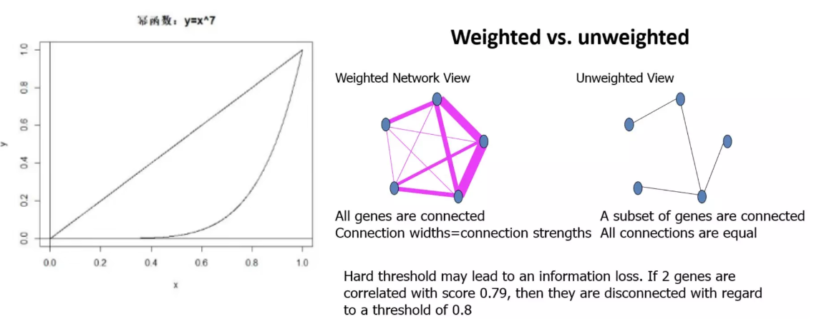

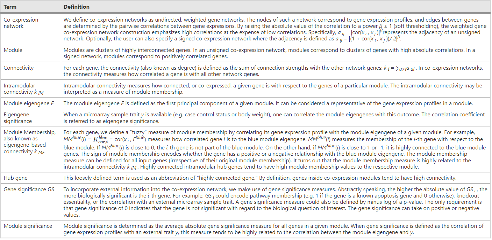

**共表达网络：**定义为加权基因网络。点代表基因，边代表基因表达相关性。加权是指对相关性值进行冥次运算(冥次的值也就是软阈值（power, pickSoftThreshold这个函数所做的就是确定合适的power）)。无向网络的边属性计算方式为  abs(cor(genex, geney)) ^ power；有向网络的边属性计算方式为 (1+cor(genex, geney)/2) ^  power; sign hybrid的边属性计算方式为cor(genex, geney)^power if cor>0 else  0。这种处理方式强化了强相关，弱化了弱相关或负相关，使得相关性数值更符合无标度网络特征，更具有生物意义。如果没有合适的power，一般是由于部分样品与其它样品因为某种原因差别太大导致的，可根据具体问题移除部分样品或查看后面的经验值。

**Module(模块)：**高度內连的基因集。在无向网络中，模块内是高度相关的基因。在有向网络中，模块内是高度正相关的基因。把基因聚类成模块后，可以对每个模块进行三个层次的分析：a. 功能富集分析查看其功能特征是否与研究目的相符；b. 模块与性状进行关联分析，找出与关注性状相关度最高的模块；c.  模块与样本进行关联分析，找到样品特异高表达的模块。

**Connectivity (连接度)：**类似于网络中 “度”(degree)的概念。每个基因的连接度是与其相连的基因的边属性之和。

**Module eigengene：**Eigengene（eigen +‎ gene），基因和样本构成的矩阵，[<u>https://en.wiktionary.org/wiki/eigengene</u>](https://en.wiktionary.org/wiki/eigengene) ，Module eigengene是一个基因模块的代表，通常定义为该模块内所有基因表达谱的第一主成分（PC1）。它代表了整个模块的基因表达谱，并用于计算模块与表型或其他基因模块之间的关联。

**Intramodular connectivity：**给定基因与给定Module内其他基因的关联度，判断基因所属关系。

**Module membership: **给定基因表达谱与给定**Module**的eigengene的相关性。Module membership是一个基因表达谱与给定模块的Module eigengene之间的相关性度量。它表示了单个基因属于某个特定模块的程度。

**Hub gene: **关键基因（连接度最多或连接多个模块的基因）。

**邻近矩阵：**是图的一种存储形式，用一个一维数组存放图中所有顶点数据；用一个二维数组存放顶点间关系（边或弧）的数据，这个二维数组称为邻接矩阵；在WGCNA分析里面指的是基因与基因之间的相关性系数矩阵。 如果用了阈值来判断基因相关与否，那么这个邻近矩阵就是0/1矩阵，只记录基因相关与否。但是WGCNA没有用阈值来卡基因的相关性，而是记录了所有基因之间的相关性。

**Topological Overlap Matrix (TOM) ：**WGNA认为基因之间的简单的相关性不足以计算共表达，所以它利用上面的邻近矩阵，又计算了一个新的邻近矩阵。一般来说，TOM就是WGCNA分析的最终结果，后续的只是对TOM的下游注释。

## 3.分析流程

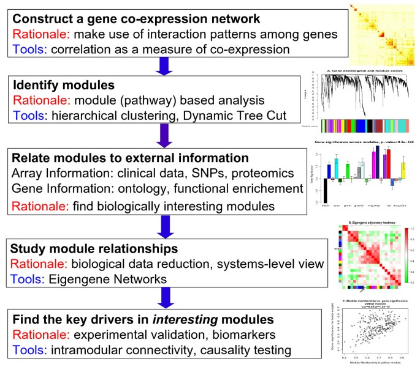

### 3.1. 数据预处理

这部分内容包括以下部分：

+ 读取和过滤基因表达数据
+ 读取样本表型数据
+ 可视化样本聚类和表型数据

官方的示例数据是一个小鼠的芯片表达谱数据，包含了135个雌性小鼠的数据，在提供的表达谱数据中，除了探针ID和样本表达量之外，还有额外的探针注释信息，在读取原始数据时，需要把多余注释信息去除。

对于基因的表达量数据，需要进行过滤，对于基因而言，可以过滤缺失值或者低表达的基因，对于样本而言，如果该样本中基因缺失值很多，也需要过滤，WGCNA内置了一个检验基因和样本的函数，通过该函数可以进行一个基本过滤。基础过滤之后，还可以看下是否存在离群值的样本，通过样本的聚类树进行判断，生成的图片如下。

#### （1）表达数据处理
```plain
library(WGCNA);
# The following setting is important, do not omit.
options(stringsAsFactors = FALSE);
#Read in the female liver data set
femData = read.csv("LiverFemale3600.csv");
# Take a quick look at what is in the data set:
dim(femData);
names(femData);
#=====================================================================================
#  Code chunk 2
#=====================================================================================
datExpr0 = as.data.frame(t(femData[, -c(1:8)]));
names(datExpr0) = femData$substanceBXH;
rownames(datExpr0) = names(femData)[-c(1:8)];
#=====================================================================================
#  Code chunk 3
#=====================================================================================
#检测表达值是否OK
gsg = goodSamplesGenes(datExpr0, verbose = 3);
gsg$allOK
#=====================================================================================
#  Code chunk 4
#=====================================================================================
if (!gsg$allOK){
  # Optionally, print the gene and sample names that were removed:
  if (sum(!gsg$goodGenes)>0)
     printFlush(paste("Removing genes:", paste(names(datExpr0)[!gsg$goodGenes], collapse = ", ")));
  if (sum(!gsg$goodSamples)>0)
     printFlush(paste("Removing samples:", paste(rownames(datExpr0)[!gsg$goodSamples], collapse = ", ")));
  # Remove the offending genes and samples from the data:
  datExpr0 = datExpr0[gsg$goodSamples, gsg$goodGenes]
}
```

  goodSamplesGenes函数过滤有太多遗漏条目的样本，这个函数检查数据是否有缺失条目，并返回一个样本列表，该列表通过了缺失值最大数量的两个标准:缺失值的比例必须低于给定的阈值，缺失基因的总数必须低于给定的阈值。具体用法参数如下：

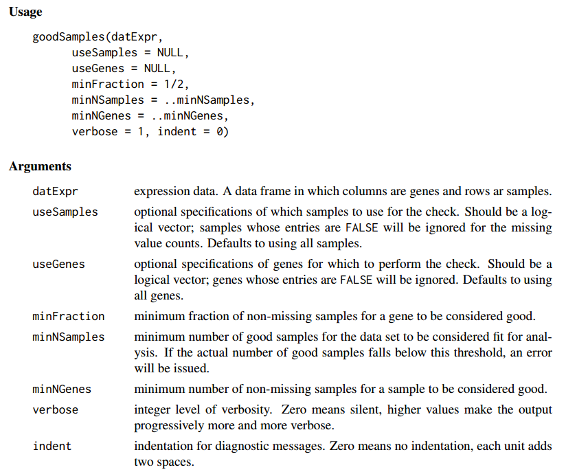

datExpr0 表达矩阵：

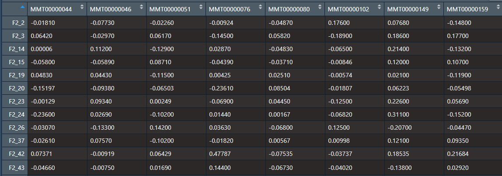

接下来我们基于样本聚类（不同于后面的基因聚类）来查看是否有一些明显的异常值，绘制聚类树形图。

```plain
#=====================================================================================
#  Code chunk 5
#=====================================================================================
sampleTree = hclust(dist(datExpr0), method = "average");
# Plot the sample tree: Open a graphic output window of size 12 by 9 inches
# The user should change the dimensions if the window is too large or too small.
sizeGrWindow(12,9)
#pdf(file = "Plots/sampleClustering.pdf", width = 12, height = 9);
par(cex = 0.6);
par(mar = c(0,4,2,0))
plot(sampleTree, main = "Sample clustering to detect outliers", sub="", xlab="", cex.lab = 1.5,
     cex.axis = 1.5, cex.main = 2)
```

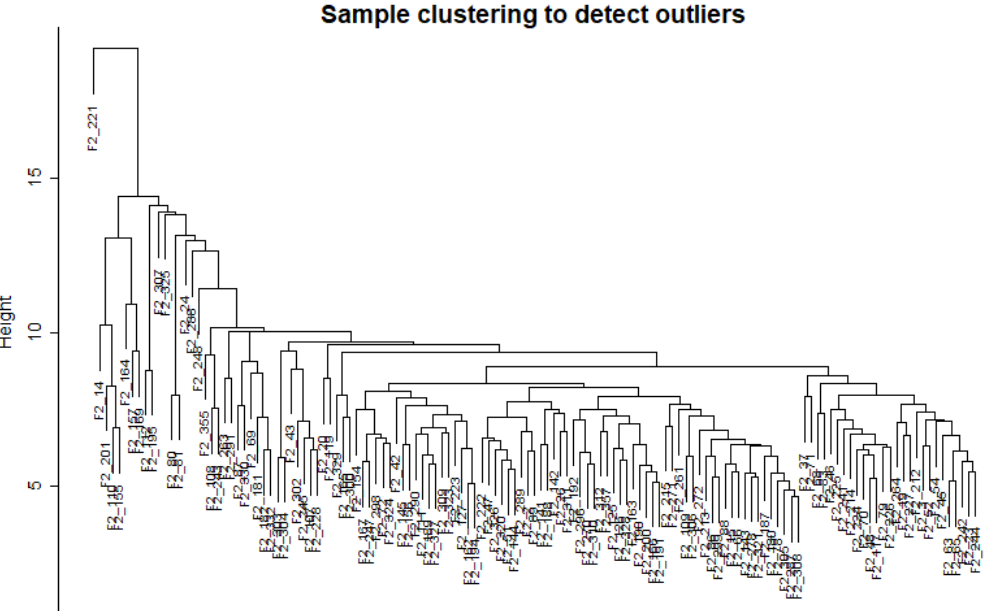

从图上可以看出，F2_221 这个样本和其他样本差距很大，可以将该样本过滤掉。可以手动移除或者使用自动移除方法：选择一个高度来截断移除不符合条件的样本，使用这个高度来进行剪枝（这里我也不知道如何翻译，就使用剪枝这个词来翻译tree cut，决策树也有剪枝，这个剪枝和决策树不同）。

```plain
#=====================================================================================
#  Code chunk 6
#=====================================================================================
# Plot a line to show the cut
abline(h = 15, col = "red");
# Determine cluster under the line
#cutreeStatic模块检测在分层树状图使用恒定高度树切割。只有其大小至少为minSize的分支被保留。clust = cutreeStatic(sampleTree, cutHeight = 15, minSize = 10)
table(clust)
# clust 1 contains the samples we want to keep.
keepSamples = (clust==1)
datExpr = datExpr0[keepSamples, ]
nGenes = ncol(datExpr)
nSamples = nrow(datExpr)
```

cutreeStatic函数用来切枝。模块检测在分层树状图使用恒定高度树切割（这里是15）。只有其大小至少为minSize的分支被保留。具体的说，这个函数直接执行由cutree实现的等高剪切，然后计算每个分支上的对象数量，并且只保留那些至少有minSize对象的分支。table(clust)查看切枝统计，0表示我们切除的1个样本，剩下的134个是正常的样本。具体统计还与切枝高度有关。

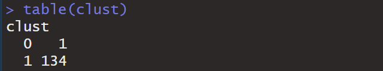

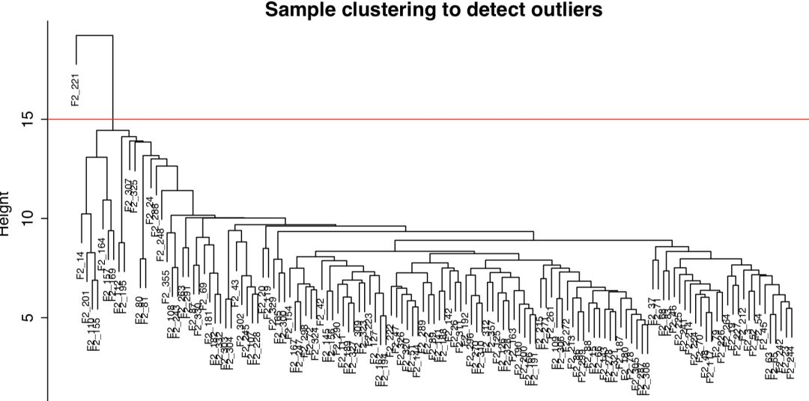

#### （2）临床数据处理

表型数据中也包含了不需要的列，而且其样本比表达谱的样本多，需要根据表达谱的样本提取对应的表型数据。

```plain
#=====================================================================================
#  Code chunk 7
#=====================================================================================
traitData = read.csv("ClinicalTraits.csv");
dim(traitData)
names(traitData)
# remove columns that hold information we do not need.
allTraits = traitData[, -c(31, 16)];
allTraits = allTraits[, c(2, 11:36) ];
dim(allTraits)
names(allTraits)
```

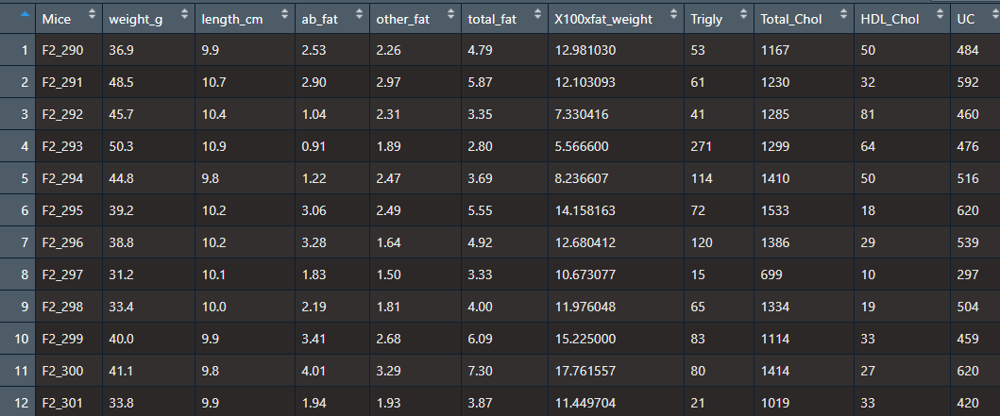

因为表达数据我们处理过，可能会删除一部分样本。所以我们需要再处理一下临床数据。

```plain
femaleSamples = rownames(datExpr);
traitRows = match(femaleSamples, allTraits$Mice);
datTraits = allTraits[traitRows, -1];
rownames(datTraits) = allTraits[traitRows, 1];
```

得到的数据类似于表达矩阵。

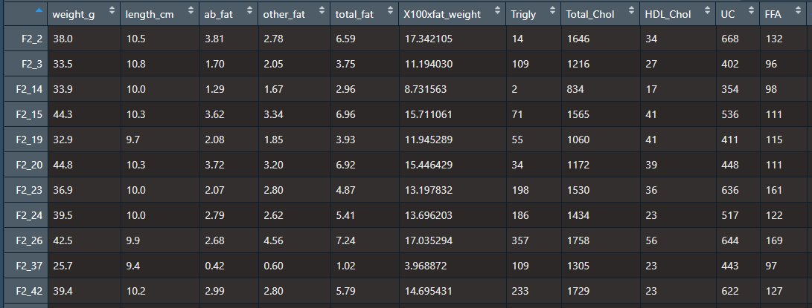

执行垃圾收集，直到空闲内存标识符没有变化为止。

```plain
##执行垃圾收集，直到空闲内存标识符没有变化为止。collectGarbage();
```

表达谱数据和表型数据准备好之后，可以绘制样本聚类树和表型的热图。

```plain
#=====================================================================================
#  Code chunk 8
#=====================================================================================
# Re-cluster samples
sampleTree2 = hclust(dist(datExpr), method = "average")
# Convert traits to a color representation: white means low, red means high, grey means missing entry
traitColors = numbers2colors(datTraits, signed = FALSE);
# Plot the sample dendrogram and the colors underneath.
plotDendroAndColors(sampleTree2, traitColors,
                    groupLabels = names(datTraits),
                    main = "Sample dendrogram and trait heatmap")
```

生成的图片如下。

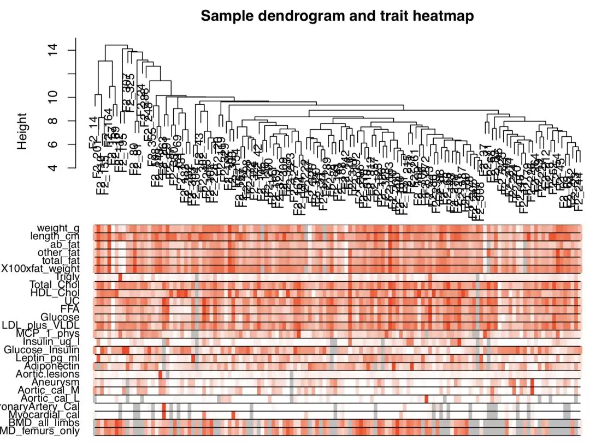

上半部分为样本的聚类树，下半部分为样本对应的表型的热图，顺序和聚类树中的顺序一致，表达量从低到高，颜色从白色过渡到红色，灰色代表缺失值。

最后，保存数据。

```plain
#=====================================================================================
#  Code chunk 9
#=====================================================================================
save(datExpr, datTraits, file = "FemaleLiver-01-dataInput.RData")
```

### 3.2. 识别modules
#### （1）选择软阈值指数：拓扑网络分析

在构建共表达网络时，将基因间的相关系数进行乘方运算来表征其相关性，首先需要确定乘方的值，也就是软阈值或者我们叫power值、beta值。这个power值至关重要！至关重要！至关重要！那怎么选呢？在WGCNA作者的官方介绍中，一般选6就可以。作者基于无尺度网络的理念提出一种选择软阈值指数的方法，来使得基因表达网络达到无尺度网络的状态。使用函数pickSoftThreshold来进行网络拓扑分析，该函数可以帮助使用者选择合适的软阈值指数。使用者选择一系列的待定指数，然后函数返回一系列的即将被检测到的网络指数。

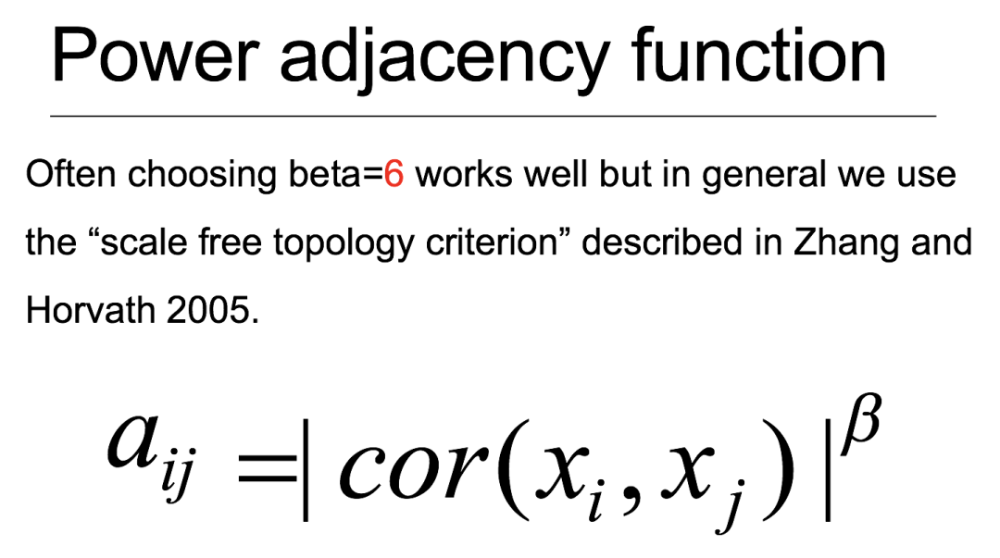

不过因为大家用的表达值都不一样，每次计算出来的阈值也不一样，所以，为了挑选出最佳的阈值，在示例代码中，我们将从1到20所有的整数作为阈值进行计算，去测试最优的阈值。具体怎么测试呢？其中powerEstimate就是最佳的power值，fitIndices保存了每个power对应的网络的特征，也就是每个power构建的相关性网络中的连接度的统计值，k就是连接度值，可以看到，对于每个power值，提供了max, median, max3种连接度的统计量，这里对连接度的均值进行可视化，

```plain
enableWGCNAThreads()
# Load the data saved in the first part
lnames = load(file = "FemaleLiver-01-dataInput.RData");
#The variable lnames contains the names of loaded variables.
lnames
powers = c(c(1:10), seq(from = 12, to=20, by=2))
# Call the network topology analysis function
#多软阈值函数的无尺度拓扑分析。目的是为了帮助用户选择一个合适的软阈值权值用于网络构建。sft = pickSoftThreshold(datExpr, powerVector = powers, verbose = 5)
```

可以明显看到powerEstimate是6，就是最佳的power值。

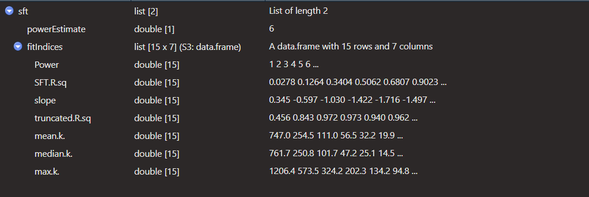

对于每个power值，提供了max, median, max3种连接度的统计量。

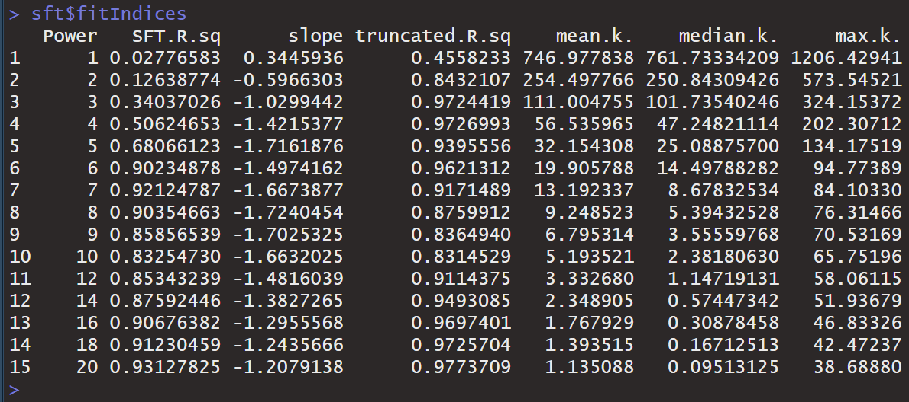

生成的图片如下。

```plain
# Plot the results:
sizeGrWindow(9, 5)
par(mfrow = c(1,2));
cex1 = 0.9;
# Scale-free topology fit index as a function of the soft-thresholding power
plot(sft$fitIndices[,1], -sign(sft$fitIndices[,3])*sft$fitIndices[,2],
     xlab="Soft Threshold (power)",ylab="Scale Free Topology Model Fit,signed R^2",type="n",
     main = paste("Scale independence"));
text(sft$fitIndices[,1], -sign(sft$fitIndices[,3])*sft$fitIndices[,2],
     labels=powers,cex=cex1,col="red");
# this line corresponds to using an R^2 cut-off of h
abline(h=0.90,col="red")
# Mean connectivity as a function of the soft-thresholding power
plot(sft$fitIndices[,1], sft$fitIndices[,5],
     xlab="Soft Threshold (power)",ylab="Mean Connectivity", type="n",
     main = paste("Mean connectivity"))
text(sft$fitIndices[,1], sft$fitIndices[,5], labels=powers, cex=cex1,col="red")
```

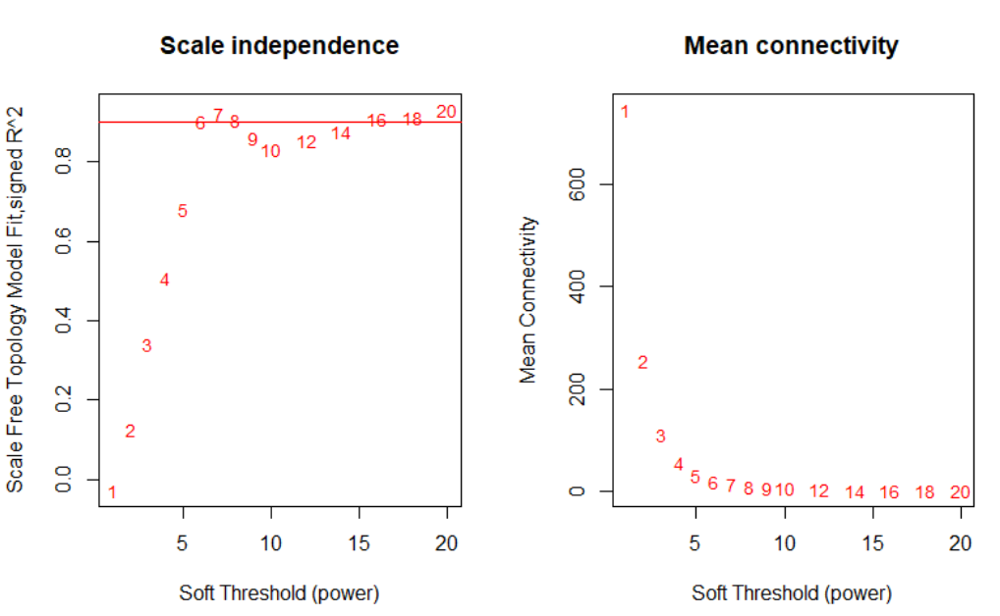

从这个图片中怎么选择power值？最直接的方法：看y轴等于0.9的时候，与曲线的交点，在这个示例数据中，刚好等于6，那我们就选6作为power值。切记：在分析自己数据的时候，power值肯定在6的附近，4-10之内都是可以的，如果离的太远，那就有问题了。之后，就可以用6作为beta值去构建基因module了。

#### （2）网络构建和模块检测
##### a.方法一：自动化构建基因网络和识别模块
```plain
#跨多个数据集进行网络构建和一致性模块检测。net = blockwiseModules(datExpr, power = 6,
                       TOMType = "unsigned", minModuleSize = 30,
                       reassignThreshold = 0, mergeCutHeight = 0.25,
                       numericLabels = TRUE, pamRespectsDendro = FALSE,
                       saveTOMs = TRUE,
                       saveTOMFileBase = "femaleMouseTOM",
                       verbose = 3)
```

在这里，选择软阈值指数为6，一个相对较大的最小模块size为30，一个中等灵敏度deepSplit=2来进行聚类拆分，参数mergeCutHeight是合并模块的阈值，我们指定这个函数返回模块数值而非颜色或者标签并保存TOM。TopologicalOverlapMatrix,这个函数的输出看似神秘却非常好用，例如net$colors保存着模块的分配，net$MEs保存着模块的eigegenes。

```plain
# open a graphics window
sizeGrWindow(12, 9)
# Convert labels to colors for plotting
mergedColors = labels2colors(net$colors)
# Plot the dendrogram and the module colors underneath
plotDendroAndColors(net$dendrograms[[1]], mergedColors[net$blockGenes[[1]]],
                    "Module colors",
                    dendroLabels = FALSE, hang = 0.03,
                    addGuide = TRUE, guideHang = 0.05)
```

生成的图片如下。

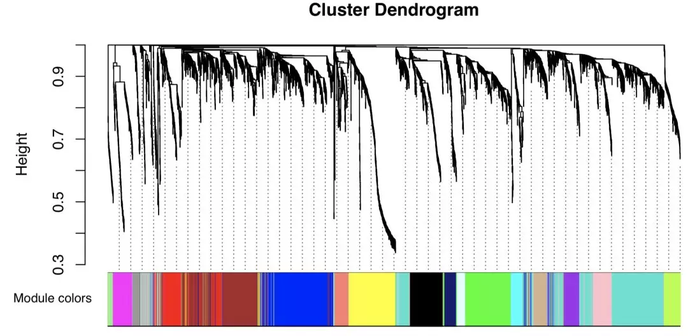

上方为基因的聚类树，聚类时的距离为1-TOM值，下方为基因对应的modules。在WGCNA中，module的概念我们已经讲过了，其实就可以理解成是一个gene group的意思。在WGCNA当中，module的命名是有特定的规则的：按照颜色进行命名。比如blue可以是一个module，brown是另外一个module。

需要注意的是有些读者会那这个代码来用于自己的数据，这个blockwiseModules函数有很多参数，在这个例子中大部分都设置为默认，WGCNA尝试提供了合理的默认参数但是对于特定的数据集来说还是可能不太合适，需要读者仔细阅读帮助文档并调整网络构建和模块检测参数，方向往着生物学相关方向调整就行。第二个需要注意的是参数maxBlockSize制定了函数这个电脑能处理的最大block大小，对个人PC而言默认值是5000，如果代码想要分析超过5000个记录，函数blockwiseModules会拆开数据为多个blocks，这回使得绘图代码失效，想要分析更大的数据集需要做：

内存够大，修改maxBlockSize：4G内存对应5000，以此类推，内存不够，分开计算，在这里我们已经返回了网络分析结果，如果想看多少模块被识别出来，可以使用table(net$colors)，返回值为：

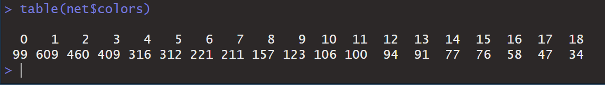

这表明18个模块被识别，1-18模块大小递减，609-34个基因数目的顺次变化.label 0被保留，代表模块外的基因. 用于识别模块的分级聚类的树图保存在net$dendrograms[[1]]中，可以用plotDendroAndColors函数可视化，也就是上面的图。

现在我们保存模块分配和模块的eigengene信息，用于下游的分析。

```plain
moduleLabels = net$colors
moduleColors = labels2colors(net$colors)
MEs = net$MEs;
geneTree = net$dendrograms[[1]];
save(MEs, moduleLabels, moduleColors, geneTree,
     file = "FemaleLiver-02-networkConstruction-auto.RData")
```

##### b.方法二：Step-by-step网络构建和模块识别

下面利用adjacency 函数计算邻近值，datExp是表达数据的数据框。列对应基因，行对应样本。

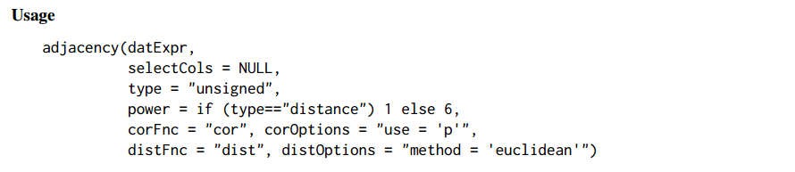

在第一部分我们已经确定了 power 为6。

```plain
softPower = 6;
adjacency = adjacency(datExpr, power = softPower);
```

TOMsimilarity函数根据给定的表达式数据计算拓扑重叠矩阵。

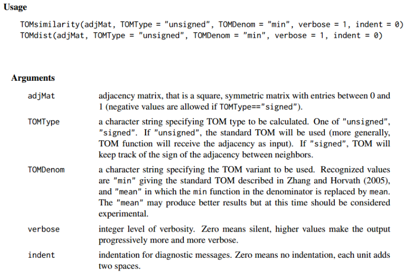

为了最小化噪音和伪相关性，我们转化邻接矩阵为TOM，并计算相对应的dissimilarity(dissTOM)。其实，从一个给定邻接矩阵计算拓扑重叠矩阵。

```plain
# Turn adjacency into topological overlap
TOM = TOMsimilarity(adjacency);
dissTOM = 1-TOM
```

使用分级聚类来产生基因的分级聚类树（dendrogram）。前2步其实就是将自动化构建时 hclust函数中的dist(datExpr)这个参数进行了拆解，一步一步是计算，先计算邻近值，在计算TOM。

```plain
# Call the hierarchical clustering function
geneTree = hclust(as.dist(dissTOM), method = "average");
# Plot the resulting clustering tree (dendrogram)
sizeGrWindow(12,9)
plot(geneTree, xlab="", sub="", main = "Gene clustering on TOM-based dissimilarity",
     labels = FALSE, hang = 0.04);
```

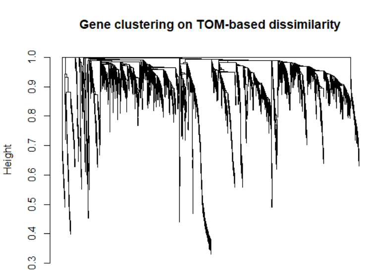

聚类树图中，每一个叶子（一个竖线）代表一个gene，高度共表达的基因的枝干被合在一组，模块识别就是识别这些独立的枝干（dendrogram的剪切），有很多种方法可以做剪枝，WGCNA使用的标准方法是dynamicTreeCut包中的动态剪枝，

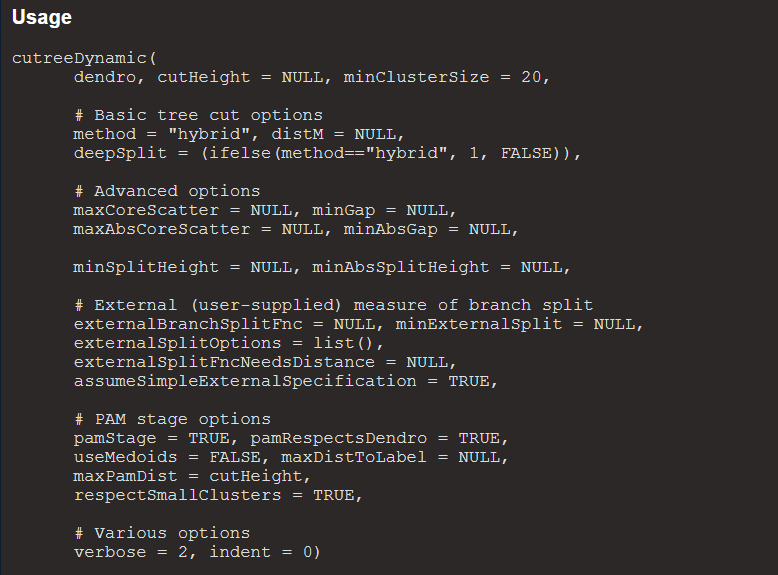

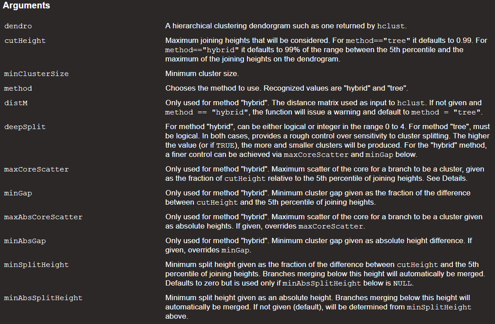

代码为：

```plain
# We like large modules, so we set the minimum module size relatively high:
minModuleSize = 30;
# Module identification using dynamic tree cut:
dynamicMods = cutreeDynamic(dendro = geneTree, distM = dissTOM,
                deepSplit = 2, pamRespectsDendro = FALSE,
                minClusterSize = minModuleSize);
table(dynamicMods)
```

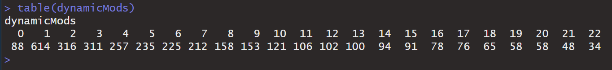

这个函数返回22个模块，标记为1-22，0保留用于未分配的基因，我们可以绘画出模块，labels2colors函数将数字标签的矢量或数组转换为与标签对应的矢量或颜色数组。

```plain
# Convert numeric lables into colors
dynamicColors = labels2colors(dynamicMods)
table(dynamicColors)
```

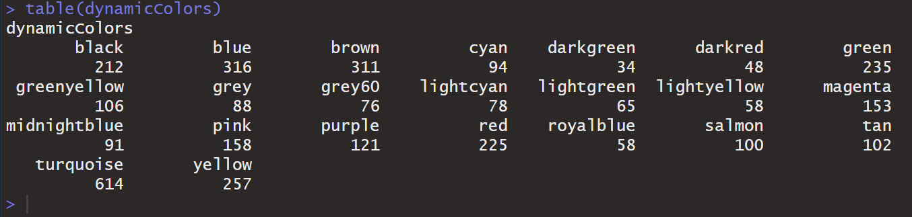

```plain
# Plot the dendrogram and colors underneath
sizeGrWindow(8,6)
plotDendroAndColors(geneTree, dynamicColors, "Dynamic Tree Cut",
                    dendroLabels = FALSE, hang = 0.03,
                    addGuide = TRUE, guideHang = 0.05,
                    main = "Gene dendrogram and module colors")
```

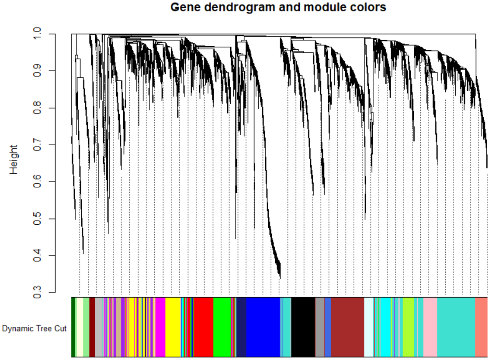

动态剪枝方法可以识别出表达谱类似的模块并合并。为了定量描述模块间的相似性，我们计算eigengenes的协相关关系来聚类：

```plain
# Calculate eigengenes
MEList = moduleEigengenes(datExpr, colors = dynamicColors)
MEs = MEList$eigengenes
# Calculate dissimilarity of module eigengenes
MEDiss = 1-cor(MEs);
# Cluster module eigengenes
METree = hclust(as.dist(MEDiss), method = "average");
# Plot the result
sizeGrWindow(7, 6)
plot(METree, main = "Clustering of module eigengenes",xlab = "", sub = "")
```

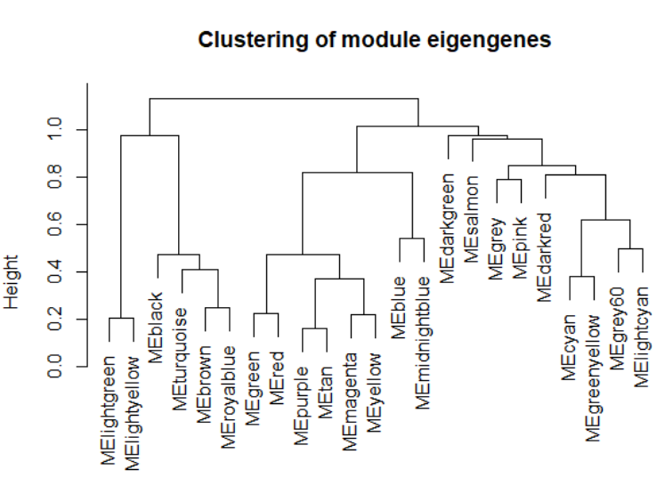

我们选择剪枝高度0.25，也就是协相关值0.75来合并模块：

```plain
MEDissThres = 0.25
# Plot the cut line into the dendrogram
abline(h=MEDissThres, col = "red")
# Call an automatic merging function
merge = mergeCloseModules(datExpr, dynamicColors, cutHeight = MEDissThres, verbose = 3)
# The merged module colors
mergedColors = merge$colors;
# Eigengenes of the new merged modules:
mergedMEs = merge$newMEs;
```

为了查看合并后的样子，我们重新绘制树图，将原始的颜色和合并后的颜色放在下面：

```plain
sizeGrWindow(12, 9)
#pdf(file = "Plots/geneDendro-3.pdf", wi = 9, he = 6)
plotDendroAndColors(geneTree, cbind(dynamicColors, mergedColors),
                    c("Dynamic Tree Cut", "Merged dynamic"),
                    dendroLabels = FALSE, hang = 0.03,
                    addGuide = TRUE, guideHang = 0.05)
#dev.off()
```

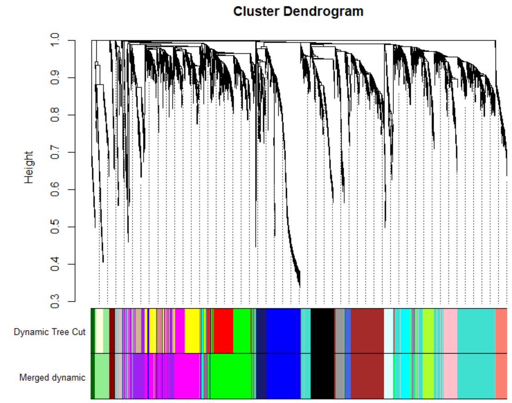

在后续的分析中，我们会用到mergedColors,我们保存这个变量：

```plain
# Rename to moduleColors
moduleColors = mergedColors
# Construct numerical labels corresponding to the colors
colorOrder = c("grey", standardColors(50));
moduleLabels = match(moduleColors, colorOrder)-1;
MEs = mergedMEs;
# Save module colors and labels for use in subsequent parts
save(MEs, moduleLabels, moduleColors, geneTree, file = "FemaleLiver-02-networkConstruction-stepByStep.RData")
```

### 3.3. 筛选和表型相关的module

加载前面分析好的数据

```plain
# Load the expression and trait data saved in the first part
lnames = load(file = "FemaleLiver-01-dataInput.RData");
#The variable lnames contains the names of loaded variables.
lnames
# Load network data saved in the second part.
lnames = load(file = "FemaleLiver-02-networkConstruction-auto.RData");
lnames
```

#### （1）定量模块-临床关系

在这个分析中，我们将识别出和临床表征相关的模块。我们已经有了每个模块总结性的数据eigengeneeigengene，我们将eigengenes和临床数据关联来查看最重要的联系。本质上是计算module的ME值与表型的相关系数，可以对module和表型间的系数的结果进行可视化。

```plain
# 定义基因和样本的数量
nGenes = ncol(datExpr);
nSamples = nrow(datExpr);
# Recalculate MEs with color labels
MEs0 = moduleEigengenes(datExpr, moduleColors)$eigengenes
MEs = orderMEs(MEs0)
moduleTraitCor = cor(MEs, datTraits, use = "p");
moduleTraitPvalue = corPvalueStudent(moduleTraitCor, nSamples);
```

可视化：

```plain
sizeGrWindow(10,6)
# Will display correlations and their p-values
textMatrix =  paste(signif(moduleTraitCor, 2), "\n(",
                           signif(moduleTraitPvalue, 1), ")", sep = "");
dim(textMatrix) = dim(moduleTraitCor)
par(mar = c(6, 8.5, 3, 3));
# Display the correlation values within a heatmap plot
labeledHeatmap(Matrix = moduleTraitCor,
               xLabels = names(datTraits),
               yLabels = names(MEs),
               ySymbols = names(MEs),
               colorLabels = FALSE,
               colors = greenWhiteRed(50),
               textMatrix = textMatrix,
               setStdMargins = FALSE,
               cex.text = 0.5,
               zlim = c(-1,1),
               main = paste("Module-trait relationships"))
```

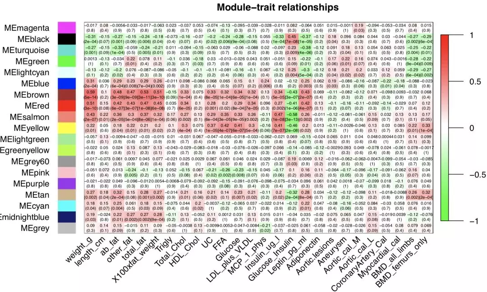

指定一个我们感兴趣的表型，可以得到与其相关性最高的module。在这个图中，红色表示正相关，绿色表示负相关，颜色越深表示相关性越强。比如，以上结果中，和weight这个表型最相关的为module为red和brown，当然也可以自己指定一个阈值，筛选出多个候选的modules。

#### （2）基因和临床表征和重要模块的关系：gene显著性和模块关系

在定量每个基因和感兴趣的临床表征（体重）的联系时，WGCNA定义了基因显著性（Gene Significance，GS）作为基因和表征之间的相关性绝对值。对于每一个模块，WGCNA也定义了模块成员关系（module membership MM）作为模块的engengene和基因表达谱的相关性。这样我们可以对每个模块定量所有基因的相似度。在WGCNA（Weighted Gene Co-Expression Network Analysis，加权基因共表达网络分析）分析中，模块内分析的一个关键步骤是识别那些具有高GS（Gene Significance）和MM（Module Membership）的基因。

GS（Gene Significance）：这是一个衡量基因与特定表型或性状关联程度的指标。GS值越高，说明该基因与所研究的表型或性状之间的关联度越高。

MM（Module Membership）：这是一个衡量基因与其所在模块内其他基因关联程度的指标。MM值越高，说明该基因在模块内的代表性或中心性越强，即该基因与模块内其他基因的共表达关系越强。

```plain
# Define variable weight containing the weight column of datTrait
##临床数据，只取重量这一个表型
weight = as.data.frame(datTraits$weight_g);
names(weight) = "weight" #重命名数据框的列名
# names (colors) of the modules
modNames = substring(names(MEs), 3)#取出颜色名称字符串
##计算表达值与MEs之间的相关性
geneModuleMembership = as.data.frame(cor(datExpr, MEs, use = "p"));
```

corPvalueStudent 函数计算相关性p值。

```plain
MMPvalue = as.data.frame(corPvalueStudent(as.matrix(geneModuleMembership), nSamples));
names(geneModuleMembership) = paste("MM", modNames, sep="");
names(MMPvalue) = paste("p.MM", modNames, sep="");
```

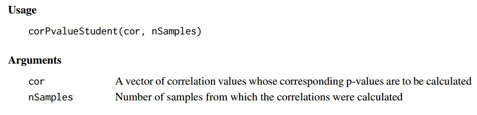

同样的方式计算GSp值。

```plain
geneTraitSignificance = as.data.frame(cor(datExpr, weight, use = "p"));
GSPvalue = as.data.frame(corPvalueStudent(as.matrix(geneTraitSignificance), nSamples));
names(geneTraitSignificance) = paste("GS.", names(weight), sep="");
names(GSPvalue) = paste("p.GS.", names(weight), sep="");
```

#### （3）模块内分析：识别具有高GS和MM的gene

使用GS和MM，我们可以识别一些基因既对体重有重要意义，其所在模块也有高的模块成员关系.例如，我们观测到棕色模块和体重有较高的联系，我们在棕色模块内绘制GS vs. MM的散点图。

```plain
module = "brown"
column = match(module, modNames);
moduleGenes = moduleColors==module;
sizeGrWindow(7, 7);
par(mfrow = c(1,1));
verboseScatterplot(abs(geneModuleMembership[moduleGenes, column]),
                   abs(geneTraitSignificance[moduleGenes, 1]),
                   xlab = paste("Module Membership in", module, "module"),
                   ylab = "Gene significance for body weight",
                   main = paste("Module membership vs. gene significance\n"),
                   cex.main = 1.2, cex.lab = 1.2, cex.axis = 1.2, col = module)
```

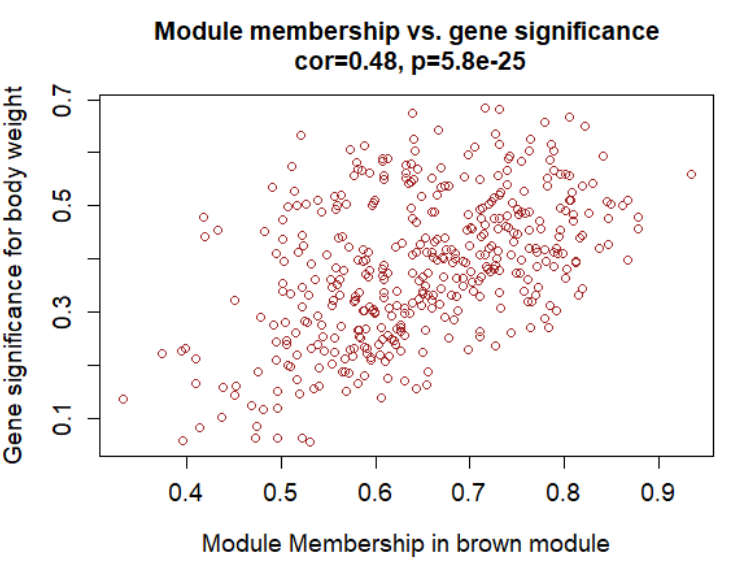

在图中可以看到，GS和MM是高度协相关的，也就是对表征有重要意义的基因就在和该表征关系最密切的模块内。

### 3.4. 生成网络，筛选核心基因

找到和表型关联的module之后，就可以导出指定modules对应的基因共表达网络，方便可视化。所谓WGCNA（共表达网络）分析，说到底还是要构建一个网络的。那么，既然说到网络，就不得不说最厉害的网络图分析软件Cytoscape。它能够帮我们去实现网络图的可视化和深层次的挖掘。在WGCNA中，也可以直接对接Cytoscape，生成的文件可以导入cytoscape进行绘图。

前面的表达数据的基因名并没有注释，这里先注释：

```plain
annot = read.csv(file = "GeneAnnotation.csv");
dim(annot)
names(annot)
probes = names(datExpr)
probes2annot = match(probes, annot$substanceBXH)
# The following is the number or probes without annotation:
sum(is.na(probes2annot))
# Should return 0.
```

我们现在创建一个数据框包含所有probes信息：probe ID, gene symbol, Locus Link ID,Entrezcode, module color, gene significance for weight, module membership , p-values in all modules.

```plain
# Create the starting data frame
geneInfo0 = data.frame(substanceBXH = probes,
                      geneSymbol = annot$gene_symbol[probes2annot],
                      LocusLinkID = annot$LocusLinkID[probes2annot],
                      moduleColor = moduleColors,
                      geneTraitSignificance,
                      GSPvalue)
# Order modules by their significance for weight
modOrder = order(-abs(cor(MEs, weight, use = "p")));
# Add module membership information in the chosen order
for (mod in 1:ncol(geneModuleMembership)){
  oldNames = names(geneInfo0)
  geneInfo0 = data.frame(geneInfo0, geneModuleMembership[, modOrder[mod]],
                         MMPvalue[, modOrder[mod]]);
  names(geneInfo0) = c(oldNames, paste("MM.", modNames[modOrder[mod]], sep=""),
                       paste("p.MM.", modNames[modOrder[mod]], sep=""))
}
# Order the genes in the geneInfo variable first by module color, then by geneTraitSignificance
geneOrder = order(geneInfo0$moduleColor, -abs(geneInfo0$GS.weight));
geneInfo = geneInfo0[geneOrder, ]
```

保存数据

```plain
write.csv(geneInfo, file = "geneInfo.csv")
```

比如我们选定brown这个模块，就可以直接生成如下两个文件：

CytoscapeInput-edges-brown-red.txt

CytoscapeInput-nodes-brown-red.txt

在Cytoscape中直接导入这两个文件就可以做图了，然后通过Cytohubba、MCODE等一系列插件，可以筛选我们感兴趣的核心基因了。至于Cytoscape的操作，我们这里就不再展开，在之前的文章（从网络图探寻基因互作的蛛丝马迹）中我们详细的讲过Cytoscape的使用。

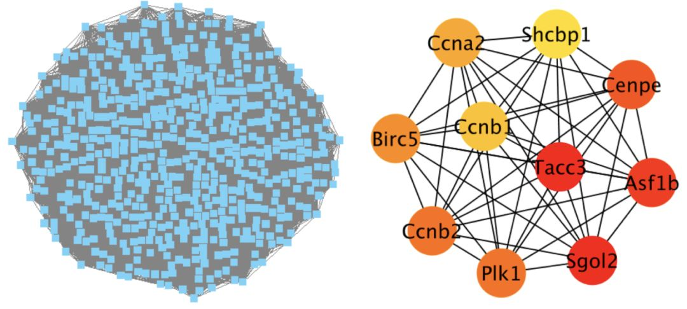

> 更新: 2024-05-30 11:03:19
> 原文: <https://www.yuque.com/doublehelix/bioinfonotes/ipkhb1>
