# 基因表达差异分析

参考文章【[一文就会TCGA数据库基因表达差异分析](https://mp.weixin.qq.com/s/e05YajG5nR5HhVC1xxisOA)】。视频可去B站：[https://www.bilibili.com/video/BV117411Z7Cq](https://www.bilibili.com/video/BV117411Z7Cq) ，


如果二维码失效，后台回复：TCGA-20200313，获取。提取码：0uvi百度网盘，如果下载慢，或者保存超过文件个数，你可以只下载R代码，其他的按照视频教程来。

你需要参考文章：超详细的[DESeq2和edgeR包的基本原理和实战案例](https://mp.weixin.qq.com/s/CtKlpDgtNs3f2NXaoulD5Q)

案列数据下载链接：[https://pan.baidu.com/s/1HcAdYficX7rjq62mTixL1Q](https://pan.baidu.com/s/1HcAdYficX7rjq62mTixL1Q)  提取码：1n3u。这个数据包括了FPKM和counts的。

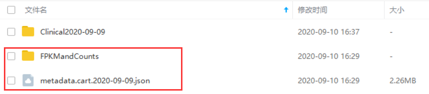

你只需要下载红框中的数据。

网盘gtf文件下载链接：[https://pan.baidu.com/s/1Tx5DD2zztdKG_gt-r9SP2A ](https://pan.baidu.com/s/1Tx5DD2zztdKG_gt-r9SP2A)

提取码：hy9w

很多人在代码1.0中运行

```plain
Counts<- data.frame(c(LUAD_Counts_expMatrix[,dataSmNT],LUAD_Counts_expMatrix[,dataSmTP]))
```

的时候发现，有未定义的列，那是因为TCGAbiolinks包请求的数据可能和你手动下载的数据可能有那么几个病人不在网页下载的数据中。TCGAbiolinks下载的数据好像的确不是很全，再加上这个包现在好像很多函数已经无法使用，我不知道现在更新没。所以区分正常样本和肿瘤样本可以用代码文件：dl.barcode.R，这也是在2.0或者3.0的代码中。为了进一步简化。3.0的代码更为简便，没有视频中的很多步骤。

---

---

## 基因表达差异分析
## 一.数据下载

利用R包下载可参考下面2篇文章：

[1.TCGA数据挖掘（一）：TCGAbiolinks包介绍](https://mp.weixin.qq.com/s?__biz=MzA4NDAzODkzMA==&mid=2651263886&idx=1&sn=1c433a1b2144328a52c0d2d8af5c35ff&scene=19#wechat_redirect)

2[.R语言TCGA-Assembler包下载TCGA数据](https://mp.weixin.qq.com/s?__biz=MzA4NDAzODkzMA==&mid=2651263287&idx=1&sn=6194d0824e8883145508b1b1b92b1227&chksm=841ef54ab3697c5cde3e28c0872685f1b60106add95129f77c2a9553804d0d896788cf9a2c6d&scene=21#wechat_redirect)

关于利用R包下载，我主要用过TCGAbiolinks和GDCRNATools，但是这2个包有些函数现在好像有些问题，所以这部分你自己关注，这里主要是自己下载后从头整理，只需要关注官网在线下载部分。主要是让大家知道细节是一个怎么回事。

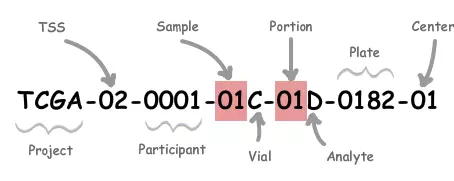

| <br/>Label | <br/>Identifier for | <br/>解释 |
| :--- | :--- | :--- |
| <br/>Project | <br/>Project name | <br/>来自哪个项目: 如TCGA、TARGET等等 |
| <br/>TSS | <br/>Tissue source site | <br/>样品来自哪个组织机构：01 代表International Genomics Consortium, 更多见：[TSS](https://www.omicsclass.com/article/1079) |
| <br/>Participant | <br/>Study participant | <br/>样品唯一编号(可以理解为一个病人唯一编号） |
| <br/>Sample | <br/>Sample type | <br/>样品来自人体组织类型，如：01代表Primary Solid Tumor， 更多见：[SampleType](https://www.omicsclass.com/article/1080) |
| <br/>Vial | <br/>Order of sample in a sequence of samples | <br/>一份样品被分割成好几份，表示第几份，通常是A-Z编号 |
| <br/>Portion | <br/>Order of portion in a sequence of 100-120 mg sample portions | <br/>每份样品再分割成不同的小样品：01-99等等编号，代表第几份 |
| <br/>Analyte | <br/>Molecular type of analyte for analysis | <br/>实验数据来源分子类型，如R代表 RNA，D代表DNA等等，更多见：[Portion / Analyte Codes](https://gdc.cancer.gov/resources-tcga-users/tcga-code-tables/portion-analyte-codes) |
| <br/>Plate | <br/>Order of plate in a sequence of 96-well plates | <br/>96孔序列中板的顺序，4个数字组成 |
| <br/>Center | <br/>Sequencing or characterization center that will receive the aliquot for analysis | <br/>数据由哪个机构分析：如 01代表The Broad Institute GCC,更多见：[Center](https://www.omicsclass.com/article/1081) |

### 1. 官网在线下载

在线下载lung cancer(只选择LUAD)转录组数据的筛选条件，下载日期2020年2月5日。

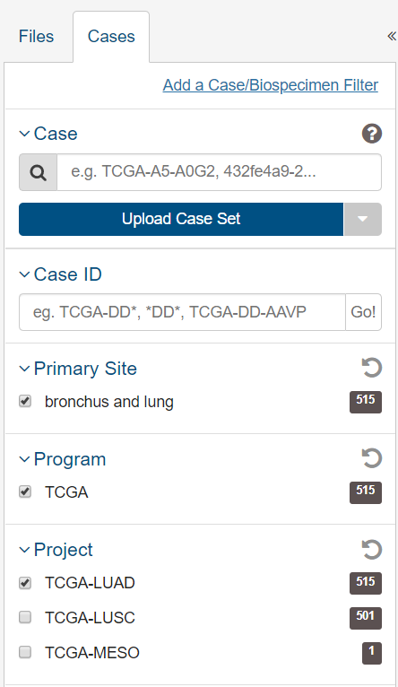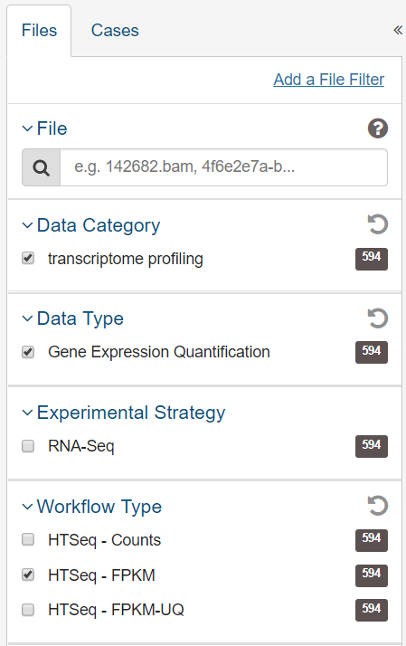

下载的数据类型，用R包分析差异基因下载原始的Counts数据，选择几个基因分析，下载FPKM数据。这里下载FPKM数据。

添加到购物车，下载Manifest文件和cart文件还有Metadata文件。

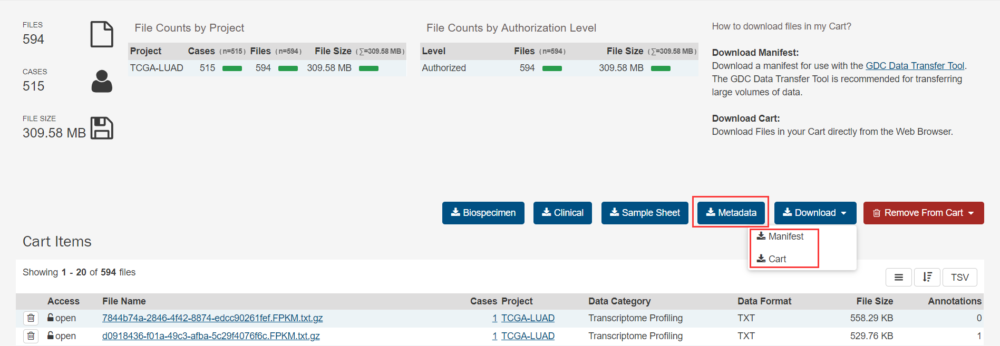

### 2.官网下载工具下载

Data Transfer Tool：[https://gdc.cancer.gov/access-data/gdc-data-transfer-tool](https://gdc.cancer.gov/access-data/gdc-data-transfer-tool)

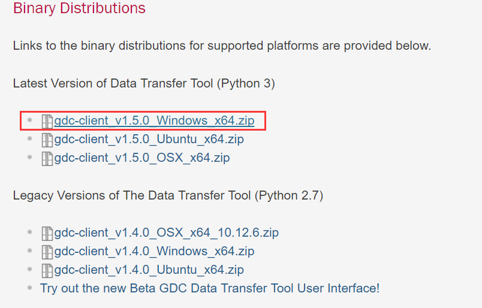

把gdc-client加入环境变量：上面配置都完成后，dos窗口输入gdc-client -h检验环境变量是否配制成功。

下载方式很简单，还记得上文中下载的Manifest文件吧，然后在windows下打开cmd，并在其中输入下载命令：

```plain
gdc-client download -m gdc_manifest_20200211_063426.txt
```

然后就是慢慢下载了，如果中间有报错断了，一般就是网络不好的原因，重新下载或者换个时间段就行了。国内利用这个下载速度还是挺慢的。

### 3. R语言TCGAbiolinks包下载

TCGAbiolinks包下载数据超级慢，可以选择官网下载。这个包只下载数据的话可以试试，我好久没有用啦。

```plain
########################## 这里下载的是Counts数据，不是FPKM数据####################
setwd(".")
# 加载相应的包，可能会需要其他包，提示错误就安装缺少的包。
# 因为每个人已经安装的包不一样。library(TCGAbiolinks)
# 请求数据。query <- GDCquery(project = "TCGA-LUAD",
                  data.category = "Transcriptome Profiling",
                  data.type = "Gene Expression Quantification",
                  workflow.type = "HTSeq - Counts")
# 从query中获取结果表，它可以选择带有cols参数的列，并使用rows参数返回若干行。
# 594个barcode
samplesDown <- getResults(query,cols=c("cases"))
# 533个barcode
dataSmTP <- TCGAquery_SampleTypes(barcode = samplesDown,
                                  typesample = "TP")
# 59个barcode
dataSmNT <- TCGAquery_SampleTypes(barcode = samplesDown,
                                  typesample = "NT")
# 59个正常组织和533个肿瘤组织样本作为研究
dataSmTP_short <- dataSmTP[1:533]
dataSmNT_short <- dataSmNT[1:59]
# 根据前面的筛选，再次请求数据
queryDown <- GDCquery(project = "TCGA-LUAD",
                      data.category = "Transcriptome Profiling",
                      data.type = "Gene Expression Quantification",
                      workflow.type = "HTSeq - Counts",
                      barcode = c(dataSmTP_short, dataSmNT_short))
#读取下载的数据并将其准备到R对象中，在工作目录生成LUAD_case.rda文件，
#同时还产生Human_genes__GRCh38_p12_.rda文件
GDCdownload(query = queryDown)
dataPrep1 <- GDCprepare(query = queryDown, save = TRUE, save.filename = "LUAD_case.rda")
```

如果下载其他癌症的数据，可通过getGDCprojects()$project_id查看数据框中的project。

```plain
> getGDCprojects()$project_id
 [1] "TCGA-READ"             "TCGA-MESO"             "TCGA-ACC"              "TCGA-LGG"
 [5] "BEATAML1.0-CRENOLANIB" "TCGA-THCA"             "TCGA-SARC"             "TARGET-CCSK"
 [9] "TARGET-NBL"            "TARGET-AML"            "WCDT-MCRPC"            "HCMI-CMDC"
[13] "TCGA-BRCA"             "VAREPOP-APOLLO"        "TCGA-CHOL"             "TCGA-KIRC"
[17] "TCGA-OV"               "TCGA-GBM"              "ORGANOID-PANCREATIC"   "GENIE-VICC"
[21] "TCGA-SKCM"             "TCGA-TGCT"             "CGCI-BLGSP"            "TCGA-KICH"
[25] "TCGA-THYM"             "TCGA-UVM"              "TCGA-PRAD"             "TCGA-LUSC"
[29] "FM-AD"                 "BEATAML1.0-COHORT"     "TCGA-DLBC"             "OHSU-CNL"
[33] "TARGET-ALL-P2"         "TCGA-STAD"             "TCGA-LAML"             "GENIE-DFCI"
[37] "TARGET-ALL-P3"         "TCGA-UCEC"             "GENIE-JHU"             "GENIE-NKI"
[41] "GENIE-MDA"             "CPTAC-3"               "GENIE-MSK"             "TARGET-OS"
[45] "TCGA-HNSC"             "TCGA-ESCA"             "TARGET-RT"             "CTSP-DLBCL1"
[49] "TCGA-LIHC"             "TCGA-COAD"             "TCGA-KIRP"             "TARGET-WT"
[53] "TCGA-CESC"             "TCGA-LUAD"             "GENIE-UHN"             "MMRF-COMMPASS"
[57] "TARGET-ALL-P1"         "GENIE-GRCC"            "CPTAC-2"               "TCGA-PAAD"
```

缩写	英文名称	中文名称

ACC	Adrenocortical carcinoma	肾上腺皮质癌

BLCA	Bladder Urothelial Carcinoma	膀胱尿路上皮癌

BRCA	Breast invasive carcinoma	乳腺浸润癌

CESC	Cervical squamous cell carcinoma and endocervical adenocarcinoma	宫颈鳞癌和腺癌

CHOL	Cholangiocarcinoma	胆管癌

COAD	Colon adenocarcinoma	结肠癌

COADREAD	Colon adenocarcinoma/Rectum adenocarcinoma Esophageal carcinoma	结直肠癌

DLBC	Lymphoid Neoplasm Diffuse Large B-cell Lymphoma	弥漫性大B细胞淋巴瘤

ESCA	Esophageal carcinoma	食管癌

FPPP	FFPE Pilot Phase II	FFPE试点二期

GBM	Glioblastoma multiforme	多形成性胶质细胞瘤

GBMLGG	Glioma	胶质瘤

HNSC	Head and Neck squamous cell carcinoma 	头颈鳞状细胞癌

**KICH	Kidney Chromophobe	肾嫌色细胞癌**

**KIRC 	Kidney renal clear cell carcinoma	肾透明细胞癌**

**KIRP	Kidney renal papillary cell carcinoma 	肾乳头状细胞癌**

LAML	Acute Myeloid Leukemia	急性髓细胞样白血病

LGG	Brain Lower Grade Glioma	脑低级别胶质瘤

LIHC	Liver hepatocellular carcinoma	肝细胞肝癌

LUAD	Lung adenocarcinoma	肺腺癌

LUSC	Lung squamous cell carcinoma	肺鳞癌

MESO	Mesothelioma	间皮瘤

OV	Ovarian serous cystadenocarcinoma	卵巢浆液性囊腺癌

PAAD	Pancreatic adenocarcinoma	胰腺癌

PCPG	Pheochromocytoma and Paraganglioma	嗜铬细胞瘤和副神经节瘤

PRAD	Prostate adenocarcinoma	前列腺癌

READ	Rectum adenocarcinoma	直肠腺癌

SARC	Sarcoma	肉瘤

SKCM	Skin Cutaneous Melanoma	皮肤黑色素瘤

STAD	Stomach adenocarcinoma	胃癌

STES	Stomach and Esophageal carcinoma	胃和食管癌

TGCT	Testicular Germ Cell Tumors	睾丸癌

THCA	Thyroid carcinoma	甲状腺癌

THYM	Thymoma	胸腺癌

UCEC	Uterine Corpus Endometrial Carcinoma	子宫内膜癌

UCS	Uterine Carcinosarcoma	子宫肉瘤

UVM	Uveal Melanoma	葡萄膜黑色素瘤

AML	Acute Myeloid Leukemia	急性髓系白血病

CCSK	Clear Cell Sarcoma of the Kidney	肾透明细胞肉瘤

NBL	Neuroblastoma	神经母细胞瘤

OS	Osteosarcoma	骨肉瘤

RT	Rhabdoid Tumor	横纹肌样瘤

WT	High-Risk Wilms Tumor	高危肾母细胞瘤

## 二. 数据的整理

下载的数据，每个样本的数据分别不同文件夹下，我们需要将所有文件移动到同一个文件夹下。

1. **移动文件**

下面是R语言移动的代码：

```plain
options(stringsAsFactors = F)
setwd("./")#设置工作目录
#################################数据下载##########################
##使用网页在线下载
##下载的数据解压后将文件夹重命名为：HTSeqCounts
#################################数据处理##########################
# 将所有文件移动到同一个文件夹SampleFiles下
if(!dir.exists("SampleFiles")){dir.create("SampleFiles")}
filepath <- dir(path ="./HTSeqCounts",full.names = TRUE)
for(wd in filepath){
  files <-dir(path = wd,pattern="gz$") #查看满足条件文件
  fromfilepath <- paste(wd,"\\",files,sep ="")
  tofilepath <- paste(".\\SampleFiles\\",files,sep ="")
  file.copy(fromfilepath,tofilepath)
}
```

### 2. 解压文件

这一步有点多余，可以不做。直接读入数据。

解压所有文件并删除原文件

```plain
########################### 解压所有文件并删除原文件###################
####其实有些多余，熟悉R后，是可以直接读入的。setwd(".\\SampleFiles")
if(file.exists("MANIFEST.txt")){file.remove("MANIFEST.txt")}
countsFiles <-dir(path = ".\\",pattern="gz$") #查看满足条件文件
library(R.utils)
sapply(countsFiles, gunzip) # 解压函数gunzip需要安装R.utils包
```

### 3. 处理json文件

因为我们下载的样本数据的文件名很难看出是什么样本信息。我们需要找到文件对应样品的barcode。

```plain
####################### 处理json文件#################################
library(rjson)
metadata_json_File <- fromJSON(file="..\\metadata.cart.2020-06-16.json")
json_File_Info <- data.frame(filesName = c(),TCGA_Barcode = c())
for(i in 1:length(metadata_json_File)){
  TCGA_Barcode <- metadata_json_File[[i]][["associated_entities"]][[1]][["entity_submitter_id"]]
  file_name <- metadata_json_File[[i]][["file_name"]]
  json_File_Info <- rbind(json_File_Info,data.frame(filesName = file_name,TCGA_Barcode = TCGA_Barcode))
}
rownames(json_File_Info) <- json_File_Info[,1]
write.csv(json_File_Info,file = "..\\json_File_Info.CSV")
```

我们运行代码后会得到一个文件名称与barcode对应关系的文件：json_File_Info.CSV

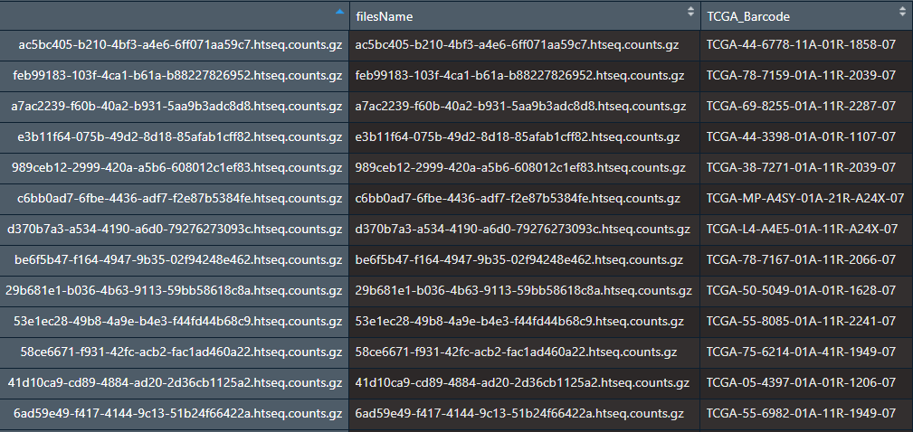

## 三. 数据融合

即将所有样本合并成一个数据框

```plain
########################## 获取Counts矩阵#######################
filesName_To_TCGA_BarcodeFile <- json_File_Info[-1]
countsFileNames<-dir(pattern="counts$") #list.files()函数也行
allSampleRawCounts <- data.frame()
for(txtFile in countsFileNames){
  #每一个循环读取一个文件
  print(paste0("正在读入文件：",txtFile))
  SampleCounts <- read.table(txtFile,header =FALSE)
  rownames(SampleCounts) <- SampleCounts[,1]
  SampleCounts <- SampleCounts[-1]
  # 根据filesName_To_TCGA_BarcodeFile文件中文件名称与barcode对应关系，命名列名
  colnames(SampleCounts) <- filesName_To_TCGA_BarcodeFile[paste(txtFile,".gz",sep = ""),]
  if (dim(allSampleRawCounts)[1]== 0){
    allSampleRawCounts <- SampleCounts
  }
  else
  {allSampleRawCounts<- cbind(allSampleRawCounts,SampleCounts)}
}
write.csv(allSampleRawCounts,file = "..\\allSampleRawCounts.CSV")
ensembl_id <- substr(row.names(allSampleRawCounts),1,15)
rownames(allSampleRawCounts) <- ensembl_id
#RawCounts.CS文件与allSampleRawCounts.CSV文件的区别在于行名的ensembl去掉了版本号
write.csv(allSampleRawCounts,file = "..\\RawCounts.CSV")
```

运行代码后我们会得到一个RawCounts.CSV的文件，行名是Ensembl ID,列名是样品名称，用于后面的分析。

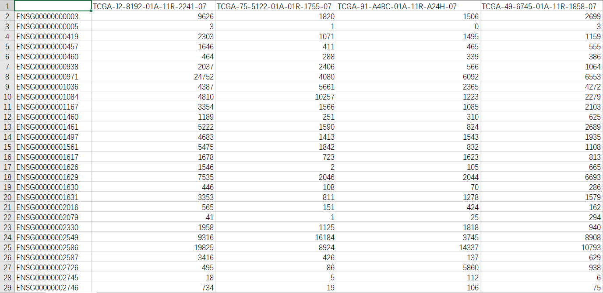

## 四. ID转换

[参考文章](https://mp.weixin.qq.com/s?src=11&timestamp=1581245491&ver=2148&signature=Tqc3mBFhZXrl1TIEi9TtROMKA1CsPCirp-pL3tVcX8M6MAkDqpaZ6Rc6rrF9jIZcte03mQma-kPdSNzJ7395zicreulip2VNHwojXk9fEJTC9kRvkI17bHLlWEY1jTnT&new=1)

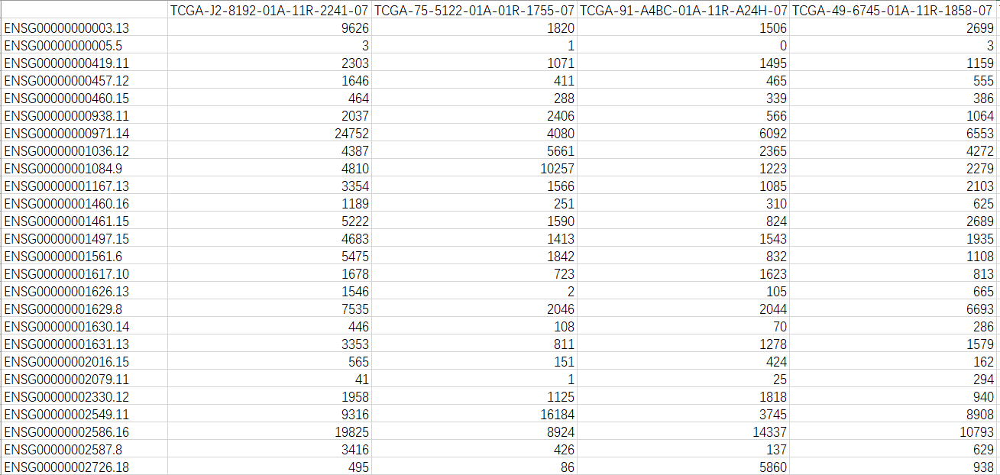

ENSG00000000003.13中小数点之后的数字是版本号，删掉即可。

```plain
#####################  ID转换  ####################
# 添加一列Ensemble_ID到RawCounts数据框中
RawCounts <- allSampleRawCounts
RawCounts <- data.frame(Ensembl_ID = row.names(RawCounts),RawCounts,check.names = F)
# 一个函数，通过gtf文件获取Ensemble_ID与基因名称的对应关系
#关于基因注释可参考文章
get_map = function(input) {
  if (is.character(input)) {
    if(!file.exists(input)) stop("Bad input file.")
    message("Treat input as file")
    input = data.table::fread(input, header = FALSE)
  } else {
    data.table::setDT(input)
  }

  input = input[input[[3]] == "gene", ]

  pattern_id = ".*gene_id \"([^;]+)\";.*"
  pattern_name = ".*gene_name \"([^;]+)\";.*"


  gene_id = sub(pattern_id, "\\1", input[[9]])
  gene_name = sub(pattern_name, "\\1", input[[9]])

  Ensembl_ID_TO_Genename <- data.frame(gene_id = gene_id,
                                       gene_name = gene_name,
                                       stringsAsFactors = FALSE)
  return(Ensembl_ID_TO_Genename)
}
#注意传入gtf文件路径
Ensembl_ID_TO_Genename <- get_map("../human.v33lift37.annotation.gtf")
gtf_Ensembl_ID <- substr(Ensembl_ID_TO_Genename[,1],1,15)
Ensembl_ID_TO_Genename <- data.frame(gtf_Ensembl_ID,Ensembl_ID_TO_Genename[,2])
colnames(Ensembl_ID_TO_Genename) <- c("Ensembl_ID","gene_id")
write.csv(Ensembl_ID_TO_Genename,file = "..\\Ensembl_ID_TO_Genename.csv")
#融合数据
mergeRawCounts <- merge(Ensembl_ID_TO_Genename,RawCounts,by="Ensembl_ID")
#按照gene_id列进行排序
mergeRawCounts <- mergeRawCounts[order(mergeRawCounts[,"gene_id"]),]
# 根据gene_id列建立索引
index<-duplicated(mergeRawCounts$gene_id)
#我们想要的那一行为FALSE，所以要取反。mergeRawCounts <- mergeRawCounts[!index,]
#利用基因名称作为行名
rownames(mergeRawCounts) <-mergeRawCounts[,"gene_id"]
# 删除前2列
LUAD_Counts_expMatrix <- mergeRawCounts[,-c(1:2)]
# 保存文件
write.csv(LUAD_Counts_expMatrix,file = "..\\LUAD_Counts_expMatrix.csv")
```

gtf文件下载：[https://www.gencodegenes.org/human/](https://www.gencodegenes.org/human/)

运行上面代码后会得到一个Ensembl_ID与基因名称的对应关系的数据框：

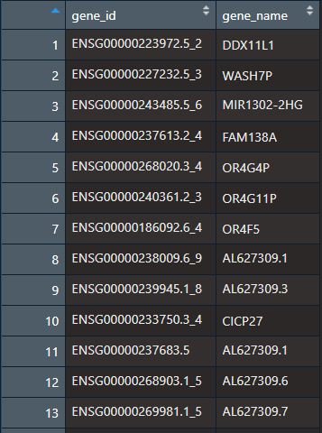

关于生信中的各种ID转换，我在文章中有介绍[https://mp.weixin.qq.com/s/lazavD3jzRVO4QkxysHQcg](https://mp.weixin.qq.com/s/lazavD3jzRVO4QkxysHQcg) ，这篇文章是付费文章，隐藏内容仅仅是gtf文件进行ID转换的内容，你不需要去付费。下面代码是一个函数，和上面的函数一样，用于基因转换的，只是提取的信息比较多，上面提取的基因很多，包括了假基因，下面代码还提取了更多基因的信息包括是编码蛋白的还是非编码RNA的，又或者是假基因。你自己把上面的gtf文件作为输入，运行一次看结果。都是处理同一文件，但返回的数据框的列名不一样，用在上面需要自己更改后续的代码。
3.0的代码就是值分析编码蛋白的基因。

```plain
############## 一个函数，通过gtf文件获取Ensemble_ID与基因名称的对应关系
get_map <- function(input) {
  if (is.character(input)) {
    if(!file.exists(input)) stop("Bad input file.")
    message("Treat input as file")
    input = data.table::fread(input, header = FALSE)
  } else {
    data.table::setDT(input)
  }
  input = input[input[[3]] == "gene", ]
  pattern_id = ".*gene_id \"([^;]+)\";.*"
  pattern_name = ".*gene_name \"([^;]+)\";.*"
  pattern_type = ".*gene_type \"([^;]+)\";.*"
  gene_id = sub(pattern_id, "\\1", input[[9]])
  gene_name = sub(pattern_name, "\\1", input[[9]])
  gene_type = sub(pattern_type, "\\1", input[[9]])
  EnsemblTOGenename <- data.frame(Ensembl = gene_id,
                                  gene_name = gene_name,
                                  gene_type = gene_type,
                                  stringsAsFactors = FALSE)
  return(EnsemblTOGenename)
}
```

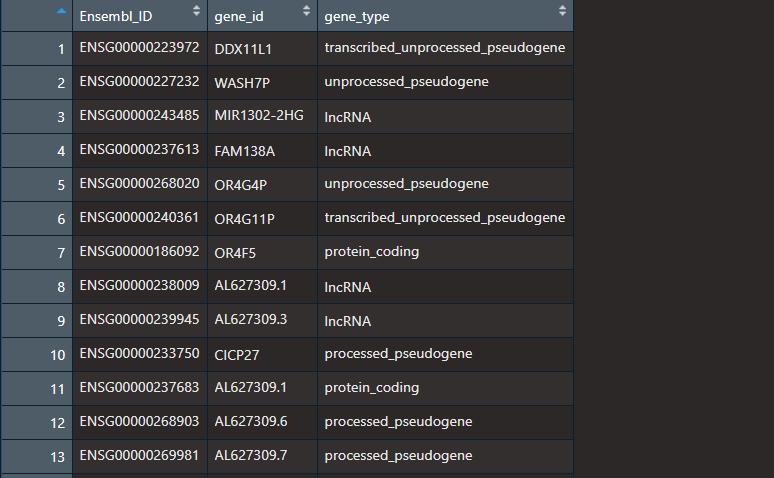

## 五. 表达差异分析

**DESeq2和EdgeR包**: 都可用于做基因差异表达分析，主要也是用于RNA-Seq数据，同样也可以处理类似的ChIP-Seq,shRNA以及质谱数据。这两个都属于R包，其相同点在于都是对count data数据进行处理，都是基于负二项分布模型。

差异分析可以参考文章：[超详细的DESeq2和edgeR包的基本原理和实战案例 ](https://mp.weixin.qq.com/s/CtKlpDgtNs3f2NXaoulD5Q)。

```plain
#############################差异分析#################################
library(stringr)
##处理barcode
DLbarcode <- function(barcode){ #处理TCGA病人的barcode，返回一个排序后的向量
  TumorBarcode <- c() #记录肿瘤样本的barcode
  NormalBarcode <- c()#记录正常样本的barcode
  for (id in barcode) {
    ids <- str_split(id,'-',simplify = T)[4]
    ids <- as.numeric(substr(ids,1,1))

    if(ids == 0){
      TumorBarcode <- c(TumorBarcode,id)
    }else if (ids == 1) {
      NormalBarcode <-c(NormalBarcode,id)
    }
  }
  print(paste0("正常样本数：",length(NormalBarcode)))
  print(paste0("肿瘤样本数：",length(TumorBarcode)))
  print("正常样本在前,肿瘤样本再后")
  return(list(sortBarcode=c(NormalBarcode,TumorBarcode),
              Norm = length(NormalBarcode),
              Tumm = length(TumorBarcode)))
}
barcodeSort <- DLbarcode(colnames(LUAD_Counts_expMatrix))
Norm = barcodeSort$Norm #正常样本数,如果为0，就不能在进行差异分析了
##TCGA中有一些肿瘤是没有正常样本的
Tumm = barcodeSort$Tumm #肿瘤样本数
# 重新排序样本顺序，正常组织样本在前，肿瘤样本在后，即前59列我正常样本
Counts <- LUAD_Counts_expMatrix[,barcodeSort$sortBarcode]
ncol(Counts)
# 在edgeR中，1代表control样本，2代表case样本。
# 原始数据中有592个样本，对照有59个和实验组各533个。所以我们可以创建一个分组向量。
###################方法一：edgeR
# 包的安装
# BiocManager::install( "edgeR" )
library( "edgeR" )
# 创建分组
group <- c(rep(1,Norm),rep(2,Tumm))
# 创建DGEList类型变量
# 这一步相当于创建一列表。注意group中的顺序和counts中行名要对应，
# 也就是对照组和实验组要指定正确。这里前59列为control，后533列为case。y <- DGEList(counts=Counts, group=group)
# 数据过滤
keep <- filterByExpr(y)
y <- y[keep, , keep.lib.sizes=FALSE]
# 计算标准化因子
y <- calcNormFactors(y)
# 计算离散度
y <- estimateDisp(y)
# 显著性检验
et <- exactTest(y)
# 获取排名靠前的基因，这里设置n=100000是为了输出所以基因
et <- topTags(et, n=100000)
# 转换为数据框类型
et <- as.data.frame(et)
# 将行名粘贴为数据框的第一列
et <- cbind(rownames(et),et)
# 指定列名
colnames(et) <- c("gene_id", "log2FoldChange", "log2CPM", "PValue", "FDR")
# 保存数据到本地
write.table(et, "..\\all_LUAD_DEG.xls", sep = "\t", col.names = TRUE,
            row.names = FALSE, quote = FALSE, na = "")
# 差异基因筛选
etSig <- et[which(et$PValue < 0.05 & abs(et$log2FoldChange) > 1),]
# 加入一列，up_down 体现上下调信息
etSig[which(etSig$log2FoldChange > 0), "up_down"] <- "Up"
etSig[which(etSig$log2FoldChange < 0), "up_down"] <- "Down"
# 保存文件
write.table(etSig, "..\\LUAD_DEG.xls", sep = "\t",
            col.names = TRUE, row.names = FALSE, quote = FALSE, na = "")
#####方法二：DESeq2
# 包的安装和加载
# BiocManager::install("DESeq2")
library("DESeq2")
####创建分组
# 在DESeq2中，对照组是control样本，实验组是case。DESeq2group <- c(rep("control",Norm),rep("case",Tumm))
# 创建实验分组
colData <- data.frame(row.names = names(Counts),
                      condition =factor(DESeq2group,
                                        levels = c("control","case")))
# 构建DESeqDataSet对象
# 构建DESeqDataSet对象用于分析，colData指定我们的样本信息和分组列表，
# design = ~ condition表示分组信息安装colData的condition列分组。dds <- DESeqDataSetFromMatrix(countData = Counts, colData = colData,
                              design = ~ condition)
# 函数分析差异
dds <- DESeq(dds)
# 计算标准化因子
sizeFactors(dds)
#提取差异表达结果
res <- results(dds)
res <- as.data.frame(res)
# 添加一列
res <- cbind(rownames(res), res)
# 重命名列名
colnames(res) <- c("gene_id", "baseMean", "log2FoldChange", "lfcSE", "stat",
                   "pval", "padj")
#保存文件到本地
write.table(res, "..\\case-vs-control-all-DESeq2.gene.xls",
            sep = "\t", col.names = TRUE, row.names = FALSE, quote = FALSE,
            na = "")
# 获取差异基因
resSig <- res[which(res$pval < 0.05 & abs(res$log2FoldChange) > 1),]
resSig[which(resSig$log2FoldChange > 0), "up_down"] <- "Up"
resSig[which(resSig$log2FoldChange < 0), "up_down"] <- "Down"
write.table(resSig, "..\\case-vs-control-diff-pval-0.05-FC-2-DESeq2.gene.xls",
            sep = "\t", col.names = TRUE, row.names = FALSE, quote = FALSE, na = "")
#火山图
diffData <- resSig[which(abs(resSig$log2FoldChange) >= 3& resSig$padj < 0.001),]
####可视化
volFig <- pdf("LuminalABvsNormal_FC6.TSS.pdf",width=10,height=6)
TCGAVisualize_volcano(diffData$log2FoldChange, diffData$padj,
                      filename = volFig, xlab = "logFC",
                      names = rownames(diffData), show.names = "highlighted",
                      x.cut = 1, y.cut = 0.01,
                      highlight = rownames(diffData)[which(abs(diffData$log2FoldChange) >= 8)],
                      highlight.color = "orange")
dev.off()
```

在提取表达数据的时候，代码虽然复杂，很多步骤多余。仅仅是让初学者知道一个详细的过程还需要特别说明的是，1.0的代码分析的基因没有筛选，包括了假基因和编码RNA的基因。你可以通过上面的get_map函数筛选出编码蛋白的基因。
3.0的代码的只分析了编码蛋白的基因。除此以外，也可以利用相关R包直接分析，比如：GDCRNATools包进行分析：[https://mp.weixin.qq.com/s/XBuikduP6iiSHFl0RBKxQg](https://mp.weixin.qq.com/s/XBuikduP6iiSHFl0RBKxQg)[](https://mp.weixin.qq.com/s/XBuikduP6iiSHFl0RBKxQg)

最后，我觉得这教程已经够细了，如果代码还出错，那就R语言没有好好学习。建议去学习我的R语言视频教程。

公众号文章目录：

> 更新: 2021-02-05 21:41:26
> 原文: <https://www.yuque.com/doublehelix/bioinfonotes/pz3xwu>
