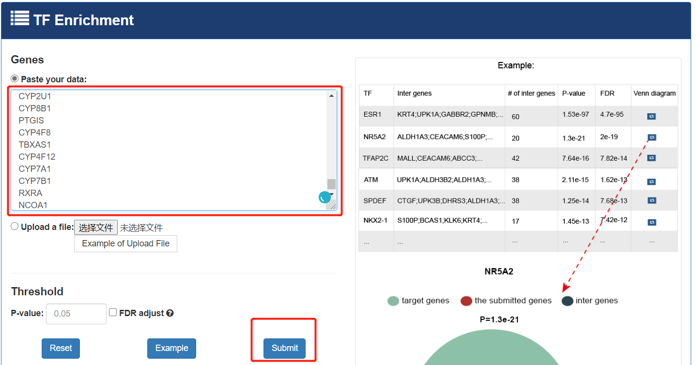
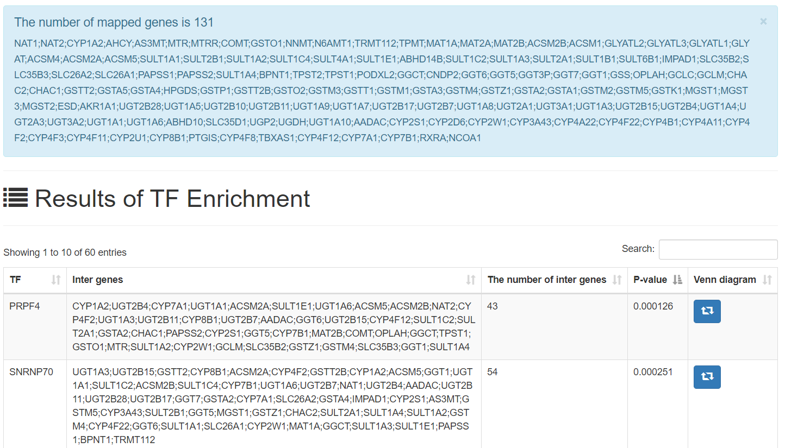
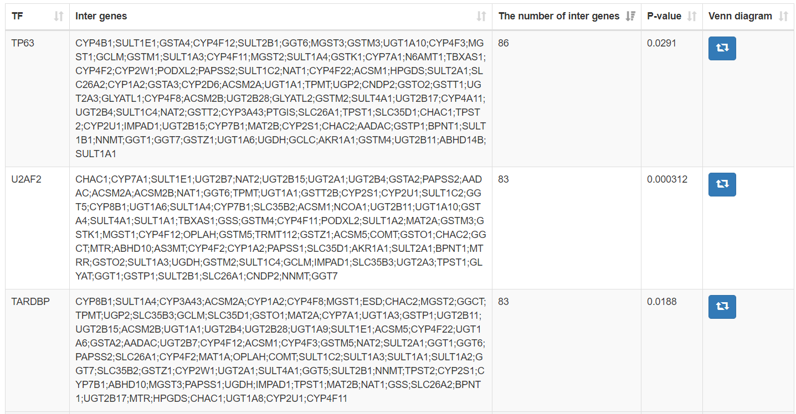

# 教你如何查找调节差异基因的转录因子

很多转录因子预测的数据库是基于转录因子的Chip-seq的数据来进行构建的，这样的结果能说明某一个转录因子结合某一段序列，但是结合并不一定说明可能影响这个基因的表达，所以最好做一个这个转录因子导入/导出的表达数据来说明对于基因表达的影响。

KnockTF（[http://www.licpathway.net/KnockTF/search.php](http://www.licpathway.net/KnockTF/search.php)）数据库就是基于这个目的构建的数据库。这个数据库收录了目前公共数据库当中敲减该转录因子后做的表达谱（芯片、二代测序）的数据，进而来反映这个转录因子变化后对于基因表达的影响。KnockTF不仅提供了感兴趣的TFs靶基因的全面基因表达信息，还收集了TFs上游通路信息以及下游靶基因的各种功能注释和分析结果，包括GSEA、GO富集、KEGG通路富集、层次聚类分析和差异表达分析。KnockTF进一步提供了有关TFs与启动子、超级增强子和靶基因典型增强子结合的详细信息。构建TF差异表达基因网络，对感兴趣的基因集进行网络分析，如子网络定位、拓扑分析和超几何富集。KnockTF将有助于阐明TF相关功能并挖掘潜在的生物学效应。这里我只介绍预测转录因子。

将差异基因粘贴到框中，

会得到一个比对结果。我总共输入了131个基因。

这些基因中，有86个基因能被TP63调控。

> 更新: 2021-02-26 17:06:19  
> 原文: <https://www.yuque.com/doublehelix/bioinfonotes/iffh47>