# 肿瘤免疫细胞浸润


在公众号上有一篇付费文章【[肿瘤免疫细胞浸润与临床相关性分析 ](https://mp.weixin.qq.com/s/S7kg3jjVZ2ZZwK6qJZYXBQ)】就介绍了肿瘤免疫细胞浸润的计算，用的是CIBERSORT这个工具，这里我们利用TIMER这个工具[http://timer.cistrome.org/](http://timer.cistrome.org/)

下面是付费文章【[肿瘤免疫细胞浸润与临床相关性分析 ](https://mp.weixin.qq.com/s/S7kg3jjVZ2ZZwK6qJZYXBQ)】的内容。

Profiles of immune infiltration in colorectal cancer and theirclinical significant: A gene expression- based study

---

肿瘤免疫细胞浸润是指免疫细胞从血液中移向肿瘤组织，开始发挥它的作用，可以从肿瘤组织中分离出的浸润免疫细胞。

肿瘤中免疫细胞的浸润与临床结果密切相关，肿瘤中浸润的免疫细胞最有可能作为药物靶标来提高患者的生存率。

分析用到的软件是CIBERSORT，这个软件的原理就是把我们输入的基因矩阵转换为免疫细胞的矩阵，这个矩阵的列名是细胞名称，行名是样品。当然我们需要根据p值对样品进行筛选。

CIBERSORT，是由Binder G等开发的反卷积算法，可以基于标准化的基因表达数据来计算复杂组织的细胞组成，改方法能量化特定细胞类型的丰度。通过流式细胞分选术很好地验证并成功评估了乳腺癌及肝癌组织中免疫细胞的组成。具体可浏览官网：[<u>https://cibersortx.stanford.edu/</u>](https://cibersortx.stanford.edu/)

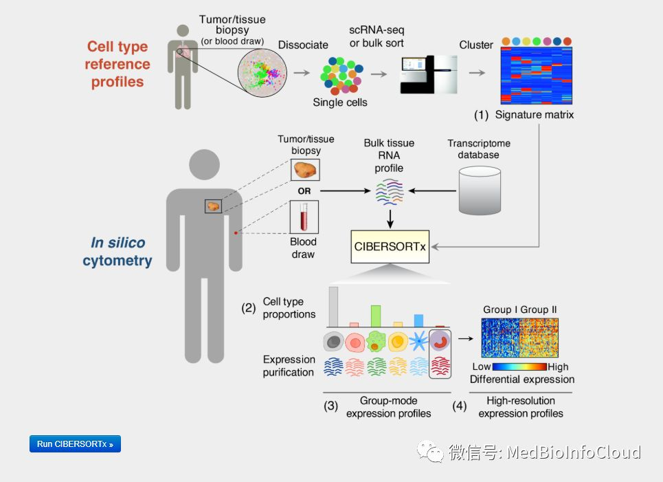

**下面我们就介绍****肿瘤免疫浸润与临床相关性分析**

## 一.表达数据准备

首先，我们需要准备一个表达矩阵，这里我们的案例用TCGA-LUAD的表达数据，已经上传到百度网盘，你可以去下载，也可以自己准备。
差异表达分析的文章中也有介绍了从TCGA数据库下载数据的视频教程：[一文就会TCGA数据库基因表达差异分析](http://mp.weixin.qq.com/s?__biz=MzA4NDAzODkzMA==&mid=2651264493&idx=1&sn=2164cc4d202fc081551f8918c8cbd7a4&chksm=841ef190b36978866b9bd71a989960370614bf234453b3bd070a56fbe324deb4ecaea2305923&scene=21#wechat_redirect)。

```plain
options(stringsAsFactors = F)
library(stringr)
library(limma)
library(survival)
library(forestplot)
library(pheatmap)
library(ggplot2)
library(limma)
library(corrplot)
library(limma)
#处理表达数据，作为免疫浸润计算的输入
exp = read.table("TCGA-COAD-Exp.txt",header = T,sep="\t",check.names = F)
#########重复的基因取平均值
delDuplicateGene = function(exp){
  geneNames= exp[,"gene_id"]
  exp = exp[,-1]
  exp = as.matrix(exp)
  rownames(exp) = as.vector(geneNames)
  exp = avereps(exp)# 需要limma包
  exp = as.data.frame(exp)
  return(exp)
}
####################删除0方差列
del0varcol = function(exp){
  # 从数据集中删除零方差列，可以使用相同的apply 表达式，设置方差不等于零。
  exp =t(exp)
  exp = exp[,which(apply(exp, 2, var)!=0)]
  exp = t(exp)
  return(exp)
}
expdata = delDuplicateGene(exp)
expdata = del0varcol(expdata)
expdata = data.frame(gene = rownames(expdata),expdata,check.names = F)
#写出作为免疫浸润的输入文件
write.table(expdata,file = "as.ImmueInputExp.txt",row.names = F,sep = "\t")
```

上面代码中TCGA-COAD-Exp.txt文件，没有去掉重复的基因，所以我们需要处理一下，也同时删除没有表达的基因。输出的as.ImmueInputExp.txt文件就作为计算免疫细胞浸润的比例文件，第一列是基因名称，其他列是样本名称。

## **二.免疫浸润计算**

**登录网址，没有账号得先注册**

[<u>https://cibersortx.stanford.edu/</u>](https://cibersortx.stanford.edu/)

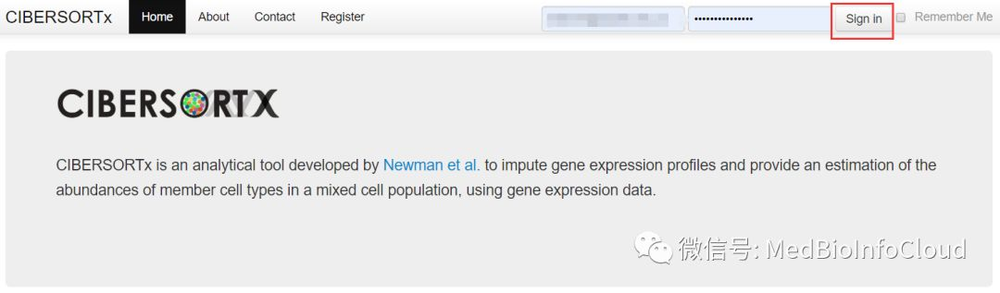

可以按照下面流程上传数据，具体不解释啦。


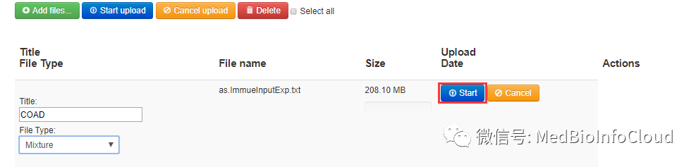

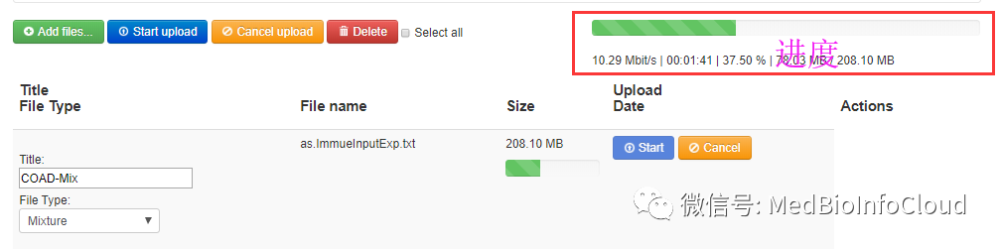

**开始计算**

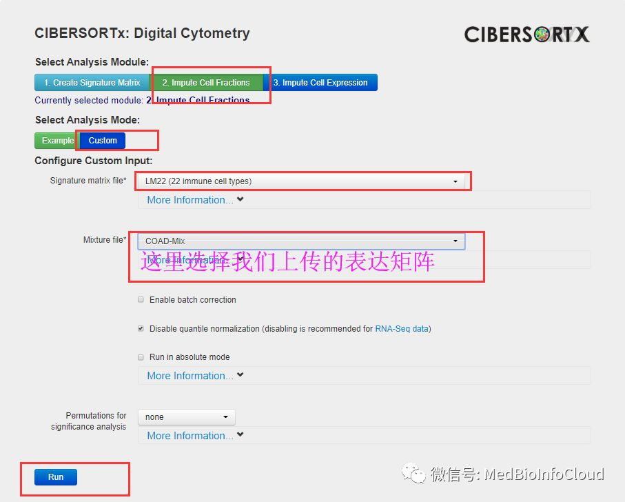

几分钟后计算结束

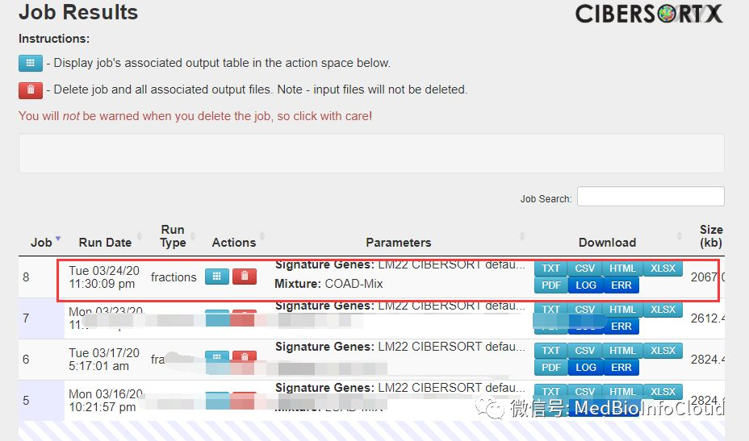

点击进去看

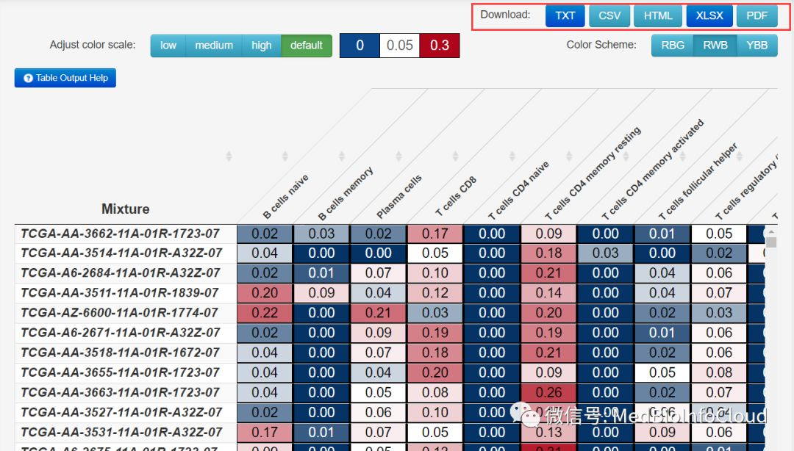

我们可以下载txt或者csv等其他格式的文件，用于后续的分析。

其实，我们也可以下载CIBERSORT的R代码，自己在本地运算，如果没有自己的服务器，就用人家的在先工具吧。要不然计算时间无法想象。

## 三.免疫浸润结果可视化
```plain
TCGAProject = "TCGA-COAD"
immuneFile = ".\\TCGA-COAD-Mixture.txt"
###创建文件夹
dir.create(TCGAProject)
setwd(TCGAProject)
dir.create("ImmuneInfiltration",showWarnings = F)
setwd("..\\")
outputPath = paste0(TCGAProject,"\\ImmuneInfiltration\\")
############一个函数，一个Barcode向量，区分正常组织和肿瘤组织
getSampleInfo <- function(Barcode){
  TumorBarcode <-c()
  NormalBarcode <-c()
  for (id in Barcode) {
    ids <- str_split(id,'-',simplify = T)[4]
    ids <- as.numeric(substr(ids,1,1))

    if(ids == 0){
      TumorBarcode <- c(TumorBarcode,id)
    }else if (ids == 1) {
      NormalBarcode <-c(NormalBarcode,id)
    }
  }
  sampleNum <- data.frame(NormalBarcode = length(NormalBarcode),TumorBarcode = length(TumorBarcode))
  sampleList <- data.frame(ID = c(NormalBarcode,TumorBarcode),Type = c(rep("Normal",length(NormalBarcode)),
                                                                       rep("Tumor",length(TumorBarcode))))
  return(list(BarcodeSort = c(NormalBarcode,TumorBarcode),
              sampleNum = sampleNum ,sampleList = sampleList))
}

```

**1.过滤数据**

就是删除p值小于0.05的样本，还有就是免疫细胞比例为0的列。

```plain
immuedata = read.table(immuneFile,header = T,row.names = 1,
                       sep = "\t",check.names = F)
immue = immuedata[immuedata$`P-value` < 0.05,]
immue = immue[,-c((ncol(immue)-3):ncol(immue))]#删除后3列不是免疫细胞的数据

SamplesInfo = getSampleInfo(rownames(immue))
sampleList = SamplesInfo$sampleList
normalBarcode = sampleList[sampleList$Type=="Normal","ID"] %>% as.vector()
tumorBarcode = sampleList[sampleList$Type=="Tumor","ID"] %>% as.vector()
immue = immue[c(normalBarcode,tumorBarcode),]
##其实上面的5行代码有点多余，因为我们给的表达数据文件已经排序过
immue = immue[,which(apply(immue, 2, var)!=0)]#删除0方差列的细胞
```

**2.绘制barplot**

```plain
####################barplot绘制
barplotData = immue
barplotData=t(barplotData)
col=rainbow(nrow(barplotData),s=0.7,v=0.7)
pdf(paste0(outputPath,"barplot.pdf"),height=20,width=100)
par(las=1,mar=c(8,4,4,15))
a1 = barplot(barplotData,col=col,yaxt="n",ylab="Relative Percent",xaxt="n")
a2=axis(2,tick=F,labels=F)
axis(2,a2,paste0(a2*100,"%"))
axis(1,a1,labels=F)
par(srt=60,xpd=T);text(a1,-0.02,colnames(barplotData),adj=1,cex=0.6);par(srt=0)
ytick2 = cumsum(barplotData[,ncol(barplotData)])
ytick1 = c(0,ytick2[-length(ytick2)])
#text(par('usr')[2],(ytick1+ytick2)/2,rownames(barplotData),cex=0.6,adj=0)
legend(par('usr')[2]*0.98,par('usr')[4],legend=rownames(barplotData),col=col,pch=15,bty="n",cex=1.3)
dev.off()
###
```

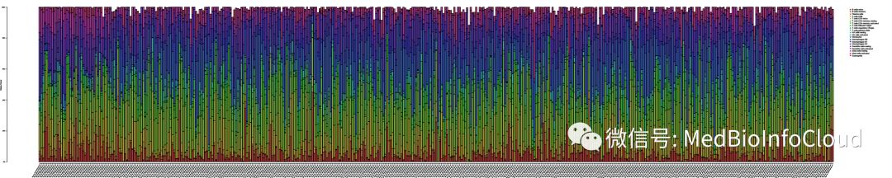

图片太长，只是作为探索性的看一下免疫细胞在不同样本中的比例，可分组取均值作柱状图。

**3.热图**

```plain
heatmapdata = immue
heatmapdata = t(heatmapdata)
heatmapdata = heatmapdata[,c(normalBarcode,tumorBarcode)]
library(pheatmap)
Type=c(rep("Normal",length(normalBarcode)),rep("Tumor",length(tumorBarcode)))    #修改对照和处理组样品数目
names(Type)=colnames(heatmapdata)
Type=as.data.frame(Type)
pdf(paste0(outputPath,"heatmap.pdf"),height=8,width=50)
pheatmap(heatmapdata,
         annotation=Type,
         color = colorRampPalette(c("green", "black", "red"))(50),
         cluster_cols =F,
         fontsize = 8,
         fontsize_row=7,
         fontsize_col=6)
dev.off()
```

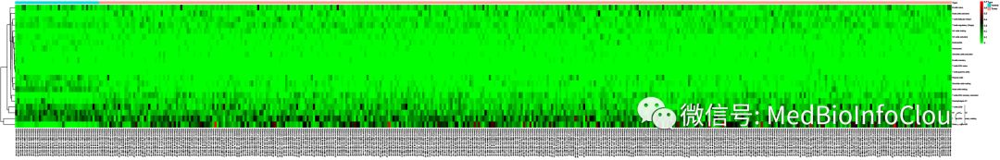

**4.相关性热图**

```plain
###############相关性热图
corheatplotdata = immue
library(corrplot)
pdf(paste0(outputPath,"corHeatmap.pdf"),height=13,width=13)              #保存图片的文件名称
corrplot(corr=cor(corheatplotdata),
         method = "color",
         order = "hclust",
         tl.col="black",
         addCoef.col = "black",
         number.cex = 0.8,
         col=colorRampPalette(c("blue", "white", "red"))(50),
)
dev.off()
```

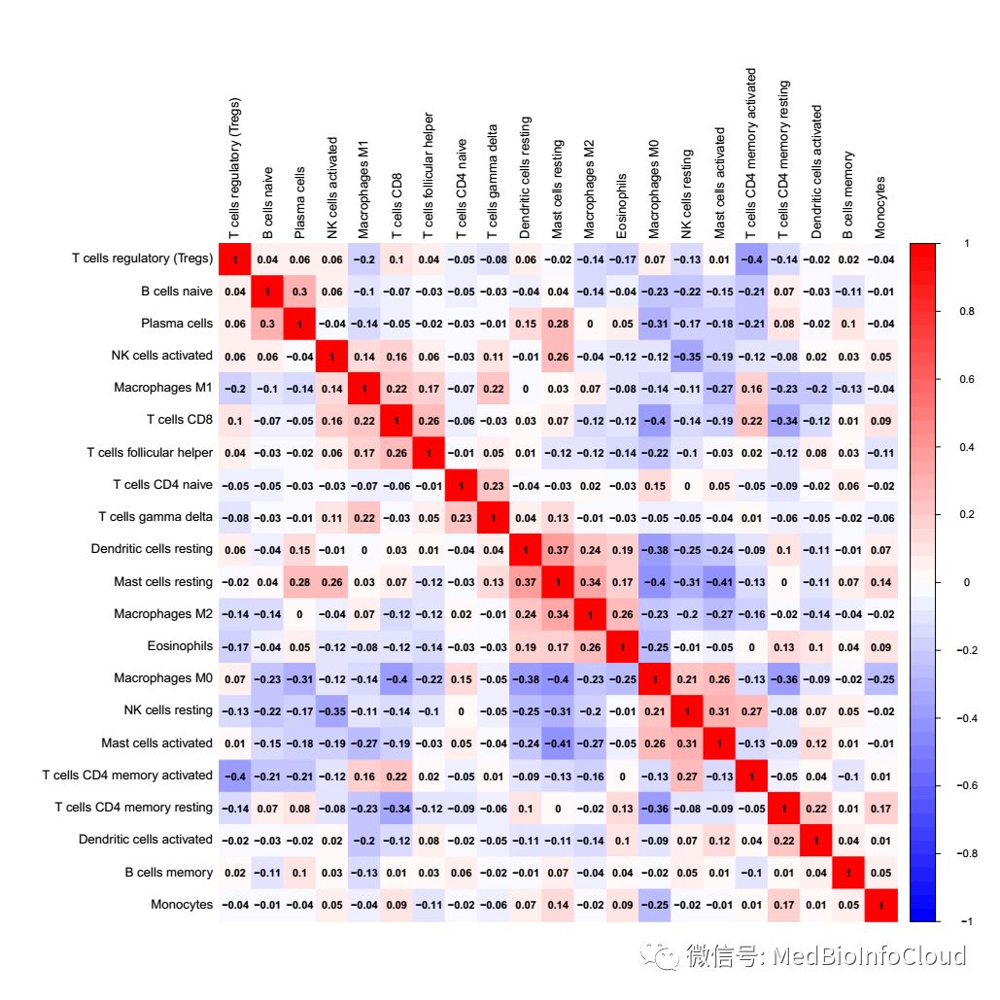

也就是看一下免疫细胞之间的相关性

**5.小提琴图**

```plain
#############小提琴图
library(vioplot)                                                    #引用包
normal= SamplesInfo[["sampleNum"]][["NormalBarcode"]]#正常样品数目
tumor=  SamplesInfo[["sampleNum"]][["TumorBarcode"]]#肿瘤样品数目
vioplotdata = immue
pdf(paste0(outputPath,"vioplot.pdf"),height=8,width=15)#保存图片的文件名称
par(las=1,mar=c(10,6,3,3))
x=c(1:ncol(vioplotdata))
y=c(1:ncol(vioplotdata))
plot(x,y,
     xlim=c(0,(ncol(vioplotdata)-1)*3),#xlim=c(0,63)这个与细胞个数(列数)有关
     #xlim=c(0,57)可以设置成列数-1，再×3
     ylim=c(min(vioplotdata),max(vioplotdata)+0.02),

     main="",xlab="", ylab="Fraction",
     pch=21,
     col="white",
     xaxt="n")
#对每个免疫细胞循环，绘制vioplot，正常用green表示，肿瘤用blue表示
for(i in 1:ncol(vioplotdata)){
  normalData=vioplotdata[1:normal,i]
  tumorData=vioplotdata[(normal+1):(normal+tumor),i]
  vioplot(normalData,at=3*(i-1),lty=1,add = T,col = 'green')
  vioplot(tumorData,at=3*(i-1)+1,lty=1,add = T,col = 'blue')
  wilcoxTest=wilcox.test(normalData,tumorData)
  p=round(wilcoxTest$p.value,3)
  mx=max(c(normalData,tumorData))
  lines(c(x=3*(i-1)+0.2,x=3*(i-1)+0.8),c(mx,mx))
  text(x=3*(i-1)+0.5,y=mx+0.02,labels=ifelse(p<0.001,paste0("p<0.001"),paste0("p=",p)),cex = 0.8)
  text(seq(1,(ncol(vioplotdata)-1)*3+1,3),-0.05,xpd = NA,labels=colnames(vioplotdata),cex = 1,srt = 45,pos=2)
}
dev.off()
```

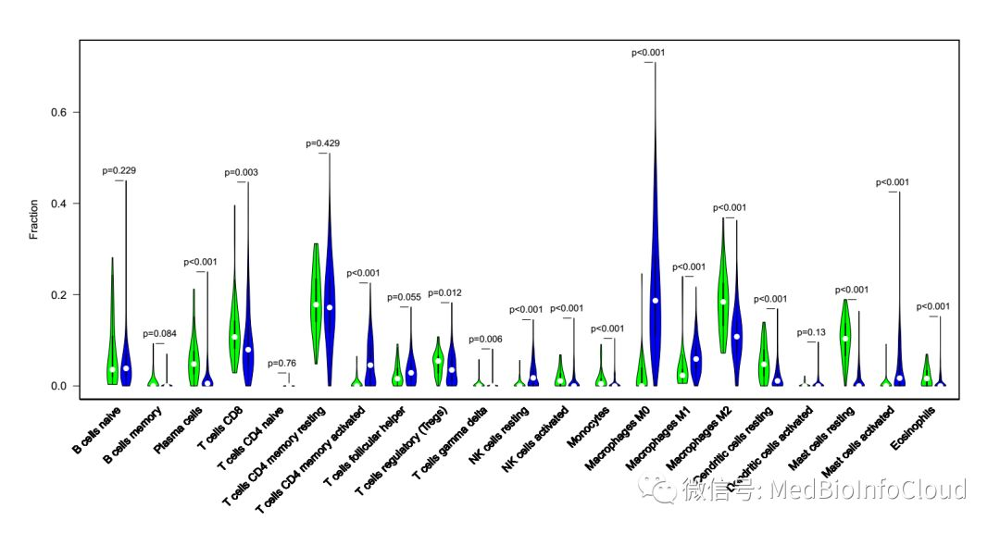

## 四.免疫浸润与临床相关性分析

得到免疫浸润结果后，就需要探讨免疫浸润与临床相关性，比如与肿瘤分期什么关系，我们演示的临床数据之前也上传到了[网盘](http://mp.weixin.qq.com/s?__biz=MzA4NDAzODkzMA==&mid=2651264583&idx=1&sn=f94bf8d77402677ee67f5d6336088254&chksm=841ef23ab3697b2c10ddf8477f41b99c2d801899e3c280f2b1ad6e34b7f6efae005ab4902013&scene=21#wechat_redirect)，具体看文章：[TCGA数据库33个Project的RNA-Seq转录组数据为你整理打包好了](http://mp.weixin.qq.com/s?__biz=MzA4NDAzODkzMA==&mid=2651264583&idx=1&sn=f94bf8d77402677ee67f5d6336088254&chksm=841ef23ab3697b2c10ddf8477f41b99c2d801899e3c280f2b1ad6e34b7f6efae005ab4902013&scene=21#wechat_redirect)。
你也可以自己下载相应的TCGA-COAD临床数据，可参考文章：[一文解决TCGA数据库临床数据下载与整理](http://mp.weixin.qq.com/s?__biz=MzA4NDAzODkzMA==&mid=2651264504&idx=1&sn=634bd925786a3193977342634b03acc3&chksm=841ef185b369789346bfbfbc315b9976bd14b9e25ed365c26522469e1ee102212c4b005bfb86&scene=21#wechat_redirect)。
这样演示的是TCGA-COAD的临床数据文件：TCGA-COAD-clinical.tsv

**1.临床数据的处理**

```plain
############一个函数
getSurData <- function(clindataM){###获取生存时间，clindataM应为读入的tsv文件
  submitter_id <- c()
  SurvivalTime <- c()
  VitalStatus <-c()
  for(i in 1:nrow(clindataM)){
    if(clindataM[i,"vital_status"] == "Alive"){
      submitter_id = c(submitter_id,clindataM[i,"submitter_id"])
      SurvivalTime <- c(SurvivalTime,clindataM[i,"days_to_last_follow_up"])
      VitalStatus <- c(VitalStatus,0)
    }
    else if(clindataM[i,"vital_status"]== "Dead"){
      submitter_id = c(submitter_id,clindataM[i,"submitter_id"])
      SurvivalTime <- c(SurvivalTime,clindataM[i,"days_to_death"])
      VitalStatus <- c(VitalStatus,1)
    }else {print(paste("第",i,"行数据的生存状态为空值"))}
  }
  surData <- data.frame(submitter_id = submitter_id,SurvivalTime = SurvivalTime,VitalStatus = VitalStatus)
  return(surData)
}
#######
##临床数据的提取，这里主要是生存时间，和肿瘤TNM分期的信息
ClinicalDataPath = "F:\\TCGA\\clinicalData\\TCGA-COAD-clinical.tsv" #下载的临床数据文件
ClinicalData <- read.table(ClinicalDataPath,sep = "\t",header = T)
ClinicalData <- ClinicalData[!duplicated(ClinicalData$submitter_id),]#下载的数据是重复的，也不知道TCGA怎么搞的
surData = getSurData(ClinicalData)#获取生存时间
pClinData <- ClinicalData[,c("submitter_id",
                             "gender",
                             "days_to_death",
                             "days_to_last_follow_up",
                             "vital_status",
                             "ajcc_pathologic_stage",
                             "ajcc_pathologic_t",
                             "ajcc_pathologic_n",
                             "ajcc_pathologic_m")]
clindata <- merge(surData,pClinData,by = "submitter_id")
#下面几行代码是删除分期的压型，比如：Stage IIIA，删除A，具体先看一下原始数据，然后改一下正则表达规则
clindata$ajcc_pathologic_stage <- gsub("[A-D].*","",c(clindata$ajcc_pathologic_stage))#
clindata$ajcc_pathologic_t <- gsub("[a-z].*","",c(clindata$ajcc_pathologic_t))
clindata$ajcc_pathologic_n <- gsub("[a-z].*","",c(clindata$ajcc_pathologic_n))
clindata$ajcc_pathologic_m <- gsub("[a-c].*","",c(clindata$ajcc_pathologic_m))
clindata <- clindata[,c("submitter_id","SurvivalTime","VitalStatus",
                        "ajcc_pathologic_stage",
                        "ajcc_pathologic_t",
                        "ajcc_pathologic_n",
                        "ajcc_pathologic_m")]
colnames(clindata) <- c("Barcode","SurvivalTime","VitalStatus","Stage","T","N","M")
```

**2.生存分析**

就是将生存数据与免疫浸润结果文件合并。

```plain
####生存数据与免疫浸润文件合并
BarcodeID = clindata$Barcode
Barcode = c()
Barcodes =c()
for(id in BarcodeID){
  index = grep(id,tumorBarcode)[1]#取一个
  if(!is.na(index)){
    Barcodes =c(Barcodes,tumorBarcode[index])
    Barcode = c(Barcode,id)
  }
}
BarcodeDF = data.frame(Barcode = Barcode,Barcodes= Barcodes)
clindata = merge(BarcodeDF,clindata,by = "Barcode")
NewImmue = immue[Barcodes,]
NewImmue = data.frame(Barcodes=rownames(NewImmue),NewImmue,check.names = F)
sur = merge(clindata[,1:4],BarcodeDF)
surImmue = merge(sur,NewImmue)
rownames(surImmue) = surImmue$Barcodes
surImmue = surImmue[,-c(1,2)]
surImmue <- surImmue[which(surImmue$SurvivalTime != "--"),]#删除没有生存数据的行
surImmue <- surImmue[which(surImmue$VitalStatus != "--"),]#删除没有生存状态的行
#####上面代码生存数据与免疫浸润文件合并，并整理
```

生存作图，这里的作图与前面介绍循环做基因与生存关系的文章差不多：[GraphPad Prism绘制生存曲线和R语言批量绘制生存曲线](http://mp.weixin.qq.com/s?__biz=MzA4NDAzODkzMA==&mid=2651264528&idx=1&sn=30f08e847eaca09b4e2df91c11aa4613&chksm=841ef26db3697b7b851d33d4061d621e19526b66b54b5a8f4c5e03a620960c4a9f0679d45005&scene=21#wechat_redirect)。

```plain
####################生存曲线的绘制
setwd(outputPath)
dir.create("survivalFig")#设置图片输出目录的名字
setwd("..\\..\\")
library(survival)
surImdata = surImmue
surImdata = data.matrix(surImdata) %>% as.data.frame()
surImdata$SurvivalTime=surImdata$SurvivalTime/365  #如果以月为单位，除以30；以年为单位，除以365
outSurImResults=data.frame()
​
for(gene in colnames(surImdata[,3:ncol(surImdata)])){
  a=surImdata[,gene]<=median(surImdata[,gene])
  diff=survdiff(Surv(SurvivalTime, VitalStatus) ~a,data = surImdata)
  pValue=1-pchisq(diff$chisq,df=1)
  outSurImResults=rbind(outSurImResults,cbind(gene=gene,pvalue=pValue))
  pValue=round(pValue,3)
  #pValue=format(pValue, scientific = TRUE)
  fit <- survfit(Surv(SurvivalTime, VitalStatus) ~ a, data = surImdata)
  summary(fit)
  tiff(file=paste(outputPath,"survivalFig\\",gene,".survival.tiff",sep=""),
       width = 14,            #图片的宽度
       height =14,            #图片的高度
       units ="cm",
       compression="lzw",
       bg="white",
       res=600)
  plot(fit,
       lwd=2,
       col=c("red","blue"),
       xlab="Time (year)",
       mark.time=T,
       ylab="Survival rate",
       main=paste(gene,"(p=", pValue ,")",sep="") )
  legend("topright",
         c("High","Low"),
         lwd=2,
         col=c("red","blue"))
  dev.off()
}
write.table(outSurImResults,file=paste0(outputPath,"survivalFig\\","survival.xls"),
            sep="\t",row.names=F,quote=F)
```

我们会得到各种免疫细胞浸润高低的生存曲线

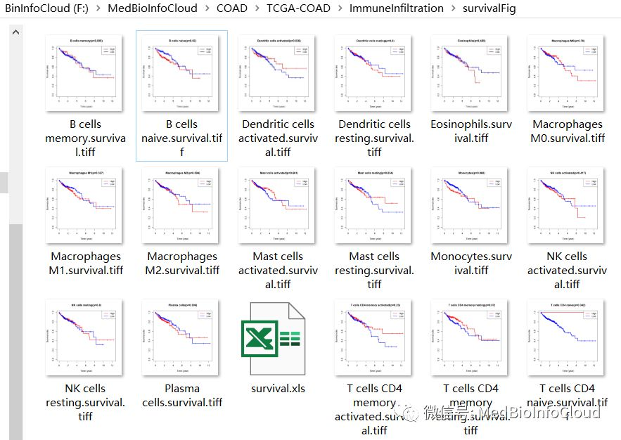

**4.免疫浸润与临床相关性分析**

数据准备，我们需要将临床文件与免疫浸润文件合并

```plain
#################临床相关性分析
corClin = clindata[,c("Barcodes","Stage","T","N","M")]
rownames(corClin) = corClin$Barcodes
corClin <- corClin[which(corClin$Stage != "--"),]#删除空行
corClin <- corClin[which(corClin$T != "--"),]
corClin <- corClin[which(corClin$N != "--"),]
corClin <- corClin[which(corClin$M != "--"),]
mergeImmuCorClin = merge(corClin,NewImmue,by ="Barcodes")
row.names(mergeImmuCorClin) = mergeImmuCorClin$Barcodes
mergeImmuCorClin = mergeImmuCorClin[,-1]
```

我们选择的临床数据有"Stage","T","N","M"，我们下面就只选择Stage作为分析，TNM分期也是一样的道理，其他临床指标的话，前面的提取临床数据的代码都要变的，不要学的太死。

```plain
####Stage
setwd(outputPath)
dir.create("immueStageFig")#设置图片输出目录的名字
setwd("..\\..\\")
Simmuedata = mergeImmuCorClin[,c(1,5:ncol(mergeImmuCorClin))]#注意所取的列
clin ="Stage"  #定义临床类型
Simmuedata$Stage = as.numeric(factor(Simmuedata$Stage))
#picDir="picture"
#dir.create(picDir)
xlabel=vector()
tab1=table(Simmuedata[,clin])
labelNum=length(tab1)
dotCol=c(2,3)
if(labelNum==3){
  dotCol=c(2,3,4)
}
if(labelNum==4){
  dotCol=c(2,3,4,5)
}
if(labelNum>4){
  dotCol=rainbow(labelNum)
}
for(i in 1:labelNum){
  xlabel=c(xlabel,names(tab1[i]) )
}
StageR = data.frame()
for(i in colnames(Simmuedata[,2:ncol(Simmuedata)])){
  Simmuedata1=rbind(expression=Simmuedata[,2],clin=Simmuedata[,clin])
  Simmuedata1=as.data.frame(t(Simmuedata1))
  if(labelNum==2){
    wilcoxTest<-wilcox.test(expression ~ clin, data=Simmuedata1)
  }else{
    wilcoxTest<-kruskal.test(expression ~ clin, data = Simmuedata1)}
  pValue=wilcoxTest$p.value
  StageR=rbind(StageR,cbind(gene=i,pVal=pValue))
  pval=0
  if(pValue<0.001){
    pval=signif(pValue,4)
    pval=format(pval, scientific = TRUE)
  }else{
    pval=round(pValue,3)
  }

  b = boxplot(expression ~ clin, data = Simmuedata1,outline = FALSE, plot=F)
  yMin=min(b$stats)
  yMax = max(b$stats/5+b$stats)
  ySeg = max(b$stats/10+b$stats)
  ySeg2 = max(b$stats/12+b$stats)
  n = ncol(b$stats)

  tiffFile=paste0(i,".",clin,".tiff")
  outTiff=paste0(outputPath,"immueStageFig\\",tiffFile)
  tiff(file=outTiff,width = 25,height = 15,
       units ="cm",compression="lzw",bg="white",res=600)
  par(mar = c(4,7,3,3))
  boxplot(expression ~ clin, data = Simmuedata1,names=xlabel,
          ylab = paste0(i," fraction"),col=dotCol,
          cex.main=1.6, cex.lab=1.4, cex.axis=1.3,ylim=c(yMin,yMax),outline = FALSE)
  segments(1,ySeg, n,ySeg);
  segments(1,ySeg, 1,ySeg2)
  segments(n,ySeg, n,ySeg2)
  text((1+n)/2,ySeg,labels=paste0("p=",pval),cex=1.5,pos=3)
  dev.off()

}
write.table(StageR,file=paste0(outputPath,"immueStageFig\\",clin,".xls"),
            sep="\t",row.names=F,quote=F)
```

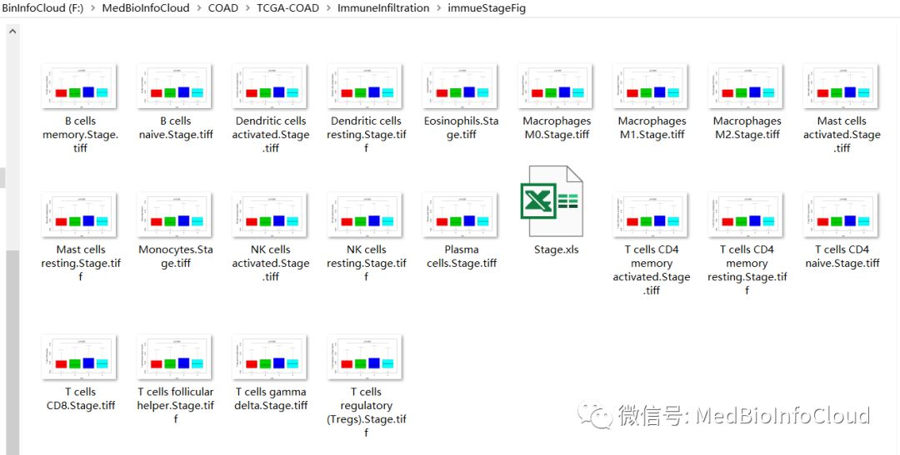

下面是代码，和免疫浸润结果文件。


链接：[<u>https://pan.baidu.com/s/1uEhnIA4sCFr8RKX_LpkcSA</u>](https://pan.baidu.com/s/1uEhnIA4sCFr8RKX_LpkcSA)<u> </u>

提取码：**v9tx **

如果失效，后台回复：**TCGA-ImmuneInfiltration**

**温馨提示：代码是死的，人是活的，还有，代码禁止传播，想别人和你一起发文章，我也拦不住。**

> 更新: 2021-02-06 19:56:28
> 原文: <https://www.yuque.com/doublehelix/bioinfonotes/anfqfn>
