# 肿瘤预后模型


下面这篇文章，估计做生信挖掘的大家不陌生，m6A RNA甲基化文章，影响因子＞5分。网上有很多关于m6A RNA甲基化的文章教程很多，视频也有。我这里提供我自己写的TCGA数据库挖掘部分的R代码。生信嘛，套路都差不多，你换一个方向也可以。


上面文献下载地址：


**提取码：****<font style="color:#FF0000;">x7he</font>**

我按照上面文章思路，写了TCGA数据分析部分的代码，当然模拟的数据不是文章的肿瘤数据，数据是TCGA-STAD转录组和临床的数据，分析的基因是我随便找的基因，所以结果没有那么好，只是一个处理流程而已，根据自己研究方向订呗。

**代码包括了：**

➢ 数据下载

➢ 数据整理

➢ ****(比如m6A)相关基因表达

➢ ****(比如m6A)差异分析（[参考文章](http://mp.weixin.qq.com/s?__biz=MzA4NDAzODkzMA==&mid=2651264493&idx=1&sn=2164cc4d202fc081551f8918c8cbd7a4&chksm=841ef190b36978866b9bd71a989960370614bf234453b3bd070a56fbe324deb4ecaea2305923&scene=21#wechat_redirect)）

➢ 临床数据下载和整理（[参考文章](http://mp.weixin.qq.com/s?__biz=MzA4NDAzODkzMA==&mid=2651264504&idx=1&sn=634bd925786a3193977342634b03acc3&chksm=841ef185b369789346bfbfbc315b9976bd14b9e25ed365c26522469e1ee102212c4b005bfb86&scene=21#wechat_redirect)）

➢ 肿瘤分型subtype 

主成分分析生存分析临床相关性

➢ 单因素COX分析

➢ Lasso模型构建

➢ 风险生存分析（[R语言批量绘制生存曲线](http://mp.weixin.qq.com/s?__biz=MzA4NDAzODkzMA==&mid=2651264528&idx=1&sn=30f08e847eaca09b4e2df91c11aa4613&chksm=841ef26db3697b7b851d33d4061d621e19526b66b54b5a8f4c5e03a620960c4a9f0679d45005&scene=21#wechat_redirect)）

➢ ROC曲线

➢ 风险热图（热图绘制:[基因表达谱热图绘制](http://mp.weixin.qq.com/s?__biz=MzA4NDAzODkzMA==&mid=2651264534&idx=1&sn=6d5ef1279972e730878d65742e56c855&chksm=841ef26bb3697b7d426e76b16fbe0365aa6ad5da7f86ca7d14dcb72ca47ada25ffba021d9ba8&scene=21#wechat_redirect)）

➢ 独立预后分析

下面是我模拟数据自动分析结果

<font style="color:#FF0000;">差异基因表达谱热图</font>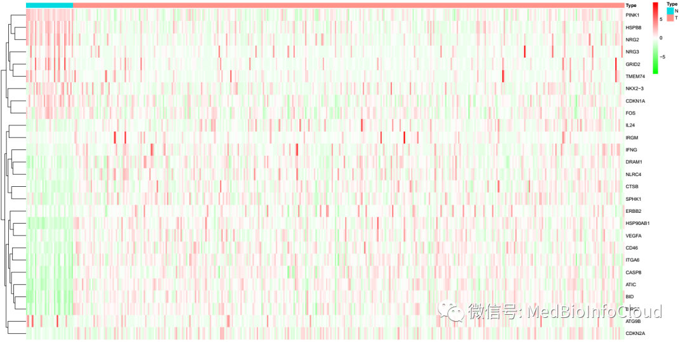

<font style="color:#FF0000;">肿瘤分型</font>


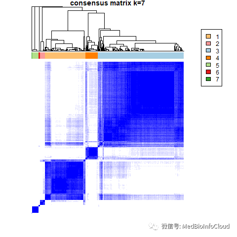

<font style="color:#FF0000;">相关性分析</font>

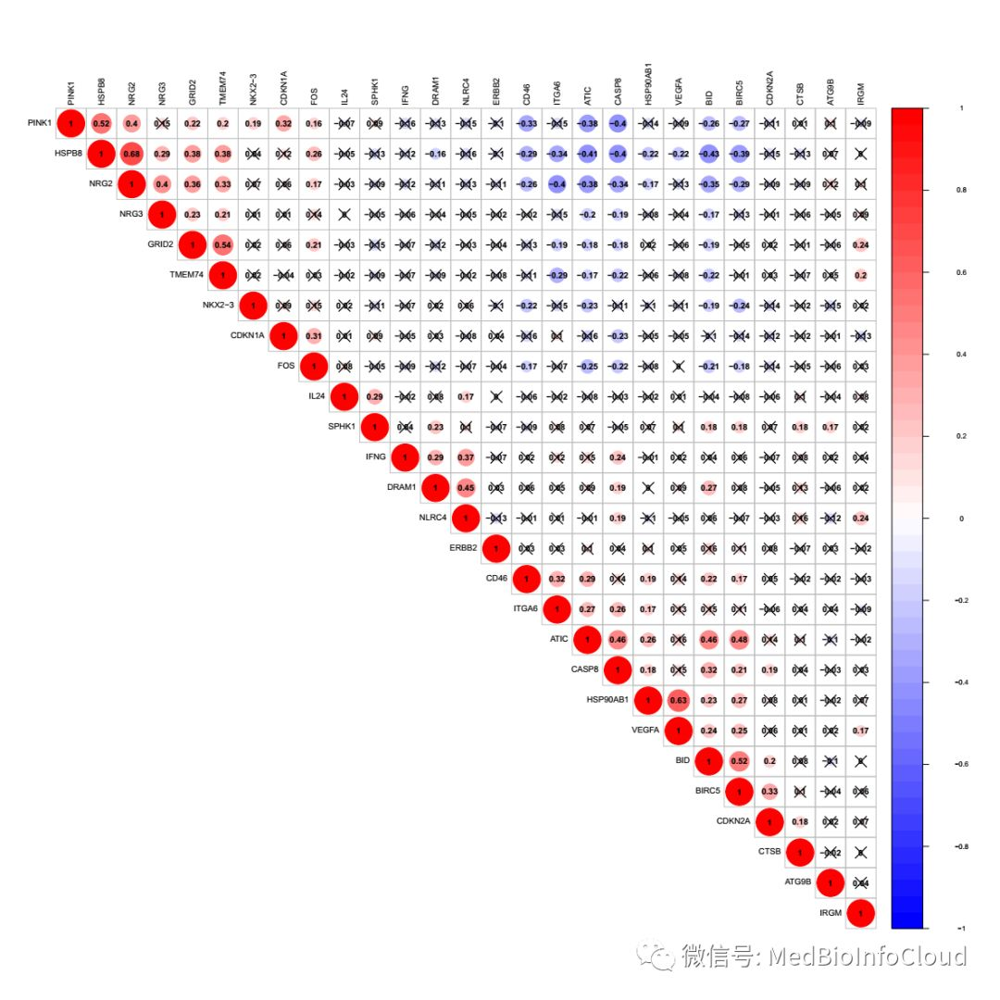

<font style="color:#FF0000;">主成分分析</font>

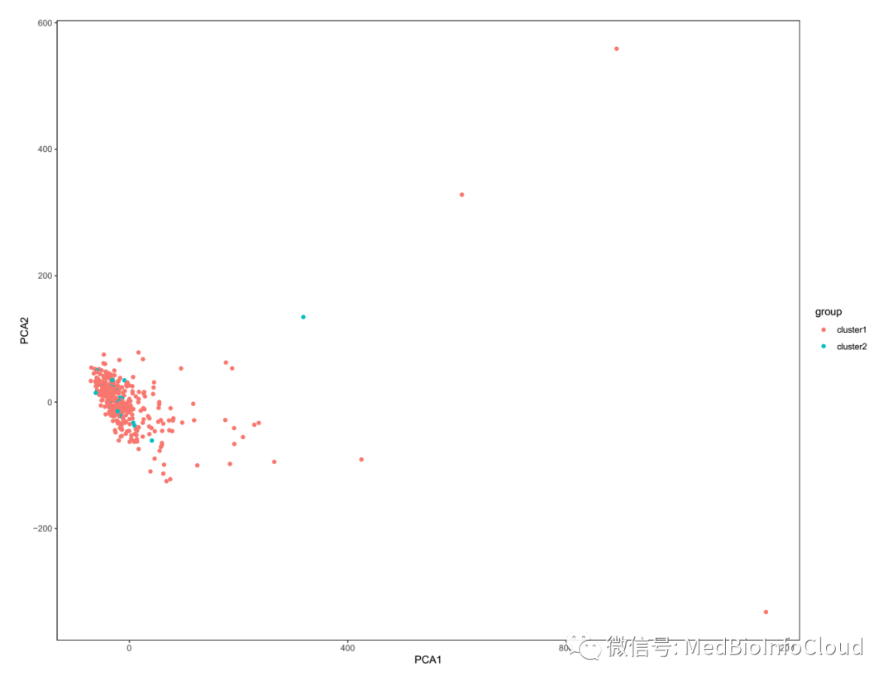

<font style="color:#FF0000;">肿瘤分型生存分析</font>

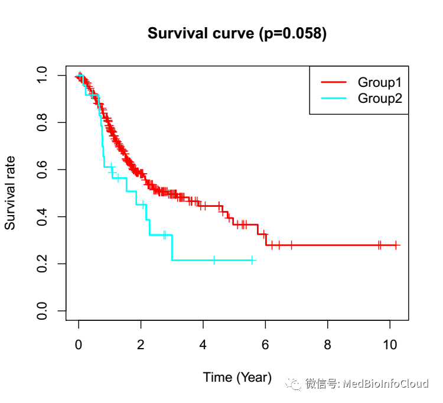

<font style="color:#FF0000;">分型与临床相关性热图</font>

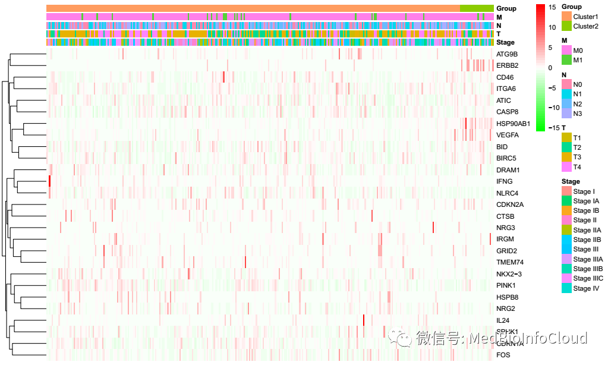

<font style="color:#FF0000;">单因素COX分析</font>

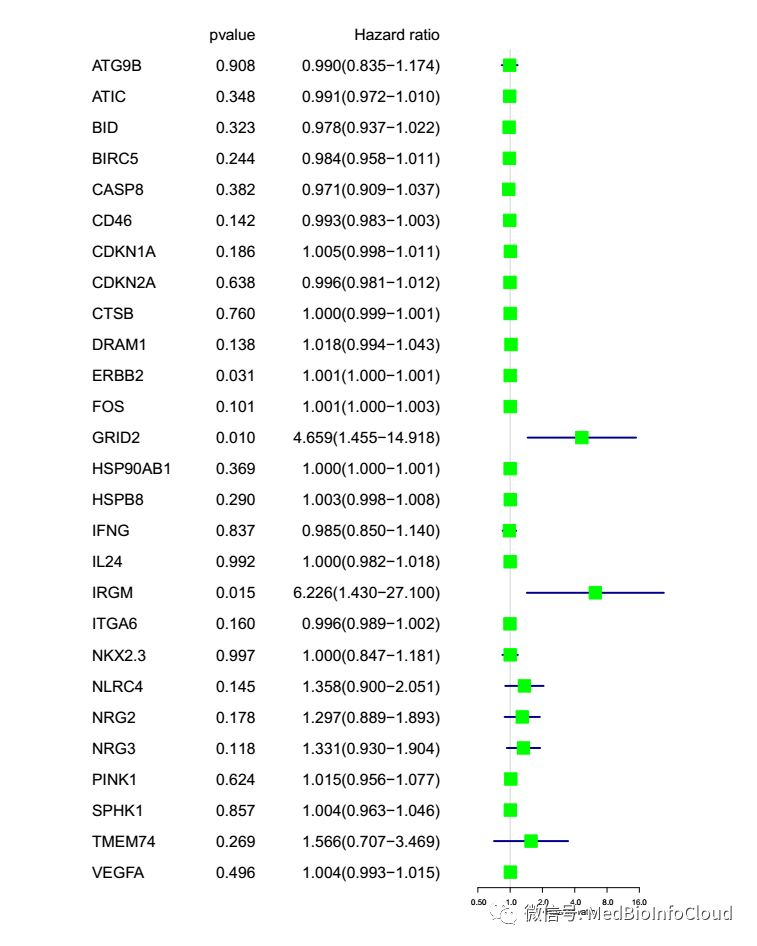

<font style="color:#FF0000;">lasso回归</font>

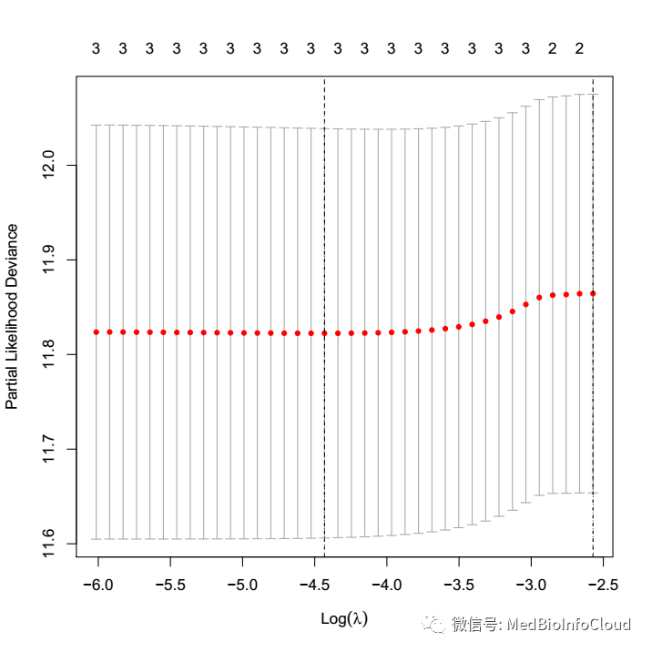

<font style="color:#FF0000;">风险生存曲线</font>

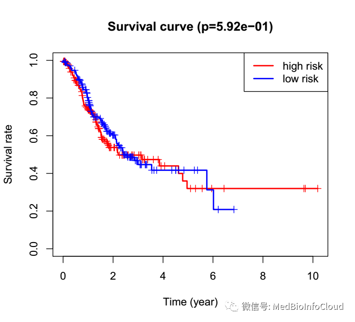

<font style="color:#FF0000;">ROC曲线</font>

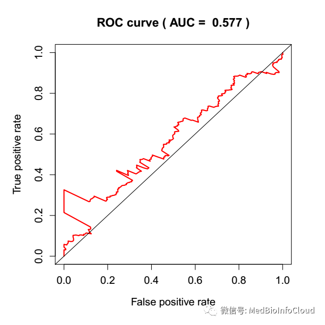

<font style="color:#FF0000;">风险与临床相关性热图</font>

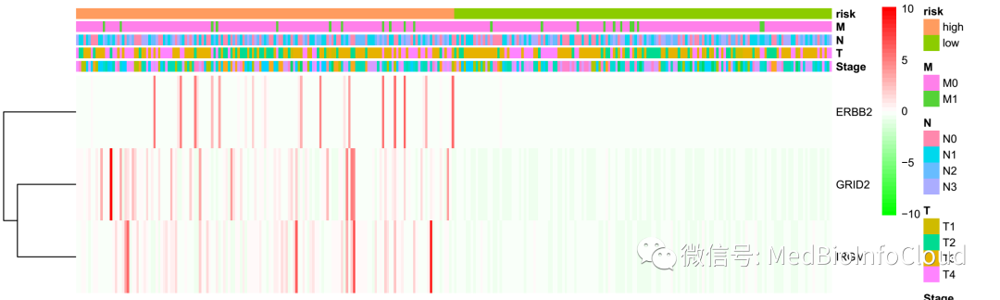

<font style="color:#FF0000;">独立预后分析</font>

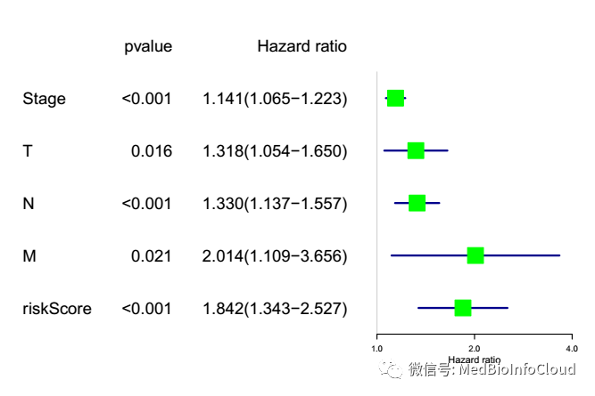

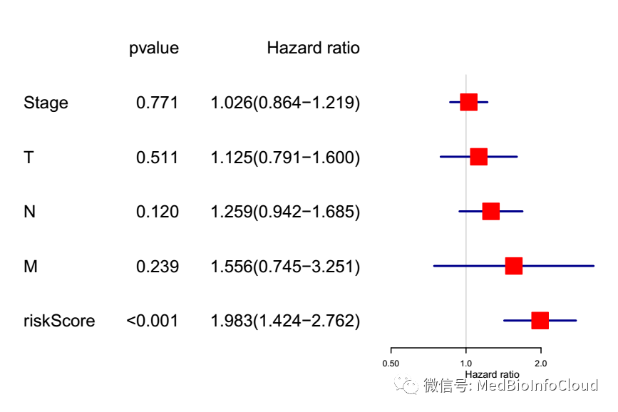

下面是我跑的时候录下的视频，17分钟就跑完了整个流程


**<font style="color:#FF0000;">付费提示：</font>**

下面只提供R代码，**<font style="color:#FF0000;">有疑虑，就此打住</font>**<font style="color:#FF0000;">，</font>我用的都是入门级别的函数，懂点R语法，就能看懂，大部分有注释，如果您付费，请尽量选择安卓手机付费，苹果付费要被老美收30%的税费，钱我也收不到。


初次学习，请使用TCGA-STAD转录组和临床的数据进行学习，我也不提供百度网盘下载了，百度网盘下载的速度，非会员太慢，自己去TCGA下载吧，至于基因注释的gtf文件，文章：[一文就会TCGA数据库基因表达差异分析](http://mp.weixin.qq.com/s?__biz=MzA4NDAzODkzMA==&mid=2651264493&idx=1&sn=2164cc4d202fc081551f8918c8cbd7a4&chksm=841ef190b36978866b9bd71a989960370614bf234453b3bd070a56fbe324deb4ecaea2305923&scene=21#wechat_redirect)：有地址，临床数据下载整理我们也发过文章：[一文解决TCGA数据库临床数据下载与整理](http://mp.weixin.qq.com/s?__biz=MzA4NDAzODkzMA==&mid=2651264504&idx=1&sn=634bd925786a3193977342634b03acc3&chksm=841ef185b369789346bfbfbc315b9976bd14b9e25ed365c26522469e1ee102212c4b005bfb86&scene=21#wechat_redirect)，下面代码直接读取TCGA的临床数据的tsv格式文件。至于gene文件，你可以选择300左右的基因进行学习。也可以用下面我模拟的基因学习。


提取码：**2opw **

**代码出错的可能原因：**

1.输入数据文件路径不对；

2.分析的基因太少，最后得到的重要基因为0，所以后面的分析会出错。

3.你下载的数据没有正常样本。

4.还有就是相关R包，你没有装。5.其他原因我也不知道，你自己解决吧，上面是我所知可能出错的原因。至于代码，那就自己码吧，一套下来就是你自己的知识啦，什么m6A RNA甲基化，你换一套基因也一样做嘛，比如免疫相关基因，某个功能相关的基因，换一换也就这些套路。代码，我觉得我写的不是那种高端代码，用的都是入门级别的函数，懂点R语法，就能看懂。最后再说一句，理论知识不懂，那就自己去补吧，学习得靠自己。

```plain
options(stringsAsFactors = F)
## dir.create("00-RawData") 手动创建用存放数据
# 需要输入的文件，注意修改
inputPath <- ".\\02-inputFiles" #gene文件和gtf文件路径
FPKMDataPath <- ".\\01-RawData\\FPKM\\" # TCGA 下载的转录组数据
jsonFilePath <- ".\\01-RawData\\FPKM-2020-03-09.json"# 转录组数据对应的json文件
gtfFilesPath <- ".\\02-inputFiles\\human.v33lift37.annotation.gtf"#基因注释文件
geneFilesPath <- ".\\02-inputFiles\\Genes.txt" #要分析的基因，比如m6A RNA甲基化相关基因
​
# 临床数据文件地址：TCGA下载的临床数据
ClinicalDataPath <- ".\\01-RawData\\Clinical2020-03-09\\TSV\\clinical.tsv"
​
#############################上面代码地址注意修改
setwd(".\\")
dir.create("03-AnalysisResult")
setwd(".\\03-AnalysisResult")
FolderName <- c("101-extractGenesExp","102-GenesDiff",
                "103-correlationAnalysis","104-tumorCluster",
                "105-PCA","106-ClinicalDataExtract","107-tumorClusterSurvivalAnalysis",
                "108-tumorClusterCorrelationAnalysis","109-singleFactorCOXAnlysis",
                "110-LassoRegression","111-RiskSurvivalCurve","112-ROC-Curve",
                "113-ClinicalCorrelationOfRisk","114-IndependentPrognostic"
)
mkdir <- function(FolderName){
  for (name in FolderName) {
    dir.create(name,showWarnings = F)
  }
}
mkdir(FolderName)
setwd("..\\")
#####################################################100-2
# 分析结果输出路径
outputPath<- c(".\\03-AnalysisResult\\101-extractGenesExp\\",
               ".\\03-AnalysisResult\\102-GenesDiff\\",
               ".\\03-AnalysisResult\\103-CorrelationAnalysis\\",
               ".\\03-AnalysisResult\\104-tumorCluster\\",
               ".\\03-AnalysisResult\\105-PCA\\",
               ".\\03-AnalysisResult\\106-ClinicalDataExtract\\",
               ".\\03-AnalysisResult\\107-tumorClusterSurvivalAnalysis\\",
               ".\\03-AnalysisResult\\108-tumorClusterCorrelationAnalysis\\",
               ".\\03-AnalysisResult\\109-singleFactorCOXAnlysis\\",
               ".\\03-AnalysisResult\\110-LassoRegression\\",
               ".\\03-AnalysisResult\\111-RiskSurvivalCurve\\",
               ".\\03-AnalysisResult\\112-ROC-Curve\\",
               ".\\03-AnalysisResult\\113-ClinicalCorrelationOfRisk\\",
               ".\\03-AnalysisResult\\114-IndependentPrognostic\\")
#######输出的文件名称
JsonFileInfoFM <- "JsonFileInfo.txt" # 样本文件名与Barcode的对于关系文件
EnsemblTOGeneFM <- "EnsemblTOGene.txt" # Ensembl ID 与Gene ID 的对于关系文件
#####脚本输出的文件
completeExpMatrixFN <- "101-completeExpMatrix.txt" # 所有样本所有基因的表达矩阵文件
onlyTumorExpMatrixFN <- "101-onlyTumorExpMatrix.txt" # 肿瘤样本所有基因的表达矩阵文件
#####102脚本输出文件
inputGeneAllSampleExpMatrixFN <- "102-inputGeneAllSampleExpMatrix.txt" #所有样本输入基因的表达矩阵文件
inputGeneOnlyTumorExpMatrixFN <- "102-inputGeneOnlyTumorExpMatrix.txt" #肿瘤样本输入基因的表达矩阵文件
###差异分析结果文件
inputGeneDiffExpResultFN <- "102-inputGeneDiffExpResult.txt" #输入基因的差异表达分析结果
sigDiffGeneExpResultFN <- "102-sigDiffGeneExpResult.txt"# pValue < 0.05 & logFC > 1 的基因的差异表达分析结果 
###差异分析后相关基因的表达矩阵文件
sigDiffGeneExpMatrixFN <- "102-sigDiffGeneExpMatrix.txt" # 显著差异的基因(pValue < 0.05 & logFC > 1)的表达矩阵(所有样本)
sigDiffGeneTumorExpMatrixFN <- "102-sigDiffGeneTumorExpMatrix.txt"# 显著差异的基因(pValue < 0.05 & logFC > 1)的表达矩阵
####差异基因热图
diffgeneHeatMapFN <- "diffgeneHeatMap.pdf" # 差异分析结果热图文件
diffgeneViolinPlotFN <- "diffgeneViolinPlot.pdf"
diffgeneVolcanoPlotFN <- "diffgeneVolcanoPlot.pdf"
####相关性分析
corHeatFigFN <- "corHeatFig.pdf"
# 肿瘤分型结果文件 
ClousterFN <- "Clouster.txt"
# PCA结果文件
PCAResultFN <- "PCAResult.txt"
CloustePCAFigFN <- "CloustePCA.pdf"
###############################################
##########################处理Json文件的函数##########################
processingJsonFiles <- function(jsonFile){
  library(rjson)
  metadata_json_File <- fromJSON(file=jsonFile)
  json_File_Info <- data.frame(filesName = c(),TCGA_Barcode = c())
  for(i in 1:length(metadata_json_File)){
    TCGA_Barcode <- metadata_json_File[[i]][["associated_entities"]][[1]][["entity_submitter_id"]]
    file_name <- metadata_json_File[[i]][["file_name"]]
    json_File_Info <- rbind(json_File_Info,data.frame(filesName = file_name,TCGA_Barcode = TCGA_Barcode))
  }
  
  rownames(json_File_Info) <- json_File_Info[,1]
  json_File_Info <-json_File_Info[-1]
  return(json_File_Info)
}
############## 一个函数，通过gtf文件获取Ensemble_ID与基因名称的对应关系
get_map = function(input) {
  if (is.character(input)) {
    if(!file.exists(input)) stop("Bad input file.")
    message("Treat input as file")
    input = data.table::fread(input, header = FALSE)
  } else {
    data.table::setDT(input)
  }
  input = input[input[[3]] == "gene", ] # 只获取基因
  pattern_id = ".*gene_id \"([^;]+)\";.*"
  pattern_name = ".*gene_name \"([^;]+)\";.*"
  gene_id = sub(pattern_id, "\\1", input[[9]])
  gene_name = sub(pattern_name, "\\1", input[[9]])
  EnsemblTOGene <- data.frame(gene_id = gene_id,
                              gene_name = gene_name,
                              stringsAsFactors = FALSE)
  return(EnsemblTOGene)
}
​
############一个函数，给一个Barcode向量，区分正常组织和肿瘤组织
getSampleInfo <- function(Barcode){
  TumorBarcode <-c()
  NormalBarcode <-c()
  for (id in Barcode) {
    ids <- str_split(id,'-',simplify = T)[4]
    ids <- as.numeric(substr(ids,1,1))
    if(ids == 0){
      TumorBarcode <- c(TumorBarcode,id)
    }else if (ids == 1) {
      NormalBarcode <-c(NormalBarcode,id)
    }
  }
  sampleNum <- data.frame(NormalBarcode = length(NormalBarcode),TumorBarcode = length(TumorBarcode))
  sampleList <- data.frame(ID = c(NormalBarcode,TumorBarcode),Type = c(rep("Normal",length(NormalBarcode)),
                                                                       rep("Tumor",length(TumorBarcode))))
  return(list(BarcodeSort = c(NormalBarcode,TumorBarcode),
              sampleNum = sampleNum ,sampleList = sampleList))
}
############ 上面函数返回一个重新排序的Barcode列表
​
############获取生存时间，clindataM应为读入的tsv文件
getSurData <- function(clindataM){
  submitter_id <- c()
  SurvivalTime <- c()
  VitalStatus <-c()
  for(i in 1:nrow(clindataM)){
    if(clindataM[i,"vital_status"] == "Alive"){
      submitter_id = c(submitter_id,clindataM[i,"submitter_id"])
      SurvivalTime <- c(SurvivalTime,clindataM[i,"days_to_last_follow_up"])
      VitalStatus <- c(VitalStatus,0)
    }
    else if(clindataM[i,"vital_status"]== "Dead"){
      submitter_id = c(submitter_id,clindataM[i,"submitter_id"])
      SurvivalTime <- c(SurvivalTime,clindataM[i,"days_to_death"])
      VitalStatus <- c(VitalStatus,1)
    }else {print(paste("第",i,"行数据的生存状态为空值"))}
  }
  surData <- data.frame(submitter_id = submitter_id,SurvivalTime = SurvivalTime,VitalStatus = VitalStatus)
  return(surData)
}
#########################100-5
options(stringsAsFactors = F)
############################将所有文件移动到同一个文件夹01-tempFiles下
if(file.exists("01-tempFiles")== FALSE){dir.create("01-tempFiles")}
txtfilepath <- dir(path = FPKMDataPath,full.names = TRUE)
for(wd in txtfilepath){
  files <-dir(path = wd,pattern="gz$") #查看满足条件文件
  fromfilepath <- paste(wd,"\\",files,sep ="")
  tofilepath <- paste(".\\01-tempFiles\\",files,sep ="")
  file.copy(fromfilepath,tofilepath)
}
########################### 解压所有文件并删除原文件###################
setwd(".\\01-tempFiles")
Files <-dir(path = ".\\",pattern="gz$") #查看满足条件文件
library(R.utils)
sapply(Files, gunzip) # 解压函数gunzip需要安装R.utils包
setwd("..\\")
​
jsonFileInfo <- processingJsonFiles(jsonFile = jsonFilePath)
write.table(jsonFileInfo,file = paste(outputPath[1],JsonFileInfoFM,sep = ""))
​
EnsemblTOGene <- get_map(gtfFilesPath) 
gtf_Ensembl_ID <- substr(EnsemblTOGene[,1],1,15)
EnsemblTOGene <- data.frame(gtf_Ensembl_ID,EnsemblTOGene[,2])
colnames(EnsemblTOGene) <- c("Ensembl_ID","gene_id")
write.table(EnsemblTOGene,file = paste(outputPath[1],EnsemblTOGeneFM,sep = ""))
##########
options(stringsAsFactors = F)
SampleFilesPath <- ".\\01-tempFiles"
###获取表达矩阵，样品信息已通过getSampleInfo函数排序
num = 0
setwd(SampleFilesPath)
if(file.exists("MANIFEST.txt")){file.remove("MANIFEST.txt")}
FileNames<-dir(pattern="txt$") #list.files()函数也行
geneExpMatrix <- data.frame()
for(txtFile in FileNames){
  #每一个循环读取一个文件
  print(paste("正在读入文件：",txtFile,sep = ""))
  OneSampleExp <- read.table(txtFile,header =FALSE)
  # 根据BarcodeFilesPath文件中文件名称与barcode对应关系，命名列名
  patientsID <- jsonFileInfo[paste(txtFile,".gz",sep = ""),"TCGA_Barcode"]
  colnames(OneSampleExp) <- c("Ensembl_ID",patientsID)
  
  if (dim(geneExpMatrix)[1]== 0){
    geneExpMatrix <- OneSampleExp
  }else {geneExpMatrix<- merge(geneExpMatrix,OneSampleExp,by = "Ensembl_ID")}
  num = num +1
}
setwd("..\\") # 读完数据后返回工作目录
print(paste("读取文件完毕,共读入",num,"个文件",sep = ""))
​
library(stringr)
ids <- c(str_split(geneExpMatrix$Ensembl_ID,'[.]',simplify = T)[,1])
# rownames(geneExpMatrix) <- geneExpMatrix$Ensembl_ID
geneExpMatrix$Ensembl_ID <- ids
geneExpMatrix <- merge(EnsemblTOGene,geneExpMatrix,by = "Ensembl_ID")
Barcode <- colnames(geneExpMatrix)[3:length(colnames(geneExpMatrix))]
print("开始数据整理排序")
BarcodeSort <- getSampleInfo(Barcode)$BarcodeSort
geneExpMatrix <- geneExpMatrix[,c("Ensembl_ID","gene_id",BarcodeSort)]
​
library(limma)
geneNames<- geneExpMatrix[,"gene_id"]
completeExpMatrix <- geneExpMatrix[,-c(1,2)]
completeExpMatrix <- as.matrix(completeExpMatrix)
rownames(completeExpMatrix) <- as.vector(geneNames)
completeExpMatrix <- avereps(completeExpMatrix)
completeExpMatrix <- as.data.frame(completeExpMatrix)
completeExpMatrix <-t(completeExpMatrix)
# 从数据集中删除零方差列，可以使用相同的apply 表达式，设置方差不等于零。
completeExpMatrix <- completeExpMatrix[,which(apply(completeExpMatrix, 2, var)!=0)]
completeExpMatrix <- t(completeExpMatrix)
​
#保存文件
write.table(completeExpMatrix,file = paste(outputPath[1],completeExpMatrixFN,sep = ""),
            sep = "\t",row.names = T)
​
# 删除正常样本后的表达矩阵
SampleInfo <- getSampleInfo(colnames(completeExpMatrix))
conNum <- SampleInfo[["sampleNum"]][["NormalBarcode"]]#control组样品数目
treatNum <- SampleInfo[["sampleNum"]][["TumorBarcode"]]#tumor组样品数目
​
SampleList <- SampleInfo[["sampleList"]]
TumorSampleBarcode <- SampleList[which(SampleList$Type == "Tumor"),"ID"]
onlyTumorExpMatrix <- completeExpMatrix[,TumorSampleBarcode]
​
onlyTumorExpMatrix <-t(onlyTumorExpMatrix)
# 从数据集中删除零方差列，可以使用相同的apply 表达式，设置方差不等于零。
onlyTumorExpMatrix <- onlyTumorExpMatrix[,which(apply(onlyTumorExpMatrix, 2, var)!=0)]
onlyTumorExpMatrix <- t(onlyTumorExpMatrix)
​
write.table(onlyTumorExpMatrix,file = paste(outputPath[1],onlyTumorExpMatrixFN,sep = ""),
            sep = "\t",row.names = T)
######################################
options(stringsAsFactors = F)
library(limma)
#####################
#开始读入数据
gene <- read.table(geneFilesPath,header = F)
# 取表达矩阵中的基因与我们要分析的基因的交集
yesgene <-intersect(gene[,1],as.vector(row.names(completeExpMatrix)))
# 表达矩阵中没有的基因
nogene <- setdiff(gene[,1],yesgene)
​
writeLines(c(paste("总共输入了",length(gene[,1]),"基因：",sep=""),
             paste("在表达矩阵中有的基因个数：",length(yesgene),sep=""),
             yesgene,paste("在表达矩阵中没有的基因个数：",length(nogene),sep=""),nogene),
           con=paste(outputPath[2],"filespec.txt",sep = ""),sep="\n")
​
inputGeneAllSampleExpMatrix <- as.matrix(completeExpMatrix[yesgene,])
write.table(inputGeneAllSampleExpMatrix,
            file=paste(outputPath[2],inputGeneAllSampleExpMatrixFN,sep = ""),
            sep="\t",row.names=T,quote=F)
inputGeneOnlyTumorExpMatrix <- inputGeneAllSampleExpMatrix[,TumorSampleBarcode]
​
write.table(inputGeneOnlyTumorExpMatrix,
            file=paste(outputPath[2],inputGeneOnlyTumorExpMatrixFN,sep = ""),
            sep="\t",row.names=T,quote=F)
​
#差异分析
library("limma")
grade <- c(rep(1,conNum),rep(2,treatNum))
inputGeneDiffExpResult <- data.frame()
for(i in row.names(inputGeneAllSampleExpMatrix)){
  rt <- rbind(expression=inputGeneAllSampleExpMatrix[i,],grade=grade)
  rt <- as.matrix(t(rt))
  wilcoxTest <- wilcox.test(expression ~ grade, data=rt)
  conGeneMeans <- mean(inputGeneAllSampleExpMatrix[i,1:conNum])
  treatGeneMeans <- mean(inputGeneAllSampleExpMatrix[i,(conNum+1):ncol(inputGeneAllSampleExpMatrix)])
  logFC <- log2(treatGeneMeans)-log2(conGeneMeans)  
  pvalue <- wilcoxTest$p.value
  conMed <- median(inputGeneAllSampleExpMatrix[i,1:conNum])
  treatMed <- median(inputGeneAllSampleExpMatrix[i,(conNum+1):ncol(inputGeneAllSampleExpMatrix)])
  diffMed <- treatMed-conMed
  exp <- data.frame(gene=i,conMean=conGeneMeans,treatMean=treatGeneMeans,logFC=logFC,pValue=pvalue)
  if (length(inputGeneDiffExpResult) == 0){
    inputGeneDiffExpResult <- exp 
  }else {inputGeneDiffExpResult <- rbind(inputGeneDiffExpResult,exp)}
}
#输出所有基因的差异表达情况
write.table(inputGeneDiffExpResult,
            file=paste(outputPath[2],inputGeneDiffExpResultFN,sep = ""),
            sep="\t",row.names=F,quote=F)
# 获取具有显著差异表达的结果
sigDiffGeneExpResult <- inputGeneDiffExpResult[which(inputGeneDiffExpResult$pValue < 0.05 & abs(inputGeneDiffExpResult$logFC)>1),]
sigDiffGeneExpResult[which(sigDiffGeneExpResult$logFC > 0), "up_down"] <- "Up"
sigDiffGeneExpResult[which(sigDiffGeneExpResult$logFC < 0), "up_down"] <- "Down"
write.table(sigDiffGeneExpResult,
            file=paste(outputPath[2],sigDiffGeneExpResultFN,sep = ""),
            sep="\t",row.names=F,quote=F)
​
###差异分析后相关基因的表达矩阵文件
sigDiffGeneExpMatrix <- completeExpMatrix[sigDiffGeneExpResult$gene,]
write.table(sigDiffGeneExpMatrix,
            file=paste(outputPath[2],sigDiffGeneExpMatrixFN,sep = ""),
            sep="\t",row.names=F,quote=F)
​
sigDiffGeneTumorExpMatrix <- completeExpMatrix[sigDiffGeneExpResult$gene,TumorSampleBarcode]
write.table(sigDiffGeneTumorExpMatrix,
            file=paste(outputPath[2],sigDiffGeneTumorExpMatrixFN,sep = ""),
            sep="\t",row.names=F,quote=F)
###############
​
#####热图的绘制
#install.packages("pheatmap")
diffGeneExpHeatMapData=log2(sigDiffGeneExpMatrix+1)
library(pheatmap)
Type=c(rep("N",conNum),rep("T",treatNum))
names(Type)=colnames(diffGeneExpHeatMapData)
Type=as.data.frame(Type)
​
pdf(paste(outputPath[2],diffgeneHeatMapFN,sep = ""),height=10,width=20)
pheatmap(diffGeneExpHeatMapData, 
         annotation=Type, 
         color = colorRampPalette(c("green", "white", "red"))(50),
         cluster_cols =F,
         show_colnames = F,
         scale="row",
         fontsize = 10,
         fontsize_row=10,
         fontsize_col=3)
dev.off()
#################################103
#install.packages("corrplot")
library(corrplot)
cordata <- t(sigDiffGeneExpMatrix)
res1 <- cor.mtest(cordata, conf.level = 0.95)
pdf(paste(outputPath[5],corHeatFigFN,sep = ""),height=20,width=20)#保存图片的文件名称
corrplot(corr=cor(cordata),
         method = "circle",
         order = "hclust",
         tl.col="black",
         addCoef.col = "black",
         p.mat = res1$p,
         sig.level = 0.001,
         insig = "pch",
         number.cex = 1,
         type = "upper",
         col=colorRampPalette(c("blue", "white", "red"))(50),
)
dev.off()
########################104
​
#######################肿瘤分型######################
library(limma)
​
#聚类
maxK=9
library(ConsensusClusterPlus)
results <- ConsensusClusterPlus(sigDiffGeneTumorExpMatrix,
                                maxK=maxK,
                                reps=50,
                                pItem=0.8,
                                pFeature=1,
                                title=outputPath[4],
                                clusterAlg="km",
                                distance="euclidean",
                                seed=123456,
                                plot="png")
​
#输出结果
clusterNum <- 2                  #分几类，根据判断标准判断
cluster <- results[[clusterNum]][["consensusClass"]]
write.table(cluster,file=paste(outputPath[4],ClousterFN,sep = ""),
            sep="\t",quote=F,col.names=F)
​
###################################105
​
##############主成分分析#############
#install.packages("ggplot2")
#pca analysis
library(limma) 
### PCA分析
pcaData <- t(as.matrix(onlyTumorExpMatrix))
pcaData.class <- rownames(pcaData)
pcaData.pca <- prcomp(pcaData, scale. = TRUE)                                  #PCA分析
write.table(predict(pcaData.pca),file=paste(outputPath[5],PCAResultFN,sep = "")
            ,quote=F,sep="\t")        #输出新表
​
#可视化
library(ggplot2)
clusterInfo <- as.data.frame(cluster)
group <- paste0("cluster",as.vector(clusterInfo[,1]))
pcaPredict <- predict(pcaData.pca)
PCA <- data.frame(PCA1 = pcaPredict[,1], PCA2 = pcaPredict[,2],group=group)
​
pdf(file=paste(outputPath[5],CloustePCAFigFN,sep = ""),height=10,width=13)#保存输入出文件
ggplot(data = PCA, aes(PCA1, PCA2)) + geom_point(aes(color = group)) +
  theme_bw()+
  theme(plot.margin=unit(rep(1.5,4),'lines'))+
  theme(panel.grid.major = element_blank(), panel.grid.minor = element_blank())
dev.off()
###################################106
​
options(stringsAsFactors = F)
ClinicalData <- read.table(ClinicalDataPath,sep = "\t",header = T)
ClinicalData <- ClinicalData[!duplicated(ClinicalData$submitter_id),]
​
pClinData <- ClinicalData[,c("submitter_id",
                             "gender",
                             "days_to_death",
                             "days_to_last_follow_up",
                             "vital_status",
                             "ajcc_pathologic_stage",
                             "ajcc_pathologic_t",
                             "ajcc_pathologic_n",
                             "ajcc_pathologic_m")]
​
surData <- getSurData(ClinicalData)
clindata <- merge(surData,pClinData,by = "submitter_id")
clindata$ajcc_pathologic_stage <- gsub("[A-D].*","",c(pClinData$ajcc_pathologic_stage))
clindata$ajcc_pathologic_t <- gsub("[a-c].*","",c(clindata$ajcc_pathologic_t))
clindata$ajcc_pathologic_n <- gsub("[a-c].*","",c(clindata$ajcc_pathologic_n))
clindata$ajcc_pathologic_m <- gsub("[a-c].*","",c(clindata$ajcc_pathologic_m))
clindata <- clindata[,c("submitter_id","SurvivalTime","VitalStatus",
                        "ajcc_pathologic_stage",
                        "ajcc_pathologic_t",
                        "ajcc_pathologic_n",
                        "ajcc_pathologic_m")]
​
colnames(clindata) <- c("Barcode","SurvivalTime","VitalStatus","Stage","T","N","M")
write.table(clindata,file=paste(outputPath[6],"clindata.txt",sep = ""),sep="\t",row.names=F,quote=F)
#########
ultiClinDataFN <- "ultiClinData.csv"
ClinBarcode <- clindata$Barcode
patientsID <-c()
for(id in ClinBarcode){
  index = grep(id,TumorSampleBarcode)
  patientsID <- c(patientsID,TumorSampleBarcode[index[1]])
}
ultiClindata <- data.frame(Barcodes=patientsID,clindata)
ultiClindata <- ultiClindata[which(!is.na(ultiClindata$Barcodes)),]
​
write.csv(ultiClindata,
          file=paste(outputPath[6],ultiClinDataFN,sep = ""),
          row.names=F,quote=F)
##########
options(stringsAsFactors = F)
​
clusterNum = clusterNum #聚类分为几类，可以更改
SurD <- ultiClindata# read.csv(paste(outputPath[6],ultiClinDataFN,sep = ""),header = T)
SurD <- SurD[which(SurD$SurvivalTime != "--"),]
rownames(SurD) <- SurD$Barcodes
SurD <- SurD[,c("SurvivalTime","VitalStatus")]
Surdata <- data.matrix(SurD) ##因为数值是字符串类型
Surdata <- as.data.frame(Surdata)
Surdata$SurvivalTime <- Surdata$SurvivalTime/365
#
classification <- as.data.frame(cluster)
classification <- classification[rownames(Surdata),]
classification <- paste0("cluster",as.vector(classification))
Surdata$group <- classification
#install.packages("survival")
library(survival)
diff <- survdiff(Surv(SurvivalTime, VitalStatus) ~ group,data = Surdata)
​
pValue <- 1-pchisq(diff$chisq,df=clusterNum-1)# df为自由度n-1
if(pValue<0.001){
  pValue <- signif(pValue,4)
  pValue <- format(pValue, scientific = TRUE)
}else{
  pValue <- round(pValue,3)
}
​
fit <- survfit(Surv(SurvivalTime, VitalStatus) ~ group, data = Surdata)
summary(fit)# 查看5年生存率
​
pdf(file=paste(outputPath[7],"ClousterSurCurve.pdf",sep = ""),width = 5.5,height =5)
plot(fit, 
     lwd=2,
     col=rainbow(clusterNum),
     xlab="Time (Year)",
     mark.time=T,
     ylab="Survival rate",
     main=paste("Survival curve (p=", pValue ,")",sep=""))
legend("topright", 
       paste0("Group",1:clusterNum), 
       lwd=2, 
       col=rainbow(clusterNum))
dev.off()
##############################108
options(stringsAsFactors = F)
​
SurD <- ultiClindata# read.csv(paste(outputPath[6],ultiClinDataFN,sep = ""),header = T)
SurD <- SurD[which(SurD$Stage != "--"),]
SurD <- SurD[which(SurD$T != "--"),]
SurD <- SurD[which(SurD$N != "--"),]
SurD <- SurD[which(SurD$N != "NX"),]
SurD <- SurD[which(SurD$M != "--"),]
​
if(length(grep("MX",SurD$M)) < nrow(SurD)/10){
  SurD <- SurD[which(SurD$M != "MX"),]
}
​
rownames(SurD) <- SurD$Barcodes
classification <- as.data.frame(cluster)
classification <- classification[SurD$Barcodes,]
classification <- paste0("Cluster",as.vector(classification))
​
SurD$Group <- classification
### 临床相关性检验：分型与临床症状的相关性检验
trainFlag <- SurD[SurD[,"Group"]=="Cluster1",]
testFlag <- SurD[SurD[,"Group"]== "Cluster2",]
newTable <- rbind(trainFlag,testFlag)
newLabels <- c("Barcodes","Barcode","SurvivalTime","VitalStatus")
for(i in 5:(ncol(newTable)-1)){
  nameStat <- colnames(newTable)[i]
  tableStat <- table(newTable[,c(nameStat,"Group")])
  pStat <- chisq.test(tableStat) # 注意检验方法
  pvalue <- pStat$p.value
  if(pvalue<0.001){
    newLabels <- c(newLabels,paste0(colnames(newTable)[i],"***"))
  }else if(pvalue<0.01){
    newLabels <- c(newLabels,paste0(colnames(newTable)[i],"**"))
  }else if(pvalue<0.05){
    newLabels <- c(newLabels,paste0(colnames(newTable)[i],"*"))
  }else{
    newLabels <- c(newLabels,colnames(newTable)[i])
  }
  print(paste(colnames(newTable)[i],pvalue,sep=" "))
}
colnames(newTable) <- c(newLabels,"Group")
​
######################################################
#install.packages("pheatmap")
library(pheatmap)
newTable <- newTable[order(newTable$Group),]
row.names(newTable) <- newTable[,"Barcodes"]
rt <- newTable[,-c(1:4)]
ExpMatrix <- sigDiffGeneTumorExpMatrix[,rownames(rt)] #sigDiffGeneTumorExpMatrix来自102
​
pdf(paste(outputPath[8],"ClousterWithClinCor.pdf",sep = ""),height=6,width=10)
pheatmap(ExpMatrix, annotation = rt, 
         color = colorRampPalette(c("green", "white", "red"))(50),
         cluster_cols =F,
         fontsize=8,
         fontsize_row=8,
         scale="row",
         show_colnames=F,
         fontsize_col=3)
dev.off()
##########
options(stringsAsFactors = F)
##############################################################
### 读入数据并整理
SurD <- ultiClindata# read.csv(paste(outputPath[6],ultiClinDataFN,sep = ""),header = T)
SurD <- SurD[which(SurD$SurvivalTime != "--"),]
rownames(SurD) <- SurD$Barcodes
SurD <- SurD[,c("SurvivalTime","VitalStatus")]
coxSurdata <- data.matrix(SurD) ##因为数值是字符串类型
coxSurdata <- as.data.frame(coxSurdata)
coxSurdata$SurvivalTime <- coxSurdata$SurvivalTime/365
coxSurdata <- data.frame(Barcodes=rownames(coxSurdata),coxSurdata)
​
coxExp <- sigDiffGeneTumorExpMatrix[,rownames(coxSurdata)]
#sigDiffGeneTumorExpMatrix来自102
coxExp <-t(coxExp)
coxData <- data.frame(Barcodes = rownames(coxExp),coxExp)
coxData <- merge(coxSurdata,coxData,by = "Barcodes")
​
####开始单因素COX分析
#install.packages('survival')
#install.packages('forestplot')
​
library(survival)
library(forestplot)
options(forestplot_new_page = FALSE) # 在pdf文件中生成图形就在第一页，不声明会在第二页
clrs <- fpColors(box="green",line="darkblue", summary="royalblue")   #定义森林图颜色
​
rt <- coxData[,-1]
coxResult <- data.frame()
for(i in colnames(rt[,3:ncol(rt)])){
  cox <- coxph(Surv(SurvivalTime,VitalStatus) ~ rt[,i], data = rt)
  coxSummary <- summary(cox)
  coxP <- coxSummary$coefficients[,"Pr(>|z|)"]
  coxResult <- rbind(coxResult,
                     cbind(Gene=i,
                           HR=coxSummary$conf.int[,"exp(coef)"],
                           HR.95L=coxSummary$conf.int[,"lower .95"],
                           HR.95H=coxSummary$conf.int[,"upper .95"],
                           pvalue=coxSummary$coefficients[,"Pr(>|z|)"])
  )
}
​
write.table(coxResult,file =paste(outputPath[9],"coxResult.txt",sep = ""),sep = "\t")
write.table(coxResult,file=paste(outputPath[9],"coxResult.xls",sep = ""),sep="\t",row.names=F,quote=F)
#绘制森林图
rt<-read.table(paste(outputPath[9],"coxResult.xls",sep = ""),
               header=T,sep="\t",row.names=1,check.names=F)
data <- as.matrix(rt)
HR <- data[,1:3]
hr <- sprintf("%.3f",HR[,"HR"])
hrLow <- sprintf("%.3f",HR[,"HR.95L"])
hrHigh <- sprintf("%.3f",HR[,"HR.95H"])
pVal <- data[,"pvalue"]
pVal <- ifelse(pVal<0.001, "<0.001", sprintf("%.3f", pVal))
tabletext <- 
  list(c(NA, rownames(HR)),
       append("pvalue", pVal),
       append("Hazard ratio",paste0(hr,"(",hrLow,"-",hrHigh,")")) )         
pdf(file=paste(outputPath[9],"forest.pdf",sep = ""),
    width = 8,             
    height = 10,           
)
forestplot(tabletext, 
           rbind(rep(NA, 3), HR),
           col=clrs,
           graphwidth=unit(50, "mm"),
           xlog=T,
           lwd.ci=2,
           boxsize=0.4,
           xlab="Hazard ratio"
)
dev.off()
options(stringsAsFactors = F)
##############################################################
#install.packages("glmnet")
library("glmnet") # 
library("survival")
inputGene <-coxResult[which(coxResult$pvalue < 0.05),]$Gene
lassoData <- coxData[,c("Barcodes","SurvivalTime","VitalStatus",inputGene)]
row.names(lassoData) <-lassoData$Barcodes
​
rt <- lassoData[,-1]
# x <- as.matrix(rt[,-c(1,2)]) # 这样转换后不能用于后面的分析，不是数字矩阵
x <- data.matrix(rt[,c(3:ncol(rt))])# 
y <- data.matrix(Surv(rt$SurvivalTime,rt$VitalStatus))
#################################################
fit <- glmnet(x, y,family = "cox" ,maxit = 5000)# 原来是family = "cox"
pdf(paste(outputPath[10],"lambda.pdf",sep = ""))
plot(fit, xvar = "lambda", label = TRUE)
dev.off()
cvfit <- cv.glmnet(x, y, family = "cox", maxit = 10000)
pdf(paste0(outputPath[10],"cvfit.pdf"))
plot(cvfit)
abline(v=log(c(cvfit$lambda.min,cvfit$lambda.1se)),lty="dashed")
dev.off()
​
coef <- coef(fit, s = cvfit$lambda.min)
index <- which(coef != 0)
actCoef <- coef[index]
lassoGene <- row.names(coef)[index]# lassoGene=row.names(coef)[index]
geneCoef <- cbind(Gene=lassoGene,Coef=actCoef)
write.table(geneCoef,file=paste0(outputPath[10],"geneCoef.txt"),sep="\t",quote=F,row.names=F)
​
riskScore <- predict(cvfit, newx = x, s = "lambda.min",type="response")
outCol <- c("SurvivalTime","VitalStatus",lassoGene)
risk <- as.vector(ifelse(riskScore>median(riskScore),"high","low"))
outTab <- cbind(rt[,outCol],riskScore=as.vector(riskScore),risk)
write.table(cbind(Barcodes = rownames(outTab),outTab),
            file=paste0(outputPath[10],"lassoRisk.txt"),
            sep="\t",
            quote=F,
            row.names=F)
##############################################################
#install.packages("survival")
library(survival)
rt <- read.table(paste0(outputPath[10],"lassoRisk.txt"),header=T,sep="\t")
diff <- survdiff(Surv(SurvivalTime, VitalStatus) ~risk,data = rt)
pValue <- 1-pchisq(diff$chisq,df=1)
pValue <- round(pValue,3)
pValue <- signif(pValue,4)
pValue <- format(pValue, scientific = TRUE)
​
fit <- survfit(Surv(SurvivalTime, VitalStatus) ~ risk, data = rt)
summary(fit)    #查看五年生存率
pdf(file=paste0(outputPath[11],"RiskSurvival.pdf"),width=5.5,height=5)
plot(fit, 
     lwd=2,
     col=c("red","blue"),
     xlab="Time (year)",
     ylab="Survival rate",
     main=paste("Survival curve (p=", pValue ,")",sep=""),
     mark.time=T)
legend("topright", 
       c("high risk", "low risk"),
       lwd=2,
       col=c("red","blue"))
dev.off()
options(stringsAsFactors = F)
##############################################################
#install.packages("survival")
library(survivalROC)
rt <- read.table(paste0(outputPath[10],"lassoRisk.txt"),header=T,sep="\t",
                 check.names=F,row.names=1)    #读取lasso回归风险文件
pdf(file=paste0(outputPath[12],"ROC.pdf"),width=6,height=6)
par(oma=c(0.5,1,0,1),font.lab=1.5,font.axis=1.5)
roc <- survivalROC(Stime=rt$SurvivalTime, status=rt$VitalStatus, marker = rt$riskScore, 
                   predict.time =5, method="KM")
plot(roc$FP, roc$TP, type="l", xlim=c(0,1), ylim=c(0,1),col='red', 
     xlab="False positive rate", ylab="True positive rate",
     main=paste("ROC curve (", "AUC = ",round(roc$AUC,3),")"),
     lwd = 2, cex.main=1.3, cex.lab=1.2, cex.axis=1.2, font=1.2)
abline(0,1)
dev.off()
##############
options(stringsAsFactors = F)
##############################################################
#######数据整理
##需要一风险基因的表达矩阵，和一个临床数据
lassoRisk <- read.table(paste0(outputPath[10],"lassoRisk.txt"),header=T,sep="\t",
                        check.names=F)    #读取lasso回归风险文件
lassoRiskGroup <- lassoRisk[,c("Barcodes","risk")]
#临床表型数据文件
SurD <- ultiClindata# read.csv(paste(outputPath[6],ultiClinDataFN,sep = ""),header = T)
SurD <- SurD[which(SurD$Stage != "--"),]
SurD <- SurD[which(SurD$T != "--"),]
SurD <- SurD[which(SurD$N != "--"),]
SurD <- SurD[which(SurD$N != "NX"),]
SurD <- SurD[which(SurD$M != "--"),]
​
if(length(grep("MX",SurD$M)) < nrow(SurD)/10){
  SurD <- SurD[which(SurD$M != "MX"),]
}
RiskCorClinData <- merge(SurD[,-c(2:4)],lassoRisk,by = "Barcodes")
RriskGenesExp <- RiskCorClinData[,-c(2:7)]
rownames(RriskGenesExp) <- RriskGenesExp$Barcodes
RriskGenesExp <- RriskGenesExp[,-c(1,(ncol(RriskGenesExp)-1):ncol(RriskGenesExp))]
######显著性检验
rt <- RiskCorClinData[,c("Barcodes","Stage","T","N","M","risk")]
trainFlag <- rt[rt[,"risk"]=="low",]
trainFlag <- cbind(trainFlag,Group="Group1")
testFlag <- rt[rt[,"risk"]=="high",]
testFlag <- cbind(testFlag,Group="Group2")
newTable <- rbind(trainFlag,testFlag)
newLabels = c("Barcodes")
variate <- c("Stage","T","N","M")
for(i in variate){
  tableStat=table(newTable[,c(i,"Group")])
  pStat=chisq.test(tableStat)# 注意检验方法
  pvalue=pStat$p.value
  if(pvalue<0.001){
    newLabels=c(newLabels,paste0(i,"***"))
  }else if(pvalue<0.01){
    newLabels=c(newLabels,paste0(i,"**"))
  }else if(pvalue<0.05){
    newLabels=c(newLabels,paste0(i,"*"))
  }else{
    newLabels=c(newLabels,i)
  }
  print(paste(i,pvalue,sep=" "))
}
newLabels <- c(newLabels,"risk")
colnames(rt)=newLabels
write.table(rt,file=paste0(outputPath[13],"RiskWtihClinSignificanceTest.txt"),
            sep="\t",row.names=F,quote=F)
##############################绘制热图######
Exp <- t(RriskGenesExp)
Type <-rt[order(rt$risk),]
row.names(Type) <- Type$Barcodes
Type <- Type[,-1]
Exp <- Exp[,rownames(Type)]
outpdf <- paste0(outputPath[13],"heatmap.pdf")
library(pheatmap)
pdf(outpdf,height=3,width=10)
pheatmap(Exp, annotation=Type, 
         color = colorRampPalette(c("green", "white", "red"))(50),
         cluster_cols =F,
         fontsize=7.5,
         fontsize_row=8,
         scale="row",
         show_colnames=F,
         fontsize_col=3)
dev.off()
options(stringsAsFactors = F)
##############################################################
​
#读取lasso回归风险文件,lassoRisk.txt文件中 生存时间已经除了365
lassoRisk <- read.table(paste0(outputPath[10],"lassoRisk.txt"),header=T,sep="\t",
                        check.names=F)    #读取lasso回归风险文件  
clinicalLassoRisk <- lassoRisk[,c("Barcodes","riskScore")]
​
#读取临床表型数据文件
SurD <- ultiClindata# read.csv(paste(outputPath[6],ultiClinDataFN,sep = ""),header = T)
SurD <- SurD[which(SurD$SurvivalTime != "--"),]
rownames(SurD) <- SurD$Barcodes
SurD <- SurD[,c("SurvivalTime","VitalStatus")]
Surdata <- data.matrix(SurD) ##因为数值是字符串类型
Surdata <- as.data.frame(Surdata)
Surdata$SurvivalTime <- Surdata$SurvivalTime/365
Surdata <- data.frame(Barcodes = rownames(Surdata),Surdata)
TNMdata <- ultiClindata[,c("Barcodes","Stage","T","N","M")]
clinIndeP <- merge(Surdata,TNMdata,by = "Barcodes")
IndeProgData <- merge(clinIndeP,clinicalLassoRisk,by = "Barcodes")
​
IndeProgData <- IndeProgData[which(IndeProgData$Stage != "--"),]
IndeProgData <- IndeProgData[which(IndeProgData$T != "--"),]
IndeProgData <- IndeProgData[which(IndeProgData$N != "--"),]
IndeProgData <- IndeProgData[which(IndeProgData$N != "NX"),]
IndeProgData <- IndeProgData[which(IndeProgData$M != "--"),]
​
if(length(grep("MX",IndeProgData$M)) < nrow(IndeProgData)/10){
  IndeProgData <- IndeProgData[which(IndeProgData$M != "MX"),]
}
IndeProgData$Stage <- as.integer(factor(IndeProgData$Stage))
IndeProgData$T <- as.integer(factor(IndeProgData$T))
IndeProgData$N <- as.integer(factor(IndeProgData$N))
IndeProgData$M <- as.integer(factor(IndeProgData$M))
#####写出数据用
write.csv(IndeProgData,
          file = paste0(outputPath[14],"IndependentPrognosticData.csv"),row.names = F)
####################
options(stringsAsFactors = F)
#install.packages('survival')
#install.packages('forestplot')
library(survival)
library(forestplot)
options(forestplot_new_page = FALSE)
clrs <- fpColors(box="green",line="darkblue", summary="royalblue") #定义森林图颜色
rt <- IndeProgData#read.table(file = paste(outputPath[14],"IndependentPrognosticData.csv",sep = ""),header=T,check.names=F)
rownames(rt) <- rt$Barcodes
rt <- rt[,-1]
outTab=data.frame()
for(i in colnames(rt[,3:ncol(rt)])){
  cox <- coxph(Surv(SurvivalTime, VitalStatus) ~ rt[,i], data = rt)
  coxSummary = summary(cox)
  coxP=coxSummary$coefficients[,"Pr(>|z|)"]
  outTab=rbind(outTab,
               cbind(id=i,
                     HR=coxSummary$conf.int[,"exp(coef)"],
                     HR.95L=coxSummary$conf.int[,"lower .95"],
                     HR.95H=coxSummary$conf.int[,"upper .95"],
                     pvalue=coxSummary$coefficients[,"Pr(>|z|)"])
  )
}
write.table(outTab,file=paste0(outputPath[14],"uniCox.xls"),
            sep="\t",row.names=F,quote=F)
#绘制森林图
rt=read.table(paste0(outputPath[14],"uniCox.xls"),header=T,sep="\t",row.names=1,check.names=F)
data=as.matrix(rt)
HR=data[,1:3]
hr=sprintf("%.3f",HR[,"HR"])
hrLow=sprintf("%.3f",HR[,"HR.95L"])
hrHigh=sprintf("%.3f",HR[,"HR.95H"])
pVal=data[,"pvalue"]
pVal=ifelse(pVal<0.001, "<0.001", sprintf("%.3f", pVal))
tabletext <- 
  list(c(NA, rownames(HR)),
       append("pvalue", pVal),
       append("Hazard ratio",paste0(hr,"(",hrLow,"-",hrHigh,")")) ) #定义图片文字
pdf(file=paste0(outputPath[14],"singleFactorForestFig.pdf"),
    width = 6,             #图片的宽度
    height = 4,            #图片的高度
)
forestplot(tabletext, 
           rbind(rep(NA, 3), HR),
           col=clrs,
           graphwidth=unit(50, "mm"),
           xlog=T,
           lwd.ci=2,
           boxsize=0.3,
           xlab="Hazard ratio"
)
dev.off()
#######
#install.packages('survival')
#install.packages('forestplot')
library(survival)
library(forestplot)
options(forestplot_new_page = FALSE)
clrs <- fpColors(box="red",line="darkblue", summary="royalblue")  #定义森林图颜色
rt <- IndeProgData
rownames(rt) <- rt$Barcodes
rt <- rt[,-1]
multiCox <- coxph(Surv(SurvivalTime, VitalStatus) ~ ., data = rt)# 多因素就变成点啦
multiCoxSum <- summary(multiCox)
outTab <- data.frame()
outTab <- cbind(
  HR=multiCoxSum$conf.int[,"exp(coef)"],
  HR.95L=multiCoxSum$conf.int[,"lower .95"],
  HR.95H=multiCoxSum$conf.int[,"upper .95"],
  pvalue=multiCoxSum$coefficients[,"Pr(>|z|)"])
write.table(outTab,file=paste0(outputPath[14],"multiCox.xls")
            ,sep="\t",row.names=T,quote=F)
#绘制森林图
data <- as.matrix(outTab)
HR <- data[,1:3]
hr <- sprintf("%.3f",HR[,"HR"])
hrLow <- sprintf("%.3f",HR[,"HR.95L"])
hrHigh <- sprintf("%.3f",HR[,"HR.95H"])
pVal <- data[,"pvalue"]
pVal <- ifelse(pVal<0.001, "<0.001", sprintf("%.3f", pVal))
tabletext <- 
  list(c(NA, rownames(HR)),
       append("pvalue", pVal),
       append("Hazard ratio",paste0(hr,"(",hrLow,"-",hrHigh,")")) )  #定义图片文字
pdf(file=paste0(outputPath[14],"multiCoxforest.pdf"),
    width = 6,             #图片的宽度
    height = 4,            #图片的高度
)
forestplot(tabletext, 
           rbind(rep(NA, 3), HR),
           col=clrs,
           graphwidth=unit(50, "mm"),
           xlog=T,
           lwd.ci=2,
           boxsize=0.3,
           xlab="Hazard ratio"
)
dev.off()
```


> 更新: 2021-02-06 19:32:34  
> 原文: <https://www.yuque.com/doublehelix/bioinfonotes/fqzv8t>