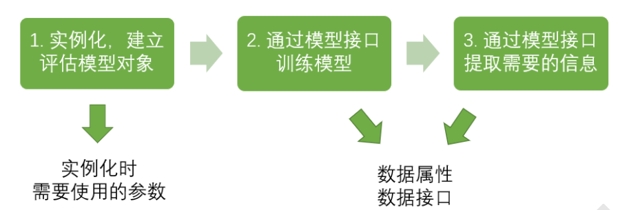

# sklearn介绍

## sklearn介绍

Sklearn原称是Scikit learn，是机器学习领域中最知名的python模块之一，是基于Python语言的机器学习的工具。他主要建立在NumPy，SciPy，matplotlib之上，提供简单高效，用于数据挖掘，数据分析等的工具，最重要的是，他是开源的，基于BSD许可证，可以商业使用。这样子，就给了我们无限的想象。

在工程应用中，用python手写代码来从头实现一个算法的可能性非常低，这样不仅耗时耗力，还不一定能够写出构架清晰，稳定性强的模型。更多情况下，是分析采集到的数据，根据数据特征选择适合的算法，在工具包中调用算法，调整算法的参数，获取需要的信息，从而实现算法效率和效果之间的平衡。而sklearn，正是这样一个可以帮助我们高效实现算法应用的工具包。

sklearn有一个完整而丰富的官网，里面讲解了基于sklearn对所有算法的实现和简单应用。然而，这个官网是全英文的，并且现在没有特别理想的中文接口，市面上也没有针对sklearn非常好的书。因此，这门课的目的就是由简向繁地向大家解析sklearn的全面应用，帮助大家了解不同的机器学习算法有哪些可调参数，有哪些可用接口，这些接口和参数对算法来说有什么含义，又会对算法的性能及准确性有什么影响。我们会讲解sklearn中对算法的说明，调参，属性，接口，以及实例应用。

官网：[https://scikit-learn.org/stable/](https://scikit-learn.org/stable/)

中文版：[https://www.scikitlearn.com.cn/ ](https://www.scikitlearn.com.cn/ )

## sklearn建模的基本流程

> 更新: 2023-12-18 19:16:45
> 原文: <https://www.yuque.com/doublehelix/bioinfonotes/uskdnsgfuamm6pai>
