# 机器学习

## 一、机器学习和深度学习综述
### 1.人工智能、机器学习、深度学习的关系

人工智能一词最早出现于1956年，用于探索一些问题的有效解决方案。1960年，美国国防部借助「神经网络」这一概念，训练计算机模仿人类的推理过程。

2010年之前，谷歌、微软等科技巨头改进了机器学习算法，将查询的准确度提升到了新的高度。而后，随着数据量的增加、先进的算法、计算和存储容量的提高，机器学习得到了更进一步的发展。

近些年人工智能、机器学习和深度学习的概念十分火热，但很多从业者却很难说清它们之间的关系，外行人更是雾里看花。在研究深度学习之前，先从三个概念的正本清源开始。概括来说，人工智能、机器学习和深度学习覆盖的技术范畴是逐层递减的，三者的关系如 **图1** 所示，即：人工智能 > 机器学习 > 深度学习。


图1：人工智能、机器学习和深度学习三者关系示意

人工智能（ArtificialIntelligence，AI）是最宽泛的概念，是研发用于模拟、延伸和扩展人的智能的理论、方法、技术及应用系统的一门新的技术科学。由于这个定义只阐述了目标，而没有限定方法，因此实现人工智能存在的诸多方法和分支，导致其变成一个“大杂烩”式的学科。机器学习（MachineLearning，ML）是当前比较有效的一种实现人工智能的方式。深度学习（DeepLearning，DL）是机器学习算法中最热门的一个分支，近些年取得了显著的进展，并替代了大多数传统机器学习算法。

### 2.机器学习的定义

机器学习:在不直接针对问题进行编程的情况下，赋予计算机学习能力的一个研究领域--Arthur Samuel,1959。

机器学习:一门人工智能的科学，该领域的主要研究对象是人工智能，特别是如何在经验学习中改善具体算法的性能。--Langley,1996。

机器学习:计算机算法的研究，并通过经验自动进行改善--Tom M.Mitchell, 1996。

机器学习:对于某类任务T和性能度量P，如果一个计算机程序在T上以P衡量的性能随着经验E而自我完善，那么我们称这个计算机程序在从经验E学习。

机器学习:指机器通过统计学算法，对大量的历史数据进行学习从而生成经验模型，利用经验模型指导业务。

### 3.机器学习三要素

机器学习三要素包括数据、模型、算法。

### 4.机器学习基本流程

机器学习工作流（WorkFlow）包含数据预处理（Processing）、模型学习（Learning）、模型评估（Evaluation）、新样本预测（Prediction）几个步骤。
**数据预处理：**输入（未处理的数据 + 标签）→处理过程（特征处理+幅度缩放、特征选择、维度约减、采样）→输出（测试集 + 训练集）。

**模型学习：**模型选择、交叉验证、结果评估、超参选择。

**模型评估：**了解模型对于数据集测试的得分。

**新样本预测：**预测测试集。

### 5.机器学习的分类

**监督学习（Supervised Learning）：**训练集有标记信息，学习方式有分类和回归。

**无监督学习（Unsupervised Learning）：**训练集没有标记信息，学习方式有聚类和降维。

**强化学习（Reinforcement Learning）：**有延迟和稀疏的反馈标签的学习方式。

### 6.分类问题

分类问题是机器学习非常重要的一个组成部分。它的目标是根据已知样本的某些特征，判断一个新的样本属于哪种已知的样本类。分类问题可以细分如下：

+ **二分类问题：**表示分类任务中有两个类别新的样本属于哪种已知的样本类。
+ **多类分类（Multiclass classification）问题：**表示分类任务中有多类别。
+ **多标签分类（Multilabel classification）问题：**给每个样本一系列的目标标签。

机器学习分类算法：KNN算法、逻辑回归算法、朴素贝叶斯算法、决策树模型、随机森林分类模型、GBDT模型、XGBoost模型、支持向量机模型等。

### 7.回归问题

回归算法：决策树模型、随机森林分类模型、GBDT模型、回归树模型、支持向量机模型等。

### 8.聚类问题

聚类（Clustering）是最常见的无监督学习算法，它指的是按照某个特定标准（如距离）把一个数据集分割成不同的类或簇，使得同一个簇内的数据对象的相似性尽可能大，同时不在同一个簇中的数据对象的差异性也尽可能地大。也即聚类后同一类的数据尽可能聚集到一起，不同类数据尽量分离。

聚类算法在很多场景下都有应用，例如新闻自动分组，用户分群，图像分割等等。很多时候，无监督的聚类算法，得到的聚类结果还可以作为特征在后续监督学习中应用，提升整体效果。

### 9.机器学习模型评估与选择
#### 1）机器学习与数据拟合

机器学习最典型的监督学习为分类与回归问题。分类问题中，我们学习出来一条「决策边界」完成数据区分；在回归问题中，我们学习出拟合样本分布的曲线。

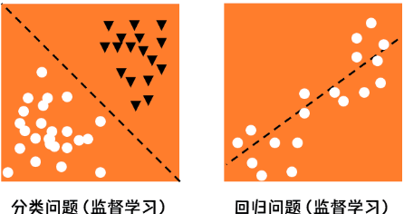

#### 2）训练集与数据集

训练集（Training Set）：帮助训练模型，简单的说就是通过训练集的数据让确定拟合曲线的参数。

测试集（Test Set）：为了测试已经训练好的模型的精确度。

#### 3）经验误差

在训练集的数据上进行学习。模型在训练集上的误差称为「经验误差」（Empirical Error）。但是经验误差并不是越小越好，因为我们希望在新的没有见过的数据上，也能有好的预估结果。

#### 4）过拟合

过拟合，指的是模型在训练集上表现的很好，但是在交叉验证集合测试集上表现一般，也就是说模型对未知样本的预测表现一般，泛化（Generalization）能力较差。

如何防止过拟合呢？一般的方法有Early Stopping、数据集扩增（Data Augmentation）、正则化、Dropout等。

正则化：指的是在目标函数后面添加一个正则化项，一般有L1正则化与L2正则化。L1正则是基于L1范数，即在目标函数后面加上参数的L1范数和项，即参数绝对值和与参数的积项。

数据集扩增：即需要得到更多的符合要求的数据，即和已有的数据是独立同分布的，或者近似独立同分布的。一般方法有：从数据源头采集更多数据、复制原有数据并加上随机噪声、重采样、根据当前数据集估计数据分布参数，使用该分布产生更多数据等。

DropOut：通过修改神经网络本身结构来实现的。

#### 5）偏差

偏差（Bias），它通常指的是模型拟合的偏差程度。给定无数套训练集而期望拟合出来的模型就是平均模型。偏差就是真实模型和平均模型的差异。

#### 6）方差

方差（Variance），它通常指的是模型的平稳程度（简单程度）。简单模型的对应的函数如出一辙，都是水平直线，而且平均模型的函数也是一条水平直线，因此简单模型的方差很小，并且对数据的变动不敏感。

#### 7）偏差与方差的平衡

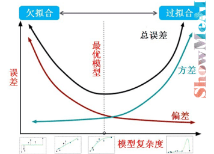

#### 8）性能度量指标

性能度量是衡量模型泛化能力的数值评价标准，反映了当前问题（任务需求）。使用不同的性能度量可能会导致不同的评判结果。

##### （1）回归问题

关于模型「好坏」的判断，不仅取决于算法和数据，还取决于当前任务需求。回归问题常用的性能度量指标有：平均绝对误差、均方误差、均方根误差、R平方等。

+ 平均绝对误差（Mean Absolute Error，MAE），又叫平均绝对离差，是所有标签值与回归模型预测值的偏差的绝对值的平均。
+ 平均绝对百分误差（Mean Absolute Percentage Error，MAPE）是对MAE的一种改进，考虑了绝对误差相对真实值的比例。
+ 均方误差（Mean Square Error，MSE）相对于平均绝对误差而言，均方误差求的是所有标签值与回归模型预测值的偏差的平方的平均。
+ 均方根误差（Root-Mean-Square Error，RMSE），也称标准误差，是在均方误差的基础上进行开方运算。RMSE会被用来衡量观测值同真值之间的偏差。
+ R平方，决定系数，反映因变量的全部变异能通过目前的回归模型被模型中的自变量解释的比例。比例越接近于1，表示当前的回归模型对数据的解释越好，越能精确描述数据的真实分布。

##### （2）分类问题

分类问题常用的性能度量指标包括错误率（Error Rate）、精确率（Accuracy）、查准率（Precision）、查全率（Recall）、F1、ROC曲线、AUC曲线和R平方等。

+ 错误率：分类错误的样本数占样本总数的比例。
+ 精确率：分类正确的样本数占样本总数的比例。
+ 查准率（也称准确率），即在检索后返回的结果中，真正正确的个数占你认为是正确的结果的比例。
+ 查全率（也称召回率），即在检索结果中真正正确的个数，占整个数据集（检索到的和未检索到的）中真正正确个数的比例。
+ F1是一个综合考虑查准率与查全率的度量，其基于查准率与查全率的调和平均定义：即：F1度量的一般形式-Fβ，能让我们表达出对查准率、查全率的不同偏好。

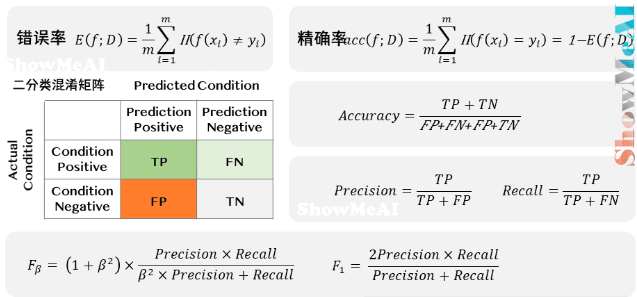

ROC曲线（Receiver Operating Characteristic Curve）全称是「受试者工作特性曲线」。综合考虑了概率预测排序的质量，体现了学习器在不同任务下的「期望泛化性能」的好坏。ROC曲线的纵轴是「真正例率」（TPR），横轴是「假正例率」（FPR）。

AUC（Area Under ROC Curve）是ROC曲线下面积，代表了样本预测的排序质量。

#### 9）评估方法

我们手上没有未知的样本，如何可靠地评估？关键是要获得可靠的「测试集数据」（Test Set），即测试集（用于评估）应该与训练集（用于模型学习）「互斥」。

常见的评估方法有：留出法（Hold-out）、交叉验证法（ Cross Validation）、自助法（Bootstrap）。

##### 留出法（Hold-out）

**留出法（Hold-out）**是机器学习中最常见的评估方法之一，它会从训练数据中保留出验证样本集，这部分数据不用于训练，而用于模型评估。

留出法数据划分的注意点：

+ 随机划分不一定能保证有效性，因为如果T中正好只取到某一种特殊类型数据，从而带来了额外的误差。此时处理方法要视具体情况而定，如当数据明显的分为有限类时，可以采用分层抽样方式选择测试数据，保证数据分布比例的平衡。
+ 单次划分不一定能得到合适的测试集，一般多次重复「划分 - 训练 - 测试求误差」的步骤，取误差的平均值。
+ 划分的验证集，太大或者太小都不合适，常用做法是选择  左右数据当作验证集用于评估。

##### 交叉验证法（Cross Validation）

留出法的数据划分，可能会带来偏差。在机器学习中，另外一种比较常见的评估方法是交叉验证法——  折交叉验证对  个不同分组训练的结果进行平均来减少方差。

因此模型的性能对数据的划分就不那么敏感，对数据的使用也会更充分，模型评估结果更加稳定，可以很好地避免上述问题。

##### 自助法（Bootstrap）

部分场景下，数据量较少，很难通过已有的数据来估计数据的整体分布（因为数据量不足时，计算的统计量反映不了数据分布），这时可以使用 Bootstrap 自助法。

Bootstrap 是一种用小样本估计总体值的一种非参数方法，在进化和生态学研究中应用十分广泛。Bootstrap通过有放回抽样生成大量的伪样本，通过对伪样本进行计算，获得统计量的分布，从而估计数据的整体分布。

## 二.机器学习算法理论与实战
### 1.线性回归

**公式（1）**

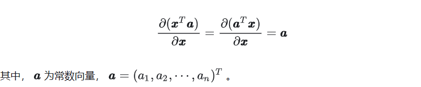

公式（2）

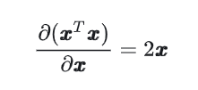

公式（3）

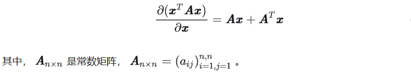

公式（4）

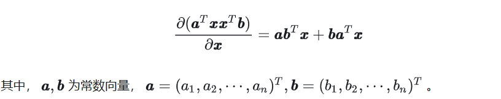

### 2.kNN算法

 KNN是英文k-nearest neighbor（K最近邻）的缩写。是一个基本的分类和回归的算法，它是属于监督学习中分类方法的一种。事实上，kNN可以说是最简单的机器学习算法。尽管kNN很简单，但它可以提供令人惊讶的良好分类性能，并且其简单性使其易于解释。。所谓K最近邻，就是k个最近的邻居的意思，说的是每个样本都可以用它最接近的k个邻居来代表。平常生活中我们都会下意识的运用到我们的判断中，比如富人区和穷人区，判断一个人是富人还是穷人根据他的朋友的判断，就是运用了kNN的思想。

#### 1）K近邻核心思想

在 KNN 分类中，输出是一个分类族群。一个对象的分类是由其邻居的「多数表决」确定的， 个最近邻居（  为正整数，通常较小）中最常见的分类决定了赋予该对象的类别。

若 ，则该对象的类别直接由最近的一个节点赋予。

在 KNN 回归中，输出是该对象的属性值。该值是其  个最近邻居的值的平均值。

 近邻居法采用向量空间模型来分类，概念为相同类别的案例，彼此的相似度高。而可以借由计算与已知类别案例之相似度，来评估未知类别案例可能的分类。

#### 2）K近邻算法工作原理

存在一个样本数据集合，也称作训练样本集，并且样本集中每个数据都存在标签，即我们知道样本集中每个数据与所属分类的对应关系。

输入没有标签的新数据后，将新数据的每个特征与样本集中数据对应的特征进行比较，然后算法提取样本集中特征最相似数据（最近邻）的分类标签。

一般来说，只选择样本数据集中前  个最相似的数据。  一般不大于  ，最后，选择  个中出现次数最多的分类，作为新数据的分类。

#### 3）K近邻算法参数选择

如何选择一个最佳的  值取决于数据。一般情况下，在分类时较大的  值能够减小噪声的影响，但会使类别之间的界限变得模糊。一个较好的  值能通过各种启发式技术（见超参数优化）来获取。

噪声和非相关性特征的存在，或特征尺度与它们的重要性不一致会使  近邻算法的准确性严重降低。对于选取和缩放特征来改善分类已经做了很多研究。一个普遍的做法是利用进化算法优化功能扩展，还有一种较普遍的方法是利用训练样本的互信息进行选择特征。

在二元（两类）分类问题中，选取  为奇数有助于避免两个分类平票的情形。在此问题下，选取最佳经验  值的方法是自助法。

说明： KNN 没有显示的训练过程，它是「懒惰学习」的代表，它在训练阶段只是把数据保存下来，训练时间开销为 ，等收到测试样本后进行处理。

#### 4）K近邻算法的核心要素：距离度量准则

近邻算法能用一种有效的方式隐含的计算决策边界。另外，它也可以显式的计算决策边界，以及有效率的这样做计算，使得计算复杂度是边界复杂度的函数。 近邻算法依赖于空间中相近的点做类别判断，判断距离远近的度量标准非常重要。

##### (1) 欧式距离

欧式距离也称欧几里得距离，是最常见的距离度量，衡量的是多维空间中两个点之间的绝对距离。也可以理解为：m维空间中两个点之间的真实距离，或者向量的自然长度（即该点到原点的距离）。在二维和三维空间中的欧氏距离就是两点之间的实际距离，下面是具体的计算公式:

                                                           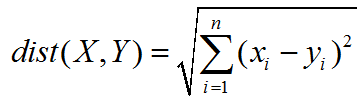

上面的欧式距离是简单的欧氏距离，标准化欧氏距离是针对简单欧氏距离的缺点而作的一种改进方案。标准欧氏距离的思路：既然数据各维分量的分布不一样，好吧！那我先将各个分量都“标准化”到均值、方差相等吧。均值和方差标准化到多少呢？这里先复习点统计学知识吧，假设样本集X的均值(mean)为m，标准差为s，那么X的“标准化变量”表示为：

　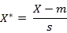

而且标准化变量的数学期望为0，方差为1。因此样本集的标准化过程(standardization)用公式描述就是：标准化后的值 =  ( 标准化前的值  － 分量的均值 ) /分量的标准差。经过简单的推导就可以得到两个n维向量a(x11,x12,…,x1n)与b(x21,x22,…,x2n)间的标准化欧氏距离的公式：

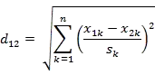

如果将方差的倒数看成是一个权重，这个公式可以看成是一种**加权欧氏距离(WeightedEuclidean distance)**。

##### (2) Mahalanobis 距离（马氏距离）

在介绍马氏距离之前，我们先来看如下几个概念：

**方差：****方差是****标准差**的平方，而标准差的意义是**数据集中各个点到均值点距离的平均值**。反应的是数据的离散程度。

**协方差：** 标准差与方差是描述一维数据的，当存在多维数据时，我们通常需要知道每个维数的变量中间是否存在关联。协方差就是衡量多维数据集中，变量之间相关性的统计量。比如说，一个人的身高与他的体重的关系，这就需要用协方差来衡量。如果两个变量之间的协方差为正值，则这两个变量之间存在正相关，若为负值，则为负相关。

**协方差矩阵：** 当变量多了，超过两个变量了。那么，就用协方差矩阵来衡量这么多变量之间的相关性。假设 X是以 n 个随机变数（其中的每个随机变数是也是一个向量，当然是一个行向量）组成的列向量：

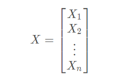

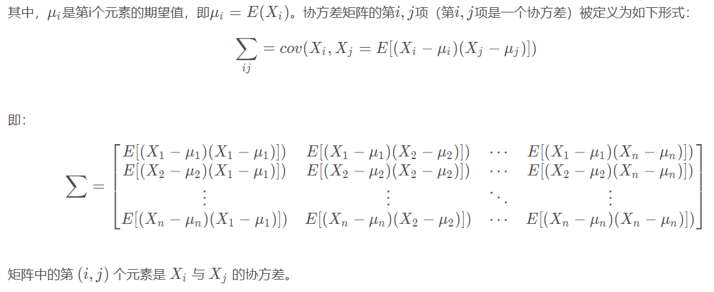

马氏距离(Mahalanobis distance)是由印度统计学家马哈拉诺比斯(P. C. Mahalanobis)提出的，表示点与一个分布之间的距离。它是一种有效的计算两个未知样本集的相似度的方法。与[欧氏距离](https://baike.baidu.com/item/%E6%AC%A7%E6%B0%8F%E8%B7%9D%E7%A6%BB/1798948)不同的是，它考虑到各种特性之间的联系（例如：一条关于身高的信息会带来一条关于体重的信息，因为两者是有关联的），并且是尺度无关的(scale-invariant)，即独立于测量尺度。

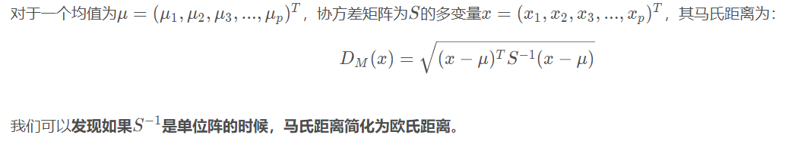

马氏距离有很多优点： 马氏距离不受量纲的影响，两点之间的马氏距离与原始数据的测量单位无关；由标准化数据和中心化数据(即原始数据与均值之差）计算出的二点之间的马氏距离相同。马氏距离还可以排除变量之间的相关性的干扰。

##### (3) 切比雪夫距离（Chebyshev distance）

在数学中，切比雪夫距离（Chebyshev distance）或是L∞度量，是向量空间中的一种度量，二个点之间的距离定义是其各坐标数值差绝对值的最大值。以数学的观点来看，切比雪夫距离是由一致范数（uniform norm）（或称为上确界范数）所衍生的度量，也是超凸度量（injective metric space）的一种。国际象棋玩过么？国王走一步能够移动到相邻的8个方格中的任意一个。那么国王从格子(x1,y1)走到格子(x2,y2)最少需要多少步？自己走走试试。你会发现最少步数总是max(| x2-x1 | , | y2-y1 | ) 步。有一种类似的一种距离度量方法叫切比雪夫距离。

**二维平面两点a(x1,y1)与b(x2,y2)间的切比雪夫距离**

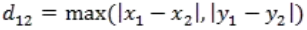

两个n维向量a(x11,x12,…,x1n)与b(x21,x22,…,x2n)间的切比雪夫距离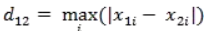 这个公式的另一种等价形式是

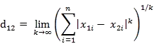

看不出两个公式是等价的？提示一下：试试用放缩法和夹逼法则来证明。

##### (3) 曼哈顿距离

二维平面两点a(x1,y1)与b(x2,y2)间的曼哈顿距离

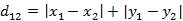

两个n维向量a(x11,x12,…,x1n)与b(x21,x22,…,x2n)间的曼哈顿距离

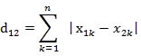

##### (4) 闵氏距离

闵氏距离不是一种距离，而是一组距离的定义。两个n维变量a(x11,x12,…,x1n)与b(x21,x22,…,x2n)间的闵可夫斯基距离定义为：

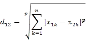

其中p是一个变参数。当p=1时，就是曼哈顿距离；当p=2时，就是欧氏距离；当p→∞时，就是切比雪夫距离 。    根据变参数的不同，闵氏距离可以表示一类的距离。闵氏距离，包括曼哈顿距离、欧氏距离和切比雪夫距离都存在明显的缺点。举个例子：二维样本(身高,体重)，其中身高范围是150~190，体重范围是50~60，有三个样本：a(180,50)，b(190,50)，c(180,60)。那么a与b之间的闵氏距离（无论是曼哈顿距离、欧氏距离或切比雪夫距离）等于a与c之间的闵氏距离，但是身高的10cm真的等价于体重的10kg么？因此用闵氏距离来衡量这些样本间的相似度很有问题。简单说来，闵氏距离的缺点主要有两个：以上将各个分量的量纲(scale)，也就是“单位”当作相同的看待了。(2)没有考虑各个分量的分布（期望，方差等)可能是不同的。

##### (5) 兰氏距离

兰氏距离(Lance and Williams distance)堪培拉距离（Canberra Distance），被认为是曼哈顿距离的加权版本。其定义公式为：

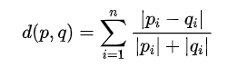

通常兰氏距离对于接近于0（大于等于0）的值的变化非常敏感。与马氏距离一样，兰氏距离对数据的量纲不敏感。不过兰氏距离假定变量之间相互独立，没有考虑变量之间的相关性。

#### 5）案例
### 3.决策树
#### 1）信息熵

信息熵是信息论中的一个基本概念，用于衡量一个随机变量或系统的不确定性或混乱程度。在信息熵的概念中，假设一个随机变量X有n个可能的取值x₁, x₂, …, xₙ，并且各个取值发生的概率分别为P(x₁), P(x₂), …, P(xₙ)，则随机变量X的信息熵H(X)可以表示为：H(X) = -Σ P(xi) * log₂(P(xi))。

信息熵的值越大，表示系统的不确定性或混乱程度越高；反之，信息熵的值越小，表示系统的不确定性或混乱程度越低。在决策树算法中，信息熵被用来评估数据的不纯度，从而进行树枝的分叉以及树的生长。

#### 2）信息增益

信息增益是机器学习中的一个概念，用于度量一个特征对于分类任务的重要性。在决策树算法中，信息增益被用来选择最优的特征进行分支。具体来说，信息增益描述的是在使用某个特征进行划分后，数据集的不确定性（或混乱程度）减少了多少。减少的越多，说明该特征对于分类任务越重要。

信息增益的计算公式为：Gain(A) = Entropy(D) - Σ(v∈values(A))(|Dv|/|D|) * Entropy(Dv)，其中A是某个特征，D是数据集，Dv是D中A取值为v的样本子集，values(A)是A的所有可能取值。

#### 3）基尼系数

在决策树算法中，基尼系数（Gini Index）是一个重要的属性选择准则，用于选择最优的划分属性。基尼系数衡量的是数据集的纯度或不确定性。具体来说，基尼系数表示从一个数据集中随机抽取两个样本，它们属于不同类别的概率。因此，基尼系数越小，表示数据集的纯度越高，不确定性越低。

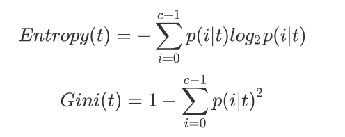

#### 1）决策树是如何工作的

决策树（Decision Tree）是一种非参数的有监督学习方法，它能够从一系列有特征和标签的数据中总结出决策规则，并用树状图的结构来呈现这些规则，以解决分类和回归问题。决策树算法容易理解，适用各种数据，在解决各种问题时都有良好表现，尤其是以树模型为核心的各种集成算法，在各个行业和领域都有广泛的应用。

**关键概念——节点**

**根节点：**没有进边，有出边。包含最初的，针对特征的提问。

**中间节点：**既有进边也有出边，进边只有一条，出边可以有很多条。都是针对特征的提问。

**叶子节点：**有进边，没有出边，每个叶子节点都是一个类别标签。

***子节点和父节点：**在两个相连的节点中，更接近根节点的是父节点，另一个是子节点。

**决策树算法的核心是要解决两个问题：**

+ 如何从数据表中找出最佳节点和最佳分枝？
+ 如何让决策树停止生长，防止过拟合？

几乎所有决策树有关的模型调整方法，都围绕这两个问题展开。这两个问题背后的原理十分复杂，我们会在讲解模

型参数和属性的时候为大家简单解释涉及到的部分。

#### 2）sklearn中的决策树

模块sklearn.tree

sklearn中决策树的类都在”tree“这个模块之下。这个模块总共包含五个类：

+ tree.DecisionTreeClassifier：分类树
+ tree.DecisionTreeRegressor：回归树
+ tree.export_graphviz：将生成的决策树导出为DOT格式，画图专用
+ tree.ExtraTreeClassifier：高随机版本的分类树
+ tree.ExtraTreeRegressor：高随机版本的回归树

##### （1）sklearn.tree.DecisionTreeClassifier类介绍
```python
sklearn.tree.DecisionTreeClassifier (criterion=’gini’, splitter=’best’, max_depth=None,
                                     min_samples_split=2, min_samples_leaf=1,
                                     min_weight_fraction_leaf=0.0, max_features=None,
                                     random_state=None, max_leaf_nodes=None,
                                     min_impurity_decrease=0.0, min_impurity_split=None,
                                     class_weight=None, presort=False)
```

**criterion**：为了要将表格转化为一棵树，决策树需要找出最佳节点和最佳的分枝方法，对分类树来说，衡量这个“最佳”的指标叫做“不纯度”。通常来说，不纯度越低，决策树对训练集的拟合越好。现在使用的决策树算法在分枝方法上的核心大多是围绕在对某个不纯度相关指标的最优化上。不纯度基于节点来计算，树中的每个节点都会有一个不纯度，并且子节点的不纯度一定是低于父节点的，也就是说，在同一棵决策树上，叶子节点的不纯度一定是最低的。criterion这个参数正是用来决定不纯度的计算方法的。sklearn提供了两种选择：

+ 输入”entropy“，使用信息熵（Entropy）
+ 输入”gini“，使用基尼系数（Gini Impurity）


其中t代表给定的节点，i代表标签的任意分类，$p(i|t)$代表标签分类i在节点t上所占的比例。注意，当使用信息熵时，sklearn实际计算的是基于信息熵的信息增益(Information Gain)，即父节点的信息熵和子节点的信息熵差。

比起基尼系数，信息熵对不纯度更加敏感，对不纯度的惩罚最强。但是在实际使用中，信息熵和基尼系数的效果基本相同。信息熵的计算比基尼系数缓慢一些，因为基尼系数的计算不涉及对数。另外，因为信息熵对不纯度更加敏感，所以信息熵作为指标时，决策树的生长会更加“精细”，因此对于高维数据或者噪音很多的数据，信息熵很容易过拟合，基尼系数在这种情况下效果往往比较好。当然，这不是绝对的。

```python
from sklearn import tree #导入需要的模块
from sklearn.datasets import load_wine
from sklearn.model_selection import train_test_split
wine = load_wine()
# 分训练集和测试集
Xtrain, Xtest, Ytrain, Ytest = train_test_split(wine.data,wine.target,test_size=0.3)
# 建立模型
clf = tree.DecisionTreeClassifier(criterion="entropy")
clf = clf.fit(Xtrain, Ytrain)
score = clf.score(Xtest, Ytest) #返回预测的准确度
```

```python
import matplotlib.pyplot as plt
from sklearn.tree import plot_tree
# 画出决策树
fig, ax = plt.subplots(figsize=(12, 12))  # 创建一个新的图形，定义大小
plot_tree(clf, filled=True, ax=ax,feature_names=wine.feature_names)  # filled参数表示用颜色填充节点，表示不同的类别
plt.show()  # 显示图形
```

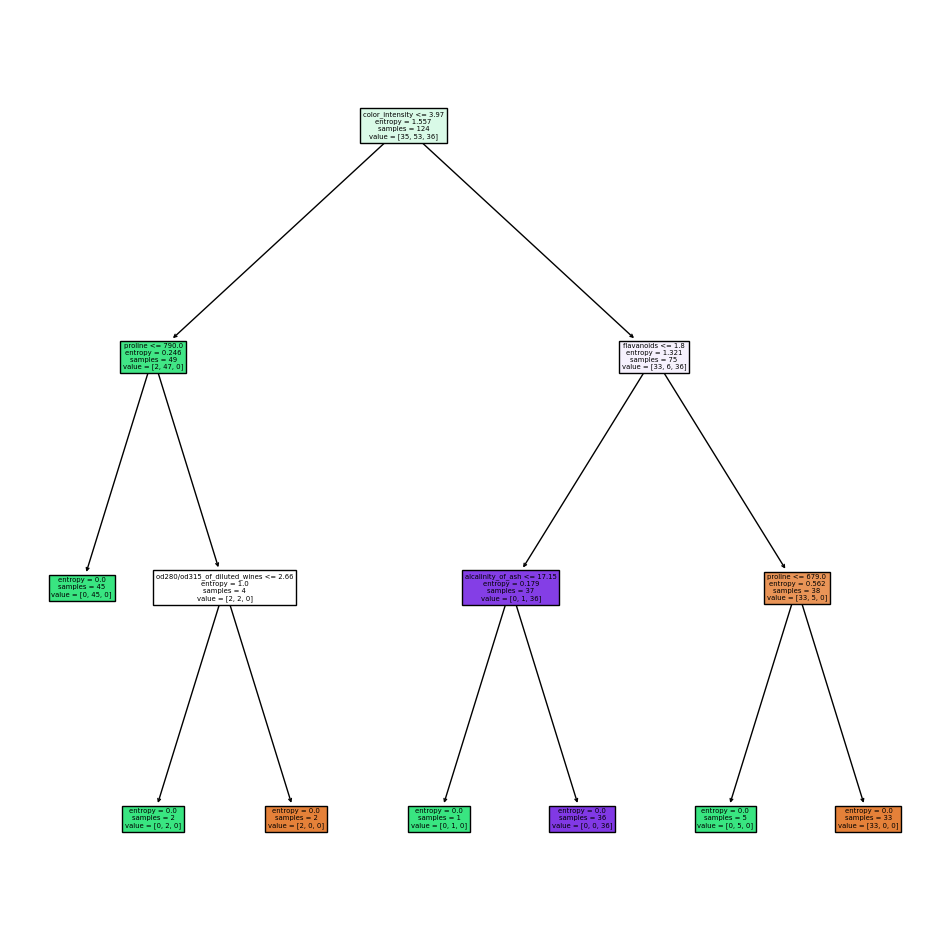

我们已经在只了解一个参数的情况下，建立了一棵完整的决策树。但是回到步骤4建立模型，score会在某个值附近波动，引起步骤5中画出来的每一棵树都不一样。它为什么会不稳定呢？如果使用其他数据集，它还会不稳定吗？我们之前提到过，无论决策树模型如何进化，在分枝上的本质都还是追求某个不纯度相关的指标的优化，而正如我们提到的，不纯度是基于节点来计算的，也就是说，决策树在建树时，是靠优化节点来追求一棵优化的树，但最优的节点能够保证最优的树吗？集成算法被用来解决这个问题：sklearn表示，既然一棵树不能保证最优，那就建更多的不同的树，然后从中取最好的。怎样从一组数据集中建不同的树？在每次分枝时，不从使用全部特征，而是随机选取一部分特征，从中选取不纯度相关指标最优的作为分枝用的节点。这样，每次生成的树也就不同了。

```python
clf = tree.DecisionTreeClassifier(criterion="entropy",random_state=30)
clf = clf.fit(Xtrain, Ytrain)
score = clf.score(Xtest, Ytest) #返回预测的准确度
score
```

**random_state ：**random_state用来设置分枝中的随机模式的参数，默认None，在高维度时随机性会表现更明显，低维度的数据（比如鸢尾花数据集），随机性几乎不会显现。输入任意整数，会一直长出同一棵树，让模型稳定下来。

**splitter：**也是用来控制决策树中的随机选项的，有两种输入值，输入”best"，决策树在分枝时虽然随机，但是还是会优先选择更重要的特征进行分枝（重要性可以通过属性feature_importances_查看），输入“random”，决策树在分枝时会更加随机，树会因为含有更多的不必要信息而更深更大，并因这些不必要信息而降低对训练集的拟合。这也是防止过拟合的一种方式。当你预测到你的模型会过拟合，用这两个参数来帮助你降低树建成之后过拟合的可能性。当然，树一旦建成，我们依然是使用剪枝参数来防止过拟合。

```python
from sklearn import tree #导入需要的模块
from sklearn.datasets import load_wine
from sklearn.model_selection import train_test_split
wine = load_wine()
# 分训练集和测试集
Xtrain, Xtest, Ytrain, Ytest = train_test_split(wine.data,wine.target,test_size=0.3)
# 建立模型
clf = tree.DecisionTreeClassifier(criterion="entropy",random_state=30,splitter="random")
clf = clf.fit(Xtrain, Ytrain)
score = clf.score(Xtest, Ytest)
score
```

在不加限制的情况下，一棵决策树会生长到衡量不纯度的指标最优，或者没有更多的特征可用为止。这样的决策树往往会过拟合，这就是说，它会在训练集上表现很好，在测试集上却表现糟糕。我们收集的样本数据不可能和整体的状况完全一致，因此当一棵决策树对训练数据有了过于优秀的解释性，它找出的规则必然包含了训练样本中的噪声，并使它对未知数据的拟合程度不足。

```python
#我们的树对训练集的拟合程度如何？score_train = clf.score(Xtrain, Ytrain)
score_train
```

为了让决策树有更好的泛化性，我们要对决策树进行剪枝。剪枝策略对决策树的影响巨大，正确的剪枝策略是优化决策树算法的核心。sklearn为我们提供了不同的剪枝策略：

**max_depth：**限制树的最大深度，超过设定深度的树枝全部剪掉

这是用得最广泛的剪枝参数，在高维度低样本量时非常有效。决策树多生长一层，对样本量的需求会增加一倍，所

以限制树深度能够有效地限制过拟合。在集成算法中也非常实用。实际使用时，建议从=3开始尝试，看看拟合的效果再决定是否增加设定深度。

min_samples_leaf & min_samples_split

**min_samples_leaf：**一个节点在分枝后的每个子节点都必须包含至少min_samples_leaf个训练样本，否则分枝就不会发生，或者，分枝会朝着满足每个子节点都包含min_samples_leaf个样本的方向去发生一般搭配max_depth使用，在回归树中有神奇的效果，可以让模型变得更加平滑。这个参数的数量设置得太小会引起过拟合，设置得太大就会阻止模型学习数据。一般来说，建议从=5开始使用。如果叶节点中含有的样本量变化很大，建议输入浮点数作为样本量的百分比来使用。同时，这个参数可以保证每个叶子的最小尺寸，可以在回归问题中避免低方差，过拟合的叶子节点出现。对于类别不多的分类问题，=1通常就是最佳选择。

**min_samples_split：**一个节点必须要包含至少min_samples_split个训练样本，这个节点才允许被分枝，否则分枝就不会发生。

```python
from sklearn import tree #导入需要的模块
from sklearn.datasets import load_wine
from sklearn.model_selection import train_test_split
wine = load_wine()
# 分训练集和测试集
Xtrain, Xtest, Ytrain, Ytest = train_test_split(wine.data,wine.target,test_size=0.3)
# 建立模型
clf = tree.DecisionTreeClassifier(criterion="entropy"
,random_state=30
,splitter="random"
,max_depth=3
,min_samples_leaf=10
,min_samples_split=10
)
clf = clf.fit(Xtrain, Ytrain)
import matplotlib.pyplot as plt
from sklearn.tree import plot_tree
# 画出决策树
fig, ax = plt.subplots(figsize=(12, 12))  # 创建一个新的图形，定义大小
plot_tree(clf, filled=True, ax=ax,feature_names=wine.feature_names)  # filled参数表示用颜色填充节点，表示不同的类别
plt.show()  # 显示图形
```

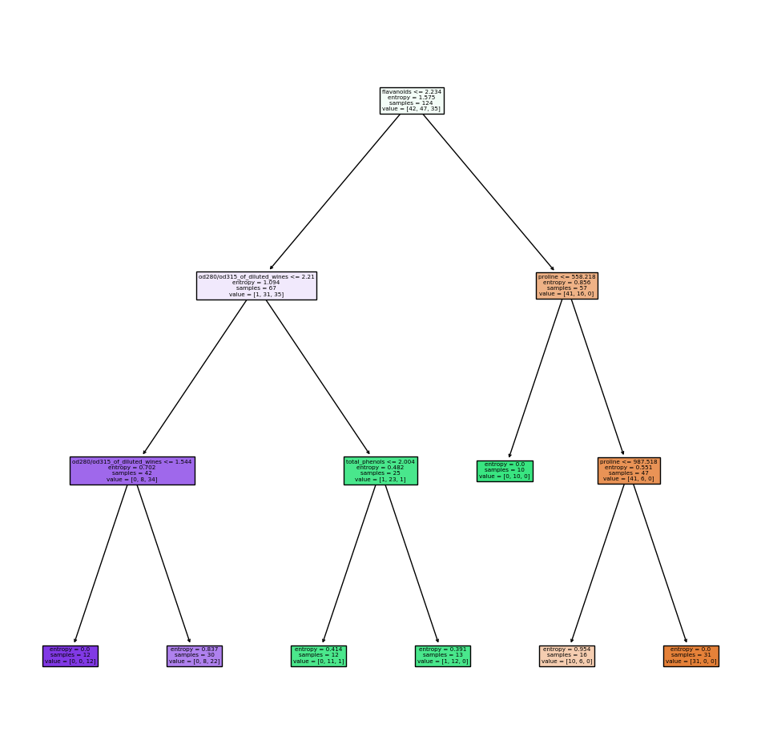

max_features：限制分枝时考虑的特征个数，超过限制个数的特征都会被舍弃。和max_depth异曲同工，max_features是用来限制高维度数据的过拟合的剪枝参数，但其方法比较暴力，是直接限制可以使用的特征数量而强行使决策树停下的参数，在不知道决策树中的各个特征的重要性的情况下，强行设定这个参数可能会导致模型学习不足。如果希望通过降维的方式防止过拟合，建议使用PCA，ICA或者特征选择模块中的降维算法。

min_impurity_decrease：限制信息增益的大小，信息增益小于设定数值的分枝不会发生。这是在0.19版本种更新的功能，在0.19版本之前时使用min_impurity_split。

那具体怎么来确定每个参数填写什么值呢？这时候，我们就要使用确定超参数的曲线来进行判断了，继续使用我们已经训练好的决策树模型clf。超参数的学习曲线，是一条以超参数的取值为横坐标，模型的度量指标为纵坐标的曲线，它是用来衡量不同超参数取值下模型的表现的线。在我们建好的决策树里，我们的模型度量指标就是score。

```python
import matplotlib.pyplot as plt
test = []
for i in range(10):
    clf = tree.DecisionTreeClassifier(max_depth=i+1
                                      ,criterion="entropy"
                                      ,random_state=30
                                      ,splitter="random"
                                     )
    clf = clf.fit(Xtrain, Ytrain)
    score = clf.score(Xtest, Ytest)
    test.append(score)
plt.plot(range(1,11),test,color="red",label="max_depth")
plt.legend()
plt.show()
```

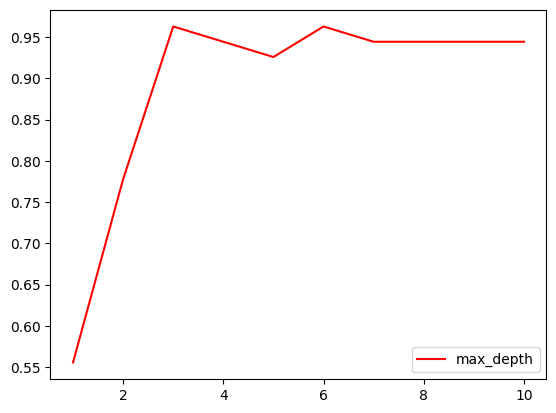

思考：

+ 剪枝参数一定能够提升模型在测试集上的表现吗？ - 调参没有绝对的答案，一切都是看数据本身。
+ 这么多参数，一个个画学习曲线？

无论如何，剪枝参数的默认值会让树无尽地生长，这些树在某些数据集上可能非常巨大，对内存的消耗。所以如果你手中的数据集非常大，你已经预测到无论如何你都是要剪枝的，那提前设定这些参数来控制树的复杂性和大小会比较好。

**class_weight & min_weight_fraction_leaf**：完成样本标签平衡的参数。样本不平衡是指在一组数据集中，标签的一类天生占有很大的比例。比如说，在银行要判断“一个办了信用卡的人是否会违约”，就是是vs否（1%：99%）的比例。这种分类状况下，即便模型什么也不做，全把结果预测成“否”，正确率也能有99%。因此我们要使用class_weight参数对样本标签进行一定的均衡，给少量的标签更多的权重，让模型更偏向少数类，向捕获少数类的方向建模。该参数默认None，此模式表示自动给与数据集中的所有标签相同的权重。有了权重之后，样本量就不再是单纯地记录数目，而是受输入的权重影响了，因此这时候剪枝，就需要搭配min_weight_fraction_leaf这个基于权重的剪枝参数来使用。另请注意，基于权重的剪枝参数（例如min_weight_fraction_leaf）将比不知道样本权重的标准（比如min_samples_leaf）更少偏向主导类。如果样是加权的，则使用基于权重的预修剪标准来更容易优化树结构，这确保叶节点至少包含样本权重的总和的一小部分。

##### （2）重要属性和接口

   属性是在模型训练之后，能够调用查看的模型的各种性质。对决策树来说，最重要的是feature_importances_，能够查看各个特征对模型的重要性。sklearn中许多算法的接口都是相似的，比如说我们之前已经用到的fit和score，几乎对每个算法都可以使用。除了这两个接口之外，决策树最常用的接口还有apply和predict。apply中输入测试集返回每个测试样本所在的叶子节点的索引，predict输入测试集返回每个测试样本的标签。返回的内容一目了然并且非常容易，大家感兴趣可以自己下去试试看。

```python
#predict返回每个测试样本的分类/回归结果
clf.predict(Xtest)
```

```python
#apply返回每个测试样本所在的叶子节点的索引
clf.apply(Xtest)
```

##### （3）案例
```python
import numpy as np
import matplotlib.pyplot as plt
from matplotlib.colors import ListedColormap
from sklearn.model_selection import train_test_split
from sklearn.preprocessing import StandardScaler
from sklearn.datasets import make_moons, make_circles, make_classification
from sklearn.tree import DecisionTreeClassifier
#make_classification库生成随机的二分型数据
X, y = make_classification(n_samples=100, #生成100个样本
n_features=2, #包含2个特征，即生成二维数据
n_redundant=0, #添加冗余特征0个
n_informative=2, #包含信息的特征是2个
random_state=1, #随机模式1
n_clusters_per_class=1 #每个簇内包含的标签类别有1个
)
rng = np.random.RandomState(2) #生成一种随机模式
X += 2 * rng.uniform(size=X.shape) #加减0~1之间的随机数
linearly_separable = (X, y) #生成了新的X，依然可以画散点图来观察一下特征的分布
#plt.scatter(X[:,0],X[:,1])
#用make_moons创建月亮型数据，make_circles创建环形数据，并将三组数据打包起来放在列表datasets中
datasets = [make_moons(noise=0.3, random_state=0),
make_circles(noise=0.2, factor=0.5, random_state=1),
linearly_separable]
#创建画布，宽高比为6*9
figure = plt.figure(figsize=(6,9))
#设置用来安排图像显示位置的全局变量i
i = 1
#开始迭代数据，对datasets中的数据进行for循环
for ds_index,ds in enumerate(datasets):
#对X中的数据进行标准化处理，然后分训练集和测试集
    X, y = ds
    X = StandardScaler().fit_transform(X)
    X_train, X_test,y_train, y_test = train_test_split(X, y,test_size=.4,random_state=42)
#找出数据集中两个特征的最大值和最小值，让最大值+0.5，最小值-0.5，创造一个比两个特征的区间本身更大一点的区间
    x1_min, x1_max = X[:, 0].min() - .5, X[:, 0].max() + .5
    x2_min, x2_max = X[:, 1].min() - .5, X[:, 1].max() + .5
#用特征向量生成网格数据，网格数据，其实就相当于坐标轴上无数个点
#函数np.arange在给定的两个数之间返回均匀间隔的值，0.2为步长
#函数meshgrid用以生成网格数据，能够将两个一维数组生成两个二维矩阵。
#如果第一个数组是narray，维度是n，第二个参数是marray，维度是m。那么生成的第一个二维数组是以narray为行，m行的矩阵，而第二个二维数组是以marray的转置为列，n列的矩阵
#生成的网格数据，是用来绘制决策边界的，因为绘制决策边界的函数contourf要求输入的两个特征都必须是二维的
    array1,array2 = np.meshgrid(np.arange(x1_min, x1_max, 0.2),np.arange(x2_min, x2_max, 0.2))
#接下来生成彩色画布
#用ListedColormap为画布创建颜色，#FF0000正红，#0000FF正蓝
    cm = plt.cm.RdBu
    cm_bright = ListedColormap(['#FF0000', '#0000FF'])
    #在画布上加上一个子图，数据为len(datasets)行，2列，放在位置i上
    ax = plt.subplot(len(datasets), 2, i)
    #到这里为止，已经生成了0~1之间的坐标系3个了，接下来为我们的坐标系放上标题
#我们有三个坐标系，但我们只需要在第一个坐标系上有标题，因此设定if ds_index==0这个条件
    if ds_index == 0:
        ax.set_title("Input data")
#将数据集的分布放到我们的坐标系上
#先放训练集
    ax.scatter(X_train[:, 0], X_train[:, 1], c=y_train,cmap=cm_bright,edgecolors='k')
#放测试集
    ax.scatter(X_test[:, 0], X_test[:, 1], c=y_test,cmap=cm_bright, alpha=0.6,edgecolors='k')
#为图设置坐标轴的最大值和最小值，并设定没有坐标轴
    ax.set_xlim(array1.min(), array1.max())
    ax.set_ylim(array2.min(), array2.max())
    ax.set_xticks(())
    ax.set_yticks(())
#每次循环之后，改变i的取值让图每次位列不同的位置
    i += 1
#至此为止，数据集本身的图像已经布置完毕，运行以上的代码，可以看见三个已经处理好的数据集
#############################从这里开始是决策树模型##########################
#迭代决策树，首先用subplot增加子图，subplot(行，列，索引)这样的结构，并使用索引i定义图的位置
#在这里，len(datasets)其实就是3，2是两列
#在函数最开始，我们定义了i=1，并且在上边建立数据集的图像的时候，已经让i+1,所以i在每次循环中的取值是2，4，6
    ax = plt.subplot(len(datasets),2,i)
#决策树的建模过程：实例化 → fit训练 → score接口得到预测的准确率
    clf = DecisionTreeClassifier(max_depth=5)
    clf.fit(X_train, y_train)
    score = clf.score(X_test, y_test)
#绘制决策边界，为此，我们将为网格中的每个点指定一种颜色[x1_min，x1_max] x [x2_min，x2_max]
#分类树的接口，predict_proba，返回每一个输入的数据点所对应的标签类概率
#类概率是数据点所在的叶节点中相同类的样本数量/叶节点中的样本总数量
#由于决策树在训练的时候导入的训练集X_train里面包含两个特征，所以我们在计算类概率的时候，也必须导入结构相同的数组，即是说，必须有两个特征
#ravel()能够将一个多维数组转换成一维数组
#np.c_是能够将两个数组组合起来的函数
#在这里，我们先将两个网格数据降维降维成一维数组，再将两个数组链接变成含有两个特征的数据，再带入决策树模型，生成的Z包含数据的索引和每个样本点对应的类概率，再切片，且出类概率
    Z = clf.predict_proba(np.c_[array1.ravel(),array2.ravel()])[:, 1]
#np.c_[np.array([1,2,3]), np.array([4,5,6])]
#将返回的类概率作为数据，放到contourf里面绘制去绘制轮廓
    Z = Z.reshape(array1.shape)
    ax.contourf(array1, array2, Z, cmap=cm, alpha=.8)
#将数据集的分布放到我们的坐标系上
# 将训练集放到图中去
    ax.scatter(X_train[:, 0], X_train[:, 1], c=y_train, cmap=cm_bright,edgecolors='k')
# 将测试集放到图中去
    ax.scatter(X_test[:, 0], X_test[:, 1], c=y_test, cmap=cm_bright,edgecolors='k', alpha=0.6)
#为图设置坐标轴的最大值和最小值
    ax.set_xlim(array1.min(), array1.max())
    ax.set_ylim(array2.min(), array2.max())
#设定坐标轴不显示标尺也不显示数字
    ax.set_xticks(())
    ax.set_yticks(())
#我们有三个坐标系，但我们只需要在第一个坐标系上有标题，因此设定if ds_index==0这个条件
    if ds_index == 0:
        ax.set_title("Decision Tree")
#写在右下角的数字
    ax.text(array1.max() - .3, array2.min() + .3, ('{:.1f}%'.format(score*100)),size=15, horizontalalignment='right')
#让i继续加一
    i += 1
plt.tight_layout()
plt.show()
```

### 3.集成算法概述

集成学习（ensemble learning）是时下非常流行的机器学习算法，它本身不是一个单独的机器学习算法，而是通过在数据上构建多个模型，集成所有模型的建模结果。基本上所有的机器学习领域都可以看到集成学习的身影，在现实中集成学习也有相当大的作用，它可以用来做市场营销模拟的建模，统计客户来源，保留和流失，也可用来预测疾病的风险和病患者的易感性。在现在的各种算法竞赛中，随机森林，梯度提升树（GBDT），Xgboost等集成算法的身影也随处可见，可见其效果之好，应用之广。

#### 1) 集成算法的目标

集成算法会考虑多个评估器的建模结果，汇总之后得到一个综合的结果，以此来获取比单个模型更好的回归或分类表现。多个模型集成成为的模型叫做集成评估器（ensemble estimator），组成集成评估器的每个模型都叫做基评估器（base estimator）。通常来说，有三类集成算法：装袋法（Bagging），提升法（Boosting）和stacking。装袋法的核心思想是构建多个相互独立的评估器，然后对其预测进行平均或多数表决原则来决定集成评估器的结果。装袋法的代表模型就是随机森林。提升法中，基评估器是相关的，是按顺序一一构建的。其核心思想是结合弱评估器的力量一次次对难以评估的样本进行预测，从而构成一个强评估器。提升法的代表模型有Adaboost和梯度提升树。

####  2) sklearn中的集成算法

sklearn中的集成算法模块ensemble。

+ ensemble.AdaBoostClassifier：AdaBoost分类
+ ensemble.AdaBoostRegressor：Adaboost回归
+ ensemble.BaggingClassifier：装袋分类器
+ ensemble.BaggingRegressor：装袋回归器
+ ensemble.ExtraTreesClassifier：Extra-trees分类（超树，极端随机树）
+ ensemble.ExtraTreesRegressor：Extra-trees回归
+ ensemble.GradientBoostingClassifier：梯度提升分类
+ ensemble.GradientBoostingRegressor：梯度提升回归
+ ensemble.IsolationForest：隔离森林
+ ensemble.RandomForestClassifier：随机森林分类
+ ensemble.RandomForestRegressor：随机森林回归
+ ensemble.RandomTreesEmbedding：完全随机树的集成
+ ensemble.VotingClassifier：用于不合适估算器的软投票/多数规则分类器

集成算法中，有一半以上都是树的集成模型，可以想见决策树在集成中必定是有很好的效果。后面，我们会以随机森林为例，慢慢为大家揭开集成算法的神秘面纱。

### 4.随机森林

随机森林是非常具有代表性的Bagging集成算法，它的所有基评估器都是决策树，分类树组成的森林就叫做随机森林分类器，回归树所集成的森林就叫做随机森林回归器。我们想讲解RandomForestClassifier，随机森林分类器。

#### 1) sklearn.ensemble.RandomForestClassifier
```python
sklearn.ensemble.RandomForestClassifier(n_estimators=’10’, criterion=’gini’, max_depth=None,
                                         min_samples_split=2, min_samples_leaf=1, min_weight_fraction_leaf=0.0, max_features=’auto’,
                                         max_leaf_nodes=None, min_impurity_decrease=0.0, min_impurity_split=None, bootstrap=True, oob_score=False,
                                         n_jobs=None, random_state=None, verbose=0, warm_start=False, class_weight=None)
```

criterion: 不纯度的衡量指标，有基尼系数和信息熵两种选择

max_depth: 树的最大深度，超过最大深度的树枝都会被剪掉

min_samples_leaf: 有增有减，默认最小限制1，即最高复杂度，向复杂度降低的方向调参，min_samples_leaf↑，模型更简单，且向图像的左边移动。

min_samples_split:有增有减，默认最小限制2，即最高复杂度，向复杂度降低的方向调参min_samples_split↑，模型更简单，且向图像的左边移动。

max_features: 有增有减，默认auto，是特征总数的开平方，位于中间复杂度，既可以向复杂度升高的方向，也可以向复杂度降低的方向调参max_features↓，模型更简单，图像左移max_features↑，模型更复杂，图像右移max_features是唯一的，既能够让模型更简单，也能够让模型更复杂的参数，所以在调整这个参数的时候，需要考虑我们调参的方向。

min_impurity_decrease: 限制信息增益的大小，信息增益小于设定数值的分枝不会发生

##### （1）n_estimators

    这是森林中树木的数量，即基基评估器的数量。这个参数对随机森林模型的精确性影响是单调的，n_estimators越大，模型的效果往往越好。但是相应的，任何模型都有决策边界，n_estimators达到一定的程度之后，随机森林的精确性往往不在上升或开始波动，并且，n_estimators越大，需要的计算量和内存也越大，训练的时间也会越来越长。对于这个参数，我们是渴望在训练难度和模型效果之间取得平衡。n_estimators的默认值为100。

```python
%matplotlib inline
from sklearn.tree import DecisionTreeClassifier
from sklearn.ensemble import RandomForestClassifier
from sklearn.datasets import load_wine
from sklearn.model_selection import cross_val_score
wine = load_wine()
rfc_l = []
clf_l = []
for i in range(10):
    rfc = RandomForestClassifier(n_estimators=25)
    rfc_s = cross_val_score(rfc,wine.data,wine.target,cv=10).mean()
    rfc_l.append(rfc_s)
    clf = DecisionTreeClassifier()
    clf_s = cross_val_score(clf,wine.data,wine.target,cv=10).mean()
    clf_l.append(clf_s)
```

```python
import matplotlib.pyplot as plt
plt.plot(range(1,11),rfc_l,label = "Random Forest")
plt.plot(range(1,11),clf_l,label = "Decision Tree")
plt.legend()
plt.show()
```

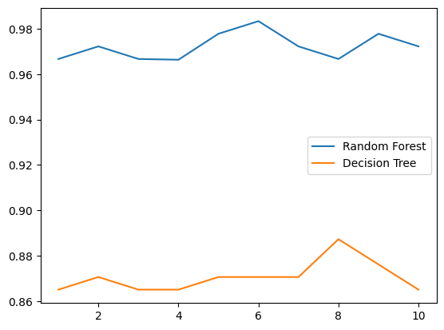

```python
superpa = []
for i in range(200):
    rfc = RandomForestClassifier(n_estimators=i+1,n_jobs=-1)
    rfc_s = cross_val_score(rfc,wine.data,wine.target,cv=10).mean()
    superpa.append(rfc_s)
print(max(superpa),superpa.index(max(superpa))) # 0.9888888888888889 52
plt.figure(figsize=[20,5])
plt.plot(range(1,201),superpa)
plt.show()
```

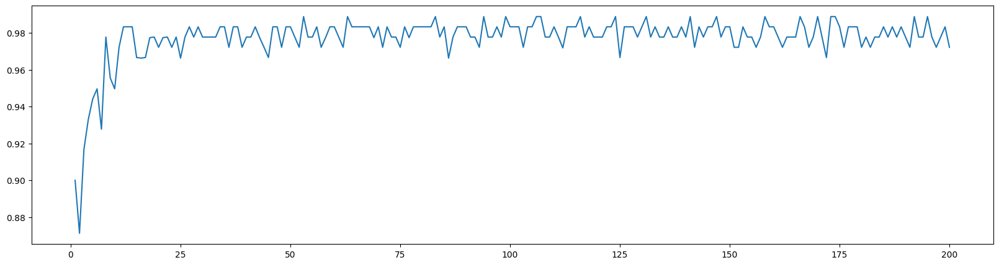

##### （2）重要属性和接口

随机森林中有三个非常重要的属性：.estimators_，.oob_score_以及.feature_importances_。

estimators_是用来查看随机森林中所有树的列表的。

oob_score_指的是袋外得分。随机森林为了确保林中的每棵树都不尽相同，所以采用了对训练集进行有放回抽样的方式来不断组成新的训练集，在这个过程中，会有一些数据从来没有被随机挑选到，他们就被叫做“袋外数据”。这些袋外数据，没有被模型用来进行训练，sklearn可以帮助我们用他们来测试模型，测试的结果就由这个属性oob_score_来导出，本质还是模型的精确度。

而feature_importances_和决策树中的feature_importances_用法和含义都一致，是返回特征的重要性。随机森林的接口与决策树完全一致，因此依然有四个常用接口：apply, fit, predict和score。除此之外，还需要注意随机森林的predict_proba接口，这个接口返回每个测试样本对应的被分到每一类标签的概率，标签有几个分类就返回几个概率。如果是二分类问题，则predict_proba返回的数值大于0.5的，被分为1，小于0.5的，被分为0。传统的随机森林是利用袋装法中的规则，平均或少数服从多数来决定集成的结果，而sklearn中的随机森林是平均每个样本对应的predict_proba返回的概率，得到一个平均概率，从而决定测试样本的分类。

```python
rfc = RandomForestClassifier(n_estimators=25)
rfc = rfc.fit(Xtrain, Ytrain)
rfc.score(Xtest,Ytest)
rfc.feature_importances_
rfc.apply(Xtest)
rfc.predict(Xtest)
rfc.predict_proba(Xtest)
```

#### 2）实例
```python
from sklearn.datasets import load_breast_cancer
from sklearn.ensemble import RandomForestClassifier
from sklearn.model_selection import GridSearchCV
from sklearn.model_selection import cross_val_score
import matplotlib.pyplot as plt
import pandas as pd
import numpy as np
```

```python
data = load_breast_cancer()
```

```python
rfc = RandomForestClassifier(n_estimators=100,random_state=90)
score_pre = cross_val_score(rfc,data.data,data.target,cv=10).mean()
score_pre
# 这里可以看到，随机森林在乳腺癌数据上的表现本就还不错，
# 在现实数据集上，基本上不可能什么都不调就看到95%以上的准确率
```

随机森林调整的第一步：无论如何先来调n_estimators

```python
"""
在这里我们选择学习曲线，可以使用网格搜索吗？可以，但是只有学习曲线，才能看见趋势
我个人的倾向是，要看见n_estimators在什么取值开始变得平稳，
是否一直推动模型整体准确率的上升等信息
第一次的学习曲线，可以先用来帮助我们划定范围，
我们取每十个数作为一个阶段，来观察n_estimators的变化如何
引起模型整体准确率的变化
"""
#####【TIME WARNING: 30 seconds】#####
scorel = []
for i in range(0,200,10):
    rfc = RandomForestClassifier(n_estimators=i+1,
    n_jobs=-1,
    random_state=90)
    score = cross_val_score(rfc,data.data,data.target,cv=10).mean()
    scorel.append(score)
print(max(scorel),(scorel.index(max(scorel))*10)+1)
plt.figure(figsize=[20,5])
plt.plot(range(1,201,10),scorel)
plt.show()
#list.index([object])
#返回这个object在列表list中的索引
```

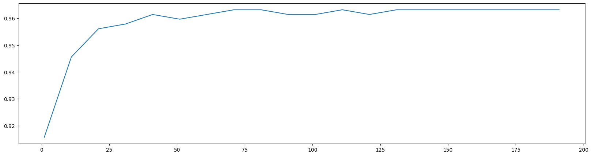
 在确定好的范围内，进一步细化学习曲线.

```python
scorel = []
for i in range(60,75):
    rfc = RandomForestClassifier(n_estimators=i,n_jobs=-1,random_state=90)
    score = cross_val_score(rfc,data.data,data.target,cv=10).mean()
    scorel.append(score)
print(max(scorel),([*range(60,75)][scorel.index(max(scorel))]))
plt.figure(figsize=[20,5])
plt.plot(range(60,75),scorel)
plt.show()
```

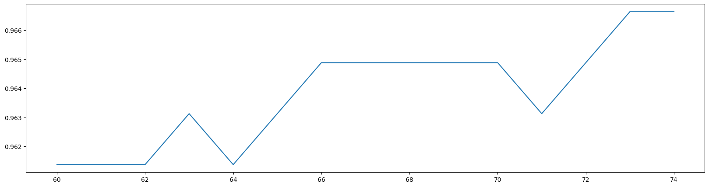

开始按照参数对模型整体准确率的影响程度进行调参，首先调整max_depth

```python
#调整max_depth
param_grid = {'max_depth':np.arange(1, 20, 1)}
# 一般根据数据的大小来进行一个试探，乳腺癌数据很小，所以可以采用1~10，或者1~20这样的试探
# 但对于像digit recognition那样的大型数据来说，我们应该尝试30~50层深度（或许还不足够
# 更应该画出学习曲线，来观察深度对模型的影响
rfc = RandomForestClassifier(n_estimators=73,random_state=90)
GS = GridSearchCV(rfc,param_grid,cv=10)
GS.fit(data.data,data.target)
GS.best_params_
GS.best_score_
```

调整max_features

```python
#调整max_features
param_grid = {'max_features':np.arange(5,30,1)}
"""
max_features是唯一一个即能够将模型往左（低方差高偏差）推，也能够将模型往右（高方差低偏差）推的参数。我
们需要根据调参前，模型所在的位置（在泛化误差最低点的左边还是右边）来决定我们要将max_features往哪边调。现在模型位于图像左侧，我们需要的是更高的复杂度，因此我们应该把max_features往更大的方向调整，可用的特征
越多，模型才会越复杂。max_features的默认最小值是sqrt(n_features)，因此我们使用这个值作为调参范围的
最小值。"""
rfc = RandomForestClassifier(n_estimators=73,random_state=90)
GS = GridSearchCV(rfc,param_grid,cv=10)
GS.fit(data.data,data.target)
GS.best_params_
GS.best_score_
```

调整min_samples_leaf

```python
#调整min_samples_leaf
param_grid={'min_samples_leaf':np.arange(1, 1+10, 1)}
#对于min_samples_split和min_samples_leaf,一般是从他们的最小值开始向上增加10或20
#面对高维度高样本量数据，如果不放心，也可以直接+50，对于大型数据，可能需要200~300的范围
#如果调整的时候发现准确率无论如何都上不来，那可以放心大胆调一个很大的数据，大力限制模型的复杂度
rfc = RandomForestClassifier(n_estimators=93,random_state=90)
GS = GridSearchCV(rfc,param_grid,cv=10)
GS.fit(data.data,data.target)
GS.best_params_
GS.best_score_
```

不懈努力，继续尝试min_samples_split

```python
#调整min_samples_split
param_grid={'min_samples_split':np.arange(2, 2+20, 1)}
rfc = RandomForestClassifier(n_estimators=73,random_state=90)
GS = GridSearchCV(rfc,param_grid,cv=10)
GS.fit(data.data,data.target)
GS.best_params_
GS.best_score_
```

调整Criterion

```python
#调整Criterion
param_grid = {'criterion':['gini', 'entropy']}
rfc = RandomForestClassifier(n_estimators=73,random_state=90)
GS = GridSearchCV(rfc,param_grid,cv=10)
GS.fit(data.data,data.target)
GS.best_params_
GS.best_score_
```

```python
rfc = RandomForestClassifier(n_estimators=93,random_state=90)
score = cross_val_score(rfc,data.data,data.target,cv=10).mean()
score
score - score_pre
```

### 5.XGBoost
### 6.lightGBM

XGBoost在进行最优分裂点的选择上是先进行预排序，然后对所有特征的所有分裂点计算分裂后全部样本的目标函数增益，这存在一些弊端，首先是空间消耗大，因为预排序既需要保存数据的特征值，还得保存特征排序后的索引，虽然提升了后续计算分割点速度，但是需要消耗训练数据两倍的内存。其次，时间上需要遍历每一个分割点，需要进行分裂增益的计算，消耗的代价较大。即使近似分割中XGBoost虽然每次只需要遍历几个可能的分裂节点，然后比较每个分裂节点的信息增益，选择最大者进行分割，但比较时需要考虑所有样本带来的信息增益，仍然比较耗时。

LightGBM(Gradient Boosting Machine)由微软2017年提出，是GBDT模型的另一个进化版本，主要用于解决GBDT在海量数据中遇到的问题，以便更好更快的用于工业实践中。从LightGBM名字可以看出其是轻量级（Light）的梯度提升机器（GBM），所以面对大规模数据集，它依然能以较高效率运行。LightGBM在XGBoost的基础上进行了很多的优化，可以看成是XGBoost的升级加强版，它延续了XGBoost集成学习的方式，但是它更加关注模型的训练速度，相对于XGBoost，具有训练速度快和内存占用率低的特点。

XGBoost在寻找最优分裂点时，其复杂度约为：特征数量*分裂点的数量*样本的数量，LightGBM针对需这三个方面进行了优化，采取了类似XGBoost对分裂点进行分桶操作的直方图算法，减少分裂点的数量，LightGBM使用单边梯度抽样算法GOSS减少样本的数量，而互斥特征捆绑算法EFB则是为了减少特征的数量。

-------------

基于梯度的单边采样算法(Gradient-based One-Side Sampling, GOSS)

单边梯度抽样算法（Gradient-based One-Side Sampling）是从减少样本的角度出发，排除大部分权重小的样本，仅用剩下的样本计算信息增益，它是一种在减少数据和保证精度上平衡的算法。

输入:训练数据，迭代步数d,大梯度数据的采样率a,小梯度数据的采样率b,损失函数和

若学习器的类型(一 般为决策树)

输出:训练好的强学习器

(1)根据样本点的梯度的绝对值对它们进行降序排序;

(2)对排序后的结果选取前a*100%的样本生成一个大梯度样本点的子集;

(3)对剩下的样本集合(1-a)*100%的样本，随机的选取b *(1-a)*100%个样本点，生成一

个小梯度样本点的集合;

(4)将大梯度样本和采样的小梯度样本合并;

(5)将小梯度样本乘上一个权重系数1-a/b ;

(6)使用上述的采样的样本，学习一一个新的弱学习器;

(7)不断地重复(1) ~ (6)步骤直到达到规定的迭代次数或者收敛为止。

SHAP（SHapley Additive exPlanations）是一种用于解释机器学习模型预测的技术，它基于博弈论中的Shapley值概念。对于LightGBM这样的梯度提升模型，SHAP可以帮助我们理解模型是如何根据输入特征来做出预测的，并提供每个特征对特定预测结果的贡献度。

在解释LightGBM模型时，SHAP会为每个输入特征分配一个SHAP值，这个值表示该特征对模型预测结果的贡献。这些SHAP值可以是正数或负数，分别表示该特征对预测结果的正面或负面影响。

具体来说，SHAP解释LightGBM模型的过程可以概括为以下几个步骤：

构建SHAP解释器：首先，我们需要使用SHAP库来构建一个解释器（explainer），这个解释器会根据我们提供的LightGBM模型和训练数据集来生成SHAP值。

计算SHAP值：解释器会遍历训练数据集中的每个样本，并计算每个样本中每个特征的SHAP值。这些SHAP值表示该特征在该样本中对模型预测结果的贡献。

分析SHAP值：通过分析计算得到的SHAP值，我们可以了解哪些特征对模型预测结果的影响最大，以及这些影响是正面的还是负面的。此外，我们还可以比较不同特征之间的SHAP值大小，从而了解它们之间的相对重要性。

可视化结果：SHAP提供了多种可视化工具，如力导向图（force plot）和摘要图（summary plot），来展示SHAP值的分布情况。这些可视化工具可以帮助我们更直观地理解特征对模型预测结果的影响。

通过SHAP解释LightGBM模型，我们可以获得以下方面的信息：

特征重要性：了解哪些特征对模型预测结果的影响最大。

特征方向性：了解每个特征对预测结果的影响是正面的还是负面的。

特征交互性：了解不同特征之间的相互作用对预测结果的影响。

这些信息可以帮助我们更好地理解LightGBM模型的预测过程，并发现可能存在的问题或改进空间。同时，它们也可以作为特征选择和模型优化的重要参考依据。

> 更新: 2024-05-24 20:58:04
> 原文: <https://www.yuque.com/doublehelix/bioinfonotes/da2vcb755iv0qraq>
