# 降维算法

## 一. PCA

PCA是一种非监督学习的降维算法，只需要计算样本数据的协方差矩阵就能实现降维的目的，其算法较易实现，但是降维后特征的可解释性较弱，且通过降维后信息会丢失一些，可能对后续的处理有重要影响。

### 1、预备知识
#### （1）数据标准化

在开始PCA之前，通常会对原始数据集进行标准化处理，将其转化为均值为0、方差为1的形式。对于一个包含m个样本、n个特征的数据集X ∈ ℝ^(m×n)，每个样本为一个n维向量，标准化过程如下：

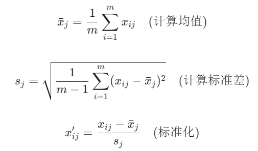

得到标准化后的数据集X' ∈ ℝ^(m×n)。

#### （2）协方差矩阵

协方差其意义： 度量各个维度偏离其均值的程度。协方差的值如果为正值，则说明两者是正相关的（从协方差可以引出“相关系数”的定义），结果为负值就说明负相关的，如果为0，也是就是统计上说的“相互独立”。协方差矩阵衡量的是原始数据中各个特征之间的线性相关性。对于标准化后的数据集X'，其协方差矩阵C ∈ ℝ^(n×n)定义为：

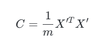

Cov(X,X)就是X的方差。当样本是n维数据时，它们的协方差实际上是协方差矩阵（对称方阵）。例如，对于3维数据（x,y,z），计算它的协方差就是：

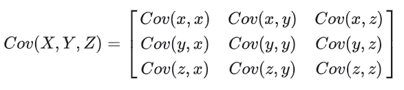

#### （3）特征值分解矩阵原理

**特征值与特征向量：**如果一个向量v是矩阵A的特征向量，将一定可以表示成下面的形式：

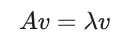

其中，λ是特征向量v对应的特征值，一个矩阵的一组特征向量是一组正交向量。矩阵A与向量v相乘，本质上是对向量v进行了一次线性变换（旋转或拉伸），而该变换的效果为常数λ乘以向量v。当我们求特征值与特征向量的时候，就是为了求矩阵A能使哪些向量（特征向量）只发生伸缩变换，而变换的程度可以用特征值λ表示。

**特征值分解矩阵：**对于矩阵A，有一组特征向量v，将这组向量进行正交化单位化，就能得到一组正交单位向量。特征值分解，就是将矩阵A分解为如下式：

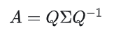

其中，Q是矩阵A的特征向量组成的矩阵，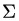则是一个对角阵，对角线上的元素就是特征值。

我们来分析一下特征值分解的式子，分解得到的Σ矩阵是一个对角矩阵，里面的特征值是由大到小排列的，这些特征值所对应的特征向量就是描述这个矩阵变换方向（从主要的变化到次要的变化排列）。

当矩阵是高维的情况下，那么这个矩阵就是高维空间下的一个线性变换，这个线性变换可能没法通过图片来表示，但是可以想象，这个变换也同样有很多的变化方向，我们通过特征值分解得到的前N个特征向量，就对应了这个矩阵最主要的N个变化方向。我们利用这前N个变化方向，就可以近似这个矩阵变换。也就是之前说的：**提取这个矩阵最重要的特征。**

### 2、PCA的推导过程

目标：通过基变化（特征矩阵Wn*k ）将样本集合X映射到新的k维特征子空间Zm*k，并且使降维后的数据在那个坐标轴中的分布尽可能分散，数据的分布的离散程度我们用方差来衡量。n为特征数，m为样本数。

Zm*k  =Xm*n Wn*k

（1）数据取中心化：将数据整体移动到坐标轴中心，数据整体的相对位置不变。

（2）投影方差：

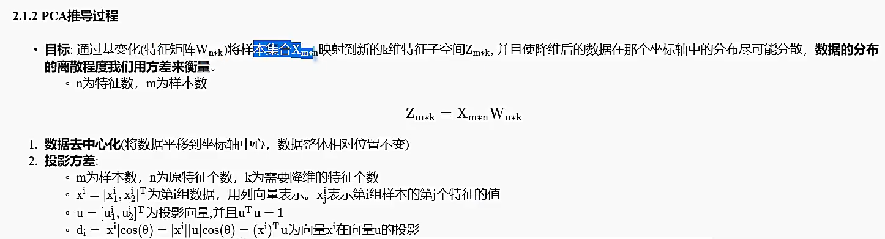

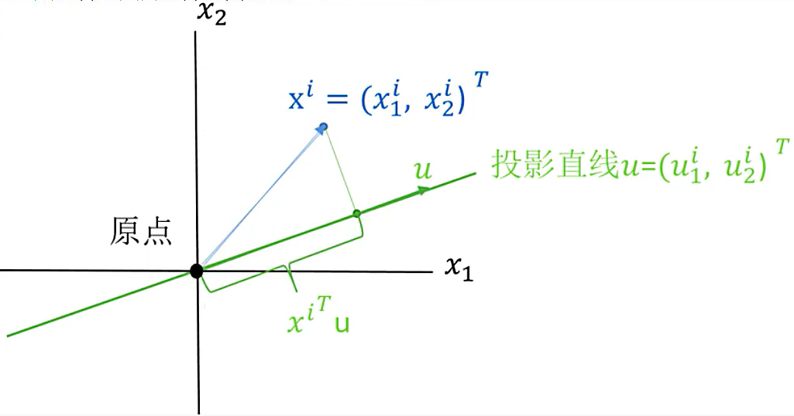

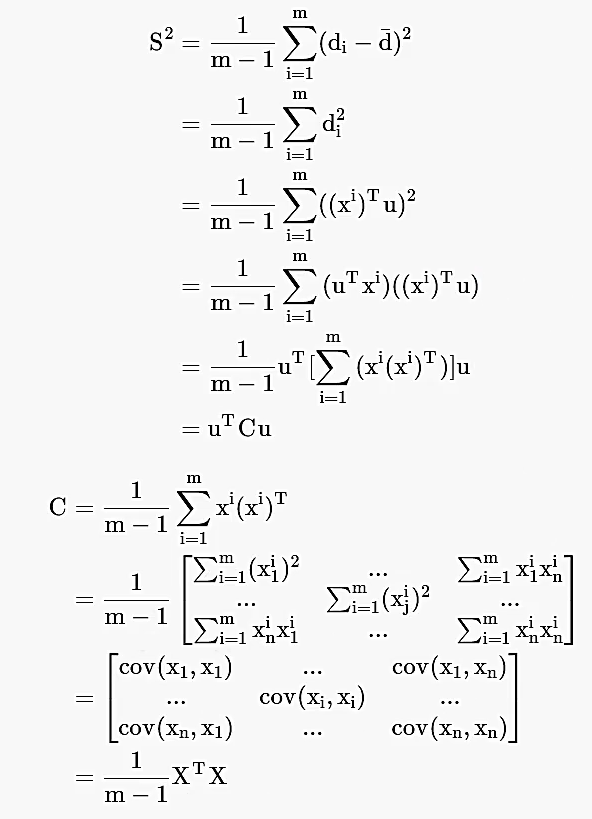

（3）目标函数：

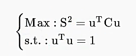

（4）拉格朗日乘子法求最值问题：

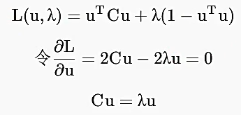

（5）新的目标函数：

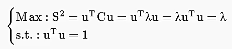

（6）求解C的特征值和特征向量

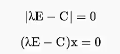

（7）选取排在前面的k个特征值对应的k个特征向量

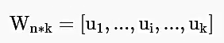

（8）数据映射降维：

Zm*k  =Xm*n Wn*k

## 二. t-SNE算法

T 分布随机近邻嵌入（T-Distribution Stochastic Neighbour Embedding，t-SNE）是一种用于降维的机器学习方法，它能帮我们识别相关联的模式。t-SNE 主要的优势就是保持局部结构的能力。这意味着高维数据空间中距离相近的点投影到低维中仍然相近。t-SNE 同样能生成漂亮的可视化。

t-SNE 算法对每个数据点近邻的分布进行建模，其中近邻是指相互靠近数据点的集合。在原始高维空间中，我们将高维空间建模为高斯分布，而在二维输出空间中，我们可以将其建模为 t 分布。该过程的目标是找到将高维空间映射到二维空间的变换，并且最小化所有点在这两个分布之间的差距。与高斯分布相比 t 分布有较长的尾部，这有助于数据点在二维空间中更均匀地分布。

Van der Maaten L, Hinton G. Visualizing data using t-SNE[J]. Journal of Machine Learning Research, 2008, 9(2579-2605): 85.

文献原文【[https://www.jmlr.org/papers/volume9/vandermaaten08a/vandermaaten08a.pdf](https://www.jmlr.org/papers/volume9/vandermaaten08a/vandermaaten08a.pdf)】

### 1.SNE（ Stochastic Neighbor Embedding）

假设我们有数据集 X，它共有 N 个数据点。每一个数据点 xi 的维度为 D，我们希望降低为 d 维。在一般用于可视化的条件下，d 的取值为 2，即在平面上表示出所有数据。SNE 通过将数据点间的欧几里德距离转化为条件概率而表征相似性：

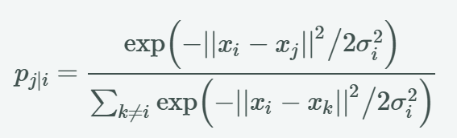

条件概率 pj|i 表示在给定数据点_x__i _的情况下，数据点_ x_j_ _被选为_ x_i_ _的近邻的概率。如果以数据点在 xi 为中心的高斯分布所占的概率密度为标准选择近邻，那么 pj|i 就代表 xi 将选择 xj 作为它的近邻。对于相近的数据点，条件概率 pj|i是相对较高的，然而对于分离的数据点， _p__j|i_几乎是无穷小量（若高斯分布的方差σi 选择合理）。其中σi 是以数据点 xi 为均值的高斯分布标准差，决定σi 值的方法将在本章后一部分讨论。因为我们只对成对相似性的建模感兴趣，所以可以令 pi|i 的值为零。这是因为在t-SNE算法中，我们主要关心的是数据点之间的成对相似性，而不是一个数据点与其自身的相似性。因此，为了简化计算和提高效率，我们通常将pi|i的值设为零，即不考虑一个数据点与其自身的相似性。

现在引入矩阵 Y，Y 是 N*2 阶矩阵，即输入矩阵 X 的 2 维表征。基于矩阵 Y，我们可以构建一个分布 q，其形式与 p 类似。对于高维数据点 xi  和 xj在低维空间中的映射点 yi  和 yj，计算一个相似的条件概率 qj|i是可以实现的。我们将计算条件概率 qj|i中用到的高斯分布的方差设置为 1/2。因此我们可以对映射的低维数据点 yi  和 yj之间的相似度进行建模：

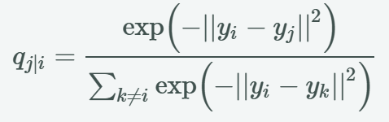

我们的总体目标是选择 Y 中的一个数据点，然后其令条件概率分布 q 近似于 p。这一步可以通过最小化两个分布之间的相对熵（损失函数）而实现【相对熵（relative entropy），又被称为Kullback-Leibler散度（Kullback-Leibler divergence）或信息散度（information divergence），是两个概率分布（probability distribution）间差异的非对称性度量在信息理论中，相对熵等价于两个概率分布的信息熵（Shannon entropy）的差值。】，这一过程可以定义为：

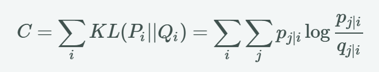

注意，这里的Pi表示了给定点xi下，其他所有数据点的条件概率分布。需要注意的是KL散度具有不对称性，在低维映射中不同的距离对应的惩罚权重是不同的，具体来说:

+ 当 _p__j|i_  = 0.8 也就是说xj是xi邻域点的概率很高，表现为两点距离很近，如果映射到低维空间的qji = 0.2, 也即是映射后的距离很远（属于邻域的概率很低），即用距离较远的两个点来表达距离较近的两个点会产生更大的cost, cost = plog(p/q)= 1.11。
+ 与之相反,用较近的两个点qji = 0.8 (属于邻域的概率很高)来表达较远的两个点pjli = 0.2产生的cost相对较小cost = - 0.277(注意: .类似于回归容易受异常值影响，但效果相反)。 因此, SNE会倾向于保留数据中的局部特征。

### 2.SNE的缺点
#### （1）距离不对称

理论上 _x__i_  和 _x__j _之间的距离与_ x__j_  和 _x__i _，之间的距离应该是相等的，我们用概率来描述这2点直接的关系，它们应该也要一样才好，但我们可以从公式看出来_p__j|i__ _和_p__i|j__ _是不同的_。_

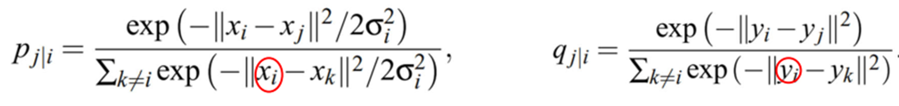

解决办法，可以将条件概率转为联合概率。

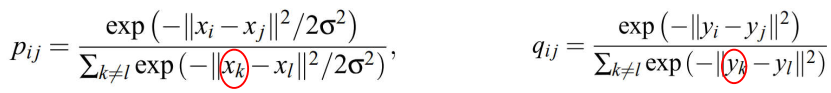

#### （2）拥挤显现

从高维到低维进行转换的过程中，低维点的距离无法建模高维点之间的位置关系，是的高维空间中距离较大的点对，在低维空间距离会变得较小。

解决办法是引入t分布。t分布具有长尾（fat-tailed）性质，这使得在低维空间中相似的数据点之间有更大的距离，从而有助于保持聚类。那么低维空间的联合概率就改为：

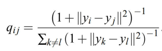

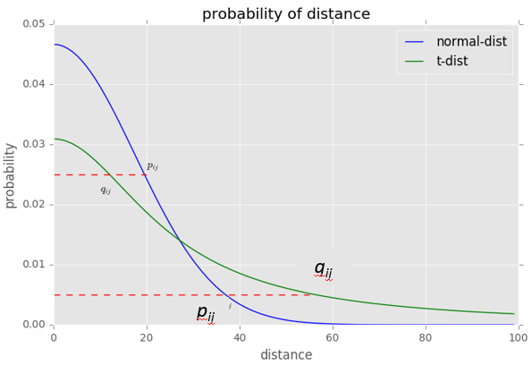

### 3.t-SNE的计算过程

计算_p__j|i__ _，

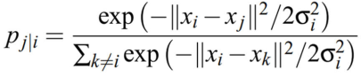

利用结果计算 _p__ij__ _,

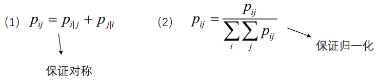

生成低维随机数并计算_q__ij__ _。

利用梯度下降，令C最小：

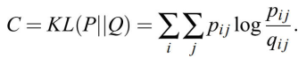

对y求偏导：

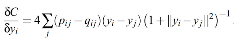

求解过程参考原文和[https://zhuanlan.zhihu.com/p/384698107](https://zhuanlan.zhihu.com/p/384698107)

## 三. UMAP(Uniform Manifold Approximation and Projection)

UMAP 是新近提出的一种新型的数据降维（数据可视化）方法。其算法原理以及降维效果与t-sne类似，但有以下改进:

> 更新: 2025-04-28 21:46:25
> 原文: <https://www.yuque.com/doublehelix/bioinfonotes/is5gdurdrng0amq6>
