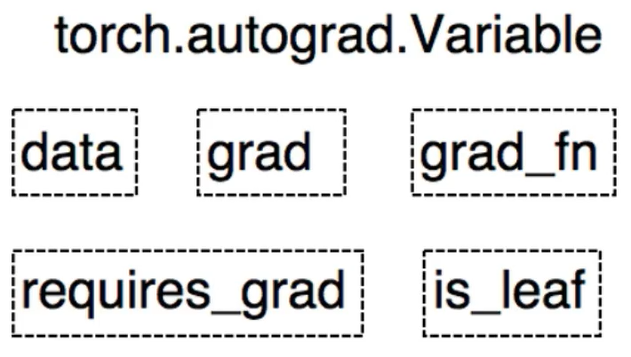
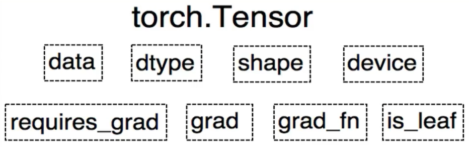
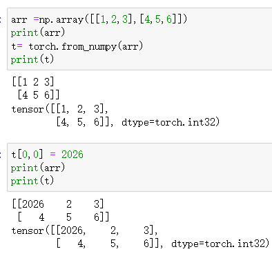

# pyTorch基础

# 1.什么是张量

张量是一种多维数组，在数学概念中是标量、向量和矩阵的拓展。张量有多种创建方式,包括直接创建、依据数组创建以及依据概率分布创建。张量还与自动求导相关的变量(variable)有密切关系，variable包含了tensor的数据、梯度等属性。掌握张量的创建方法是学习PyTorch的基础。在PyTorch中，张量（Tensor）是一个核心的概念，它是多维数组的一个扩展，支持各种数学运算，并可以在GPU上加速计算。以下是如何在PyTorch中理解张量的几个关键点：

\*\*多维数组：\*\*最基本的理解是张量就是一个多维数组。例如，一个标量是0维张量，向量是1维张量，矩阵是2维张量，更高维度的数组也是张量。

\*\*数据类型：\*\*张量具有数据类型（如float32, int64等），这决定了张量中存储的数值的类型。

\*\*形状（Shape）：\*\*张量的形状是一个描述其维度的元组。例如，一个2x3的矩阵在PyTorch中是一个形状为(2, 3)的2维张量。

\*\*操作：\*\*PyTorch提供了丰富的函数来操作张量，包括数学运算（如加法、乘法、指数、对数等）、线性代数运算（如矩阵乘法、转置、特征分解等）、形状变换（如重塑、扩展、切片等）等。

\*\*设备（Device）：\*\*张量可以存储在CPU或GPU上。使用.to('cpu')或.to('cuda')（如果GPU可用）可以将张量从一个设备移动到另一个设备。

\*\*梯度：\*\*在PyTorch的自动梯度系统中，张量也可以用来存储梯度信息。如果张量的requires_grad属性被设置为True，那么所有对这个张量的操作都会被PyTorch的自动梯度引擎记录下来，以便后续计算梯度。

\*\*自动微分：\*\*PyTorch的自动微分系统允许用户轻松地计算张量上复杂函数的梯度。这对于训练神经网络等任务至关重要。Variable是torch.autograd 中的数据类型主要用于封装Tensor，进行自动求导。

\*\*与NumPy的互操作性：\*\*PyTorch的张量和NumPy的数组之间可以很容易地转换。这使得你可以利用NumPy的丰富生态系统和成熟的科学计算库。

\*\*命名张量（Named Tensor）：\*\*虽然这不是PyTorch的核心特性，但PyTorch也支持命名张量，即带有维度名称的张量。这可以提高代码的可读性和可维护性。

\*\*动态图：\*\*PyTorch使用动态图来计算梯度，这意味着你可以像编写普通的Python代码一样编写你的神经网络和计算图，然后PyTorch会自动为你处理所有的梯度计算。

# 2.张量的基础

## （1）Tensor与Variable

tensor类似numpy，是一个矩阵，数组或值，甚至更高维的数组。tensor可以和numpy对象随意转换，它们共享内存，转换很快。 Variable（变量）是Tensor的一种特殊形式，主要用于深度学习模型的训练过程中存储和更新参数（如权重和偏置），variable是torch.autograd 中的数据类型主要用于封装Tensor，进行自动求导。

data : 被包装的Tensor

grad : data的梯度

grad_fn : 创建Tensor的Function，是自动求导的关键

requires_grad : 指示是否需要梯度

is_leaf : 指示是否是叶子结点（张量）



PyTorch0.4.0版开始，Variable并入Tensor

dtype：张量的数据类型，如：torch.FloatTensor，torch.cuda.FloatTensor。

shape：张量的形状，如(64，3，224，224)

device：张量所在设备，GPU/CPU，是加速的关键。



## （2）张量的创建

在PyTorch中，你可以使用多种方式来创建张量（Tensor）。张量是PyTorch中用于存储多维数组的数据结构，并支持GPU加速计算。下面是一些常见的创建张量的方法：

### 使用torch.tensor()

使用torch.tensor()可以基于已有的数据（如列表、元组、ndarray等）创建张量。相关参数介绍如下：

* data:数据，可以是list,numpy数据类型，
* dtype:默认与data的一致
* device:所在设备，cuda/cpu
* requires_grad:是否需要梯度
* pin_memory:是否存于锁页内存

```python
import torch

# 从Python列表创建张量
data = [1, 2, 3, 4]
tensor = torch.tensor(data)
print(tensor)
# 从NumPy数组创建张量
import numpy as np
data_np = np.array([1, 2, 3, 4])
tensor_np = torch.tensor(data_np)
print(tensor_np)
```

### 使用torch.from_numpy创建

```python
arr =np.array([[1,2,3],[4,5,6]])
print(arr)
t= torch.from_numpy(arr)
print(t)
```

```python
t[0,0] = 2026
print(arr)
print(t)
```

它们共享内存：



### 使用torch.Tensor()（不推荐）

虽然torch.Tensor()也可以用来创建张量，但它通常与torch.tensor()有所区别。torch.Tensor()是一个基类构造函数，通常建议直接使用torch.tensor()或torch.empty(), torch.zeros(), torch.ones()等特定函数来创建张量。

### 使用特定函数创建具有特定值的张量

torch.zeros(): 创建一个全为0的张量。

* size：张量的形状，如(3，3)、(3，224,224)
* out：输出的张量，就是把torch.zeros()创建的张量赋值给out设置的变量。
* layout：内存中布局形式，有strided，sparse_coo等
* device：所在设备，gpu/cpu
* requires_grad:是否需要梯度

torch.zeros_like(input,dtype,layout)：依input形状创建全0张量；dtype:数据类型；layout:内存中布局形式。

torch.ones(): 创建一个全为1的张量。

torch.empty(): 创建一个未初始化的张量（内容可能是随机的）。

torch.full(): 创建一个具有指定值的张量。

torch.randn(): 创建一个具有标准正态分布（均值为0，标准差为1）的张量。

torch.rand(): 创建一个在\[0, 1)区间内均匀分布的张量。

torch.logspace(start,end, steps,base)：创建对数均分的1维张量。注意，长度为steps，底为base。

torch.eye()：创建单位对角矩阵。

```python
# 创建一个形状为(2, 3)的全0张量
zeros_tensor = torch.zeros((2, 3))
print(zeros_tensor)

# 创建一个形状为(2, 3)的全1张量
ones_tensor = torch.ones((2, 3))
print(ones_tensor)

# 创建一个形状为(2, 3)的随机初始化张量
empty_tensor = torch.empty((2, 3))
print(empty_tensor)

# 创建一个形状为(2, 3)的值为2的张量
full_tensor = torch.full((2, 3), 2)
print(full_tensor)

# 创建一个形状为(2, 3)的标准正态分布张量
randn_tensor = torch.randn((2, 3))
print(randn_tensor)

# 创建一个形状为(2, 3)的[0, 1)区间内的均匀分布张量
rand_tensor = torch.rand((2, 3))
print(rand_tensor)
```

torch.normal() 是 PyTorch 中的一个函数，用于生成满足正态（高斯）分布的随机数。您提到的四种模式确实概括了使用 torch.normal() 时 mean 和 std 参数的可能组合。下面我将逐一解释这四种模式：

**mean为标量，std为标量：**

在这种情况下，mean 和 std 都是单一的数值（标量）。

`torch.normal(mean=0.0, std=1.0, size=(3, 3))` 会生成一个 3x3 的张量，其中的元素都是从均值为 0.0、标准差为 1.0 的正态分布中抽取的。

**mean为标量，std为张量：**

在这里，mean 是一个单一的数值，而 std 是一个形状与张量输出匹配的张量。

每个输出位置都会从具有相应标准差（来自 std 张量）和给定均值（来自 mean 标量）的正态分布中抽取一个值。例如，`torch.normal(mean=0.0, std=torch.tensor([[1.0, 2.0], [3.0, 4.0]])) `会生成一个 2x2 的张量，其左上角的元素是从均值为 0.0、标准差为 1.0 的正态分布中抽取的，右上角的元素是从均值为 0.0、标准差为 2.0 的正态分布中抽取的，以此类推。

**mean为张量，std为标量：**

在这里，std 是一个单一的数值，而 mean 是一个形状与张量输出匹配的张量。

每个输出位置都会从具有相应均值（来自 mean 张量）和给定标准差（来自 std 标量）的正态分布中抽取一个值。

例如，`torch.normal(mean=torch.tensor([[0.0, 1.0], [2.0, 3.0]]), std=1.0)` 会生成一个 2x2 的张量，其左上角的元素是从均值为 0.0、标准差为 1.0 的正态分布中抽取的，右上角的元素是从均值为 1.0、标准差为 1.0 的正态分布中抽取的，以此类推。

**mean为张量，std为张量：**

在这种情况下，mean 和 std 都是形状与张量输出匹配的张量。

每个输出位置都会从具有相应均值（来自 mean 张量）和标准差（来自 std 张量）的正态分布中抽取一个值。

例如，`torch.normal(mean=torch.tensor([[0.0, 1.0], [2.0, 3.0]]), std=torch.tensor([[1.0, 2.0], [3.0, 4.0]])) `会生成一个 2x2 的张量，其左上角的元素是从均值为 0.0、标准差为 1.0 的正态分布中抽取的，右上角的元素是从均值为 1.0、标准差为 2.0 的正态分布中抽取的，以此类推。

# 生成一个包含10个元素的张量，每个元素都独立地以0.3的概率取值为1

torch.bernoulli()：生成伯努利分布。

```python
# 生成一个包含10个元素的张量，每个元素都独立地以0.3的概率取值为1
p = torch.tensor([0.3] * 10)  # 或者简单地 p = 0.3，PyTorch会广播这个标量值
samples = torch.bernoulli(p)
samples
```

### 使用torch.arange()和torch.linspace()

torch.arange(): 类似于Python的range()函数，但返回的是一个一维张量。

torch.linspace(): 在指定的间隔内均匀创建数值，返回一维张量。

```python
# 创建一个从0到9（不包括10）的一维张量，步长为1
arange_tensor = torch.arange(0, 10, 1)
print(arange_tensor)

# 创建一个从0到1之间均匀分布的5个点的一维张量
linspace_tensor = torch.linspace(0, 1, 5)
print(linspace_tensor)
```

> 更新: 2024-06-03 21:42:24
> 原文: <https://www.yuque.com/doublehelix/bioinfonotes/spfmyirdai7cst1z>
