# KEGG、GO与GSEA是什么？

我们前面介绍了[**TCGA**](https://mp.weixin.qq.com/mp/appmsgalbum?action=getalbum&album_id=1338047035672526848&__biz=MzA4NDAzODkzMA==#wechat_redirect)数据库的各种数据下载与整理，获得的表达矩阵可以[**绘制热图**](http://mp.weixin.qq.com/s?__biz=MzA4NDAzODkzMA==&mid=2651264534&idx=1&sn=6d5ef1279972e730878d65742e56c855&chksm=841ef26bb3697b7d426e76b16fbe0365aa6ad5da7f86ca7d14dcb72ca47ada25ffba021d9ba8&scene=21#wechat_redirect)，可以进[**差异分析**](http://mp.weixin.qq.com/s?__biz=MzA4NDAzODkzMA==&mid=2651264898&idx=1&sn=f6287d98fe0b0fb48a96d2905ca0bb4f&chksm=841ef3ffb3697ae9505b6e795a1fe842b2dd32b82f6b5ed4c3e68569c0459bff57319c08e0e2&scene=21#wechat_redirect)，差异分析获得的差异表达基因，在我们进行差异表达分析的时候，我们会得到很多的差异表达基因。这些基因如果只是按照基因名放到哪里的话，我们很难找到一个规律说这些有基因之间有什么关系的。我们后面可以进行KEGG ，GO等分析，之前也介绍[**FunRich工具**](http://mp.weixin.qq.com/s?__biz=MzA4NDAzODkzMA==&mid=2651265340&idx=1&sn=5c3608661698d2332b992269a8721833&chksm=841efd41b3697457f96ace4eecc682cbbbe3fdf3955f0060d3aafcdff0a2d85c225d5ce3f784&scene=21#wechat_redirect)进行富集分析。当然，还有其他富集分析工具，比如DAVID，但不建议使用啦，好久没有更新啦。[**FunRich**](http://mp.weixin.qq.com/s?__biz=MzA4NDAzODkzMA==&mid=2651265340&idx=1&sn=5c3608661698d2332b992269a8721833&chksm=841efd41b3697457f96ace4eecc682cbbbe3fdf3955f0060d3aafcdff0a2d85c225d5ce3f784&scene=21#wechat_redirect)就很不错。通路可视化的话pathview在线工具也不错：[<u>https://pathview.uncc.edu/</u>](https://pathview.uncc.edu/)，当然Cytoscape有插件，可以自由更改和美化。

但是，一般的差异分析（GO和Pathway）往往侧重于比较两组间的基因表达差异，集中关注少数几个显著上调或下调的基因，这容易遗漏部分差异表达不显著却有重要生物学意义的基因，忽略一些基因的生物特性、基因调控网络之间的关系及基因功能和意义等有价值的信息。而GSEA不需要指定明确的差异基因阈值，算法会根据实际数据的整体趋势， 为研究者们提供了一种合理地解决目前芯片分析瓶颈问题的方法,即使在没有先验经验存在的情况下也能在表达谱整体层次上对数条基因进行分析,从而从数理统计上把表达谱芯片数据与生物学意义很好地衔接起来,使得研究者们能够更轻松、更合理地解读芯片结果。

           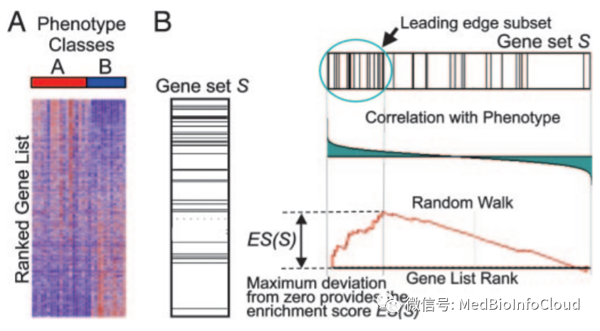

目前，市面上绝大多数公司在求得差异基因列表后，都会在此之上提供给客户Pathway 以及GO 富集分析，很多人也是这么干的。毕竟给予成百上千的差异表达基因以简洁、明晰的生物学功能的概括，才是进行高通量生物学表达谱实验的主要目的。然而，在实际应用于生物学高通量数据时，它们都有一个重大的缺陷：对于差异基因检出的阈值，异常的敏感，客户需要给出差异基因的一个明确的定义(阈值)，例如abs(logFC) ≧2.0 & FDR ≦ 0.05。这种一刀切的阈值，对于发现真正的生物学效应，许多时候是一种障碍，因为实际通过芯片观测到的RNA 表达变化，往往是层层的负反馈调控后的结果，并且不同组织对于表达差异的敏感度是不同的：在神经递质系统内，一个1.2 倍的表达差异即可能产生及其显著的效应。

那我们说的GSEA：Gene Set Enrichment Analysis (基因集富集分析)又是什么东西？所以我们还是从KEGG和GO说起。

---

除了对基因本身功能的注释，我们也知道基因会参与人体的各个通路，基于人体通路而形成的数据库就是通路相关的数据库。而KEGG就是通路相关的数据库的一种。

GO(geneontology)是基因本体联合会(GeneOnotologyConsortium)所建立的数据库，旨在建立一个适用于各种物种的， 对基因和蛋白质功能进行限定和描述的， 并能随着研究不断深入而更新的语义词汇标准。GO是多种生物本体语言中的一种， 提供了三层结构的系统定义方式，用于描述基因产物的功能。他们把基因的功能分成了三个部分分别是：细胞组分（cellular component, CC）、分子功能（molecular function, MF）、生物过程（biological process, BP）。**细胞组份**用于描述基因产物在细胞中的位置，如内质网，核或蛋白酶体等；**分子功能**大部分指的是单个基因产物的功能，如结合活性或催化活性等； **生物学途径/过程** 多是指具有多个步骤的有序的生物过程，如细胞生长、分化和维持、凋亡以及信号传导等过程。

利用GO数据库，我们就可以得到我们的目标基因在CC, MF和BP三个层面上，主要和什么有关。比如前面我们利用[**FunRich工具**](http://mp.weixin.qq.com/s?__biz=MzA4NDAzODkzMA==&mid=2651265340&idx=1&sn=5c3608661698d2332b992269a8721833&chksm=841efd41b3697457f96ace4eecc682cbbbe3fdf3955f0060d3aafcdff0a2d85c225d5ce3f784&scene=21#wechat_redirect)软件分析我们的差异表达基因，发现这些差异表达的基因进行细胞组分分析，发现35.2%都是表达膜蛋白的基因。

**关于GO的基础理论如果想进一步深入了解，****文末获取资料**。

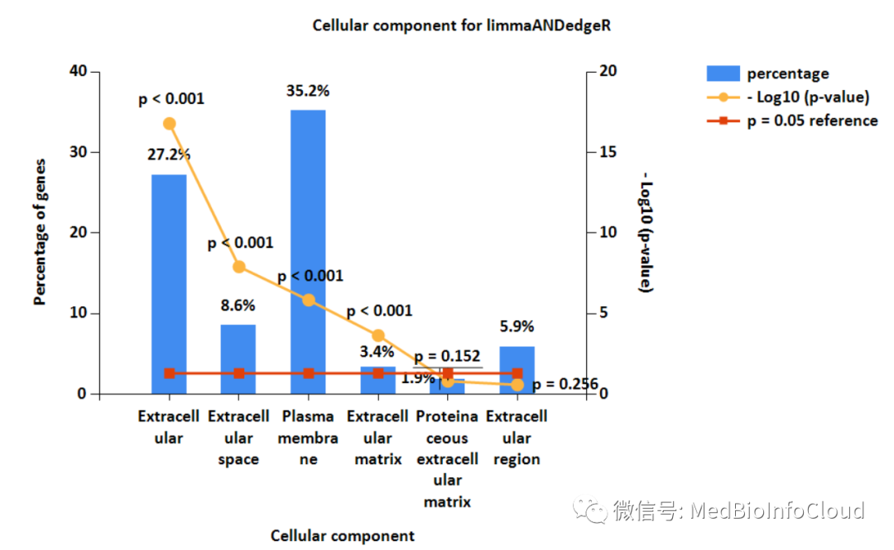

**关于通路数据库很多，比如：****UCSD Signaling Gateway，****Reactome Pathway 数据库****等。****记不住那么多，那我告诉你一个，这个网站统计了所有通路数据库：**[**http://www.pathguide.org/**](http://www.pathguide.org/)**，用的时候去查，可能有适合你的工具。**

---

**那么什么是GSEA？**

GSEA：基因集富集分析 (Gene Set Enrichment Analysis, GSEA) ，其基本思想是使用预定义的基因集（通常来自功能注释或先前实验的结果），将基因按照在两类样本中的差异表达程度排序，然后检验预先设定的基因集合是否在这个排序表的顶端或者底端富集。基因集合富集分析检测基因集合而不是单个基因的表达变化，因此可以包含这些细微的表达变化，预期得到更为理想的结果。

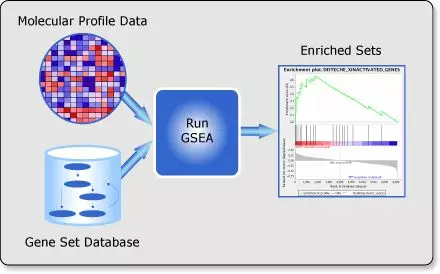

MSigDB（Molecular Signatures Database）数据库中定义了已知的基因集合：[http://software.broadinstitute.org/gsea/msigdb](http://software.broadinstitute.org/gsea/msigdb)

对于人种，包括H和C1-C8八个系列（Collection），每个系列内容为：

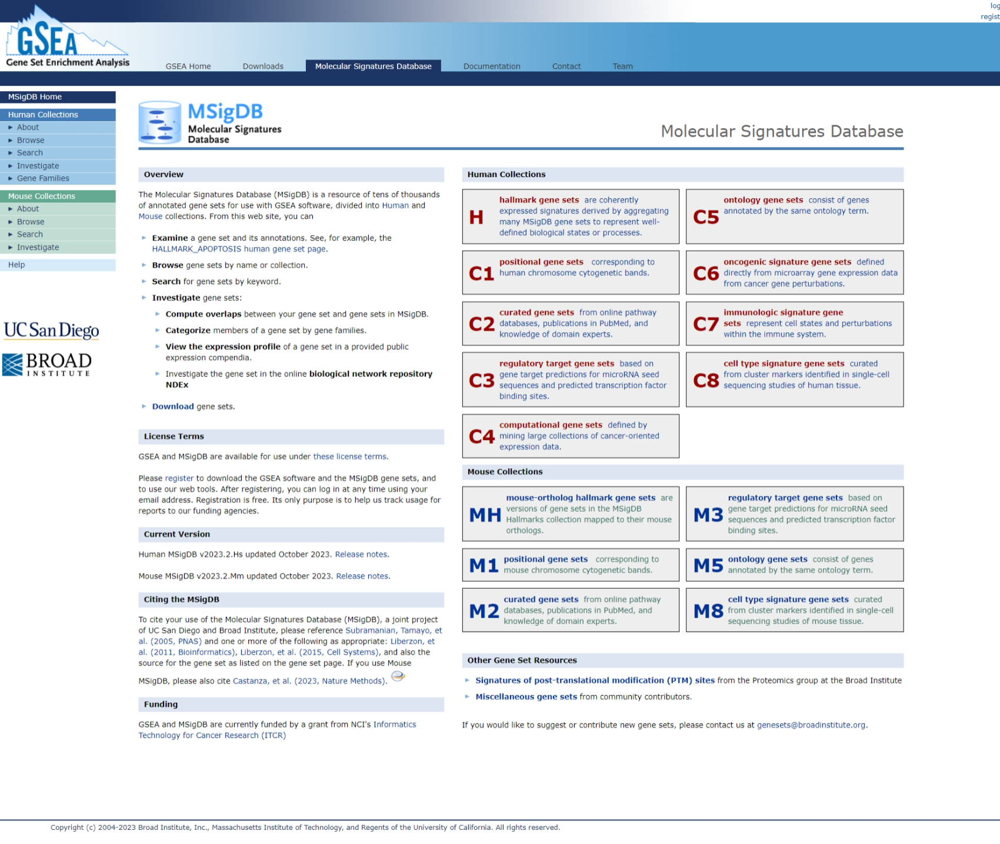

                      

**H: hallmark gene sets （效应）特征基因集合，共50组 **         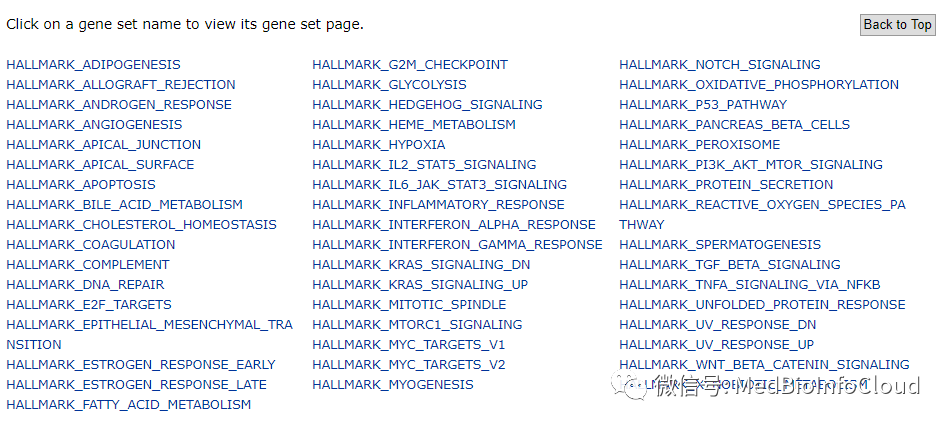             

点击相应的基因集就可以看到该基因集合的描述信息，如我们点击第一个：HALLMARK_ADIPOGENESIS，脂肪形成的基因集。我们可能要关注一下基因集合的数据文件，有很多种格式，grp，text，gmt，gmx以及xml格式。

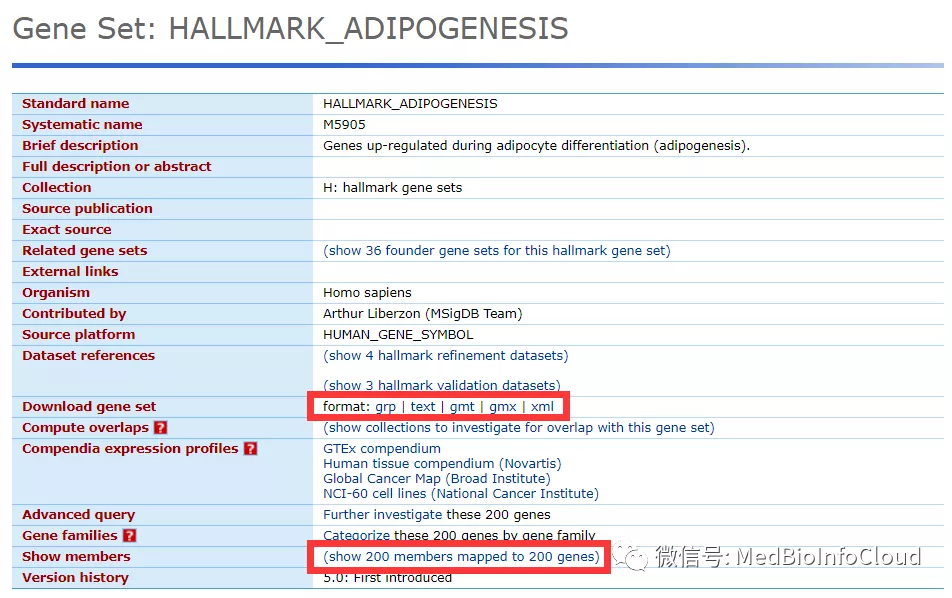            

我们可以点击(show collections to investigate for overlap with this gene set)查看该基因集合有哪些基因。

           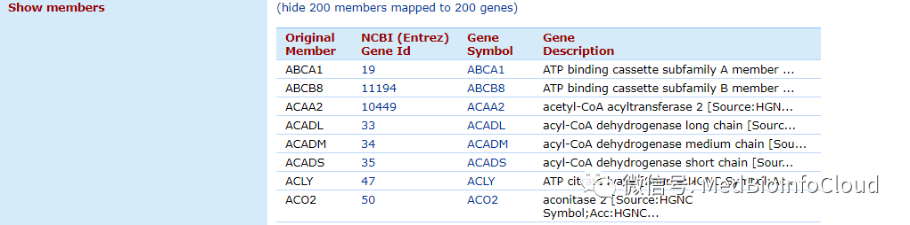             

C1: positional gene sets 位置基因集合，根据染色体位置，共299个

           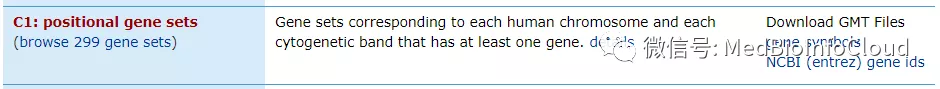            

**部分截图如下：**

          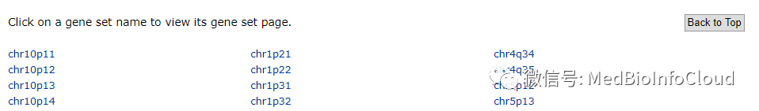             

我们顺便点击一个也可以查看该集合的信息。

           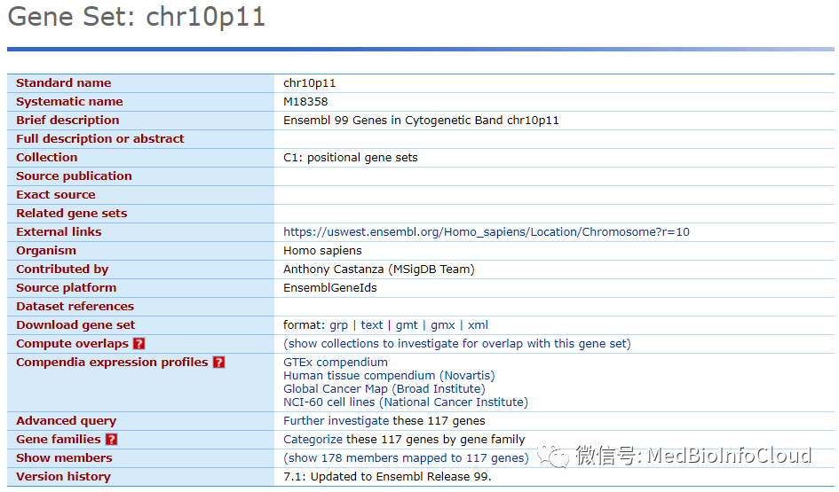            

C2: curated gene sets：（专家）共识基因集合，基于通路、文献等。有5529个基因集，可能我们比较关注的是，KEGG subset ，186个基因集。

           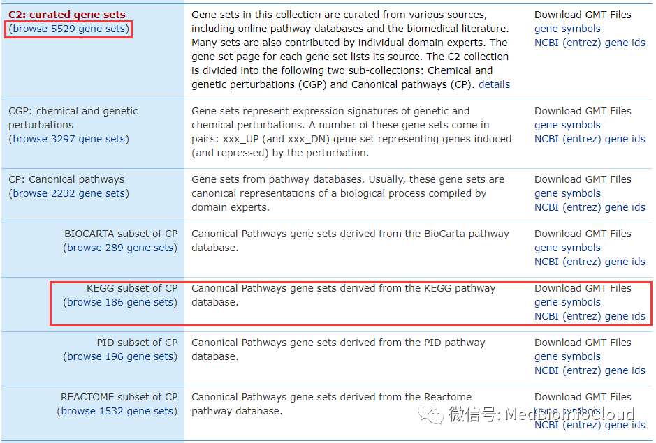            

比如癌症通路的基因集。

           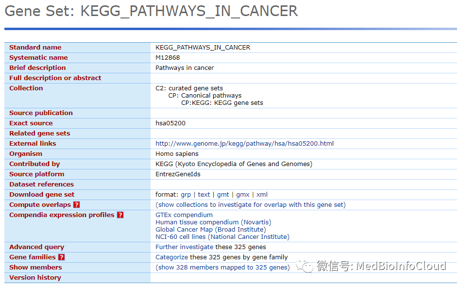            

C3: motif gene sets：模式基因集合，主要包括microRNA和转录因子靶基因两部分。总共3735个基因集。

           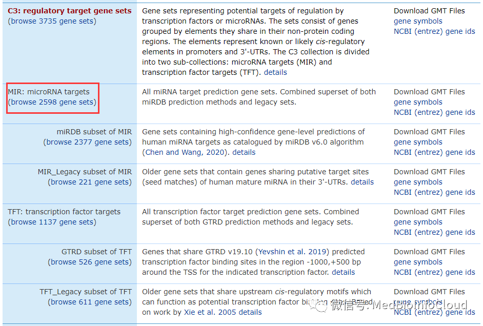            

C4: computational gene sets：计算基因集合，通过挖掘癌症相关芯片数据定义的基因集合。

           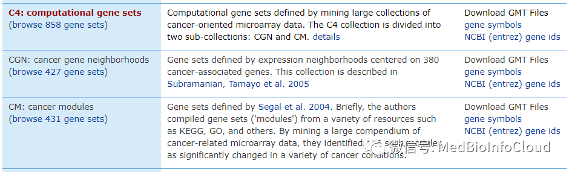            

C5: GO gene sets：Gene Ontology 基因本体论，包括BP（生物学过程biological process，细胞原件cellular component和分子功能molecular function三部分），这部分，我们也是比较关注的，所以能用GSEA分析就用GSEA。

           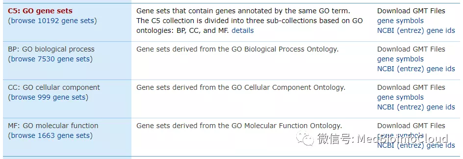            

C6: oncogenic signatures：癌症特征基因集合，大部分来源于NCBI GEO 未发表芯片数据。

           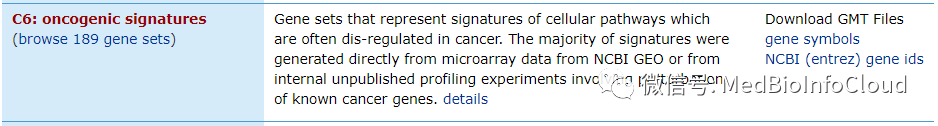            

C7: immunologic signatures: 免疫相关基因集合。

           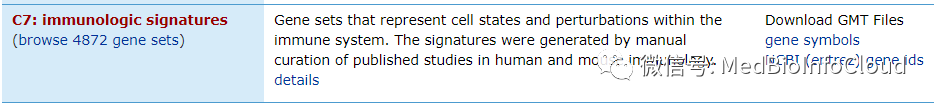  

---

**GO文件，后台回复：****GO基础理论**

**关于相关分析，后续介绍..................**   

> 更新: 2024-01-11 10:56:51  
> 原文: <https://www.yuque.com/doublehelix/bioinfonotes/siyloi>