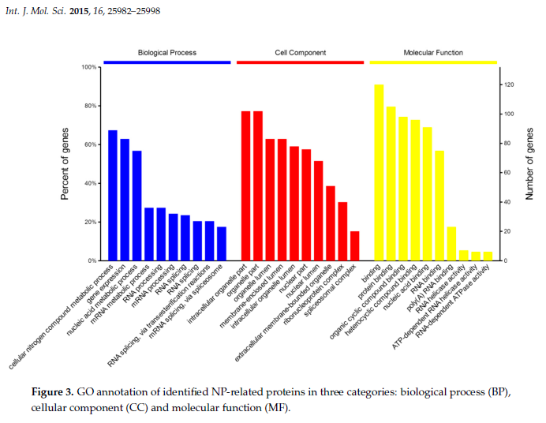
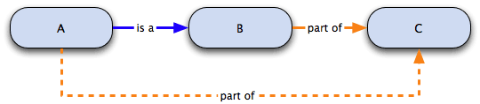
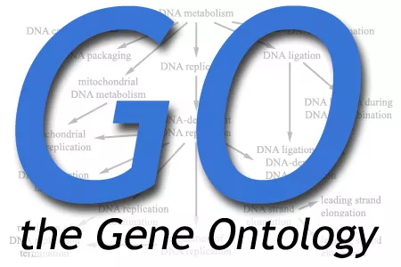
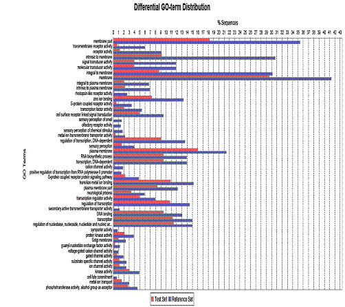

# 理解 GO 是什么？

## 1.GO 怎么就出现了？

现今的生物学家们浪费了太多的时间和精力在搜寻生物信息上。这种情况归结为生物学上定义混乱的原因：不光是精确的计算机难以搜寻到这些随时间和人为多重因素而随机改变的定义，即使是完全由人手动处理也无法完成。举个例子来说，如果需要找到一个用于制抗生素的药物靶点，你可能想找到所有的和细菌蛋白质合成相关的基因产物，特别是那些和人中蛋白质合成组分显著不同的。但如果一个数据库描述这些基因产物为"翻译类"，而另一个描述其为"蛋白质合成类"，那么这无疑对于计算机来说是难以区分这两个在字面上相差甚远却在功能上相一致的定义。

Gene Ontology（GO）项目正是为了能够使对各种数据库中基因产物功能描述相一致的努力结果。这个项目最初是由 1988 年对三个模式生物数据库的整合开始：FlyBase（果蝇数据库 Drosophila）、Saccharomyces Genome Database（酵母基因组数据库，SGD）和 Mouse Genome Database（小鼠基因组数据库，MGD）。从那开始，GO 不断发展扩大，现在已包含数十个动物、植物、微生物的数据库。GO 的定义法则已经在多个合作的数据库中使用，这使在这些数据库中的查询具有极高的一致性。这种定义语言具有多重结构，因此在各种程度上都能进行查询。举例来说，GO 可以被用来在小鼠基因组中查询和信号转导相关的基因产物，也可以进一步找到各种生物的受体酪氨酸激酶。这种结构允许在各种水平添加对此基因产物特性的认识。

## 2.GO 的发展和组织形式

GO 发展了具有三级结构的标准语言（ontologies），根据基因产物的相关分子功能、生物学途径、细胞学组件而给予定义，无物种相关性。三种本体论的内容如下：

- **分子功能本体论**：基因产物个体的功能，如与碳水化合物结合或 ATP 水解酶活性等。
- **生物学途径本体论**：分子功能的有序组合，达成更广的生物功能，如有丝分裂或嘌呤代谢等。
- **细胞组件本体论**：亚细胞结构、位置和大分子复合物，如核仁、端粒和识别起始的复合物等。

基本来说，GO 工作可分为三个不同的部分：第一，给予和维持定义；第二，将位于不同数据库中的本体论语言、基因和基因产物进行联系，形成网络；第三，发展相关工具，使本体论的标准语言的产生和维持更为便捷。

## 3.GO 的形式

GO 定义的术语有着有向无环图（directed acyclic graphs，DAGs）的特点，而并非是传统的等级制定义方式（随着代数增加，下一级比上一级更为具体）。举个例子来说，生物学途径中有一个定义是己糖合成，它的上一级为己糖代谢和单糖合成。当某个基因被注解为"己糖合成活性"后，它自动地获得了己糖代谢和单糖合成的注解。因为在 GO 中，每个术语必须遵循"真途径"法则，即如果下一代的术语可以用于描述此基因产物，其上一代术语也可以适用。

## 4.GO 的注释（Annotation）

那么，GO 中的术语如何和相对应的基因产物相联系的呢？这是由参与合作的数据库来完成的，它们使用 GO 的定义方法，对它们所包含的基因产物进行注解，并且提供支持这种注解的参考和证据。每个基因或基因产物都会有一个列表，列出与之相关的 GO 术语。每个数据库都会给出这些基因产物和 GO 术语的联系数据库，并且也可以在 GO 的 ftp 站点上和 WEB 方式查询到。而且，GO 联合会提供了简化的本体论术语（GO slim），这样，可以在更高级的层面上研究基因组的功能。比如，粗略地估计哪一部分的基因组与信号传导、代谢合成或复制有关。

GO 对基因和蛋白的注释阐明了基因产物和用于定义他们的 GO 术语之间的关系。基因产物指一个基因编码的 RNA 或蛋白产物。因为一个基因可能编码多个具有很不相同性质的产物，所以 GO 推荐的注释是针对基因产物的而不是基因的。一个基因是和所有适用于它的术语联系在一起的。一个基因产物可以被一种本体论定义的多种分支或多种水平注释。注释需要反映在正常情况下此基因产物的功能、生物途径、定位等，而并不包括其在突变或病理状态下的情况。

GO 联合会的各个数据库成员采用手动或自动的方式生成注释，这两种方式共有的原理是：

1. 所有的注释都需要有来源，可以是文字、另一个数据库或是计算机分析结果；
2. 注释必须提供支持这种基因产物和 GO 术语之间联系的证据。

## 5.GO 文件格式

GO 的所有数据都是免费获得的。GO 数据有三种格式：flat（每日更新）、XML（每月更新）和 MySQL（每月更新）。这些数据格式都可以在 GO ftp 的站点上下载。XML 和 MySQL 文件是被储存于独立的 GO 数据库中。如果需要找到与某一个 GO 术语相关的基因或基因产物，可以找到一个相应表格，搜寻到这种注解的编号，并且可以链接到与之对应的位于不同数据库的基因相关文件。

## 6.GO 浏览器和修改器（browser and editor）

GO 术语和注释使用了多种不同的工具软件，它们都可以在 web 方式的"GO 浏览器"下"GO software page"中找到。大多数 GO 浏览器都是 web 模式的，允许你直观的看到术语和其相关信息，如定义、同义词和数据库参考等。有些 GO 浏览器如 AmiGO 和 QuickGO，可以看到每个术语的注释。而可下载的 DAG-Edit 编辑器，一样可以离线地显示注释和所有本体论定义的信息。对于每一个浏览器来说，都可以选择最适用于你要求的工具软件。

### 1）常见的三种浏览器

- **AmiGO**（from BDGP）：在 AmiGO 中，可以通过查询一个 GO 术语而得到所有具有这个注释的基因产物，或查询一个基因产物而得到它所有的注释关系。还可以浏览本体论，得到术语之间的关系和术语对应的基因产物数目。AmiGO 直接连接 GO 下的 MySQL。
- **MGI GO Browser**：MGI GO 的功能类似于 AmiGO，所不同的在于它所得到的基因为小鼠基因。MGI GO 浏览器直接连接 GO 下的 MGI 数据库。
- **QuickGO**（at EBI）：QuickGO 整合在 EBI 下的 InterPro 中，可以通过查询一个 GO 术语而得到它的定义与关系描述、在 SWISS-PROT 中的定位、在酶分类学（EC）和转运分类学（TC）中的定位和 InterPro 中的定位等。

其他还有一些特殊的浏览 GO 的浏览器，其中括号中为建立机构和主要特色：EP GO Browser（EBI，基因表达情况）、GoFish（Harvard，Boolean 查询）、GenNav（NLM，图像化展示）、GeneOntology@RZPD（RZPD，UniGene）、ProToGO（Hebrew University，GO 的亚图像化）、CGAP GO Browser（癌症基因组解剖工程，癌症）、GOBrowser（Illumina，perl）、TAIR Keyword Browser（TAIR，拟南芥）、PANDORA（Hebrew University，非一致化蛋白）。

### 2）修改器

GO 术语和本体论结构可以由任何可以读入 GO 平板文件的文本修改器进行编辑，但是这需要对平板文件非常熟悉。因此，**DAG-Edit** 是被推荐使用的，它是为 GO 特别设计的，能够保证文件的句法正确。GO 注释可以被多种数据库特异性的工具所编辑，如 TIGR 的 Manatee 和 EBI 的 Talisman tool。但是 GO 数据库中写入新的注释是需要通过 GO 认证的管理员方可进行的，如果想提出新的注释或对本体论的建议，可以联系 GO。

主要修改器为 DAG-Edit 和 COBrA。DAG-Edit 基于 Java 语言，提供了能浏览、查询、编辑具有 DAG 数据格式的 GO 数据界面。在 SourceForge 可以免费下载，伴随着帮助文件。COBrA 能够编辑和定位 GO 和 OBO 本体论。它一次显示两个本体论，因此可以在不同的水平相应定位（如组织和细胞类型水平）。优点在于可以综合几种本体论，支持的文件格式多，包括 GO 平板文件、GO RDF 和 OWL 格式等。

如图为 DAG-Edit 的界面，可以分为四个部分：

> 1. **定义编辑面板（term editor panel）**：显示当下的本体论。也是主要的编辑本体论结构的工具，可以通过点击和拖动术语来修改本体论的从属关系。
> 2. **文本编辑面板（text editor panel）**：修改术语中的内容。在修改多个术语时，会出现一个选择菜单，可以选中后逐个修改。
> 3. **DAG 浏览器**：DAG 浏览器是一个插件，能够以图形的方式展示具有复杂的从属关系的术语。
> 4. **搜寻/屏蔽面板**：可搜寻术语、术语类型和术语间关系。可自定义屏蔽条件，限制得出的搜寻结果。

## 7.GO 数据库的查找和浏览 FAQ

### 1）如何搜寻注释？

使用 AmiGO 浏览器，可以在所有参与的数据库中搜寻一个特定的注解。AmiGO 允许使用 GO 术语或基因产物的搜寻。搜寻结果包括 GO 对这个术语的等级分级情况、定义和近义结构、外部链接、所有相联系的基因产物和它的下一级术语。

### 2）如何得到全部的 GO 注释？

在 GO 网站上，基因产物与 GO 联系的组信息都有提供。这些文件储存了基因/基因产物的 ID 和引用文献等支持证据（如 FlyBase 基因 ID、SWISS-PROT 蛋白 ID），在 ftp 站点上都可以获得。

### 3）如何查询一个基因相关的多条核酸序列？

在一些模式生物中，一个基因通常有多个与之相关的核苷酸序列，如 EST、蛋白序列等。要查询到这些序列，可以从该模式生物数据库中通过基因联系（gene association）查询到基因获得 ID（gene accession ID），或是分别在 Compugen 中查询大的转录产物（transcript）和 SWISS-PROT/TrEMBL 中查询蛋白。

### 4）如何得到由 GO 术语注解的蛋白序列？

在 GO 网页上选择能查询到所有数据库的 AmiGO 浏览器，键入 GO 术语（如"线粒体"），在结果中显示了被注释的基因。然后选择你所需基因，在网页的最低端把选项拖至"get fasta sequence"区域，再确定即可。

### 5）如何能够找到所有和一个特定的 GO 术语相关的人类基因呢？

GO 术语是和 SWISS-PROT/TrEMBL/InterPro 和 Ensembl 中的蛋白序列无赘余地对应的。这些注释在 EBI 上的 GOA-Human 文件中，GO 的 FTP 站点上，Ensembl、EMBL-Bank 上都可找到。

### 6）可以直接使用 GenBank 的 gi 获取码在 GO 数据库中进行查询吗？

GO 数据库中除了 Compugen 所提供的 GenBank 获取码之外，没有包含其他 GenBank 获取码的信息，但是在 EBI 的 GOA（GO Annotation）中，有一个综合的对 GenBank/EMBL/DDBJ 进行查询的方式，详细请见：<ftp://ftp.ebi.ac.uk/pub/databases/GO/goa/HUMAN/xrefs.goa>。

### 7）GO 与其他分类系统的定位关系（Mapping to GO）

GO 并不只是希望为基因组建立一个标准化的、结构清晰的注释语言。GO 致力于各种基因组数据库的标准化。GO 为各种基因组分类系统和 GO 注释之间的转化提供了转化表，见 <http://www.geneontology.org/GO.indices.html>。需要注意的是，这些转化不是完全而精确的。其中的一个原因可能是 GO 有一套完整的定义系统，而很多数据库并不具有。

## 8.GO 的应用

### GO 的局限性

1. GO 不是基因序列或基因产物数据库，相反的，GO 强调基因产物在细胞中的功能。
2. GO 不是整合数据库的一种方式（如联邦式整合数据库），它并不能做到这点是因为：
   - 更新速度较慢；
   - 由于每个人对数据定义的方式不同，标准难以达到一致；
   - GO 并不对生物学的每个方面进行描述，如功能域的结构、3D 结构、进化等。
3. GO 是对基因功能的注解，但是有其局限性。比如说，GO 不能反映此基因的表达情况，即是否在特定细胞中、特定组织中、特定发育阶段或与某种疾病相关。GO 虽然不涉及这些方面，但是支持其他的 OBO（open biology ontologies）成员成立其他类型的本体论数据库（如发育本体学、蛋白组本体学、基因芯片本体学等）。

### 用于基因组分析

基因组和全长 cDNA 序列工程通常会根据序列的相似性，推测基因与已注释的基因功能类似。现在最常用的手段是在 SWISS-PROT 序列中设定一个相似性的域值，使用计算机化的方法来判断。因此，根据这一原理，也可以得到新的 GO 注释（被标记为"根据电子注释推测"）。一个 GO 的重要应用方面是对于一个 GO 术语，能形成一个相联系的基因产物组。举例来说，某一基因产物可以被精确地注释为在碳水化合物代谢的一个特定的功能，如葡萄糖代谢，而在总结碳水化合物代谢时，所有这些基因产物都会聚集到一起。GO 计划为每一个高频出现的术语建立文档总汇，现在有些已经在"GO Slim"中实现了。

### 用于基因表达分析

如在芯片数据中引入 GO 注释，通常可以揭示出为什么一个特定组的基因拥有相似的表达模式。共表达的基因可能编码在同一个生物过程中出现的基因产物，或定位于同一个细胞部位的。如果未知基因和一些已被 GO 过程术语相似地注释了的基因共表达，那么这个未知基因很有可能在同一个过程中发挥功能。分析和操作基因表达芯片数据，并且又能结合 GO 注释的软件已产生。EBI 提供的 Expression Profiler 和 EP:GO 都具有此功能。

### GO 可能的应用

GO 的应用前景很广阔，不可能一一列出，现在已用到的包括：

- 整合来自于不同生物的蛋白组信息。
- 判定蛋白结构域的功能。
- 找到在疾病/衰老中异常表达的基因的功能类似性。
- 预测与一种疾病相关的基因。
- 分析在发育中同时表达的基因。
- 建立起自动的能从文献中获取基因功能信息的工具。

## 9.GO 规模

如上所述，GO 的三层结构是**分子功能**、**生化途径**和**细胞组件**。GO 包含的大部分为平板格式文件（GO flat file），由每一种本体论中定义的文件为文本文件，而包含本体论和定义两种格式的是 OBO 格式的平板文件，XML 作为可以用于三种本体论和所有定义的文件格式也有提供。这些文件都在每月的 1 日更新，GO 每月将给出月份更新报告。

## 10.GO 的使用和引用

### GO 的使用

基因本体论联合会是由国家人类基因组研究所（NHGRI）的 R1 拨款所赞助，此外还有欧盟 RTD 项目"生活质量和生活资源管理"拨款。Gene Ontology™ 由 AstraZeneca 公司提供资金赞助，而 SGD 小组得到了 Incyte Genomics 的赞助。GO 数据库中的术语、注释等都属于公共范畴。GO 的资源是免费的，但是必须在以下三种情况下使用：

- 必需引用基因本体论联合会。
- 所使用的 GO 文件必需标明 GO 的版本号和日期（GO 处于不断更新中）。
- GO 文件的内容和内在的逻辑关系不得被更改。

### 引用 GO

当使用 GO 资源时，请引用以下文献：

> Gene Ontology: tool for the unification of biology. The Gene Ontology Consortium (2000) *Nature Genet.* 25: 25–29.

当引用亚数据库资源时，请参考 GO 的 publication list。

### 参考

- <http://www.360doc.com/content/11/0301/23/5690405_97308626.shtml>
- <http://home.bbioo.com/space.php?uid=110070&do=blog&id=5201>
- <http://blog.sina.com.cn/s/blog_416cfd6b0100qjn7.html>
- <http://www.geneontology.org/>

**文章来源：** <http://fhqdddddd.blog.163.com/blog/static/1869915420128289474633/>

> 更新: 2024-01-11 09:38:29
> 原文: <https://www.yuque.com/doublehelix/bioinfonotes/kg40vf>
