# 超详细的 DESeq2、edgeR 和 limma 包的基本原理和实战案例

本文来自文章：超详细的[DESeq2和edgeR包的基本原理和实战案例](https://mp.weixin.qq.com/s/CtKlpDgtNs3f2NXaoulD5Q)

## edgeR 包的基本原理

---

### RPKM 等均一化的局限

在转录组测序（RNA-Seq）中，基因的表达量是我们关注的重点。基因表达量的衡量指标有：RPKM、FPKM、TPM。可参考文章：[**RNA-seq的counts,RPM, RPKM, FPK值到底有什么区别？**](http://mp.weixin.qq.com/s?__biz=MzA4NDAzODkzMA==&mid=2651264575&idx=2&sn=69b45012dbfe61d7574446de00ec9a7b&chksm=841ef242b3697b54484a64f82bba4372a8fb2b4d411b1c1fc2bc68d12aa44756f96c3b8e48f5&scene=21#wechat_redirect)

**RPKM：**是 Reads Per Kilobase per Million mapped reads 的缩写，代表每百万 reads 中来自于某基因每千碱基长度的 reads 数。RPKM 是将 map 到基因的 read 数除以 map 到基因组上的所有 read 数（以 million 为单位）与 RNA 的长度（以 KB 为单位）。说实话，这个英文说明真的很费解，其实可以理解为“Reads Per Kilobase Per Million Reads”，即“每一百万条 Reads 中，对基因的每 1000 个 Base 而言，比对到该 1000 个 base 的 Reads 数”，计算公式。

**FPKM：**Fragments per Kilobase Million，FPKM 意义与 RPKM 极为相近。二者区别仅在于，Fragment 与 Read。RPKM 的诞生是针对早期的 SE 测序，FPKM 则是在 PE 测序上对 RPKM 的校正。只要明确 Reads 和 Fragments 的区别，RPKM 和 FPKM 的概念便易于区分。Reads 即是指下机后 fastq 数据中的每一条 Reads，Fragments 则是指每一段用于测序的核酸片段，在 SE 中，一个 Fragments 只测一条 Reads，所以，Reads 数与 Fragments 数目相等；在 PE 中，一个 Fragments 测两端，会得到 2 条 Reads，但由于后期质量或比对的过滤，有可能一个 Fragments 的 2 条 Reads 最后只有一条进入最后的表达量分析。总之，对某一对 Reads 而言，这 2 条 Reads 只能算一个 Fragments，所以，Fragment 的最终数目是 Reads 的 1 到 2 倍之间。

**TPM：**Transcripts Per Million，这个英文也很费解。先不纠结字面意思了，直接解释它的计算方法。TPM 的计算分 3 步：

step1：根据基因/转录本长度校正 count 值；假设某基因 count 值为 R1，则校正后 count 值为：R1/(L1/1000)； 【注: L1 为该基因的长度】；

step2：计算 total 校正后 count 值；即所有基因的校正后 count 值总和，Rtotal；

step3：计算 TPM；TPM 结果为：R1*1000*1000000/(L1*Rtoatl)。

RNA-seq 是二代测序技术中用来表示基因表达量或丰度的方法。在衡量基因表达量时，若是单纯以 map 到的 read 数来计算基因的表达量，在统计上是不合理的。因为在随机抽样的情况下，序列较长的基因被抽到的机率本来就会比序列短的基因较高，如此一来，序列长的基因永远会被认为表达量较高，而错估基因真正的表现量，所以 Ali Mortazavi 等人在 2008 年提出以 RPKM 在估计基因的表现量。

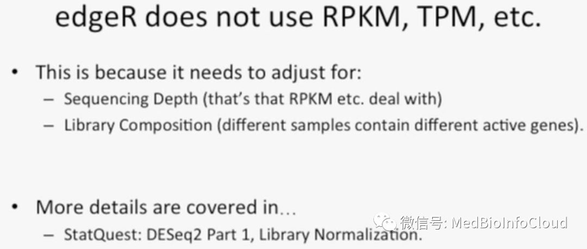

edgeR 与 DESeq2 这两种方法并不使用 RPKM，FPKM，TPM 等方法来进行均一化，edgeR 与 DESeq2 在对文库进行均一化时要考虑两个方面的问题：

第一，测序深度（RPKM，FPKM，TPM 方法也能做到）；

第二，文库补偿（library composition 没有找到相应的中文译名，此处译为“文库补偿”），因为不同的样本含有不同的活跃基因（FPKM，FPKM 和 TPM 做不到），如下所示：

### edgeR 均一化步骤

下面是 edgeR 进行文库均一化的步骤。

**第一步：****移除所有未转录的基因**

我们先看下面的一批测序数据，在这批数据中，有 3 个样本，每个样本有 5 个基因（这个数据只是虚拟的，为了方便说明问题，实际测序中不可能只有这几个基因），如下所示：

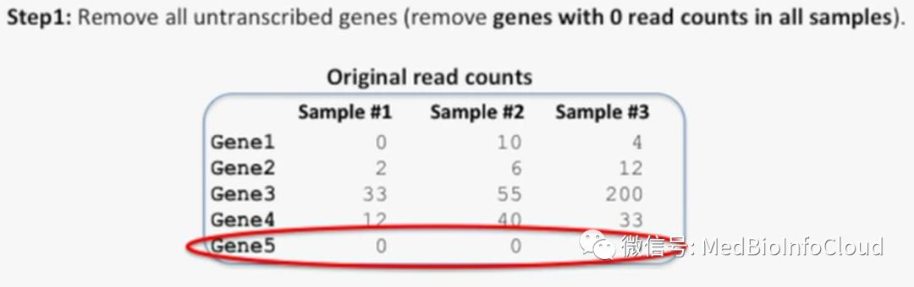其中我们可以发现，Gene5 在这 3 个样本中的 reads 数都是 0，因此我们要把 Gene 5 给去掉，如下所示：

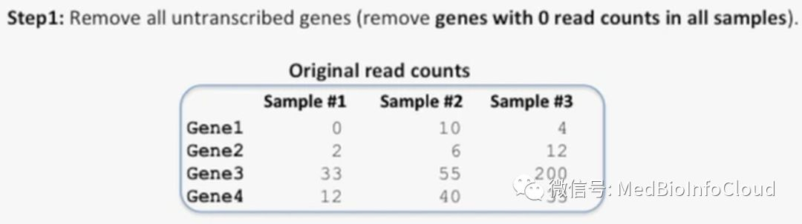

#### 第二步：选择参考样本

在这个步骤中，我们需要在一批样本中，挑选一个样本作为“参考样本”，随后，我们会使用这个样本来均一化其他的样本，我个人理解，这个参考样本其实就相当于 qPCR 中的参考基因，如下所示：

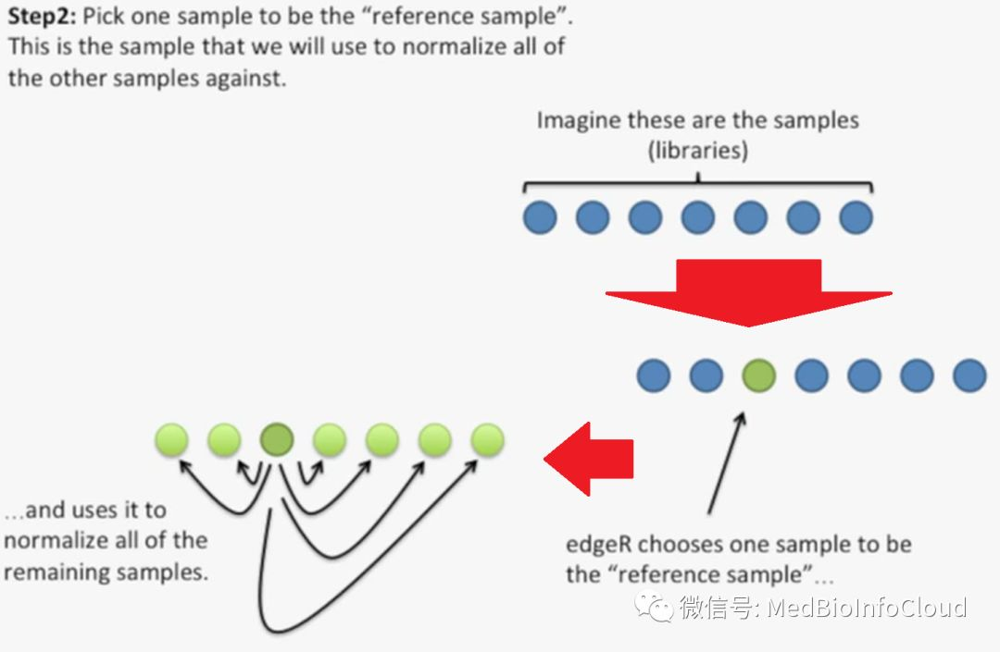

现在我们就遇到另外一个新问题了，什么是好的参考样本，什么是坏的参考样本，好坏的标准是什么？

我们先看一个案例，这个案例讲的是坏的参考样本，所有的样本如下所示，其中 Sample #3 是一个非常差的参考样本，Sample #3 中所有基因的 reads 数的均一化都只是基于一个 reads 数，即 Gene 3，因为其它的基因都是 0，因此 Sample #3 有很大的噪音，如下所示：

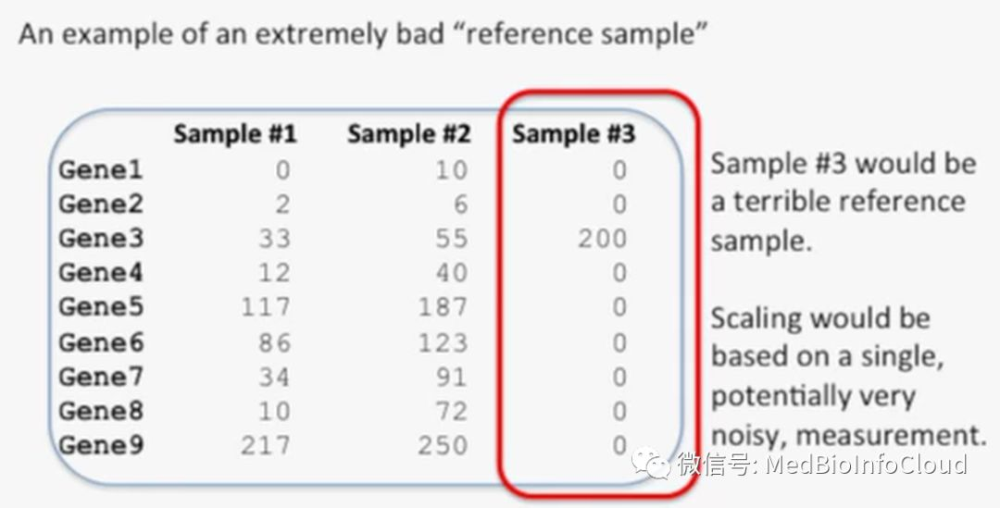

为了避免找到这样极端的样本，edgeR 会选择那些最“平均”的样本，如下所示：

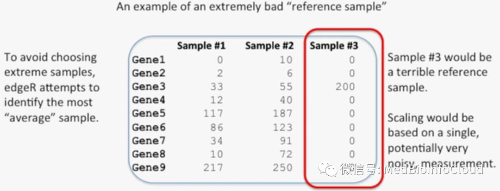

我们现在看一下 edgeR 如何找到这个最“平均”的样本，我们再看一批数据，如下所示：

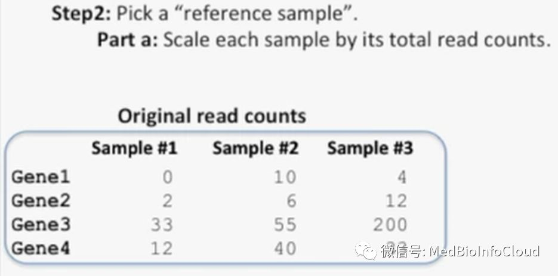

在寻找最“平均”的样本时，我们需要进行 a，b，c，d 这四步。

##### 第 a 步：用总 reads 数校正每个样本

注：原文是 Scale each sample by its total read counts，我这里使用“校正”来指 scale。

计算出每个样本的所有基因的总 reads 数，如下图左图所示，然后使用每个样本中每个基因的 reads 数除以每个样本的总 reads 数，如下图右图所示：

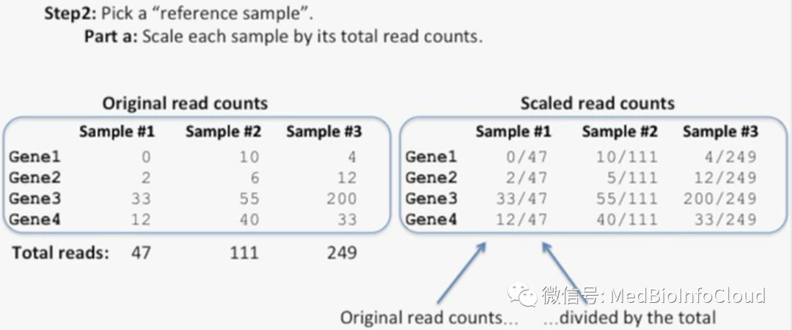**第 b 步：计算 75% 百分位数**

对于每个样本，计算出校正后的数据的 75% 百分位数的值，或者是小于 75% 百分位数的值，例如，对于样本 1 来说，它的 75% 百分位数是 0.26，或者是小于 0.26，如下所示：

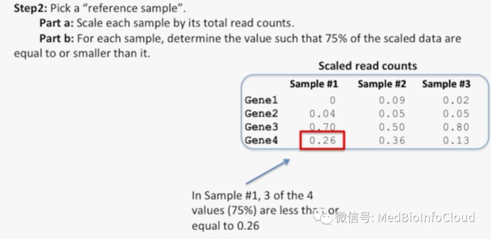

对于样本 2 来说，它的 75% 百分位数是 0.36，或者是小于 0.36，如下所示：

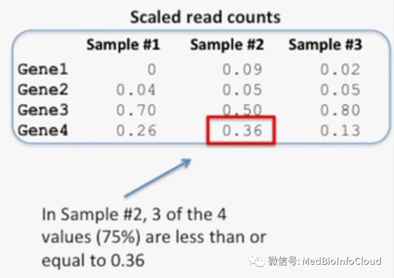

对于样本 3 来说，它的 75% 百分位数是 0.13，或者是小于 0.13，如下所示：

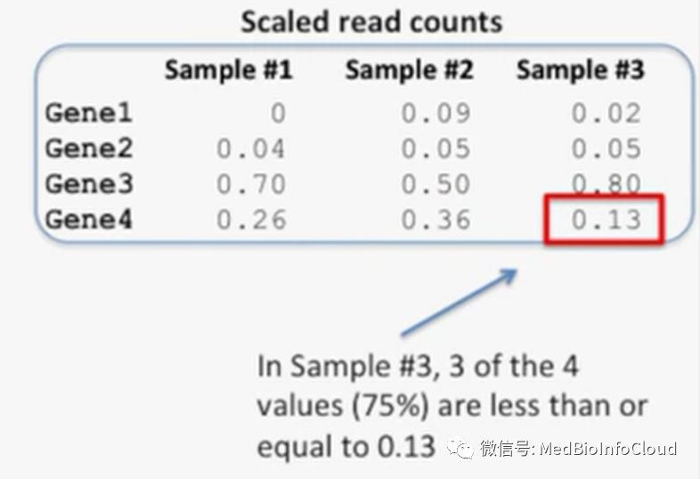

现在把这 3 个样本的 75% 百分位数放在一起，如下所示：

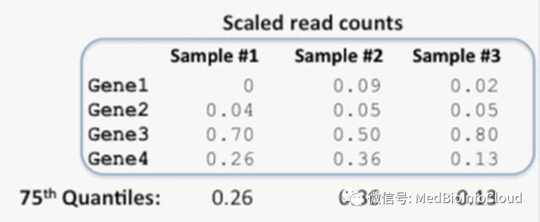

##### 第 c 步：计算平均 75% 百分位数

现在计算这 3 个样本的平均 75% 百分位数，加起来，除以 3 即可，如下所示：

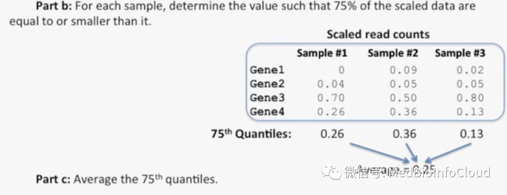

##### 第 d 步：找出最近接近于平均 75% 百分位数的样本

“参考样本”的标准就是它的 75% 百分位数最接近于平均 75% 百分位数，样本 1，样本 2 和样本 3 的 75% 百分位数分别为 0.26，0.36，0.13，它们与平均 75% 百分位数的差值分别为 0.01，0.11，0.12，其中，最接近于 0.26 的样本是样本 1，因此样本 1 就是“参考样本”，如下所示：

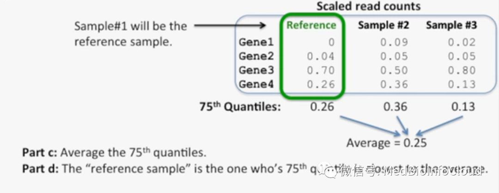

#### 第三步：计算标准化因子
##### 基本思路

在这一步骤中，我们需要选择一些基因集（genes，复数）来创建标准化因子（scaling factors），计算的过程就是针对“参考样本”，分别选择其余的样本的基因集来创建标准化因子（也就是说不同样本创建标准化因子的基因集不同）。我们在第二步中找到了参考样本，也就是 Sample #1，现在分别针对 Sample #1，来计算 Sample #2 和样本 3 的标准化因子，如下所示：

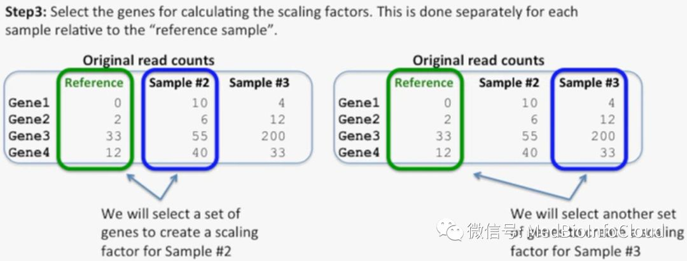

这是 edgeR 方法的一个局限，针对不同的样本，edgeR 会使用不同的基因集来计算它们的标准化因子（原文是 this is one of the ramifications of edgeR’s approach. Different samples use different genes to derive their scaling factors.不知道我理解的对不对，可以对比一下原文自己理解），如下所示：

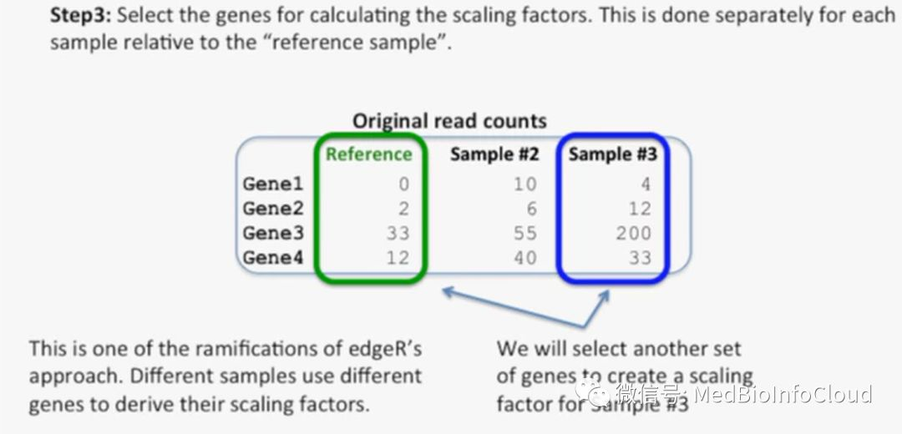

现在我们以 Sample #2 为例，说明一下如何选择用于创建标准化因子的基因集，我们先来看一下用于选择的基因的不同类型，下图是一个 XY 二维坐标系，如下所示：

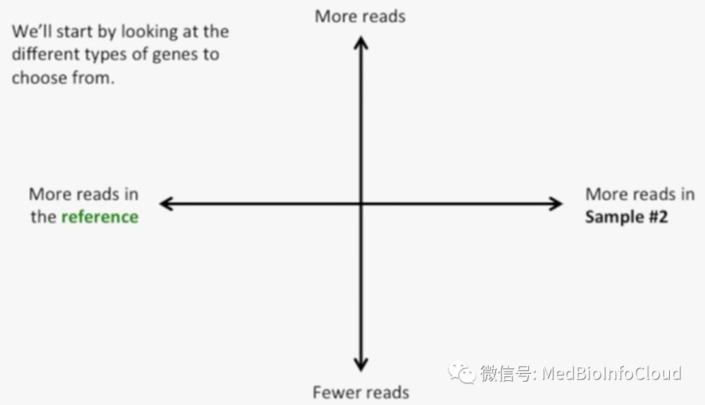

XY 轴把这个坐标系分成了四个象限，这个很好理解，我们先看下图中的第 1 个点（蓝色的），这个点位于左上部分，它表示这个基因主要在参考样本（reference）中转录，如下所示：

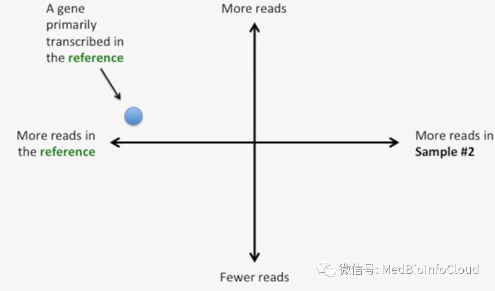

我们再看第 2 个点，这个点位于最右的坐标轴上，根据坐标轴的说明，我们知道，这个基因主要在 Sample #2 中转录，如下所示：

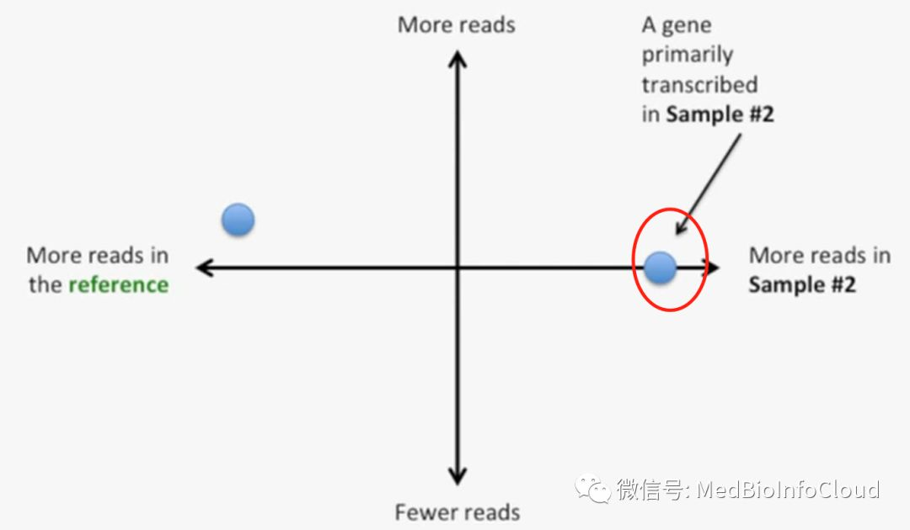

我们再看第 3 个点（下图中红色圆圈标出的点），这个点位于正中间的坐标轴上，它表示这个基因的很多 reads 在参考样本和 Sample #2 中都存在，如下所示：

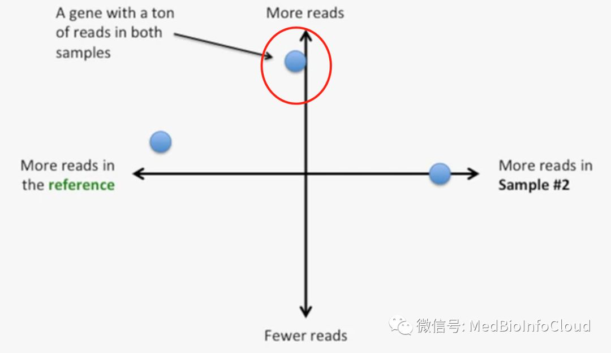

我们再看第 4 个点，它们于中间最下面的坐标轴上，根据坐标轴的说明，我们知道，在参考样本和 Sample #2 中，都很少含有这个基因的 reads，如下所示：

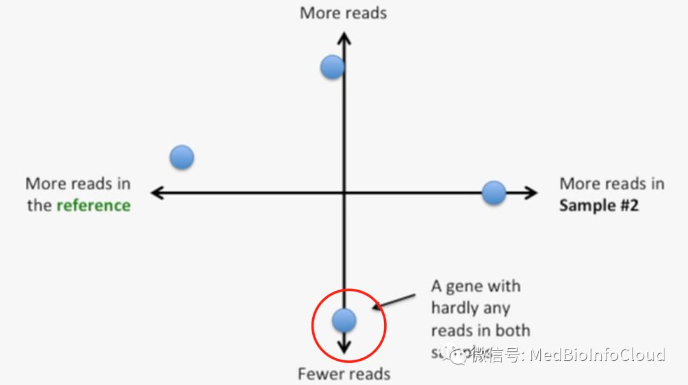

这样，我们把所有的基因的 reads 数都放到这个坐标上，我们就可以发现，中间有很大一部分基因没有偏倚，没有偏倚的意思是说，在中间的这些基因，它们在参考样本和 Sample #2 中的 reads 数都差不多，区别不大，如下所示：

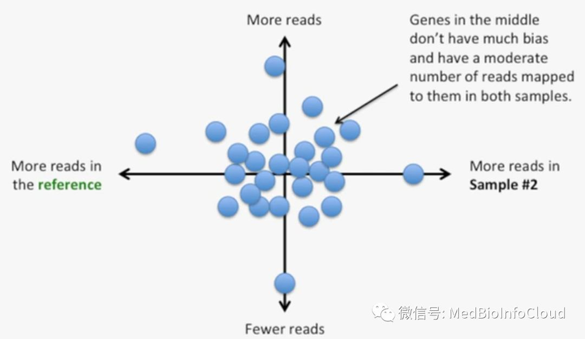

而 edgeR 就会选择中间区域（红色椭圆区域）里的这些基因，排除那些有偏倚的基因，如下所示：

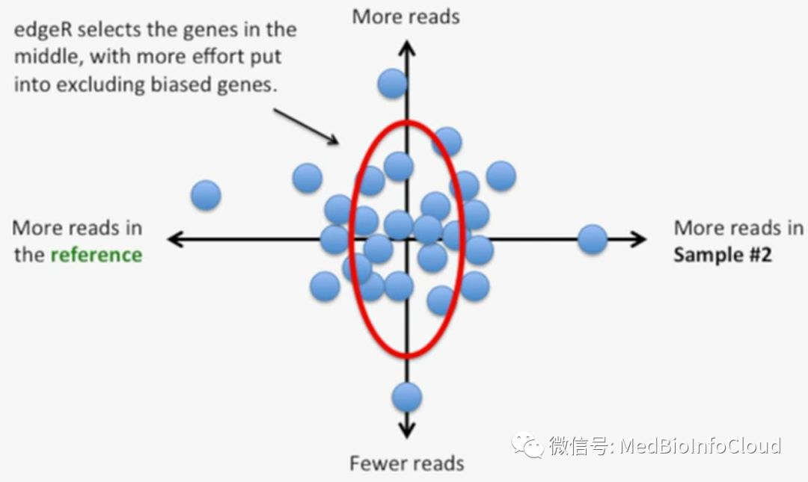

##### 计算过程

上面只是 edgeR 选择基因集的基本思路。现在我们看一下 edgeR 是如何计算标准化因子的。

###### 第 a 步：过滤偏倚基因

计算所用的数据是已经均一化后的数据（也就是每个基因的 reads 数除以总的 reads 数），下图中表示的是全部的 N 个基因，基因虽然很多，但是这些基因均一化的方法还是与前面所述的 4 个基因是一样的，如下所示：

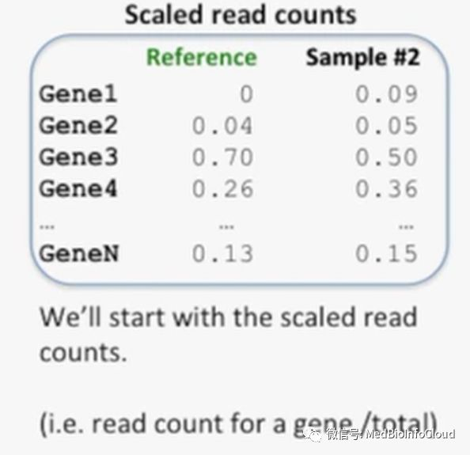

edgeR 是通过倍数差异的 log 转换（log fold differences）来过滤偏倚基因（biased genes）的，它的公式是 log fold differences = log2（Reference/sample 2）。从这个公式我们就可以看出来，如果 Reference 的某个基因的值相对于 Sample #2 比较高，那么这个 log fold differences 就是一个正值（图中指向 3），如果 Sample #2 的某个基因的值相对于 Reference 比较高，那么这个 log fold differences 就是一个负值（图中指向-3），如下所示：

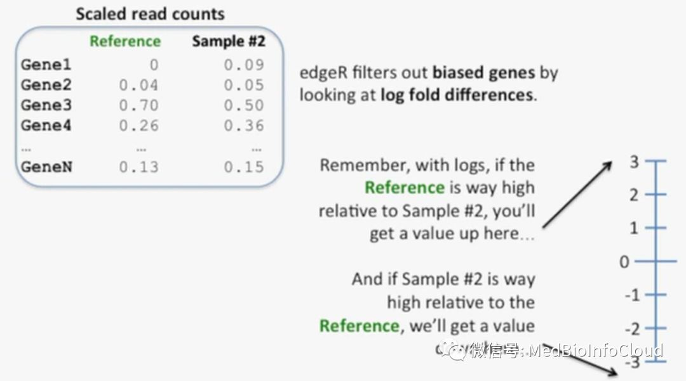

最终，我们会选择一个阈值，例如+/-6，超过这个范围就认为是极度偏倚的值，需要除去，如下所示：

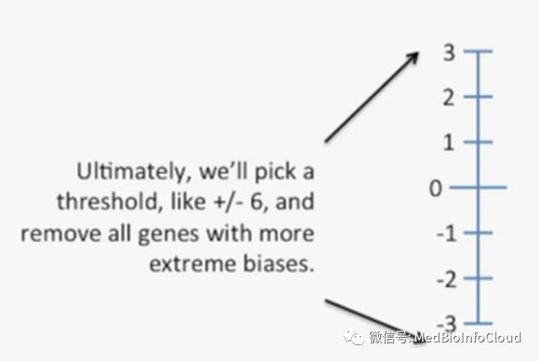

我们现在以 Gene 1 为例来说明一下，它的计算公式如下所示：

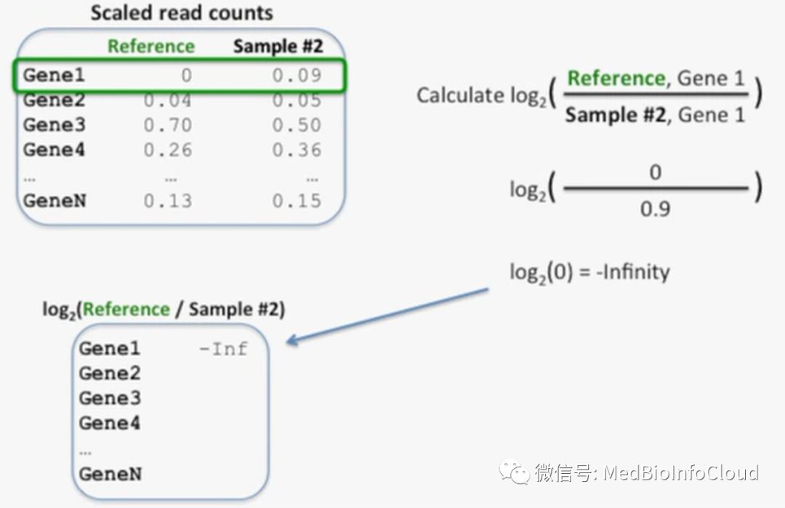

由于参考样本的 Gene1 是 0，因此这个最终的 log fold differences 数值为-Inf，它表示无穷小。现在我们看一下 Gene2 的计算，如下所示：

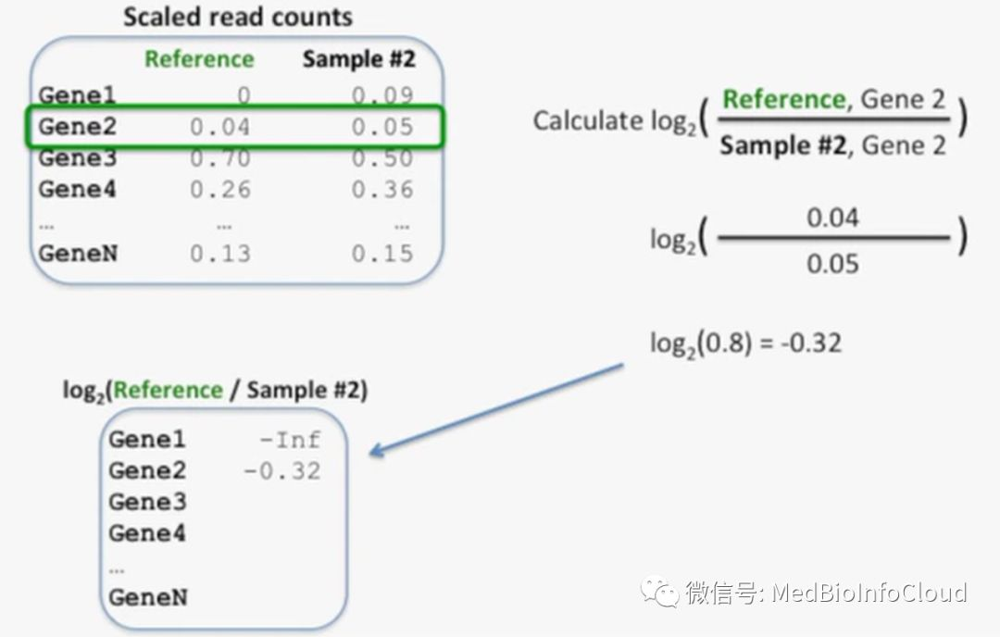

最终计算出所有的结果，如下所示：

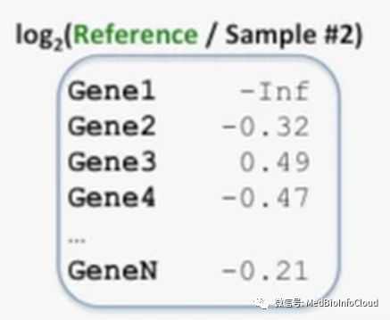

此时，我们就要移除那些 Inf 的基因，也就是说，要移除那些在样本中（无论是同时在两个样本，还是任何一个样本中）reads 数为 0 的基因，如下所示：

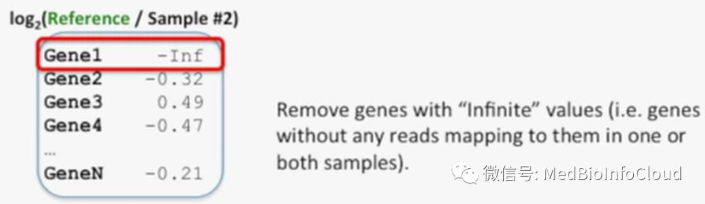

经过上面的计算，我们就得到了一个新的数据集，这个数据集是经过 log fold differences 转换后的数据集，此数据集用于排除偏倚基因。

###### 第 b 步：计算几何均数

现在我们还需要另外一个数据集，用于观察哪些基因在两个样本是高转录和低转录的，如下所示：

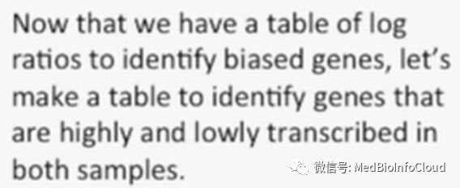

计算基因的高转录和低转录时，首选要计算每个基因的几何均数（the geometric mean），几何均数很有用，因为它不太容易受到异常值的影响，如下所示：

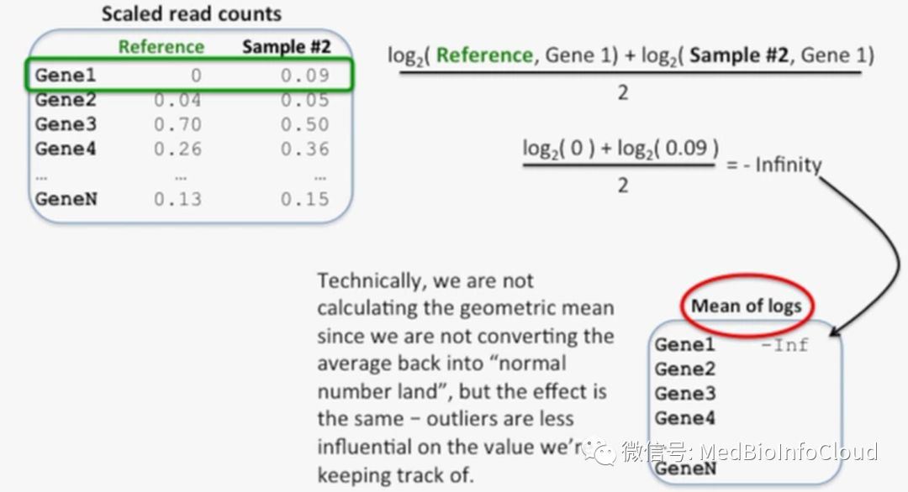

这里要注明一下，严格意义来说，上面的这个公式只是经 log 转换后的数字的算术均数，由于经过了 log 转换，因此 log 转换后的算术均数其实上就是原始数据（未经 log 转换的数据）的几何均数，因为我们并不把 log 转换后的算术均数转换回正常的数值（也就是没有经过 log 转换后的数值），因此在这里，我们使用了 log 转换后的数值的算术均数，但它们的最终的效应是一样的，即异常值很少影响这些数据，下面以 Gene 2 为例说明一下这个计算过程：

Gene 2 在参考样本中的数值为 0.04，在 Sample #2 中的数值为 0.05，它的几何均值其实应该是下面的这个样子：

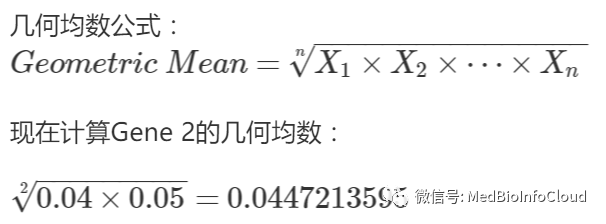

现在对 0.0447213595 进行 log2 转换，如下所示：

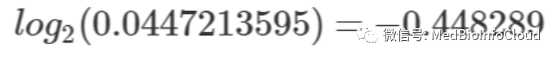

我们再来看一下计算结果，如下所示：

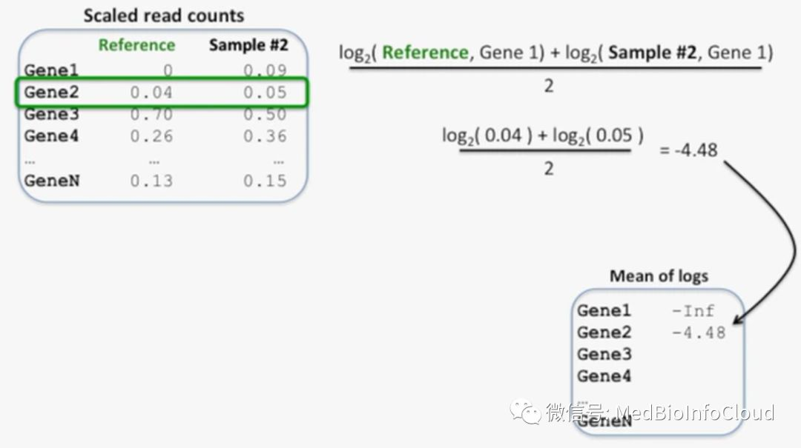

从上面的结果我们可以发现，这个数值是一样的，经过计算，所有的结果如下所示：

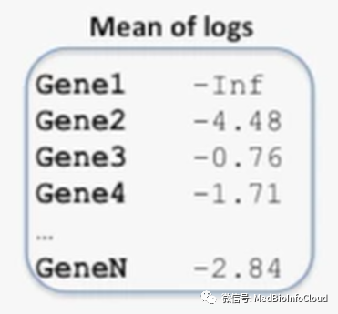

现在我们移除那些 infinite 的值，也就是那些没有任何 reads 的基因（也就是计算结果中是-Inf 或 Inf 的值），如下所示： 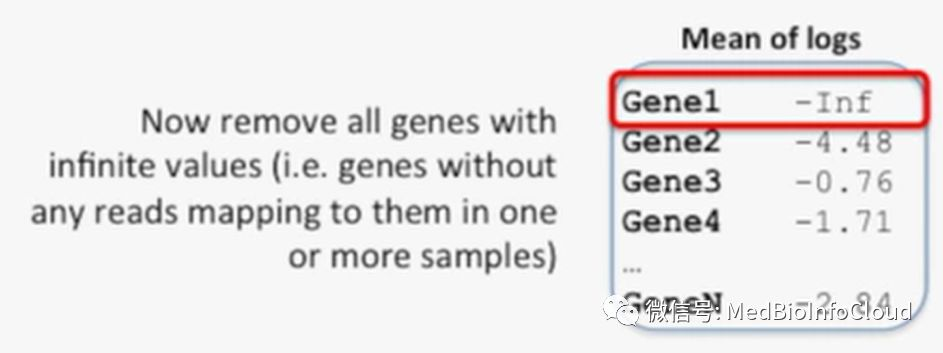

###### 第 c 步：计算代表基因集

经过前面的计算，此时，我们就有了两张表，第一张表是 log2(reference/Sample #2)的数据，它用于确定偏倚基因，另外一张表的数据是经 log2 转换后的均值数据，这批数据用于确定哪些基因是高转录的，哪些基因是低转录的，这两张表如下所示：

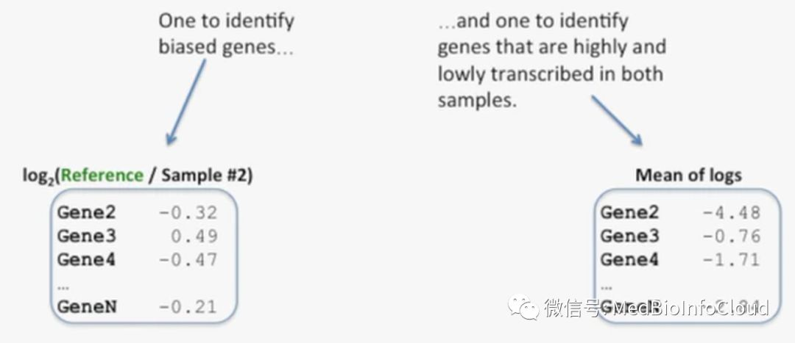

此时，我们将这两张表中的数据都按从小到大的顺序进行排列，如下所示：

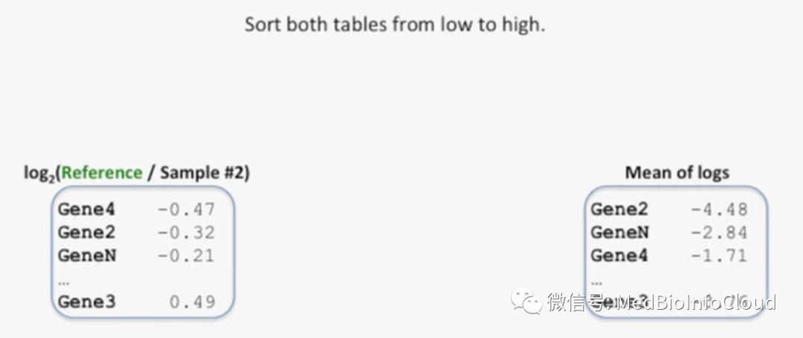

在第一张表中，去掉前 30% 的数据，以及去掉后 30% 的数据，如下所示：

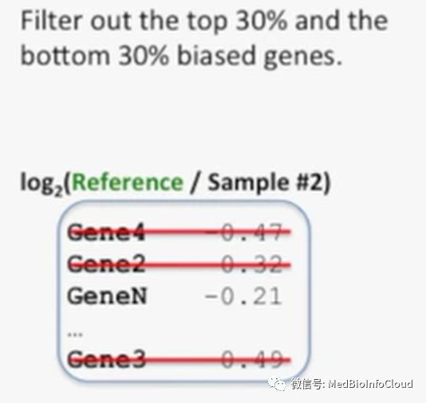

在第二张表中，去掉前 5% 的数据，以及去掉后 5% 的数据，如下所示：

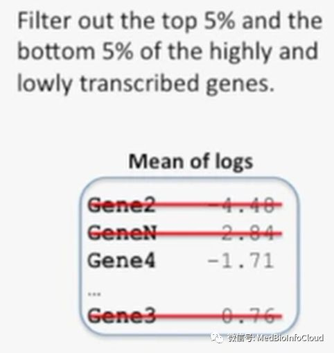

用两张表中剩下的数据来计算标准化因子（取两张表基因的交集），如下所示：

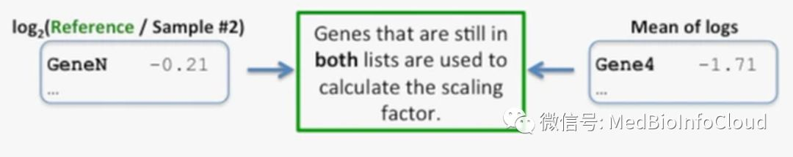

不过在这个案例中，这两终表中剩余的基因并没有列出，都在省略号中，但是这个案例只是在讲 edgeR 的算法原理，并不涉及具体的数据，如下所示：

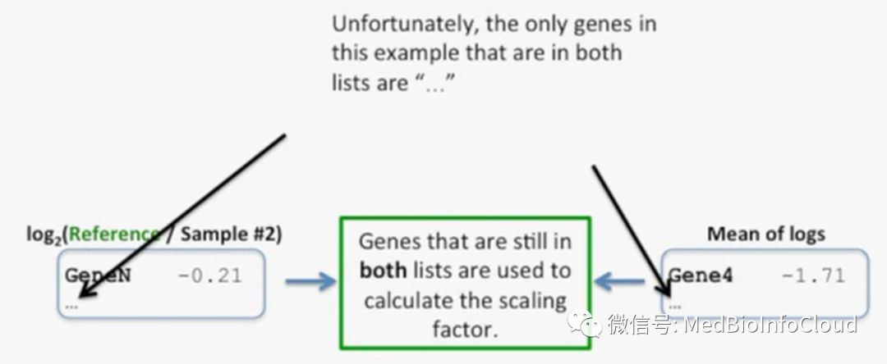

为了方便理解，我们就假定，下图就是最终于用计算 Sample #2 的标准化因子的基因集，如下所示：

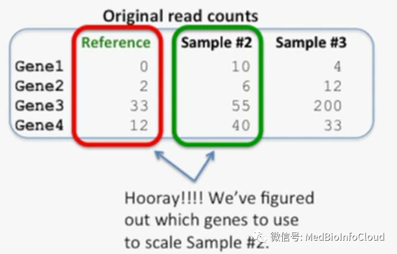

同样的，还有计算 Sample #3 标准化因子的基因集，如下所示：

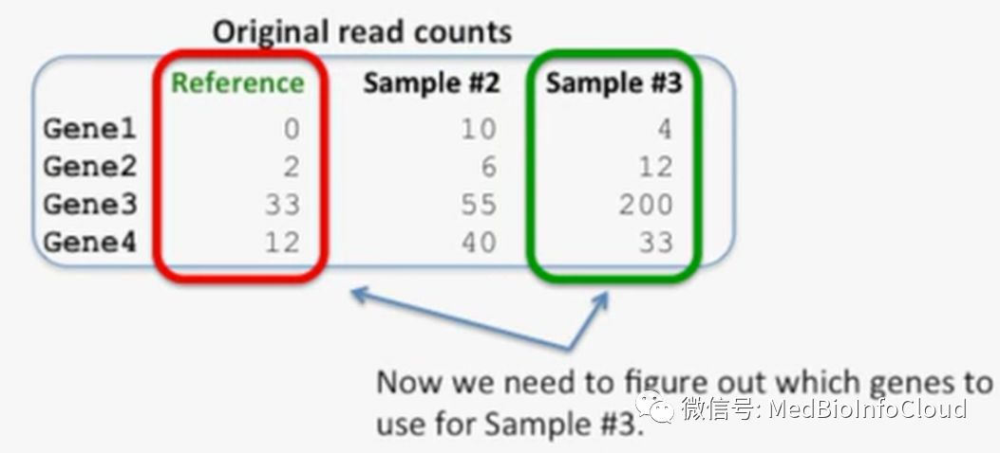

#### 第四步：计算加权均数

在这一步骤中，edgeR 会计算代表性基因集的 log fold 的加权平均数，在 edgeR 中，这个 log fold 的加权平均数称为为“weighted trimmed mean of the log2 ratio”，因为这些数据已经剔除掉（trim）了那些表达比较极端的基因（特别高的和特别低的），这样，计算结果就不会受到表达异常基因的影响，如下所示：

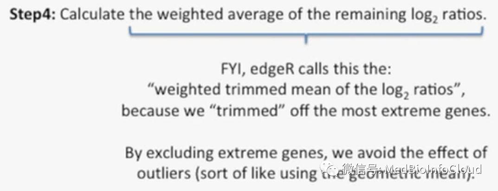

现在我们回到 Sample #2 的基因集上，这些基因是经过了第三步的筛选过的基因，只是我们假定的数据，就是我们上面说的省略号中的基因，只是用来计算的，不用管它的实际意义，它的 log fold 如下所示：

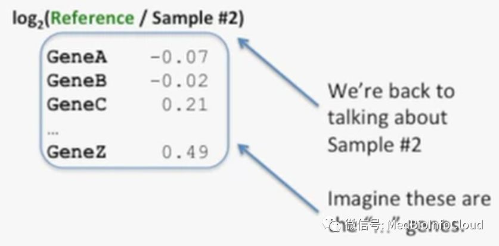

一旦我们选择了这些基因用于计算标准化因子，那么我们就仅需要计算出它们的 log 2 的加权均数即可，也就是说，比对到某个基因上的 reads 数越多，这个基因的权重就越大，这是因为对于那些低 reads 数的基因来的，log fold 数值的变异程度比较大，如下所示：

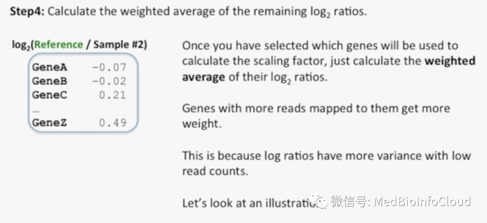

为了说明 reads 数少的基因经过 log fold 转换后的变异程度比较大的问题，我们这里插入一个案例，下图是几个基因的 reads 数，如下所示：

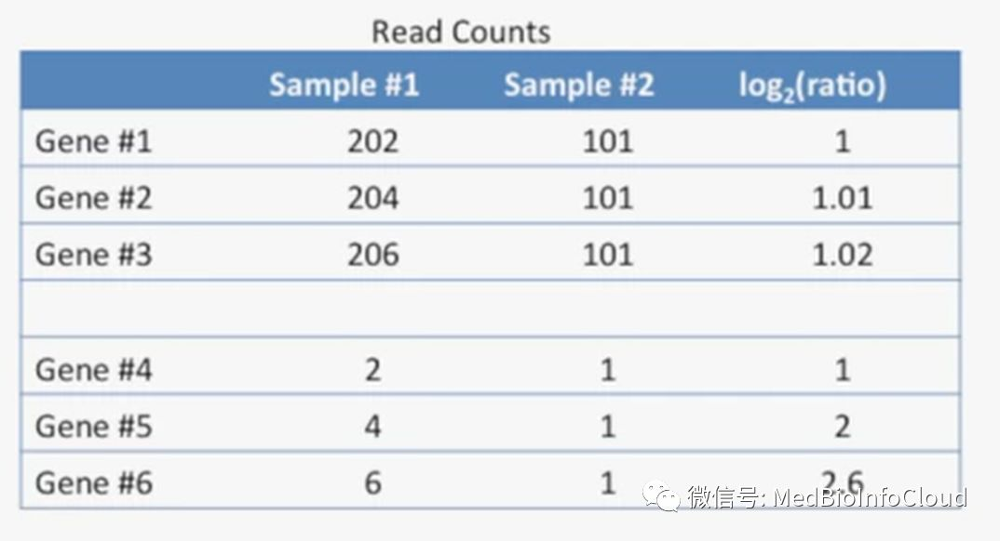

从上面的数据中我们可以知道，Gene #1、Gene #2、Gene #3 的 reads 数比较高，不过 Gene #1 比 Gene #3 的 reads 数还是多了 4，如下所示：

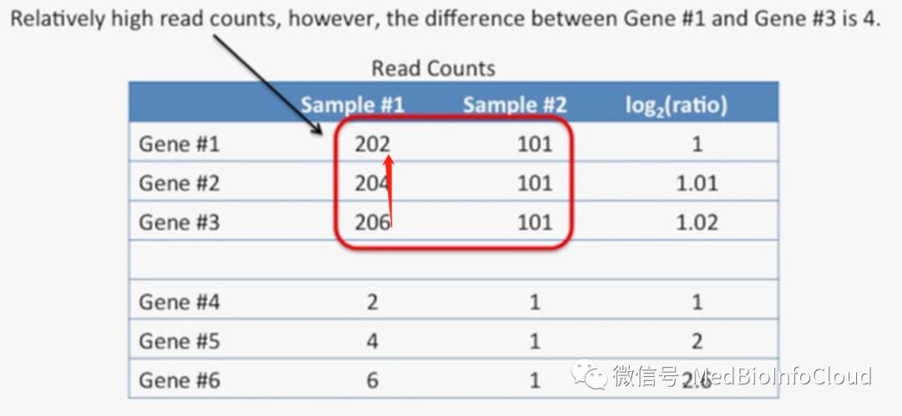

我们再看 Gene #4 和 Gene #6，虽然它们的 reads 数比较少，不过它们之间的 reads 数也是差了 4，这个数值与 Gene #1 比 Gene #3 的差值一样，如下所示：

不过，我们看一下右侧的经过 log2 fold 转换后的数据，我们可以发现，Gene #1 和 Gene #3 的 log2 fold 的值差别并不大，如下所示： 

但是，我们看一下 Gene #4 和 Gene #6，虽然它们的 reads 数相差是 4，但是，它们的 log2 fold 的值相差却是 1.6，这个值是非常大的值了，如下所示：


针对这种情况，我们就需要对那些有着高 reads 数的基因加上更大的权重，如下所示：

对于 Sample #3 的处理，也是如此，如下所示：


log2 fold 的加权均数的计算公式如下所示：

简单来说就是 log2 foldA 的值乘以相应基因的 reads 数的和，然后除以所有的 reads 数之和。


#### 第五步：将加权 log2 fold 值转换为真值

在这一步中，我们需要把前面过计算出来的加权平均值转换为真值（也就是 log2 转换前的数值）。

标准化因子的公式如下所示：

不过，此时的这个“标准化因子”并不是 edgeR 所使用的标准化因子，为了区分 edgeR 中的标准化因子，我暂时称它为“原始标准化因子”，如下所示：


按照上述方法，再计算出 Sample #3 的“原始标准化因子”，如下所示：


经过上面的计算，这个原始标准化因子还要进行进一步的计算，才是 edgeR 的标准化因子。

我们来看一个实际的案例，这个案例使用的一个 RNA-Seq 实验中的数据计算出来的原始标准化因子（就是按上面的公式计算出来的标准化因子），其中，WT2 是参考样本，其余的样本根据 WT2 进行均一化，如下所示：


#### 第六步：原始标准化因子的中心化

下图是我们计算出来的原始标准化因子，如下所示：


这些值在数轴上主要以 0.95 为中心进行排列，如下所示：


我们对这批数据进行“中心化”，其实就是用它们的每个值除以这 4 个数据的几何均数，几何均数就是如下所示：


最终计算的 edgeR 标准化因子（也就是中心化的原始标准化因子）如下所示：


虽然除以几何均数并不会改变最终的计算结果，但是 Mark Robinson（edgeR 包的开发者）说，经过中心化的处理就能赋予标准化因子一些数学上的美感。


此时，edgeR 的标准化因子计算到此，接着把表达矩阵中的数值除以这个标准化因子即可。

---

## edgeR 包差异分析实战案例

### 包的安装和加载
```plain
BiocManager::install( "edgeR" )library( "edgeR" )
```

### 读入数据

这里我们用的数据是一个 Excel 文件，是原始的 counts 文件（想运行案例，文末获取文件）

```plain
# 读取数据
counts <- read.table("gene_counts.xls", sep = "\t", header = T, row.names = 1)
```

导入的数据我们通过 head()函数查看前 6 行。


行名 A1,A2,A3,B1,B2,B3 为样本名，列名是基因名。

### 创建分组

设置实验组别，在前面我们介绍基本原理时，有一步需要选择参考样本，在实际分析中，我们可以自己选择参考样本，一般都是对照组作为参考样本，在 edgeR 中，1 代表 control 样本，2 代表 case 样本。原始数据中有 6 个样本，对照和实验组各三个。所以我们可以创建一个分组向量。

```plain
# 创建分组group <- c(rep(1,3),rep(2,3))
```


### 数据处理
```plain
# 创建DGEList类型变量
y <- DGEList(counts=counts, group=group)
```

这一步相当于创建一列表。注意 group 中的顺序和 counts 中行名要对应，也就是对照组和实验组要指定正确。这里 A1,A2,A3 为 control，B1,B2,B3 为 case。


```plain
# 数据过滤
keep <- filterByExpr(y)y <- y[keep, , keep.lib.sizes=FALSE]
```

filterByExpr 函数用于确定哪些基因的计数足够大，可以保留在统计分析中。也就是我们在介绍原理中提到的去除表达值为 0 的基因，实际分析中不是 0，我个人理解，counts 为只为个位数的也认为是不表达的，所以这里默认的 min.count = 10, min.total.count = 15，当然也可以通过参数自己设定。


filterByExpr 函数返回的是一个逻辑值类型数据，所以我们需要通过索引获取过滤后的数据。即去除 FALSE 的基因。


```plain
# 计算标准化因子
y <- calcNormFactors(y)# 查看标准化因子y$samples
```


```plain
# 计算离散度
y <- estimateDisp(y)# 显著性检验
et <- exactTest(y)# 获取排名靠前的基因，这里设置n=100000是为了输出所以基因
et <- topTags(et, n=100000)# 转换为数据框类型
et <- as.data.frame(et)
```


```plain
# 将行名粘贴为数据框的第一列
et <- cbind(rownames(et),et)# 指定列名
colnames(et) <- c("gene_id", "log2FoldChange", "log2CPM", "PValue", "FDR")# 保存数据到本地
write.table(et, "case-vs-control-all.gene.xls", sep = "\t", col.names = TRUE,
row.names = FALSE, quote = FALSE, na = "")
```


### 差异基因筛选
```plain
# 差异基因筛选
etSig <- et[which(et$PValue < 0.05 & abs(et$log2FoldChange) > 1),]
# 加入一列，up_down 体现上下调信息
etSig[which(etSig$log2FoldChange > 0), "up_down"] <- "Up"
etSig[which(etSig$log2FoldChange < 0), "up_down"] <- "Down"
# 保存文件
write.table(etSig, "case-vs-control-diff-pval-0.05-FC-2-edgeR.gene.xls", sep = "\t",
						col.names = TRUE, row.names = FALSE, quote = FALSE, na = "")
```


这样我们就可以获取差异表达的基因了，可以用于后面的作图，比如火山图！

案例文件和代码，后台回复：**chip-data-edgeR**，获取！

---

## DESeq2 包的基本原理

上面我们介绍了 edgeR 包的基本原理，我们接着介绍 DESeq2 的基本原理。

### 文库均一化面临的问题

DESeq2 是另外一个分析差异基因的 R 包，它的功能很多，使用也比较复杂。我们在前面提到过，RPKM，FPKM 与 TPM 是常用的用于均一化不同的样本 reads 数的方法，不过 DESeq2 和 edgeR 并不使用前面的三种方法，因为在对文库进行均一化时，存在两个问题，如下所示：


第 1 个问题就是，不同样本的文库大小还有差异，需要对其进行调整。我们先看一个简单的案例，在这个案例中，我们假设某个物种的基因组上只有 6 个基因，如下所示：


现在我们手中有这个物种的两个测序样本，其中 Sample #1 的 reads 数为 635，Sample #2 的 reads 数为 1270，它们的各自基因对应的 reads 数如下所示，从中我们可以看到，Sample #1 的 reads 总数是 Sample #2 的 reads 总数的一半，如下所示：


我们再看一下这两个样本每个基因对应的 reads 数，从中我们可以发现，Sample #2 中每个基因对应的 reads 数也基本上是 Sample #1 中每个基因对应的 reads 数的 2 倍，这种差异不可能是生物学的原因，因为物种都一样，出现这种现象的原因就是测序深度，而 RPKM，FPKM 和 TPM 都能处理这样的问题（也就是测序深度不同造成的 reads 不同），如下所示：

第 2 个问题是，我们需要调整由于文库补偿（library composition 没有找到相应的中文翻译，此处译为“文库补偿”）造成的差异。RNA-seq 或者是其它的高通量测序技术通常会比较不同组织类型之间的测序数据差异，例如我们可能会比较肝脏与脾脏的差异。这个时候就可能会出现问题，因为在肝脏中，存在着某些特异性基因，这些基因只在肝脏中大量转录，而在脾脏中转录不活跃，这就是文库补偿造成的差异的一个案例，如下所示：


我们看一下 A2M 这个基因，在 Sample #1 中，这个基因的 reads 数是 635，而在 Sample #2 中这个基因的 reads 数是 0，这就说明，A2M 这个基因只在 Sample #1 中转录，它的 reads 数是 563，但是在 Sample #2 中，这个 563 的 reads 数必定是分配到其它的基因上去了，如下所示：


现在我们看一下 Sample #2 中所有基因的 reads 数，我们可以发现，在 Sample #2 中，A2M 的 reads 数为 0，如下所示：


如果出现了这种情况，那么 RPKM，FPKM 和 TPM 是无法处理的，此时就需要使用 DESeq2（或者是 edgeR）来处理，DESeq2 能处理各种测序的数据集，它能解决的两个问题：

第一，不同文库大小之间的差异；

第二，文库补偿效应造成的差异。

如下所示：


## DESeq2 均一化的步骤

现在我们看一个简单的案例，在下面的这个案例中，我们有 3 个样本，每个样本有 3 个基因，在这个案例中，我们的目标是计算每个样本的标准化因子（scaling factor），标准化因子会解决测序深度（read depth）和文库补偿（library composition）的问题，如下所示：


### 第一步：对 reads 数取自然对数

DESeq2 中默认是对 reads 数取以 e 为底的对数（但是也可能设置以 2 或 10 为底的对数）如下所示：


自然对数比较好理解，以 Sample #2 的 Gene 1 为例，它的 reads 数是 10，那么 loge(10)=2.3，另外需要注意的是，如查 reads 数为 0，那么对数就是-Infinity，缩写为-Inf，表示负无穷，如下所示：


### 第二步：求所有样本中，相同基因对数的均值

在这一步中，我们需要对同一个基因在所有样本中的数值取均数，以 Gene 1 为例，Gene 1 在这三个样本中的数值分别为-Inf，2.3，1.4，由于-Inf 是负无穷，因此加起来也是-Inf，再除以 3，还是这个数，我们再看 Gene 2 的数值，它在 3 个样本中的数值分别为 0.7，1.8，2.5，那么它的均值就是 1.7，如下所示：


用对数的一个原因就是对数不太容易受到异常值的影响，我们看一下 Gene3，它在 Sample #3 中的原始 reads 数是 200，而在 Sample #1 和 Sample #2 中的数值分别为 33 和 55，因此 200 明显是一个异常值，如果直接使用 reads 数来计算均数，那么结果就是 96，我们再看一下使用对数的均值，计算结果是 4.3，这个 4.3 是指数，现在把它转换成与 reads 数对应的原始数值，也就是 e 的 4.3 次方，结果为 73.7，与 96 相比，前者还是比较小的，说明使用对数的受异常值的影响比较小（这种先取对数，后用对数求均值的方法叫几何平均数），如下所示：


### 第三步：去除掉 Infinity

在这一步中，我们要把在第二步中计算出的含有 Inf 的基因给剔除掉，也就是说要在样本中把 reads 数为 0 的基因给剔除掉，如果如果我们比较的是肝脏和脾脏的转录组，按这种剔除方法，我们会把那些所有只在肝脏（或脾脏）中转录的基因都给剔除掉，从理论上讲，最终剩下的基因基本上就是管家基因（house keeping genes）了，也就是说在不同组织类型中都表达相似的基因，如下所示：


### 第四步：矩阵减均值

在上一步中，我们把数据中的 Inf 值去除了，在这一步中，把每个样本中的每个基本减去该基因在所有样本中的均值，以 Gene 2 为例，它在经对数转换后的 Sample #1、Sample #2、Sample #3 中的数值分别为 0.7，1.8 和 2.5，它在所有样本中的均值为 1.7，这 3 个数值都减去 1.7，就是-1.0，0.1，0.5，其余基因操作均如此，如下所示：


在这一步骤中，我们用的是对数转换后的数值相减，其本质上是以某个基因（这里称为基因 X）的平均值为参考，对每个样本中的基因 X 进行均一化，就是原始 reads 数的相除，如下所示：


### 第五步：计算每个样本的中位数

在这一步中，我们要计算每个样本中，所有基因的对数的中位数，以 Sample #1 为例，在这个样本中，它所有的基因只有 Gene2 和 Gene3，分别为-1.0 和-0.8，它的中位数就是-0.9，其余的样本的计算也是如此，这里需要注明一下，因为在这个案例中，一个样本的所有基因只有 2 个，因此它的中位数和无数是相等的，但是如果基因的数目很大，这两个值就不一定相等了，例如某批数据，分别为 1，3，5，7，10000，那么这批数据的中位数就是 5，均值则为 2003.2，这个均值受异常值的影响很大，再看一批数据，分别为-1000，3，5，7，9，那么这批数据的中位数还是 5，均值就变成了-195.2 了，从中我们可以发现，均值比较容易受异常值的影响，但中位数对异常值则不敏感。

这里使用中位数主要是为了排除一些极端表达基因的影响，极端表达指的是表达量极高或极低，它们能够对均值造成很大的影响，而那些表达量差异极大的基因对于中位数的影响，并不比那些表达量差异较小的基因对中位数的影响大。再加上那些表达量差异极大的基因数量通常情况下很少，因此，更多情况下，中等程度表达差异的基因和管家基因对中位数的影响更大一些，如下所示：


### 第六步：将中位数转换为真数，计算每个样本最终的标准化因子

在这一步中，我们要把第五步中的对数中位数转换为真数，如下所示：


此时，我们就得到了这 3 个样本的标准化因子了，此时进入第七步。

### 第七步：原始 reads 数除以标准化因子

在这一步中，我们要把原始的 reads 数除以这个标准化因子，以 Sample #1 为例，它的标准化因子为 0.4，那么 Gene 1，Gene2 和 Gene 3 的 reads 数分别为 0，2，33，它们分别除以 0.4，结果为 0，5，82.5，由于 read 不可能是小数，四舍五入，结果就是 0，5，83，其余的样本均按此方法处理，如下所示：


### DESeq2 文库标准化因子总结

log 转换会剔除那些只在某个样本类型中的转录的所有基因（例如肝脏与脾脏），这种处理也会消除原始 reads 数的异常值（通过几何均数）。

中位数的处理会进一步降低那些高数值 reads 数基因的影响，从而关注那些中等表达程度的基因，如下所示：


### 不相关过滤（Independent Filtering）

在这一部分中，我们会讲一下对那些低 reads 数的基因过滤的方法，这个过程又叫不相关过滤（Independent Filtering 没有找到相应的中文译名，这里译为“不相关过滤”），也叫解决多重检测问题，如下所示：


#### 有关假阳性

当我们做一个统计学检验时，就有一定的概率得到的是错误结论，简单来说就是，我们认为“p 值小于 0.05 就是有统计学差异的”，也可以这么说，“我们有 5% 的概率会得到一个假阳性的结果”，如下所示：


我们来用一个简单的案例来说明这个问题，在下面的这个案例中，其中红点表示突变组，黑点表示对照组，我们检测了 Gene 1 和 Gene 2 的这两个基因，它们对应的 p 值如下所示：


从上面的结果可以看出，它们的 p 值分别为 0.03 和 0.13，基因数目是 2，2 的 5% 是一个很小的数值，因此，我们很不太可能得到一个假阳性的结果，但是，如果我们比较了整个基因组中的所有基因（大概有 2 万个），用于观察哪些基因调控出现了异常时，情况就不太一样了，如下所示：


2 万的 5% 就是 1000，也就是说，如果我们以 p 值 0.05 为阈值进行统计的话，我们有可能得到约 1000 个假阳性结果，对于这个问题，我们通常会采用 FDR 和 Benjamini-Hochberg 方法来解决，不过，即使是这样，我们还会遇到另外的一个问题，先看一个案例。

在下面的图形中，我们看到了两个独立的分布，其中红色曲线表示 X 品系小鼠的体重，蓝色的曲线表示 Y 品系小鼠的体重分布，如下所示：


如果我们称量一个 X 品系小鼠的体重，那么它有很大的概率会落到红色曲线的中间部分，如下所示：


如果我们称量 3 只 X 品系的小鼠，它们都有可能落在红色曲线的中间部分，如下所示：


同样类似的，还有 Y 品系小鼠的体重，如果我们称量 3 只 Y 品系的小鼠，那么它们也有很大的概率会落在蓝色曲线的中间区域，如下所示：


如果我们对这两批数据进行 t 检验，得到的 p 值小于 0.05 的话，我们就可以正确地下一个结论，即这两批数据存在着差异，这种差异是来源于两种小鼠的体重分布不同，也就是说这是由于小鼠品系不同千万的体重差异，如下所示：


但是，有时候我们称量的小鼠体重会出现重叠，此时，我们进行 t 检验，它的 p 值有可能就是大于 0.05 的，这就是假阴性，如下所示：


如果我们使用计算机从这些分布中进行 1000 次抽样（一次抽样包括从对照组中抽 3 只，突变组中抽 3 只），如下所示：


现在做 1000 次 t 检验，我们看一下这 1000 次的 p 值，如下所示：


其中我们可以发现，有 949 个结果的 p 值是小于 0.05 的，有 51 个假阴性（p 值大于 0.05），如下所示：


目前为止，我们进行的每次检验都被认为应该是一个真阳性，它的 p 值是小于 0.05 的，这句话的意思是说，我们希望检验的这两个数据（也就是突变组与对照组的数据）是有差异，当然了，实际结果可能没有差异，这就是假阴性。出现真阳性是因为我们每次检验使用的样本都是来源于不同的分布，如下所示：


当我们加入一些没有统计学差异的样本时，也就是说来源于同一个分布的样本时，它的 p 值就会大于 0.05，如下所示：


但是，即使是来源于同一分布的两组数据，有的时候，也会出现 p 值小于 0.05 的情况，就像下面的这个样本，如下所示：


现在我们绘制一个直方图，这个直方图是 2000 个 p 值，其中 1000 个来源于两个不同的分布的两组数据的 t 检验的 p 值，另外的 1000 个是来源于同一个分布的两组数据的 t 检验的 p 值，如下所示：


从上面的直方图我们可以知道，其中有 993 个小于 0.05 的 p 值，如下所示： 

在这 993 个小于 0.05 的 p 值中，有 949 个是真阳性（这是由第一组 p 值构成的，也就是来源于两个不同分布的两组数据的 t 检验的 p 值），有 44 个假阳性的 p 值（这是由第二组 p 值构成的，也就是来源于同一个分布的两组数据的 t 检验的 p 值），如下所示：


由于在这些小于 0.05 的 p 值中，只有约 4% 的 p 值是假阳性（44/993=4.4%），因此我们并不需要 FDR 校正，但是，如果在实际的分析中，我们并不知道 p 值的构成，因此就需要进行 FDR 校正，如下所示：


我们来看一下，这个数据经过 FDR 校正后的结果，校正后，有 846 个 p 值仍然小于 0.05，在这 846 个数值中，有 827 个是来源于原来真阳性的 949 个，所占比例为 89%，有 19 个是假阳性，占 846 的比例为 2%，如下所示：


现在我们把数据的构成改变一下，让它更像 RNA-seq 的数据，此时我们增加样本的数目到 6000 个，其中 1000 个来源于两个不同的分布，5000 个来源于相同的分布，这 5000 个样本进行 t 检验，它们的 p 值有更大的可能性大于 0.05，如下所示：


绘图出样本 t 检验的 p 值直方图，如下所示：


现在我们看一下这些 p 值的分布，其中有 1215 个 p 值小于 0.05，其中 949 个 p 值是真阳性，有 266 个 p 值是假阳性，假阳性的比例为 22%，此时就需要进行 FDR 校正，如下所示：


经过 FDR 校正，我们发现，只有 256 个校正后的 p 值小于 0.05，其中 250 个来源于原来的 949 个真阳性，其比例为 26%，剩下的 6 个是假阳性，来源于原来 256 个假阳性，比例为 2%，从这个结果我们可以看出来，FDR 能够限制假阳性的数目，但是它同时还能减少真阳性的数目，如下所示：


现在我们把样本数目增加到 11000，其中 1000 个来源于两个不同的分布的两组数据，10000 个来源于相同的分布的两组数据，现在对这些样本进行 t 检验，将它们的 p 值绘制成直方图，如下所示：


其中 1430 个 p 值小于 0.05，跟前面的结果一样，有 949 个真阳性的 p 值，但是有 481 个假阳性的 p 值，假阳性的比例高达 34%（481/1430），如下所示：


经过 FDR 校正，只有 56 个 p 值仍然是小于 0.05，其中 54 个真阳性的 p 值，2 个假阳性的 p 值，也就是说，原来 949 个真阳性中，只剩下了 54 个真阳性，只有原来的 6%，而假阳性占到 FDR 校正后的小于 0.05 的 p 值数目的 4%，从前面的计算结果可以看出来（2000 个样本，6000 个样本，11000 个样本），每当我们增加样本的检验数目时，通过 FDR 校正的真阳性的（p 小于 0.05）数目都会减少，如下所示：


用折线图表示就是下面的这个样子，其中绿色曲线表示的是通过 FDR 校正后，p 值仍然小于 0.05 的数目，橘黄色的线表示经过 FDR 校正后，p 值仍然小于 0.05 的假阳性的数目，这张图表说明，无论检验的数目是多少，FDR 总能控制假阳性的比例，这在我们的模拟数据中已经得到了很好验证，不过随着检验数目的增多，真阳性的比例却在下降，如下所示：


这也说明了，Benjamni-Hochberg 方法时行的 FDR 校正还有很大的改进空间，edgeR 和 DESeq2 都有自己的方法来对前面的模拟检验进行过滤。

### edgeR 和 DESeq2 的过滤

edgeR 和 DESeq2 对检验结果进行过滤的基本思路就是，那些 reads 数极少的基因提供的信息量有限，可以把它们从数据集中剔除掉。换句话讲，如果这个基因在一个样本中只有 1 个或 2 个转录本，在另外一个同样的样本中只有 3 或 4 个转录本，那么就很难得到它们的精确 reads 数，即使这些低 reads 数的基因有着生物学意义，那么我们也能剔除它们，如下所示：


### edgeR 的过滤

在了解 edgeR 过滤数据之前，我们先了解另外一个概念，即 CPM，CPM 的全称是 Counts Per Million，它用于校正不同文库之间的由于测序深度造成的差异，edgeR 是按照 CPM 来剔除数据的，它的阈值是 1，edgeR 会保留那些在 2 个及 2 个以上的样本中 CPM 大于 1 的基因，剩余的基因就被剔除掉，具体的后面我们会讲到，如下所示：


**CPM**

下图说明了如何计算 CPM，流程为：①总 reads 数除以 100 万；②用每个样本中的每个基因对应的 reads 数再除以①中的数字，就是 CPM。

总 reads 数除以 100 万主要是为了方便计算 CPM，否则 CPM 的数值会非常小，不方便，如下所示：


现在我们有了所有样本中的所有基因的 CPM 值，此时就要保留那些有 2 个或 2 个以上样本中，CPM 值大于 1 的基因，剩下的基因除去，如下所示：


现在我们看一下如何保留需要的基因，一个基因一个基因地来看：

gene 1，它在 kidney 1 和 kidney 2 这两个样本中的 CPM 值都大于 1，因此保留，如下所示：


再看 gene 2，gene2 在 kidney 1 和 kidney 2 这两个样本中，CPM 值都大于 1（有一个是等于 1），因此我们保留基因 2，如下所示：


再看 gene 3，由于 gene 3 只在一个样本，即 liver 2 中的 CPM 值大于 1，即使这个值很大，我们也不需要（下图中的这个值是 103.3，跟前面视频的数据不一样的，我估计作者在这里主要是为了说明一个问题，即使某个值在一个样本中很大，在其他样本中仍然小于 1，也是要剔除这个数据），如下所示：


再看 Gene 4，由于有 2 个样本的 CPM 值小于 1（可能作者没有算另外两个 CPM 等于 0 的样本），因此也要剔除，如下所示：


再看 Gene 5，它在所有的 4 个样本中 CPM 值都小于 1，因此 Gene 5 也不用保留，如下所示：


再看 Gene 6，这个基因在 2 个样本中 CPM 值大于 1，即使这两个样本不是同一类型的，但我们可以保留这个基因，如下所示：

edgeR 的这种方法很简单，但我们要知道，测序深度会影响这个数值，例如如果一个样本中有 500 万条 reads，那么 CPm 的标准化因子就是 500 万/100 万=5，如果我们有 5 条 reads 比对到某个基因上了，那么我们就会知道这个基因是 1CPM，即 5/5=1CPM，如果我们有 800 万个基因，那么标准化因子就是 80，1CPM=80 reads，这个数值就非常大了，如下所示：


换句话讲，有时候，我们也需要一个比较大的 CPM 阈值了，例如，如果我们的一个样本中有 5 万条 reads（单细胞测序的 reads 数可能就这么多了），那么它的 CPM 标准化因子为 0.05，即 5 万/100 万=0.05，如果一个基因有一条 reads 比对上了，那么这个基因的 CPM 就是 20，即 1/0.05=20。即使一个基因在生物学水平进行了转录，但是你只能低到一个低的 reads 数和低的总 reads 数，它仍然存在着很大的噪音，如下所示：


#### edgeR 中 CPM 阈值的确认

此时，我们可能面临一个问题：如何找一个很好的阈值（cutoff）？

我们来看一个真实的案例。

这个案例是从别人那里得到的一批真实数据，在这批数据中，每个样本有 2200 万条 reads（8 个样本，其中包括 4 个野生型，4 个敲除型）；

在不剔除任何基因的情况下，运行 edgeR，得到一批原始的 p 值；

使用不同的 CPM 阈值（cutoff）来过滤基因，然后对这些 p 值进行校正，如下所示：


此时我们使用不同的 CPM 阈值来过滤一下基因，然后再校正 p 值，就是下图所示的内容，其中 y 轴表示经过 FDR 校正后，p 值仍然小于 0.05 的基因的数目，x 轴表示最小的 CPM 的阈值，如下所示：


其中横坐标上的 0 表示，没有剔除掉任何一个基因，如下所示：


如果我们选择 1，也就是 Minimum CPM Threshold 的值为 1（也就是推荐的值），此时 FDR 小于 0.05 的基因的数目大概是 3400 个，在此处的 reads 数还是比较多的，这说明这个阈值还是比较严格的，如下所示：


如果我们使用一个较低的阈值，我们就会发现，此时 FDR 小于 0.05 的值基因数目大概是 3600 个，比 CPM=1 时的数目多了约 200 个，如下所示：


总之，edgeR 的主旨就是：仔细选择阈值（cutoff），你需要在计算了 p 值之后再尝试不同的 CPM 阈值，如下所示：


  **DESeq2 中 CPM 阈值的确认**

在确认 CPM 的阈值方面，edgeR 和 DESeq2 有两点不同。

第一，edgeR 计算 CPM 的阈值时，它会检查每个基因在不同样本中的数值，从而确定保留下来的基因中，至少有 2 个样本的 CPM 值大于阈值，在下面的这个案例中，我们就发现，gene 1 在 kidney 1 和 kidney 2 这 2 个样本中，它的 CPM 值都大于 1，因此保留 gene 1，如下所示：


相比之下，DESeq2 则是要检查某个基因在所有样本中均一化后的数值的均值，还是以上面的案例说明，如果是 DESeq2，它比较的结果就是，这 4 个样本的平均值都在阈值之上，因此可以保留 gene 1，如下所示：


此时，你或许会想，如果我使用了 DESeq2 的方法，那么对于异常值，该如何处理？

看下面的案例，gene 1 在 kidney 1，kidney 2，liver 1 中的 CPM 都是 0，而在 liver 2 中则是 5000，平均值是 1250 CPM，按照 edgeR 的标准，gene 1 不会被保留，因此它只有一个样本的 CPM 大于 1，如下所示：


但是对于 DESeq2 来说，gene 1 在 4 个样本中的平均值为 1250，它会被 DESeq2 保留（这种情况下 DESeq2 无法处理，也就是一个类型中有 2 个样本），如下所示：


但 DESeq2 本身具备异常值的检测方法，不过这种方法只有在每类别中，有超过 2 个样本的时候才发挥作用（具体的可以参考这篇文献：Moderated estimation of fold change and dispersion for RNA-seq data with DESeq2）。

下图是分别使用这两种方法（edgeR 和 DESeq2）对同一批数据进行计算的结果，其中横坐标表示最小 CPM 阈值，纵坐标表示有显著差异的基因的数目，如下所示：


从中我们可以发现，这两种方法基本上都有在同一区域达到顶点，如下所示：


这两种方法同时会产生一个相似的阈值，如下所示：


现在我们看一下这两种方法不同之处，其中一处区别在于 x 轴，如下所示：


再看另外一处差异，DESeq2 能绘制 X 轴是百分位数（用于替代 min CPM 阈值），Y 轴是显著差异基因数目的二维坐标系，如下所示：


根据这种二维坐标图，我们可以看出来，0 表示在这个阈值之下的基因是 0%，如下所示：


0.2 表示在这个阈值之下，有 20% 的基因，如下所示：


分位数（Quantiles）非常有用，因为我们可以看到，CPMs 的计算依赖于测序深度。无论这个文库是 800 万条 reads，还是 8000 万条 reads，10% 的基因总是总是小于 0.1 百分倍数，如下所示：


我们可以选择使用分位数法和最小 CPM，如下所示：


现在看第三处差异，DeSeq2 会对这些点进行拟合，找到一曲线，如下所示：


DESeq2 就会找到这条拟合曲线的最大位置处，如下所示：


阈值就在这条曲线的最大位置处，关送去拟合曲线和原始值之间的标准差，换句话讲，在峰值的噪声范围内，第一个分位数就是 CPM 的阈值，如下所示：


如果在这个阈值之上没有原始值，那么就不过滤，如下所示：


至此，我们就知道了 edgeR 和 DESeq2 是如何过滤基因的，其中 edgeR 是保留那些在 2 个或 2 个以上样本中，CPM 大于最小阈值的基因，而 DESeq2 则是，保留那些平均 CPM 大于最小 CPM 的基因，然后绘制显著基因与分位数的散点图，找到拟合曲线，再用最大值减去噪声，即是阈值，如下所示：


不过现在我们知道，我们可以同时联合使用这两种方法，如下所示：


### 建议

如果你使用 edgeR，在计算出了 p 值之后，找到 CPM 的阈值。在 edgeR 的基因选择标准方面，使用 DESeq2 可以很容易地找到找到最优的 CPM 阈值。

如果你使用 DESeq2 时，如果在每个分类（例如野生型组和突变型组）只有 2 个样本，此时要尤其注意异常值，如下所示：


## DESeq2 差异分析实战案例
### 包的安装和加载
```plain
# 包的安装和加载
BiocManager::install("DESeq2")library("DESeq2")
```

### 读入数据

这里我们用的数据是一个原始的 counts 数据的 Excel 文件，和上一讲中用的数据一样（想运行案例，文末获取文件）

```plain
# 读入原始的counts数据
counts <- read.table("gene_counts.xls", sep = "\t", header = T, row.names = 1)
```

导入的数据我们通过 head()函数查看前 6 行。


行名 A1,A2,A3,B1,B2,B3 为样本名，列名是基因名。

### 创建分组

设置实验组别，在 DESeq2 包的基本原理部分，我们介绍时，有一步需要选择参考样本，在实际分析中，我们可以自己选择参考样本，一般都是对照组作为参考样本，在 DESeq2 中，对照组是是，control 样本，实验组是 case。原始数据中有 6 个样本，对照和实验组各三个。所以我们可以创建一个分组向量。

```plain
# 创建分组
colData <- data.frame(row.names = c("A1","A2","A3","B1","B2","B3"),                      condition =                        factor(c("control","control","control","case","case","case"),                               levels = c("control","case")))
```


### 构建 DESeqDataSet 对象

构建 DESeqDataSet 对象用于分析，colData 指定我们的样本信息和分组列表，design = ~ condition 表示分组信息安装 colData 的 condition 列分组。

```plain
#构建DESeqDataSet对象
dds <- DESeqDataSetFromMatrix(countData = counts, colData = colData,design = ~ condition)
```


### 差异分析
```plain
# 函数分析差异dds <- DESeq(dds)# 计算标准化因子
sizeFactors(dds)#提取差异表达结果
res <- results(dds)
```


```plain
class(res)res <- as.data.frame(res)
```


### 结果处理与保存
```plain
# 添加一列
res <- cbind(rownames(res), res)
# 重命名列名
colnames(res) <- c("gene_id", "baseMean", "log2FoldChange",
										"lfcSE", "stat", "pval", "padj")
#保存文件到本地
write.table(res, "case-vs-control-all-DESeq2.gene.xls",
						sep = "\t", col.names = TRUE, row.names = FALSE,
						quote = FALSE,na = "")
```

### 差异基因筛选

这里和前文 edgeR 差异分析实战案例差不多，不多解释！

```plain
# 获取差异基因
resSig <- res[which(res$pval < 0.05 & abs(res$log2FoldChange) > 1),]
resSig[which(resSig$log2FoldChange > 0), "up_down"] <- "Up"
resSig[which(resSig$log2FoldChange < 0), "up_down"] <- "Down"
write.table(resSig, "case-vs-control-diff-pval-0.05-FC-2-DESeq2.gene.xls",
						sep = "\t", col.names = TRUE, row.names = FALSE, quote = FALSE, na = "")
```


这样我们就可以获取差异表达的基因了，可以用于后面的作图，比如火山图！

案例文件和代码，后台回复：**chip-data-DESeq2**，获取！

好了，关于 DESeq2 和 edgeR 包，就介绍到这里！！

## limma 包差异表达分析

limma 包最初设计用于分析芯片数据，后经扩展也可适用于 RNA-seq 数据。通过将 read count 数据转换为 log2-counts per million（logCPM），估计均值-方差（mean-variance）关系以确定在线性建模之前每次观察的权重，之后将数据应用于线性建模，并通过经验贝叶斯统计差异基因。

### 包的安装
```plain
#Bioconductor 安装 limma
BiocManager::install('limma')

library(limma)
```

### 读入数据

```plain
library(TCGAbiolinks)
library(DESeq2)
library(limma)
library(edgeR)

dataPath <- "H:/MedBioInfoCloud/analysis/TCGA/new/processedTCGAdata/TCGA-STAR_Exp/TCGA-LUAD-STARdata.Rdata"

load(dataPath)#STARdata
count <- STARdata[["count"]]

###整理数据
source("H:/MedBioInfoCloud/analysis/TCGA/new/00-fun/filterGeneTypeExpr.R")
count <- filterGeneTypeExpr(expr = count,
                            fil_col = "gene_type",
                            filter = FALSE)
##正常组织样本ID
SamN <- TCGAquery_SampleTypes(barcode = colnames(count)[-c(1:3)],
                              typesample = c("NT","NB","NBC","NEBV","NBM"))

##肿瘤组织样本ID
SamT <- setdiff(colnames(count),SamN)

###去除重复样本
source("H:/MedBioInfoCloud/analysis/TCGA/new/00-fun/del_dup_sample.R")
nor_exp <- del_dup_sample(count[,SamN],col_rename = F)
tur_exp <- del_dup_sample(count[,SamT],col_rename = F)
data <- cbind(nor_exp,tur_exp)
head(data)[,1:3]
```


### 设计分组

limma 分析需要指定一试验设计矩阵，即样本分组，要保证基因表达矩阵中的样本名称顺序和分组顺序是一一对应的。

```plain
#试验设计矩阵
#注意要保证表达矩阵中的样本顺序和这里的分组顺序是一一对应的
group <- factor(rep(c('control', 'treat'), each = 5), levels = c('control', 'treat'))
design <- model.matrix(~0+group)
colnames(design) = levels(factor(group))
rownames(design) = colnames(group)
design
```

### 基因表达值标准化（voom 标准化）

计数数据（read count）存在不可忽视的均值-方差关系，原始计数表现出随着计数大小的增加而增加的方差，而对数计数则通常表现为均值-方差趋势减小。

limma 包中 voom()函数用于标准化 RNA-Seq 或芯片数据。该函数将计数（所有计数加 0.5 以避免对数取零）转换为 logCPM 值，之后将 logCPM 值矩阵进行标准化。通过估计对数计数的均值-方差趋势，然后根据其预测方差为每个观察值分配权重，用于在线性建模过程中使用权重来调整异方差。

```plain
#voom 标准化，详见 ?norm
norm <- voom(exprSet, design, plot = TRUE)
```

数据标准化后，根据每个基因的平均 log2CPM 构建线性模型，计算残差，并拟合 log2CPM 与残差标准差平方根的关系，得到的趋势线（红色平滑曲线）可为样本和基因分配权重。

对于该趋势线，若左侧 0 起点处所示残差标准差明显偏高，或者 0 起点处出现上式趋势，则表明数据中存在较多的低表达（low counts 数）基因。若觉得它们可能会对后续的计算带来较大的误差，不妨在标准化前手动过滤下。

数据执行标准化后，原本离散程度较大的 reads counts 矩阵的离散程度降低。

```plain
#标准化前后数据比较
par(mfrow = c(2, 2))
boxplot(data)
plotDensities(data)
boxplot(norm$E)
plotDensities(norm$E)
```

此外，对于 voom()标准化功能，除了像上述这样指定原始的基因表达矩阵外，也可将其应用于 edgeR 的 DGEList 对象中实现数据标准化，因此 limma 也常和 edgeR 结合使用。

### 差异分析

接下来就是使用标准化后的基因表达数据，通过加权或广义最小二乘法对每个基因拟合线性模型，并通过经验贝叶斯计算出适度的 t 统计值、F 统计值和差异表达值，最后获得差异基因分析结果。

```plain
##==差异表达分析
#线性拟合，详见 ?lmFit
fit <- lmFit(norm, design, method = 'ls')

#确定比较的两组
#后续将计算标记为 1 的组相对于 -1 的组，基因表达值的上调/下调状态
contrast <- makeContrasts('Tumor-Normal', levels = design)
contrast

#使用经验贝叶斯模型拟合标准误差，详见 ?eBayes
fit2 <- contrasts.fit(fit, contrast)
fit2 <- eBayes(fit2)

qqt(fit2$t, df = fit2$df.prior+fit2$df.residual, pch = 16, cex = 0.2)
abline(0,1)

#p 值校正、提取差异分析结果，详见 ?topTable
diff_gene <- topTable(fit2, number = Inf, adjust.method = 'fdr')
head(diff_gene, 10)
```

> 更新: 2022-09-27 15:45:33
> 原文: <https://www.yuque.com/doublehelix/bioinfonotes/qemw2a>

