# Python编程基础

作者：DoubleHelix

微信：MedBioInfoCloud

版权所有 @DoubleHelix 【微信公众号：生物信息云】

# 第一章	Python的相关软件安装

## 一. Python的下载安装

### 1.下载

官网：<https://www.python.org/>

Downloads 》》Windows 跳转页面：<https://www.python.org/downloads/windows/>

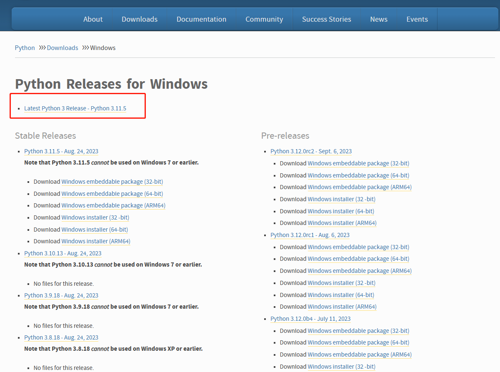

最新版本：

* [Latest Python 3 Release - Python 3.11.5](https://www.python.org/downloads/release/python-3115/)

找到你要下载的版本：初学者，下载什么版本无所谓，对于开发来说都是选择稳定的版本比如3.6。当然，现在3.9也是稳定的了，有些特殊情况，某些包只在特定版本上能运行，但作为初学者，说这些就多余了，先把语法学会了，后面自己实战的时候，需要什么版本，重新安装一下就可以了，如果涉及到不同版本否需要使用，那后续了解一下Anaconda。

**<font style="color:rgb(68, 68, 68);background-color:rgb(249, 249, 249);">Note that Python 3.9+ </font>*****<font style="color:rgb(68, 68, 68);background-color:rgb(249, 249, 249);">cannot</font>*****<font style="color:rgb(68, 68, 68);background-color:rgb(249, 249, 249);"> be used on Windows 7 or earlier. 当然，你是Windows 7系统，那么你就需要选择更老的版本了。</font>**

**<font style="color:rgb(68, 68, 68);background-color:rgb(249, 249, 249);">这里下载：Python 3.11.5和</font>**[**<font style="color:rgb(68, 68, 68);background-color:rgb(249, 249, 249);">Python 3.10.7 </font>**](https://www.python.org/downloads/release/python-3107/)**<font style="color:rgb(68, 68, 68);background-color:rgb(249, 249, 249);">的版本。</font>**

**<font style="color:rgb(68, 68, 68);background-color:rgb(249, 249, 249);">快速找到这个版本的方法：在浏览器页面按Ctrl + F（和Excel和World一样，查找快捷键），输入版本号回车即可。</font>**


定位到该版本的位置：

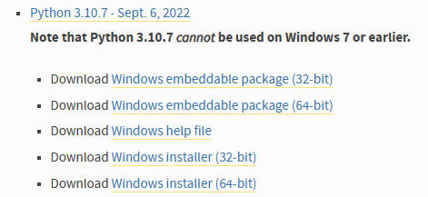

**<font style="color:rgb(68, 68, 68);background-color:rgb(249, 249, 249);">根据你的系统是32位还是64位的【现在的电脑一般都是64位的了】，选择下面对应的选项就行，点击蓝色字体即可下载：</font>**

* <font style="color:rgb(68, 68, 68);background-color:rgb(249, 249, 249);">Download</font><font style="color:rgb(68, 68, 68);background-color:rgb(249, 249, 249);"> </font>[**<font style="color:rgb(68, 68, 68);background-color:rgb(249, 249, 249);">Windows installer (32-bit)</font>**](https://www.python.org/ftp/python/3.10.7/python-3.10.7.exe)
* <font style="color:rgb(68, 68, 68);background-color:rgb(249, 249, 249);">Download </font>[**<font style="color:rgb(68, 68, 68);background-color:rgb(249, 249, 249);">Windows installer (64-bit)</font>**](https://www.python.org/ftp/python/3.10.7/python-3.10.7-amd64.exe)

**<font style="color:rgb(68, 68, 68);background-color:rgb(249, 249, 249);">类似地，</font>**[**<font style="color:rgb(68, 68, 68);background-color:rgb(249, 249, 249);">Python 3.11.5</font>**](https://www.python.org/downloads/release/python-3115/)**<font style="color:rgb(68, 68, 68);background-color:rgb(249, 249, 249);">版本，点击打开页面时【Latest Python 3 Release - Python 3.11.5】的超链接，跳转的新页面最底部，有不同系统下的安装包。同样的选择</font>**[**<font style="color:rgb(68, 68, 68);background-color:rgb(249, 249, 249);">Windows installer (32-bit)</font>**](https://www.python.org/ftp/python/3.10.7/python-3.10.7.exe)**<font style="color:rgb(68, 68, 68);background-color:rgb(249, 249, 249);">或者 Windows installer (64-bit)。这里需要注意，如果你的CPU是ARM公司的话，需要选择：Windows installer (ARM64)。</font>****<font style="color:#DF2A3F;background-color:rgb(249, 249, 249);">这在以前的版本中，不需要区分CPU的品牌</font>****<font style="color:rgb(68, 68, 68);background-color:rgb(249, 249, 249);">。如果是英特尔公司（Intel）的CPU，按照前面的选就行了。</font>**

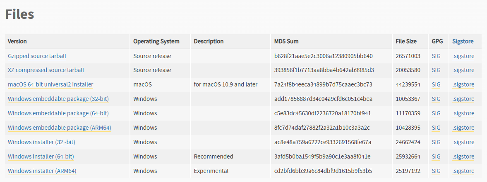

扩展：如何查看电脑的CPU品牌？

按下win+r键打开运行窗口，输入cmd回车进入管理员界面。

在管理员窗口中输入“dxdiag”命令并按下回车键。就会弹出下面信息，就可以看见自己的CPU品牌了。

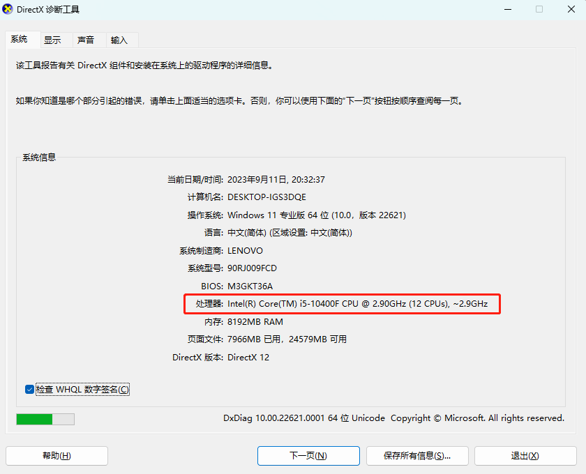

当然，你买的是笔记本，型号自己应该知道，在京东商店搜这个电脑，看一下参数就知道了。快速就是上面命令的方式。

好了，下载好了2个版本的文件：

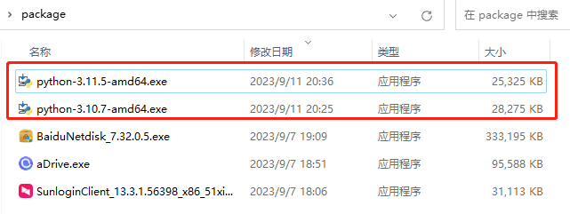

### 2.安装

双击下载的文件即可进行安装，如：python-3.11.5-amd64.exe

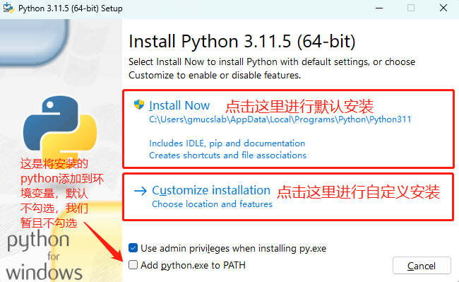

推荐选择自定义安装【Customize installation】：

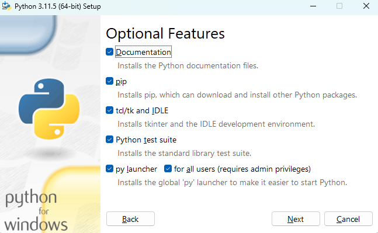

上面页面默认前面勾选，不需要管。点击\*\*<font style="color:#DF2A3F;">Next</font>\*\*即可。

得到的窗口如下：

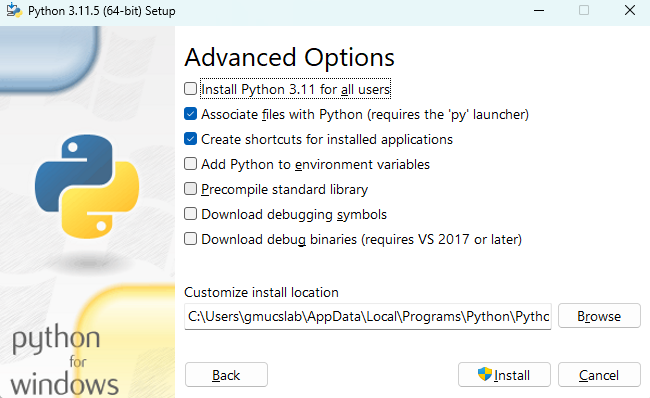

这里默认勾选了上图中的2个选项。

第一个勾选后就是为你电脑上所有用户都安装，自己的笔记本就你使用，选不选都一样。

第4个选项`Add Python to environment variables`：表示添加python到环境变量，这里和前面`Add python.exe to PATH`是一个意思，前面没有勾选，所以这里也没有勾选。如果我们点击`Back`返回前面去勾选后到这里，这个选项就是勾上的。我们这里先不勾选。

其他选项不重要了。

接下来就是选择我们的安装路径了，点击Browse选择我们要安装的目录，比如我这里打算安装在`D:\Program Files\Python3.11`这个目录下。

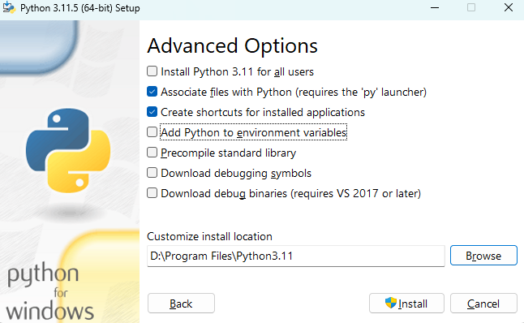

点击`Install`即可安装。等待几秒钟即可安装成功。点击`Close`即可完成。

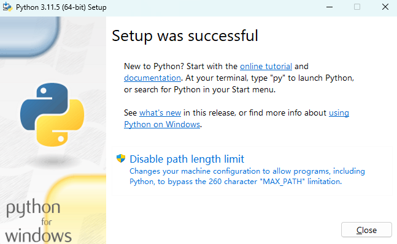

在我们的安装路径下：

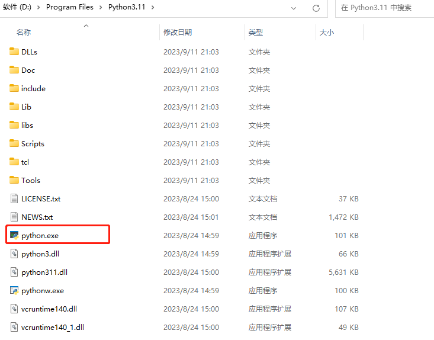

点击`python.exe`即可打开python软件。

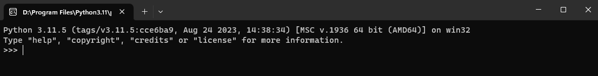

同样的方法安装`python-3.10.7`版本到`D:\Program Files\Python3.10`目录下。

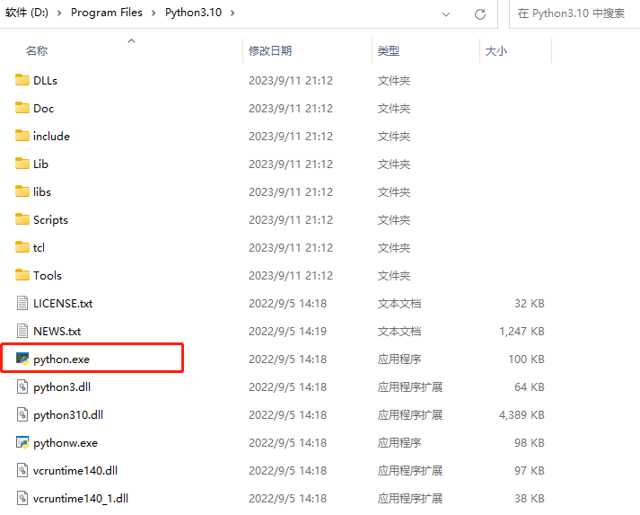

### 3.PATH环境变量的配置

由于我们在安装过程中并没有勾选`Add Python to environment variables`或`Add python.exe to PATH`，所以我们需要配置环境变量。

【**拓展**】：环境变量相当于给系统或用户应用程序设置的一些参数，具体起什么作用这当然和具体的环境变量相关。比如path，是告诉系统，当要求系统运行一个程序而没有告诉它程序所在的完整路径时，系统除了在当前目录下面寻找此程序外，还应到哪些目录下去寻找。比如，我们安装的python，我们如果没有将python的这个程序的路径添加到PATH这个环境变量中的话，我们要打开`python.exe`这个软件，每次都要去我们的安装路径【如：`D:\Program Files\Python3.10`】点击`python.exe`打开。是不是很麻烦？？当然，我们可以通过右键创建快捷来放在桌面，只需要在桌面点击即可，这其实就是创建了一个链接，也解决不了在任何目录下都能启动python解释器，并且他们本质上有很大区别，学过Linux的话，这类似于软链接。

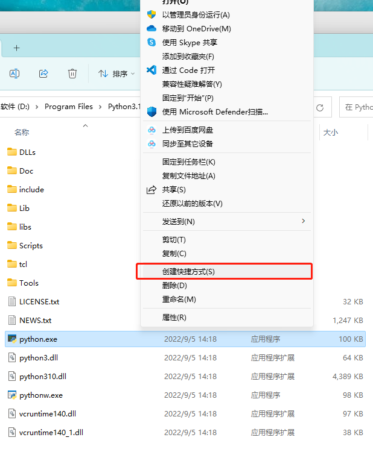

我们想要的是在任何目录下，都能启动我们的python程序，那么我们就需要添加python的安装路径到PATH这个环境变量中。方法如下：

`此电脑`》》`右键属性`

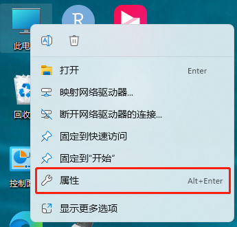

选择`高级系统设置`，下面是win11系统截图，win10系统在最右侧。

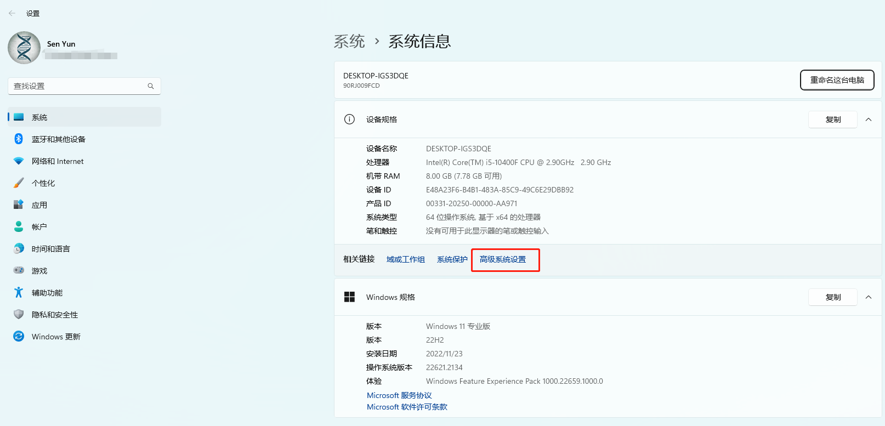

按照下面图中所示，选择编辑：

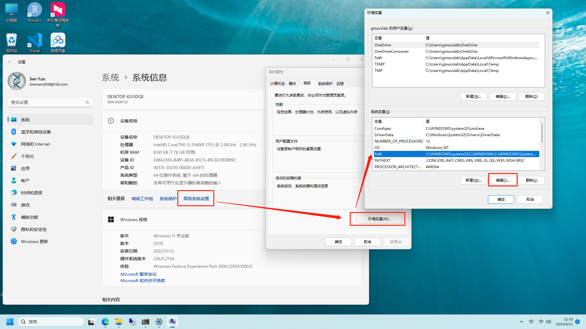

得到下面窗口：

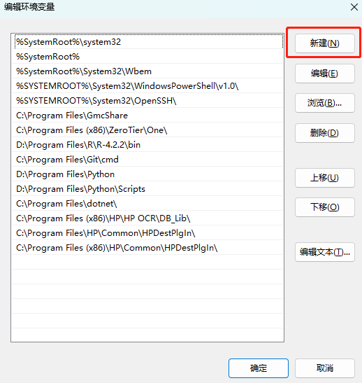

点击新建，左侧会添加一个框，将我们的python路径复制粘贴到框内。我们前面安装了2个版本的python，都添加到这里。

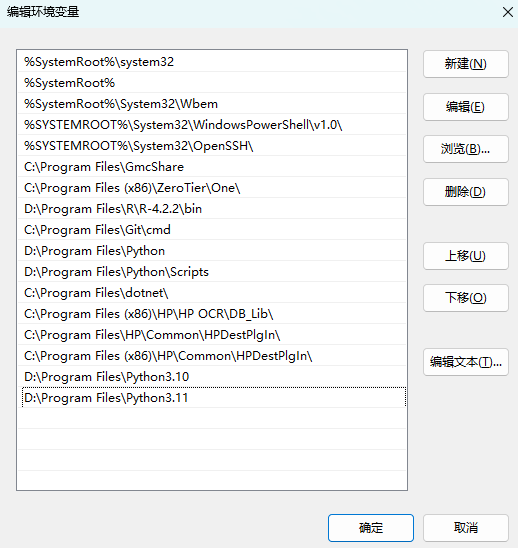

然后，点击确定、确定、确定，退出即可完成。

接下来测试一下：按下win+R键打开运行窗口，输入cmd回车进入命令提示符界面。

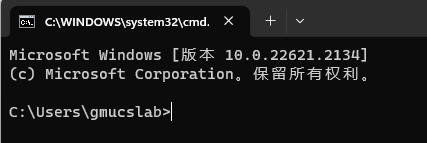

当前所在路径是：`C:\Users\gmucslab`在我们这个路径下是没有安装python的。

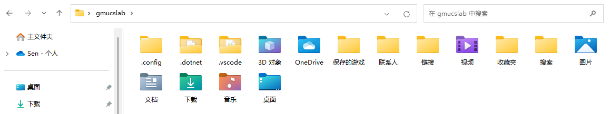

在命令提示符窗口输入python回车：

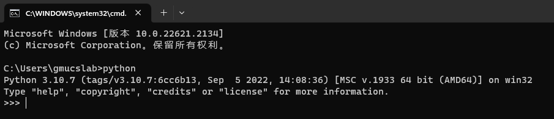

发现我们启动了python，版本是3.10.7的，这样我们就可以在任何目录下通过这种方式来启动python软件了。

【扩展】：命令行模式切换盘符，直接输入盘符和:即可，如切换到D盘:

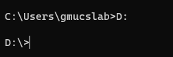

改变目录：`cd 路径`。比如，我要进入到D盘目录下`D:\Program Files\Python3.11\Lib`中。

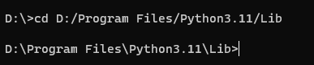

`>`符号前面就是当前所在的路径，这里其实相当于图形化界面，鼠标点击进入这个文件夹一样。只不过，我们这里是通过命令行来操作而已，这是另外一门课程，就不多介绍了，这里，你会切换盘符，改变工作目录就够了。

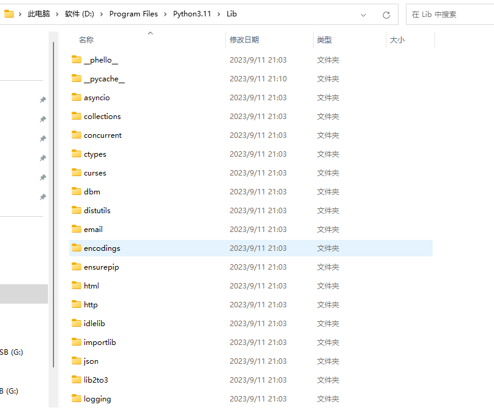

需要注意，cd后面有一个空格。路径的`\`通常需要改为`/`。<font style="color:#DF2A3F;">当然在window系统里面，DOS窗口这里使用</font><code><font style="color:#DF2A3F;">\</font></code><font style="color:#DF2A3F;">没有问题，但在python代码中，要是使用到路径这么写就会有问题了</font>。

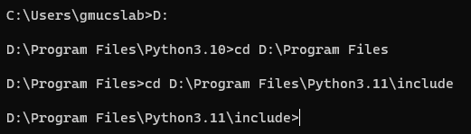

我们前面配置了2个版本的PATH环境变量，但我们启动的时候为什么是3.10.7这个版本，如果我想用3.11怎么办？这种情况是因为我们配置PATH时，3.10版本在前面，3.11在后面。

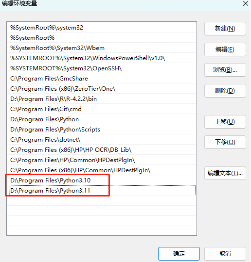

我们在CMD窗口输入python时，首先会在当前路径下找python程序，没有找到就去PATH环境变量里面找，从上往下找，先找到的3.10的，就不会再往下找了。比如，我们在3.11的目录下，输入python，启动的就是3.11，因为该目录下就有python程序，所以就不去PATH中找了。

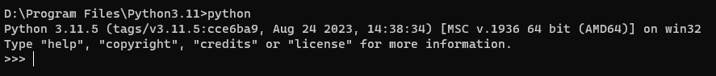

当然，我们在编辑环境变量窗口中的上移和下移来拍序这些路径。

**<font style="color:#DF2A3F;">注意：配置环境变量后，需要重启CMD，CMD窗口才会生效哦！！</font>**

## 二.PyCharm的下载、安装与简单使用

### 1.下载

地址：<https://www.jetbrains.com.cn/en-us/pycharm/download/other.html>

左侧专业版，需要付费，右侧社区版，免费。根据自己系统，下载安装即可。

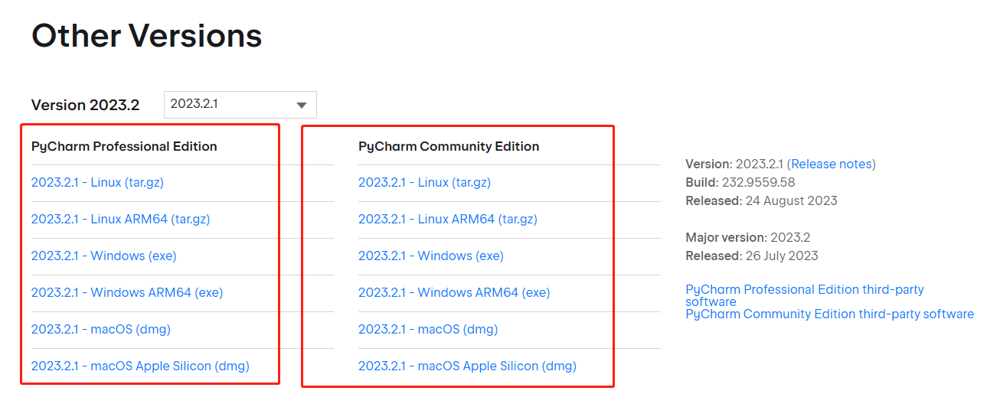

安装过程中，安装路径可以改变，和python的安装一样，默认安装路径`D:\Program Files\JetBrains\PyCharm Community Edition 2023.1.3`，可以安装在D盘，直接改动盘符即可。安装过程中下面选项全部勾选上。

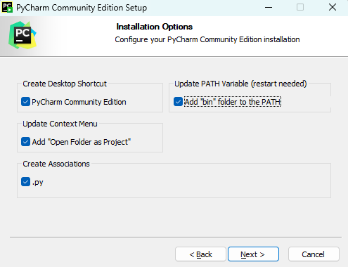

安装完成后启动pycharm，界面如下：

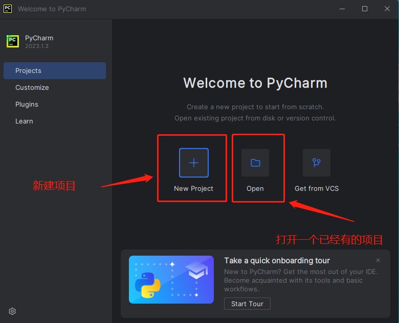

选择`New Project`，第一个`Location`处选择路径，其实就是选择一个文件夹，这个文件夹就是我们的项目了。

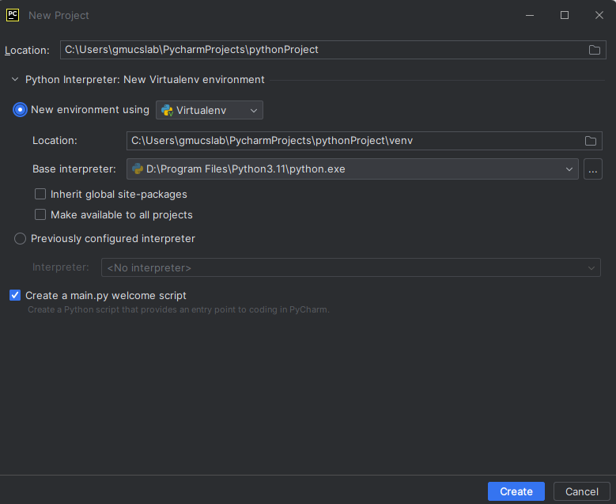

当然，之前创建过的项目，直接选择OPEN打开就可以了。

对于下面的选项，就是选择我们的python解释器了。有一个选项`New environment using`，默认是Virtualenv虚拟环境，Virtualenv用于在一台机器上部署多个独立运行的Python工作环境，这样做的目的主要有两个，如下:

* 隔离不同项目之间的Python版本以及库包的依赖，例如有的版本依赖Diango1.2.5，而另一个版本依赖Diango1.3.
* 部署方便，该虚拟环境下部署的Python解释器版本以及库包的版本都能进行统一，有利于工作分工的进行。

好像知识点有些多了，这些环境都是基于我们已经安装的python解释器的，所以在`base interpreter`会有我们安装的2个python版本，因为我们配置了PATH环境变量，所以有2个选项，选择其中一个就行。理解不了就直接点击下面的Create即可。对于只是学习语法，这里不重要了。后续学习深入，做开发的时候，学习使用anaconda，就知道了什么是虚拟环境了。

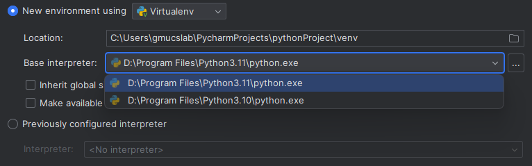

当然，可以选择`Previously configured interpreter`，点击`Add interpreter`。弹出下面这个窗口，选择`System Interpreter`，然后选择python解释器，点击`OK`即可。

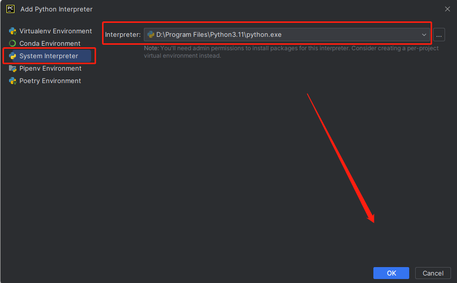

你可以按照下图进行设置：

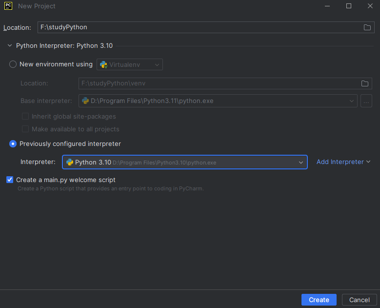

点击`Create`即可。

因为我们前面勾选了下面这个：


所以创建项目后会有一个main.py的文件。

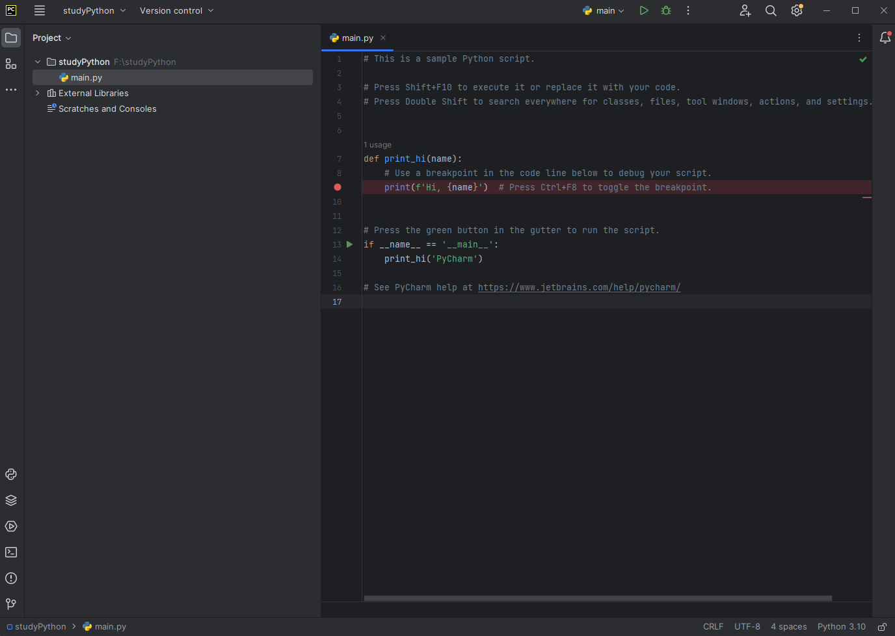

### 2.PyCharm汉化

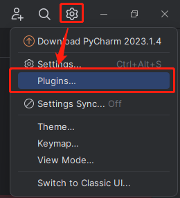

搜索`Chinese`安装下面插件。

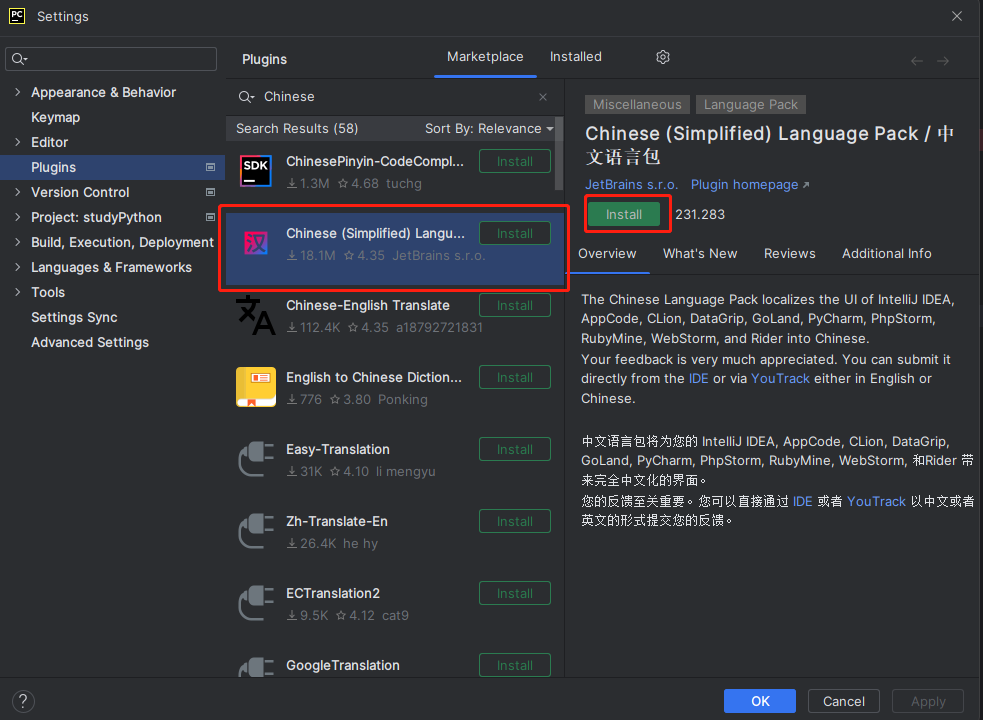

安装后点击OK，重新启动。

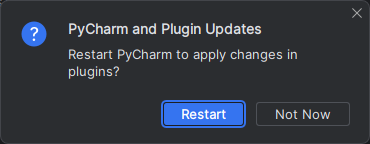

重启后，如下：

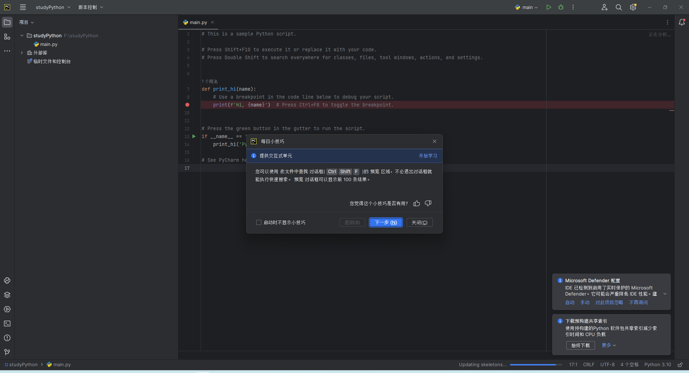

和以前的版本不太一样，这个版本的菜单栏被收起来了。

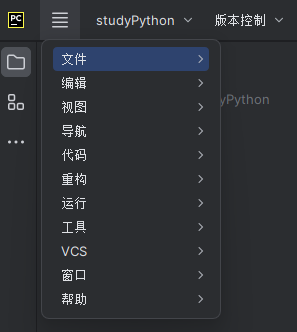

选择文件》》新建》》

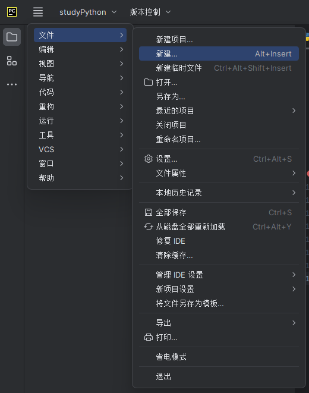

选择python文件输入文件名称，回车即可创建python文件。

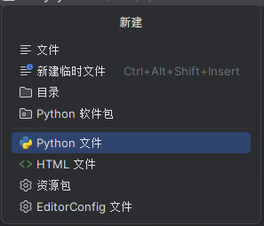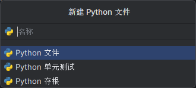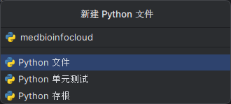

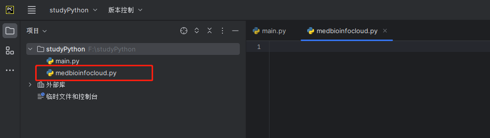

然后我们就可以在里面写代码了。

在文件中写了一句代码：

```python
print("MedBioInfoCloud")
```

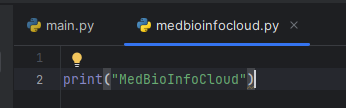

右键点击运行，即可执行这个文件里面的代码：

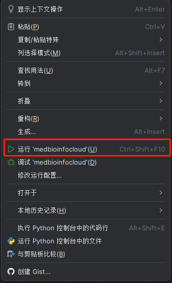

执行后：

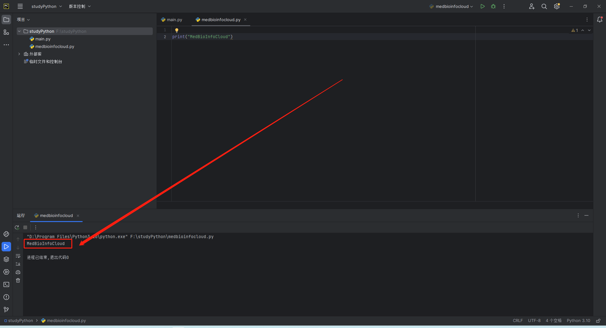

### 3.修改主题

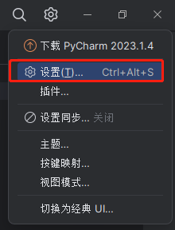


其它的自己探索了，反正是中文。

### 4.快捷键

* 格式化代码 【Ctrl + Alt + L】
* 多行代码合并为一行【Crtl+Shift+J】
* 修正报警告的代码【Ctrl + Enter】
* 包装代码【Crtl+Alt+T】
* 快速注释/取消注释【Crtl+/】
* 向右缩进一个制表位【Tab】
* 向左缩进一个制表位【Shift + Tab】
* 在上方插入新行【Ctrl + Alt + Enter】
* 在下方插入新行【Shift + Enter】
* 上下移动选中代码【Alt + Shift + 上、下键】
* 上下移动选中方法体【Ctrl + Shift + 上、下键】
* 复制代码【Ctrl + D】
* 折叠代码【Ctrl + -】
* 展开代码【Ctrl + +】
* 将代码抽取为一个方法【Ctrl + Shift+M】
* 重命名文件【Shift+F6】
* 查找类被引用的地方【Ctrl+N】
* 查找/全局查找【Ctrl+F / Ctrl + Shift+F】
* 替换/全局替换【Ctrl+R / Ctrl + Shift+R】
* 快速跳转报错的代码【F2】
* 定义一个书签【F11】
* 代码小写转大写【Ctrl + Shift+U】
* 进入一个方法【Ctrl + B / Ctrl +鼠标左键】
* 快捷查看方法的实现(源码)【Ctrl + Shift + I】
* 查看文档描述【Ctrl + Q】
* 查看文件中的方法【Ctrl + F12】
* 最近编辑的文件列表【Ctrl + E】
* 快捷运行代码【Shift + F10】
* 快捷调试代码【Shift + F9】
* 快捷切换视图/目录【Ctrl + Tab】
* 查看最近更改【Alt + Shift + C】
* 将光标移动到代码行尾【End】
* 全选一行并移至行尾【Shift + End】
* 查看历史粘贴复制记录【Ctrl + Shift+ V】
* 将光标移动到方法体或循环的开始【Ctrl + {】
* 将光标移动到方法体或循环的结束【Ctrl + ｝】
* 最大化编辑代码窗口【Ctrl + Shift + F12】
* 快捷添加代码【Ctrl + J】

### 5.高级使用【省略】

我们前面所写好代码，右键点击运行即可执行，这是一下子执行里面的的所以代码，真正的情况是，我们开发过程中需要不断的调试代码，需要设置断点，目前刚刚入门学语法。暂且忽略这部分，等语法学的差不多了，代码写的多了，需要调试的时候，问问B站。

## 三.Jupyter notebook的安装和使用

### 1.安装

官网：<https://jupyter.org/>


点击上面`jupyterlab`或`jupyter notebook`，或进入安装教程界面，如下：


我们打开命令行窗口，输入上面命令即可进行安装，对于小白来说，很难理解这些命令的意思的。

首先是pip，和我们前面介绍的cd命令一样，也是一个命令。我在安装python的时候，有一个选项就是要勾选它。pip是专门用来安装python包的一个命令，后面学习中会有介绍。当然，这里其实已经用到了，我们用它来安装jupyterlab，你只需要复制粘贴到命令行窗口，回车即可。


哈哈，pip没有被找到了，但是我们在安装python的时候也勾选安装pip了呀。

既然我们前面介绍了python的PATH环境变量的配置，这里可能就是pip不在我们这个目录`C:\Users\gmucslab`下。确实不在，pip在`python`文件夹中的`Scripts`文件夹里面。下面是3.11版本中的pip。


那么我们将这个路径配置到PATH环境变量就可以了。我这里配置了3.10中的。


然后重启CMD窗口，再去执行安装命令，就可以正常下载安装了。


notebook的安装也一样哦！！

```bash
pip install notebook
```


### 2. lab 和 notebook的启动

安装好后，在DOS窗口执行下面命令即可。

```plain
jupyter lab
```


```plain
jupyter notebook
```


### 3. notebook的基本使用

算了，看视频吧【<https://www.bilibili.com/video/BV1JW4y1f7uh/?vd_source=ad7486d1c0a79f7459d20781ce805fbc>】

## 四.第一个python程序

### 1.Python编辑器

在DOS窗口，输入python，打开Python编辑器的运行环境，直接在提示符“>>>”输入命令语句就可以交互式的执行结果。注意，这里需要提前配置python的环境变量，前面已经配置了。


### 2.IDLE

打开Python自带的集成开发环境IDLE，直接在提示符“>>>”输入命令语句就可以交互式的执行结果。


### 3.使用解释器执行

使用文本编辑器工具编写代码，在命令提示符中（cmd）输入python F:/learnPyhon/01/first_Python_code.txt

书写格式：python\[空格]文件路径。


尽管txt文本文件里面的Python代码能执行，但我们要用.py的格式文件，让我们看到文件时就知道这是一个python代码文件。

### 4.其他专业的集成开发环境

PyCharm，Jupyter notebook，Visual Studio Code等。

# 第二章	Python语法基础

## 一.几个基础概念

### 1.理解函数

在数学领域，函数是一种特定的映射关系，它将一个或多个输入值（称为自变量）与唯一的输出值（称为因变量）相关联。以f(x) = x + 2为例，当我们赋予x一个特定的值（如3），函数便会产生一个对应的输出f(3) = 5。类似地，在编程语境中，函数的概念也广泛存在，并与数学中的函数概念相互对应。在数学表达式f(x) = x + 2中，f代表函数名，x是自变量，而在编程中，x通常作为函数的参数出现。而“x + 2”这个表达式，在编程中被称为函数体，它定义了函数如何根据输入计算输出。通过给定不同的x值，我们可以轻松地计算出f(x)在任意点的函数值，例如f(1) = 3。在编程中，函数是一段命名的代码块，它接受一个或多个参数，执行特定的操作或计算，并可能返回一个结果。这里的函数体可能远比简单的“x + 2”复杂，且可以接受多个参数，比如f(x,y,z,…)，在数学中就叫多元函数。当使用现成的函数时，我们往往不需要关心函数体内部的具体实现细节，只需了解其功能、参数和返回值即可。例如，在许多编程语言中，print(x)函数用于在屏幕上显示x的值。我们无需深究print(x)是如何在内部实现这一功能的，只需知道它能按预期打印出x的值。同样地，当我们自定义函数时，只需按照所用编程语言的语法规则编写即可。总之，在编程中，我们会频繁使用现成的函数，有时也需自定义函数。对于现成的函数，我们关注的是其功能、参数和返回值；而自定义函数时，则需遵循编程语言的规则来编写函数体。

在数学中，函数是一种特殊的对应关系，它将一个或多个输入值（通常称为自变量）映射到一个输出值（通常称为因变量）。比如，我们有一个简单的数学函数 f(x) = x + 2，当我们给这个函数一个输入值 x（比如3），它就会输出一个结果 f(3) = 5。类似地，在编程语境中，函数的概念也广泛存在，并与数学中的函数概念相互对应。在数学中，上面的函数f(x) = x + 2，其中f我们可以理解为函数名称，f(x)中的x在程序语言中可以理解为是这个函数参数，而x + 2在程序语言里面可以用函数体这么术语来代表它。在数学上，对于函数f(x) = x + 2，我们知道当x=1时，即f(1)，知道f(1)的值是3，我们可以轻易的计算出f(2)、f(3)等任意x时的函数值。在程序语言中，计算得到的值通常叫函数的返回值。如果这理解这一点，那么先介绍程序语言中的函数的概念。函数是一段被命名的代码块，这段代码接受一个或多个输入（称为参数），执行特定的操作或计算，并可能返回一个输出值。在程序语言中，函数f(x)的函数体，一般不会是简单的x + 2，并且可以有很多个参数，比如f(x,y,z,…)，在数学中就叫多元函数。在程序语言中，如果使用别人写的或是定义好的函数，我们通常不关注函数体里面怎么用程序语言完成这个过程的，我们只需要知道这个函数实现的功能是什么，给什么参数，返回什么样的值。比如很多程序语言中都有print(x)这个函数，它的功能是将x打印在屏幕上，至于print(x)这个函数是怎么实现这一点的，我们不关心，就相当于我们不需要知道前面f(x)这个函数内部执行x + 2这个计算一样，我们只需要知道f(x)这个函数返回的值是你给定的x加上2。当然，我们这里知道是x + 2，因为这里这个函数可以理解为是我们自己定义的，自己定义的，当然清楚。总之，在程序语言中，我们会用到别人写好的函数，有时候也许自己去定义这个函数，用别人写好的函数通常不需要知道函数内部的代码怎么写的，或者说是怎么实现的，我们自己写函数，就是按照所用的程序语言来写就行。我们这里只需要简单的理解程序语言中的函数是什么就行，因为我们在学习程序语言的语法时，都会一开始就用到各种函数。后续章节中将会介绍Python语言中的函数。

### 2.理解计算机系统中的路径

在计算机系统中，路径是用于指定文件、目录或设备在网络或文件系统中位置的一种表示方式。它可以是绝对路径，即从文件系统的根目录（或起始点）开始到目标文件或目录的完整路径；也可以是相对路径，即从当前工作目录（或当前文件/目录所在的位置）到目标文件或目录的路径。在UNIX/Linux系统中，绝对路径通常以/开头，如`/home/user/documents/file.txt`；而在Windows系统中，绝对路径通常包含驱动器标识符（如`C:\`），如`C:\Users\user\Documents\file.txt`。相对路径则依赖于当前工作目录，例如，如果当前目录是`/home/user/documents`，那么`file.txt`或`./file.txt`都是指向同一文件的相对路径。路径中的每个部分由路径分隔符分隔。在`UNIX/Linux`系统中，路径分隔符是/；在Windows系统中，可以是`\`或`/`（尽管\更常用）。除了标准的路径表示，还有通配符（如\*和?）可以在路径中使用，以匹配多个或单个字符。例如，在`UNIX/Linux`系统中，`ls /home/user/documents/*.txt`会列出该目录下所有扩展名为`.txt`的文件。此外，路径中还有一些特殊表示法，如.表示当前目录，..表示父目录（即当前目录的上一级目录），~（在`UNIX/Linux`系统中）通常表示当前用户的家目录。本教材将在后续的章节中详细的介绍这以内容


> 更新: 2025-05-21 10:41:01  
> 原文: <https://www.yuque.com/doublehelix/bioinfonotes/mqe7ftaya2o4l1uq>