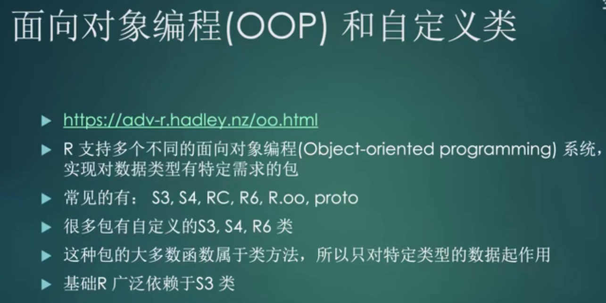

# 01-软件安装


## 必备
R [https://www.r-project.org/](https://www.r-project.org/)

Rstudio [https://www.rstudio.com/products/rstudio/download/#download](https://www.rstudio.com/products/rstudio/download/#download)

Git [https://git-scm.com/](https://git-scm.com/)

Gitee 或 Github [https://gitee.com/](https://gitee.com/) 或 [https://github.com/](https://github.com/)

## 推荐
CRAN统计

METACRAN [https://www.r-pkg.org/](https://www.r-pkg.org/)

几乎所有R包的源代码/文档在线查看

[https://rdrr.io/](https://rdrr.io/)

阅读英文网页

沙拉查词 [https://saladict.crimx.com/download.html](https://saladict.crimx.com/download.html)

# <font style="color:rgb(38, 38, 38);">01_开发环境</font>
<font style="color:rgb(38, 38, 38);">开发环境，除了常规的R和Rstudio安装之外，还需要安装的一些东西</font><font style="color:rgb(38, 38, 38);">  
</font>

[软件工具软件和工具R包开发](https://www.yuque.com/xiayonghe/dev_r_pack/mtr992)

<font style="color:rgb(38, 38, 38);">  
</font>**<font style="color:rgb(38, 38, 38);">Windows</font>**<font style="color:rgb(38, 38, 38);">  
</font><font style="color:rgb(38, 38, 38);">安装好Rtools，正常的下载安装，推荐用默认选项即可  
</font>[https://cran.r-project.org/bin/windows/Rtools/](https://cran.r-project.org/bin/windows/Rtools/)<font style="color:rgb(38, 38, 38);">  
  
</font>**<font style="color:rgb(38, 38, 38);">MacOS</font>**<font style="color:rgb(38, 38, 38);">  
</font><font style="color:rgb(38, 38, 38);">安装好Xcode和GNU Fortran compiler  
</font>[https://mac.r-project.org/tools/](https://mac.r-project.org/tools/)<font style="color:rgb(38, 38, 38);">  
</font><font style="color:rgb(38, 38, 38);">●xcode推荐安装方式  
</font><font style="color:rgb(38, 38, 38);">打开终端  
</font><font style="color:rgb(38, 38, 38);">输入命令  
</font><font style="color:rgb(38, 38, 38);">●GNU Fortran compiler 下载地址  
</font>**<font style="color:rgb(38, 38, 38);">注意区分版本</font>**<font style="color:rgb(38, 38, 38);">  
</font>[https://github.com/fxcoudert/gfortran-for-macOS/releases](https://github.com/fxcoudert/gfortran-for-macOS/releases)<font style="color:rgb(38, 38, 38);">  
</font>**<font style="color:rgb(38, 38, 38);">Linux</font>**<font style="color:rgb(38, 38, 38);">  
</font><font style="color:rgb(38, 38, 38);">要看具体发行版  
</font><font style="color:rgb(38, 38, 38);">下面的链接有主要的几个发行版的手册  
</font>[https://cran.r-project.org/bin/linux/](https://cran.r-project.org/bin/linux/)


<font style="color:rgb(35, 41, 48);background-color:rgb(250, 250, 250);">xcode</font><font style="color:rgb(225, 0, 35);background-color:rgb(250, 250, 250);">-</font><font style="color:rgb(35, 41, 48);background-color:rgb(250, 250, 250);">select</font><font style="color:rgb(89, 89, 89);background-color:rgb(250, 250, 250);"> </font><font style="color:rgb(225, 0, 35);background-color:rgb(250, 250, 250);">--</font><font style="color:rgb(35, 41, 48);background-color:rgb(250, 250, 250);">install</font>

# <font style="color:rgb(38, 38, 38);">02_开发工具包</font>
<font style="color:rgb(38, 38, 38);">除了系统和软件，开发过程中还会用到一些用于开发包的包</font><font style="color:rgb(38, 38, 38);">  
</font>


**<font style="color:rgb(38, 38, 38);">必备</font>**<font style="color:rgb(38, 38, 38);">  
</font><font style="color:rgb(38, 38, 38);">●</font><font style="color:rgb(38, 38, 38);">devtools </font><font style="color:rgb(38, 38, 38);">  
</font><font style="color:rgb(38, 38, 38);">安装上devtools后基本上其他会用到的也会被一同安上</font><font style="color:rgb(38, 38, 38);">  
</font><font style="color:rgb(38, 38, 38);">  
</font>**<font style="color:rgb(38, 38, 38);">建议使用</font>**<font style="color:rgb(38, 38, 38);">  
</font><font style="color:rgb(38, 38, 38);">●</font><font style="color:rgb(38, 38, 38);">依赖管理 </font><font style="color:rgb(38, 38, 38);">  
</font><font style="color:rgb(38, 38, 38);">Packrat </font>[https://rstudio.github.io/packrat/](https://rstudio.github.io/packrat/)<font style="color:rgb(38, 38, 38);">  
</font><font style="color:rgb(38, 38, 38);">●</font><font style="color:rgb(38, 38, 38);">依赖分析</font><font style="color:rgb(38, 38, 38);">  
</font><font style="color:rgb(38, 38, 38);">pkgnet </font>[https://uptake.github.io/pkgnet/](https://uptake.github.io/pkgnet/)


<font style="color:rgb(191, 191, 191);background-color:rgb(245, 245, 245);">R</font><font style="color:rgb(89, 89, 89);background-color:rgb(245, 245, 245);">复制代码</font>


```r
# Install devtools from CRAN
install.packages("devtools")

# Or the development version from GitHub:
# install.packages("devtools")
devtools::install_github("r-lib/devtools")
```


# <font style="color:rgb(38, 38, 38);">03_阅读材料</font>


**<font style="color:rgb(38, 38, 38);">基础</font>**<font style="color:rgb(38, 38, 38);">  
</font><font style="color:rgb(38, 38, 38);">R Packages </font>[https://r-pkgs.org/r.html](https://r-pkgs.org/r.html)<font style="color:rgb(38, 38, 38);">  
</font><font style="color:rgb(38, 38, 38);">文件名规范 </font>[https://style.tidyverse.org/files.html](https://style.tidyverse.org/files.html)<font style="color:rgb(38, 38, 38);">  
</font><font style="color:rgb(38, 38, 38);">包中文件规范 </font>[https://style.tidyverse.org/package-files.html](https://style.tidyverse.org/package-files.html)<font style="color:rgb(38, 38, 38);">  
</font><font style="color:rgb(38, 38, 38);">Devtools cheatsheet </font>[https://github.com/rstudio/cheatsheets/raw/master/package-development.pdf](https://github.com/rstudio/cheatsheets/raw/master/package-development.pdf)<font style="color:rgb(38, 38, 38);">  
</font><font style="color:rgb(38, 38, 38);">可重复代码怎么写 </font>[https://stackoverflow.com/questions/5963269/how-to-make-a-great-r-reproducible-example](https://stackoverflow.com/questions/5963269/how-to-make-a-great-r-reproducible-example)<font style="color:rgb(38, 38, 38);">  
  
</font>**<font style="color:rgb(38, 38, 38);">工具</font>**<font style="color:rgb(38, 38, 38);">  
</font><font style="color:rgb(38, 38, 38);">usethis </font>[https://usethis.r-lib.org/articles/articles/usethis-setup.html](https://usethis.r-lib.org/articles/articles/usethis-setup.html)<font style="color:rgb(38, 38, 38);">  
</font><font style="color:rgb(38, 38, 38);">devtools </font>[https://devtools.r-lib.org/](https://devtools.r-lib.org/)<font style="color:rgb(38, 38, 38);">  
</font><font style="color:rgb(38, 38, 38);">testthat </font>[https://testthat.r-lib.org/](https://testthat.r-lib.org/)<font style="color:rgb(38, 38, 38);">  
</font><font style="color:rgb(38, 38, 38);">roxygen2 </font>[https://roxygen2.r-lib.org/](https://roxygen2.r-lib.org/)<font style="color:rgb(38, 38, 38);">  
  
</font>**<font style="color:rgb(38, 38, 38);">进阶</font>**<font style="color:rgb(38, 38, 38);">  
</font><font style="color:rgb(38, 38, 38);">Advanced R </font>[https://adv-r.hadley.nz/index.html](https://adv-r.hadley.nz/index.html)<font style="color:rgb(38, 38, 38);">  
</font><font style="color:rgb(38, 38, 38);">Writing R Extensions </font>[https://cran.r-project.org/doc/manuals/R-exts.html](https://cran.r-project.org/doc/manuals/R-exts.html)<font style="color:rgb(38, 38, 38);">  
</font><font style="color:rgb(38, 38, 38);">开发全家桶清单 </font>[https://indrajeetpatil.github.io/awesome-r-pkgtools/](https://indrajeetpatil.github.io/awesome-r-pkgtools/)<font style="color:rgb(38, 38, 38);">  
</font><font style="color:rgb(38, 38, 38);">R Development Guide </font>[https://forwards.github.io/rdevguide](https://forwards.github.io/rdevguide)<font style="color:rgb(38, 38, 38);">  
  
</font>**<font style="color:rgb(38, 38, 38);">CRAN规定</font>**<font style="color:rgb(38, 38, 38);">  
</font><font style="color:rgb(38, 38, 38);">CRAN Repository Policy </font>[https://cran.r-project.org/web/packages/policies.html](https://cran.r-project.org/web/packages/policies.html)<font style="color:rgb(38, 38, 38);">  
  
</font>**<font style="color:rgb(38, 38, 38);">Bioconductor规定</font>**<font style="color:rgb(38, 38, 38);">  
</font><font style="color:rgb(38, 38, 38);">package guidelines </font>[https://www.bioconductor.org/developers/package-guidelines/](https://www.bioconductor.org/developers/package-guidelines/)<font style="color:rgb(38, 38, 38);">  
</font><font style="color:rgb(38, 38, 38);">Package Submission </font>[https://www.bioconductor.org/developers/package-submission/](https://www.bioconductor.org/developers/package-submission/)<font style="color:rgb(38, 38, 38);">  
</font><font style="color:rgb(0, 0, 0);">guide developers </font>[https://bioconductor.org/developers](https://bioconductor.org/developers/)<font style="color:rgb(38, 38, 38);">  
  
</font>**<font style="color:rgb(38, 38, 38);">其他推荐</font>**<font style="color:rgb(38, 38, 38);">  
</font><font style="color:rgb(38, 38, 38);">remotes   
</font>[https://remotes.r-lib.org/articles/dependencies.html](https://remotes.r-lib.org/articles/dependencies.html)<font style="color:rgb(38, 38, 38);">  
  
</font><font style="color:rgb(38, 38, 38);">Mastering Software Development in R   
</font>[https://bookdown.org/rdpeng/RProgDA/building-r-packages.html](https://bookdown.org/rdpeng/RProgDA/building-r-packages.html)<font style="color:rgb(38, 38, 38);">  
  
</font><font style="color:rgb(38, 38, 38);">为新手准备的现代化 R 包开发流程   
</font>[https://swsoyee.vercel.app/2021/02/writing-r-packages-a-modern-workflow-for-beginners](https://swsoyee.vercel.app/2021/02/writing-r-packages-a-modern-workflow-for-beginners/)<font style="color:rgb(38, 38, 38);">  
  
</font><font style="color:rgb(38, 38, 38);">rOpenSci Packages: Development, Maintenance, and Peer Review </font>[https://devguide.ropensci.org/index.html](https://devguide.ropensci.org/index.html)<font style="color:rgb(38, 38, 38);">  
  
</font><font style="color:rgb(38, 38, 38);">R Packages 中文   
</font>[https://r-packages-zh-cn.readthedocs.io/zh_CN/latest/](https://r-packages-zh-cn.readthedocs.io/zh_CN/latest/)<font style="color:rgb(38, 38, 38);">  
  
</font><font style="color:rgb(38, 38, 38);">Develop an R package for CRAN vs BioConductor  
</font>[https://www.biostars.org/p/233043/](https://www.biostars.org/p/233043/)<font style="color:rgb(38, 38, 38);">  
  
</font><font style="color:rgb(38, 38, 38);">Git教程  
</font>[https://backlog.com/git-tutorial/cn/](https://backlog.com/git-tutorial/cn/)<font style="color:rgb(38, 38, 38);">  
</font><font style="color:rgb(38, 38, 38);">Happy Git and GitHub for the useR  
</font>[https://happygitwithr.com/](https://happygitwithr.com/)<font style="color:rgb(38, 38, 38);">  
</font>




> 更新: 2022-07-03 11:37:20  
> 原文: <https://www.yuque.com/doublehelix/bioinfonotes/bbtk97>