# R包开发快速手册

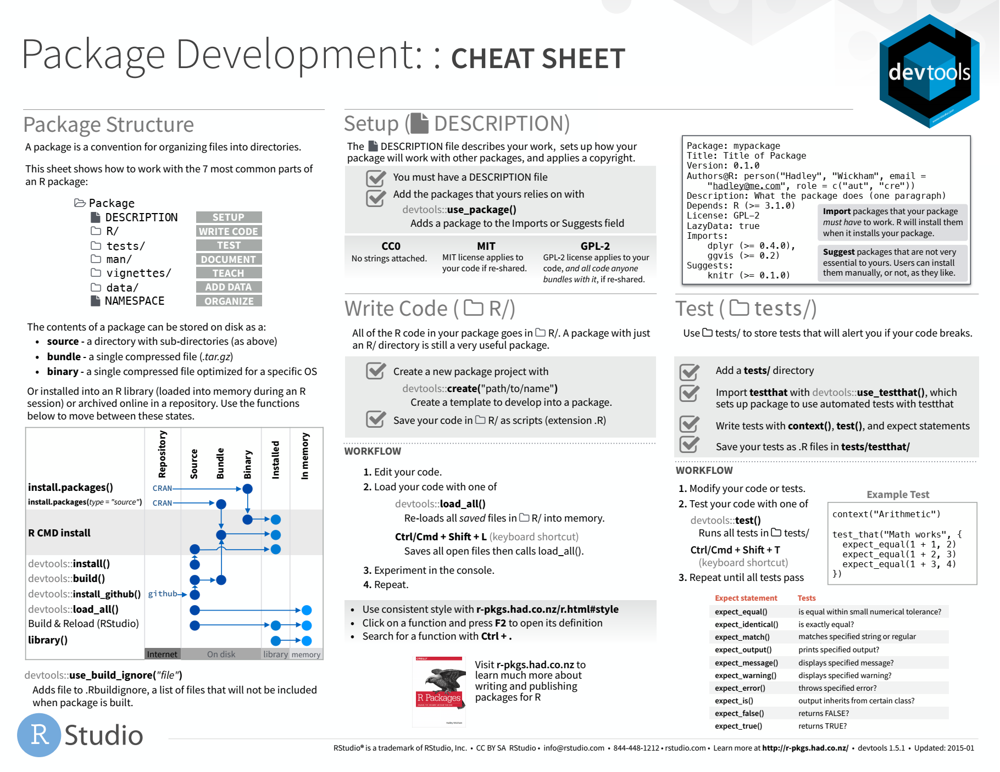

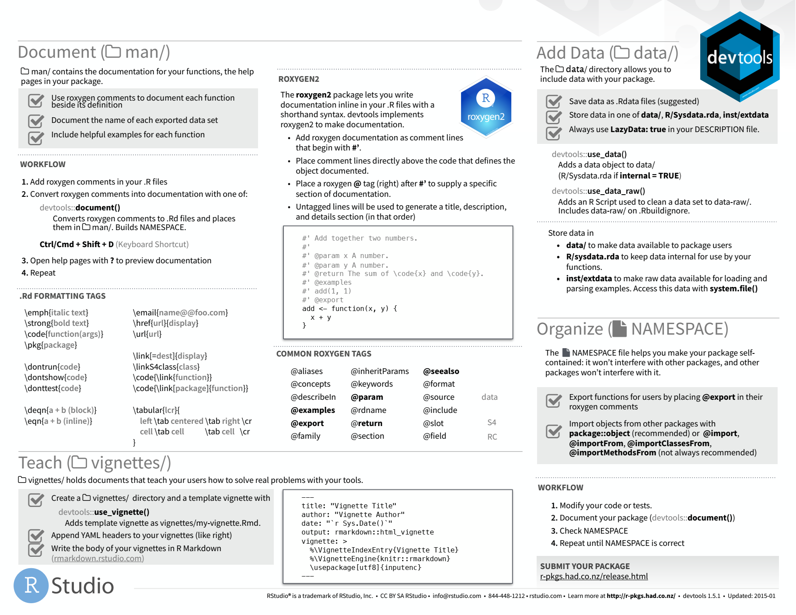

一个R包本质上就是一系列函数的集合，通过调用R包的函数从而实现相应的功能。R包开发对R语言编程能力提升有极大帮助，更能方便理解他人编写的包，而不仅仅调参。

```r
install.packages("usethis")
```

或者

```r
# install.packages("devtools")
devtools::install_github("r-lib/usethis")
```

相关函数：<https://usethis.r-lib.org/reference/index.html>

# **一.创建一个R包**

Rstudio中点击File - New Project - New Directory - R Package - 给自己R包取名和选择包地址，确定即可。

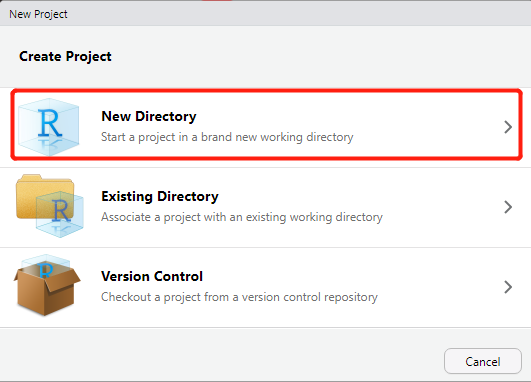

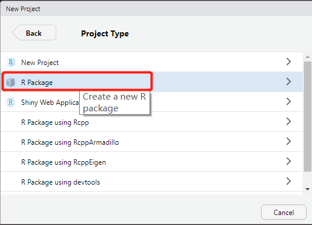

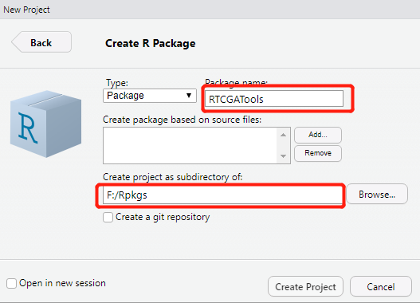

通过代码创建

```r
devtools::create("F:/Rpkgs/YunSen")
```

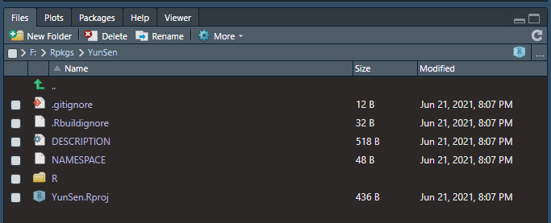

在包的文件下会生成5个文件和一个R文件夹

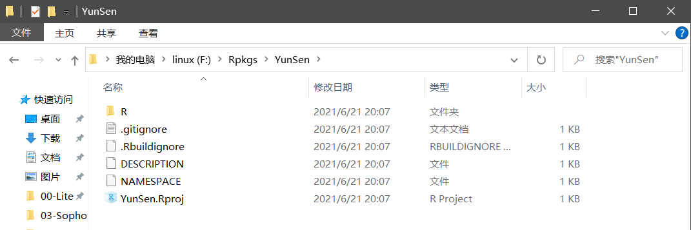

在RStudio中也可以看见。

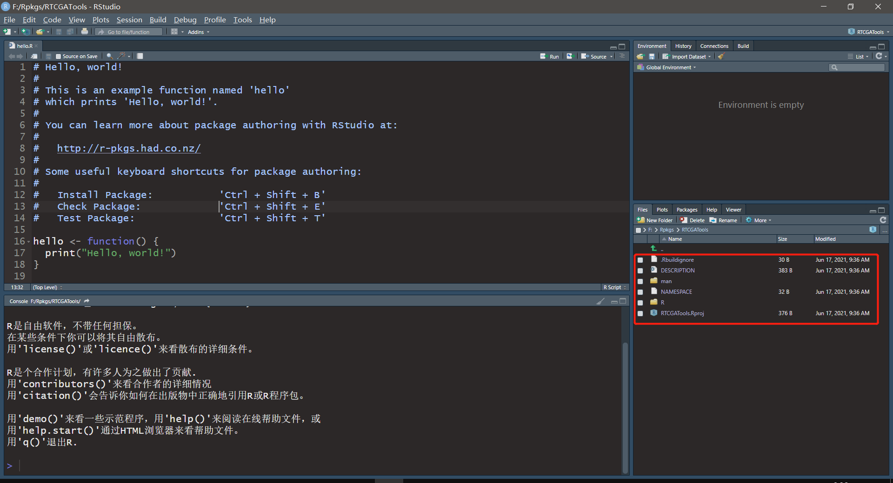

R(存放R代码的地方)

DESCRIPTION(R包的相关描述)

NAMESPACE(用来规定可以调用的R函数功能,如果这里没有写明，即是R文件夹里面有相关函数功能也不能在之后调用)

.gitignore和.Rbuildgnore

# **二.创建R脚本**

R脚本是存放在R这个文件夹下，但我们通常usethis工具创建。自动在R文件夹下生成脚本文件。

```r
usethis::use_r("getSamInfo")
```

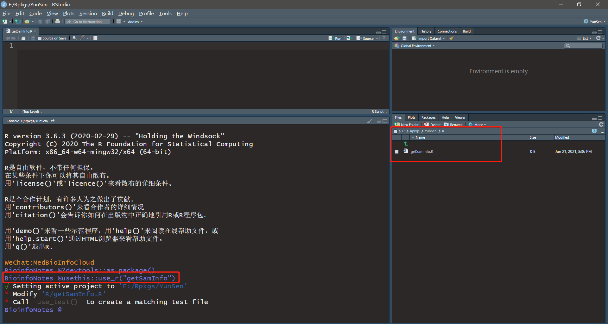

开始写脚本，代码一般全是函数。

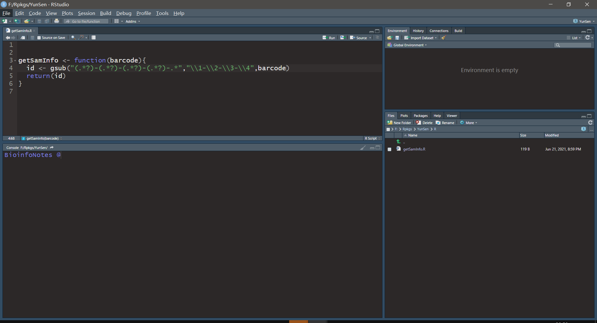

写好脚本，我们要测试一下这个函数能否正常工作，首先使用load_all()函数加载包，它大致模拟了用library()安装和加载包时的情况。

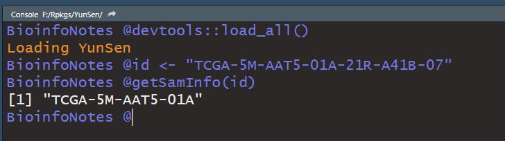

当我们把所有函数都写好后，利用devtools::check()自动检查构建和检查源代码包。

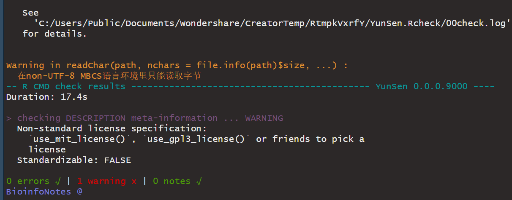

0个错误，1个警告，0个注意。可以看见警告内容是没有许可协议，如果不给其他人用，自己用的话，可以忽略许可协议。

怎么生成许可协议？？首先就得介绍一下DESCRIPTION文件

# **三.编写DESCRIPTION文件**

DESCRIPTION文件的作用是存储包中重要的元数据，当创建包时，就默认生成了DESCRIPTION文件，默认已经有一些内容。

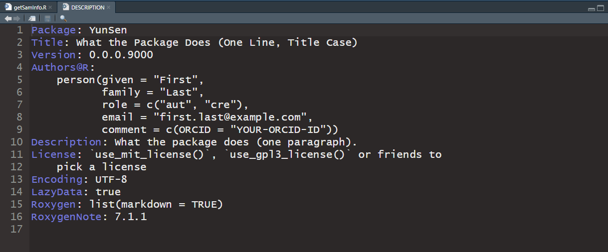

Package：包的名字

Title: 包的介绍，这里的内容就是Rstudio中Packages面板下各种包的描述

Version: 0.0.0.9000(版本号,版本号存在一定规范。这里只是一个简单的R包开发教程，不需理会)

Author: 作者信息

Description: 包的描述

License: 许可证(包的公共许可，开源程序的特色)

Encoding: UTF-8(编码方式)

LazyData: true(R包内置数据时选中)

先修改作者信息。

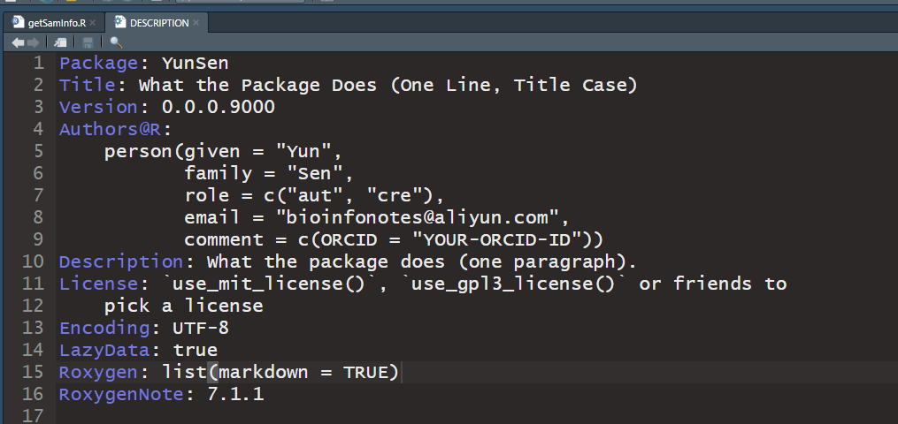

生成许可协议

```r
usethis::use_mit_license("Yun Sen")
```

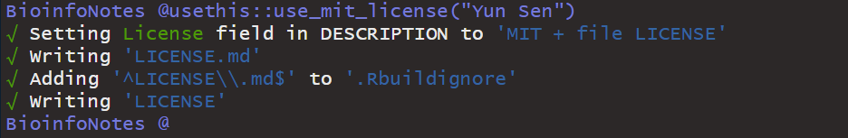

然后我们就会看见DESCRIPTION文件里的License处发生了变化

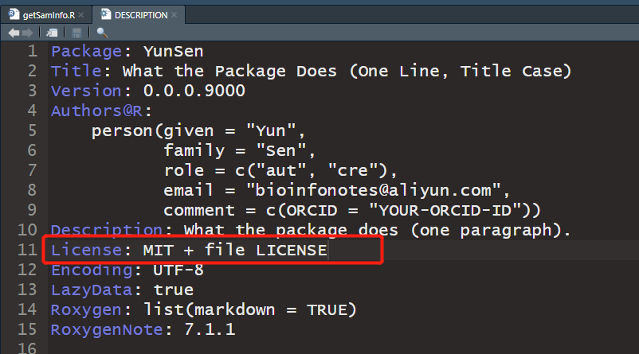

同时在包目录下会生成2个文件。

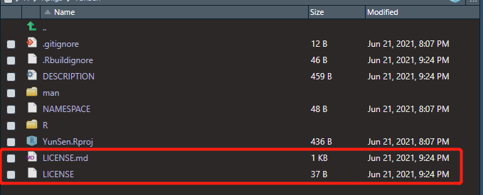

# **四.写函数帮助文档**

R 函数的帮助文档也是 R Package 的重要组成部分。函数文档以特殊的标记格式放在 man/\*.Rd 文件中，但是我们不需要掌握这种特殊标记语法，我们只需要撰写特殊格式的注释，然后 roxygen2 就会将其转换成 \*.Rd 文件。

将鼠标光标放在指定的函数体内，在 RStudio 中使用 Ctrl + Shift + Alt + R 或依次点击 Code -> Insert Roxygen Skeleton，就能够产生特殊格式的注释框架。

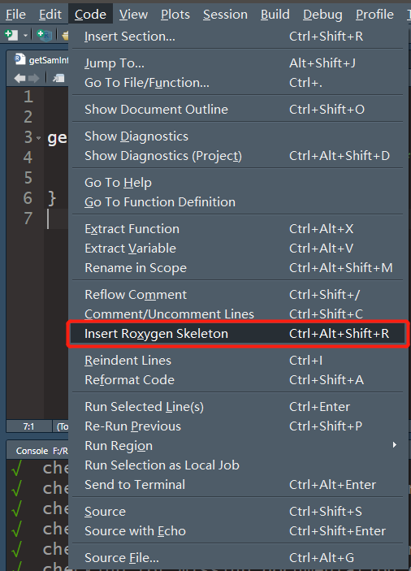

然后会自动在该脚本前面生成默认的常见参数，都是以@开始的，这些我们可以称为标签

@param 函数参数

@return 说明本函数返回值

@importFrom 包名 函数名 函数名

@export（不添加，这个函数就不显示也就不能直接使用）

@examples提供示例代码

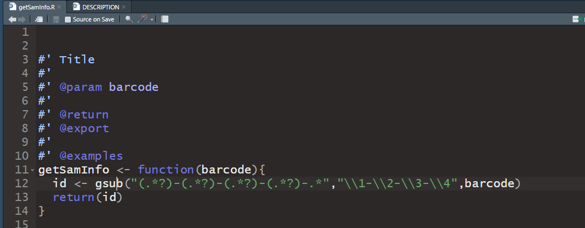

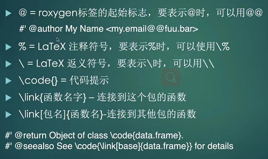

开始写参数介绍。

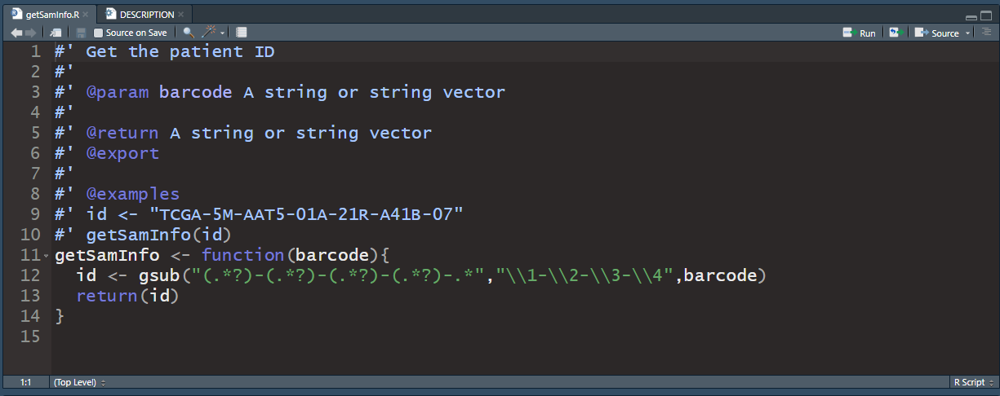

document()函数生成帮助文档，执行devtools::document()后，会生成一个man文件夹，man文件夹下会生成相应的Rd文件，文件名就是函数名。

```r
devtools::document()
```

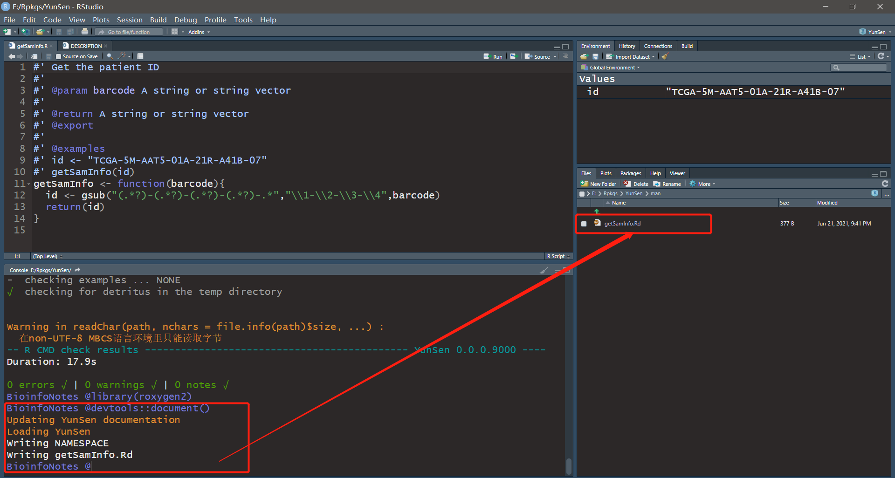

然后我们就可以像平时一样通过问号?getSamInfo查看帮助文档了。

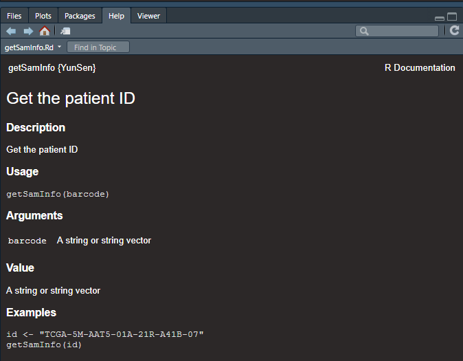

# **五.添加测试代码**

当我们写好一个函数后，需要验证函数是否能正确执行，结果是否正确，需要进行测试。

```r
usethis::use_testthat()
```

通过usethis::use_testthat()创建测试文件，会生成一个tests文件夹，里面有一个文件夹和一个R脚本。

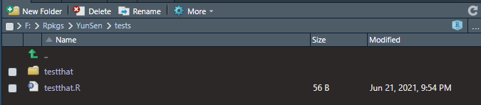

test_check.文件里面的代码如下，就是加载我们自己的包和testthat包，和测试检查我们的包，这里先不管。

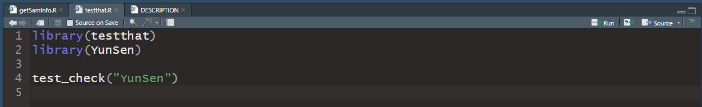

我们要测试函数，需要自己创建一个R脚本，这里通过use_test函数创建，参数是包名

```r
usethis::use_test("YunSen")
```

testthat文件夹下会自动生成测试的R脚本，打开后默认有3行代码。

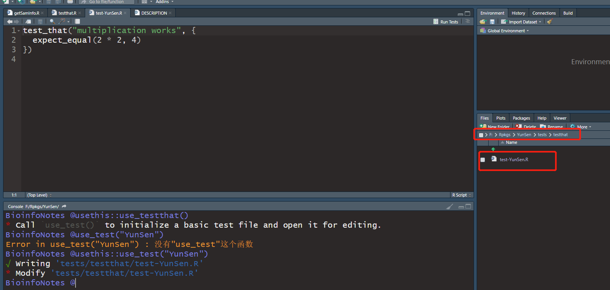

我们主要是通过检查函数运行结果一预期结果的比较。通常会用到下面这些函数，但不是全部。

expect_equal()判断是否相等，它使用all.equal()来检查一个数值在误差内是否相等。expect_identical()精确测试是否相等。

expect_match检测一个字符串向量是否与一个正则表达式匹配。

expect_output()检测打印输出，expect_message()检查信息，expect_warning()检查警告，expect_error()检查错误。

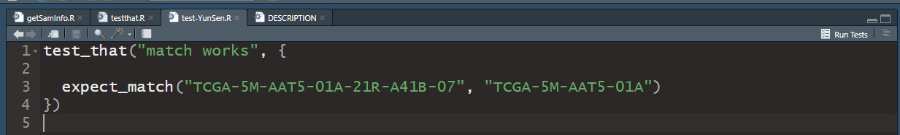

然后执行devtools::test()进行检查

```r
devtools::test()
```

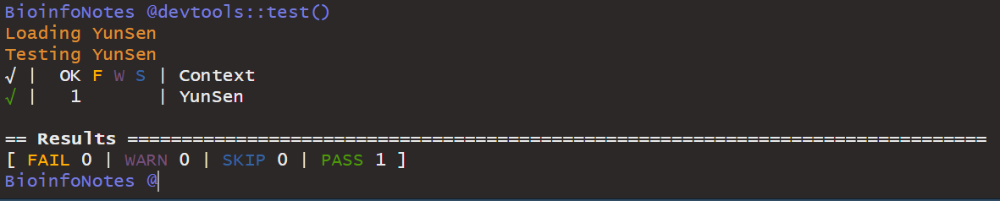

如果这些函数不能满足我们的需要，我们需要用expect_true或者expect_false函数来抓取其他的期望。这里的期望是我自己去构造的，也就是构造一个返回值为true或者false的期望表达式。还有，有时候结果太复杂，不容易通过代码重建，在这种情况下，可以检查结果是否与上次相同，expect_equal_to_reference()会缓存第一次结果，然后将其与随后的运行进行比较。

# **六.依赖包**

如果我们开发包过程中用到一些已有的包，或者其中的某个函数，那么我们需要引入，我们平时使用包是通过library或者source来加载包，但在开发时不能使用这种方式。
R有很多种方式来描述这种潜在的依赖关系。
通过imports（输入）、suggests（建议）、Depends（依赖）、LinkingTo（链接到）和Enhances（增强）来描述。
imports里的包必须被安装，也就是在安装自己包的时候，imports申明的包也会被安装。
suggests中的包，我们可以使用他，但不是必须的，比如我们可以退使用建议包中的数据来运行测试，编译使用指南，或者只有一个函数需要这个包，suggests中的包是不会随我们的包的安装而安装的。
Depends用来指定特定的R版本，例如Depends：R（>=3.0.1)。
LinkingTo用于列出依赖于另一个包中的C或者C++代码。
Enhances列出你的包增强了的包，通常，你的包为其他包里的类提供了方法。

我们通过use_package()函数来申明依赖包。

```r
use_package(package, type = "Imports", min_version = NULL)
```

package 包的名称

type 就是依赖类型，必须是 "Imports", "Depends", "Suggests", "Enhances"或者 "LinkingTo"中的一个，默认"Imports"。

关于TCGA分析的包有很多，我么这里可以用。

```r
usethis::use_package("GDCRNATools",type = "Imports")
```

我们会看见描述文件会发生更新。

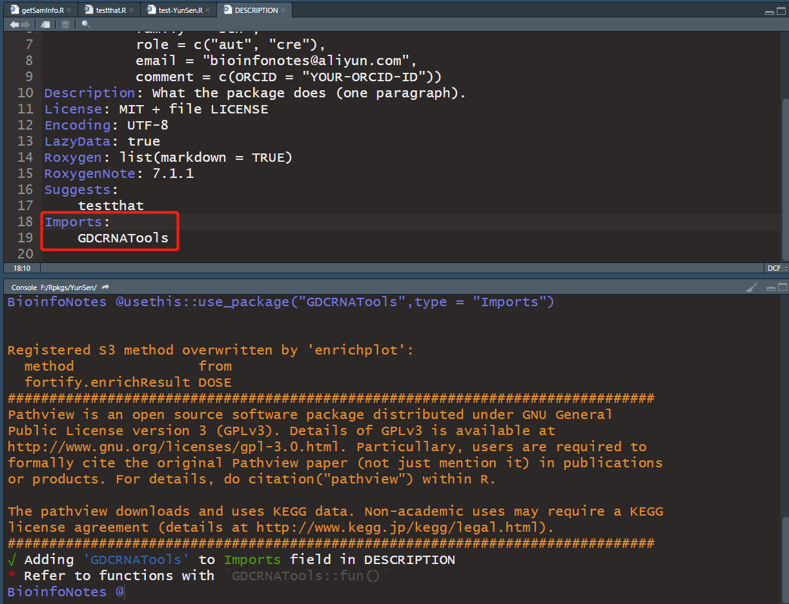

use_package()向DESCRIPTION添加了一个CRAN包依赖关系，并提供了一些关于如何最好地使用它的建议。use_dev_package()在一个正在开发的GitHub包上添加了一个版本化的依赖，将repo添加到Remotes，这样它就会从正确的位置自动安装。

我们这里创建一个新的R脚本

```r
usethis::use_r("getTCGAData")
```

导入非标准计算

```r
usethis::use_tidy_eval()
```

# **七. 外部数据**

## **1.导出的数据**

包中数据最常用的位置是在data/目录下，数据格式一般是.Rdata。其中包含单个对象和文件的名称相同，使用这个规则最简单的方法是使用：

usethis::use_data()

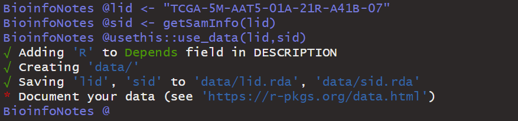

会在包的目录下产生一个data文件夹，data目录下就会生成对应的Rda格式的文件。

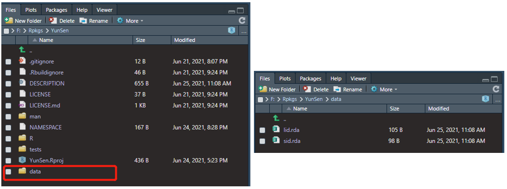

使用Use_data()可以很容易地以正确的格式保存包数据。我建议您将生成包数据的脚本保存在data-raw中:使用use_data_raw()进行设置。您还需要记录导出的数据集。

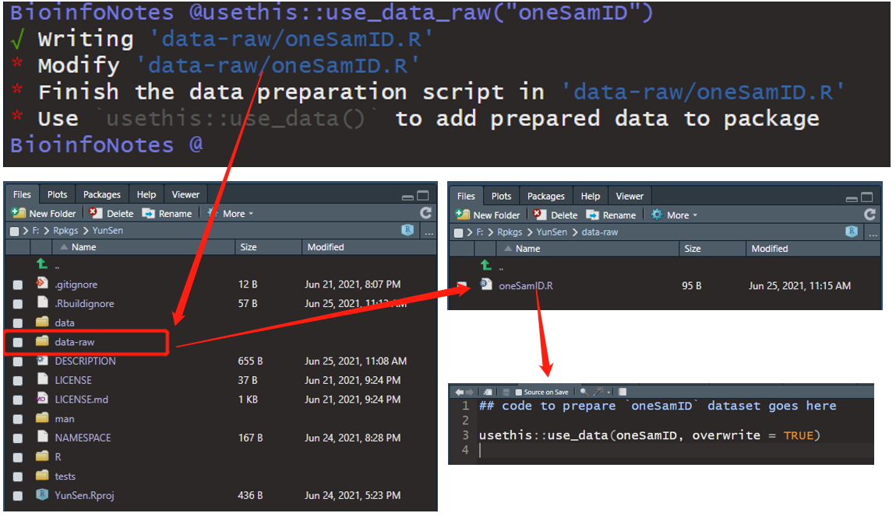

在oneSamID写生成数据的代码，后续也好知道数据的来源，data-raw目录下的代码是不需要打包的。对于数据的描述文档可以使用下面2个标签描述。

\#' @format #' @source

## **2.内部数据**

有时候函数需要预先计算的数据表，如果把这些数据放在data/目录下，这些数据也将会被提供给包的用户，这是不恰当的，正确的做法是把他保存在R、sysdata.Rda。我们在使用usethis::use_data()保存数据的时候，可以加上internal=TRUE来创建文件。

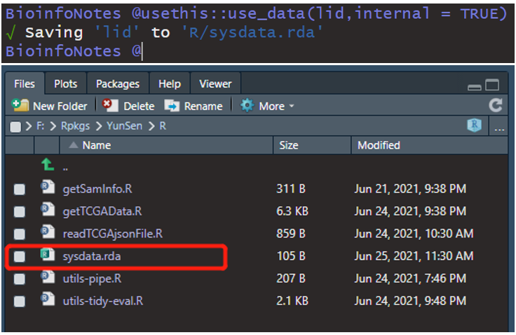

## **3.原始数据**

如果想展示加载/解析原始数据的例子，就将原始文件放在inst/extdata。安装包时，inst/中所有文件和文件夹都会移动到顶层目录，所以它们不能有R/description这样的名字，要引用inst/extdata（无论是否安装）中是文件，使用system.file()。

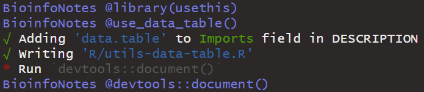

BioinfoNotes @use_data_table() √ Adding 'data.table' to Imports field in DESCRIPTION √ Writing 'R/utils-data-table.R' \* Run `devtools::document()`

# 八.Build包

检查包

```r
install.packages("rhub")
rhub::check()
```

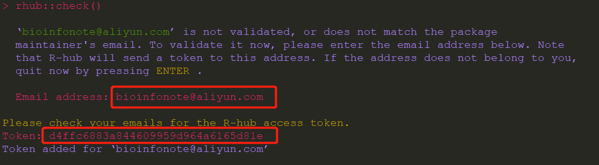

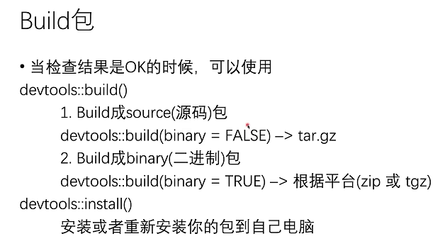

# 九.提交到github

配置git用户：

在git窗口：

```git
# configure the user which will be used by Git
# this should be not an acronym but your full name
git config --global user.name "Firstname Lastname"

# configure the email address
git config --global user.email "your.email@example.org"
```

如果之前登录过账户，切换账户，在push时可能会报403错误，解决办法：

CMD窗口，输入命令：rundll32.exe keymgr.dll,KRShowKeyMgr，出现「存储的用户名和密码」窗口：

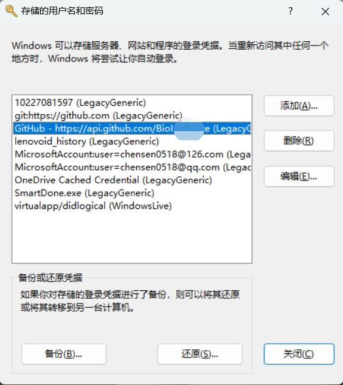

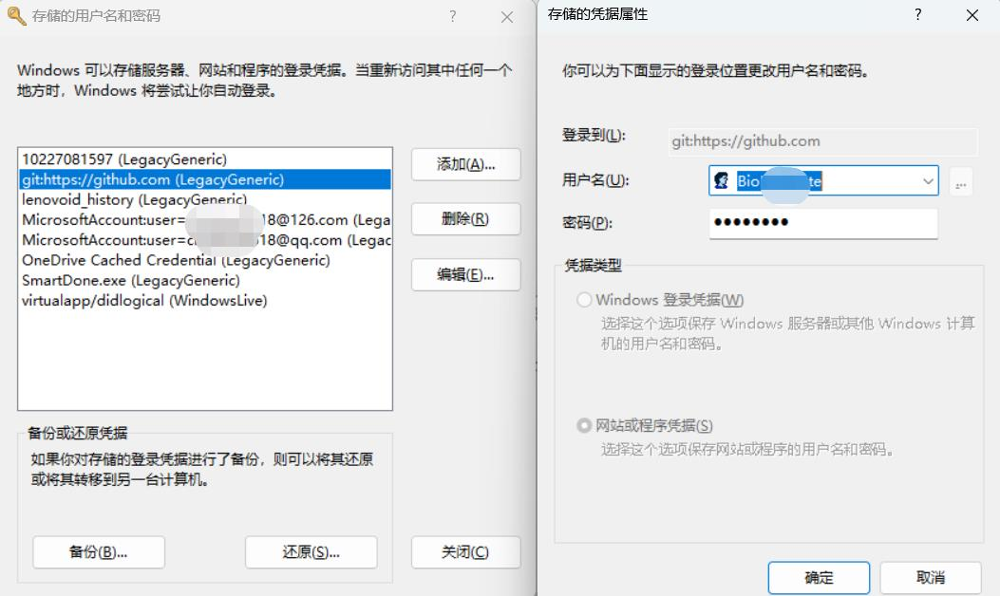

将 github 相关的条目删除。

然后提交

```r
git remote add origin git@github.com:BioInfoNote/FUNscore.git
git push -u origin master
```

# **十. usethis包**

## **1.use_package()**

use_package()向DESCRIPTION添加了一个CRAN包依赖关系，并提供了一些关于如何最好地使用它的建议。

use_dev_package()添加了一个对正在开发的包的依赖，将dev repo添加到Remotes，这样它就会从正确的位置自动安装。

use_package(package, type = "Imports", min_version = NULL) use_dev_package(package, type = "Imports", remote = NULL)

package：要依赖的包的名称。

type：依赖类型:必须是 "Imports", "Depends", "Suggests", "Enhances"h或者 "LinkingTo" 之一。匹配不区分大小写。

min_version：还可以为包提供一个最小版本。设置为TRUE以使用当前安装的版本。

remote：默认情况下，插入一个OWNER/REPO GitHub远程服务器。您可以选择提供一个字符串来指定远程，例如。"gitlab::jimhester/covr"，使用远程包支持的任何语法。

## **2.use_import_from()**

use_import_from(package, fun, load = is_interactive())

use_import_from()通过将roxygen2 @importFrom标记添加到包级文档(可以使用use_package_doc()创建)来从另一个包中导入函数。从另一个包中导入一个函数允许你在没有命名空间的情况下引用它(例如，fun()而不是package::fun())。use_import_from()也会重新记录命名空间，并重新加载当前包。这能够确保你的开发过程中能够立即获得乐趣。

package：Package name

fun：A vector of function names

load：Logical. Re-load with pkgload::load_all()?

## **3.use_r()**

use_r(name = NULL, open = rlang::is_interactive()) use_test(name = NULL, open = rlang::is_interactive())

name：可以使用没有扩展名的名称，也可以使用NULL来根据脚本编辑器中当前打开的文件创建成对的文件。如果R文件是打开的，use_test()将创建/打开相应的测试文件;如果测试文件打开，use_r()将创建/打开相应的R文件。

## **4.use_rmarkdown_template()**

use_rmarkdown_template(   template_name ="Template Name",   template_dir =NULL,   template_description ="A description of the template",   template_create_dir =FALSE)

## **5\*\*\*\*.Use_data()**

```r
use_data(...,   internal =FALSE,   overwrite =FALSE,   compress ="bzip2",   version =2)
```

参数：

internal ：如果为FALSE，则将每个对象保存在data/目录中自己的.rda文件中。这些数据文件绕过通常的导出机制，在加载包时可用(如果LazyData不为TRUE，则通过data()可以使用)。如果为TRUE，则将所有对象存储在单个R/sysdata中.rda文件。此文件中的对象遵循通常的导出规则。请注意，这意味着如果您使用通用 exportPattern() 规则导出所有对象，除了以 .

overwrite : 默认情况下，use_data()不会覆盖现有文件。如果您真的想这样做，请将此设置为TRUE。

**compress : **选择save()使用的压缩类型。应该是"gzip"， "bzip2"，或"xz"之一。

version : 要使用的序列化格式版本。默认的2是从R 1.4.0到3.5.3。版本3从R 3.6.0开始成为默认版本，只能由R版本3.5.0及更高版本读取。

use_data_raw(name = "DATASET", open = rlang::is_interactive())

name : 要准备包含在包中的数据集的名称。

open : 打开新创建的文件进行编辑?发生在RStudio，如果适用，或通过utils::file.edit()否则。

library(GDCRNATools)

samInfo <- gdcParseMetadata(project.id="TCGA-COAD", data.type='RNAseq')

colnames(samInfo)

\#entity_submitter_id

\#TCGA-5M-AAT5-01A-21R-A41B-07

编写DESCRIPTION文件

在Rstudio中打开DESCRTION文件,编写包的描述。

相关内容包括：

Package：包的名字

Type: Package(类型)

Title: 包的介绍，这里的内容就是Rstudio中Packages面板下各种包的描述

Version: 0.1.0(版本号,版本号存在一定规范。这里只是一个简单的R包开发教程，不需理会)

Author: 作者

Maintainer: The package maintainer yourself@somewhere.net(包的贡献者名字及邮箱)

Description: 包的描述

License: 许可证(包的公共许可，开源程序的特色。这里也不理会，以GPL-3为协议)

Encoding: UTF-8(编码方式)

LazyData: true(R包内置数据时选中)

Depends : 依赖环境

Imports : 需要使用的包

Suggests: 建议配合使用的包

其他如网址、bug报告地址等内容，这里不涉及。

> 更新: 2022-09-28 22:25:08
> 原文: <https://www.yuque.com/doublehelix/bioinfonotes/hdgnuy>
