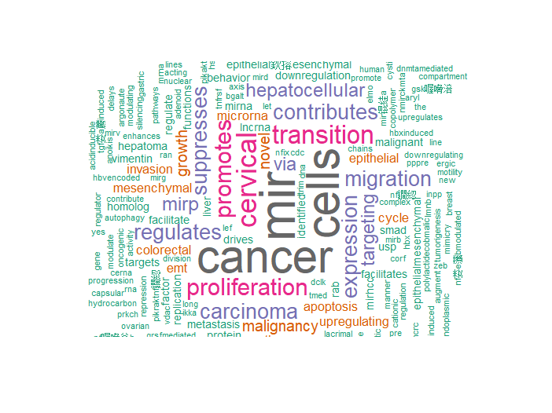
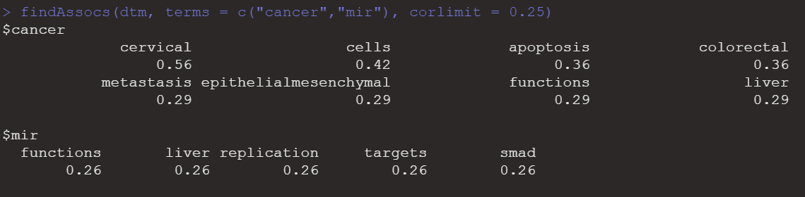
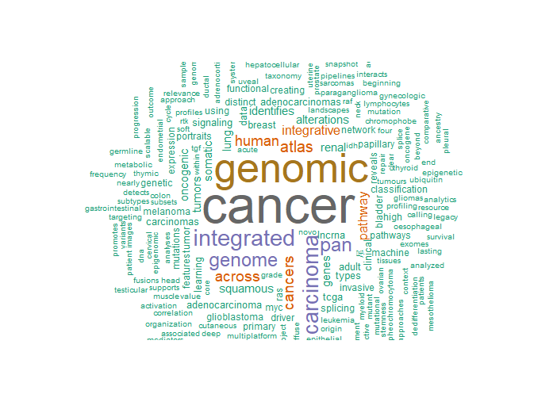
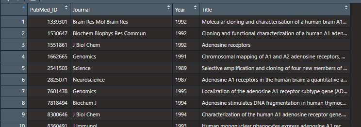
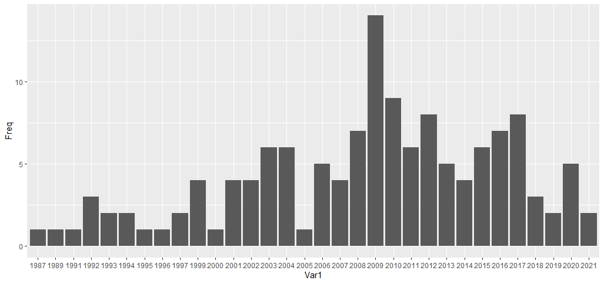
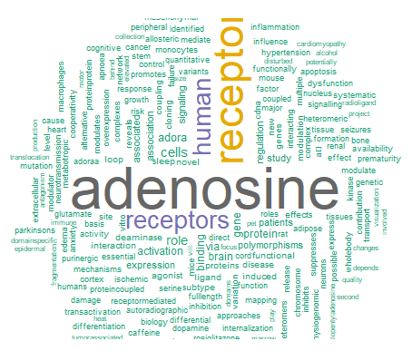

# 文本挖掘

## 一.文本挖掘的一般过程

参考:[http://www.sthda.com/english/wiki/text-mining-and-word-cloud-fundamentals-in-r-5-simple-steps-you-should-know](http://www.sthda.com/english/wiki/text-mining-and-word-cloud-fundamentals-in-r-5-simple-steps-you-should-know)

电子书:[https://www.tidytextmining.com/](https://www.tidytextmining.com/)

Step 1: Create a text file

本地文件，或者来源于网络。

Step 2 : Install and load the required packages

```r
# Install
install.packages("tm")  # for text mining
install.packages("SnowballC") # for text stemming
install.packages("wordcloud") # word-cloud generator
install.packages("RColorBrewer") # color palettes
# Load
library("tm")
library("SnowballC")
library("wordcloud")
library("RColorBrewer")
```

Step 3 : Text mining

```r
#读入本地文件
text <- readLines('data/text/text.txt')
# Read the text file from internet
filePath <- "http://www.sthda.com/sthda/RDoc/example-files/martin-luther-king-i-have-a-dream-speech.txt"
text <- readLines(filePath)
# Load the data as a corpus
docs <- Corpus(VectorSource(text))
```

VectorSource(x)函数：向量源将向量x的每个元素解释为一个文档。

其他读入函数：

+ **read.csv() is** used for reading comma-separated value (csv) files, where a comma “,” is used a field separator
+ **read.delim()** is used for reading tab-separated values (.txt) files

Inspect the content of the document

```r
inspect(docs)
```

文本转换

清理文本数据首先要进行转换，比如从文本中删除特殊字符。这是通过使用tm_map()函数将特殊字符如“/”、“@”和“|”替换为空格来完成的。下一步是删除不必要的空格并将文本转换为小写。

```r
toSpace <- content_transformer(function (x , pattern ) gsub(pattern, " ", x))
docs <- tm_map(docs, toSpace, "/")
docs <- tm_map(docs, toSpace, "@")
docs <- tm_map(docs, toSpace, "\\|")
```

tm_map()函数用于删除不必要的空格，将文本转换为小写，删除常见的停止词，如' The '， " we "。

“stopwords”的信息值接近于零，因为它们在语言中非常常见。在进一步分析之前，删除这类词是有用的。对于“stopwords”，支持的语言是丹麦语，荷兰语，英语，芬兰语，法语，德语，匈牙利语，意大利语，挪威语，葡萄牙语，俄语，西班牙语和瑞典语。语言名称区分大小写。

您还可以使用removeNumbers和removePunctuation参数删除数字和标点符号。

另一个重要的预处理步骤是使文本词干化，将单词还原为词根形式。换句话说，这个过程去掉单词的后缀，使其变得简单，并获得共同的起源。例如，词干提取过程将单词“moving”、“moved”和“movement”还原为词根词“move”。

```r
# 将文本转换为小写
docs <- tm_map(docs, content_transformer(tolower))
# Remove numbers
docs <- tm_map(docs, removeNumbers)
# 去掉英语中常见的停顿词
docs <- tm_map(docs, removeWords, stopwords("english"))
# Remove your own stop word
# specify your stopwords as a character vector
docs <- tm_map(docs, removeWords, c("blabla1", "blabla2"))
# Remove punctuations
docs <- tm_map(docs, removePunctuation)
# Eliminate extra white spaces
docs <- tm_map(docs, stripWhitespace)
# Text stemming
# docs <- tm_map(docs, stemDocument)
```

Step 4 : Build a term-document matrix

清理完文本数据后，下一步是统计每个单词出现的次数，以确定流行或趋势主题。使用文本挖掘包中的函数TermDocumentMatrix()，您可以构建一个文档矩阵——一个包含单词频率的表。

TermDocumentMatrix()可以如下使用:

```r
dtm <- TermDocumentMatrix(docs)
m <- as.matrix(dtm)
v <- sort(rowSums(m),decreasing=TRUE)
d <- data.frame(word = names(v),freq=v)
head(d, 10)
```

Step 5 : Generate the Word cloud

单词的重要性可以用单词云来说明，如下所示:

```r
set.seed(1234)
wordcloud(words = d$word, freq = d$freq, min.freq = 1,
          max.words=200, random.order=FALSE, rot.per=0.35,
          colors=brewer.pal(8, "Dark2"))
```

Step 6 :Word Association

相关性是一种统计技术，它可以证明成对的变量是否以及多大程度上是相关的。这种技术可以有效地用于分析哪些单词与调查回答中最频繁出现的单词联系在一起，这有助于查看这些单词周围的上下文。

```r
# Find associations
findAssocs(TextDoc_dtm, terms = c("good","work","health"), corlimit = 0.25)
```

您可以修改上述脚本，以查找与出现至少50次或以上的单词相关的术语，而不必在脚本中硬编码这些术语。

```r
# Find associations for words that occur at least 50 times
findAssocs(TextDoc_dtm, terms = findFreqTerms(TextDoc_dtm, lowfreq = 50), corlimit = 0.25)
```

Sentiment Scores

情绪可以分为积极的、中性的和消极的。它们也可以用数字表示，以便更好地表达文本主体中所包含的情绪的积极或消极程度。

这个例子使用Syuzhet包来生成情感分数，它有四个情感词典，并提供了一种访问斯坦福大学NLP小组开发的情感抽取工具的方法。get_sentiment函数接受两个参数:一个字符向量（句子或单词）和一个方法。所选择的方法决定了将使用四种可用的情感提取方法中的哪一种。这四个方法是syuzhet(这是默认的)、bing、afinn和nrc。每种方法使用不同的刻度，因此返回的结果略有不同。请注意，nrc方法的结果不仅仅是一个数值分数，需要额外的解释，超出了本文的范围。get_sentiment函数的描述来源于:

[https://cran.r-project.org/web/packages/syuzhet/vignettes/syuzhet-vignette.html?](https://cran.r-project.org/web/packages/syuzhet/vignettes/syuzhet-vignette.html?)

```r
# regular sentiment score using get_sentiment() function and method of your choice
# please note that different methods may have different scales
syuzhet_vector <- get_sentiment(text, method="syuzhet")
# see the first row of the vector
head(syuzhet_vector)
# see summary statistics of the vector
summary(syuzhet_vector)
```

更多，参考：[https://www.red-gate.com/simple-talk/databases/sql-server/bi-sql-server/text-mining-and-sentiment-analysis-with-r/](https://www.red-gate.com/simple-talk/databases/sql-server/bi-sql-server/text-mining-and-sentiment-analysis-with-r/)

## 二. 作业一：查看一下这些文献有什么规律
```r
A Novel Copolymer Poly(Lactide-co-b-Malic Acid).pdf
A novel miRNA identified in GRSF1 complex drives the metastasis via the PIK3R3_AKT_NF-百B and TIMP3_MMP9 pathways in cervical cancer cells.pdf
A novel microRNA identified in hepatocellular carcinomas is __responsive to LEF1 and facilitates proliferation and epithelial- mesenchymal transition via targeting of NFIX.pdf
B4GALT3 up-regulation by miR-27a contributes to the oncogenic.pdf
C14orf28 downregulated by miR-519d contributes to oncogenicity and regulates apoptosis and EMT in colorectal __cancer.pdf
Contribution of hydrophobichydrophilic modification on cationic chains.pdf
DCLK1 promotes epithelial-mesenchymal transition via the PI3K_Akt_NF-百B pathway in colorectal cancer.pdf
DNA Methylation-mediated Repression of miR-941 Enhances.pdf
Downregulation of PPP2R5E expression by miR-23a suppresses.pdf
Downregulation of TNFRSF19 and RAB43 by a novel miRNA, miR-HCC3, promotes proliferation and epithelial–mesenchymal __transition in hepatocellular carcinoma cells.pdf
GRSF1-mediated MIR-G-1 promotes malignant behavior and nuclear autophagy by directly upregulating TMED5 and LMNB1 __in cervical cancer cells.pdf
HBV-encoded miR-2 functions as an oncogene by downregulating TRIM35 but upregulating RAN in liver cancer __cells.pdf
HBx-induced MiR-1269b in NF-百B dependent manner upregulates cell division cycle 40 homolog (CDC40) to promote proliferation and migration in hepatoma cells.pdf
ICP4-induced miR-101 attenuates HSV-1 replication.pdf
INPP1 up�\regulation by miR�\27a contributes to the growth, migration and invasion of human cervical cancer.pdf
KDM4B-mediated epigenetic silencing of miRNA-615-5p augments RAB24 to facilitate malignancy of hepatoma cells.pdf
LncRNA RSU1P2 contributes to tumorigenesis by acting as a _ceRNA against let-7a in cervical cancer cells.pdf
LncRNA n335586_miR-924_CKMT1A axis contributes to cell migration and invasion in hepatocellular carcinoma cells.pdf
Long non-coding RNA Unigene56159 promotes.pdf
MiR-124 represses vasculogenic mimicry and cell motility by.pdf
MiR-23a Facilitates the Replication of.pdf
MiR-346 Up-regulates Argonaute 2 (AGO2) Protein Expression to Augment the Activity of.pdf
MiR-HCC2 Up-regulates BAMBI and ELMO1 Expression to Facilitate the Proliferation and EMT of Hepatocellular Carcinoma Cells.pdf
MicroRNA-142-3p, a new regulator of RAC1, suppresses the migration.pdf
MicroRNA-19a and -19b regulate cervical carcinoma cell proliferation.pdf
MicroRNA-214 Suppresses Growth and Invasiveness.pdf
NF-¦ÊB-modulated miR-130a targets TNF-¦Á in cervical cancer cells.pdf
PIWIL4 regulates cervical cancer cell line growth and is involved in.pdf
TCDD-induced antagonism of MEHP-mediated migration and __invasion partly involves aryl hydrocarbon receptor in MCF7 breast cancer cells.pdf
USP14 de-ubiquitinates vimentin and miR-320a modulates USP14 and vimentin to contribute to malignancy in gastric _cancer cells.pdf
miR-10a suppresses colorectal cancer metastasis by modulating __the epithelial-to-mesenchymal transition and anoikis.pdf
miR-1228 promotes the proliferation and.pdf
miR-17-5p up-regulates YES1 to modulate the cell cycle progression and apoptosis in ovarian cancer cell lines.pdf
miR-212132.pdf
miR-23a Targets Interferon Regulatory Factor 1 and.pdf
miR-23a promotes IKKa expression but.pdf
miR-24-3p Suppresses Malignant Behavior of Lacrimal Adenoid Cystic Carcinoma by Targeting PRKCH to Regulate p53_p21 Pathway.pdf
miR-30a reverses TGF-¦Ā2-induced migration and EMT in posterior capsular opacification by targeting Smad2.pdf
miR-371-5p down-regulates pre mRNA processing factor 4 homolog B.pdf
miR-377-3p drives malignancy characteristics via upregulating GSK-3ฆย expression and activating NF-ฆสB pathway in hCRC cells.pdf
miR-3928v is induced by HBx via NF-κB_EGR1 and contributes __to hepatocellular carcinoma malignancy by down-regulating VDAC3.pdf
miR-484 suppresses proliferation and epithelial–mesenchymal __transition by targeting ZEB1 and SMAD2 in cervical cancer cells.pdf
miR-490-3p Modulates Cell Growth and Epithelial to Mesenchymal Transition of Epithelial to Mesenchymal Transition of Targeting Endoplasmic Reticulum-Golgi Intermediate Compartment Protein 3 (ERGIC3).pdf
miR-639 Expression Is Silenced by DNMT3A-Mediated Hypermethylation and Functions as a Tumor Suppressor in Liver Cancer Cells.pdf
microRNA-34a-Upregulated Retinoic Acid-Inducible Gene-I Promotes Apoptosis and Delays Cell Cycle Transition in Cervical Cancer Cells.pdf
```

完整代码：

```r
#install.packages('wordcloud2')
#devtools::install_github("lchiffon/wordcloud2")
#最终采用本地安装wordcloud2 0.2.0版本
# Install
# install.packages("tm")  # for text mining
# install.packages("SnowballC") # for text stemming
# install.packages("wordcloud") # word-cloud generator
# install.packages("RColorBrewer") # color palettes
# Load
library("tm")
library("SnowballC")
library("wordcloud")
library("RColorBrewer")

text=readLines('data/text/text.txt')
# Load the data as a corpus
docs <- Corpus(VectorSource(text))
toSpace <- content_transformer(function (x , pattern ) gsub(pattern, " ", x))
docs <- tm_map(docs, toSpace, "/")
docs <- tm_map(docs, toSpace, "@")
docs <- tm_map(docs, toSpace, "\\|")
docs <- tm_map(docs, toSpace, ".pdf")
# Convert the text to lower case
docs <- tm_map(docs, content_transformer(tolower))
# Remove numbers
docs <- tm_map(docs, removeNumbers)
# Remove english common stopwords
docs <- tm_map(docs, removeWords, stopwords("english"))
# Remove your own stop word
# specify your stopwords as a character vector
docs <- tm_map(docs, removeWords, c("characterization", "molecular",
                                    "comprehensive",'cell',
                                    'analysis','landscape'))
# Remove punctuations
docs <- tm_map(docs, removePunctuation)
# Eliminate extra white spaces
docs <- tm_map(docs, stripWhitespace)
# Text stemming
# docs <- tm_map(docs, stemDocument)

dtm <- TermDocumentMatrix(docs)
m <- as.matrix(dtm)
v <- sort(rowSums(m),decreasing=TRUE)
d <- data.frame(word = names(v),freq=v)
head(d, 10)
#普通版
wordcloud(words = d$word, freq = d$freq, min.freq = 1,
          max.words=200, random.order=FALSE, rot.per=0.35,
          shape = 'pentagon',size=0.7,
          colors=brewer.pal(8, "Dark2"))
```



再看一下关键词比较多的cancer和mir较近的词

```r
findAssocs(dtm, terms = c("cancer","mir"), corlimit = 0.25)
```



```r
findAssocs(dtm, terms = findFreqTerms(dtm, lowfreq = 10), corlimit = 0.25)
```

```r
$cancer
             cervical             apoptosis            colorectal            metastasis
                 0.56                  0.36                  0.36                  0.29
epithelialmesenchymal             functions                 liver
                 0.29                  0.29                  0.29
```

## 三. 作业二：TCGA计划官方文章

TCGA计划官方文章在：[https://www.cancer.gov/about-nci/organization/ccg/research/structural-genomics/tcga/publications](https://www.cancer.gov/about-nci/organization/ccg/research/structural-genomics/tcga/publications)

```r
Comprehensive genomic characterization defines human glioblastoma genes and core pathways
Integrated genomic analyses of ovarian carcinoma
Comprehensive molecular characterization of human colon and rectal cancer
Comprehensive molecular portraits of human breast tumours
Comprehensive genomic characterization of squamous cell lung cancers
Integrated genomic characterization of endometrial carcinoma
Genomic and epigenomic landscapes of adult de novo acute myeloid leukemia
Comprehensive molecular characterization of clear cell renal cell carcinoma
The Cancer Genome Atlas Pan-Cancer analysis project
The somatic genomic landscape of glioblastoma
Comprehensive molecular characterization of urothelial bladder carcinoma
Comprehensive molecular profiling of lung adenocarcinoma
Multiplatform analysis of 12 cancer types reveals molecular classification within and across tissues of origin
The Somatic Genomic Landscape of Chromophobe Renal Cell Carcinoma
Comprehensive molecular characterization of gastric adenocarcinoma
Integrated genomic characterization of papillary thyroid carcinoma
Comprehensive genomic characterization of head and neck squamous cell carcinomas
Genomic Classification of Cutaneous Melanoma
Comprehensive, Integrative Genomic Analysis of Diffuse Lower-Grade Gliomas
Comprehensive Molecular Portraits of Invasive Lobular Breast Cancer
The Molecular Taxonomy of Primary Prostate Cancer
Comprehensive Molecular Characterization of Papillary Renal-Cell Carcinoma
Comprehensive Pan-Genomic Characterization of Adrenocortical Carcinoma
Distinct patterns of somatic genome alterations in lung adenocarcinomas and squamous cell carcinomas
Integrated genomic characterization of oesophageal carcinoma
Comprehensive Molecular Characterization of Pheochromocytoma and Paraganglioma
Integrated Molecular Characterization of Uterine Carcinosarcoma
Integrative Genomic Analysis of Cholangiocarcinoma Identifies Distinct IDH-Mutant Molecular Profiles
Integrated genomic and molecular characterization of cervical cancer
Comprehensive and Integrative Genomic Characterization of Hepatocellular Carcinoma
Integrative Analysis Identifies Four Molecular and Clinical Subsets in Uveal Melanoma
Integrated Genomic Characterization of Pancreatic Ductal Adenocarcinoma
Comprehensive Molecular Characterization of Muscle-Invasive Bladder Cancer
Comprehensive and Integrated Genomic Characterization of Adult Soft Tissue Sarcomas
The Integrated Genomic Landscape of Thymic Epithelial Tumors
Pan-cancer Alterations of the MYC Oncogene and Its Proximal Network across the Cancer Genome Atlas
Scalable Open Science Approach for Mutation Calling of Tumor Exomes Using Multiple Genomic Pipelines
Molecular Characterization and Clinical Relevance of Metabolic Expression Subtypes in Human Cancers
Systematic Analysis of Splice-Site-Creating Mutations in Cancer
Somatic Mutational Landscape of Splicing Factor Genes and Their Functional Consequences across 33 Cancer Types
The Cancer Genome Atlas Comprehensive Molecular Characterization of Renal Cell Carcinoma
Pan-Cancer Analysis of lncRNA Regulation Supports Their Targeting of Cancer Genes in Each Tumor Context
Spatial Organization and Molecular Correlation of Tumor-Infiltrating Lymphocytes Using Deep Learning on Pathology Images
Machine Learning Detects Pan-cancer Ras Pathway Activation in The Cancer Genome Atlas
Genomic and Molecular Landscape of DNA Damage Repair Deficiency across The Cancer Genome Atlas
Driver Fusions and Their Implications in the Development and Treatment of Human Cancers
Genomic, Pathway Network, and Immunologic Features Distinguishing Squamous Carcinomas
Integrated Genomic Analysis of the Ubiquitin Pathway across Cancer Types
SnapShot: TCGA-Analyzed Tumors
The Cancer Genome Atlas: Creating Lasting Value beyond Its Data
Machine Learning Identifies Stemness Features Associated with Oncogenic Dedifferentiation
Oncogenic Signaling Pathways in The Cancer Genome Atlas
Perspective on Oncogenic Processes at the End of the Beginning of Cancer Genomics
Comprehensive Characterization of Cancer Driver Genes and Mutations
An Integrated TCGA Pan-Cancer Clinical Data Resource to Drive High-Quality Survival Outcome Analytics
Pathogenic Germline Variants in 10,389 Adult Cancers
A Pan-Cancer Analysis of Enhancer Expression in Nearly 9000 Patient Samples
Genomic and Functional Approaches to Understanding Cancer Aneuploidy
A Comprehensive Pan-Cancer Molecular Study of Gynecologic and Breast Cancers
Comparative Molecular Analysis of Gastrointestinal Adenocarcinomas
lncRNA Epigenetic Landscape Analysis Identifies EPIC1 as an Oncogenic lncRNA that Interacts with MYC and Promotes Cell-Cycle Progression in Cancer
The Immune Landscape of Cancer
Integrated Molecular Characterization of Testicular Germ Cell Tumors
Comprehensive Analysis of Alternative Splicing Across Tumors from 8,705 Patients
A Pan-Cancer Analysis Reveals High-Frequency Genetic Alterations in Mediators of Signaling by the TGF-β Superfamily
Integrative Molecular Characterization of Malignant Pleural Mesothelioma
The chromatin accessibility landscape of primary human cancers
Comprehensive Molecular Characterization of the Hippo Signaling Pathway in Cancer
Before and After: Comparison of Legacy and Harmonized TCGA Genomic Data Commons'Data
Comprehensive Analysis of Genetic Ancestry and Its Molecular Correlates in Cancer
Whole-genome characterization of lung adenocarcinomas lacking alterations in the RTK/RAS/RAF pathway
```

完整代码：

```r
TCGALett <- readLines('data/text/TCGA-literature.txt')

docs <- Corpus(VectorSource(TCGALett))
toSpace <- content_transformer(function (x , pattern ) gsub(pattern, " ", x))
docs <- tm_map(docs, toSpace, "/")
docs <- tm_map(docs, toSpace, "-")
docs <- tm_map(docs, toSpace, "\\|")

# Convert the text to lower case
docs <- tm_map(docs, content_transformer(tolower))
# Remove numbers
docs <- tm_map(docs, removeNumbers)
# Remove english common stopwords
docs <- tm_map(docs, removeWords, stopwords("english"))
# Remove your own stop word
# specify your stopwords as a character vector
docs <- tm_map(docs, removeWords, c("characterization", "molecular",
                                    "comprehensive",'cell',
                                    'analysis','landscape'))
# Remove punctuations
docs <- tm_map(docs, removePunctuation)
# Eliminate extra white spaces
docs <- tm_map(docs, stripWhitespace)
# Text stemming
# docs <- tm_map(docs, stemDocument)

dtm <- TermDocumentMatrix(docs)
m <- as.matrix(dtm)
v <- sort(rowSums(m),decreasing=TRUE)
d <- data.frame(word = names(v),freq=v)
head(d, 10)
wordcloud(words = d$word, freq = d$freq, min.freq = 1,
          max.words=200, random.order=FALSE, rot.per=0.35,
          shape = 'pentagon',size=0.7,
          colors=brewer.pal(8, "Dark2"))
```



```r
findAssocs(dtm, terms = c("cancer","genomic"), corlimit = 0.25)
findAssocs(dtm, terms = findFreqTerms(dtm, lowfreq = 10), corlimit = 0.25)
wordcloud2(d,size = 0.6)
```

## 四. 作业三：研究最热门的基因是什么

在 NCBI的ftp里面关于人的一些基因信息， 在 ：ftp://ftp.ncbi.nlm.nih.gov//gene 下载即可！

其中 gene2pubmed.gz 这个是NCBI的entrez ID号对应着该基因发表过的文章的ID号

链接是：[ftp://ftp.ncbi.nlm.nih.gov//gene/DATA/gene2pubmed.gz ](ftp://ftp.ncbi.nlm.nih.gov//gene/DATA/gene2pubmed.gz )

读入数据统计，绘制词云图

```r
library(data.table)
library(wordcloud)
library(org.Hs.eg.db)
g2p <- fread('/data/NCBI/gene2pubmed.gz',data.table = F)
head(g2p)

tb <- as.data.frame(table(g2p$GeneID))
tb <- tb[order(tb$Freq,decreasing = T),]
colnames(tb)[1]='gene_id'
head(tb)
ids=toTable(org.Hs.egSYMBOL)
head(ids)
tbs=merge(ids,tb,by='gene_id')
wordcloud(words = tbs$symbol, freq = tbs$Freq, min.freq = 1,
          max.words=200, random.order=FALSE, rot.per=0.35,
          colors=brewer.pal(8, "Dark2"))
```

下载NCBI的文献数据：

原本是想通过包来提取的，结果会挂。

```r
ncbi <- "https://ftp.ncbi.nlm.nih.gov/pubmed/baseline/"
hn <- read_html(ncbi, encoding = "utf-8")
dlurl <- html_nodes(hn,"pre a")%>% html_text() %>% str_trim()
dlurl <- dlurl[-c(1:2)]
dlurl <- dlurl[!grepl(".md5$",dlurl)]
dlurl[1:3]
lapply(dlurl,function(u){
  au <- paste0(ncbi,u)
  file_destination <- paste("data/NCBI/literatureInfo/",u)
  download.file(au,destfile =file_destination)
})
```

[https://ftp.ncbi.nlm.nih.gov/pubmed](https://ftp.ncbi.nlm.nih.gov/pubmed)。baseline是已经整理好的。updatefiles用于每天更新的内容。这些文件存储的内容包括文章接受日期，修订日期，作者，摘要，杂志社等等，同时也包括被撤回的文章。可以下载后整理：

在R中下载

```r
ncbi <- "https://ftp.ncbi.nlm.nih.gov/pubmed/baseline/"
hn <- read_html(ncbi, encoding = "utf-8")
dlurl <- html_nodes(hn,"pre a")%>% html_text() %>% str_trim()
dlurl <- dlurl[-c(1:2)]
dlurl <- dlurl[!grepl(".md5$",dlurl)]
dlurl[1:3]
lapply(dlurl,function(u){
  au <- paste0(ncbi,u)
  file_destination <- paste("data/NCBI/literatureInfo/",u)
  download.file(au,destfile =file_destination)
})
```

Linux服务器下载

```r
#!/bin/bash
#批量下载PubMed
echo https://ftp.ncbi.nlm.nih.gov/pubmed/baseline/pubmed21n{0001..1062}.xml.gz |xargs -n1 >fileurl.txt
wget -i fileurl.txt
```

直接爬虫，会被和谐哦

用已有R包：

```r
library(RISmed)
##限定下检索主题
search_topic <- c('DNA methylation in plant')
search_query <- EUtilsSummary(search_topic,db="pubmed", retmax=10000,datetype='pdat', mindate=2000, maxdate=2018)
##查查看下检索内容
summary(search_query)
##看下这些文献的Id
QueryId(search_query)
##获取检索结果
records<- EUtilsGet(search_query)
class(records)
str(records)
##提取检索结果
pubmed_data <- data.frame('Title'=ArticleTitle(records),
                          'Year'=YearAccepted(records),
                          'journal'=ISOAbbreviation(records))

head(pubmed_data,1)
pubmed_data[1:3,1]
write.csv(pubmed_data,file='DNA_methylation_in_plant.csv')
##分析文章情况
y <- YearPubmed(EUtilsGet(search_query))
##可视化一下
library(ggplot2)
date()
count <- table(y)
count <- as.data.frame(count)
names(count)<-c("Year", "Counts")
library(ggsci)
ggplot(data=count, aes(x=Year, y=Counts,fill=Year)) +
  geom_bar(stat="identity", width=0.5)+
  labs(y = "Number of articles",title="PubMed articles containing DNA methylation in plant"
  ) + theme_bw() + scale_fill_manual(values = colorRampPalette(brewer.pal(19, "Accent"))(19)) +
  theme(legend.position="bottom")
```

## 五. 作业四：研究的基因信息统计

前面文章[什么基因研究最多？？](http://mp.weixin.qq.com/s?__biz=MzA4NDAzODkzMA==&mid=2651276465&idx=1&sn=46b0f163152672dd1ae4ee9acfa554fb&chksm=841ea0ccb36929daa8696264983ce3b1aba9074c6be368cc662fd011dcbc31beea34d00d90d9&scene=21#wechat_redirect)中下载的gene与pubmed的文献ID的文件，统计了研究基因与出版文献的对应关系。这里来探索一下你研究的基因，发表的文献，可以看看都发表在什么期刊，对题目进行文本挖掘，可以统计每年的发表文献数量等等。。。。

下面是探索ADORA1这个基因的研究情况。

信息是通过网络爬虫的形式获取，中间可能会断，所以下面代码是爬取一个就写入一个到本地文件ADORA1.txt中，如果中断，可以修改一下代码，接着爬，但这还只是适用于数量小的情况。

接着文章【[什么基因研究最多？？](http://mp.weixin.qq.com/s?__biz=MzA4NDAzODkzMA==&mid=2651276465&idx=1&sn=46b0f163152672dd1ae4ee9acfa554fb&chksm=841ea0ccb36929daa8696264983ce3b1aba9074c6be368cc662fd011dcbc31beea34d00d90d9&scene=21#wechat_redirect)】的g2p数据框。

```r
pid <- g2p$PubMed_ID[g2p$GeneID==tbs$gene_id[tbs$symbol=="ADORA1"]]
#### 网络爬虫
url <- "https://pubmed.ncbi.nlm.nih.gov/"
output <- file("data/ADORA1.txt", open="wt")
library(tidyr)
library(rvest)
library(dplyr)
library(RCurl)
library(XML)
library(stringr)
pubmedinfo <- lapply(1:length(pid),function(x){
  id <- pid[x]
  u <- paste0(url,id)
  htdata <- read_html(u, encoding = "utf-8")
  message(x)
  title <- html_nodes(htdata,"h1")[[1]]%>% html_text() %>% str_trim()
  Sys.sleep(1)
  #doi <- html_nodes(htdata,"header div ul li span a")[[1]]%>% html_text() %>% str_trim()
  info <- html_nodes(htdata,"header div div div.article-source span")[[2]]%>% html_text() %>% str_trim()
  Sys.sleep(1)
  year <- gsub("\\D","",unlist(strsplit(info,";"))[1])
  year <- substr(year,1,4)
  jur <- html_nodes(htdata,"header div div div.article-source button")[[1]]%>% html_text() %>% str_trim()
  info <- data.frame(PubMed_ID = id,
                     Journal = jur,
                     Year = year,
                     #DOI = doi,
                     Title = title)
  outlines = paste0(id,jur,year,title,collapse='\t')
  writeLines(outlines, con=output)
  return(info)
})
close(output)
pubmed_Info <- do.call(rbind,pubmedinfo)
```

```r
staty = as.data.frame(table(pubmed_Info$Year))
dim(staty)
library(ggplot2)
ggplot(staty,aes(x = Var1,y=Freq))+
  geom_bar(stat = "identity")
```



这里就可以看见基本的信息了。先看看每一年发表的文章。



有一个R包RISmed是可以用来探索pubmed数据库的数据的，像上面这种还是会挂。你可以尝试一下。下面代码，所以每一个循环设置了睡眠2s。

```r
library(RISmed)
linfo <- lapply(APOE2pubmed, function(uid){
  message(uid)
  query <- paste0(uid,"[UID]")
  Sys.sleep(2)
  search_query = EUtilsSummary(query = query,retmax=100)
  records<- EUtilsGet(search_query)
  pubmed_data <- data.frame(Title = ArticleTitle(records),
                            Year = YearAccepted(records),
                            journal = ISOAbbreviation(records),
                            PubMed_ID = uid)
  return(pubmed_data)
})
ADORA1_pubmeddata <- do.call(rbind,linfo)
save(ADORA1_pubmeddata,file= "data/NCBI/pubmeddata.Rdata")
```

下面就看看这些文章的词云图

```r
library("tm")
library("SnowballC")
docs <- Corpus(VectorSource(pubmed_Info$Title))
toSpace <- content_transformer(function (x , pattern ) gsub(pattern, " ", x))
docs <- tm_map(docs, toSpace, "/")
docs <- tm_map(docs, toSpace, "@")
docs <- tm_map(docs, toSpace, "\\|")
# Convert the text to lower case
docs <- tm_map(docs, content_transformer(tolower))
# Remove numbers
docs <- tm_map(docs, removeNumbers)
# Remove english common stopwords
docs <- tm_map(docs, removeWords, stopwords("english"))
# Remove your own stop word
# specify your stopwords as a character vector
docs <- tm_map(docs, removeWords, c("characterization", "molecular",
                                    "comprehensive",'cell',
                                    'analysis','landscape')
)
# Remove punctuations
docs <- tm_map(docs, removePunctuation)
# Eliminate extra white spaces
docs <- tm_map(docs, stripWhitespace)
# Text stemming
# docs <- tm_map(docs, stemDocument)
​
dtm <- TermDocumentMatrix(docs)
m <- as.matrix(dtm)
v <- sort(rowSums(m),decreasing=TRUE)
d <- data.frame(word = names(v),freq=v)
head(d, 10)
wordcloud(words = d$word, freq = d$freq, min.freq = 1,
          max.words=200, random.order=FALSE, rot.per=0.35,
          shape = 'pentagon',size=0.7,
          colors=brewer.pal(8, "Dark2"))
```



上面2种方式，获取文献信息，对于文献个数多，总是会挂的，比较是基于网络请求的方法。在NCBI上，是有所有文献的信息数据的，可以直接下载，唯一的缺点就是数据量不小，而且是xml的文件，需要全部整理统计出来。下面是下载地址：

> 更新: 2021-10-05 09:54:40
> 原文: <https://www.yuque.com/doublehelix/bioinfonotes/tvfggw>
