# 信号通路

## 1.NF-κB 信号通路

NF-κB（nuclear factor-kappa B）是 1986 年从 B 淋巴细胞的细胞核抽提物中找到的转录因子， 历史很久远了， 属于通路里的老大哥。NF-κB是一种重要的转录因子，在炎症、免疫、细胞增殖、分化以及存活过程中扮演重要角色。肿瘤微环境中潜在的炎症会造成NF-κB异常激活，更进一步促进癌症侵袭和转移。所以，NF-κB被认为是炎症和癌症之间的重要纽带。 NF 是核因子， κB 是因为它能与免疫球蛋白 kappa 轻 链基因的增强子 B 序列特异性结合， 促进κ轻链基因表达， 因此得名。 NF-κB 是一个真核细 胞转录因子家族， 有多个成员， 比较出名的是 p65 和 p50， 它们结构中都包含一个约 300 个 氨基酸同源结构域。 这个高度保守的 domain 能够使得 NF-kB 蛋白形成同源或异源二聚体， 这种结构域也是 NF-κB 与靶基因 DNA 序列的特异性结合区域。 一般情况下， 在细胞质中的NF-κB 处于失活状态， 原因是它的二聚体能与一个抑制蛋白 IkB（inhibitory protein of NF-κB） 结合成三聚体复合物。 三聚体形式下， NF-κB 没有活性。 在信号通路中， 转录因子是效应开关， 属于下游了， 那么它的上游信号是什么呢？ NF-κB 通路已知的主要上游信号是肿瘤坏死因子 TNF。 TNF 是一种糖蛋白， 有两个亚型： TNF-α与 TNF-β。 当 TNF 与细胞膜 表面的 TNF 受体结合后， 受体发生构象改变并且与胞内的下游分子发生相互作用， 招募一 些蛋白， 可以将信号传递给 IKK（IkB kinase） 激酶。 在 NF-κB 通路里 IKK 扮演了非常重要 的角色， 尽管上游信号来源有好多条， 但是最终都汇集到 IKK。 作为激酶的 IKK 能使 IkB 蛋白磷酸化， 导致它从三聚体中解离出来， NF-κB 的二聚体就能暴露出核定位序列（nuclear localization signals, NLS）， 迅速从细胞质进入细胞核内， 与核内 DNA 上的特异序列相结合， 促进相关基因的转录。但是，之前研究已发现，炎症刺激所诱导的IKK活性比NF-κB激活所持续的时间长得多，说明可能有一些未知的机制保护IκB不被上升的IKK磷酸化。 NF-kB 的下游基因包括 CyclinD1 和 c-Myc 这些与肿瘤密切相关的蛋 白， 还有 MMP-9， VEGF 等明星分子。 通路的持续激活会导致细胞生长失控， 抑制细胞凋 亡的功能， 促进肿瘤转移和血管新生， 涉及表型很多， 比较万金油。 我们记住其中的明星分 子有 p65， p50， IKK， IkB。

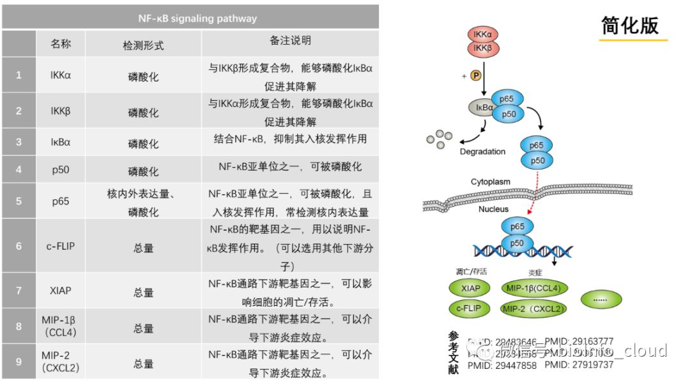

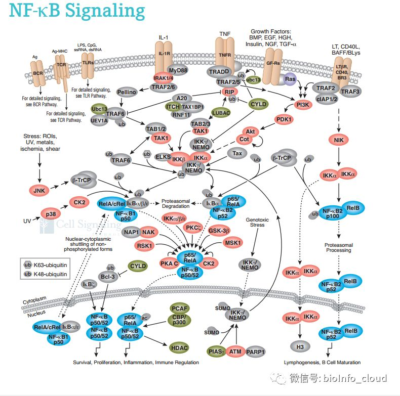

## 2.PI3K/AKT 信号通路

PI3K 是一种胞内的磷脂酰肌醇激酶，具有丝氨酸/苏氨酸激酶的活性， 大家记住它是个激酶。PI3K 也是个二聚体，由调节亚基p85 和催化亚基 p110 构成。 PI3K 上游信号一般是生长因子受体比如 EGFR，引起二聚体构象改变而被激活。 活化的 PI3K产生下一级信号， 改变 Akt的蛋白结构。 活化的 Akt 通过磷酸化作用激活或抑制下游一系列底物如凋亡相关蛋白 Bad、Caspase9 改变，从而调节细胞的增殖、分化、凋亡以及迁移等表型。 大家注意， Akt 也可以激活 IKK， 与 NF-kB 通路存在 cross-talk。Akt 激活了 IKK 就能使 NF-κB 从细胞质中释放进行核转位, 激活下游基因表达。 Akt 很重要， 磷酸化的 Akt 更重要， 所以PI3K 和 Akt 的总蛋白以及磷酸化蛋白都是通路的 Biomarker。 PI3K/AKT 的下游靶点是哺乳动物雷帕霉素靶蛋白（mTOR），也是一类丝/苏氨酸激酶， 有时候这个通路也叫 PI3K/AKT/mTOR。 mTOR的下游转录因子包括 HIF1α、 c-Myc、 FoxO 等，都是如雷贯耳的明星分子。 这里还要留意一个大名鼎鼎的抑癌蛋白 PTEN，PTEN 是一个磷酸酶， 它与 PI3K 的功能正好相反， 可去磷酸化，所以 PTEN 可减少 Akt 的活化而阻止所有由 Akt 调控的下游信号传导事件，是PI3K的负向调节因子。

mTOR既可作为单独的通路，也可与PI3K/Akt通路结合并称为PI3K/Akt/mTOR信号通路，可见其上下游关系具有公认度。该通路是自噬表型中最经典的效应途径，这几年也比较火。

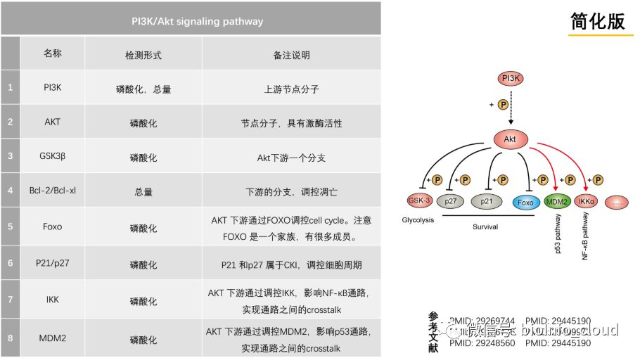

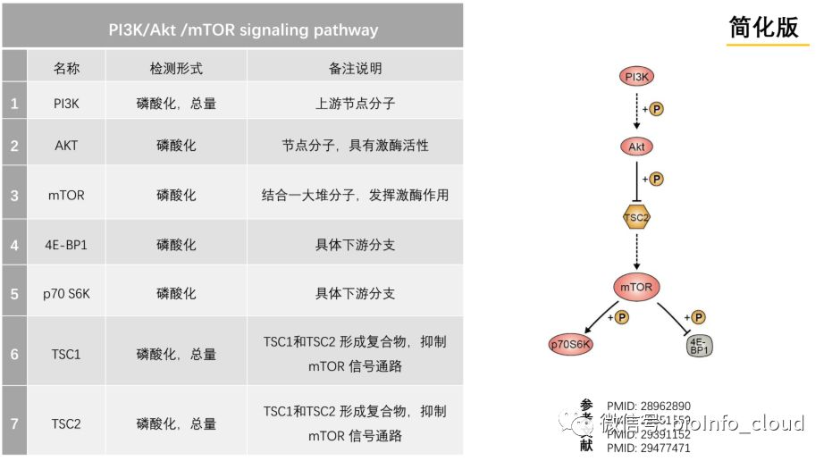

## 3.MAPK 信号通路

MAPK 翻译过来是丝裂原活化蛋白激酶（mitogen-activated protein kinase，MAPK），也是一种丝-苏氨酸蛋白激酶。 细胞因子、 神经递质、 激素等信号都可以激活 MAPK 的激酶活性。MAPK 通路有三级的信号传递过程， 像发射火箭助推点燃一样， 它是三级激酶模式： MAPK，MAPK 激酶（MAP kinase kinase， MEK 或 MKK）以及 MAPK 激酶的激酶（MAP kinase kinase kinase， MEKK 或 MKKK）。 这三种激酶能依次激活， 共同调节着细胞的生长、 分化、 应激、炎症反应等多种重要的生理/病理效应。 MAPK 是通路里最庞大的， 具体信号传导有 4 种主要的分支路线： ERK、 JNK、 p38MAPK 和 ERK5， 文章里经常看到的是前三个， ERK 最明星， ERK5 相对小众一点。 这些分支路线所使用的 MAPK， MEK 和 MEKK 蛋白都是不同的，所以你会听到有人说 ERK 通路， JNK 通路， 或者 p38MAPK 通路， 其实都属于 MAPK 通路这个大家庭。 JNK 和 p38 介导的功能相似， 跟炎症、 凋亡、 生长都有关， ERK 主要管细胞生长、 分化， 它的上游信号是著名的 Ras/Raf 蛋白。 MAPK 几个通路分支的不同激酶都是它们的 Biomarker。

MAPK通路信号传导有4个主要的分支路线：ERK、JNK、p38和ERK5，这些分支路线所使用的MAPK，MKK和MKKK蛋白是不同的，其中Ras/Raf是ERK通路的经典上游信号。

MEK（MAPK/ERK激酶）： MEK分为分子量44kD和45kD的MEK1和MEK2两种。Raf被激活后，它的C端催化区能与MEK结合，并使其催化区第Ⅷ亚区中两个Ser磷酸化，从而使MEK激活。MEK属于少有的双重特异性激酶，使Tyr和Thr两个调节位点磷酸化而激活ERK。

MAPK/ERK: MAPK/ERK是一种Ser/Thr蛋白激酶。多种激酶作用于MEK时，活化的MEK通过其N端区域与ERKs直接连接，催化ERK的亚功能区8“TEY盒”中的Tyr和Thr残基双特异性磷酸化，激活ERK。MEKs不仅仅是ERK的激活物，还可能是ERK在胞浆中的锚定器，当信号通路无活性时，它就将ERK固定在胞浆中，一旦有信号刺激ERKs磷酸化及二聚体化，它就激活ERKs并将其转移到胞核或其它活化位点，再进一步磷酸化下游底物。A.V.Khokhlatchev等人研究ERK2磷酸化后转位入核的过程，发现ERK2是通过磷酸化的ERK2和磷酸化或未磷酸化的ERK2形成同源二聚体转位入核，说明同源二聚体的形成是ERK核转位所必需的。

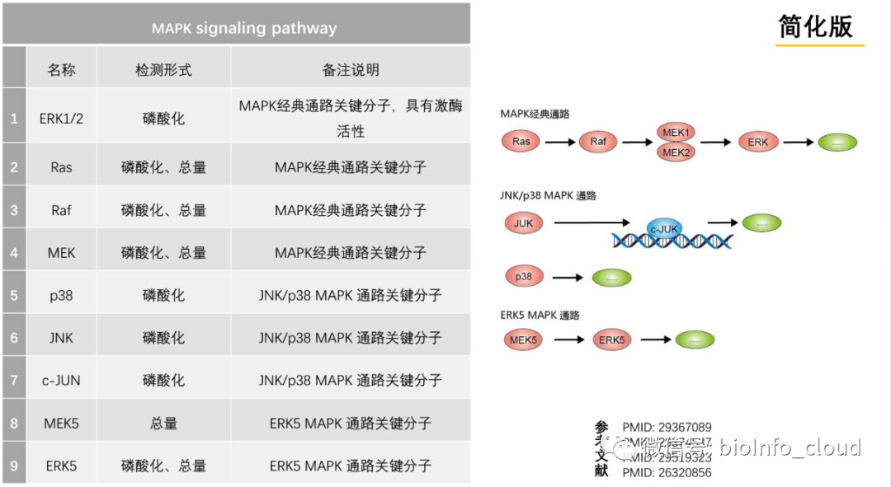

## 4.JAK-STAT 信号通路

JAK-STAT 也是个万金油， 跟细胞的增殖、 分化、 凋亡都有关系， 由三个部分组成： 接收信号的酪氨酸激酶相关受体、 传递信号的酪氨酸激酶 JAK 和产生效应的转录因子 STAT， 通路 的三元件结构很清晰。如果觉得前面几个通路比较麻烦， 先搞清楚 JAK-STAT， 是一个不错 的学习切入点。 许多细胞因子和生长因子通过 JAK-STAT 信号通路来传导信号，这包括白介素 2、 GM-CSF（粒细胞/巨噬细胞集落刺激因子）、 生长激素（GH）、 表皮生长因子（EGF）、 血小板衍生因子（PDGF） 以及干扰素（IFN） 等等。 这些细胞因子和生长因子在细胞膜上 的受体本身不具有激酶活性， 但它的胞内段都跟酪氨酸激酶 JAK 有结合位点。 这一点与其 他通路略有不同， 很多酪氨酸激酶是细胞膜受体， 而 JAK 却是一类非跨膜型的酪氨酸激酶。 当配体和受体结合后可以活化 JAK， 使其发生自身磷酸化， 活化后的 JAK 再作为激酶磷酸 化下游靶蛋白的酪氨酸残基， 实现信号转递。 转录因子 STAT 被招募并且被 JAK 磷酸化修 饰后， 就形成了活化的状态， 活化的 STAT 蛋白以二聚体的形式进入细胞核内与靶基因结合， 调控下游基因的转录。 所以在 JAK-STAT 通路中， 磷酸化的 JAK 和 STAT 蛋白表达都是重 要的 Biomarker。

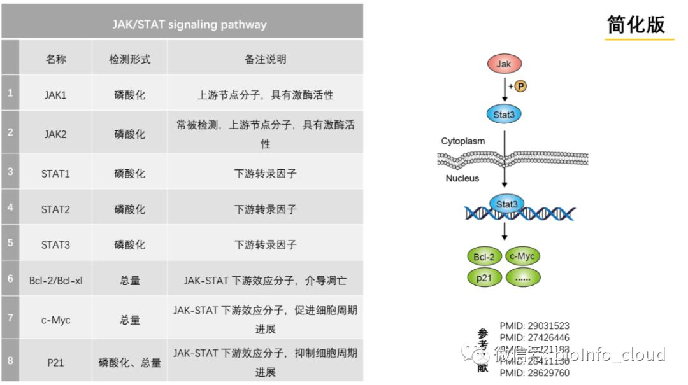

## 5.TGF-β信号通路

TGF 是转化生长因子（transforming growth factor）， TGF-β信号通路经常会称为 TGF-β/SMAD 信号通路， 为什么？ 因为 SMAD 是 TGF-β信号通路的效应转录因子， 就跟 JAK-STAT 中的 STAT 一样。 TGF-β比较复杂的地方是接收信号的 TGF-β超家族有几十个成员， 除了 TGF-β1/2/3， 还有明星分子 BMP（骨形态发生蛋白）。 这样 TGF-β通路的信号来源配体分为 两类， TGF-β和 BMP。 所以说到 BMP 通路其实是 TGF-β通路的一个分支。 TGF-β通路和很 多通路也存在 cross-talk。 要检测 TGF-β通路活性一般检测 TGF-β、 TGF-β的受体、 SMAD 或者是 BMP。

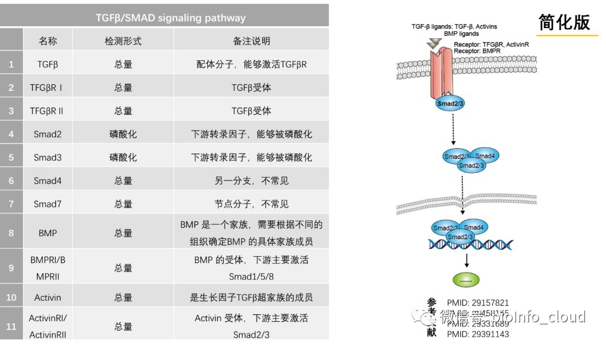

## 6.Wnt 信号通路

我记得七八年前 Wnt 还只是个小众通路， 后面随着上皮间质转化 EMT 研究的热潮， 一下子 火了起来， TGF-β和 Wnt 都是对 EMT 的调节是至关重要的通路。 Wnt 通路分为经典和非经 典两条路径， 一般提到 Wnt 信号通路主要指的是由β-Catenin 介导的经典 Wnt 信号通路。 Wnt 是一类分泌型糖蛋白， 通过自分泌或旁分泌发挥作用。接收 Wnt 信号的是跨膜受体 FZD 蛋白家族， 随后通过下游蛋白激酶的磷酸化作用影响β-Catenin 的降解； Wnt 激活的时候， β-Catenin 的降解活性受到抑制， 胞浆中稳定积累的β-Catenin 进入细胞核后结合 TCF/LEF 转录因子家族， 启动下游靶基因的转录。 所以β-Catenin 是检测 Wnt 是否激活的一个重要 Biomarker。

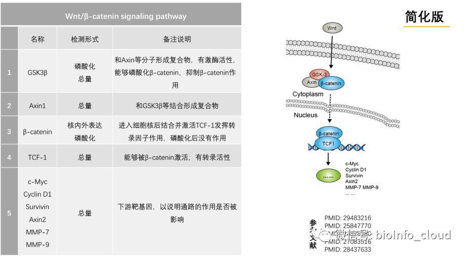

## 7.Notch 信号通路

Notch 跟前几个通路比起来算是小众。 Notch 跟前面讲的通路模式有两个显著区别： 第一， Notch 的受体和配体都是膜蛋白， 它介导的是两个细胞相互靠近接触之后的活化效应， 而不 是由分泌型的蛋白作为配体。 第二， Notch 信号途径不是通过激酶磷酸化逐步活化传递信号， 它是 Notch 通过三步蛋白酶切水解， 一步一步把有转录调节活性的 Notch 蛋白片段释放出来 实现活化。这个切完的具有核定位信号的Notch蛋白片段叫NICD（Notch intracellular domain） 或者 ICN（intracellular domain of Notch）， 翻译过来就是 Notch 的胞内结构域。 NICD 与转录 因子 CSL 结合， 调节下游基因表达。

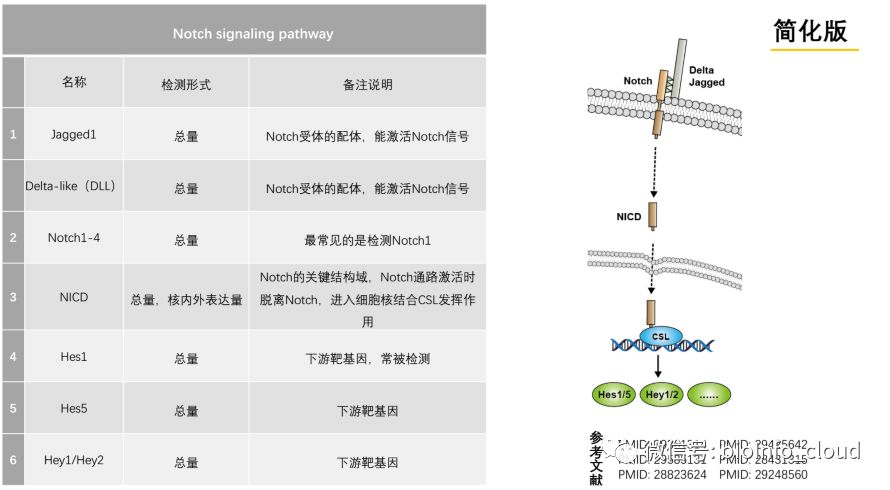

## 8.Hedgehog 信号通路

Wnt、 Notch 经常和 Hedgehog 放在一起说， 因为这三条通路的 cross-talk非常密切。 Hedgehog 通路的配体就是 Hh 蛋白， 需要经过一系列加工才有活性。Hedgehog 通路的受体有两种， 一种是 Ptc， 一种叫Smo。 这个通路的特点是内部具有反馈调节机制，正常情况下， Smo 是 正向激活转录因子， 但另一个受体 Ptc 能抑制 Smo 蛋白活性， 抑制下游通路， 实现自我调 节。 Hedgehog 通路的转录因子是Gli 蛋白家族， 有几种不同亚型， Gli1 是常见的检测对象。 这个通路的配体、 受体、 转录因子一目了然， 没有中间复杂的信号传递过程， 主要是注意它 的反馈调节特点。

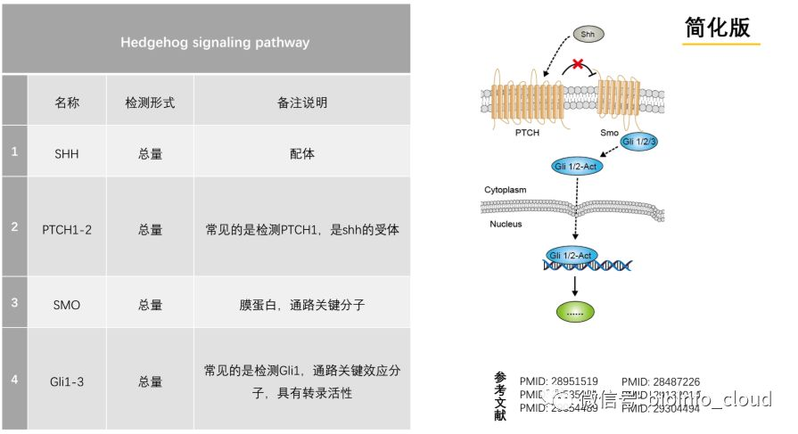

## 9.Hippo 信号通路

Hippo 是信号通路中的新宠， 最先在果蝇中发现 Hippo 参与调控器官大小发育， 后来的研究 发现在哺乳动物的发育过程中有相似功能。现在研究已经证实这条通路还可以调控干细胞自 我更新及组织再生， 与癌症的发生也密切相关。 Hippo 通路结构也不复杂， 由一组保守的激 酶组成， 上游的膜蛋白受体感受到胞外环境的信号后， 经过一系列激酶的磷酸化反应， 最终 作用于下游效应因子 YAP 和 TAZ。 YAP/TAZ 具有转录调节功能， 能对细胞表型精细调控。 Hippo 通路调控细胞的增殖、 分化以及凋亡的机制要么直接作用于这些表型的关键分子， 要 么与其他通路发生 cross-talk， Hippo 跟 Notch、 Wnt、 MAPK 都有交集。 通路之间各种交互 影响千万要习惯， 分子调控是一种网状的形式， 并非线性的， 肯定会产生交叉。

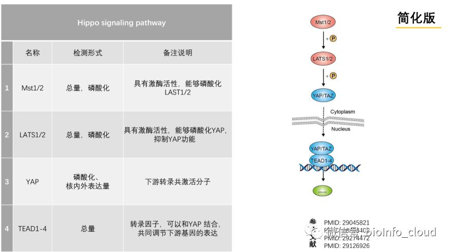

---

如果想了解更多信号通路的相关资料，关注我们，后台回复：**信号通路资料**

> 更新: 2023-09-04 11:41:44
> 原文: <https://www.yuque.com/doublehelix/bioinfonotes/mscfog>
