# 基础科研思路

## 1.疾病和表型

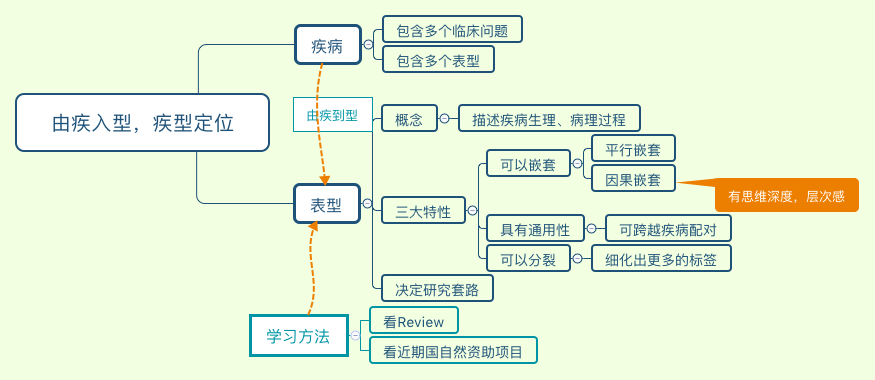

## 2.表型和模型

细胞+动物还有两个非常专业的术语：in vitro and in vivo，就是体外和体内的概念。vitro 和 vivo 都是拉丁文，词源来自希腊语。in vitro 字面翻译是在玻璃里，意思指试管内，也就是体外实验，宽泛点理解，不是在活体中做的实验都是体外，in vitro。vivo 翻译过来就是生物体，in vivo 就是活体内，也就是动物模型。文章里还经常能看到另外一个词，ex vivo，它也有体外的意思，翻译成离体。ex vivo 是有定义的，特指直接活体取材，比如取皮肤、脑组织、肠、心脏、血液等，有时候是一部分动物实验完成后取器官、组织等进行分析叫 ex vivo，还有体外培养细胞体内回输的实验，也是 ex vivo。如果生物材料不是直接取自生物体，是商业购买的经过转化、筛选、永生化等人工处理的细胞株，包括转基因操作过的细胞株都是 in vitro，因为整个实验过程自始至终都在体外。

我直接在 Geenmedical 网站上进行检索（http://www.geenmedical.com）（备注：这个网站检索的结果和 pubmed 上的结果是一致的，并且还自带 IF 影响因子筛选的功能，推荐使用）

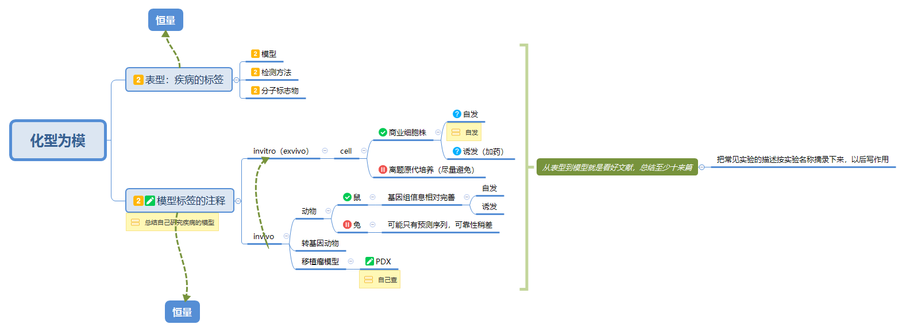

## 3.方法和 Biomarker

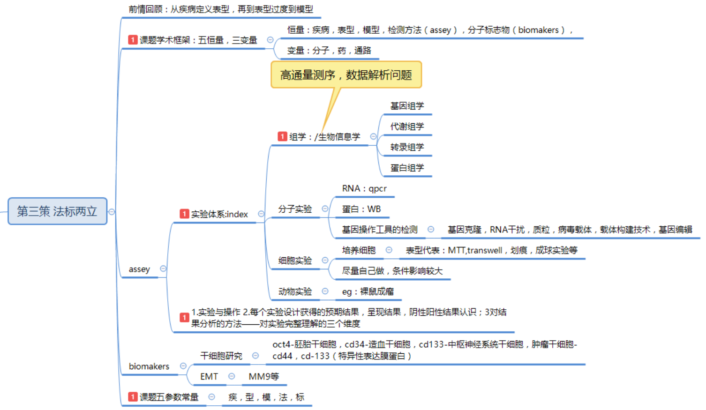

医学基础科研中四个部分的常规实验体系，这样可以建立宏观上的全局理解。第一部分是各种组学实验 omics，组学有四大金刚，分别是基因组学 genomics 和转录组学 transcriptomics，蛋白组学 proteomics 和代谢组学 metabonomics。组学有个好基友，生物信息学，通过生信手段，可以对组学产生的海量数据进行系统分析。在一项研究里，第一步往往是进行筛选，筛选就用到组学，不同组学可以从不同的维度寻找致病的分子靶标。

CD34 被认为是造血干/祖细胞的标志物，神经干细胞可以用 Nestin 蛋白筛选，Nestin 主要表达在中枢神经系统的干细胞上，不在成熟中枢神经细胞上表达。肿瘤干细胞的标记 CD44，CD133。

## 4.目标分子

细胞膜是磷脂双分子层，质粒是 DNA 没法自己穿过去，所以把质粒导入细胞需要一些特定试剂，这一步操作就叫转染 transfection，常用的转染试剂是脂质体，一种高分子的聚合物，与细胞膜有亲和性，可以与膜融合，从而把携带的质粒带进细胞。除了脂质体之外，还有两种转染方式，一种是电穿孔（电转法），就是用电击使得细胞膜打开，还有一种是磷酸钙转染，简称钙转。至于什么细胞用什么转染方式效果最好，这是一门手艺活，用到了再慢慢摸索。我要提醒大家注意几个相似的概念，转染 Transfection，转导 Transduction，转化 Transformation，感染叫 infection 。

RNAi 技术的革命性意义就在于它太便利了，只要合成一段 21 个碱基的 siRNA，转染到细胞里就能对目标基因实现 70% 以上的表达沉默。RNAi 的运作机制是细胞自带的，当 siRNA 进入细胞的时候，会被一个叫 RISC（RNA induced silencing complex）复合体的蛋白结合，然后以序列互补的形式找 siRNA 匹配的 mRNA 靶点，一旦配上就启动核酸内切酶活性把特定基因的 mRNA 降解掉，从而高效、特异地阻断体内特定基因表达。

siRNA 的设计有一些原则，但并不是特别难，一个基因可供选择的 siRNA 序列很多，比如 sigma 网站上就有预设计好的 siRNA 序列，一般来说设计三条 siRNA 总有一条是有效的。

用 RNAi 沉默基因有个术语叫 Knockdown，翻译过来叫敲降或者叫敲减，这是跟基因敲除的 Knockout 是相对应的。RNAi 是个很高效的 loss of function 方法，但毕竟还不是完全功能缺失，还有一些其他的基因编辑方法可以实现基因的 Knockout，在 DNA 水平把基因的编码序列 DNA 破坏掉。比如锌指酶 ZFN 和另一种核酸酶 TALEN，这些分子生物学技术可谓日新月异，当初 TALEN 才热了那么一两年，立马就被 CRISPR 抢了风头，原因是 TALEN 技术做起来比较麻烦，而 CRISPR 改良之后几乎跟 RNAi 一样方便。你就设计一段 sgRNA，跟 siRNA 差不多，然后导入一个 Cas9 核酸酶蛋白，差不多就搞定了。它比 RNAi 就多了一个 Cas9 蛋白共转，过表达 Cas9 的模型细胞其实可以做好了备在那里用，所以真的很方便。

在 2001 年，Science 杂志的一篇文章中第一次出现 microRNA 的概念，micro 就是微小的意思，因为这种 RNA 分子很短，长度只有 20 个碱基左右，所以叫 microRNA。概念的确认是 2001 年，但最早的一条 miRNA 要追溯到 1993 年，在模式生物线虫中被发现的。

siRNA 他是一个研究工具，他是在做基因沉默的时候用来抑制一个表达基因的，而 microRNA 是研究对象，是你研究的靶分子一种类型，miRNA 并不能人为设计好用于做沉默实验，这就是他们之间不同。作为研究对象，miRNA 是内源的，而 siRNA 大部分是外源导入的，虽然内源性的也有，但大家基本碰不到，属于很小众的研究方向。

长链非编码 RNA，Long non-coding RNA, 简称 lncRNA。lncRNA 是长度大于 200 个碱基的非编码 RNA，不编码蛋白，是一种调控性分子。lncRNA 的发现其实比 miRNA 还早，最早是 1990 年在哺乳动物的细胞中鉴定了第一个 lncRNA——H19。

miRNA 作用方式比较简单，lncRNA 就复杂得多了，基本上蛋白能够执行的调控形式，lncRNA 都能参与。比如它可以像转录因子一样，与编码基因上游的启动子区结合，干扰基因表达。它也可以通过与基因之间竞争转录因子的方式导致基因表达的沉默。它可以发挥像脚手架一样的结构作用将两个蛋白连接在一起发挥功能。它也可以与蛋白编码基因的转录本形成互补双链，干扰 mRNA 的剪切，产生不同的剪切形式。还可以通过结合到特定蛋白上，改变该蛋白的活性或胞质定位。LncRNA 和 miRNA 也可以结合，作为 miRNA 的靶分子。它还可以作为小分子 RNA，如 miRNA，piRNA 的前体分子。lncRNA 涉及了基因表达调控的方方面面，所以研究的灵活性很大。

在 lncRNA 之后，还有新的热点，2012 年有研究证实在人细胞的基因表达程序中，环状 RNA 分子（Circular RNAs，circRNA）是一种比线性 RNA 分子更普遍的特征。与传统的线性 RNA 不同，circRNA 分子呈封闭环状结构，不受 RNA 外切酶影响，表达更稳定不易降解。本质上，circRNA 属于 lncRNA 的一个分类，不是一种新的分子类型，正因为它的研究特征跟 lncRNA 一致，所以现有报道 circRNA 也比较全能，参与各种调控过程。在功能上，最主要的一种作用形式是发现，circRNA 分子经常富含 miRNA 的结合位点，在细胞中起到 miRNA 海绵（miRNA sponge）的作用，通过竞争性的结合 miRNA，就解除了 miRNA 原本对它的靶基因的抑制作用，导致靶基因的表达水平上调。这种作用机制还有一个专业的名称，叫竞争性内源 RNA（ceRNA）。ceRNA 不是一种分子类型，而是描述了一种分子调控的机制模式。

## 5.药物

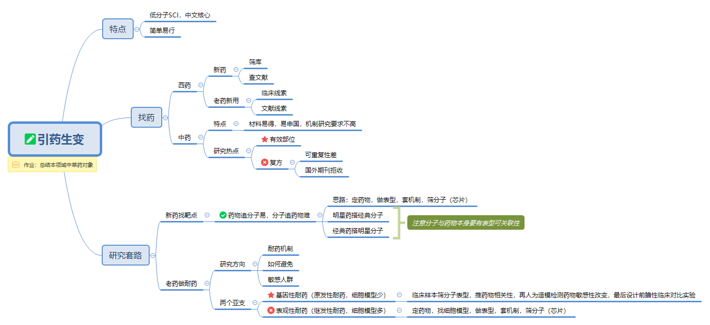

## 6.信号通路
### （1）NF-κB 信号通路

NF-κB（nuclear factor-kappa B）是 1986 年从 B 淋巴细胞的细胞核抽提物中找到的转录因子，历史很久远了，属于通路里的老大哥。NF-κB 是一种重要的转录因子，在炎症、免疫、细胞增殖、分化以及存活过程中扮演重要角色。肿瘤微环境中潜在的炎症会造成 NF-κB 异常激活，更进一步促进癌症侵袭和转移。所以，NF-κB 被认为是炎症和癌症之间的重要纽带。NF 是核因子，κB 是因为它能与免疫球蛋白 kappa 轻链基因的增强子 B 序列特异性结合，促进κ轻链基因表达，因此得名。NF-κB 是一个真核细胞转录因子家族，有多个成员，比较出名的是 p65 和 p50，它们结构中都包含一个约 300 个氨基酸同源结构域。这个高度保守的 domain 能够使得 NF-kB 蛋白形成同源或异源二聚体，这种结构域也是 NF-κB 与靶基因 DNA 序列的特异性结合区域。一般情况下，在细胞质中的 NF-κB 处于失活状态，原因是它的二聚体能与一个抑制蛋白 IkB（inhibitory protein of NF-κB）结合成三聚体复合物。三聚体形式下，NF-κB 没有活性。在信号通路中，转录因子是效应开关，属于下游了，那么它的上游信号是什么呢？NF-κB 通路已知的主要上游信号是肿瘤坏死因子 TNF。TNF 是一种糖蛋白，有两个亚型：TNF-α与 TNF-β。当 TNF 与细胞膜表面的 TNF 受体结合后，受体发生构象改变并且与胞内的下游分子发生相互作用，招募一些蛋白，可以将信号传递给 IKK（IkB kinase）激酶。在 NF-κB 通路里 IKK 扮演了非常重要的角色，尽管上游信号来源有好多条，但是最终都汇集到 IKK。作为激酶的 IKK 能使 IkB 蛋白磷酸化，导致它从三聚体中解离出来，NF-κB 的二聚体就能暴露出核定位序列（nuclear localization signals, NLS），迅速从细胞质进入细胞核内，与核内 DNA 上的特异序列相结合，促进相关基因的转录。但是，之前研究已发现，炎症刺激所诱导的 IKK 活性比 NF-κB 激活所持续的时间长得多，说明可能有一些未知的机制保护 IκB 不被上升的 IKK 磷酸化。NF-kB 的下游基因包括 CyclinD1 和 c-Myc 这些与肿瘤密切相关的蛋白，还有 MMP-9，VEGF 等明星分子。通路的持续激活会导致细胞生长失控，抑制细胞凋亡的功能，促进肿瘤转移和血管新生，涉及表型很多，比较万金油。我们记住其中的明星分子有 p65，p50，IKK，IkB。

### （2）PI3K/AKT 信号通路

PI3K 是一种胞内的磷脂酰肌醇激酶，具有丝氨酸/苏氨酸激酶的活性，大家记住它是个激酶。PI3K 也是个二聚体，由调节亚基 p85 和催化亚基 p110 构成。PI3K 上游信号一般是生长因子受体比如 EGFR，引起二聚体构象改变而被激活。活化的 PI3K 产生下一级信号，改变 Akt 的蛋白结构。活化的 Akt 通过磷酸化作用激活或抑制下游一系列底物如凋亡相关蛋白 Bad、Caspase9 改变，从而调节细胞的增殖、分化、凋亡以及迁移等表型。大家注意，Akt 也可以激活 IKK，与 NF-kB 通路存在 cross-talk。Akt 激活了 IKK 就能使 NF-κB 从细胞质中释放进行核转位, 激活下游基因表达。Akt 很重要，磷酸化的 Akt 更重要，所以 PI3K 和 Akt 的总蛋白以及磷酸化蛋白都是通路的 Biomarker。PI3K/AKT 的下游靶点是哺乳动物雷帕霉素靶蛋白（mTOR），也是一类丝/苏氨酸激酶，有时候这个通路也叫 PI3K/AKT/mTOR。mTOR 的下游转录因子包括 HIF1α、c-Myc、FoxO 等，都是如雷贯耳的明星分子。这里还要留意一个大名鼎鼎的抑癌蛋白 PTEN，PTEN 是一个磷酸酶，它与 PI3K 的功能正好相反，可去磷酸化，所以 PTEN 可减少 Akt 的活化而阻止所有由 Akt 调控的下游信号传导事件，是 PI3K 的负向调节因子。

mTOR 既可作为单独的通路，也可与 PI3K/Akt 通路结合并称为 PI3K/Akt/mTOR 信号通路，可见其上下游关系具有公认度。该通路是自噬表型中最经典的效应途径，这几年也比较火。

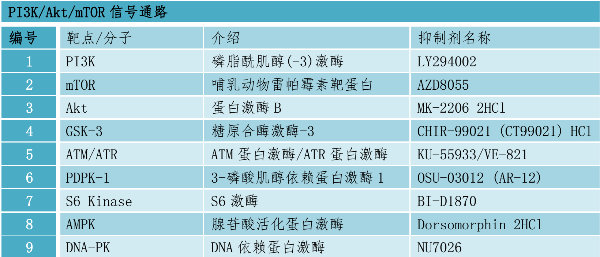

### （3）MAPK 信号通路

MAPK 翻译过来是丝裂原活化蛋白激酶（mitogen-activated protein kinase，MAPK），也是一种丝-苏氨酸蛋白激酶。细胞因子、神经递质、激素等信号都可以激活 MAPK 的激酶活性。MAPK 通路有三级的信号传递过程，像发射火箭助推点燃一样，它是三级激酶模式：MAPK，MAPK 激酶（MAP kinase kinase，MEK 或 MKK）以及 MAPK 激酶的激酶（MAP kinase kinase kinase，MEKK 或 MKKK）。这三种激酶能依次激活，共同调节着细胞的生长、分化、应激、炎症反应等多种重要的生理/病理效应。MAPK 是通路里最庞大的，具体信号传导有 4 种主要的分支路线：ERK、JNK、p38MAPK 和 ERK5，文章里经常看到的是前三个，ERK 最明星，ERK5 相对小众一点。这些分支路线所使用的 MAPK，MEK 和 MEKK 蛋白都是不同的，所以你会听到有人说 ERK 通路，JNK 通路，或者 p38MAPK 通路，其实都属于 MAPK 通路这个大家庭。JNK 和 p38 介导的功能相似，跟炎症、凋亡、生长都有关，ERK 主要管细胞生长、分化，它的上游信号是著名的 Ras/Raf 蛋白。MAPK 几个通路分支的不同激酶都是它们的 Biomarker。

MAPK 通路信号传导有 4 个主要的分支路线：ERK、JNK、p38 和 ERK5，这些分支路线所使用的 MAPK，MKK 和 MKKK 蛋白是不同的，其中 Ras/Raf 是 ERK 通路的经典上游信号。

### （4）JAK-STAT 信号通路

JAK-STAT 也是个万金油，跟细胞的增殖、分化、凋亡都有关系，由三个部分组成：接收信号的酪氨酸激酶相关受体、传递信号的酪氨酸激酶 JAK 和产生效应的转录因子 STAT，通路的三元件结构很清晰。如果觉得前面几个通路比较麻烦，先搞清楚 JAK-STAT，是一个不错的学习切入点。许多细胞因子和生长因子通过 JAK-STAT 信号通路来传导信号，这包括白介素 2、GM-CSF（粒细胞/巨噬细胞集落刺激因子）、生长激素（GH）、表皮生长因子（EGF）、血小板衍生因子（PDGF）以及干扰素（IFN）等等。这些细胞因子和生长因子在细胞膜上的受体本身不具有激酶活性，但它的胞内段都跟酪氨酸激酶 JAK 有结合位点。这一点与其他通路略有不同，很多酪氨酸激酶是细胞膜受体，而 JAK 却是一类非跨膜型的酪氨酸激酶。当配体和受体结合后可以活化 JAK，使其发生自身磷酸化，活化后的 JAK 再作为激酶磷酸化下游靶蛋白的酪氨酸残基，实现信号转递。转录因子 STAT 被招募并且被 JAK 磷酸化修饰后，就形成了活化的状态，活化的 STAT 蛋白以二聚体的形式进入细胞核内与靶基因结合，调控下游基因的转录。所以在 JAK-STAT 通路中，磷酸化的 JAK 和 STAT 蛋白表达都是重要的 Biomarker。

### （5）TGF-β 信号通路

TGF 是转化生长因子（transforming growth factor），TGF-β信号通路经常会称为 TGF-β/SMAD 信号通路，为什么？因为 SMAD 是 TGF-β信号通路的效应转录因子，就跟 JAK-STAT 中的 STAT 一样。TGF-β比较复杂的地方是接收信号的 TGF-β超家族有几十个成员，除了 TGF-β1/2/3，还有明星分子 BMP（骨形态发生蛋白）。这样 TGF-β通路的信号来源配体分为两类，TGF-β和 BMP。所以说到 BMP 通路其实是 TGF-β通路的一个分支。TGF-β通路和很多通路也存在 cross-talk。要检测 TGF-β通路活性一般检测 TGF-β、TGF-β的受体、SMAD 或者是 BMP。

### （6）Wnt 信号通路

我记得七八年前 Wnt 还只是个小众通路，后面随着上皮间质转化 EMT 研究的热潮，一下子火了起来，TGF-β和 Wnt 都是对 EMT 的调节是至关重要的通路。Wnt 通路分为经典和非经典两条路径，一般提到 Wnt 信号通路主要指的是由β-Catenin 介导的经典 Wnt 信号通路。Wnt 是一类分泌型糖蛋白，通过自分泌或旁分泌发挥作用。接收 Wnt 信号的是跨膜受体 FZD 蛋白家族，随后通过下游蛋白激酶的磷酸化作用影响β-Catenin 的降解；Wnt 激活的时候，β-Catenin 的降解活性受到抑制，胞浆中稳定积累的β-Catenin 进入细胞核后结合 TCF/LEF 转录因子家族，启动下游靶基因的转录。所以β-Catenin 是检测 Wnt 是否激活的一个重要 Biomarker。

### （7）Notch 信号通路

Notch 跟前几个通路比起来算是小众。Notch 跟前面讲的通路模式有两个显著区别：第一，Notch 的受体和配体都是膜蛋白，它介导的是两个细胞相互靠近接触之后的活化效应，而不是由分泌型的蛋白作为配体。第二，Notch 信号途径不是通过激酶磷酸化逐步活化传递信号，它是 Notch 通过三步蛋白酶切水解，一步一步把有转录调节活性的 Notch 蛋白片段释放出来实现活化。这个切完的具有核定位信号的 Notch 蛋白片段叫 NICD（Notch intracellular domain）或者 ICN（intracellular domain of Notch），翻译过来就是 Notch 的胞内结构域。NICD 与转录因子 CSL 结合，调节下游基因表达。

### （8）Hedgehog 信号通路

Wnt、Notch 经常和 Hedgehog 放在一起说，因为这三条通路的 cross-talk 非常密切。Hedgehog 通路的配体就是 Hh 蛋白，需要经过一系列加工才有活性。Hedgehog 通路的受体有两种，一种是 Ptc，一种叫 Smo。这个通路的特点是内部具有反馈调节机制，正常情况下，Smo 是正向激活转录因子，但另一个受体 Ptc 能抑制 Smo 蛋白活性，抑制下游通路，实现自我调节。Hedgehog 通路的转录因子是 Gli 蛋白家族，有几种不同亚型，Gli1 是常见的检测对象。这个通路的配体、受体、转录因子一目了然，没有中间复杂的信号传递过程，主要是注意它的反馈调节特点。

### （9）Hippo 信号通路

Hippo 是信号通路中的新宠，最先在果蝇中发现 Hippo 参与调控器官大小发育，后来的研究发现在哺乳动物的发育过程中有相似功能。现在研究已经证实这条通路还可以调控干细胞自我更新及组织再生，与癌症的发生也密切相关。Hippo 通路结构也不复杂，由一组保守的激酶组成，上游的膜蛋白受体感受到胞外环境的信号后，经过一系列激酶的磷酸化反应，最终作用于下游效应因子 YAP 和 TAZ。YAP/TAZ 具有转录调节功能，能对细胞表型精细调控。Hippo 通路调控细胞的增殖、分化以及凋亡的机制要么直接作用于这些表型的关键分子，要么与其他通路发生 cross-talk，Hippo 跟 Notch、Wnt、MAPK 都有交集。通路之间各种交互影响千万要习惯，分子调控是一种网状的形式，并非线性的，肯定会产生交叉。

## 7.找分子 1

要么筛，要么猜；

一次全转录组测序可以获得 mRNA，miRNA、lncRNA 甚至 circRNA 的全面信息。

## 8.找分子 2

有钱筛，没钱猜。

基础科研跟临床完全是两码事，跟临床科研也有大大的不同，临床研究都有规范性要求，写病例报告文章的规范叫 CARE，随机对照研究有 CONSORT 规范，诊断性研究有 STARD 规范等等，

## 9.功能基因研究的经典模式
### 第一步：检测分子的基础表达

表达检测是套路开始的地方，如果说这个蛋白在细胞中有特定功能，那合理推测它应该有一定的表达量，有表达是有功能的先决条件。再严谨一点说，不是有表达就行了，应该是在疾病中有表达的改变才说明功能有意义。如果疾病和正常状态下表达一样，那么哪怕蛋白功能很重要，表达一样就意味着跟疾病发生发展没关系。

mRNA 和蛋白的表达数据一般是一致的，能够相互佐证，出现了不一致，就应该考虑一些特殊的调控机制。

### 第二步：制作过表达或者沉默的载体工具

腺病毒是一种主要用于基因过表达实验的载体，做 RNA 干扰的时候免疫源性比较强，不推荐。慢病毒尤其适合于做 RNAi 实验，当然也是可以用于 CRISPR 实验，对于表达短的插入片段，慢病毒表现不错。

有些基因过表达或者沉默后会启动代偿机制，随着细胞传代基因操作的趋势会越来越不明显。

慢病毒也不全是优点，它的致命缺点是表达大片段的时候，包装效率会大幅降低，而且不同的基因包装效率也有不同，有时候基因不大但出毒效率也低。所以做过表达用慢病毒有一些限制，它基本算是一个标准的沉默载体。

在做过表达方面，腺相关病毒最近几年用到的越来越多了。AAV 不仅可以做表达也可以做干扰，效率都还 OK。

发卡状的 shRNA 正是 siRNA 的前体，在细胞里面会被自动切割加工为 siRNA，而之所以质粒和病毒载体上都会用 shRNA 的结构，是因为 shRNA 表达时候更稳定，发卡结构是一种 RNA 的稳定结构，形成双链对于 RNA 有稳定作用。

实验还需要设置一个阴性对照，在过表达实验里它是空载体，里面没有负载任何基因；在 RNAi 实验里它是一段打乱序列不影响任何基因表达的序列，也就是无效的 siRNA。

### 第三步：用来检测表型功能的实验

表型的体外、体内实验组合，也就是细胞加上动物，这是一个普遍论证规律

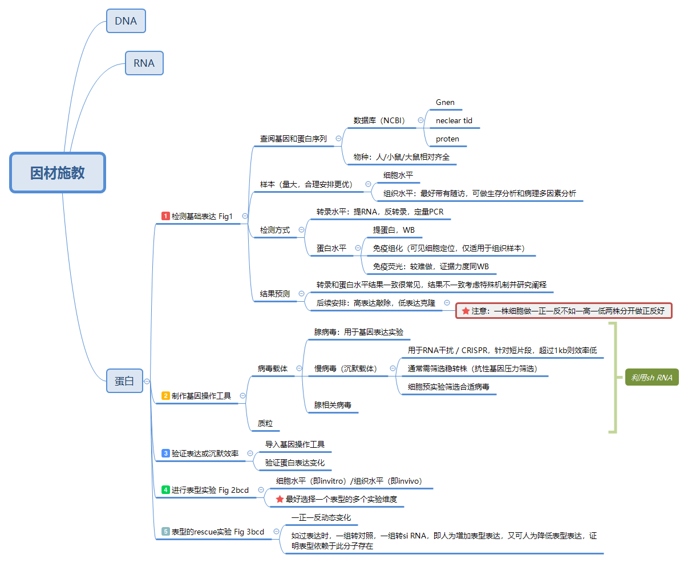

## 10.分子修饰

DNA 水平还有一种天然的变化，叫 SNP，single nucleotide polymorphism。这是一种天然存在的单个核苷酸的变化引起的 DNA 序列多态性。SNP 是人类个体与个体间存在差异的基因学基础，。

SNP 跟突变虽然都是 DNA 序列上的变化，但是有一个显著的区别，在群体中发生频率高于 1％才能定义为 SNP，而致病突变发生频度远低于 1%，注意这一点就能把它们区别开。

对于 DNA、RNA 和蛋白的变化，常用的术语不太一样，蛋白主要变化形式是修饰（modification），氨基酸链不会变，加各种基团。而 DNA 和 RNA 变化会涉及序列变化，序列变了才会影响蛋白功能。DNA 序列变化叫 Mutation，RNA 序列改变既不叫修饰，也不是突变，习惯于叫 editing，编辑。

在 NCBI Gene 数据库检索背景信息的时候发现还有不同的剪切变异体，又叫转录本（isoform）。

人类中最常见的 RNA 编辑类型是把腺嘌呤（A）脱氨基转化为次黄嘌呤（I），英文叫 A-to-I editing。A-to-I 是酶催化的，造成的结果是次黄嘌呤在翻译过程中被识别为鸟嘌呤（G），导致密码子改变，氨基酸变异。

DNA 的甲基化修饰是发生在胞嘧啶（C）上的，而最常见的 RNA 的甲基化修饰是发生在腺嘌呤上，修饰的产物叫 m6A（N6-methyladenosine，6-甲基腺嘌呤）。m6A 甲基化可以发生在 mRNA 上也可以发生在 lncRNA 上，在哺乳动物中发生 m6A 修饰的腺嘌呤比例平均下来频度每条 mRNA 有 3-5 个位点，算比较普遍。通常 m6A 位于 mRNA 终止密码子附近和 3’非翻译区。这种 RNA 甲基化修饰能够在转录后水平上调控 RNA 的稳定性、定位、运输、剪切和翻译，几乎是方方面面都有用。

目前发现在 RNA 甲基化修饰过程中，有三类分子参与其中：第一类是 Writer，负责将甲基化修饰写入 RNA，也就是促进 RNA 的甲基化。最常见的分子是 METTL3 和 METTL14，这两个酶都可以在体外和体内催化 RNA 的 m6A 甲基化。当然不止这两个，催化的蛋白酶复合物里有多个蛋白，一旦发现一个就可以通过蛋白-蛋白相互作用的研究模式把它们都逐一找出来。第二类分子叫 Eraser，负责将 RNA 甲基化修饰信号擦除，也就是介导 RNA 的去甲基化修饰过程。FTO 和 ALKBH5 是两个去除 RNA 上 m6A 甲基化的关键分子。第三类分子叫 Reader：负责读取 RNA 甲基化修饰的信息，可以参与下游 RNA 的翻译、降解等生物学过程。这些 Reader 一般具有识别并结合 mRNA 中的 m6A 位点的特异性结构域，结合上之后经典的作用是能减少 mRNA 的半衰期促使其降解。

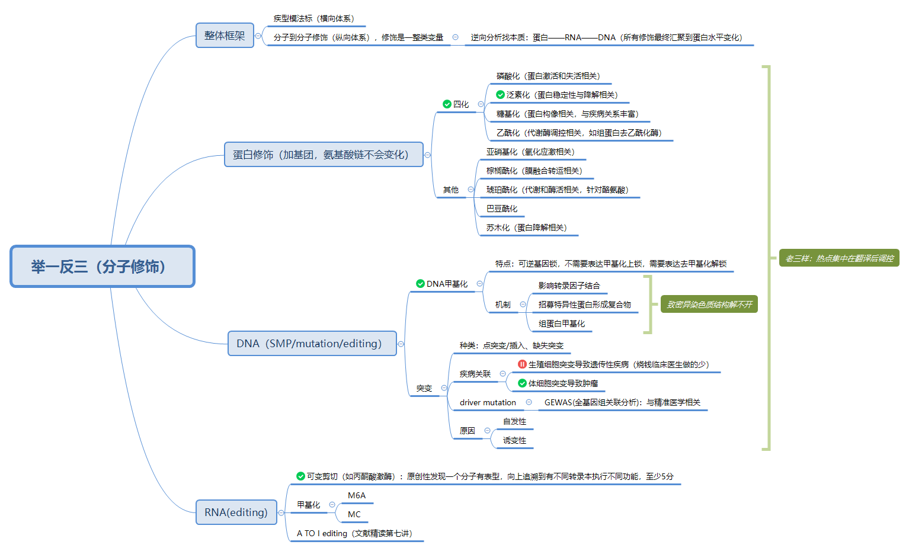

## 11.miRNA

miRNA 结合靶基因的验证只有一个经典实验——荧光素酶报告基因实验（Luciferase Assay），这个实验应该算是机制研究里比较容易做的。miRNA 第一个特征是长度整齐划一，都是 19-25 核苷酸的单链 RNA 片段。

最初转录出来的 miRNA 有几百个甚至几千个碱基长，称为初级转录产物（primary miRNA，pri-miRNA），pri-miRNA 经过二次剪切加工产生约 70-90 个碱基的 miRNA 前体(miRNA precursor，pre-miRNA)。加工初级转录产物到前体的核酸内切酶是 Drosha，这一步发生在细胞核内。miRNA 前体转运到胞浆再被 Dicer 酶切产生 miRNA 成熟体。

成熟的 miRNA 分子要发挥功能，它可以跟一个或多个 mRNA 分子不完全匹配的互补结合，一旦结合上就可以下调基因的表达。miRNA 主要作用位点在靶基因的 3’-UTR，依赖于 RISC（RNA induced silencing complex）沉默复合体发挥作用，这一点也跟 siRNA 一样，在一些文章里也有报道 miRNA 作用于 5’-UTR 和 mRNA 编码区的，但是结合 3’-UTR 是主流。

查询 miRNA 的权威数据库是 miRBase，在预测 miRNA 靶基因方面最权威的数据库是 Targetscan。

如果遇到新发现的 miRNA 跟已有名称的高度同源的情况，序列只差 1-2 个碱基，区分开来没法体现这种序列和功能上的相似性，那就在第一个发现的 miRNA 后加上小写的 a/b/c 这样区分。如果一条 miRNA 可以来源于不同的 DNA 编码区域，也就是在基因组有平行的多个拷贝，那么还要在 a/b/c 后面加个横杠再以数字 1/2/3 来表示。最后一条规则是科学家们发现 miRNA 前体是个茎环结构，加工过程会从 3'或 5'端茎环臂产生最终成熟的 miRNA，但是一般只有其中一条是表达量高的。以前把表达量低的加个*号，后来发现这样不太准确，也有会以“-s”和“-as”来命名，最新的命名规则改用了来源于 5'端的标上 5p，3'端标 3p。这样就形成了物种-miR-数字序号+字母-5p/3p 的名字，一条 miRNA 光看名称就包含了至少 4 条信息，

过表达的基因一般叫 over-expression，如果文章在实验分组里出现一个基因名称或者缩写 OE 的组，就是过表达基因的，但是 miRNA 过表达有个专用名词叫 mimics（模拟物），这一点有区别。同时，做基因沉默时编码基因的分组标注一般是 si-XXX 或者用载体的 sh-XXX，看到 si 或者 sh 你就知道作者在搞 loss of function，而 miRNA 的沉默叫 inhibitor（抑制物），术语上不一样。

miRNA 很小，转染操作较方便，当想用质粒或者病毒做稳定转导的时候，跟做 shRNA 非常相似，也是表达一个茎环结构的发卡状 RNA。一般做 miRNA 表达载体会用前体 pre-miRNA 的结构，胞内经过加工自动成为成熟的 miRNA，而做 inhibitor 的载体就在这个茎环里放上 miRNA 的反义链。

荧光素酶报告基因实验是机制研究中的一个非常经典的实验，五分以上的文章就经常看到了，有两种主要的用途：一个用在 miRNA 靶基因验证，一个用在研究转录因子对启动子的调控活性。用在 miRNA 和转录因子研究里的两套载体是不同的，研究 miRNA 的时候是将需要鉴定的 miRNA 靶基因的 3’-UTR 插入荧光素酶基因的 3’端，转到细胞再过表达 miRNA，如果 miRNA 对靶基因的 3’UTR 是有结合和抑制翻译作用的，荧光素酶表达量会减少，对底物荧光的值就会降低，这样就能获得证据证明 miRNA 与靶基因 3’-UTR 是有结合的。

miRNA 结合靶基因 mRNA 之后影响基因表达的方式主要是两种，一般认为 miRNA 与 mRNA 的 3’UTR 结合后会阻碍翻译过程，但不影响 mRNA 的稳定性，早期发现的 miRNA 都是这种机制，常识认为 miRNA 结合 mRNA 不影响其表达。但随着研究深入，这种认识被颠覆掉了，后续研究报道 miRNA 还可以降解靶基因 mRNA。当 miRNA 与 mRNA 完全互补或者近乎完全互补的时候是可以引导降解 mRNA 的，在植物中就是这样，类似于 siRNA 的机制。

## 12.lincRNA

lncRNA 的研究模式，lncRNA 既然叫 long non-coding，名字就包含了两个关键特征。第一是 long，长，超过 200 个核苷酸；第二是 non-coding，不编码。

查基因用 NCBI 的 Genebank 数据库，查 miRNA 用 miRbase，查 lncRNA 序列也有一个权威数据库叫 Noncode（www.noncode.org）。

用 NCBI 的 ORF finder 工具可以预测 ORF 。

lncRNA 现在发现可以编码形成一些短肽，这是一种比较新颖的作用机制，所以在分析 ORF 的时候发现 lncRNA 能编码短肽序列，就算它没有同源蛋白也不要忽视，做机制的时候可能有用。

还有一种分析非编码 RNA 序列特性的工具叫 CSF（codon substitution frequency scores）——密码子替换频率，它是一种对序列的分析算法，主要是看一段序列编码的密码子在不同物种之间的保守性。非编码 RNA 有个特点，它的保守性是比较差的，因为不编码蛋白，错个把碱基关系不大，所以当 CSF 评分小于 0 的时候，就可以认为它是一个非编码。

第一步，检测基础表达，它是 RNA 没蛋白，就做 RNA 水平检测就好了，实时定量 RT-PCR。但是需要注意 lncRNA 表达一般比 mRNA 低，如果前面有筛选步骤，优先选择表达量高的。用送测序或者芯片的同一批样品来做二次验证，这样验证效果最好，如果换一批样品，批次之间也有分子表达的差异，验证效果就会差一些。除了定量 PCR 还有 Northern-blot 可以检测。也可以用荧光原位杂交（Fluorescence in Situ Hybridization），这个实验在很多 lncRNA 文章里都用，图很漂亮，而且还能知道 lncRNA 的亚细胞定位。有不少 lncRNA 位于细胞核，参与转录调控，这些 lncRNA 后面做基因操作工具的时候就要小心。

第二步，制备基因操作工具，具体小心什么呢，核定位的 lncRNA 你用 RNAi 做，可能效果是很差的，因为 RNAi 主要在细胞浆发挥作用。替代的方式是用现在很流行的 CRISPR 基因编辑技术，直接把 lncRNA 的基因给 knockout 掉。

第三步，细胞表型实验

第四步，动物表型实验也一样。

第五步，表型的 Rescue 实验。你可以把 CRISPR 敲掉后的细胞再过表达 lncRNA 分子进去，跟功能基因的验证策略类似。

第三步，细胞表型实验。

## 13.药物+分子

第一，药物介导表型；第二，药物调控分子；第三，分子跟表型相关，这一条一般是选已知明星分子，所以就不必论证了；第四，阻断了药物对分子的调节，则药物对表型的作用会无效化，也就是被回复。

Rescue 只是验证了分子是必要的环节，至于是间接还是直接，还需要提供更多的研究证据，比如后续研究证实药物能够影响蛋白的泛素化修饰，或者影响 mRNA 的稳定性，或者调控转录的过程。

## 14.药物+分子+通路

三元变量论证可拆解为三组关系：1）药能调分子，2）分子能调通路，3）药能调通路；以及一组必要性论证，即 Rescue 环节——药调节通路依赖分子。其中，药物/分子对表型的调节则相当于 2 组单变量研究。

此外，与表型相关的 Rescue 还有三条：1）药物调节表型依赖于分子；2）分子调节表型依赖于通路，3）药物调节表型依赖于通路。显然，在分子机制研究中，Rescue 优先级是要高于纯粹变量间调控关系的论证（即药物调节通路依赖于分子）。

当这些证据条目再加上两个二元关系的直接作用细节：1）药怎么调节分子；2）分子又怎么作用于通路的，从间接拓展到直接，才能构成一篇顶尖水平的研究论文。

## 15.分子+分子+分子

在分子+分子+分子的三元组合中，其研究方法的主要奥义在于“先下后上”，即先做下游，后做上游。

该组合也是符合三元变量研究的 5 个论证层次：1、主变量介导表型的单变量，2、主变量调节下游因变量，3、上游因变量调节主变量，4、围绕主变量的 2 组 Rescue，5、上下游分子间直接作用机制的 2 组模式。

基因的表达调控具体分为五个层次：1）DNA 水平；2）转录水平，即 RNA 水平；3）转录后水平，因为 RNA 有修饰、剪切；4）翻译水平，即蛋白水平；5）翻译后水平，即蛋白翻译后的修饰调控。这五个水平的任一变化，如表达水平高低、mRNA 和蛋白的构象改变、加基团修饰、形成复合体，都可以引起蛋白功能的改变。

考虑到 DNA 不调控 RNA 和蛋白，RNA 和蛋白可调控 DNA、RNA 和蛋白（其中非编码 RNA 已跟蛋白一样全方位参与分子调控过程，尤其在转录后调控机制中独挑大梁），分子调分子的具体模式则有以下 6 种组合：

1）蛋白调控 DNA：主要指的是修饰 DNA，如甲基化修饰，而甲基化修饰则需要甲基化酶和去甲基化酶。

2）RNA 调节 DNA：lncRNA 也参与并调控 DNA 的甲基化修饰过程。

3）蛋白调控 RNA：转录水平中，最典型的模式就是转录因子；转录后水平，mRNA 转录形成后需要在蛋白作用下进行剪切、修饰等编辑过程。

4）RNA 调控 RNA：lncRNA 可调节转录过程；mRNA 转录后也受到 miRNA、siRNA 等非编码 RNA 调控。

5）蛋白调控蛋白：各种酶促反应。

6）RNA 调控蛋白：蛋白的翻译过程。

但无论上游分子是 RNA 还是蛋白，以及它调节的靶分子是在 DNA、还是 RNA、或者蛋白水平，其研究的方法是不一样的，要分门别类加以整理和学习。

## 16.转录因子直接机制

转录因子有一个显著的结构特征，所以我们才知道有两千多个蛋白可能是转录因子。这个特征是所有转录因子都包含一段 DNA binding domain，也就是 DNA 结合的结构域，这个结构域能够识别和结合 DNA 序列。DNA 是带负电荷的，在 20 种常见氨基酸里精氨酸、组氨酸、赖氨酸这些带正电氨基酸是产生 DNA binding domain 的特异性序列，正负相吸。同时这一段结构域还会形成特定的空间结构，与 DNA 骨架相互匹配。什么样的氨基酸序列和结构喜欢结合什么样的 DNA 序列有一定规律的，这种规律是预测转录因子调控靶基因的理论基础。

要做转录因子的研究，我们还需要熟悉基因的结构。基因是一段 DNA，这段 DNA 可分为编码区和非编码区，编码区叫 CDS，coding sequence，指的是用来编码产生 mRNA 的一段序列。不仅有编码区，基因还有非编码区，叫 noncoding sequence，这跟 noncoding RNA 不一样，noncoding RNA 是指不编码产生蛋白，而 DNA 的非编码区连 RNA 都不编码。这段序列用于执行转录的调控功能，它的位置是位于编码区的 5’端和 3’端的邻近区域，跟编码区挨着，所以这些非编码序列也称之为侧翼序列，flanking sequence。侧翼序列包含了基因的启动子(promoter)、增强子(enhancer)、终止子(terminator) 这些转录调控元件。这其中研究的最多的就是 promoter。启动子里含有 RNA 聚合酶的特异性结合序列，同时可以跟转录因子结合控制基因的转录活性。就像受体和配体是一对搭档一样，转录因子和启动子也是一对搭档，这一点大家需要形成牢固认识。找一个基因上游调控的转录因子，其实是找这个基因启动子序列能够结合的转录因子，而找一个转录因子能够调控的下游靶基因，也是找转录因子能够结合的启动子序列，从而判断它到底调节什么基因。

查启动子序列的话，我推荐另外两个数据库 UCSC 和 Ensembl。UCSC 是 University of California Santa Cruz 的缩写，UCSC 基因组浏览器就是这个大学开发的，里面有多个物种的基因组信息，很全面，检索非常方便。Ensembl 是一个基因组注释的数据库，是欧洲的一个科研项目，是一个整合型的数据库，整合了很多来自于其他数据库的源数据。当你想查突变、转录本、同源蛋白、包括查启动子，用 UCSC 或者 Ensembl 要比 NCBI 好用一点。

启动子并不像基因的编码序列一样，具有特征明确的起点和终点，我们有时候一时确认不了 Promotor 区域有多长，一般选取基因翻译起始位点 ATG 密码子上游至少 1000bp，保险起见 2000-3000bp 的区域作为启动子候选序列，把这段序列拿出来再进行进一步分析。分析启动子可以用 promoterscan 或者 promoterInspector 这两个在线的工具，在百度里面把关键词一搜，网址就出来了。这一步还比较简单，输入序列点一下分析就好了。

明确启动子序列之后，接下来要把它克隆出来，后面的实验里要用到。有些基因的启动子克隆是可以商业化买到的，这就更加方便了。

## 17.甲基化

甲基化的研究就分为 DNA 甲基化和组蛋白甲基化两个细分问题。它们结果是一样的，都是影响基因的转录。

DNA 甲基化是在 DNA 甲基转移酶的作用下将甲基选择性地添加到胞嘧啶上的过程，变成 5-甲基胞嘧啶（甲基加在 5 号碳原子上，真核生物只有这种甲基化修饰形式）。

甲基化的功能主要是调控基因表达，尤其在胚胎发育中甲基化控制着时序性表达的基因（时序性表达即在特定时间阶段表达），甲基化去除之后就像基因解开封印，用完之后再封印起来。

在 DNA 甲基化的世界里，大家重点搞清楚三件事：CpG 岛、甲基化和去甲基化过程中的酶以及甲基化特异性检测方法。

CpG 岛（CpG island）是个术语，是 DNA 发生甲基化的位置，CpG 里的 C 是 DNA 四种碱基之中的胞嘧啶的缩写，p 代表磷酸，G 是碱基鸟嘌呤。CpG 即指 C 后面跟一个 G 的核苷酸序列，而 CpG 岛就是指富含 CG 序列的区域。

基因组 DNA 四种碱基排列，从概率来说，CG 这种连续序列也是常见的排布。在人类基因组内，G 和 C 的含量大约为 40%，A 和 T 比较多，而且 GC 不是平均分布。在某些 DNA 片段位置，GC 局部富集，而在另一些位置出现得较少。正常情况下，散在的 CpG 是被甲基修饰的，属于封印状态。在编码基因的启动子或者其他转录调控区域中，CpG 容易成簇，形成 CpG island。在健康人中 CpG 岛跟散在的 CpG 不一样，它往往呈现非甲基化的状态，也就是解封印，这是转录调控的开关。CpG 岛有严格定义，长度至少 500bp，GC 含量超过 55%，CpG 比值大于 0.65。CpG 比值是个参数，有公式可以算的，需要用到查一下。

人类基因组大概存在 4 万个 CpG 岛，大部分位于启动子区域，启动子 CpG 岛甲基化之后会诱发基因沉默，所以启动子 CpG 甲基化与转录活性呈负相关。CpG 岛的概念之所以重要，是因为研究一个基因启动子 DNA 甲基化就是找 CpG 岛位置，那里是一切故事起源的地方。

第二个重要的概念是了解在甲基化和去甲基化过程中发挥作用的酶和辅助蛋白因子。甲基化是个可逆的酶促反应，目前已知 DNA 甲基转移酶（DNA methyltransferase）有 4 种：DNMT1、DNMT2、DNMT3a、DNMT3b。根据结构和功能上的差异分为两大类: 维持甲基化（maintenance methylation）和从头甲基化（de novo methylation）。维持甲基化以 Dnmt1 为代表，它作用于仅有一条链甲基化的 DNA 双链使其完全甲基化，参与 DNA 复制双链中的新合成链的甲基化。而从头甲基化是对 DNA 链甲基化状态的重构，不依赖于 DNA 复制，是在完全非甲基化的位点上引入甲基。主要参与的从头甲基化酶是 Dnmt3a、Dnmt3b。现有研究表明 Dnmt1 与 Dnmt3a、Dnmt3b 之间还存在交互影响，并非绝对的分工关系。针对 Dnmt2 的认识相对较少，在 DNA 甲基化中不起主要作用，所以平常研究中遇到的机会不多，底物主要是催化 tRNA，虽然底物不一样但催化机制类似。除了 DNA 甲基化酶，我们还需要注意有一类参与甲基化过程的 DNA 甲基化结合蛋白，这类蛋白通过一种保守的结构域，称为甲基化 DNA 结合结构域（methylated DNA-binding domain，MBD），结合甲基化的 CpG。MBD 家族有 MeCP2，MBD1、2、3、4 五个成员。

MeCP2 是最早发现的，甲基化与组蛋白乙酰化之间的联系就通过它。MBD 识别甲基化位点，负责招募阻遏蛋白，抑制转录过程。

有些转录因子直接对甲基化位点敏感的，有甲基化存在就不能结合启动子来影响转录。还有一些转录因子对甲基化不敏感，当启动子上存在 CpG 岛的甲基化，它们的转录抑制就需要 MBD 参与。DNA 去甲基化过程比较复杂，有脱氨酶参与的碱基切除修复途径（base excision repair，BER），还有直接移除甲基化 CpG 的核苷酸切除修复机制（nucleotide excision repair，NER），也可以在酶催化下，氧化或者水解方式去除甲基基团。

要知道 DNA 甲基化是增加了或是减少了涉及第三个问题：甲基化特异性检测方法。作为一个研究历史很长的修饰方式，甲基化的实验检测方法非常多，少说十几种，不过我理了一下，主要有两类：第一类是酶切法，原理是有些核酸内切酶能够识别特异性的甲基化位点，它们切割完 DNA 跑下胶鉴定结果就出来了，再进一步可以用酶切+PCR 的方法鉴定。如果酶切完用电泳方法分离，再用特异性探针进行杂交，这方法就叫 Southern Blotting，酶切法里大家记住 Southern 就好了，既有跑胶分离又有特异性探针的杂交，实验精度更可靠，一度还比较流行。这里 Southern 是检测 DNA 的印迹杂交技术，而检测 RNA 的印迹杂交技术叫 Northern，检测蛋白的，太熟悉了叫 Western 。

第二种检测 DNA 甲基化的方法是 PCR 的衍生技术，PCR 是分子生物学的基础技术，从这个技术衍生出来的 DNA 甲基化检测，其群众基础就更好了，是当前流行的方法。第一种技术叫 MS-PCR（methylation specific PCR），简称 MSP——甲基化特异性 PCR。原理是 DNA 经过亚硫酸氢钠处理后，非甲基化的胞嘧啶会转变成尿嘧啶而甲基化的保持不变，这样设计两对特异性的引物去扩增甲基化和非甲基化的 DNA 结果就出来了。类似的技术还有 BSP（Bisulfite sequencing PCR）：同样用亚硫酸氢盐处理 DNA，设计引物进行 PCR，在扩增过程中尿嘧啶会被识别为胸腺嘧啶，DNA 序列就改变了，对 PCR 产物进行测序就可以获得结果。其他基于 PCR 衍生还有高分辨溶解曲线技术（High Resolution Melting，HRM），检测精度也很高；还可以用带荧光标记的 Taqman 探针做 qPCR，有试剂盒可以直接用。这些检测技术针对的是已知的 DNA 甲基化位点；大规模的 DNA 甲基化位点筛选也有，有 DNA 甲基化组学（Methylome），用基因芯片和二代测序都可以做筛选，跟筛基因差不多。我们比较少直接筛甲基化差异，更多的情况是已有一个主变量，表型做完，上游找机制的时候考虑 DNA 甲基化，这种策略是不需要做高通量筛选的。

具体怎么做？从启动子区找 CpG 岛的过程很简单，CpG 岛是一个序列特性，不涉及复杂的生信算法，用来搜索 CpG 岛的软件有：CpG Analyzer、CpGcluster、CpGFinder、CpG Island Explorer、CpG Island Searcher 等，另外甲基化引物设计软件 Methyl Primer Express 以及 MethPrimer 也有相应的 CpG 岛搜索功能。找到了这些 CpG 岛的位点，接下来用特异性甲基化检测方法比如 MSP，BSP 检测分析就好了。在预测分析这一步，甲基化要比转录因子简单得多，甚至检索启动子序列的数据库也能提供相关的 CpG 岛甲基化位点信息。

我们知道染色质是由核小体组成的，核小体包含 4 种组蛋白 H3、H4、H2A、H2B，组装成 8 聚体的复合物。四种组蛋白内部结合非常紧密，但 N 端会伸向外侧，形成各种组蛋白修饰酶的作用位点。组蛋白修饰主要有两个作用：影响染色质结构从而调控转录，或者作为信号招募转录因子和辅助的调控蛋白。在所有的修饰里，甲基化是目前研究比较清楚的一种组蛋白修饰方式，是由组蛋白甲基化转移酶（Histone methylation transferase，HMT）催化，可以发生在赖氨酸和精氨酸两种氨基酸上。赖氨酸可以 1，2，3 甲基化，也就是分别添加 1 个，2 个，3 个甲基；而精氨酸可以 1，2 甲基化。在文献里看到组蛋白甲基化会觉得有点烦，位点特别多：H3K4、H3K9、H3K27 等让你无所适从。我跟大家讲讲规律，这些组蛋白甲基化位点前面 H3、H4 是组成核小体的组蛋白名称，后面的 K 是赖氨酸缩写，而 R 是精氨酸缩写，氨基酸后面的数字就是第几个赖氨酸或精氨酸的序列位置。有时候 H3K4 后面还会跟 me1，2，3，这是 1 甲基化，2 甲基化和 3 甲基化，加一个两个三个甲基的区别。

## 18.生物数据库和生物信息学软件

数据库索引网站，叫 Omictools（https://omictools.com/）

## 19.核酸交互作用

编码蛋白的基因有启动子，非编码 RNA 像 miRNA、lncRNA、circRNA 也有，这个模式反过来，当转录因子是上游的因变量时，主变量是不限分子类型的，转录因子可以调节任何类型分子的转录过程，包括编码基因和非编码 RNA。

RNA 与 RNA，或者 RNA 与 DNA 的交互，模式是核酸之间的互补结合，这种搭配的主变量是现在流行的非编码 RNA。以 miRNA 为例，当主变量是 miRNA，其靶基因因变量应该是一个 RNA，可以是编码蛋白的 mRNA 的 3’UTR，也可以是另外一个非编码 RNA（lncRNA 或 circRNA 都可以）。用来预测 miRNA 靶基因的网站，预测 miRNA 与非编码 RNA 的结合也可以做，所以无论 miRNA 结合的对象具体是什么分子类型，它结合的对象就是 RNA。另外当主变量是 lncRNA 或者 circRNA 的时候，因变量反过来也可以是 miRNA，所以 RNA 结合 RNA 主要就是非编码 RNA 在唱戏。lncRNA 和 circRNA 都可以参与调控转录的过程，可以竞争性结合启动子 DNA 序列导致转录因子结合不上去，这是 RNA 与 DNA 的交互。

miRNA 其实并不专一，一条 miRNA 可以同时结合多个靶基因，反之这些被结合的靶基因也可以一条 RNA 结合多个 miRNA，形成一个网络状的调控关系。当一个 miRNA 同时结合 2 个靶基因的时候，这两个靶基因是存在一种竞争关系的，因为同一时间与 miRNA 配对的只能是一条，有你没我，这样的调控模式叫竞争性内源 RNA。英文术语 competitive endogenous RNA / competing endogenous RNA，意思一样，缩写 ceRNA。ceRNA 不是一种分子类型，它是一套机制模式。

当 lncRNA 作为伴侣分子参与到第一种蛋白-DNA 的相互作用，也形成了一种三元结构，这个 story 讲的是一条 lncRNA 对于某个转录因子调控靶基因是不可或缺的，一手牵两头起到了引导的作用。当 lncRNA 作为伴侣分子参与到第二种蛋白-蛋白的相互作用，对于两个蛋白结合起到分子骨架的作用，这也是不可或缺的。

## 20.蛋白互作

3 个实验方法：一个是质谱，是用来鉴定蛋白的，相当于查蛋白身份证。每个蛋白都有其唯一的身份证号，可用质谱鉴定。另外一个关键的实验叫 co-IP——免疫共沉淀。最后一个叫 pulldown。RNA 结合蛋白还会有 RNA 结合蛋白免疫沉淀，RIP。

IP 全部都是 Immunoprecipitation 的缩写，immuno 是免疫，precipitation 是沉淀。免疫指的是抗原抗体相互结合反应，而沉淀是说结合之后把东西富集下来。IP 的核心原理是利用特异性的抗体，识别和结合目的蛋白，然后将它富集沉淀。因为同时被富集下来的还有与目的蛋白有结合的其他分子，所以这一步也是研究蛋白互作的必要路径。只要涉及到蛋白跟其他分子结合，对象包括 DNA、RNA 和蛋白，IP 免疫沉淀就是最基本的实验手段。

抗体属于免疫球蛋白，里面有一个氨基酸序列叫 Fc 片段。有一种蛋白来自于一种细菌，金黄色葡萄球菌里面叫 protein A 的蛋白，它与免疫球蛋白的 Fc 段有特异性结合的性质，相当于抗体的抗体，跟各种抗体都能结合，具有通用性。我们用 Protein A 就可以实现把结合了抗体的目的蛋白给拉下来的目的，这样一个 IP 体系就构成了。protein A 结合抗体，抗体再结合靶蛋白。protein A 一般买回来就跟琼脂糖珠交联好了，除了 protein A 常用的还有 Protein G，两者在不同物种的抗体上亲和力略有不同，做成珠子比较方便分离，现在更流行用磁珠。

琼脂糖珠不能叫琼脂糖珠，得叫 Agarose beads，磁珠得叫 Magnetic beads，才显得你很专业，像 protein A 如果你叫蛋白 A 就透露出一股浓浓的乡土气息。

买回来的 beads 就跟 ProteinA 是交联好的，最终 beads 结合 Protein A，proteinA 结合抗体，抗体结合目的蛋白，把目的蛋白沉淀下来，这就是免疫沉淀了。免疫沉淀是一种捕获目的蛋白的方法，可以用来纯化蛋白。比如 Western blot 实验里抗体特异性不好，背景噪音很强，就可以在 Western 之前加一步 IP 富集。也可以用于阴性富集把你知道的某个杂质蛋白去除。另外比较常见的一种应用是 IP 拉下来目的蛋白之后去打质谱，这样可以分析蛋白是否有磷酸化、甲基化、糖基化、乙酰化等修饰作用。在没有针对修饰的特异性抗体的情况下，也可以检测蛋白修饰。

co-IP 多了个 co 就变成了共沉淀，co-IP 是用 IP 的原理去富集蛋白复合物，鉴定与我研究的靶蛋白存在相互作用的蛋白，这个实验是专门用来研究蛋白-蛋白结合的。实验的原理是在裂解细胞的时候我们不把蛋白变性，保留它的天然构象，那么理论上胞内的蛋白-蛋白相互作用就可以保留了下来。当用固定 beads 上的 protein A 去拉免疫沉淀的目标蛋白的时候，与目标蛋白在体内结合的其他蛋白质也能一起沉淀下来。随后进行变性分离，用另一个蛋白的抗体 Western blot 检测，就能证实相互作用蛋白了。IP 是把靶蛋白富集沉淀下来，co-IP 是检测拉下来的蛋白复合物里面其他结合的蛋白存在。这是两个实验在目的上的不同。co-IP 结果表现形式也是 Western blot 的图，所以你在文章里一看到跟 Western 差不多的图，但是有 IP、IB、input 的标注，那就是典型的 co-IP 结果，说明作者在研究蛋白相互作用，属于直接作用机制的范畴。Input 是什么？一个成功的 Co-IP 实验需要证明靶蛋白和预测的相互作用的蛋白存在于免疫沉淀完了的蛋白样品中，这个沉淀完的蛋白样品就称为 Input。我们需要证明 input 中同时有两个蛋白的存在，用于沉淀靶蛋白的抗体叫 IP 抗体，所以文章里 IP 后面标的名字，就是告诉你用了什么蛋白抗体包被 beads 去拉的。IB，B 是 blot，是指用什么抗体去检测沉淀下来的蛋白。

co-IP 实验并不容易驾驭，除了要双向拉，co-IP 结果要可靠还需要设置几种阴阳性参照，比如只加 beads 不加 IP 抗体的阴性对照，再比如用没有特异性结合的 IgG 来替代 IP 抗体的阴性对照。当然也需要设置阳性对照，A 抗体做 IP 拉下来的沉淀，检测 B 的时候用 A 的抗体做 Western 检测，证明 IP 的效果是 OK 的，这些对照无疑增加了实验结果中分组的复杂性，导致文章里这样的图很难看懂。

Tag 标签：Tag 在蛋白研究中使用非常广泛，学习蛋白互作的时候必须掌握到。什么叫 Tag？不复杂，是过表达蛋白的时候在载体上目的基因编码区的 N 端或者 C 端（5’端或 3’端）加上一段氨基酸序列，形成融合蛋白。加上去的这段多肽能产生特征性的标志，凡是带这个标志的就是我们外源表达的蛋白，这感觉上很像电影谍战片里经常看到的追踪器，到哪都能监视你。这段序列一般比较小，所以不会影响目的蛋白的功能，巧妙就巧妙在虽然小，但是能构成表位供特异性的抗体识别。这样就算没有目的基因的抗体，利用标签的抗体也能够将目的蛋白进行纯化和检测。

在蛋白互作的研究中，Tag 应用的是非常普遍的，IP 的时候用 Tag 的抗体也能够把带标签的蛋白给拉下来。比较常见的标签有 His、Flag、HA、Myc 四种，His 是 6 个组氨酸组成的，Flag 是 8 个氨基酸，HA 是 9 个氨基酸，Myc 标签是 10 个氨基酸，都很小。还有其他一些常用标签，片段长一点而且带有功能的，其中最重要的是 GFP，绿色荧光蛋白。还有 eGFP，前面加个 e 是 enhanced，增强型绿色荧光蛋白。

如果一个蛋白与另外一个蛋白发生结合，有一个重要的实验结果可以提供佐证，就是研究蛋白共定位，结合的两个蛋白必然物理空间上是接近的。有两种方法可以做共定位，一种是免疫荧光实验，用二抗来携带荧光探针，两个蛋白分别用两种颜色，红绿叠在一起显黄色就证明是共定位了。另外一种就是把两个蛋白分别做成绿和红的两种融合蛋白，然后看胞内表达定位情况。

像 GFP 这样的蛋白也被叫做 Reporter（报告基因）。His、Flag、HA、Myc 只是标签，而 GFP、RFP 既是标签也是 Reporter，luciferase（荧光素酶），同样属于 Reporter。

GST（谷胱甘肽巯基转移酶），它的特性，第一是能够把融合蛋白变成高度水溶性的蛋白。第二可以特异性结合谷胱甘肽，方便纯化融合蛋白，第三要去除融合蛋白中 GST 融合部分，可用位点特异性蛋白酶切除，很方便。第四它也是标签，也可以用 GST 特异性抗体来检测。

提到这个标签是因为做蛋白-蛋白相互作用的时候除了 co-IP，另一个经典的实验就是 GST pull-down。pulldown 里面最常用的 tag 是 GST，主要是利用了 GST 与底物结合特异性非常高的特点。

GST pull-down 是这么做的，先用基因重组的方法构建一个 GST 和目的基因的融合蛋白，把 GST 融合蛋白与谷胱甘肽的特异性结合，制备到固相载体也就是层析柱上，这相当于一个钓鱼竿上挂上了诱饵，在 pulldown 里有个专门的词叫 bait。接下来把细胞裂解液通过层析柱，这时相互作用蛋白就能被吸附，然后换个溶液洗脱就得到了互作蛋白。pulldown 可以用于筛选，洗下来的互作蛋白打质谱鉴定能知道是什么东西，也可以用于已知的相互作用验证，拉下来之后做 Western 也是可以的。所以 pull-down 的图在文章里出现的时候也是 western 结果，以细胞裂解液作为 input，以单纯 GST 没有融合目的基因的作为阴性对照，以 GST 融合蛋白作为 bait，以相互作用蛋白的特异性抗体作为 blot 检测的抗体，能产生杂交的阳性信号就说明有相互作用。pull-down 是将目的蛋白固定在一种基质材料上，当细胞裂解液经过该基质的时候与固定在载体上的蛋白发生相互作用的蛋白被吸附，而没有被吸附的杂质洗脱流出，相当于层析技术，结合的蛋白后面用溶液再洗下来就可以 western 检测了。pull-down 也可以用在体外寻找可能与目的蛋白有相互作用的靶蛋白，洗脱完一样是后面接质谱鉴定。

做蛋白互作的方法其实很多，常见的还有酵母双杂交 Y2H、噬菌体展示 Phage display、表面等离子共振 SPR、荧光共振能量转移 FRET、还有蛋白芯片。但是只需要记住蛋白蛋白相互作用，重点掌握的质谱，co-IP 和 GST pulldown 三种技术就够了，质谱用来鉴定蛋白，研究互作主要是后两种。

筛选之后一定有很多蛋白，全部买抗体很贵，这时候可以先用外源性 co-IP 验证一轮。外源性 co-IP 是把目的基因用一个标签，比如 His tag 构建融合表达载体，然后候选的几个结合蛋白都用另外一个标签，比如 Flag 也构建成融合表达载体，一起转染一个工具细胞，然后用标签抗体 His 和 Flag 来互拉。这样可以用标签抗体完成全部候选蛋白验证，很方便也很便宜。外源 co-IP，因为两个蛋白都是外源导入细胞的，当然信号比较强。这一步验证成功后再去订购特异性抗体做内源的 co-IP，内源验证是在靶细胞里用目的蛋白的抗体和候选结合蛋白的抗体进行互拉。

在 co-IP 沉淀的复合物里，我们只能用 western 证明有结合蛋白存在，不能证明是否直接结合，也可能是通过第三者蛋白介导，所以比较严谨的话，还要做一个 GST-pulldown 证明是直接相互作用。pulldown 是用 bait 来钓鱼，跟 co-IP 共孵育不一样，没有形成多蛋白复合物的充分条件，pulldown 能结合上那就说明是直接结合。

## 21.ceRNA 互作

RNA-RNA 交互的升级就是 ceRNA 的调控网络，把两套 RNA-RNA 交互作用叠加在一起就成了 ceRNA，其中有一个 RNA 是共用的，是 miRNA。一个 miRNA 两个靶基因，一共三个变量，构成 ceRNA 的基本框架。

ceRNA 概念的提出是源自 2011 年 cell 上的一篇文章，A ceRNA hypothesis: the Rosetta Stone of a hidden RNA language?，题目翻译过来是一个隐藏着 RNA 语言的 Rosetta Stone。你看看，到了 cell 这个级别，作者的装逼能力已经突破天际。Rosetta Stone，什么石碑，必有典故。我跟大家一样，也不知道具体是什么典故，所以特意去查了下。Rosetta Stone 是保存在大英博物馆的一块石碑，制作于公元前 196 年，上面记载着古埃及国王托勒密五世登基的诏书。这块石碑是 1799 年，拿破仑时期，法军在占领的埃及城市 Rosetta 挖到的。在 1801 年拿破仑的军队被英国人打败，这块石碑到了英国人手上，从 1802 年开始收藏于大英博物馆，被称为镇馆三宝之一。这块石碑为什么重要呢？因为它是古埃及文明的重要象征，古埃及的文字一度失落了一千多年，没人会解读。这块石碑上用希腊文、古埃及文和当时的通俗文字记录了同样的内容，为法老歌功颂德。因为希腊文是一直流传下来的，这样的一块石碑就使考古学家有机会通过文字对照，解读出埃及象形文的意义与结构，从而重新掌握了这种文字。回过头来再看，一个科学家用这样的寓意起作自己文章的题目，装逼水平已经到了出神入化的境界。

ceRNA 本质上是 miRNA 作用机制的升级，把它从单机版变成网络版。miRNA 通过与 mRNA 的 3'UTR 结合抑制蛋白翻译表达，这个领域从 2001 年开始，最初也是 CNS 上报道，随后大量发现了 miRNA 就很普遍了。后续研究证实单个 mRNA 可能受到多个 miRNA 的调控，而单个 miRNA 也能调控多个 mRNA，形成一个网状的结构。那么问题来了，如果两个 mRNA 它们的 3’UTR 能结合同样的 miRNA，它们之间会不会有调控关系呢？理论上说，A 表达多了之后，能够竞争性结合 miRNA，然后就导致结合 B 的同样的 miRNA 减少，这样 B 的表达就上升了，所以 A 和 B 之间应该存在表达的正相关性。

ceRNA 不是指一个分子，而是 RNA 与 RNA 之间多元调控的一种交互模型。一个 miRNA 结合的靶基因可能有上百个，而 mRNA 的 3’UTR 和大量的非编码 RNA 上，也有远远不止一个的 miRNA 识别元件，miRNA recognition elements(MRE)，或者叫 miRNA binding sites，miRNA 结合位点。

miRNA 结合靶基因被证明是依赖于 RISC 蛋白复合体的，RISC 复合体中有个关键催化组分蛋白叫 AGO2。有一种思路是利用 AGO2 的抗体把复合物免疫沉淀下来，再把结合在其中的 miRNA 和其他 RNA 送去测序，这样的高通量研究就表明参与 ceRNA 调控网络的基因数量非常庞大。

Dicer 是 miRNA 从前体加工成成熟体必须的酶，Dicer 缺陷的细胞是 miRNA 缺失的，这也相当于是一种阻断策略。

## 22.RNA 和蛋白

首先从 DNA 开始，基因水平有 DNA 的甲基化，这其中 lncRNA 是可以调节的。甲基化需要蛋白酶催化，lncRNA 可以起到穿针引线的作用，这是第一种。接下来对转录因子以及其他转录调节蛋白的作用主要是两种：招募（recruitment）和抑制（inhibitor），招募不一定是促进转录，抑制也不一定是抑制转录，万一招募和抑制的是转录的负调节因子，就正负得负，负负得正了。转录过程对蛋白的招募和抑制是二和三了。第四种调控模式，lncRNA 转录出来也可以直接结合旁边的 DNA 序列，结合了能抑制转录。这跟前面二和三的不同在于不依赖于蛋白，是核酸之间直接结合，是比较独特的一种形式。还有，转录不仅仅是转录因子和 DNA，主要催化的是 RNA 聚合酶，lncRNA 也可以影响转录复合物以及 RNA 聚合酶的催化活性，这就有第五种了。转录还需要染色质结构的解开才能进行，影响染色质结构的组蛋白修饰包括甲基化、乙酰化，都有 lncRNA 的参与，影响了这些组蛋白修饰环节一样可以调节转录。数一数，从 DNA 到 RNA 就有 6 种形式的调控模型了，都是围绕转录水平的细化。lncRNA 可以影响 mRNA 的前体加工成熟的过程，这是第七种了。mRNA 加工成熟后需要转送到细胞质进行蛋白翻译，mRNA 的定位也会受到 lncRNA 影响，相当于原本路口红绿灯控制着，交警来了可以用手势来干预，mRNA 转运是一套标准流程，这套流程能被 lncRNA 调控，是第八种。下面，mRNA 的稳定性同样受到 lncRNA 调节，lncRNA 可以结合 mRNA 的 3’UTR 诱导 mRNA 降解，很像 miRNA，miRNA 就是在这个步骤起作用。lncRNA 还可以结合蛋白，再靶向结合 mRNA 的序列，促进 mRNA 的稳定性。好全面，正反都能干。影响 mRNA 稳定性是第九种调控路径。到了翻译环节，lncRNA 可以结合 mRNA 的 5’UTR，非翻译区，促进翻译过程。它也可以结合特定的蛋白，然后靶向 mRNA 抑制翻译，又是正反都能干，这已经是第十种了。在翻译后修饰方面，JAK-STAT 信号通路的明星分子 STAT3，它的磷酸化就受到 lncRNA 的调控。调控蛋白翻译后修饰，第十一种。翻译后修饰的类型多了去了，看到文章里把 lncRNA 掺和进去做什么修饰都不要奇怪。最后，lncRNA 还能调节蛋白的细胞定位，定位也会影响功能，这就十二种了。

Signal，信号分子，这包含了 lncRNA 特有的跟蛋白不一样的作用形式，lncRNA 因为是 RNA，它能够一转录就起到调控作用，效率要比蛋白高。蛋白需要编码翻译了之后，从胞浆再运送到细胞核内，才能参与转录调控，而 lncRNA 转录出来之后可以直接结合染色体中邻近位置的 DNA，调节基因表达。这种自产自销的模式还有个专业的分子生物学名称，叫顺式调控，cis-regulation。lncRNA 当中的一些分类，比如反义 antisenselncRNA，以及 eRNA（enhancer RNA）主要就是这种顺式作用模式。从分子相互作用的角度，signal 一般是 RNA 结合 DNA，signal 强调的是 lncRNA 本身是信号传递中的一个必要环节，当然并不仅限于 RNA 与 DNA 的互作，跟蛋白互作也是兼容的。

ceRNA 就是 lncRNA 发挥 decoy（诱骗）作用的典型，属于 RNA-RNA 直接结合的 decoy。当然作为竞争性结合的模式，lncRNA 也可以 decoy 蛋白，比如说转录因子，让它误以为自己已经结合到调控的 DNA 序列了——其实并没有，人家 DNA 还在苦苦等待被翻牌。

第三种机制模型叫 Guide，引导员。Guide 是 lncRNA 一手拉转录因子，一手利用碱基互补配对结合 DNA，引导它们靠近发挥调节作用。从分子结合的角度，这里面包含了 RNA-DNA 以及 RNA-蛋白两种结合。

第四个是 scaffold，结构骨架，指的是一个 lncRNA 充当蛋白复合体的骨架，连接多个蛋白，从分子类型来说它也属于 RNA 和蛋白结合的范畴。scaffold 和 guide 都可以结合蛋白，甚至 decoy 也可以结合蛋白，区别是什么？经典的 Guide 模式可以连接 DNA，而 scaffold 没有结合 DNA 的戏，只结合蛋白。decoy 竞争的蛋白，它本来是有一个其他的结合对象的，scaffold 模式中没有。

总体来说 RNA-蛋白分子交互有两种情况：1）已知 lncRNA 找互作蛋白；2）已知蛋白找互作的 lncRNA。从已知 lncRNA 找结合蛋白的实验方法叫 RNA pulldown，跟 GST-pulldown 原理差不多，捕获 lncRNA 可以用一条互补的合成的 RNA 探针，探针上人为加上生物素 biotin 的标签，然后用链霉亲和素（Streptavidin）的 beads 结合 biotin，这样 RNA 的 bait 就做好了，接下来一样亲和层析，换溶液洗脱，洗下来的结合蛋白去打质谱鉴定，跟蛋白-蛋白相互作用大同小异。

lncRNA 和蛋白互作预测的专门数据库也是有一些的，比如 catRAPID(http://service.tartaglialab.com/page/catrapid_group) ,这是一个专门用来分析和计算蛋白与 ncRNAs 相互结合能力的数据库，根据二级结构、氢键、范德华力等参数来预测蛋白-RNA 的结合关系。转录因子结合启动子预测的 JASPAR 数据库是根据 DNA motif，也就是蛋白爱吃什么 DNA 的口味来预测的，是根据序列特征。

Omics 用于预测某一个 lncRNA 的结合蛋白，或者某一个蛋白的结合 lncRNA，也就是说可以从 RNA 出发，也可以蛋白出发，只需知道 lncRNA 的核苷酸序列或蛋白氨基酸序列就可以了，circRNA 也可以做。

RNA Pull-down：通过体外转录 RNA 并用生物素进行标记，然后与胞浆蛋白混合物共同孵育形成 RNA-蛋白质复合物，然后用链霉亲和素标记的磁珠分离纯化该复合物（利用生物素与链霉亲和素的非共价亲和作用），洗脱后进行检测，如果检测蛋白为已知蛋白可通过 WB 进行鉴定，如果检测未知蛋白则可以结合质谱进行鉴定。流程为提取细胞胞浆蛋白样品液→体外转录合成生物素标记 RNA→共孵育→磁珠纯化→洗脱得到互作蛋白→WB 或质谱鉴定。

DNA Pull-down：通过合成标记有生物素的 DNA 片段，与细胞核蛋白混合物共同孵育形成 DNA-蛋白质复合物，然后用链霉亲和素磁珠纯化，WB 或者质谱进行检测鉴定。流程为提取核蛋白样品液→合成生物素标记 DNA→共孵育→磁珠纯化→洗脱得到互作蛋白→WB 或质谱鉴定。

胞内 RNA 与蛋白质结合情况的验证：RIP，RNA 结合蛋白免疫沉淀（RNA Binding Protein Immunoprecipitation, RIP）的基本原理是使用目标蛋白的抗体捕获内源性的 RNA-蛋白的复合物，然后通过免疫沉淀的方法把 RNA-蛋白复合物一起分离下来，然后通过 RT-PCR、RIP-Seq（高通量测序）或 RIP-Chip（microarray）来鉴定结合的 RNA 序列。RIP 流程如下图：

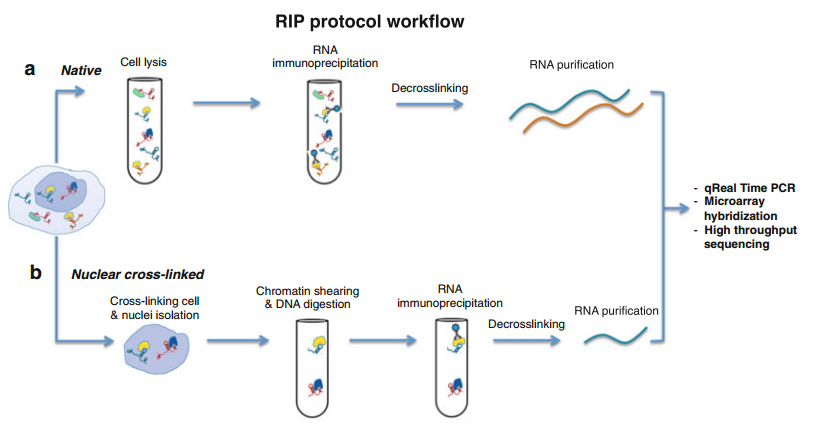

RNA 反义纯化（RNA Antisense Purification, RAP）设计一段与目标 RNA 互补的寡核苷酸探针，并对其进行生物素标记，使用该探针将目标 RNA 拉下来，同时与目标 RNA 相互作用的蛋白也被捕获，然后经链霉亲和素标记的磁珠纯化，通过 Real Time RT-PCR、WB、二代测序或质谱进行进一步的鉴定。实验流程为探针设计→待测样品准备（细胞、组织或待测 RNA 和蛋白质等）→生物素标记探针与 RNA 杂交→RAP→分离 RNA 和蛋白质进行鉴定分析。

更多内容：[https://docs.qq.com/doc/DTElBYkFDZmtBc01I](https://docs.qq.com/doc/DTElBYkFDZmtBc01I)

## 23.可变剪切

一个基因通过 mRNA 的转录后加工，形成多个长短不一蛋白的情形。表面上你以为就一个基因、一个变量，实际上执行功能的是多个蛋白、不同的变量，表里不一。可变剪切虽然属于知其然知其所以然，但又不是 DNA、RNA、蛋白相互之间做连线，它是 mRNA 转录出来加工成熟的过程中产生的 RNA 水平的变化。我们把转录的初级产物也就是 mRNA 前体上，去除内含子外显子连接起来成为成熟 mRNA 的过程称为剪接，splicing。那么可变剪切在概念上体现的是，同一个前体 mRNA 通过不同的剪接方式产生不同的 mRNA 剪接异构体，transcript variant。这种同一个基因生出来的亲兄弟，也被称为不同的转录本亚型 isoform。isoform 一般指的是蛋白亲兄弟，而在 mRNA 水平的亲兄弟叫 transcript variant。所以你在文章里看到可变剪切、选择性剪切、剪切异构体、转录本亚型、蛋白亚型其实说的都是一个事情。不同外显子拼接组成不同的转录本形成不同的蛋白亚型，这是生物体 Economy 原则的体现，优化效率。一个基因编码多个不同转录产物和蛋白产物，能够产生丰富的多样性。

可变剪切现象发现的很早，alternative splicing 是由 Walter Gilbert 在 1977 年提出的，但是一直发展的比较慢。到 2000 年左右，用分子生物学的方法一共也只发现了数百个有可变剪接的基因，由此推测在高级真核细胞生物中约存在 5％的基因有可变剪接。不过，这是受制于技术手段的落后，通量太低造成的误解，后面发生什么事情大家可以猜得到：二代测序来了。高通量测序技术不仅揭开了非编码 RNA 的大幕，对可变剪切事件的发现也是颠覆性的，根据测序和生物信息学分析结果提示，整个人类基因组大概有 35%-60% 的基因存在可变剪接形式。为什么是一个范围？因为不同的组织和发育阶段，很有可能存在有不同的剪接变异体，但我们目前还没有办法把所有的组织类型都做全，只能是个估算值。经由这些高通量研究，我们可以获得一个结论，可变剪切是具有普遍性的机制，一半左右的基因都有多个转录本，这是一个常规现象。

怎么知道一个编码基因有没有可变剪切形式？数据库类型有样本数据库、信息数据库、通路数据库和互作数据库 4 个品类，其中信息数据库里的三大基因组数据库，NCBI、UCSC、ensembl，它们都能查到。就以 NCBI 为例，你查基因一般用 GENE 这个子数据库，信息比较全，输入一个基因名称，比如说 PTEN——PI3K/AKT 信号通路的负调节因子，在检索结果界面里第一个，种属是 homo sapiens 就是人的 PTEN，点击去，可以看到基因的介绍，往下拉有很多信息包括相关的文献等等。其中有一个内容叫 NCBI Reference Sequences (RefSeq)，就是 NCBI 数据库里相关序列信息的链接，里面的 mRNA and Protein(s)，就是这个基因的 mRNA 和蛋白序列。这些序列是标了序号的，第一个 NM_000314.6 → NP_000305.3，M 就是 mRNA，P 是蛋白。NCBI 里面序列非常多，请大家认准 NM 和 NP 商标，这是官方 Review 过的，品质有保障。后面数字每个序列是唯一的，点几是版本号。NM 号比较重要，因为你检测目的基因表达常规操作第一步设计 PCR 引物，需要知道 mRNA 序列，给公司设计你也要提供 NM 号才行。检测蛋白倒没那么麻烦，订购抗体往往给个基因名称就行，不用提供序列号。所以，NM 号是非常重要的一个基因研究必备的序列信息。我们可以在 PTEN 基因详情页 Refseq 板块，看到有 3 个 NM 对 NP 的已知转录本 isoforms，每一个都有 Description 描述。第一个写了 The most abundant isoform，表达丰度最高的，是常规意义上的 PTEN。但是它还有另外两种剪切形式，一种更长一点，叫 PTEN-L 也叫 PTENalpha；另一种是更短一点叫 PTENbeta。前面一个长的叫 PTEN-L，那短的一般就叫 PTEN-S，shorter。但是现在 Gene 数据库里面还没有标注 beta，或者 s，可能还没更新到那。这么明星的分子就没人做转录本功能差异吗？查了下，2017 年 3 月就有报道 PTENbeta 的功能，发在 Nature Communications 上。

看基因名称后面有时候有数字，1234。比如 DDR1 和 DDR2。DDR1、DDR2 是同一家族的两个基因，因为有结构和功能上的相似性被编成同一组，1234 这样排下去形成 family 家族。如果你在基因名称后面看到跟着αβγδ这种拉丁字母，或者是小写的 abcd，这就不一样了，属于同一个基因因为不同的剪切变异形式产生的不同转录本、蛋白亚型。当在一篇文章里面涉及多个变量之间的调控关系的时候，称为二元、三元变量。而同一篇文章里面研究 123、αβγ这样同一家族或者同一基因的不同亚型，它们不是调控关系，而是平行结构，这个可以称为双变量、三变量。用不同概念定义来归类，能够让我们的思路一直保持清晰。在一个课题中研究不同转录本的功能差异，属于多变量的层次，是讲兄弟关系同一辈分，不是下游上游儿子老子的因果关联。多变量当然工作量也是翻倍上去的，自然对文章也有显著的加分效果。尤其是多变量执行功能还存在不同的时候，故事会更加精彩。

m6A 甲基化可以作为可变剪切识别的一个信号，这种 cross-talk 绝对是非常新的领域。除了可变剪切+分子修饰的纵向两层嵌套，新的分子类型——非编码 RNA 也有可变剪切的展开模式，连最新的分子类型 circRNA 可变剪切的文章也都有。

## 24.结合位点验证

DNA 和 RNA 的基本单元是碱基、脱氧核糖或者核糖、磷酸，而蛋白进一步细分到一级结构是一条氨基酸组成的链条，如果这些生物大分子之间有直接结合，结合部位可以最终落实到具体某个碱基位点或者氨基酸位点，这是现今我们解释分子机制的最小单元。

DNA 和 RNA 具体来说就是启动子和 lncRNA，当研究它们跟蛋白结合的时候，常常采取分段的策略。一段序列很长，1000 个 bp，我就分成 4 段每段 250 个 bp，然后再去重复前期做过的分子互作的实验。当你用直接作用的分子交互实验验证了两个分子有结合，下一步的策略就是把 DNA 启动子和 lncRNA 序列分段，重复验证一下，看他们具体结合在哪个区段上。理论上通过分段的方法是可以逐步缩小范围，最终锁定到结合区域序列的，因为 250 个 bp 还可以在分段，这样两次切完就是很小的序列了，一步一步缩小范围。一段分多长合适其实没有金标准，一般不超过 500 个 bp，分成三段四段的都比较常见，这是因为有效率的做法最受欢迎。你们可以自己测算一下，一段 1000bp 的序列每次分 4 段，第一次的解析率是 250 个 bp，第二次把阳性的再分段就是 250 除以 4，解析率等于 62.5bp。而如果你第一次就分成 8 段，1000 除以 8 解析率是 125bp，效率整整差了一倍。

通过分段缩小了范围，最终核酸上的结合位点还可以用点突变的策略来验证。在分子生物学上，对序列中的一个或多个核苷酸位点进行突变是一个很成熟的技术。这样既可以验证核酸的结合位点，也可以改变蛋白的氨基酸密码子从而突变一个氨基酸，毕竟蛋白也是通过构建质粒上的核酸序列过表达出来的。

除了分子交互，还有各种分子修饰，DNA 甲基化，RNA 甲基化，蛋白的糖基化、磷酸化、泛素化、酰基化都可以具体到位点验证的层次。

分子的直接相互作用，DNA 和蛋白，蛋白和蛋白，蛋白和 RNA，RNA 和 RNA，RNA 和 DNA，也都可以通用于结合位点验证的策略，通过位点突变来确认结合序列的特异性。定点突变是一项伟大的技术，没有这个技术做完结合验证就结束了，没有办法深入到单个核苷酸和氨基酸的水平。定点突变英文叫 site-specific mutagenesis，它能够实现在体外高效特异地改变 DNA 序列中特定某一个或几个核苷酸。这项技术的发明人是加拿大科学家 Michael Smith，时间是 1985 年，并且在 1993 年获 Nobel 化学奖。据说 Smith 教授是在咖啡馆喝着咖啡聊着天灵感迸发建立了这项技术。这种故事随便听听就好了，比如 PCR 技术发明人是磕了药开着车带着女朋友去浪的时候突发奇想的原理，而 RNAi 技术背后竟然是一个缠绵悱恻的爱情故事——科学家为了妻子，想给矮牵牛花插入红色素的基因，希望能够让花朵更鲜艳，意料之外的是矮牵牛花完全褪色，花瓣变成了白色，好像没有一个好故事不利于这种创世之作的传播。

Smith 教授发明的定点突变技术可以有目的的设计特异性的核苷酸序列，在任何一个基因片段上进行随意替换。其实原理不复杂，人为的在 PCR 扩增的引物上加入突变形成错配的引物，然后通过酶切把不包含突变的质粒给破坏掉，这样就能转化出来包含突变序列的质粒。定点突变技术有很多的变种，一次性引入多个突变位点也是可行的，总之按照试剂盒的 protocol 来操作，这种做工具的活交给公司来办也比较适合我们医生做科研时间稀缺的现状，构建突变质粒费用不贵，省下来时间做关键的细胞表型和机制实验，多重复几次。

分子结合如何进行实验验证。第一类我要讲的是转录因子和 miRNA，一个是启动子 DNA 结合蛋白，一个是 miRNA 结合 mRNA 的 3’UTR，放在一起总结是因为它们的结合验证都用荧光素酶报告基因实验。既然实验策略很相似，我们就可以把它们归成一类。启动子很长，一般来说用分段策略做就可以了，大致定位到结合的区域，很多文章里面并不需要一定明确到位点。也就是说启动子和转录因子的结合验证，主要策略是把启动子区域分段，然后再做的荧光素酶报告基因实验，看有没有调节 luciferase 的转录作用。如果你预测了转录因子结合的 motif，当然也可以点突变再验证，有了结合位点的分析就比 luciferase 加上 ChIP 实验的结果更进了一步。miRNA 本身就只有 20 几个碱基，没什么分段的必要性，结合的关键位置叫 SEEDRegion（种子区），也叫 seed sequence，它是 miRNA 结合 mRNA 的必要序列，一般是 miRNA5´端 2-7 位的碱基，这段序列是需要与靶基因完全互补配对而且一般来说很保守。毫无疑问，我们可以采取点突变的形式把影响结合的位点给筛查出来。在 miRNA 的研究中，做一个突变的表达载体证明结合的特异性，然后表明它失去对靶基因的抑制作用后，功能会显著受到影响，说明 miRNA 结合靶基因对功能发挥很重要，这都是常规论证思路。

co-IP 验证存在结合的两个蛋白，根据结构域 domain 可以分段或者根据预测的关键位点进行氨基酸的点突变，然后我们重复 co-IP 实验，看还有没有结合作用，这就能够报告在结合序列的特性上两个分子是什么情况。蛋白结合是经典分子互作模式，所以第二类位点验证的结果在文章里频繁能看到。这个时候你操作的对象是过表达的载体，也就是质粒，不是直接改蛋白，改的是表达蛋白产物的 DNA，我不管你是 RNA 还是蛋白，反正改了 DNA，都得乖乖听话，这是擒贼擒王，中心法则这套原理被我们充分利用了。直接修改蛋白里面氨基酸的方法还没有开发出来，因为生物体本身的机制，调控就主要发生在 DNA、RNA 水平，到了蛋白就覆水难收了，只能加点修饰标签微调一下。基因操作的技术像 CRISPR、RNAi、TALEN 等层出不穷，已经到了造物主的能力阶段，突变、删除、添加碱基随心所欲。所以当你在蛋白水平进行氨基酸位点上的精细研究时，把内源的蛋白干掉，导入一个改造过的外源蛋白就可以实现。

lncRNA 和蛋白都可以做突变操作，这里就有个问题，验证结合的时候突变哪个为好呢？要考虑两个因素：突变核酸方便还是突变蛋白方便，以及蛋白和核酸那个是主变量的问题，谁是主角谁就承担主要的戏份，从这两个要素来判断都应该对着 lncRNA 下手才对。lncRNA 就算可以用计算机预测结合位点也不一定很准确，上来就做点突变风险太大了，先做一个分段的操作是很合理的策略。分了段之后再去做 RIP，RNA pulldown，其实道理跟前面一模一样，进一步缩小区域范围，然后有必要的话，再去做结合位点的突变。

## 25.细胞交互作用

细胞交互就是一项研究里包含了两种细胞之间的相互作用，即这项研究架构在二元的细胞体系上。

要做细胞交互的课题，你首先需要有一组细胞交互的模型，一种细胞能够影响另外一种细胞的现象需要首先观察到，然后才能进行分子层面的进一步解析。这其中有一种常见的交互验证模式，就是用一种细胞的培养上清去刺激另外一种细胞，观察刺激后的生物学效应，这种培养方式叫条件培养。我们既可以分开培养，把一种细胞的分泌物加到另一种里，也可以直接用做肿瘤转移表型的 Transwell 小室，分上下两层共同培养，但是两种细胞不接触。一般我们不能直接把两种细胞混在一起，因为混在一起后就分不开了，要检测的很多指标就没法直接检测，必须进行细胞示踪才可以，太麻烦了，甚至有些表型就干脆检测不了。研究细胞交互作用经典的模式，是一个细胞分泌另外一个细胞吸收，通过条件培养基的刺激就能验证这种交互作用是否存在。比如说 A 细胞的分泌物促进了 B 细胞增殖，在这个现象基础上，我们再去分析分泌物里有什么分子可以介导这种效应，这时候可以用筛选+验证的常规套路，反正东西就在培养上清里。而且也不可能只有一个分子起作用，有效的成分是一组，找出来一个自圆其说的文章就可以发了，不需要把所有分子都做完。设计细胞交互需要有交互作用的前置验证，这是特别需要关注的策略，在没有确定的交互结果之前，盲目去考虑分子和变量交互、直接机制都是徒劳无功的，要按部就班来。

细胞交互第一问：什么细胞调节了什么细胞？肿瘤细胞调节成纤维细胞叫改造微环境，成纤维细胞影响肿瘤细胞叫微环境对肿瘤细胞的反馈调控，主动和被动的关系，攻和受的区别不要混淆。在二元细胞结构里，总有一个细胞是输出信号的，有一个是接收信号并且发挥效应的。前者我们称为 donor，捐献者，或者叫供体细胞；后者我们称为 recipient，接受者，或者叫受体细胞。

细胞交互的第二问：细胞交互的途径是什么？细胞交互的发生依赖于三种可能的途径：第一种是细胞接触；第二种是信号分子裸奔；第三种是信号分子坐交通工具。接触很好理解，需要借用细胞膜上的蛋白来感受信号，跟信号通路的模式相似。信号裸奔就是分子直接从细胞分泌出来，主要是蛋白也可以是其他的化学小分子，包括代谢产物，主流当然是蛋白。分泌型蛋白是蛋白中的一类，它们执行的功能本来就跟细胞交互相关的，只是近几年的研究不是很热，早些年就有很多报道了。目前研究比较热门的是通过交通工具的信号传递，交通工具叫囊泡（Vesicle），囊泡运输机制在 2013 年获得过诺贝尔生理或医学奖，相关论文 80 年代、90 年代就已经发表了，并不是新鲜的东西。但是，非编码 RNA 分子经由囊泡运输产生细胞交互调控作用，却是令囊泡推陈出新的新亮点。囊泡根据直径大小分为微泡和外泌体两类，外泌体+非编码 RNA 是现阶段医学基础科研中的顶尖流行套路。

细胞交互的第三问：信号从哪里来，到哪里去？三元分子变量从哪里来就是上游的驱动因素，到哪里去就是下游的效应环节。分子之间构成信号传递链条的时候，围绕主变量会有从哪来到哪去的关键逻辑问题，搞清楚了主变量上下游的关键分子，再复杂的分子机制也能迎刃而解。现在，当课题或者文章涉及细胞交互的时候，从哪来到哪去的问题需要问两遍：第一遍要知道分子的从哪来到哪去，第二遍搞清楚从哪个细胞来到哪个细胞去的传递关系。一般来说，上游机制的因变量会在供体细胞与主变量发生调控关系，而下游机制的因变量会在受体细胞与主变量发生调控关系，这样就比之前单个细胞里面研究上下游复杂多了，大家要注意。你可以把供体细胞中上游因变量对主变量的调节，以及受体细胞中主变量对下游因变量的调节看成是两组二元变量关系，相当于两篇文章的数据放在一起。这还不够，还要增加细胞交互的部分，证明确实是 A 细胞里面来的分子影响了 B 的功能，而不是 B 自身的分子变化，有一套验证的实验。这种高端套路复杂程度是胜过三元变量的，但逻辑难度上，它还是三元的底子，无非加了外壳。

## 26.细胞交互模式

有一些新的分子类型是进入到细胞交互层面的研究才会涉及到的，这些分子类型主要的角色就是在细胞外进行信号的 cross-talk。几乎所有的体液里都会有分子的存在，尤其是在循环系统也就是血液中存在的这一类信号分子，对于疾病的诊断、治疗效果的评价、预后的追踪都有深刻的转化意义，值得我们投入十二分的关心。这一类分子我们有一个单独的名称来定义它们，叫循环分子，英文术语是 circulate 循环的 ing 形式，circulating。circulating 后面跟分子类型，比如 circulatingmiRNA 就是循环 miRNA 分子，circulating lncRNA 就是循环 lncRNA 分子。蛋白是执行生物功能的基本单位，当然，用来传递细胞交互信号的 circulating 的蛋白是很常见的，而且这一类蛋白还有一个专有名词：细胞因子（cytokine）。细胞因子从定义来说就是一类能在细胞间传递信息的物质，主要包括的是具有免疫调节的功能性蛋白或小分子多肽。在细胞交互中，免疫相关的表型占了非常重要的位置，免疫细胞天生就具有跟其他组织细胞发生交互的使命。

Circulating 的蛋白，重点我们就理解细胞因子这类分子的作用模式就可以了。细胞因子最早是从淋巴细胞和单核细胞里面发现的，所以之前是叫淋巴因子或单核因子，随后研究发现很多细胞都能分泌这一类蛋白。尤其当机体遭遇细菌、病毒等微生物的入侵，或者经过物理的、化学的因素诱发了损伤，都会刺激细胞因子的产生，而细胞因子可以杀灭细菌和抑制病毒，达到保护机体的目的。细胞因子已发现的有上百种，根据功能大致可以分成：白细胞介素（Interleukin，IL）、干扰素(Interferon，IFN)、集落刺激因子(Colony-stimulating factor，CSF)、肿瘤坏死因子(Tumor necrosis factor，TNF)、趋化因子(Chemokine)，生长因子(Growth factor，GF) 一共六种。细胞因子的功能研究一直是免疫学的一个热点方向，这些蛋白参与的生理过程包括调节 T 细胞、B 细胞活化、生长和分化，介导细胞免疫和体液免疫，刺激造血生成、刺激骨髓祖细胞生长和分化为各种成熟血细胞。同时还可以调节细胞的病理过程，参与抗感染和抗肿瘤，参与组织修复、促进伤口愈合，在超敏反应和自身免疫性疾病中担当角色，人体的发烧和炎症都跟它有关。细胞因子是分泌蛋白，但并不是所有的分泌蛋白都是细胞因子，还有消化酶、抗体、多肽类的激素，像生长激素、胰高血糖素、肾上腺素也都是分泌蛋白。

分泌蛋白在结构上的一个显著特点是 N 端会有一段特定的氨基酸序列肽段，又叫信号肽，在蛋白转运出细胞的时候这段信号肽会被剪切掉，形成成熟的分泌蛋白。包含这种序列特征的蛋白就预示着他们是分泌蛋白，所以分泌蛋白是有特殊序列标签的，在基因注释网站检索分子背景信息的时候要对这一特征保持敏感度。分泌蛋白需要结合受体细胞膜上的相应受体蛋白发挥生物学功能，这种配体和受体的结合就是机制研究的一种确定套路。膜上的蛋白也有特定的跨膜结构域也可以被识别出来，因为蛋白研究相对比较成熟，所以对于一个蛋白在细胞内定位在哪里，是不是分泌以及是不是膜蛋白，全部都有根据序列分析过的结果，在 Genecards 数据库就有相关的内容。我们了解分子的特定类型，对于基础研究的设计走向尤其是机制的模式具有关键性的影响。

蛋白可以主动分泌，DNA 和 RNA 这一类核酸可以分泌吗？DNA 和 RNA 都是细胞里的，一般情况下他们不会直接分泌出来，如果需要参与细胞交互信号传递，正常采用经由囊泡运输的模式，也就是需要借助载体才能实现从一种细胞到另一种细胞的交互过程。但是如果细胞破了，也就是它自身裂解了，那么其中的 DNA 和 RNA 就有可能释放出来。这种 DNA 和 RNA 也是 circulating 的，它们有一个专门的名词，叫 cell free DNA，或者 cell free RNA，简称 cfDNA 和 cfRNA。cell free 的意思就是游离于细胞外，cfDNA 和 cfRNA 是专属于循环分子中的一类，细胞内没有，它们构成了我们医学科研中变量的一种新分子类型。如果我们的研究对象是 cfDNA、cfRNA，天生有一种诊断倾向的研究格式，形成了一种独特的研究套路。

人体细胞有自我的新陈代谢过程，每时每刻体内都有细胞会发生凋亡，是一种主动式的细胞降解。这个过程中会产生片段化的 DNA，大小基本在一两百 bp 左右。除了主动的还有细胞被动裂解，可以是来源于外界物理或者化学刺激引发的组织坏死，也可以是自身免疫系统对细胞杀伤作用，这个过程释放的 DNA 片段会比较大。无论主动还是被动产生的 cfDNA，一般到了外周血中会被快速清除，然后细胞又会释放新的 cfDNA，形成动态平衡。在健康状态下 cfDNA 一般是维持在一个较低的水平，人体内检测到的 cfDNA 含量实际上是 DNA 的释放和清除平衡后的结果。当严重的系统性组织损伤或者异常代谢打破这种平衡时，大量死亡的细胞释放 cfDNA 会使血液中的 cfDNA 含量大大增加，这就跟疾病的临床诊断挂上钩了，很有医学研究的价值。cfDNA 的发现其实非常早，1948 年就已经在人血液中发现了，但是当时对于 DNA 是遗传物质的认识还没建立，DNA 双螺旋结构是 1953 年提出的，所以发现之后并没有引起很大的研究热情。在 1977 年的时候，第一次发现肿瘤病人血液中的 cfDNA 含量要比正常人高。到了 1989 年，证实了一部分 cfDNA 是来源于肿瘤细胞的，提出了 liquidbiopsy 的概念，就是精准医疗中的液体活检或者叫液态活检的起源。在 2013 年，因为随后的研究中大量发现来自于肿瘤细胞的 cfDNA 可以检测出肿瘤特异的突变信息，才终于使这种体液活检技术成为能够大范围应用的现实。不难理解的是，传统的病理技术是需要从病灶获得组织，这种检查是侵入式的，没那么安全，有一定局限性。癌症有异质性，对于已经转移肿瘤而言，仅取某个局部组织并不能反映患者整体情况。有些患者还不具备组织活检的条件，有些肿瘤在受到活检的操作后有加速转移的风险。那么液体活检的样本来自血液，是非侵入式的，就很有想象空间了。当然，来自于肿瘤细胞的 cfDNA 量不是很大，尤其是早期的肿瘤病人，检测敏感度是个问题。能实现有效检测与最近十几年测序技术的快速发展也有巨大关联，测序技术的通量和精度现在已经很高了，这也是肿瘤的 cfDNA 被应用于个体化诊断，包括液态活检如今是转化医学热点的原因，这个方向是严重依赖于测序技术作为平台支撑的。

cfDNA 检测的转化应用最知名的案例就是新生儿无创唐筛，在孕妇血液中约有 10%-15% 的 cfDNA 来自于胎盘滋养层，这意味着可以通过母亲外周血测序分析了解其中的 cfDNA 序列，其中一部分信息来源于胎儿。而通过这一部分就可以判断胎儿是否存在整个染色体或者大片段 DNA 的变异，对于传统的羊水穿刺检测来说是一种颠覆，因为无创。很多炎症性的疾病，因为同样会引发局部细胞的大量死亡，cfDNA 水平也会发生显著变化。比如关节炎、肝炎、肾炎、胰腺炎、炎症性肠病、系统性红斑狼疮等疾病患者血液中，检测到 cfDNA 的量相比健康人大大增加，可以作为 Biomarker。在肿瘤中的 cfDNA，还有一个专门的名词叫 ctDNA，circulating tumor DNA，循环肿瘤 DNA，就是指来自肿瘤细胞的外周血 cfDNA。ctDNA 中能够检测到非常丰富的遗传变异信息，从位点突变到基因组结构变异，拷贝数变异都能够检测到。可以想象 ctDNA 含量通常在晚期或转移性肿瘤中较高，而在早期或局限性肿瘤中含量较低。在不同类型肿瘤中，ctDNA 水平也会存在差异，所以具体临床应用要探索，不能一概而论。ctDNA 的转化应用潜力是可以作为肿瘤预后的标志物，而且也能够用来预测药物治疗的效果，实现个体化治疗。说到 ctDNA，还有一个概念也要了解一下，那就是 CTC，循环肿瘤细胞 (Circulating tumor cell)。CTC 是从实体瘤中脱离出来并进入外周血液循环的肿瘤细胞，可以用来判断肿瘤的转移风险和病人的预后情况。早在 1896 年，研究人员就已经从一例转移性的肿瘤患者血液中首次观察到从实体肿瘤中脱离并进入血液循环的肿瘤细胞，提出了 CTC 的概念，这种发现靠显微镜就可以了，所以历史很久远了。目前 CTC 计数可以用来预测一些肿瘤的治疗后无进展生存时间 PFS 和总生存时间 OS，以此作为患者是否需要接受辅助化疗的参考。也可以动态监测 CTC，观察接受化疗的肿瘤患者 CTC 的数量变化，作为肿瘤进展、转移复发风险评估的参考。另一方面可以实时反映肿瘤负荷，作为肿瘤药物耐药性的监测。CTC 的临床价值还在于可以准确地提示肿瘤的发生，并且因为 CTC 在肿瘤早期就会产生，所以远远早于影像学证据。但是，从技术上来说，CTC 在外周血中含量非常低，在癌前病变或肿瘤早期数目就更少了，检测的灵敏度很难保障。一般患者 1ml 血中大概平均只有 1 个 CTC，而 1ml 血液里面有 50 亿个红细胞和上千万的白细胞，对检测技术是个考验。另外 CTC 检测还有特异性的问题，血液中一些细胞，比如巨核细胞、内皮细胞、未成熟的造血细胞、上皮细胞等，这些细胞在正常血液中比较少见到，比较容易被误认为 CTC。因为我们判断 CTC 是不是肿瘤细胞是通过表面的 Biomarker，理论上说这只能推断这种细胞可能是恶性肿瘤细胞，而不能进一步确诊到底为何种肿瘤细胞。还有没有影像学证据，你也没法对症治疗，只能加强随访，这也是局限性。

总的来说，ctDNA 的灵敏度高于 CTC，因为 ctDNA 半衰期很短，只有几个小时，是实时更新代谢的，可以清晰反馈当前肿瘤信息，有治疗实时监控的潜力。但针对肿瘤早期筛查或诊断，CTC 的准确性优于 ctDNA，毕竟早期的时候 ctDNA 含量太少了。DNA 比较稳定，所以 cfDNA 是比较可靠的循环 Biomarker，但是 RNA 就没那么稳定了，非常容易被降解，因此 cfRNA 相对而言应用价值就没有那么突出。cfRNA 的研究也是有的，它的来源跟 cfDNA 一样，主动或者被动的细胞降解就能释放出来，在血液中的 cfRNA 又叫循环 RNA，circulatingRNA，其他的体液也会有，尿液、唾液、乳汁、前列腺液、精液、经血等。这些游离 RNA 还有个名称是 exRNA（extracellular RNA），翻译过来是胞外的 RNA，概念很多大家不要慌，有一些只是表述不同，意思其实差不多，我们应当掌握合并同类项的道理。cfDNA、cfRNA、ctDNA、CTC、exRNA 都是 cell free 的，extracellular 跟 cell free 是一个意思。cell free 的分子除了近端的作用形式，要进入循环系统那就属于 circulating 的状态，所以一个分子前面有 circulating 的定语，你就知道它是 cell free 的，可以用于液态活检。mRNA、miRNA、lncRNA、circRNA 都可能出现在 exRNA 中，通过某些病理过程的特殊机制，这一领域研究还比较前沿，很多问题尚无定论。但有一点是肯定的，就是 exRNA 更倾向于坐车，用囊泡的形式分泌出来。有了外层膜的保护，RNA 的稳定性就有保证了。这一类在囊泡中的 RNA 分子，尤其是起调节作用的非编码 RNA：miRNA、lncRNA、circRNA，加上囊泡中的大热门——外泌体，外泌体携带非编码 RNA 介导细胞交互作用。

细胞外囊泡，英文是 extracellular vesicles，简称 EVs。在很多时候英文缩写会有复数形式，这样首字母大写拼起来之后会跟一个小写的 s，这是一种表述习惯，当然，EV 和 EVs 是同一个东西的两种表现形式，同一个东西。大家一说胞外囊泡第一反应是外泌体，其实是有三类常见的 EV，一种是凋亡过程产生的凋亡小体（apoptotic body），体积最大，500nm-2um，它伴随凋亡表型产生，所以只跟凋亡挂钩。第二种是微囊泡（microvesicle）体积在 100nm 或 200nm 以上。第三种外泌体（exosome），体积小一点，一般说 30-100nm，也有说到 150nm 的。以粒径大小来区分微泡和外泌体是不太严谨的，就像 lncRNA 的定义是 200nt 以上的非编码 RNA，但 180、190 的非编码 RNA 也是 lncRNA。微泡和外泌体的区别还在于它们形成的机制不太一样，凋亡小体和微泡都是由细胞直接出芽形成的囊泡，外泌体的形成却要经历更加复杂的途径，中间要产生一个多囊泡体，因为大家不会去研究外泌体生成机制，所以我也不详细讲，有兴趣自己查资料就好了，你们只需要知道形成机制上微泡和外泌体不一样就行。从技术上来说，抽提外泌体的试剂盒也不能保证 100% 就是外泌体，它只能是把 100nm 粒径左右的囊泡给富集下来，因为你一开始就用了外泌体的试剂盒，从起点来说有目的，所以微泡的问题就自动被过滤掉了。我要教大家的就是化繁为简的思路，凋亡小体、微泡、外泌体这三类常见的胞外囊泡的知识是要知道的，但具体做囊泡介导的细胞间通讯，你的选择很简单：做外泌体。因为它包含的内容物和信号分子最丰富，这是当前研究主流。

1986 年，外泌体就被发现了，最初是在绵羊红细胞的培养上清中找到的有磷脂膜结构的小囊泡，后续 20 年里，其他类型的细胞主要是免疫细胞都发现了有功能性的外泌体，但真正得到大家关注还是在 2007 年发现在肿瘤细胞和正常细胞外泌体之间的差异，其中携带的 RNA 可实现跨细胞的调控性事件，这在肿瘤微环境研究中是个突破性的证据。2015 年，利用转基因小鼠模型研究人员证实外泌体作为细胞通讯的载体具有广泛性，能够在全身水平上被其他细胞摄取并发挥调控功能。广泛性的证明非常重要，非编码 RNA 里的 miRNA、lncRNA、circRNA 都是因为被发现广泛存在引起研究热潮。当前还有把外泌体中特异性表达的分子当作液态活检 Biomarker 的研究，还有把外泌体当作载药系统和靶向递送系统的研究。凋亡小体包含的是大量降解的核酸碎片、肽段和脂类分子，基本没有用于调控的完整的核酸分子，研究角度有瓶颈。而微泡和外泌体都是可以携带蛋白、脂质和 RNA。RNA 包括 mRNA 和非编码，既然所有分子类型里创新最显著的是 lncRNA 和 circRNA，那么加上了外泌体的外衣，这些新颖的非编码 RNA 分子类型依然要重点关注。

## 27.外泌体

囊泡有微泡、外泌体、凋亡小体三种主要形式，我们需要聚焦的就是当前最流行的外泌体。外泌体里面会有蛋白、RNA，还有脂质和一些代谢小分子，但是执行调控性功能的 RNA 是目前最受欢迎的研究对象。

外泌体是一个双层磷脂膜的结构，跟细胞膜一样，它的膜上也有跨膜蛋白，这些蛋白可以作为信号分子，与受体细胞膜上的受体蛋白产生结合，这也是直接作用机制。蛋白+蛋白的直接机制嵌套到细胞交互的研究模型中，一样有显著的故事性提升，是高分文章的基础架构。

阻断外泌体合成是有商业化抑制剂的，比如用中性神经鞘磷脂酶的抑制剂，这个酶是外泌体生成途径必须的酶，也可以封闭参与外泌体最终释放过程的关键蛋白，比如说 Rab27a，用基因操作的方法来沉默就可以了。阻断了供体细胞中的外泌体，自然其中的 miRNA 也不复存在，这时候用细胞上清孵育受体细胞，与没有阻断外泌体的组别相比，照理说也该出现 loss of function 的功能。

外泌体还有特色的数据验证套路，从体液中分离外泌体的方法有很多，外泌体的分离是有专门的试剂盒的，分离的原理包括离心、色谱、过滤，或者是基于高分子聚合物的沉淀和免疫亲和分离。分离后需要鉴定，鉴定的数据有透射电镜（TEM）观察外泌体的形态照片，动态光散射（DLS）或者其他的方法分析颗粒粒径大小、颗粒密度、检测颗粒电荷，又叫 Zeta 电位、以及外泌体表面 marker 的检测等等，外泌体表面 marker 也不少，这些都属于常识，大家可以查文献整理，典型的有 HSP70、TSG101、CD63 等，可以用 western，也可以用免疫荧光检测。组织细胞蛋白的免疫检测用 western，而体液样本的分泌蛋白检测用 ELISA，适用对象有不同。如果是检测 miRNA 或者其他非编码 RNA，筛选或者鉴定可用 qPCR、芯片、测序，这些技术平台是一样的，分离囊泡下来之后，后面就可以回归到常规的分子生物学手段。

囊泡是有脂质膜结构的，所以相应的示踪的方法是用亲脂性的荧光染料标记外泌体，再观察受体细胞摄入情况。这种荧光染料有 DiI/DiD/DiO/DiR 等，都是一些差不多的衍生化合物，这些荧光染料在进入细胞膜之前荧光非常弱，当与细胞膜结合后荧光强度大大增加。一旦进入细胞膜后，可在整个细胞膜上扩散，使细胞显色。这一步跟上一步一样，是囊泡特殊的鉴定步骤，属于细胞交互的特殊配置。如果是 circulating 的分子，没有囊泡包裹，也可以直接标记分子来观察摄入情况，分子或者囊泡荧光示踪是观察受体细胞摄入的金标准证据。

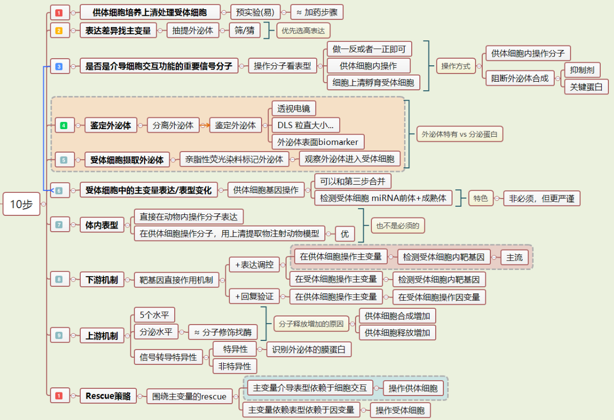

## 28.lncRNA 的直接机制

lncRNA 的直接机制可以有 12 种调控模式，和 signal、decoy、guide、scaffold 四种分子交互模型。它可以调节下游基因的 DNA 的甲基化、结合启动子 DNA 或者结合转录因子以及其他转录调节的蛋白产生招募或者抑制作用。也可以影响转录复合物，包括调节 RNA 聚合酶的催化活性，能够帮助解开染色质结构，参与组蛋白甲基化、乙酰化等修饰过程。在胞浆里 lncRNA 可以结合 mRNA 影响 mRNA 前体的加工成熟，干预 mRNA 的转运定位，以及调节 mRNA 的稳定性。在蛋白翻译过程中，lncRNA 可以结合蛋白靶向 mRNA 来促进翻译或者抑制翻译，也能调控蛋白翻译后修饰途径，还有蛋白的细胞定位也受到 lncRNA 影响。

## 29.免疫细胞

免疫细胞共同的来源是造血干细胞，造血干细胞可以分化为淋巴祖细胞和髓系祖细胞。淋巴祖细胞可以接下来分化为淋巴母细胞，然后进一步分化为 T 淋巴细胞和 B 淋巴细胞。而髓系祖细胞可以继续分化为成髓细胞，最后分化为单核细胞（monocytes）、巨噬细胞（macrophages）、树突状细胞（dendritic cells）、肥大细胞（mast cells）、中性粒细胞（neutrophils）、嗜酸性粒细胞（eosinophils）、嗜碱性粒细胞（basophils）、红细胞（erythrocytes)、血小板（platelets)。这些免疫细胞亚群有一些还能继续分，以 T 淋巴细胞为例又可以进一步分为 CD4+和 CD8+两个细胞亚群。其中 CD4+T 细胞还可以继续分成 5 个细胞亚群，CD8+T 细胞也可以再分。这些都是免疫学随着研究逐步深入，我们对于不同特征的细胞亚群功能逐步细化的过程。也就是说研究免疫表型，笼统说免疫细胞是不准确的，必须要聚焦到某个细胞亚群的研究，这才是执行功能的真实载体。

跟免疫相关最常见是蛋白家族是白介素（Interleukin，IL），IL-2，IL-3，IL-4，IL-5，IL-6，IL-8，IL-10，IL-13 这些分子在免疫研究中都非常常见。其次是分化抗原家族 CD 分子，CD 多少多少用数字排序的，数量有几百个，其中不少是细胞膜表面的特异性标记蛋白，经常用来表征免疫细胞亚群的特性。还有一个常见的免疫相关蛋白家族是趋化因子（chemokine）及其受体，有 4 个亚族，英文缩写是 C、CC、CXC、CX3C，后面加个 R 就是受体，像 CXCR4 就是 CXC 亚家族的受体。

通常说的免疫反应，有固有免疫（innateimmune response）和适应免疫两种（adaptive immune response）。固有免疫是指不需要接触过病原体而与生俱来的抵抗力，是一种非特异性的免疫反应，反应速度很快。适应免疫需要与抗原进行接触，通过抗体和淋巴细胞以特异性的方式来攻击病原体，前者是体液免疫的概念，后者是细胞免疫，其反应速度与固有免疫相比要慢一些。病原体入侵后最早到达的免疫细胞一般是中性粒细胞，它采用自杀式攻击模式，能通过脱颗粒作用释放抗菌多肽直接杀死细菌，或者释放核内的 DNA 到胞外形成一张网把病原体给控制住。随后到的是巨噬细胞，它能吞噬残留的病原体，还可以把已经完成使命凋亡的中性粒细胞清理干净。之后树突状细胞参与进来，它是连接固有免疫和适应免疫的关键免疫细胞，能吞噬病原体并把抗原提取出来和 MHC 分子结合，然后递呈到细胞膜上。MHC 分子通过结合 T 细胞上的受体激活有特异性的适应免疫，然后 T 细胞进一步分化为 CD4+的辅助性 T 细胞亚群和 CD8+的细胞毒性 T 细胞亚群。辅助性 T 细胞可以把抗原传递给 B 细胞，刺激 B 细胞表达特异性抗体激活体液免疫。辅助性 T 细胞还能帮助激活细胞毒性 T 细胞，直接将受感染细胞杀死。这是整个免疫反应恢宏浩大的一连串效应流程。

把免疫表型的模块分解一下，上面说的一个典型的免疫反应就应该包含感受、激活、效应三个阶段。感受过程是由病原体产生的分子模式（molecular patterns）启动的，分子模式简单说就是一群分子的组合，病原相关分子模式叫 PAMP (pathogen associated molecular patterns)，损伤相关分子模式叫 DAMP (damage-associated molecular patterns)，病原是外源的，损伤是内源的，所以免疫刺激的来源有外源的和内源的，这是免疫反应的第一个组件。分子模式相当于信号传导的源头，接下来这个信号需要识别，是通过模式识别受体（pattern recognition receptor），PRR 识别、接受信号，这是系统的第二个组件。典型的信号通路也是胞外配体结合细胞膜上受体然后激活胞内的激酶逐步放大信号，这个过程跟免疫细胞识别是极度类似的。至少已经有 5 大类的 PRR 被发现，包括 TLR（Toll like receptor）、CLR（C type lectin receptor）、NLR（NOD-like receptor）、STING 和 RIG-1/MAVS。分子模式和 PRR 都是分子，等同于配体和受体的概念。实际上用来识别分子模式的细胞是感受细胞（Sensor），也就是抗原呈递细胞 APC，这就有了第三个组件。我再捋一遍，免疫感受的主体就是 sensor 细胞，感受对象是分子模式。Sensor 细胞主要包括树突状细胞、巨噬细胞和中性粒细胞等。PRR 受体是位于 Sensor 细胞上的，Sensor 识别分子模式，启动下游的效应，这是免疫的出发阶段——感受。有三个组件，Molecular patterns，PRR 和 Sensor 细胞。

接下来 Sensor 细胞通过胞内不同的信号传导途径，分泌各种细胞因子，使三大类的淋巴细胞朝不同的亚型分化，这三类是固有淋巴细胞（Innate lymphoid cells，ILC）、辅助性 T 淋巴细胞（Helper T cells，简称 Th）和细胞毒性 T 淋巴细胞（Cytotoxic T cell，简称 Tc 或 CTL）。都是淋巴细胞，描述为不同的细胞亚群，各自表达不同的转录因子形成特异性的细胞 marker，并且分泌功能各异的细胞因子。每个亚群接受的细胞因子信号，胞内特异性表达的转录因子，细胞膜上特异性的 marker 以及活化后释放的细胞因子都是不同的。免疫原决定了 Sensor 细胞分泌的细胞因子类型，细胞因子差别决定了下游刺激哪些淋巴细胞，并且决定这些淋巴细胞的分化方向。不同的淋巴细胞亚群又能够自我激活和传递细胞因子信号到效应细胞上。感受到信号之后，输入什么输出什么下游再激活什么，这是免疫应答中一套非常规整的模块化体系，不同路径之间有明显的分子、细胞界限，存在固定的套路框架。三类淋巴细胞是激活下游的一系列功能执行效应细胞的中间环节，激活过程也有点类似通路中的激酶介导的信号放大，类似于三级的信号传递的形式，先感受再激活最后效应。免疫交互研究的重头戏是在中间激活的这一层以及它们分泌的细胞因子变化，就跟我们通路中研究那些激酶和转录因子道理一样，到了转录因子调控的与表型相关的直接效应蛋白，调控空间就不大了。所以要想把免疫表型吃透玩好，就要聚焦固有淋巴细胞、辅助性 T 细胞和细胞毒性 T 细胞的上传下达功能。

固有淋巴细胞主要分为三类——ILC1、ILC2、ILC3，还包括 NK 细胞和淋巴组织诱导细胞（LTi）。它在粘膜表面发挥作用，可以调节组织内动态平衡、粘膜和非粘膜组织的炎症与修复，包括小肠、肺、皮肤、脂肪、淋巴等组织部位。由于有组织部位的特异性，百搭属性没有另外两种 T 细胞来源的亚群广泛。成熟的 T 细胞可以按照表面标记 CD4+和 CD8+分成两个亚群，都是由初始 T 细胞（Naïve T cells）分化而来的。CD4+的是辅助性 T 细胞，而 CD8+就是细胞毒性 T 细胞了。CD8+的 T 细胞的研究远没有 CD4+T 细胞来得深入，近些年才开始慢慢把 CD8+T 细胞再分亚群。三大类的淋巴细胞亚群中需要重点关注的是 CD4+T 细胞，其研究比较成熟。

CD4+T 细胞或者说叫 Th 细胞，还可以进一步分化为 5 种常见的细胞亚群：Th1、Th2、Th17 是主线，通过三条路径驱动三类不同的效应细胞。经由 sensor 细胞分泌细胞因子活化的 Th1 细胞分泌 IFN-γ，而活化的 Th2 细胞分泌 IL-4，Th1 细胞分泌的 IFN-γ可以抑制 Th2 细胞增殖，而 Th2 细胞分泌 IL-4 可以抑制 Th1 细胞增殖，显然从调控关系看它们是相互排斥的，所以 Th1/Th2 的比例称之为 balance，平衡。

Th1 细胞分泌 IFN-γ或者 Th2 细胞分泌 IL-4 都可以抑制 Th17 的产生，所以 CD4+T 细胞向 Th1 分化时 IFN-γ能够同时抑制 Th2 和 Th17，而向 Th2 分化时 IL-4 也可以同时抑制 Th1 和 Th17，它们之间是路径选择的问题，对应了三种免疫效应途径，可以称之为免疫效应模块（immune effector modules）。Th1 介导的是 1 型免疫，Th2 介导的是 2 型免疫，Th17 介导的是 3 型免疫。1 型免疫的免疫原是胞内的病毒、胞内细菌、胞内的寄生虫，2 型免疫原主要是非胞内的寄生虫，3 型免疫原是胞外的细菌、真菌——常见的炎症病原体。不同免疫原 sensor 细胞感受到后分泌的细胞因子不同，诱导不同的 T 细胞亚群分化，最后招募不同的效应细胞。

感受、激活、效应，最后的环节是效应，需要一系列吞噬细胞来执行功能。1 型免疫是 Th1 激活后通过 IFN-γ信号刺激巨噬细胞，以巨噬细胞的吞噬作用消灭侵入机体的细菌、吞噬异物颗粒、消除体内衰老/损伤的细胞和变性的细胞间质、以及杀伤肿瘤细胞等。CD8+的细胞毒性 T 细胞也是利用这个效应组件。2 型免疫的效应模块是 Th2 激活后通过 IL-4、IL-5、IL-13 等细胞因子，活化肥大细胞、嗜酸性粒细胞、嗜碱性粒细胞作为效应终端排除寄生虫。3 型免疫的效应模块是 Th17 活化后通过分泌 IL-17、IL-22 作用于中性粒细胞。整个免疫反应从病原体识别就进入模块体系，到最后杀灭病原体依然是一一配对的模式。

把 CD4+ T 细胞根据产生细胞因子类型的不同，分为 Th1 和 Th2 两种类型，那是 1986 年的事，抑制性 T 细胞的概念早在 20 世纪 70 年代初就有学者提出过，直到 1990 年才首次获得了抑制性 T 细胞克隆，1995 年明确提出了调节性 T 细胞（regulatory T cell，Treg）的亚群。Treg 细胞可以抑制 Th1 和 Th2 细胞的分化和增殖，是一种免疫负调节效应细胞。而 Th17 是 2005 年才发现的，比 Treg 细胞正式发现还晚了 10 年。Th17 细胞和 Treg 细胞来源于同一祖细胞，亲缘关系非常近，祖细胞先分化为 Th17/Treg 细胞中间祖细胞，中间祖细胞通过表达转录因子 Foxp3 和 RORγt 刺激 Th17/Treg 细胞分化。Foxp3 和 RORγt 功能截然相反：Foxp3 刺激中间祖细胞分化为 Treg 细胞，RORγt 刺激中间祖细胞分化为 Th17 细胞。Th17 细胞和 Treg 细胞在功能上相互制约，其比例变化在免疫调节中有决定性作用，可以说 Th17 和 Treg 也构成了一组平衡。

正常机体是一个免疫抑制的状态，这时候 Treg 细胞调节免疫的平衡。当免疫刺激产生的时候，如果是胞外细菌就促发 3 型免疫模块，Sensor 细胞释放 IL-6 造成 Th17 分化。因为是来源于同一个祖细胞，Th17 的分化会解除 Treg 的免疫抑制。是不是向 Th17 分化取决于 IL-6 的存在，Sensor 细胞分泌的 IL-6 能够诱导 Th17 分化。当病原体是寄生虫的时候促发的是 2 型免疫，活化 Th2 细胞会同时抑制 Th1 和 Th17，也会解除 Treg 的免疫抑制。而当病原体是胞内细菌、病毒时，促发的是 Th1 细胞这条路径，1 型免疫。免疫的研究就是这么深入，已经把免疫细胞亚群细化到了这种的地步。细胞亚群再配上分子标记，除了分泌细胞因子还有关键的转录因子，肯定比通路光需要记明星分子要复杂。我们必须学会用一套框架性的结构来建立整体认识，细节的部分随用随学、不断完善。

辅助性 T 细胞还有最后一个亚群，叫滤泡辅助性 T 细胞（Follicular helper T cell，Tfh），2000 年发现的，在 2008 年确定了 Tfh 细胞是一种独立的 CD4+ T 细胞亚群。Tfh 细胞定位于淋巴滤泡，主要功能是辅助 B 细胞增殖和产生抗体，参与体液免疫。免疫细胞亚群这么复杂的问题进一步浓缩，就变成了要优先搞清楚 Th1、Th2、Th17 和 Treg，以及他们之间的调节关系。在细胞交互的研究中，中间激活这一层的 T 细胞亚群是交互场景最丰富的。讲了主干的结构，剩下的细节还有很多，解开免疫复杂机制的钥匙，关键是记住各种免疫细胞亚群及其功能，按照免疫效应模块的理念来区分信号传递的路径。一种细胞亚群附带了 3 个与分子相关的问题：第一，什么分子能诱导免疫细胞向特定的亚群分化，每一种亚群前面的诱导因子不一样。第二，诱导成功后这个亚群细胞能表现出什么样的特征，一般是通过膜蛋白的 Biomarker 来鉴定，用特异性的抗体利用流式细胞仪检测，也包括检测特异性的转录因子表达，用 Western 就可以了。第三，这个细胞亚群还会分泌什么样的效应因子引起下游的免疫反应。这些因子跟上游诱导的可能有重合，因为它们还会自激活，但也有不一样，信号还要继续传递给下游的效应细胞。这些信息都是固定的搭配，属于常识范畴，需要记但逻辑上不会很难。说完了免疫细胞，干细胞就容易理解多了。干细胞有两个显著的特点，自我更新和分化的潜能。根据发育阶段分类分为胚胎干细胞和成体干细胞，而成体干细胞又可以根据组织来源分为造血干细胞、骨髓间充质干细胞、神经干细胞、脂肪干细胞、骨骼干细胞等等。还有一类干细胞不是原生的，是人为诱导的，叫诱导多能干细胞（iPS）。从终末分化的细胞通过体外诱导，逆向去分化形成干细胞，这是干细胞研究中的一类热点细胞对象。iPS 是 2006 年报道的，2012 年拿了诺贝尔奖由此名声大噪。这个领域再拓展一下就是细胞的转分化问题，分化完的细胞类型还能诱导转变为其他细胞类型。最早在 1987 年就发现成纤维细胞可以转分化为肌细胞，2004 年发现 B 细胞转入一个基因就能转分化为巨噬细胞，2010 年发现成纤维细胞能转分化为神经细胞、心肌细胞和血液细胞，这给了我们非常多的转化医学想象空间。在肿瘤中还有肿瘤干细胞，它是具有干细胞特性的肿瘤细胞，严格意义上讲还不是干细胞。

肿瘤干细胞是肿瘤难以治愈的一个重要原因，它介导了增殖、转移、治疗耐受等一系列问题，是肿瘤细胞里面最顽固最难消灭的细胞亚群。干细胞种类这么多，不像免疫细胞全盘都需要掌握，每个科室相关的疾病适用于干细胞的模型也就是寥寥几种而已。其中最百搭的在我看来就是 MSC，间充质干细胞，取材方便、应用广泛，百搭的属性很强烈。干细胞不用考虑多个细胞亚群间传递信号的问题，只需要考虑干细胞怎么影响效应细胞的，怎么改变组织微环境的，无非就是分泌细胞因子或者经由囊泡介质传递分子这些常规套路。

以干细胞为研究对象，我们也可以关注输入的信号，就是什么因子能诱导产生特定的干细胞亚群，第二，诱导成功后表现出什么 Biomarker，代表了这种亚群的特征。第三，这种亚群依靠分泌什么因子来影响效应细胞，产生交互作用。这三点跟上面免疫细胞总结的要点一样，可以举一反三。如果免疫细胞没有多级传导的信号步骤，只是一种亚群介导一种功能，知识也会简单一些，等摸清了免疫细胞的套路，再看干细胞就丝毫没有神秘的地方了。我们在医学研究中经常会遇到一类以干细胞做疾病治疗的课题，大部分这类课题都是研究干细胞介导的微环境对局部组织细胞的表型改变。什么是微环境？就是分泌出来的那些东西影响了组织修复和组织再生。只有少部分医学研究会涉及到干细胞定向分化或者是转分化的问题，定向分化和转分化本质上属于单细胞研究，并不是细胞交互，除非你把微环境纳入研究范畴，看特异性的环境中的因子对分化问题的影响，这就不是特别流行的设计策略了，科学家会研究，医生很少涉及。如果需要学习，可以按照我整理过的逻辑思路、模块化法则，找文献来进行反向的拆解，形成自己可用的套路模板。

## 30.基础科研框架

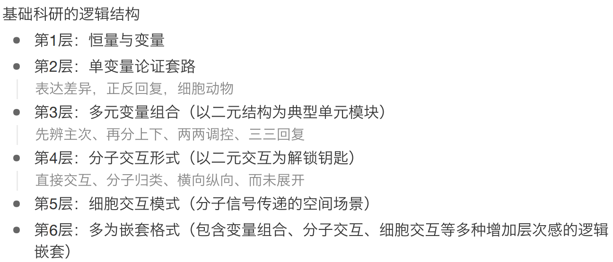

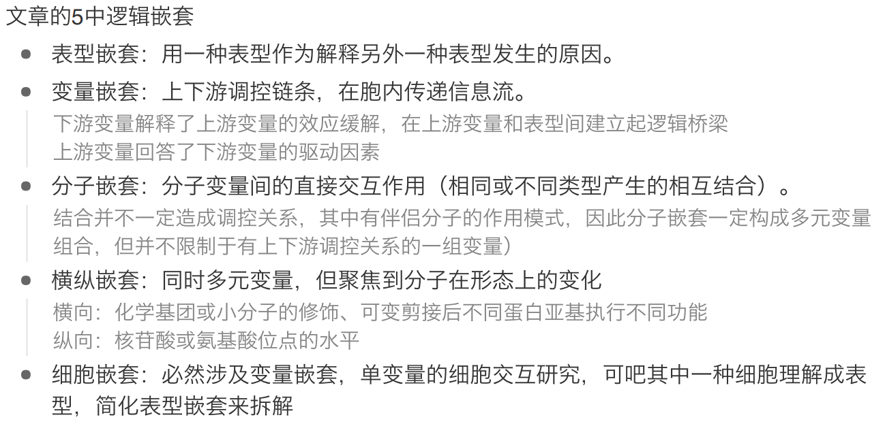

## 31.基础科研套路

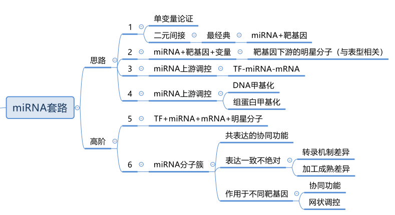

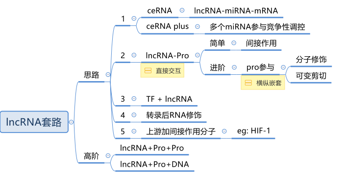

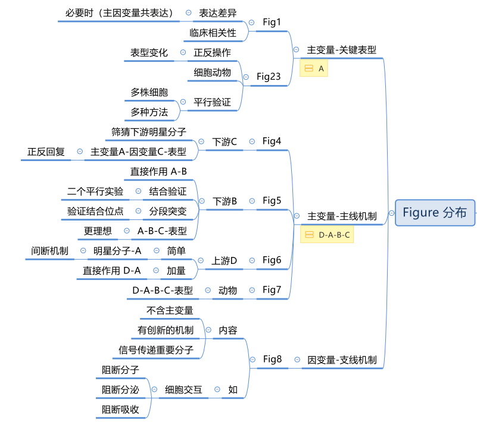

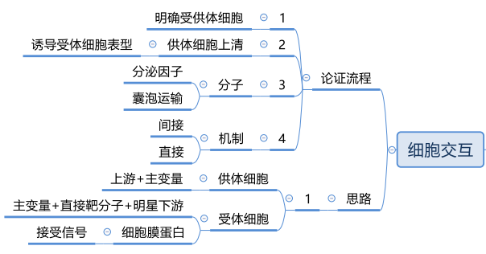

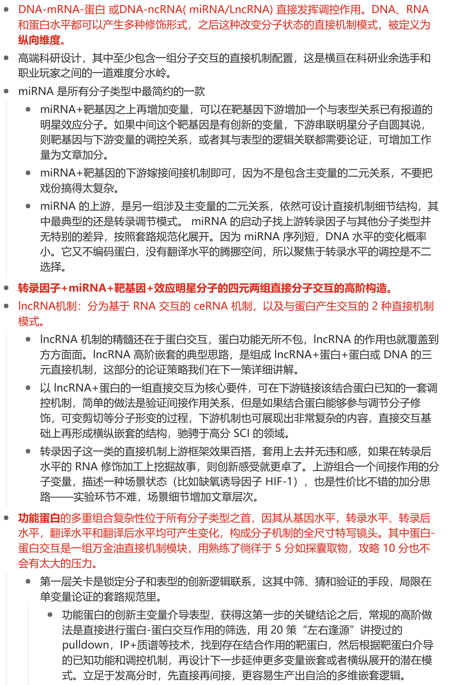

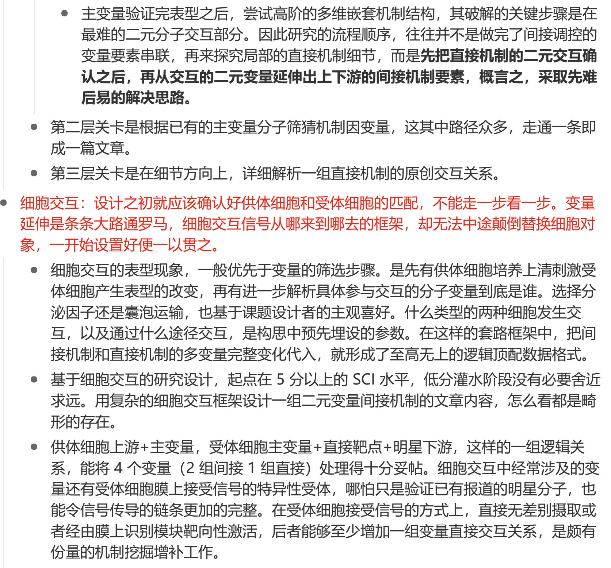

> 更新: 2022-10-17 15:46:09
> 原文: <https://www.yuque.com/doublehelix/bioinfonotes/ffotmi>
