# 生物学基础知识【总】

# 第一部分：细胞相关知识
## 一、细胞凋亡
### 凋亡概述
#### 细胞凋亡的研究历史
细胞死亡现象， 是细胞生物学领域中的核心议题之一。 细胞死亡现象， 也是生命新陈代谢的本质问题， 例如胚胎发育、 组织更新， 在增殖的淋巴细胞群体中选择适当的细胞克隆等等。在这些生物学过程中， 都涉及到细胞的死亡现象。 这种细胞生理性死亡的现象， 是有利于动物发育的。

最早在 1956 年， 有学者在发育生物学中提出一个叫做细胞程序性死亡的概念。 细胞程序性死亡（programmed cell death， PCD） ， 指的是生理性细胞死亡， 强调的是这个过程的生理学特性， 描述在一个多细胞生物中某些细胞死亡是个体发育中的一个预定的， 并受到严格程序控制的细胞和分子生物学过程， 是正常发育过程的一部分。  

随后在 1972 年， Keer （基尔） 根据细胞发生了和坏死完全不同的死亡过程而提出了细胞凋亡（apoptosis） 的概念。 随着生物学研究的深入， 生物学家越来越意识到细胞死亡， 特别是细胞凋亡， 具有特殊的生物意义。 细胞凋亡对于维持一个多细胞生物的组织或器官的完整性和平衡性， 具有不可替代的重要作用。 在多细胞生物的生长、 发育、 存活以及死亡等过程中，都伴随着细胞凋亡的过程。 从 80 年代开始， 细胞凋亡成为医学和生物学研究的热点。 2002年， 正是由于发现了细胞凋亡的规律， 三位科学家获得了诺贝尔医学和生理学奖。 他们分别是英国的西德尼-布伦南和约翰-苏尔斯顿， 美国的罗伯特-霍维茨。  

#### 凋亡的形态特征
在凋亡的发生过程中，细胞表现出非常明显的形态学特征。这些形态学特征主要有以下几点：  

1） 细胞丧失了表面结构， 形成光滑的轮廓， 从周围的正常细胞组织中分离了出来。

2） 细胞体积变小。 在细胞体积变小的过程中， 主要的形态学变化有： 胞浆内细胞器发生集中分布； 细胞膜出芽/起泡（bleb） ， 细胞发生皱缩。 但是在细胞体积变小的过程中， 细胞胞浆内的细胞器形态始终保持完整性。

3） 细胞核内染色质结构改变。 这是整个过程中形态学上最引人注意的形态变化。 染色质的形态学变化主要表现为： a） 染色质固缩（condensation） ； b） 染色质边缘化（margination） ；c） 细胞核内胞浆紧实（compaction） ； d） 细胞核的核膜折叠（fold） 。

4） 细胞形成凋亡小体（Apoptotic body） 。 在这一阶段， 凋亡细胞会裂解为很多由细胞膜包饶的小体。 在每一个凋亡小体内都有一簇细胞器。 由于细胞器被细胞膜包饶， 没有细胞内容物的外泄， 因此不会引起周围的炎症反应。

5） 凋亡细胞/凋亡小体被识别和被吞噬。 凋亡小体会被迅速吞噬， 形成吞噬体（phagosome），随后这些吞噬体进一步变性， 成为溶酶体残留小体（lysosomal residual body） 。  

#### 凋亡的细胞学过程
有学者根据凋亡的整个细胞学过程， 将整个细胞凋亡的过程分为三个阶段： 早期（early phase） ， 晚期（later phase） 和末期（at last） 。 在下图中， 把整个凋亡的细胞学过程通过图表的方式， 进行了总结。

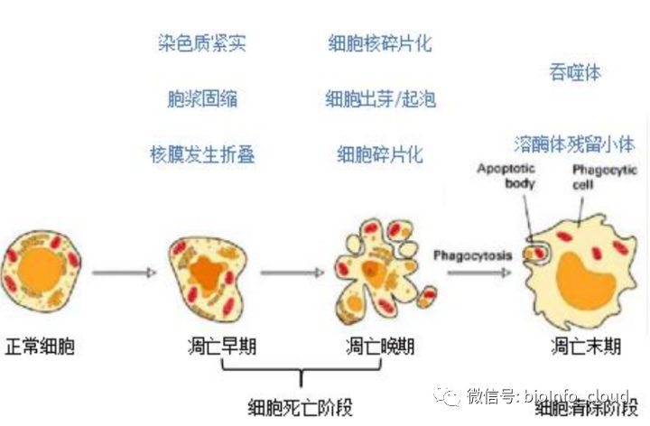

在细胞凋亡的早期阶段， 主要发生的细胞学现象是： 染色质变得紧实（compaction） ， 胞浆变得固缩（condensation） ， 细胞核的核膜发生折叠（fold） 。 在凋亡的晚期阶段， 细胞核发生碎片化现象， 细胞出现出芽/起泡（bleb） 的现象， 甚至连细胞都开始发生碎片化。 在凋亡的末期， 凋亡细胞所形成的凋亡小体， 被吞噬细胞所吞噬， 并最终完成整个细胞凋亡的过程。

通过实时影像学的研究发现， 凋亡过程开始得很突然。 在受到致死刺激之后不久， 被攻击的细胞突然出现细胞膜的皱缩， 细胞发生出芽/起泡的现象并且在细胞内激活凋亡的信号通路，这个时期仅仅持续几分钟。 然后迅速出现凋亡小体， 凋亡小体一旦形成停留在组织中被辨认出来的时间大约是 4-9 个小时。 这段时间和巨噬细胞在体内吞噬大的生物结构物并完全降解这些生物结构物所需要的时间大致相等。

由于整个细胞凋亡的过程是一个连续的细胞学行为过程， 从细胞的形态上， 有时很难把凋亡的早期和晚期非常严格地区分开， 因此， 有些学者提出把凋亡的早期和晚期合二为一， 称之为凋亡的细胞死亡阶段（the dying process） ； 把末期称之为凋亡的细胞清除阶段（the elimination process） 。

### 凋亡通路和关键分子
#### 凋亡通路核心分子家族成员
**（1）Bcl-2 家族**

Bcl-2 家族最有代表性的家族成员就是 Bcl-2 分子。 也正是因为 Bcl-2 分子研究得最为深入，也最广为人知， 因此 Bcl-2 不仅是分子的名称， 也成了家族的名称。 所以学员们在阅读文献时， 需要分清楚文章中出现的 Bcl-2 究竟指的是分子还是家族， 以免混淆。 Bcl-2 分子内含有四个同源结构域， 分别是 BH1-BH4。 家族成员根据分子内所含有的同源结构域的差异，可以分为三个不同的亚家族。

+ Bcl-2 亚家族。 属于这个亚家族的成员， 几乎都含有 BH1 和 BH2 结构域。 Bcl-2 亚家族成员对细胞凋亡起到抑制的作用。
+ Bax 亚家族。 Bax 亚家族都含有 BH3 结构域， 但是除了 BH3 结构域之外， 也含有其他的BH 结构域。 Bax 亚家族的成员所起到的作用和 Bcl-2 亚家族成员的功能， 正好相反， 它们起到促进细胞凋亡的作用。
+ BH3 亚家族。 这个亚家族内的成员， 只含有 BH3 结构域。 它们的作用也是促进细胞凋亡。

在 Bcl-2 家族内， 最明星的两个分子是 Bcl-2 分子和 Bax 分子。 当细胞内 Bax 高表达时， 细胞对死亡信号敏感， 促进了细胞发生凋亡。 当 Bcl-2 高表达时， Bcl-2 可以和 Bax 形成异源二聚体， 抑制细胞凋亡。 所以细胞内 Bcl-2/Bax 的比例对决定细胞凋亡的敏感性起到重要作用。

**（2）Caspase 家族**

Caspase 家族是一组蛋白酶， 介导即将死亡的细胞高效且特异的蛋白水解作用， 是细胞凋亡过程中非常重要的效应分子。

Caspase 蛋白水解酶有三个特征： 1） 都是半胱氨酸蛋白酶； 2） 作用位点都在天冬氨酸残基后的位点； 3） Caspase 家族成员都是以酶原的形式存在， 需要经过活化。

Caspase 家族成员， 可以按照功能分为三组：  

+ 凋亡启动亚类 Caspase 蛋白酶（apoptotic initiation） ： 这一类 Caspase 包括 Caspase-2、8、9 和 10。 它们是细胞凋亡的起始分子。  
+ 凋亡效应亚类 Caspase 蛋白酶（apoptotic execution） ： 这一类 Caspase 包括 Caspase-3、 6和 7。 它们是具体执行细胞凋亡的效应分子。 因此凋亡效应类的 Caspase 蛋白酶在信号传导的过程中始终处于凋亡启动类 Caspase 蛋白酶的下游。
+ 细胞因子激活类 Caspase 蛋白酶（cytokine activation） ： 这一类 Caspase 包括 Caspase-1、4、5 和 13。 这一类 Caspase 分子与细胞凋亡的关系不是很密切， 可能与多种炎症因子或者细胞因子的成熟有关。

#### 细胞凋亡的机制/通路
介导凋亡的通路有三条： 分别是线粒体通路； 内质网通路和死亡受体通路。

**（1） 线粒体通路**

在脊椎动物细胞凋亡过程中， 线粒体被认为是处于凋亡调控的中心位置。 在线粒体通路中，死亡信号激活含 BH3 结构域的 Bcl-2 家族成员， 例如 Bax。 这些含 BH3 结构域的 Bcl-2 家族成员（例如 Bax） 发生寡聚化， 并插入线粒体膜， 引起线粒体膜通透性改变， 跨膜电位丢失， 释放细胞色素 C(Cyt C)和其他蛋白。  

线粒体是细胞能量代谢的中心。 细胞凋亡过程中， 对线粒体损伤后最直接的结果是线粒体正常功能的丧失。 线粒体功能障碍， 除了会直接诱导细胞凋亡外， 还会导致自由基产生增加、兴奋性氨基酸释放增多、 钙离子超载等现象。 如果细胞的损伤程度相对较轻， ATP 能提供细胞凋亡所需的能量， 则发生细胞凋亡； 若细胞的损伤程度较为严重， ATP 急剧耗竭， 则细胞发生坏死现象。

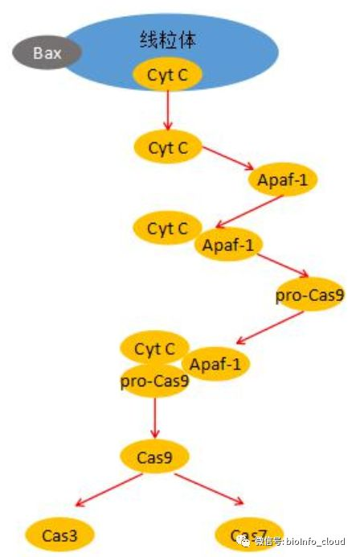

**（2） 内质网通路**

内质网是细胞内蛋白质合成的主要场所， 同时也是 Ca2+的主要储存库。 内质网在维持细胞内钙离子的稳定以及膜蛋白的合成、 修饰和折叠等方面都发挥关键性作用。 除了在蛋白合成过程中的作用外， 内质网也参与凋亡信号的处理和传递。

凋亡的内质网通路和线粒体通路或死亡受体介导的凋亡通路， 有很大的不同。 当内质网内，钙离子平衡被破坏或者内质网蛋白的过量积累， 都会诱导 Caspase-12 在内质网膜上的表达，同时内质网也介导了胞质的 Caspase-7 转移到内质网表面并激活 Caspase-12。 激活后的Caspase-12 可进一步剪切 Caspase-3， 引发细胞凋亡。

虽然由内质网功能失调引起的凋亡通路和由线粒体为靶点的凋亡信号明显不同。 但是， 内质网的功能失调在某种程度上可以影响线粒体通路的凋亡现象。 许多细胞在凋亡早期， 由于内质网中 Ca2+的释放， 会导致胞质内 Ca2+浓度迅速且持续的升高。 高浓度的 Ca2+可以激活胞质中的钙依赖性蛋白酶， 又可以作用于线粒体， 影响线粒体的通透性并导致线粒体膜电位的改变， 从而促进凋亡。 这两条通路之间是有一定的相关性的。

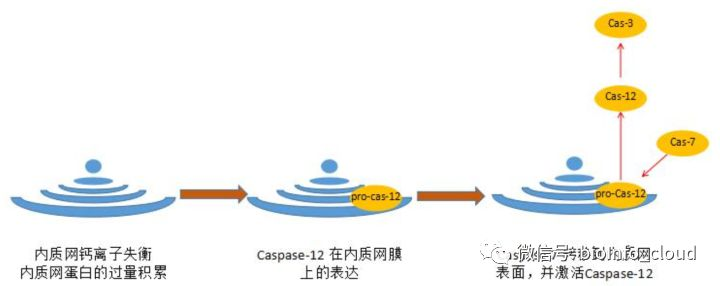

**（3） 死亡受体通路**

胞外的死亡信号可通过死亡受体转入胞内。 死亡受体为一类跨膜蛋白， 属于肿瘤坏死因子受体(TNFR)基因超家族。 它们胞外部分都含有一个富含半胱氨酸的区域， 胞质区有一个由同源氨基酸残基构成的结构。 这个结构具有蛋白水解功能， 被称为“死亡结构域” (death domain， DD)， 可使死亡信号得以进一步传递， 最终启动凋亡。

已知的死亡受体有五种：

+ TNFR-1 (又称 CD120a 或 p55)；
+ Fas(又称为 CD95 或 Apo1)；
+ DR3(死亡受体 3 death receptor 3， 又称 Apo3)；
+ DR4（死亡受体 4， 又被称为 TRAIL-R1）；
+ DR5（死亡受体 5， 又被称为 Apo2， TRAIL-R2)。

与死亡受体相互对应的就是死亡配体（ligand） 。 与 TNFR 对应的死亡配体是 TNF（肿瘤坏死因子） ； 和 Fas 对应的死亡配体是FasL(CD95L)； 和 DR3 对应的死亡配体是 Apo-3L(DR3L)； 和 DR4 以及 DR5 对应的死亡配体是 Apo-2L(TRAIL)。  

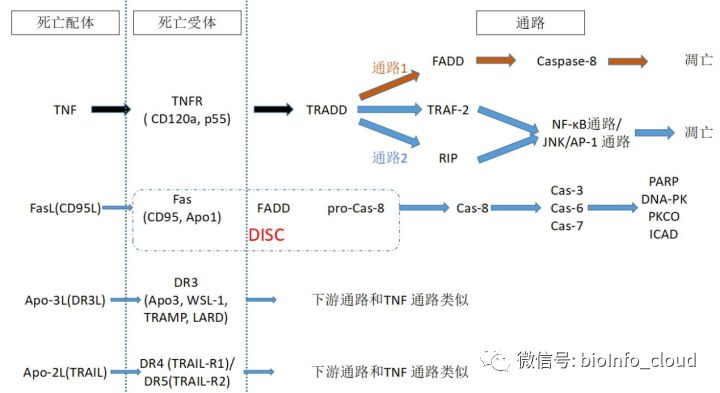

+ **Fas/FasL 通路**

Fas 又称为 CD95， FasL 又称为 CD95L， 因此 Fas/FasL 通路， 也被称为 CD95/CD95L 通路。Fas 死亡通路在免疫系统的发育过程中起到重要作用。 许多细胞都表达 Fas， 但是它的配体FasL 只在激活的 T 细胞和 NK 细胞中表达。 FasL 是一个同源三聚体， 每个三聚体分子结合3 个 Fas 分子， 一旦与三聚体的配体相结合， Fas 通过胞内段的 death domain（死亡结构域）招募胞质中含有死亡结构域的 Fas 相关蛋白（Fas-associated protein with death domain,FADD）。

FADD 氨基端含有一个死亡效应结构域（Death effector domain， DED 结构域） ， FADD 的DED 结构域和 Caspase-8 分子的 DED 结构域相互作用， 把 Caspase-8 募集到 Fas 区域， 从而形成 Fas、 FADD 和 Caspase-8 所组成的死亡诱导信号复合体（Death-inducing signaling complex， 缩写是 DISC） 。 Caspase-8 酶原被激活， 并自我剪切活化形成活性 Caspase-8。 活化的 Caspase-8 可激活下游的 Caspase-3、 Caspase-6、 Caspase-7。 激活后的 Casp-3、 6 和 7，又能剪切下游的很多底物， 包括 PARP、 DNA-PK、 蛋白激酶 CO（Protiein kinase CO， PKCO）和 ICAD（Inhibitor of caspase activated DNAase） 。 ICAD 剪接成 CAD 之后， 转运入核内，降解染色质 DNA。

+ **TNF-TNFR 通路**

TNF 通过 TNFR-I 和 TNFR-II 介导下游的生物学活性， 这两个 TNFR（TNF 受体） 在胞外结构域具有同源性， 但 TNFR-I 含有 DD 死亡结构域， TNFR-II 缺乏 DD 死亡结构域， 两个受体都可以介导凋亡。 研究证明， TNFRs 不具有酶解活性， 因此 TNFR 通过招募其他分子，传导 TNF-TNFR 下游的信号。

当 TNF 结合受体之后， TNFR 受体发生三聚体化， 然后招募一个衔接蛋白 TRADD（全称是 Tumor necrosis factor receptor type 1-associated DEATH domain protein ， 肿瘤坏死因子受体I 型相关死亡结构域蛋白）。 TRADD 可以再招募其他的三个衔接分子： FADD（就是 Fas/FasL通路中的 FADD 分子） 、 TRAF-2 （Tumor necrosis factor receptor-associated factor-2， 肿瘤坏死因子受体相关因子 2） 和 RIP（Receptor interactive protein， 受体相互作用蛋白）

如果 TRADD 和 RIP/TRAF-2 相互结合， 下游激活 NF-κB 通路或者 JNK/AP-1 通路； 如果TRADD 和 FADD 相互结合， 那么下游可以招募和活化 Caspases， 并激活凋亡通路。 因此，请大家要注意， 在 TNF/TNFR 通路传递到 TRADD 这里的时候， 通路开始了分叉。 如果TRADD 结合 TRAF-2/RIP， 下游激活 NF-κB 通络或者是激活 JNK/AP-1 通路； 如果 TRADD结合 FADD， 下游激活 Caspase， 从而诱导细胞发生凋亡。

+ **其他通路**

第三通路是 DR3 通路， 而第四条通路是 DR4/DR5 通路， 又被称为 TRAIL 通路。 特别需要说明的是 TRAIL 是配体， 又被称为 Apo-2L， 下游可以结合的死亡受体有两个： DR4（死亡受体 4） 和 DR5（死亡受体 5） 。 因此， 虽然有五种死亡受体， 但是只有四种死亡配体。 通路也只有四条。  

DR3/DR4/DR5 的氨基酸序列与 TNFR1 高度同源。 DR3/DR4/DR5 下游的信号通路和TNFR 类似， 也可以激活下游的 NF-κB 通路和 Caspase 介导的细胞凋亡反应。 与 TNF/TNFR 通路类似， DR3/DR4/DR5 通过 TRADD、 TRAF2 和 RIP， 激活 NF-κB 通路； 通过 TRADD、FADD，激活下游 Caspase-8， 并诱导细胞凋亡。

TNF/TNFR 通路和 DR3/DR4/DR5 通路具有极高的类似性， 那么这些通路在体内是如何发挥不同的作用的呢？ 研究发现， 主要是因为这些配体和受体的表达有明显的不同。 TNF 主要在激活的巨噬细胞和淋巴细胞中表达， 而 Apo3L 在许多正常组织中表达。 相反， TNFR1 在各种组织中广泛表达， 而 DR3 主要在脾脏、 胸腺和激活的 T 淋巴细胞中表达。 因此， 尽管信号传导机制类似， 但由于配体和受体的组织或细胞特异性表达分布， 使得 Apo3L-DR3 通路、 TRAIL-DR4/DR5 通路以及 TNF-TNFR 通路在不同的组织或器官内介导具有不同生物学功能的下游通路。

### 凋亡的检测方法
凋亡检测需要解决的问题有三个： 1） 研究体系中是否有凋亡现象发生， 这是一个定性的问题； 2） 凋亡的发生率。 这是一个相对的概念， 很多时候需要结合细胞群体的增殖率来分析，这样才能更客观、 更能反应细胞群体的生长状态； 3） 了解细胞凋亡的严重程度以及凋亡的发生阶段。常见的凋亡检测方法有很多。

#### 形态学方法
形态学检测主要是通过显微镜， 观察细胞甚至是亚细胞层面的形态变化和形态学特征。常见的有光学显微镜， 主要观察细胞缩小、 核浓缩、 细胞周围出现透明圈等现象； 相差显微镜， 主要观察细胞鼓泡， 凋亡小体的产生等现象。基于光学的显微镜，主要还局限于细胞层面的形态学研究和鉴定。如果要涉及到亚细胞形态，那就需要用到电子显微镜技术， 例如透射电镜。 通过透射电镜可以观察到细胞表面微绒毛的消失、 核染色质沿核膜分布、 新月体形成及凋亡小体的形成等现象。

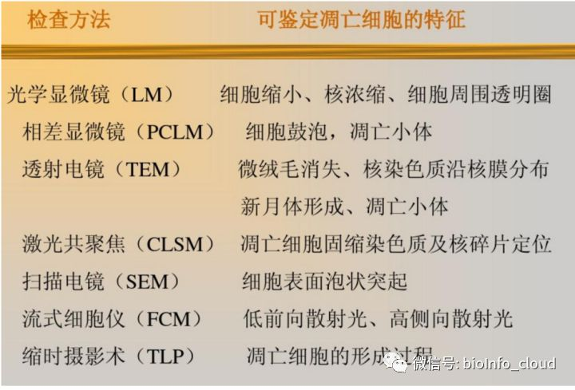

#### 流式细胞仪检测（Annexin V-PI 双染色实验）  
Annexin V-PI 双染色实验是用于检测凋亡的经典实验方法。 在正常细胞中， 磷酯酰丝氨酸只分布在细胞膜的脂质双分子层的内侧。 当细胞发生凋亡的早期阶段， 磷酯酰丝氨酸从细胞膜内侧外翻到细胞膜的外侧。

Annexin V 作为一种磷脂结合蛋白， 与磷酯酰丝氨酸有高度亲和性。 它通过细胞外侧暴露的磷酯酰丝氨酸与凋亡早期细胞的细胞膜结合。 因此， Annexin V 是检测细胞早期凋亡的灵敏指标。

PI 是一种核染料， 它不能透过完整的细胞膜。 但是在凋亡的晚期阶段或者是细胞发生坏死现象， 由于细胞膜的完整性已经遭到破坏， 使得 PI 能够透过细胞膜与细胞核发生结合。

因此， 通过 Annexin V-PI 双染色实验， 再通过流式细胞仪进行检测， 可以把细胞分为四种类型：

+ Annexin V 阴性且 PI 阴性（双阴性细胞） ， 这类细胞是活细胞；
+ Annexin V 阳性且 PI 阴性， 这类细胞是早期凋亡的细胞；
+ Annexin V 阳性且 PI 阳性（双阳性细胞） ， 这类细胞是晚期凋亡或者是坏死的细胞；
+ Annexin V 阴性且 PI 阳性， 这种情况可能是由于非特异性染色导致的。 因为 Annexin V阴性， 表示磷酯酰丝氨酸没有外翻， 说明细胞膜依然具有完整性。 PI 不能透过完整性的细胞膜和细胞核结合， 因此从理论上讲， 不存在 Annexin V 阴性而 PI 阳性的细胞。

#### 核酸电泳检测细胞凋亡（DNA 片段检测法）
当细胞发生凋亡时， 细胞中 DNA 发生断裂， 小分子 DNA 片段不断增加， 高分子 DNA 片段不断减少， 而且在细胞的胞浆内出现 DNA 片段。 但是凋亡细胞 DNA 断裂的特点是，DNA 断裂不是随机的， 而是由于内源性的内切酶作用， 因此 DNA 的断点都是规律性的发生在核小体之间， 因此出现的 DNA 片段都是 180-200bp 的片段或者是 180-200 bp 整数倍的 DNA 片段。 在凝胶电泳中， 如果出现这种特征性的电泳条带， 就可以判断细胞发生了凋亡。

#### 凋亡明星分子检测
通常检测明星分子， 采用的是 western blot 的方法检测蛋白。 因为， 在凋亡通路中， 线粒体通路实在是太重要了。 因此， 结合线粒体通路， 首先是检测激活的 Cas-9。 然后激活的 Cas-9再级联放大激活下游的 Cas-3， 所以 Cas-9 和 Cas-3 几乎是逃不掉的两个明星分子。 前体分子是 Pro-cas-9 和 Pro-cas-3。在检测之前，大家需要好好看看抗体的说明书。因为有些抗体只识别前体 Cas-9和前体 Cas-3，有些抗体即能检测前体 Cas-9 和前体 Cas-3， 又能检测激活后的 Cas-9 和 Cas-3。 所以， 需要看清楚抗体说明书， 免得事倍功半。 另外， Cas-3 激活后可以作用于很多的底物之上，最常检测的 Cas-3 的底物是 PARP 分子。另外， 在凋亡发生时， Bcl-2 家族成员发挥了重要的作用。 例如， 抑制凋亡的 Bcl-2 和促进凋亡的 Bax。 因此， 常常通过 western 检测 Bcl-2 和 Bax 的表达量， 通过 Bcl-2/Bax 的比值，表征细胞凋亡的程度。

对于死亡受体介导的凋亡通路， Fas、 FasL、 TNF 和 TNFR， 都是常规需要检测的明星分子。在 FasL-Fas 通路以及 TNF-TNFR 通路之下， 都涉及到 FADD 分子。 所以检测 FADD 也是非常常见的。 但是， 在 TNF-TNFR 通路之下， 由于这条通路非常地复杂， 具体检测哪个或者哪些分子， 就需要比较个性化地去选择了。

## 二、细胞周期
### 细胞周期概述
细胞周期（cell cycle） 是指细胞从一次分裂完成开始到下一次分裂结束所经历的全过程。 细胞周期是细胞生命活动的基本过程， 细胞在周期时相的变迁过程中进入增殖、 分化、 衰老和死亡等生理状态。

体外研究发现， 大多数细胞的细胞周期为 10 到 48 小时。 主要分为 4 期:

G1 期——DNA 合成前期， 是细胞周期的关键步骤。 细胞周期长短决定于 G1 期长度；

S 期——DNA 合成期；

G2 期——DNA 合成后期；

M 期——有丝分裂期。 M 期一结束， 2 个子代细胞就形成了。 这也标志着这一轮细胞周期的结束。

有些情况下， 也会把细胞周期分为 5 期。 在这种分类过程中， G1 期、 S 期、 G2 期和 M 期是相同的， 但是会增加一个 G0 期。 G0 期指的是某些细胞或某个阶段的细胞， 可从 G1 期退出细胞周期， 但是仍然存活。 这类细胞受某种刺激后仍能进入细胞周期， 继续进行 DNA 复制， 并进行有丝分裂， 这一时期被称为 G0 期。

在细胞周期的全过程中， 还有两个检查点（check-point） 。 这两个检查点分别是 G1/S期检查点和 G2/M 期检查点。 1） G1/S 期检查点， 控制着细胞从静止状态进入 DNA 合成期的调控； 2） G2/M 检查点的作用是： 决定细胞是否一分为二， 形成两个子代细胞。 如果通过 G2/M 检测点， 细胞的染色体收缩， 有丝分裂开始。 这两个检查点能够监视细胞周期调控的运作，确保基因和遗传物质准确遗传到子代细胞中。细胞周期调控是在上述检查点控制下，通过各种调控因子的激活和灭活， 使细胞依次启动和完成细胞周期循环的过程。

### 细胞周期过程中， 参与调控的关键分子
保罗·诺斯用遗传学和分子学方法， 识别克隆并描绘了细胞周期的一个关键调节物质 CDK（Cyclin-dependent kinase） 。 他发现 CDK 的功能在进化中被很好的保存了下来， CDK 是通过对其他蛋白质的化学修饰来驱动细胞周期的。 蒂莫西·亨特的贡献是发现了细胞周期蛋白（Cyclin） ——Cyclin 具有调节 CDK 的功能， Cyclin 和 CDK 相互配合能精准地调控细胞周期的全过程。 他发现细胞周期蛋白 Cyclin 在每次细胞分裂中都周期性地降解， 这个机制被证明对控制细胞周期的全过程都非常重要的作用。 这两类重要的蛋白， 再加上细胞周期蛋白依赖性激酶抑制因子(Cyclin dependent kinase inhibitor， CKI)。 这三类蛋白共同构成了 Cyclin—CDK—CKI 的信号调控网络，从而实现了细胞周期全过程的精确调控。

### 细胞周期过程的概述
首先， 生长因子与细胞表面的受体结合后， 刺激细胞由 G0 期进入细胞周期过程， 启动细胞内 fos、 jun 和 myc 等 immediate early gene 表达。 在这些 immediate early gene 作用下， 细胞开始激活 CDK 和 G1 期 Cyclin 等分子。 CDK 和 Cyclin 组装成有激酶活性的复合物，Cyclin/CDK 复合物能使 Rb 磷酸化， 使转录因子 E2F 从磷酸化的 Rb 蛋白上脱落下来， 游离的 E2F 可促使与 DNA 合成有关的一系列基因表达， 从而促使 DNA 合成， 推动细胞周期的进展。

pRb-E2F 是细胞 G1 和 S 期转换的一个经典调控途径。 参与细胞周期内源性调控的核心因子是 Cyclin 和 CDK。 其中， Cyclin 对于 CDK 的功能， 起到的是正向促进的作用， 而且 Cyclin 的周期性积累与降解对细胞周期的进程起着关键性的作用。CKI， 这个分子的名字中有一个 inhibitor， 对于 CDK起到负向的抑制作用。 CKI 能和 CDK 或 Cyclin 或 Cyclin-CDK 复合物结合， 抑制 CDK 的催化活性。 Cyclin 和 CKI 分别对 CDK 进行一正一反的调控。一旦这种正负调控的平衡被打破，细胞就可能发生异常增殖。

### Cyclin 和 CDK 的介绍  
在哺乳动物细胞， Cyclin总共有 8 类， 分别是 Cyclin A-H。 其中 Cyclin D 有 D1、 D2 和 D3 三种， Cyclin B 有 B1 和B2 两种。 所以 Cyclin 连同亚类， 总共有 11 种亚类。 Cyclin 含量随细胞周期时相的变化而变化， 不同的 Cyclin 在不同的周期时相内开始表达， 或者是达到含量和活性的峰值。 而 CDK在整个细胞周期中， 表达相对恒定的。 所以在整个细胞周期的调控过程中， 有明显周期性表达的 Cyclin 和表达相对稳定的不同的 CDK 相互结合形成复合物， 从而激活 CDK 的激酶活性， 达到在不同的时相精准调控细胞周期的功能。 因为 Cyclin 要和 CDK 相互结合成复合物之后， 才能发挥调控细胞周期的功能 。

Cyclin 对细胞周期的调控， 主要表现在 G1 期和 S 期/M 期。  

#### （1）G1 期的 Cyclin 及相关 CDK
G1 期 Cyclin 在 G1 期和 G1/S 期交界处发挥重要的作用。  G1/S 期和 G2/M 期恰好是两个非常重要的check-point（检查点） 。 因此， Cyclin 是整个细胞周期过程中最核心的分子。 Cyclin 的表达调控， 不仅保证了细胞周期的精准性， 同时也介导了检查点 check-point 功能。

G1 期 Cyclin 主要包括 Cyclin D1、 D2、 D3、 E 和 C。

Cyclin D1 是发现最早也是研究最深入的 Cyclin。 CyclinD1 在 G1 早期表达， 是细胞周期启动因子， 它也是生长因子感应器。 Cyclin D1 过表达使细胞加速从 G1 到 S 期转换，细胞快速通过 G1/S 检查点， S 期缩短； 阻断或敲除 CyclinD1， 使细胞发生细胞周期阻滞，可以诱导细胞发生凋亡。 Cyclin D 能和 CDK4 或 CDK6 结合， 形成复合物(到底是结合 CDK4还是结合 CDK6， 由细胞种类决定)。 Cylin D 与 CDK4/CDK6 结合后， 能使 CDK4/6 的 172位酪氨酸残基发生磷酸化， 激活 CDK 的激酶活性。

Cyclin E 的合成开始于 G1 中期， 表达水平最高是在细胞进入 S 期， 同时 Cyclin E 的降解也发生在 S 期， 而 Cyclin E 在 G2 和 M 期不表达。 Cyclin E 主要在 G1 晚期发挥作用,是G1 期和 S 期转换的限速因子。 在 G1 期和 S 期， Cyclin E 能和 CDK2 形成复合物， 能使 Rb因磷酸化而失活， 磷酸化的 RB 与 E2F 分离， 失去对 E2F 转录活化功能的抑制， 使细胞从G1 期进入 S 期。  

#### （2）S 期/M 期的 Cyclin 及相关 CDK
S 期的 Cyclin 主要是 CyclinA， M 期 Cyclin 主要有 Cyclin B。 它们分别在 S 期以及 G2 和 M期交界处发挥作用， 诱导细胞分裂。

A） S 期的 Cyclin 主要是 CyclinA， 在 G1 晚期开始增多， 在 S 和 G2 期达到表达峰值， 并能检测出激酶活性。 如果细胞内 CyclinA 表达受到抑制， 细胞周期会停滞在 S 期。 当细胞进入S 期之后， 由于 Cyclin E 的表达水平迅速降低， 从而使 G1 期的 CyclinE-CDK2 复合物解体。游离的 CDK2 又能和 S 期高表达的 Cyclin A 结合， 从而形成 Cyclin A-CDK2 复合物。 另外，也有报道， Cyclin A 也能与 CDK1 结合， 并且在 G2 期达到活性峰值， 随后迅速降解失活。不过， 传统观点还是认为在 S 期， Cyclin A 主要和 CDK2 形成复合物， 介导细胞通过 S 期。

B） M 期 Cyclin 主要有 Cyclin B， CyclinB 在 G1 晚期开始合成， 在 S 期表达升高， 在 G2 晚期和 M 期表达达到峰值， 并进入核内与 CDK1 结合形成复合物， 从而激活 CDK1 的激酶活性。 Cyclin B-CDK1 主要在 G2 末期发挥作用， 可以引导细胞进入有丝分裂的 M 期。 当细胞退出 M 期， Cyclin B 降解， CDK1 的激酶活性失活， 底物去磷酸化， 促进染色体的凝集，核膜核仁重建， 引导细胞进入下一个细胞周期。

不同的 Cyclin 分子在细胞周期的不同时相内的表达情况， 它们所发挥的功能以及能与他们相互结合的 CDK 等信息。

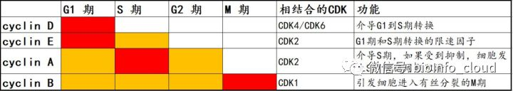

### CKI 的结构与功能
目前已知的 CKI（Cyclin dependent kinase inhibitor）可划分为两大类： 一类是Ink4(Inhibitor of CDK4)， 特异性抑制 CDK4-Cyclin D1 或者 CDK6-Cyclin D1 的磷酸化激酶活性； 另一类是 KIP(kinase inhibition protein)， 抑制大多数 CDK-Cyclin 的磷酸化激酶活性。

#### （1）Ink4 介绍
我们先介绍 Ink4， 现已知的 Ink4 包括 p16（Ink4a/MTS1）、 p15（Ink4b/MTS2）、p18（Ink4c）、p19（Ink4d） 。

这里有两个问题需要大家注意：

问题一： 这些基因都有很多个名称。 例如 P16、 p16INK4a、 MTS1， 指的都是同一个分子。 而且这些分子在文献中都很常见， 很难说哪个名称就比其他名称更普遍更被大家所接受。

问题二： 分子不能弄混淆。 比如我们在 NCBI 上查询 CDKN2A 这基因， 网站上会告诉你，这个基因有很多的其他名称， 例如 P16， p16INK4a， MTS1 等等， 除此之外还有其他的别称，例如 p14， p14ARF 等。 一般的读者看到这里， 都会想当然地认为 p14 和 p16 只是同一个分子的两种名称而已。 这就陷入了一种误区， 其实 p14 和 p16 是两个完全不同的蛋白， 发挥完全不同的功能。 编码 p14 和 p16 蛋白的基因都位于染色体的 9p21 位置， 编码 p14 的基因和编码 p16 的基因有共同的外显子 2 和 3， 但是它们的外显子 1 是不同的。 p14 是外显子 1β； 而p16 是外显子 1α。 由于 p14 和 p16 的外显子 1 不同， 而且发生了读码框的移位， 导致 p14和 p16 的蛋白序列也是不同的， 所以 p14 和 p16 是完全不同的两个蛋白分子， 序列不同， 参与的信号通路也不同。 p16 属于 CKI， 参与 p16-Cyclin D1/CDK4 复合物到 Rb 的信号传递，也就是调控细胞周期的 Rb 途径； 而 p14 参与 p14-MDM2-p53 信号通路的调控， 通过解除MDM2 介导的 p53 信号的抑制， 使得 p53 表达升高， 最终启动细胞周期的阻滞或凋亡。 虽然从最终的效应来看， p14 和 p16 都能导致细胞周期的阻滞， 但是它们所参与介导的信号通路是完全不同的。

Ink4 蛋白的 N 末端含有 4 个钩状重叠组成的二级结构， 和 CyclinD1 的序列有很高的同源性， 因此 Ink4 能和CyclinD1 竞争性结合 CDK4 或者 CDK6， 抑制 CyclinD-CDK4/CDK6 的复合物， 从而抑制了Rb 的磷酸化作用， 使得 E2F 与未磷酸化的 Rb 结合， 阻断了 E2F 依赖的基因转录， 最终实现抑制细胞周期进展的效果。 Ink4 失活将导致细胞周期调控紊乱， 目前已在多种肿瘤如胰腺癌、 非小细胞肺癌、 神经胶质细胞癌、 急性白血病等中发现存在 p16Ink4a 基因缺失的现象。  

#### （2）KIP 的介绍  
KIP 全称是 kinase inhibition protein， 激酶抑制蛋白。 现已知的 KIP 包括 p21cip1 (Cyclin inhibition protein 1)、 p27kip1 (kinase inhibition protein 1)及 p57kip2 三种细胞周期抑制蛋白。这三个 KIP 分子在 N 末端有结构及功能的相似性， 都含有一个保守的 80 个氨基酸序列， 能抑制 CDK4-CyclinD1、 CDK6-CyclinD1、 CDK2-CyclinE、 CDK2-CyclinA 的蛋白激酶复合物的活性。 虽然三个 KIP 分子： p21、 p27 和 p57， 在 N 末端有序列上的相似性， 但是它们 C末端区域含有各不相同的功能区。 p27kip1 C 末端有一个苏氨酸的磷酸化位点， 可以抑制 H1组蛋白的磷酸化； p21cip1 C 末端有 40 个氨基酸残基的肽段， 可以和 DNA 聚合酶δ的辅助因子 PCNA发生结合， 从而覆盖了 PCNA 的某些功能区， 使 PCNA 不能与 DNA 聚合酶δ形成复合物， 从而影响 DNA 复制。  

#### （3）小结
总结一下， CKI（细胞周期蛋白依赖性激酶抑制因子） 可以分为两大类， 一类是 Ink4， 代表分子 p16、 p15、 p18 和 p19。 Ink4 分子和 Cyclin 有结构上的相似性， 可以通过竞争性结合的方式， 阻断 CyclinD 和 CDK4/CDK6 的复合物， 从而阻断细胞周期； 另一类是 KIP（激酶抑制蛋白） ， 代表分子是 p21、 p27 和 p57。 KIP 分子也可以阻断 Cyclin 和 CDK 之间的复合物， 在这一点的功能上， KIP 和 Ink4 类似， 但是 KIP 分子的 C 末端差异很大， 从而介导了不同 KIP 分子发挥不同的特异性功能。

### 细胞周期调控途径及机制
细胞周期的顺利进展需要 Cyclin、CDK、CKI多因素之间相互协同作用。目前研究发现 Cyclin、CDK、 CKI 对细胞周期的作用主要通过两条途径来实现， 一条是 Rb 为主的网络调控途径；另一条是 p53 为主的调控途径。

#### 以 Rb 为主的网络调控途径
+ 生长因子结合相应的受体， 通过信号传递， 促进 Cyclin 基因表达；
+ Cyclin 与相应 CDK 结合， 形成 Cyclin-CDK 激酶复合物,促进 Rb 蛋白磷酸化；
+ 非磷酸化的 Rb 原本和转录因子 E2F 相互结合。 在发生磷酸化之后， Rb 释放核转录因子E2F；
+ 游离的 E2F 进入核内， 结合一系列具特殊序列的基因启动子区， 促进下游基因的表达；
+ 这些基因的产物促进细胞进入细胞周期的程序。

####  以 p53 为主的调控机制
哺乳动物细胞在受到 DNA 损伤后， 细胞周期的进程将会停滞于两个关键的检查点， 即 G1/S检查点和 G2/M 检查点。 抑癌基因 p53 主要在 G1 检查点上发挥重要作用。 p53 可作为转录因子， 诱导下游蛋白的产生， 从而达到调控细胞周期的作用。 常见的机制有三种：

+ p53 可诱导 p21 的表达。 p21 基因启动子区域具有 p53 结合位点。 p53 能与其结合并激活p21 基因转录。 当细胞 DNA 受损后， p21 基因在 p53 诱导下表达水平可升高， 能抑制 CDK活性， 尤其是 CyclinD-CDK4 复合物活性， 阻止细胞从 G1 期进入 S 期， 使细胞停止于 G1期， 从而有更多的时间修复 DNA 模板。 如果 DNA 损伤严重无法修复， 将导致细胞凋亡。
+ p53 可诱导 GADD45 合成。 GADD45 可以结合 PCNA， 抑制 DNA 合成， 从而抑制细胞进入 S 期。
+ 诱导 Bax 产生。 Bax 为凋亡相关基因， 与 bcl-2 相同作用， 共同调节细胞凋亡。在 p53 通路中， p53 可诱导产生 p21， 而 p21 本身就是 CKI， 在 Rb 调控机制中有重要作用。因此， Rb 调控通路与 p53 调控通路并不是完全独立分开的， 而是在某些调节子之间存在着相互作用(crosstalk)。

### 细胞周期相关的实验检测  
#### 检测明星分子
看前面相关分子

#### PI 染色实验
检测细胞周期， 除了上面提到的检测明星分子之外， 更常用的细胞学检测方法是 PI 染色实

验。 简单介绍一下原理： 在细胞周期的整个过程中， G0/G1 期发生于 DNA 复制之前， 因此细胞内染色体表现为两倍体(2N)； 而在 S 期， DNA 发生复制， 因此 S 期的细胞染色体介于两倍体和四倍体之间（2N < 染色体< 4N） ； 在 G2/M 期， 由于 DNA 已经复制完成， 因此细胞内染色体数量是四倍体（4N） 。 PI 全称是碘化丙啶。 它是插入性核酸荧光染料， 能选择性地嵌入核酸 DNA 双链螺旋的碱基之间并发出荧光。 PI 结合的量与 DNA 的含量成正比例关系， 用流式细胞仪进行分析就可以得到细胞周期各个阶段的 DNA 分布状态， 从而计算出各个细胞周期时相的百分含量。

细胞自噬是指细胞在外界环境因素的影响下， 细胞利用溶酶体降解自身受损、 变性或衰老的大分子物质以及细胞器的自我消化过程。 自噬是细胞的一种自我保护机制， 广泛存在于真核细胞内， 在调节细胞生存和死亡的过程中， 起着重要的作用。 

当细胞发生自噬后， 在自噬相关基因的调节下， 细胞通过单层或双层膜， 包裹待降解的细胞质或细胞器， 形成囊泡状的自噬体（autophagosome） 。 然后自噬体再和溶酶体（lysosome）发生融合形成自噬溶酶体（autolysosome） ， 由溶酶体内的一系列水解酶， 降解自噬溶酶体内所包裹的内容物， 以实现细胞对自身代谢和能量的更新。 

## 三、细胞自噬
### 自噬的细胞学分类及过程 
根据细胞内物质运输到溶酶体的方式以及生理功能的差异， 哺乳动物的细胞自噬可以分为三种类型： 大自噬/宏自噬（macroautophagy） ， 小自噬/微自噬（microautophagy） 和分子伴侣介导的自噬（chaperone-mediated autophagy， CMA）。 

1） 大自噬/宏自噬： 我们通常所说的自噬指的就是大自噬/宏自噬。 在大自噬的过程中， 细胞质中可溶性的大分子物质以及变性的细胞器， 被内质网、 线粒体来源的单层或双层膜包裹形成自噬体。 接着自噬体的外膜与溶酶体膜融合， 进一步形成自噬溶酶体， 自噬体内的待降解物被一系列的水解酶降解， 最终完成整个的自噬过程。

2） 小自噬/微自噬： 与大自噬过程不同， 是溶酶体膜自身发生内陷， 包裹和吞噬细胞内待降解的底物， 并在溶酶体内发生降解。 小自噬与大自噬的区别就在于， 在小自噬过程中胞质成份是直接被溶酶体包裹， 没有形成自噬体的过程。

3） 分子伴侣介导的自噬： 在分子伴侶介导发生的自噬过程中， 其待降解的底物都是可溶性的蛋白质分子。 分子伴侣蛋白识别带有特定氨基酸序列的底物蛋白质分子， 并与之结合， 然后再经溶酶体膜上的受体 Lamp2a（lysosome-associated membrane protein 2， Lamp2） 转运到溶酶体； 底物蛋白分子再在溶酶体内， 被水解酶降解。 因此， 分子伴侣介导的自噬与前两者不同， 在降解蛋白时具有选择性。 而大自噬和小自噬现象中， 一般而言， 在降解蛋白时没有明显的选择性。  

### 自噬信号通路
在自噬过程中， mTORC1 处于整个自噬过程的起点。 因为在正常细胞内 mTORC1 处于激活状态， 磷酸化了 ATG13， 抑制了 ATG13-ATG1-ATG17 复合物的形成， 也抑制了细胞的自噬过程。 只有当细胞在营养和能量缺乏、 蛋白质累积或者应激状态等情况下， mTORC1 的活性会受到抑制， ATG13 的磷酸化水平降低， 从而导致自噬水平会迅速被诱导上调。因此， 细胞内的信号通路如果可以影响到 mTORC1 的活性， 那么就能调控下游自噬的过程。目前常见的可以影响 mTORC1 活性的通路有三条： 1） AMPK-mTORC1 通路， 2） class IPI3K/AKT/mTORC1 通路， 3） Ras/Raf/MEK/ERK 通路。

1)AMPK-mTORC1 信号通路： AMPK 的激活能磷酸化结节性硬化症 TSC1/2 复合物， 从而促进 mTORC1 的失活， 诱导细胞自噬水平的提高。 TSC1/2 复合物是异二聚体， TSC1 具有稳定作用， TSC2 能抑制 mTORC1 激活所必须的小 GTP 酶 Rheb (Ras homolog enriched inbrain)， 实现对 mTORC1 的抑制作用。 AMPK 也能直接磷酸化 Raptor（Raptor 本身也是mTORC1 复合物中的一个关键组分蛋白）， 抑制 mTORC1， 上调细胞自噬。

2） class I PI3K/AKT/mTORC1 通路： PI3K 根据结构的不同分为三类： class I PI3K、 class IIPI3K 以及 class III PI3K， 在细胞增殖和存活的过程中具有重要的作用。 目前研究较为广泛的是 class I PI3K， 它是自噬的负调节分子。 我们通常所说的 PI3K/AKT 信号通路中的 PI3K通常都是指 ClassⅠPI3K。 ClassⅠPI3K 能在细胞中产生第二信使 PIP3， PIP3 在磷脂酰肌醇脂依赖性蛋白激酶 1(PDK1)的协助下激活 AKT， 激活的 AKT 能够抑制 TSC1/2 复合物， 从而激活 mTORC1， 抑制细胞自噬。 另外， 抑癌基因 PTEN 可以通过抑制 Class I PI3K 的活性， 诱导细胞自噬水平的上调。

3） Ras/Raf/MEK/ERK 通路： Ras-Raf-MEK-ERK 信号通路在肿瘤细胞中表现活跃， 它与细胞自噬的具体机制还仍然待研究。 但研究表明 ERK 能通过抑制 TSC1/TSC2 的活性， 调节细胞自噬水平， 促进肿瘤细胞的形成。 另外， Ras 也能通过 Class I PI3K/AKT 通路调节细胞自噬。

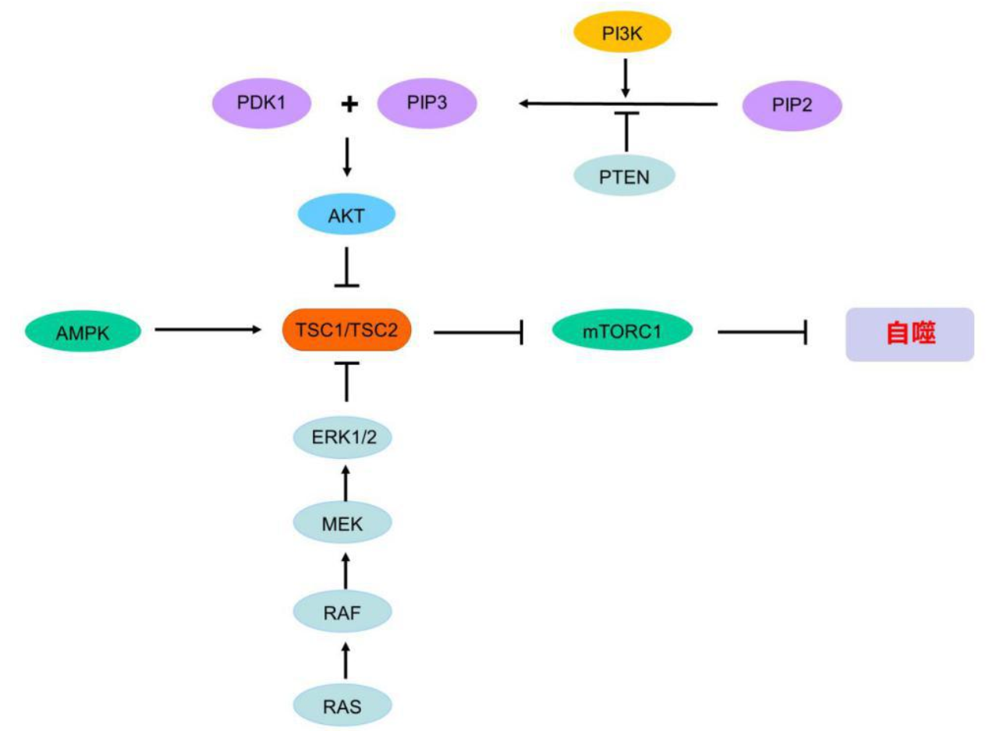            

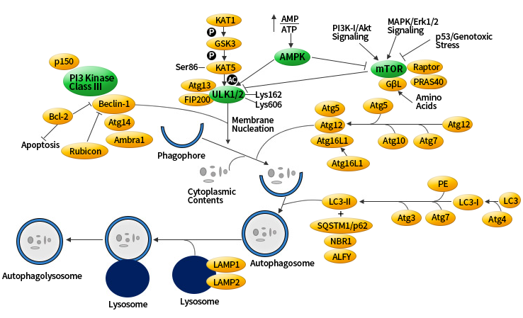            

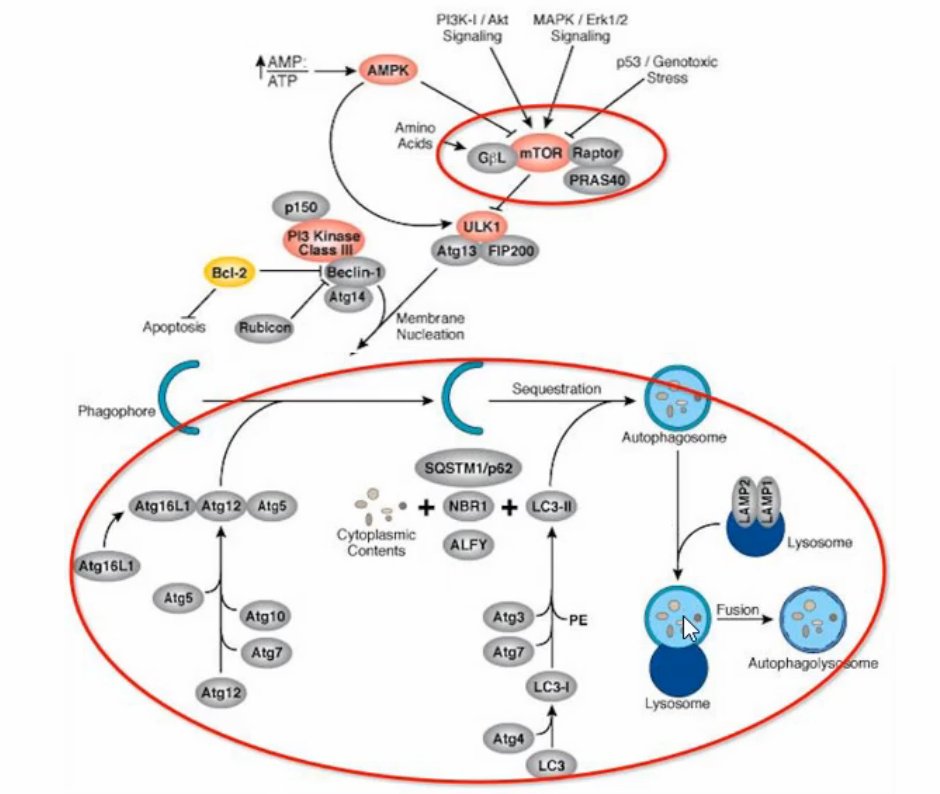            

### 自噬与凋亡的关系
细胞凋亡也被称为 I 型程序性细胞死亡； 自噬则被称为 II 型程序性细胞死亡。 凋亡和自噬是两种显著不同的细胞死亡形式， 两者在形态、 生化指标以及调控细胞死亡的过程上都存在着较大的差异， 但两者又不是两个完全独立的过程。 许多研究表明， 凋亡和自噬的作用以及功能在某些情况下也是相互影响和制约的。 自噬和凋亡之间存在着三种不同类型的相互作用，而且每种类型都对应着相应的特定的细胞类型、 刺激和环境。 

1） 自噬和凋亡互相协同， 共同促进细胞死亡。 两种效应之间， 可以其中一种效应影响另一种效应； 自噬也可以作为凋亡的上游调节因子， 直接调控细胞凋亡， 从而影响细胞的死亡；

2） 自噬可以通过促进细胞存活而拮抗细胞的凋亡效应。 比如， 可以通过去除因氧化应激受损的细胞器， 或降解变性的大分子物质， 为饥饿的细胞提供生存所需要的营养和能量； 或者通过降解未折叠的蛋白来抑制内质网应激。 自噬的这些功能将会抑制促凋亡信号的产生， 从而起到拮抗细胞凋亡的作用。 

3） 自噬有时虽然自身并没有导致细胞死亡， 但却参与了细胞凋亡的过程。 比如自噬参与了一些 ATP 依赖的凋亡过程。 

### 自噬的分子机制和特征
1) 自噬诱导阶段（induction） ： 正常生理状态下， 细胞保持很低的基础自噬水平。 这时细胞内能量充足，哺乳动物雷帕霉素靶蛋白复合物 1(也就是 mTOR 复合物 1，也叫做 mTORC1)处于活化的状态。 活化的 mTORC1 通过磷酸化的方式使得 ATG13 发生磷酸化反应， 从而抑制细胞的自噬。 

当细胞在营养和能量缺乏、 蛋白质累积、 应激状态等情况下， mTORC1 的活性会受到抑制，ATG13 的磷酸化水平降低， 从而导致自噬水平会迅速被诱导上调。哺乳动物的自噬诱导过程主要通过 ATG1 复合物来介导。 ATG1 复合物除了包含有 ATG1 之外， 还包含有 ATG13 和 ATG17。 ATG1 复合物能形成的主要原因是， 在营养和能量缺乏、应激状态等条件下， mTORC1 的活性受到抑制， 使得 ATG13 的磷酸化水平降低， 导致去磷酸化的 ATG13 与 ATG1 形成复合物， 并与 ATG17 相互作用， 产生 ATG13-ATG1-ATG17 的复合物， 并诱导下游自噬体的成核（nucleation） 和延伸（elongation） 。

注意： ATG1 在哺乳动物中的同源蛋白是 ULK1， 所以这个 ATG1 复合物也被称为ULK1 复合物。 另外， ATG 17 在哺乳动物中的同源蛋白是 FIP200。

2） 成核过程（vesicle nucleation） ： 成核过程和 Vps34-ATG6 复合物密切相关。 这个复合物还包含有调节性蛋白激酶 Vps15， 共同作用于膜泡的成核， 介导 PAS(也就是前自噬体结构pre-autophagosomal structure)的形成。

Vps34-ATG6 复合体还可以召集 ATG12-ATG5 和 ATG16 多聚体以及 LC3， 并通过后两者促进吞噬泡的伸展扩张。  Vps34 在哺乳动物中的同源蛋白是 class III PI3K； ATG6在哺乳动物中的同源蛋白是 Beclin-1， 所以 Vps34-ATG6 复合体， 也被称为 PI3K-Beclin-1复合物。 

3） 自噬体的延伸阶段： 这个过程的分子机制是最为复杂的。 哺乳动物自噬体的延伸主要依赖于两个类泛素化的系统： a） ATG12 的结合过程； b） LC3 的修饰过程。

ATG12 的结合过程是类似泛素化的过程， 需泛素活化酶 E1 和 E2 的参与。 ATG12 首先由 E1样酶 ATG7 活化， 再通过 E2 样酶 ATG10 转运并结合 ATG5， 然后和 ATG16 结合， 生成ATG12-ATG5-ATG16 的多体复合物。 这个复合物定位于前自噬体结构的外膜表面， 并参与前自噬体外膜的扩张。 

LC3 在酵母中的同源基因是 ATG8。 LC3 的修饰过程同样需要类似泛素活化酶 E1 和 E2 的参与。 LC3 前体形成后被 ATG4 加工成胞浆可溶性的 LC3-Ⅰ， 然后在 E1 样酶 ATG7 和 E2样酶 ATG3 的作用下， 和磷脂酰乙醇胺(PE)共价连接成为脂溶性的 LC3-PE（也就是 LC3-II），并参与膜的延伸。 LC3-Ⅱ能够与新形成的膜结合， 直到自噬溶酶体(Autolysosome)的形成。因此， LC3-Ⅱ常用作自噬形成的标识物， 也是一种重要的定位于自噬泡膜上的多信号传导调节蛋白。

哺乳动物的 ATG12-ATG5 类泛素化过程和 LC3 类泛素化过程并不是独立运行的， 它们之间可以相互作用、 相互调节。 

 4） 自噬体的成熟阶段： 自噬体的成熟主要是指自噬体通过微管骨架在转运必须内吞体分类复合物(ESCRT)和单体 GTP 酶(Rab S)作用下， 与溶酶体融合形成自噬溶酶体的过程。 参与成熟阶段的溶酶体相关蛋白还包括： LAMP1、 LAMP2、 UVRAG(紫外线抵抗相关肿瘤抑制基因)。

5） 自噬体的裂解阶段： 是指自噬溶酶体膜的裂解及内容物在溶酶体水解酶的作用下降解的过程。 降解过程中产生的氨基酸及部分蛋白可以为细胞提供营养、 能量或循环利用。 

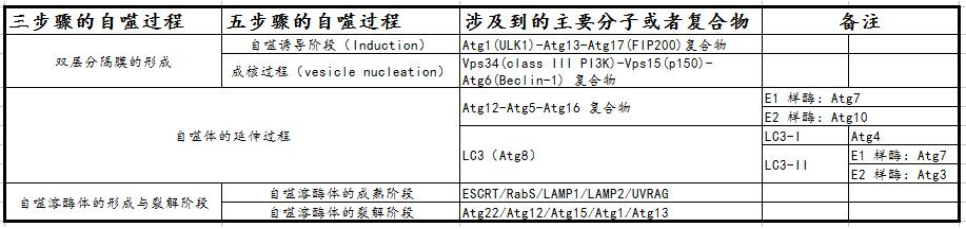            

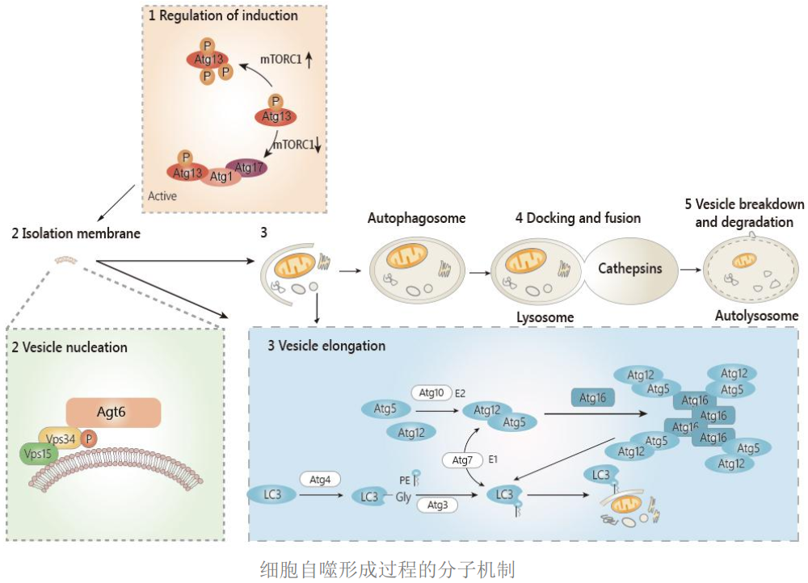

### 自噬诱导剂
a) Bredeldin A / Thapsigargin / Tunicamycin ：模拟内质网应激

b) Carbamazepine/ L-690，330/ Lithium Chloride（氯化锂）：IMPase 抑制剂（即Inositol monophosphatase，肌醇单磷酸酶）

c) Earle's平衡盐溶液：制造饥饿

d) N-Acetyl-D-sphingosine（C2-ceramide）：Class I PI3K Pathway抑制剂

e) Rapamycin：mTOR抑制剂

f) Xestospongin B/C：IP3R阻滞剂

### 自噬抑制剂
a) 3-Methyladenine（3-MA）：（Class III PI3K） hVps34 抑制剂

b) Bafilomycin A1：质子泵抑制剂

c) Hydroxychloroquine（羟氯喹）

除了选用上述工具药外，一般还需结合遗传学技术对自噬相关基因进行干预：包括反义RNA干扰技术（Knockdown）、突变株筛选、外源基因导入等。

### 自噬的检测手段 
自噬的评估通常采用多个自噬阶段的标志物，因为自噬小体数量的增加可能是自噬上调也可能是自噬最后阶段降解被抑制所致，所以设置合适的对照很有必要。

1. 透射电镜，电镜观察自噬体和溶酶体的超微结构；
2. WB检测标志物LC3/Atg8和p62/SQSTM1；生化检测自噬体膜标志蛋白， 特别是ATG12、 ATG5 和 LC3；荧光显微镜检测 LC3 或GFP-LC3 斑点的形成； 生化检测自噬底物 p62
3. WB检测Lamps、Atg5、Atg14和Beclin-1。
4. 组织蛋白酶Cathepsin活力检测
5. IF检测自噬潮autophagic flux

自噬过程进行观察和检测 细胞经诱导或抑制后，需对自噬过程进行观察和检测，常用的策略和技术有：

（1）观察自噬体的形成

由于自噬体属于亚细胞结构，普通光镜下看不到，因此，直接观察自噬体需在透射电镜下。Phagophore的特征为：新月状或杯状，双层或多层膜，有包绕胞浆成分的趋势。自噬体（AV1）的特征为：双层或多层膜的液泡状结构，内含胞浆成分，如线粒体、内质网、核糖体等。自噬溶酶体（AV2）的特征为：单层膜，胞浆成分已降解。（autophagic vacuole，AV）

（2）在荧光显微镜下采用GFP-LC3融合蛋白来示踪自噬形成

由于电镜耗时长，不利于监测（Monitoring）自噬形成，人们利用LC3在自噬形成过程中发生聚集的现象开发出了此技术。无自噬时，GFP-LC3融合蛋白弥散在胞浆中；自噬形成时，GFP-LC3融合蛋白转位至自噬体膜，在荧光显微镜下形成多个明亮的绿色荧光斑点，一个斑点相当于一个自噬体，可以通过计数来评价自噬活性的高低。

（3）利用Western Blot检测LC3-II/I比值的变化以评价自噬形成自噬形成时，胞浆型LC3（即LC3-I）会酶解掉一小段多肽，转变为（自噬体）膜型（即LC3-II），因此，LC3-II/I比值的大小可估计自噬水平的高低。

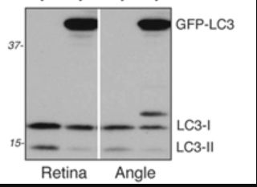            

（注意：LC3抗体对LC3-II有更高的亲和力，会造成假阳性。需要多种检测方法结合使用，同时需考虑溶酶体活性的影响。）

（4）检测长寿蛋白的批量降解：非特异

（5）MDC（Monodansylcadaverine，单丹磺酰尸胺）染色：包括自噬体，所有酸性液泡都被染色，故属于非特异性的。

（6）CellTrackerTM Green染色：主要用于双染色，但其能染所有的液泡，故也属于非特异性的。

自噬相关蛋白的定位 在研究自噬相关蛋白时，需对其进行定位。

由于自噬体与溶酶体、线粒体、内质网、高尔基体关系密切，为了区别，常用到一些示踪蛋白在荧光显微镜下来共定位：

Lamp-2：溶酶体膜蛋白，可用于监测自噬体与溶酶体融合。

LysoTrackerTM 探针：有红或蓝色可选，显示所有酸性液泡。

pDsRed2-mito：载体，转染后表达一个融合蛋白（红色荧光蛋白+线粒体基质定位信号），可用来检测线粒体被自噬掉的程度（Mitophagy）。

MitoTraker探针：特异性显示活的线粒体，荧光在经过固定后还能保留。

Hsp60：定位与线粒体基质，细胞死亡时不会被释放。

Calreticulin（钙网织蛋白）：内质网腔

（注意：这些蛋白均为胞浆蛋白，爬片或胰酶消化的细胞在做免疫荧光前需先透膜（permeablize），可采用0.1%SDS处理。）

### 自噬研究常规思路
通常情况下，除了研究自噬现象本身，大家更多的是将自噬与各种生命活动或者疾病结合起来，把自噬作为这些方向的一个机制来研究。比如研究自噬如何参与肿瘤的发生发展、如何参与肿瘤的耐药性与复发转移、如何参与肿瘤免疫治疗的效果、如何参与炎症反应、如何参与氧化应激，如何参与自闭症、阿尔兹海默症的发生与治疗等，通常的研究模式：

1. 证明自噬参与了相关研究表型（电镜、LC3II/I-WB、LC3亚细胞定位、LC3荧光示踪监测自噬流等）
2.  证明自噬在表型中起到关键作用（通过自噬抑制剂、激动剂进行关联研究）
3. 找到表型与自噬桥梁分子（检测pI3K通路、Beclin-1、ATG家族各成员）
4. 在基因层面通过gain of/lost of function研究桥梁分子在自噬中的作用。

### 研究自噬的文献参考
[1]. Emerging Mechanisms in Initiating and Terminating Autophagy. Trends Biochem Sci. 2017 Jan;42(1):28-41.

[2]. Targeting autophagy in cancer. Nat Rev Cancer. 2017 Sep;17(9):528-542.

[3]. Autophagy: controlling cell fate in rheumatic diseases. Nat Rev Rheumatol. 2016 Sep;12(9):517-31.

[4]. Crosstalk between autophagy and inflammatory signalling pathways: balancing defence and homeostasis. Nat Rev Immunol. 2016 Nov;16(11):661-675.

[5]. Autophagy and Neurodegeneration: Pathogenic Mechanisms and Therapeutic Opportunities. Neuron. 2017 Mar 8;93(5):1015-1034.

[6]. Activating autophagy to potentiate immunogenic chemotherapy and radiation therapy. Nat Rev Clin Oncol. 2017 Apr;14(4):247-258.

[7]. Epigenetic Control of Autophagy: Nuclear Events Gain More Attention. Mol Cell.2017 Mar 2;65(5):781-785.

[8]. Pharmacological modulation of autophagy: therapeutic potential and persisting obstacles. Nat Rev Drug Discov.2017 Jul;16(7):487-511.

### 人自噬相关基因
人自噬数据库：[<u>http://www.autophagy.lu/index.html</u>](http://www.autophagy.lu/index.html)

自噬相关基因：[<u>https://docs.qq.com/sheet/DTGxMQmtxcXJZcFhF?c=K18A0A0</u>](https://docs.qq.com/sheet/DTGxMQmtxcXJZcFhF?c=K18A0A0)

网站：[<u>http://thanatos.biocuckoo.org/result.php?type=simple</u>](http://thanatos.biocuckoo.org/result.php?type=simple)

## 四、细胞衰老
### 细胞衰老现象的发现
细胞衰老现象最早在 1961 年被报道。因为在 1961 年，美国生物学家 Leonard Hayflick 在体外培养正常人的成纤维细胞时发现，即使给予细胞生长最适宜的条件，细胞分裂至一定代数时也会发生衰竭，从而使细胞周期进入了一种“不可逆”的停滞状态。基于此种现象，Hayflick首次提出了细胞衰老的概念（cellular senescence）。而这种细胞的增殖能力的极限，则被称为 Hayflick 极限（Hayflick limit）。机制研究表明，这种现象是因为细胞随着复制次数越来越多，从而导致端粒的缩短和端粒酶活性的降低。后来，随着研究的深入，研究人员发现，有很多因素都可能导致细胞衰老，除了端粒缩短而导致的细胞衰老之外，其他的体外刺激，也同样可以诱导细胞发生衰老现象，常见的体外刺激包括活性氧自由基的产生、癌基因的表达或抑癌基因的失活、化疗和放疗以及诱导细胞发生重编程等刺激。细胞衰老已经成为生命科学和医学研究中的一个热门研究领域。目前，关于细胞衰老相关的文献报道不断增加。特别是在 2000 年以后，研究衰老的相关文献更是有了突飞猛进的发展。

### 细胞衰老的分类
目前，对于细胞衰老(cellular senescence)的定义是，随着时间的推移或面临外界应激压力时,细胞的正常生理功能和增殖能力发生逐渐地衰退,从而脱离细胞周期的过程。整个细胞衰老过程和机体的衰老及疾病等，都具有重要的关联。最初研究人员认识到正常培养的成纤维细胞发生衰老的主要原因是因为端粒的缩短--即 Hayflick 极限。但是随着对于细胞衰老现象的研究不断地深入，发现各种对细胞的刺激，应激反应以及 DNA 损伤等刺激，都可能引起细胞的衰老。因此，按照细胞衰老的诱发因素进行分类，衰老可以细分为：1.端粒诱导的细胞衰老（Telomere-induced senescence）；2.癌基因诱导的衰老（Oncogene-induced senescence，OIS）；3.氧化应激诱导的细胞衰老（Oxidative stess-induced senescence）；4.治疗诱导的细胞衰老（Treatment-induced senescence，TIS）；5.重编程诱导的细胞衰老（Reprogramming-induced senescence，RIS）等等。这些发现逐渐丰富了我们对于细胞衰老发生原因的认识，而且促进了细胞衰老领域内分子机制的研究。但是按照细胞衰老的诱发因素进行分类，显得太过于琐碎，而且新的能诱发细胞衰老的诱因，还在不断地被发现，因此这种分类方法极易引起混淆。所以，有学者干脆按照细胞发生衰老的机制进行了分类。因为正常培养的细胞之所以发生细胞衰老，是因为细胞多次增殖分裂之后，端粒缩短，使得细胞达到了正常细胞分裂的极限，也就是 Hayflick 极限，因此，有学者把这种由生理性原因引起的细胞衰老，称之为复制性细胞衰老（Replicative senescence）。而其他诱因导致的细胞衰老，都是由于各种各样的其他刺激（例如，癌基因突变，氧化应激刺激，治疗刺激等等），从而导致细胞在达到 Hayflick 极限之前，就开始了细胞的衰老过程。如果说细胞在达到 Hayflick 极限之后，发生衰老现象是正常的衰老过程的话，那么由于外在的各种刺激导致细胞在 Hayflick 极限之前就发生了衰老现象，被称之为过早衰老（premature senescence），也被称之为加速衰老现象（accelerated senescence）。因此，上述按照细胞衰老的诱因而进行的分类，可以将端粒诱导的细胞衰老归入复制性细胞衰老；而其他外在刺激诱导的细胞衰老，都可以统一归入过早衰老的范畴。

#### 复制性衰老
复制性衰老现象是由于细胞因为不断地分裂导致端粒缩短，从而诱导细胞发生衰老的现象。端粒是位于染色体末端的 DNA 重复序列（在脊椎动物细胞中，其序列是 TTAGGG）以及结合在这段 DNA 重复序列之上的核蛋白复合物所共同组成的复杂结构。端粒的作用是在染

色体末端维持基因组的稳定性。正常细胞端粒的长度会随着 DNA 的复制而不断地缩短。当端粒 DNA 缩短到一定程度时，细胞会自动开启衰老程序，这个过程就被称之为端粒缩短诱导的细胞衰老（Telomere-induced senescence），也可以被称之为复制性细胞衰老（Replicative senescence）。现在认为，端粒缩短和功能异常可能会引起细胞 DNA 损伤应答（DNA damage response，DDR），导致的细胞衰老的发生；相反，如果过表达端粒逆转录酶（Telomere reverse transcriptase，TERT）则可以推迟或者避免正常细胞发生复制性衰老，从而使得细胞产生永生化。但是端粒酶活性的增加，并不能阻断癌基因诱导的细胞衰老或者其他应激反应引起的细胞衰老。这说明，由端粒诱导的复制性细胞衰老现象和由应激反应而诱导的过早衰老现象，其下游的机制是不同的。

####  过早衰老
由于外在的各种刺激，导致细胞在 Hayflick 极限之前就发生了衰老现象，被称之为过早衰老（premature senescence），也被称之为加速衰老现象（accelerated senescence）。常见的过早衰老现象包括癌基因诱导的细胞衰老、氧化应激诱导的细胞衰老、治疗诱导的细胞衰老和细胞重编程诱导的细胞衰老现象。

##### a) 癌基因诱导的细胞衰老
1997 年，有学者将癌基因 Ras 分别转入人和小鼠的成纤维细胞，结果这些转入了癌基因的细胞大部分都变得扁平，并且发生了永久性的 G1 期细胞周期阻滞现象。除此之外，细胞内还发生了 p53、p16 等蛋白过度积累的情况。这种现象就是后来被命名为癌基因诱导的细胞衰老现象（Oncogen-induced senescence，OIS）。而在细胞内过表达 Ras 也成为了诱导 OIS最常用的细胞模型。此外，其他的癌基因，例如 c-Myc、BRAFE600 等癌基因的活化，也被报道在特定条件下可以诱导细胞发生衰老。除了癌基因的激活之外，抑癌基因 PTEN 的失活，也可以诱导细胞发生衰老。因此，这种现象虽然被称为癌基因诱导的细胞衰老现象，但是抑癌基因的失活诱导的细胞衰老现象，也被包含在这个概念之中，因此，不要被名字所迷惑。有观点认为癌基因诱导的细胞衰老过程中，同样激活了 DNA 损伤反应（DNA damage response，DDR），从而导致了细胞衰老现象的发生。另有观点认为，癌基因激活后（或者抑癌基因失活后），还可以在某些处于癌前病变的细胞内，诱导端粒功能的紊乱，加速了细胞衰老的产生。随着研究不断地深化，癌基因诱导的细胞衰老现象，已经被认为是体内抵抗肿瘤发生的重要屏障，细胞衰老和肿瘤的发生/发展现象之间具有复杂的相互关联。

 所以总结一下，衰老现象可以根据发生的机制，分为复制性衰老和过早衰老。所谓的复制性衰老指的是细胞由于不断地分裂，造成端粒缩短，从而达到 Hayflick 极限，导致细胞退出细胞周期的现象。如果由于外界的刺激，导致细胞在达到 Hayflick 极限之前，就开始进入衰老过程，这种现象被成为细胞的过早衰老现象。能导致细胞过早衰老的刺激有：癌基因诱导的细胞衰老、氧化应激诱导的细胞衰老、治疗诱导的细胞衰老和细胞重编程诱导的细胞衰老等等。

##### b）氧化应激诱导的细胞衰老
同样在 197 年，另有研究人员在培养的成纤维细胞内，加入了 H2O（过氧化氢，双氧水），之后观察到细胞受到 H2O 刺激，出现氧化应激反应之后，出现类似衰老的现象。在研究由癌基因 Ras 过表达而诱导的细胞衰老过程中，研究人员也发现在不同氧气浓度条件下，Ras诱导细胞发生衰老现象的能力也是不同的。以上两种现象，促使研究人员意识到氧化应激反应对细胞衰老现象具有促进作用。产生氧化应激的主要原因是细胞内游离的活性氧自由基ROS。在细胞培养基中加入 H2O，或者通过抑制超氧化物歧化酶 SOD1，从而间接在细胞内提高 ROS 的浓度，都可以诱导细胞衰老的发生。活性氧自由基 ROS 可以通过两种途径引起细胞衰老：1）第一种方式是 ROS 氧化细胞内的 DNA、脂类物质、蛋白等生物大分子，从而破坏细胞的结构和功能，诱导细胞发生衰老；2）第二种方式是 ROS 直接作为细胞内的第二信使，调节细胞内的信号传导通路，诱导细胞发生衰老现象。

##### c）治疗诱导的细胞衰老
肿瘤患者常接受放疗和化疗作为治疗肿瘤的手段。研究发现，肿瘤的放化疗都可以诱导细胞发生衰老现象。常见的放化疗处理有顺铂处理，阿霉素处理或者伽马射线等。有意思的是，当化疗采用较低的药物浓度或者放疗采用较低的放射强度时，这样的放化疗处理能诱导细胞发生衰老现象；反之，如果采用较高的化疗药物浓度或者较强的放射强度，往诱导细胞发生凋亡。放化疗治疗诱导的细胞衰老的主要原因，也是导致了细胞内 DNA 的损伤，而部分化疗药物引起细胞内 ROS 的产生或者因放化疗而在细胞内导致了端粒酶活性受到抑制，从而同样参与诱导细胞衰老，并且有可能加速了细胞的衰老过程。有学者特别提出，在机体接受放化疗治疗之后，虽然肿瘤细胞发生衰老，退出细胞周期，丧失了增殖能力，但是这些细胞具有潜在的致瘤性，而且肿瘤细胞在发生衰老现象后，可能会通过 SAP 现象（也就是衰老相关分泌表型 senscene asociated secrtion phenotype，在后面的内容中我们会进一步介绍），促进肿瘤的进展或者转移。

##### d）细胞重编程诱导的细胞衰老
在 2006 年，日本京都大学的山中伸弥教授带领的科研团队，从胚胎干细胞相关的很多候选基因中筛选出四个基因—Oct4、Sox2、KLF4 和 c-Myc，然后通过逆转录病毒将这四个基因导入小鼠胚胎成纤维细胞之内，结果发现这四个基因导入后的胚胎成纤维细胞会发生重编

程现象，形成类似胚胎干细胞的细胞，被称为诱导多能干细胞（induced pluripoten stem cel，iPSC）。iPSC 的产生效率非常低下，原因是细胞衰老现象是抑制重编程效率的重要原因之一。如果抑制细胞衰老相关通路，可以显著地提高 iPSC 的重编程效率。另外，还有研究人员发现，在产生 iPSC 的过程中，导入了这四个重编程因子之后，会诱导细胞发生衰老现象，从而阻碍 iPSC 的产生效率，这种现象就被称为重编程诱导的细胞衰老。

### 细胞衰老的基本特征
虽然引起细胞衰老的诱导因素很多，介导不同类型细胞衰老的分子机制也差异很大，但是发生衰老现象的细胞，依然表现出了一系列类似且特异性的特点，这些特点可以作为判断细胞衰老的标准。

#### 细胞周期阻滞
细胞衰老最基本的特征之一，就是细胞长久地处于细胞周期的阻滞现象或者永久退出细胞周期，因此细胞周期阻滞现象是在体外鉴定细胞衰老最基本也是最不可或缺的指标之一。有研究表明，发生衰老的成纤维细胞在体外持续培养超过 12 个月，成纤维细胞依然无法重新进

入细胞周期，甚至在有丝分裂原的刺激之下依然不能进行细胞分裂。检测细胞是否发生细胞周期阻滞的方法有很多。例如，通过检测Ki67 反应细胞的增殖状态；通过 Brdu 渗入实验检测细胞内 DNA 的复制合成情况，或者通过流式细胞术结合 PI 染色的方法检测细胞在不同细胞周期内的分布情况等。这些都是常用的用于检测细胞周期阻滞的方法，在我们之前的内容中，都有所涉及，不再过多叙述。

#### 细胞形态的改变
发生衰老的细胞和正常细胞相比，在形态上具有显著不同的特征。例如，衰老细胞通常会表现出细胞变得扁平，整个细胞的胞体和细胞核的体积会变大，细胞质内出现的颗粒会明显增加。产生这些形态学变化的主要原因，可能是因为在衰老的细胞内，蛋白质的降解体系受到

抑制，从而导致蛋白质在衰老细胞的胞浆内持续地积累，以及衰老细胞中高尔基体和溶酶体增多造成的。但是需要注意的是，上述这些典型性的细胞形态学变化并非绝对的。因为在不同类型的细胞内诱导衰老所形成的形态变化是不同的。而且即便是同一类型的细胞，由不同

原因而导致的细胞衰老现象，表现出来的形态学变化也是不同的。因此，细胞在衰老后的形态学变化只能作为判断细胞衰老的辅助性证据。

#### 端粒缩短
端粒是位于生物体内染色体末端的一段特殊的 DNA 片段。在这段片段中含有许多简单的重复序列。在正常情况下哺乳动物体细胞中，可以合成端粒的端粒酶的活性是受到抑制的，因此随着细胞分裂次数增加，染色体末端的端粒长度不断地缩短，细胞分裂和 DNA 的复制能

力越来越受到限制。因此，检测端粒的缩短现象是细胞衰老的特征之一。检测端粒长度的经典方法是 southern 限制性内切酶酶切产生末端片段。但是这种方法所需样品量多，操作费时费力。更加需要注意的是，有些过表达了 p16 的细胞中并没有发生衰老现象，但是有时也可以检测到端粒缩短和端粒的功能紊乱。而且由应激引起的细胞衰老现象中并没有端粒缩短现象的出现，所以端粒缩短现象不算是一个很好、很可靠的细胞衰老的标志物，只能说具有一定的参考价值。

#### 衰老相关异染色质集落的形成（SAHF）
细胞要具备正常的生理功能和机能，依赖于细胞基因组的完整性。在某些外界刺激作用下，例如紫外线照射、化疗药物处理或者过氧化物刺激之后，细胞内产生多种信号，增加了细胞内活性氧自由基 ROS 的水平，或者引起了细胞内 DNA 的损伤、DNA 片段的丢失、DNA链断裂、染色体移位等，从而导致发生衰老的细胞内，产生衰老相关异染色质集落（senscen asociated hetrochromatic foci，SAHF）。SAHF 现象在衰老的细胞内，主要表现为细胞内染色质凝集，DNA 凝结成散在的、致密的、大小不均一的异染色质颗粒。可以在细胞内通过 DAPI 染料对衰老细胞的 DNA 进行染色标记，在荧光显微镜下可以观察到在衰老细胞内有这种异染色质集落的形成现象。有观点认为，SAHF 的形成和 p16 信号通路密切相关。SAHF 的形成和维持过程中，组蛋白的甲基化修饰以及组蛋白相互结合蛋白的一系列变化。这些变化包括在发生衰老的细胞内，1）H3 组蛋白第 9 位赖氨酸的三甲基化（H3K9me3）水平会提高；2）异染色质蛋白 1（hetrochromatin protein 1，HP1）、高迁移率 A 族 蛋 白 （ hig-mobilty group A protein, HMGA ） 和 组 蛋 白 甲 基 转 移 酶 Suv39h1（supresorf variegation 3-9 homlog 1）等分子的表达都有变化。这些分子及 H3K9 的甲基化水平的变化，都可以作为检测细胞发生衰老的标志。

#### 衰老相关分泌表型（SAP）
衰老的细胞除了表型出一定的特征性的细胞和分子的表征之外，还可以分泌一系列细胞因子，这些细胞因子通过自分泌或者旁分泌的方式作用于衰老细胞本身，或者作用于衰老细胞周围的其他细胞，从而改变了衰老细胞及其周围的微环境。细胞由于发生衰老现象，从而分泌的一系列的细胞因子，并改变衰老细胞自身或者周边微环境的现象，就被称为衰老相关分泌表型 （ senscen asociated secrtory phenotype ， SAP ）， 或 者 被 称 为 衰 老 信 息 分 泌 组（senscen-mesagin secrtome，SMS）。衰老细胞可以分泌的细胞因子很多，例如，胰岛素样生长因子（insulin-ke growth factor，IGF）、转化生长因子β（transformingrowth factor- β，TGF-β）、白介素（interlukin，IL）、I 型纤溶酶原激活物抑制剂（Plasminogen activator inhbitor 1，PAI-1）等。其中，IL-6（白介素-6）是非常重要的由衰老细胞所分泌的细胞因子。IL-6 的分泌直接由 DNA 损伤信号通路调控，被认为和细胞衰老密切相关。衰老细胞通过 SAP 机制从而将衰老细胞和其周围的细胞微环境联系在了一起。尤其在肿瘤发生过程中，SAP 机制被认为具有双重的调控作用，一方面发生衰老的细胞，通过 SAP 机制加速衰老细胞的生长停滞，促进机体启动免疫系统清除衰老的细胞，避免肿瘤的形成；但是另一方面，衰老细胞通过 SAP 机制所分泌的细胞因子通常可以引起炎症反应，参与破坏组织结构的完整性，甚至诱导细胞发生上皮间质转化 EMT 现象，也可能促进细胞癌变和癌细胞的增殖。但是 SAP 现象只能作为判断衰老的一个辅助标准，因为一些长期细胞或者病毒的感染、或者伤口愈合过程以及肿瘤发生过程中，受到感染或者发生癌变的细胞，同样可以分泌细胞因子，这类因子和衰老细胞通过 SAP 机制而分泌的细胞因子很相似。因此仅只是通过分析由细胞所分泌的细胞因子的种类，是不能准确判定细胞是否发生衰老现象的，因此 SAP 现象只是衰老现象的一个辅助指标。

#### 衰老相关分子的变化（分子标志物）
在衰老过程中会有一些特异性的分子标志物的表达变化，通过检测这些特异性的分子标志物，可以对衰老现象进行鉴别。接下来，我们就开始介绍和衰老相关的分子标志物。需要特别说明的是，即便检测了衰老相关的分子标志物，也需要和其他衰老相关的特征相互结合，

才能准确判定细胞衰老现象。任何依靠单一指标的检测，都是不全面的。

##### (1) 衰老相关 β-半乳糖苷酶活性的改变
首先介绍的就是大名鼎鼎的 SA-β-gal。这个分子的全称是 senescence-associated β galactosidase，衰老相关-β-半乳糖苷酶。它是目前应用最为广泛的细胞衰老的标志物之一，可以将发生衰老的细胞和处于分裂静息期或者是终末分化状态的细胞区分开来。在衰老的细胞内，SA-β-gal 是由细胞溶酶体中的 β-gal（β-半乳糖苷酶）衍生而来的。β-gal 在正常的人体细胞中主要表达在溶酶体中，最适宜的 pH 范围是 4-4.5。但是在发生衰老的细胞内，细胞的溶酶体开始膨胀，数量也增加，β-半乳糖苷酶在溶酶体中积聚，而且使得 β-gal 的最适 pH 范围发生了迁移，从正常细胞内的 4-4.5 迁移到衰老细胞内的 pH 6.0。因此，当细胞发生衰老时，β-gal 在 pH6.0 时，表现出高的酶活性。在检测衰老细胞时，可以人为给予 β-gal 的作用底物 X-gal 和 pH6.0 的环境，结果衰老细胞可以在 β-半乳糖苷酶的作用下，将底物转变为深蓝色的产物，使得发生衰老的细胞在普通光学显微镜下即可观察到。检测 SA-β-gal 的方法操作简单，但是这种方法具有一定的局限性。首先，β-gal 在正常生理条件下也表达于一些非衰老的细胞中，例如破骨细胞、成熟的巨噬细胞等。其次，正常情况下在中性的 pH 环境下，β-gal 几乎不表达；但是在细胞接受强的电离辐射之后，在 1 个小时内细胞内的 β-gal 就可以表现出极高的酶活性，因此会给细胞衰老的判断带来极大的干扰。所以通过检测 SA-β-gal 的方法鉴定细胞衰老，需要谨慎，尤其是研究溶酶体活动旺盛的细胞、或者研究 DNA 受到损伤的细胞、与炎症和肿瘤相关的巨噬细胞时，要防止误判。

##### (2) 和细胞周期相关的分子标志物
细胞衰老的主要的特征之一就是细胞永久性地退出细胞周期。因此很多细胞周期相关蛋白都在细胞衰老过程中起到重要的作用，可以作为细胞衰老的标志物。

###### A）p16/p14
我们之前介绍了细胞周期相关的分子，其中提到了一个基因叫做CDKN2A，cylin-depndent kinase inhbitor 2A，细胞周期素依赖性蛋白激酶抑制因子 2A。我们还特别提到这个 CDKN2A 基因编码了两个重要的细胞周期调控蛋白 p14 和 p16。p14和 p16 是两个不同的蛋白，发挥不同的功能。p14 和 p16 相比，有共同的外显子 2 和 3，但是它们的外显子 1 是不同的。P14 是外显子 1β；而 p16 是外显子 1α。由于 p14 和 p16 的外显子 1 不同，而且发生了读码框的移位，导致 p14 和 p16 的蛋白序列也是不同的。P16 的分子量是 16 kD，由 156 个氨基酸残基组成，大约 75%的癌细胞株中都存在 p16 蛋白的缺失或者突变。在衰老的细胞内，P16 调控了 CDK4 和 CDK6 进而影响了 Rb 信号通路，阻断细胞周期，促使细胞发生细胞衰老现象，因而 p16 分子可以作为细胞衰老的标志物之一。有研究发现，在通常情况下,p16 蛋白在健康且没有应激压力反应的组织细胞内，表达量很低，但是在衰老的细胞，受到损伤的细胞和初期的肿瘤细胞内，p16 的表达会明显地升高，因此p16 的表达具有明显的动态特性。如果作为细胞衰老的标志物，p16 具有较大的局限性。第一，某些没有衰老的细胞，例如部分免疫细胞或者肿瘤细胞内，同样高表达 p16。譬如，多次复制的 T 细胞内就积累了大量的 p16 蛋白，但是细胞却并不表达其他的衰老标志物。而且分离出这类高表达 p16 的细胞后，如果给予这些细胞以适宜的细胞培养条件，细胞能重新进入细胞周期。由此可知，单纯检测 p16 蛋白的高表达，不能准确判定细胞的衰老状态；其次，某些类型的衰老细胞中却不表达或者低表达 p16 蛋白。所以，使用 p16 作为衰老标志物需要谨慎。CDKN2A 基因所编码的另一个蛋白 p14，可以作为 p53 信号的上游信号通路，通过p14-MDM2-p53 信号通路，从而参与调控细胞的衰老过程。因此，有些学者也认为，p14 分子也可以作为细胞衰老的标志物之一。但是，我们不推荐使用 p14 作为细胞衰老的标志物，因为 p14 作为调控 p53 信号通路的关键调控因子之一，广泛参与 p53 通路的调控。而p53 通路的作用范围又是如此地广泛，会导致几乎所有发生 p53 通路发生变化的细胞内，几乎都可以检测到 p14 蛋白的变化。因此，检测 p14 的蛋白变化，根本不能表征细胞衰老的现象，反而只能带来干扰。

###### B）p21
编码 p21 的基因是 CDKN1A，cylin-depndent kinase inhbitor 1A，细胞周期素依赖性蛋白激酶抑制因子 1A，基因位于人 6 号染色体上，分子量是 21 kD，由三个外显子编码的 164个氨基酸残基组成。P21 的表达受到 p53 的调控，并且参与了细胞周期和衰老相关的信号传

递通路。有研究发现，在小鼠中敲除 CDKN1A 基因后，小鼠细胞内出现 G1-S 和 G2-M 检查点（check point）的功能紊乱，从而导致小鼠体内产生更多的肿瘤。进一步的研究发现，p16 也同样介导了细胞的衰老现象。具体的通路和机制，我们会在“细胞衰老相关信号通路”

这部分内容中进行介绍。

##### (3) 其他标志物分子
在细胞发生衰老现象之后，衰老细胞会表达一系列的分子水平的特征性变化，主要包括了肿瘤抑制分子网络和细胞周期抑制通路的变化。在细胞衰老过程中，p53-p21 通路和 p16-Rb通路是介导大多数细胞衰老现象的最主要的信号通路，也是肿瘤抑制分子网络的主要组成部分。在这个信号网络中主要的分子除了有上面我们提到的 p14、p16、p21 之外，其他的分子还有 p53、p27、Rb 等等。除此之外，还有一些其他的分子可以作为体内外判断细胞衰老的分子标志物，例如 DCR2 （decoy death receptor 2）、DEC1（differentiated embryo-chondrocyte expressed gene 1）以及 HP-1、HMGA 等分子，它们的表达变化也可以作为检测细胞衰老的标志物。此外，近年来，还有研究发现在细胞衰老时，衰老细胞的某些骨架蛋白发生了特异性的改变。采用激光扫描细胞仪（LSC，laser scanning cytometer）观察和比较正常细胞和衰老细胞的细胞核的相对大小，同样可以区分衰老细胞和正常细胞。总而言之，无论是采用经典的方法，还是最新的技术，细胞衰老的各种特征不是绝对特异的。不能仅仅根据细胞衰老的某一个特征来检测和判断细胞的衰老现象。因此，在研究细胞衰老现象时，需要根据细胞的多种特性综合而全面地分析，从而才能正确判断细胞是否发生了衰老现象。

### 细胞衰老相关信号通路
细胞衰老现象的出现是由于细胞因为某种自身或者外界的刺激，从而导致细胞永久性地退出细胞周期的现象和过程。因此，介导细胞衰老的通路和介导抑制细胞周期的通路具有极高的相似性。

我们先细胞周期中介绍过的一些知识点：

1)MDM2-p53 相互作用：在正常的细胞内 MDM2 和 p53 相互结合，并且抑制了 p53 的功能和活性，促进了 p53 的蛋白降解，从而始终在正常细胞内保持 p53 的低表达。

2）Rb 通路：当细胞处于非分裂状态时，细胞内的 Rb 处于非磷酸化的状态，而且非磷酸化的 Rb 和转录因子 E2F 相互结合，从而绑定了 E2F，抑制了 E2F 转录的活性。在细胞发生正常分裂时，生长因子或者有丝分裂原和相应的受体结合，通过信号通路传递促进 cyclin 基因表达；随后 cyclin 和相应的 CDK 相互结合，形成 cyclin-CDK 激酶复合物，促进 Rb 蛋白的磷酸化，形成磷酸化 Rb---即 pRb。磷酸化的 pRb 和 E2F 分离，重获自由的转录因子 E2F 进入细胞核内，调控了下游基因的转录，这些受到 E2F 转录调控的基因产物促使细胞进入细胞周期。在了解了上述知识点之后，我们来看看，当细胞发生衰老时，衰老的细胞内究竟发生了什么样的信号传导。

#### 复制性衰老的通路
首先，当细胞随着增殖和分裂的次数越来越多，细胞内染色体上的端粒末端的序列也不断地丢失，导致端粒的序列越来越短。当端粒缩短到无法维持染色体结构的完整性的时候，细胞内的 p14 被激活。激活的 p14 能抑制 MDM2 的活性，从而间接地促进了 p53 的稳定并激活了 p53 的活性。激活后的 p53 可以入核，调控下游基因的转录表达。在 p53 的下游基因中，最重要的就是 CDKN1A 以及由 CDKN1A 基因编码的 p21 蛋白。p21 表达升高后，抑制了cyclinE/CDK2 复合物的活性，使得磷酸化的 pRb 蛋白转变为非磷酸化的 Rb 蛋白。非磷酸化的 Rb 蛋白重新结合转录因子 E2F，使得 E2F 不能激活细胞周期所必需的基因表达，促使细胞发生 G0/G1 期细胞周期阻滞，无法进入 S 期，也无法启动染色体复制，抑制了细胞的分裂 和 增 殖 ， 最 终 启 动 细 胞 的 复 制 性 衰 老 。 当 细 胞 发 生 衰 老 现 象 时 ， 通 过p14-MDM2-p53-p21-pRb 通路，促使细胞退出细胞周期，并启动细胞衰老的进程，在整个过程中，p14 的激活是整个通路的上游起始诱因，通过下游的 p53 通路和 Rb 通路，最终实现细胞退出细胞周期并开始衰老的整个过程。

#### 过早衰老的通路
上述提到的通路主要介导细胞的复制性衰老，主要由端粒缩短到无法维持染色体的结构完整性而激活 p14 开始，最终实现激活 p53 通路和 Rb 通路，介导了细胞的复制性衰老过程。但是当细胞受到外界刺激而发生过早衰老时，下游的信号通路和复制性衰老的通路略有差异。在细胞受到外界刺激时，往往会导致细胞内的DNA发生损伤，从而引起DNA损伤反应（DNA damage response），在这个过程中 ATM 基因被 DNA 损伤反应所激活。ATM 激活后，促进了 p53 的磷酸化，并激活 p53 的功能。随后 p53 调控下游 p21 的转录，使得 p21 表达升高。表达升高后的 p21 再通过 Rb 通路，抑制 E2F，促使细胞退出细胞周期并开始衰老过程。在这条通路中，除了 p53 的激活，由 ATM 激活之外，p53 及其下游通路和复制性衰老过程中的通路是类似的。差别只是在激活 p53 的起始诱因上的差异：当细胞发生复制性衰老时，细胞内 p14 激活，然后通过 MDM2 间接地激活 p53；而当细胞发生过早衰老时，细胞内发生DNA 损伤反应，激活 ATM 再激活 p53 通路。在细胞发生过早衰老时，除了上面提到的 ATM-p53-p21-Rb 通路之外，发生过早衰老的细胞还能促进细胞内 p16 的表达上升和功能激活。p16 是一种 CKI，也就是 CDK4 和 CDK6 的活性抑制剂。因此，当 p16 表达升高后，通过抑制 CDK，进而抑制了 CDK/cyclin 复合物，从而促使磷酸化的 pRb 转变为非磷酸化的 Rb。非磷酸化的 Rb 结合转录因子 E2F，抑制了 E2F下游的基因转录，从而使细胞停滞于 G0/G1 期，并退出细胞周期，启动细胞衰老过程。

总结一下，当细胞发生复制性衰老时，细胞内发生 p14-p53-p21-Rb 通路，从而启动细胞衰老过程；当细胞内发生过早衰老时，细胞内可以发生两条通路：1）一条是 ATM-p53-p21-Rb 通路；2）另一条是 p16-Rb 通路。具体的信号传导通路，见下图。

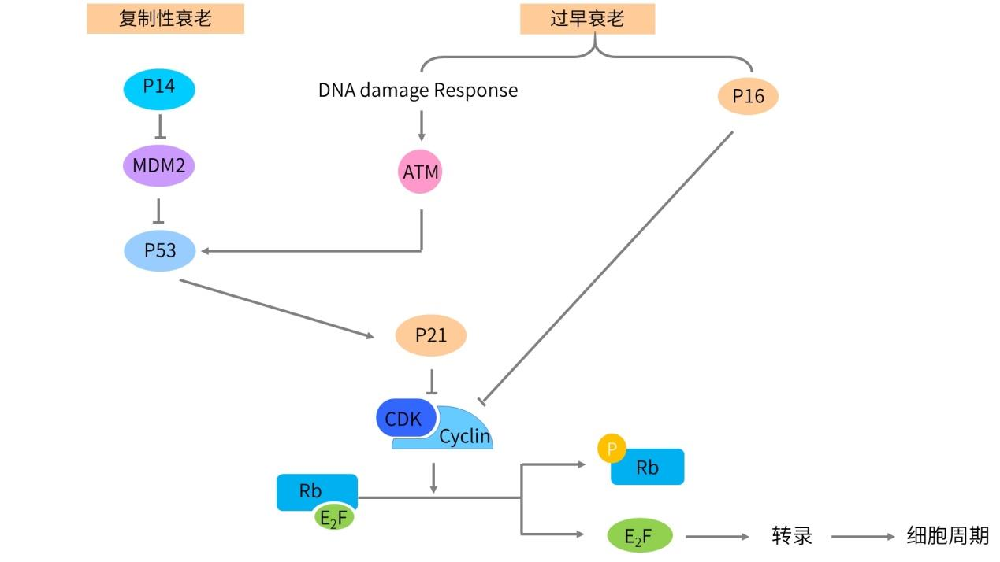            

### 细胞衰老现象与肿瘤
肿瘤的典型性特征之一就是持续的分裂和增殖的能力。而细胞衰老过程却恰恰使细胞永久性地退出细胞周期。因此，很早之前，就有研究人员认为细胞衰老是防止细胞发生癌变的第三道保障。第一道保障是细胞内 DNA 的损伤修复机制；第二道保障是诱导细胞凋亡的能力；第三道保障是诱导细胞发生衰老。所以长久以来，大多数的研究人员都认为细胞衰老对于肿瘤发生具有抑制作用。

#### 细胞衰老对于肿瘤发生的抑制作用
细胞衰老是现在研究得很热门的一种抗癌机制。细胞衰老过程中，Rb 和 p53 蛋白在诱导细胞发生衰老时起到了至关重要的作用。而 Rb 蛋白和 p53 蛋白又是非常关键的抑癌基因，抑制了细胞发生癌变的过程。很多肿瘤的发生都是由于抑癌基因的失活而导致的。研究表明，Rb 和 p53 蛋白的活性增强，可以启动细胞进入衰老过程。因此，如果细胞要发生癌变，那么规避衰老现象是细胞发生癌变的必要条件。因此，现在越来越多的研究，开始关注如何启动细胞衰老现象从而抑制肿瘤的发生发展。有研究发现，在 PTEN 基因失活的小鼠前列腺模型中，可以在癌前病变的小鼠组织中检测到细胞衰老现象，但是在发生了恶性前列腺癌的小鼠组织中却没有检测到细胞衰老现象。而这种差异的关键在于 p53 信号是否激活。另有研究发现，在小鼠模型中高表达 K-Rasv12 癌基因，可以诱导癌前病变、多发腺瘤，甚至是恶性的腺癌。在癌前病变和腺瘤组织中可以检测到细胞衰老，以及 p16、Dec1 以及 HP-1 等衰老标志分子，但是在腺癌细胞中不能检测到细胞的衰老现象。这些研究结果都提示激活的癌基因在小鼠体内诱导细胞衰老，但是由于少数细胞内的突变积累导致极少数的细胞突破了衰老防线，并进一步发展为恶性肿瘤。

##### 细胞衰老对于肿瘤发生的促进作用
尽管上述的研究表明，体内的衰老现象是一种重要的抗肿瘤防卫机制，但是由于衰老细胞仍然保留基本的细胞代谢过程，同时发生衰老的细胞可以产生各种活性蛋白和细胞因子（也就是 SASP 现象）也可能对肿瘤发生产生了促进的作用。衰老细胞可以不断积累产生各种细

胞炎性因子以及上皮生长因子，从而对衰老细胞周围的微环境的结构和功能造成了破坏，因此衰老细胞可以通过 SASP 现象而间接地对细胞造成损伤，甚至诱导细胞恶性增殖并发生癌变。衰老不足可能引起肿瘤的发生，但是过度地衰老也可以导致肿瘤的发生。如何平衡这两者的矛盾，需要我们不断深入进行研究。目前学术界提出了“拮抗性多效假说”（antagonistic pleiotropy hypothesis），认为衰老在早期可以保护机体不至于发生肿瘤，而到了机体的老年时期则促进衰老表型，促使肿瘤的形成。当然这种理论，目前还是一种假说，需要更深入的研究和确实的实验证据。

### 全文总结
1.衰老现象在 1960 年代，由 Hayflick 提出。因为他的研究发现，细胞即使在最适宜的培养条件下培养，也不能无限地增殖；等到细胞分裂达到一定的代次，细胞会出现永久性退出细胞周期的现象。这种现象就被称为细胞衰老。这种细胞分裂周期的极限，也被称为 Hayflick极限。

2.按照细胞衰老的发生机制，可以将细胞衰老分为两类：1）复制性衰老；2）过早衰老。复制性衰老现象是由于细胞因为不断地分裂，导致端粒缩短，从而诱导细胞发生衰老的现象。可以认为复制性衰老是细胞生理性的一种衰老现象。过早衰老现象是指，由于外在的各种刺激，导致细胞在 Hayflick 极限之前就发生了衰老现象，也可以被称为加速衰老现象。常见的过早衰老现象包括，癌基因诱导的细胞衰老、氧化应激诱导的细胞衰老、治疗诱导的细胞衰老和细胞重编程诱导的细胞衰老现象。

3.细胞的衰老现象，表现出了一系列类似且特异性的特点，这些特点包括：细胞周期阻滞、细胞形态的改变、端粒的缩短现象、衰老相关异染色质集落的形成（SAHF）；衰老相关分泌表型（SASP）和衰老相关分子的变化。

4.和衰老相关的分子标志物有很多，常见的有 1）衰老相关 β-半乳糖苷酶活性的变化；2）和细胞周期相关的分子标志物（例如 p14、p16、p21 等）；3）以及一些其他类型的分子标志物，例如 DCR2 、DEC1、HP-1、HMGA 等分子。但是需要大家注意的是，无论是采用经典的方法，还是最新的技术，细胞衰老的各种特征不是绝对特异的。不能仅仅根据细胞衰老的某一个特征来检测和判断细胞的衰老现象。因此，在研究细胞衰老现象时，需要根据细胞的多种特性综合而全面地分析，才能正确判断细胞是否发生了衰老现象。

5.当细胞发生复制性衰老时，细胞内发生 p14-p53-p21-Rb 通路，从而启动细胞衰老过程；当细胞内发生过早衰老时，细胞内可以发生两条通路：1）一条是 ATM-p53-p21-Rb 通路；2）另一条是 p16-Rb 通路。

6.肿瘤的典型性特征之一就是持续的分裂和增殖的能力。而细胞衰老过程却可以使细胞永久性地退出细胞周期。因此，研究人员认为细胞衰老是防止细胞发生癌变的第三道保障。但是，仍然有研究显示，发生衰老的细胞可以通过 SASP 机制间接地对细胞造成损伤，甚至

诱导细胞的恶性增殖。因此，衰老不足可能引起肿瘤的发生，但是过度地衰老也可以导致肿瘤的发生。

## 五、血管新生
首先要分清楚三个词: vasculogenesis、angiogenesis 以及 arteriogenesis。 这三个单词都含有词根-genesis。 “-genesis” 这个词根的意思是“产生/形成” 的意思。  

血管发生(vasculogenesis)， 指的是在胚胎发育时由中胚层起始形成血管的过程中， 由成血管细胞发育成血管内皮细胞并最终形成血管的过程。 这是血管“从无到有” 的一个生物学过程。 

angiogenesis 的中文意思是“血管新生” 。 关键在于“新” 字， 指的是在原有的毛细血管或者微静脉基础上， 通过内皮细胞的增殖、 分化和迁移， 以芽生或非芽生的形式生成新生的血管。 因此 angiogenesis 指的是血管从“少到多” 的一个生物学过程。 血管新生的现象参与了很多的生理或病理过程，例如胚胎发育、 女性生殖周期、 胎盘发育、 病理性糖尿病视网膜血管增生、 创伤愈合和肿瘤血管生长等过程。 

arteriogenesis 这个词的词缀是“arterio-” ， 表示“动脉” 的意思， 因此这个词的中文意思是“动脉生成” 。 动脉生成指新形成或原有的血管沟发生重塑， 形成更大并肌组织化的小动脉和侧副管， 在心肌缺血动物模型和冠状动脉疾病患者中较为常见。

常见的血管新生诱导因子有： VEGF、angiopoietin 和 FGF 

VEGF 受体(VEGFR )属于酪氨酸激酶受体， 目前发现 3 个 VEGFR 受体，分别是 VEGFR1(FLT-1；fms-related tyrosine kinase)、VEGFR2(FLK-1／kinase insert domain containing receptor， KDR)和 VEGFR3 (FLT-4） 。 其中 VEGFR1 是最有效的有丝分裂受体， VEGFR1 在病理性促炎症反应的部位， 募集造血前体细胞和单核细胞的时候， 起到关键作用并促进血管新生。 

血管新生抑制因子的主要作用是抑制血管新生过程。常见的血管新生抑制因子主要有：Arresten、 Endostatin、 Angiostatin 和 MMP。   

VEGF 主要通过下游 PLCγ1 通路、 MAPK 通路和 PI3K-AKT 通路， 促进内皮细胞增殖和存活。研究发现 VEGF 和它的受体 VEGFR 结合后，通过 PLCγ1 激活下游 PKC（protein kinaseC， 蛋白激酶 C） 促进了血管内皮细胞的增殖。 除了 PLCγ1 之外， VEGF 下游还可以激活Ras-Raf-MEK-ERK 通路， 最终通过 ERK 促进血管内皮细胞的增殖。 另外， VEGF 下游通过PI3K/AKT 通路促进内皮细胞增殖和存活， 这也已成为 VEGF 下游的经典信号通路。 研究显示 VEGF 通过下游 PI3K-AKT 的信号级联放大， 通过 BAD 途径抑制细胞凋亡； 同时又通过mTORC2 和 FOXO1 促进内皮细胞的增殖和血管新生。 

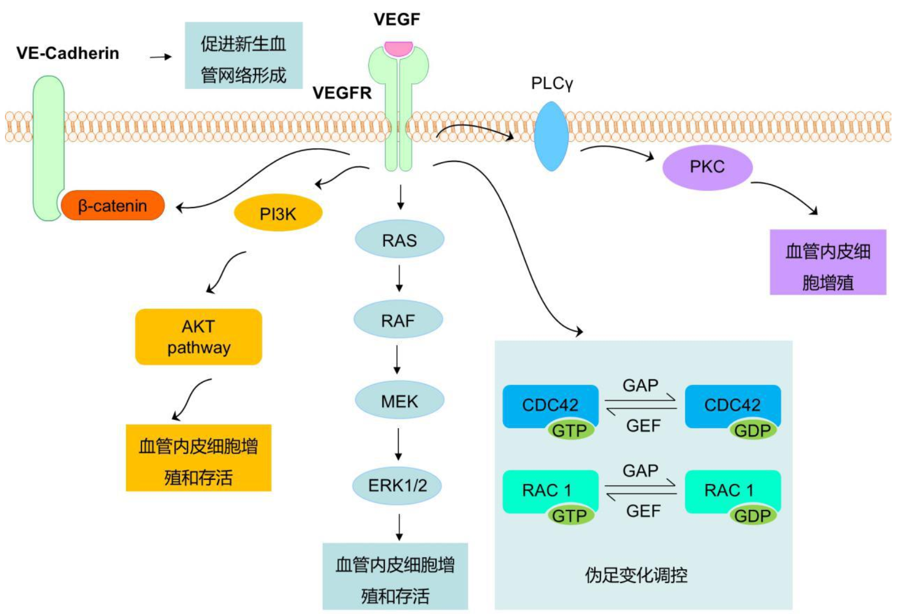            

检测血管新生的模型可以分为体内模型和体外模型。 体外模型包括： 内皮细胞增殖实验、内皮细胞迁移实验和小管形成实验。 体内实验包括： 角膜微囊实验、 鸡胚绒毛尿囊膜实验、圆盘血管新生系统实验和基质胶栓实验。 需要学员们注意的是， 每一种体内或者体外的模型都有其技术的局限性， 需要大家根据自己的研究选取合适的实验模型。  

# 第二部分：细胞内的分子
## 一、概述
细胞内的分子种类很多，包括水、无机盐、有机分子等。以下是细胞内一些重要分子的详细信息：

+ 蛋白质：细胞的主要构成成分之一，也是细胞中最广泛存在的生物大分子之一。蛋白质在细胞中扮演着多种重要的角色，包括结构支持、酶催化、运输、通信等。细胞内合成的蛋白质也可用于输送重要生物分子，如激素、细胞因子等。
+ 核酸：包括脱氧核糖核酸（DNA）和核糖核酸（RNA），是生物体中的基本遗传物质。DNA存在于细胞的染色体中，控制生物体的遗传特征。RNA在细胞中的职责是将DNA的信息转变成蛋白质，在蛋白质合成过程中扮演着重要的角色。
+ 碳水化合物：细胞内的碳水化合物通常是多糖分子，如淀粉、糖原等。它们在能源储备、分子识别、毒素降解等方面起到重要作用。此外还有简单糖类（如葡萄糖、果糖等），可为细胞提供能量。
+ 脂类：细胞在膜的形成和维持中都需要脂类。脂类通常由脂肪酸和甘油分子组成，属于不溶于水的有机物质。

除此之外，细胞内还有许多其他种类的分子，如无机盐、维生素、代谢中间产物等。这些分子在细胞内都扮演着各自重要的角色，维持着细胞的正常运转和生命活动。

## 二、基因
### DNA（脱氧核糖核酸）
DNA（脱氧核糖核酸）是一种生物大分子，是生物细胞内重要的遗传物质。它由核苷酸组成，而每个核苷酸由糖类、碱基和磷酸组成。其中，脱氧核糖是DNA的糖部分，而碱基是DNA的信息部分。DNA的主要功能是储存和传递遗传信息，控制生物体的遗传、发育和生命机能。

DNA具有双螺旋结构，这意味着它的长链在空间中互相缠绕。在双螺旋结构中，碱基对位于两条链之间，通过氢键相连。DNA的四种碱基是腺嘌呤（A）、鸟嘌呤（G）、胸腺嘧啶（T）和胞嘧啶（C）。这些碱基的排列顺序决定了DNA的特异性，因为它们决定了遗传信息的编码。

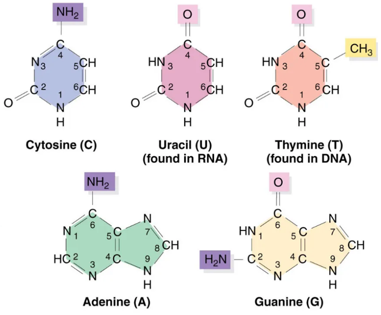

DNA携带有合成RNA（核糖核酸）和蛋白质所必需的遗传信息，是生物体发育和正常运作必不可少的生物大分子。在细胞中，DNA位于染色体上，而染色体是细胞核的主要组成部分。每个染色体都包含一个DNA分子，它被包装在蛋白质中以形成核小体。

DNA的复制是一个细胞周期的重要阶段，在这个过程中，DNA的双螺旋结构在特定的酶的作用下解开，每条链都作为模板合成新的互补链。这个过程确保了DNA遗传信息的准确传递。

### RNA
核糖核酸（RNA，Ribonucleic Acid）是存在于生物细胞以及部分病毒、类病毒中的遗传信息载体。RNA由核糖核苷酸经磷酸二酯键缩合而成长链状分子。一个核糖核苷酸分子由磷酸，核糖和碱基构成。RNA的碱基主要有4种，即A（腺嘌呤）、G（鸟嘌呤）、C（胞嘧啶）、U（尿嘧啶），其中，U（尿嘧啶）取代了DNA中的T（胸腺嘧啶）。

在生物学中，RNA主要扮演着基因表达的信使，即mRNA（信使RNA）。mRNA在细胞质中合成，由DNA转录而来，作为蛋白质合成的模板。此外，还有tRNA（转运RNA）和rRNA（核糖体RNA），它们分别在氨基酸活化和蛋白质合成中起关键作用。

除了作为基因表达的信使，RNA还在细胞内发挥许多其他功能。例如，一些RNA可以作为酶，催化化学反应，类似于蛋白质或DNA的作用。此外，一些RNA可以调节基因的表达，通过与DNA或其他RNA的相互作用来控制基因的转录。

近年来，科学家们还发现了一些非编码RNA（ncRNA），它们不直接参与蛋白质的合成，而是执行各种生物学功能。例如，有一些ncRNA可以调节其他RNA的表达，有一些可以调节染色体的结构，还有一些可以参与DNA的修复和复制。

总之，RNA是生物体内重要的遗传信息载体，参与蛋白质合成和基因表达等许多关键过程。除了作为基因表达的信使，RNA还在细胞内发挥许多其他功能，包括调节基因的表达和催化化学反应等。核糖核酸（RNA，Ribonucleic Acid）是存在于生物细胞以及部分病毒、类病毒中的遗传信息载体。RNA由核糖核苷酸经磷酸二酯键缩合而成长链状分子。一个核糖核苷酸分子由磷酸，核糖和碱基构成。RNA的碱基主要有4种，即A（腺嘌呤）、G（鸟嘌呤）、C（胞嘧啶）、U（尿嘧啶），其中，U（尿嘧啶）取代了DNA中的T（胸腺嘧啶）。

在生物学中，RNA主要扮演着基因表达的信使，即mRNA（信使RNA）。mRNA在细胞质中合成，由DNA转录而来，作为蛋白质合成的模板。此外，还有tRNA（转运RNA）和rRNA（核糖体RNA），它们分别在氨基酸活化和蛋白质合成中起关键作用。

除了作为基因表达的信使，RNA还在细胞内发挥许多其他功能。例如，一些RNA可以作为酶，催化化学反应，类似于蛋白质或DNA的作用。此外，一些RNA可以调节基因的表达，通过与DNA或其他RNA的相互作用来控制基因的转录。

近年来，科学家们还发现了一些非编码RNA（ncRNA），它们不直接参与蛋白质的合成，而是执行各种生物学功能。例如，有一些ncRNA可以调节其他RNA的表达，有一些可以调节染色体的结构，还有一些可以参与DNA的修复和复制。

总之，RNA是生物体内重要的遗传信息载体，参与蛋白质合成和基因表达等许多关键过程。除了作为基因表达的信使，RNA还在细胞内发挥许多其他功能，包括调节基因的表达和催化化学反应等。

### 基因
基因（遗传因子）是产生一条多肽链或功能RNA所需的全部核苷酸序列。基因支持着生命的基本构造和性能。储存着生命的种族、血型、孕育、生长、凋亡等过程的全部信息。环境和遗传的互相依赖，演绎着生命的繁衍、细胞分裂和蛋白质合成等重要生理过程。生物体的生、长、衰、病、老、死等一切生命现象都与基因有关。它也是决定生命健康的内在因素。因此，基因具有双重属性：物质性（存在方式）和信息性（根本属性）。

#### 基因的结构
基因结构，是指基因的[编码序列](https://baike.baidu.com/item/%E7%BC%96%E7%A0%81%E5%BA%8F%E5%88%97/5978027?fromModule=lemma_inlink)，编码的序列称为外显子（exon），是一个[基因表达](https://baike.baidu.com/item/%E5%9F%BA%E5%9B%A0%E8%A1%A8%E8%BE%BE/3839041?fromModule=lemma_inlink)为[多肽链](https://baike.baidu.com/item/%E5%A4%9A%E8%82%BD%E9%93%BE/1271962?fromModule=lemma_inlink)的部分；[非编码序列](https://baike.baidu.com/item/%E9%9D%9E%E7%BC%96%E7%A0%81%E5%BA%8F%E5%88%97/5617577?fromModule=lemma_inlink)称为[内含子](https://baike.baidu.com/item/%E5%86%85%E5%90%AB%E5%AD%90/402770?fromModule=lemma_inlink)（intron），又称[插入序列](https://baike.baidu.com/item/%E6%8F%92%E5%85%A5%E5%BA%8F%E5%88%97/10453584?fromModule=lemma_inlink)（intervening sequence，IVS）。

大多数真核生物的基因为不连续基因（interrupted或discontinuous gene）。所谓不连续基因就是基因的编码序列在DNA分子上是不连续的，被非编码序列隔开。编码的序列称为外显子（exon），是一个基因表达为多肽链的部分；非编码序列称为内含子（intron）,又称插入序列（intervening sequence,IVS）。内含子只参与转录形成pre-mRNA，在pre-mRNA形成成熟mRNA时被剪切掉。如果一个基因有n个内含子，一般总是把基因的外显子分隔成n+1部分。内含子的核苷酸数量可比外显子多许多倍。

**外显子：**每个外显子和内含子接头区都有一段高度保守的一致顺序（consensus seqence）,即内含子5’末端大多数是GT开始，3’末端大多是AG结束，称为GT-AG法则，是普遍存在于真核基因中RNA剪接的识别信号。

**侧翼顺序：**侧翼顺序在第一个外显子和最末一个外显子的外侧是一段不被翻译的非编码区，称为侧翼顺序（flanking sequence）。侧翼顺序含有基因调控顺序，对该基因的活性有重要影响。

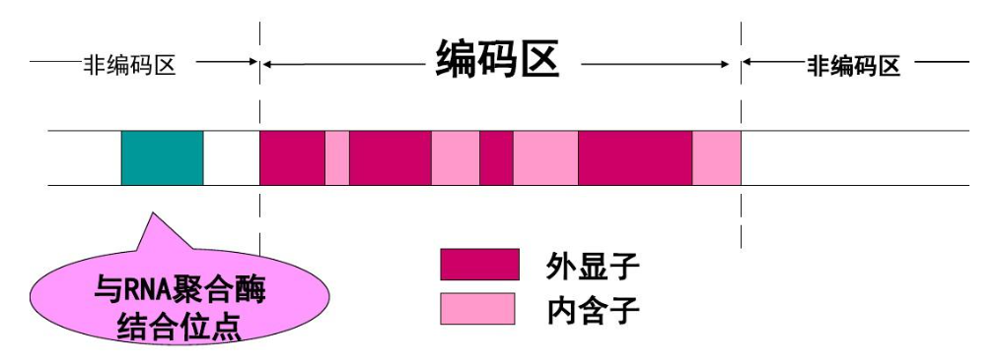

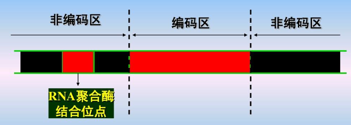

#### 可变剪切(Alternative Splicing) 
可变剪切(Alternative Splicing) 是指转录形成的前体mRNA通过去除内含子、保留外显子形成成熟mRNA的过程。

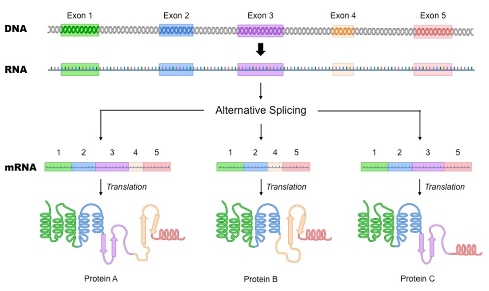

**生物学意义：**可变剪切是维持蛋白质多样性的主要机制。在不同组织或者发育的不同阶段，可变剪切不是一成不变的，在特定的组织或者条件下，会产生特定的剪切异构体（isoform）,这说明不同异构体具有特定的时间与空间作用，从而将可变剪切与正常的生命活动和疾病相关联，有大量的研究发现，可变剪切的变化与癌症等多种疾病相关，所以研究可变剪切在不同组织中的作用是非常有意义的。

#### 基因突变
基因突变是指由于DNA碱基对的置换、增添或缺失而引起的基因结构的变化，亦称点突变。由于DNA分子碱基顺序的改变而导致基因型和表型变异的现象。按突变的来源，可分为自发突变和诱发突变，但二者产生的突变型没有本质不同，只是利用诱变因素可提高基因的突变率。 在自然条件下发生的突变叫自发突变，由人工利用物理因素或化学药剂诱发的突变叫诱发突变。基因突变是生物变异的主要原因，是生物进化的主要因素。在生产上人工诱变是产生生物新品种的重要方法。

**转换和颠换是基因突变中的两种类型：**转换指的是嘌呤与嘌呤，嘧啶与嘧啶之间的转换，如A-G,C-T；颠换指的是嘧啶与嘌呤之间的替代。A-T,A-C,C-G,T-G。

**同义突变：**由于遗传密码子存在简并性，碱基置换后密码子虽然发生改变，但所编码的氨基酸没有改变。

**错义突变：**碱基置换后编码某个氨基酸的密码子变成另一种氨基酸的密码子，从而改变多肽链的氨基酸序列，影响蛋白质的功能。

**无义突变：**碱基置换后使原本编码氨基酸的密码子变成不编码任何氨基酸的终止密码子（UAG、UAA或UGA），使得多肽链的合成提前终止，肽链长度变短而成为无活性的截短蛋白。

**终止密码子突变：**与无义突变相反，碱基替换后使某一终止密码子变成具有氨基酸编码功能的遗传密码子，使本应终止延伸的多肽链合成异常地持续进行。终止密码子突变会使多肽链长度延长，其结果也必然形成功能异常的蛋白质结构分子。

**移码突变：**也称框移突变，由于编码序列中插入或缺失一个或几个碱基，使得插入或缺失点下游的三联密码子组合发生改变，造成突变点以后的全部氨基酸序列发生改变。移码突变引起蛋白质多肽链中的氨基酸组成和顺序发生多种变化，且都没有生物学活性。

## 三、中心法则
中心法则（英语：genetic central dogma），又译成分子生物学的中心教条（英语：The central dogma of molecular biology），首先由弗朗西斯·克里克于1958年提出，并于1970年在《自然》上的一篇文章中重申：“The central dogma of molecular biology deals with the detailed residue-by-residue transfer of sequential information. It states that such information cannot be transferred from protein to either protein or nucleic acid. （分子生物学的中心法则旨在详细说明连串信息的逐字传送。它指出遗传信息不能由蛋白质转移到蛋白质或核酸之中。）是指遗传信息从DNA传递给RNA，再从RNA传递给蛋白质，即完成遗传信息的转录和翻译的过程。也可以从DNA传递给DNA，即完成DNA的复制过程。这是所有有细胞结构的生物所遵循的法则。在某些病毒中的RNA自我复制（如烟草花叶病毒等）和在某些病毒中能以RNA为模板逆转录成DNA的过程（某些致癌病毒）是对中心法则的补充。

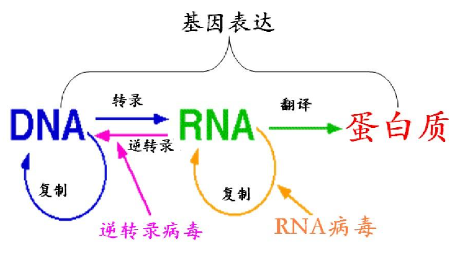

中心法则包括以下主要步骤：

+ DNA复制：DNA（脱氧核糖核酸）是生物体内携带遗传信息的分子。在细胞分裂过程中，DNA会复制自身，生成两份完全相同的DNA分子，每一份分配给新的细胞。
+ 转录（Transcription）：在细胞核中，DNA的一部分会被复制成一种称为RNA（核糖核酸）的分子，这个过程称为转录。RNA是一种类似于DNA的分子，但它包含了由脱氧核糖代替脱氧核糖的碳氢氧基团。这个RNA分子被称为信使RNA（mRNA）。
+ 翻译（Translation）：mRNA将从DNA中的遗传信息转移到细胞质中的核糖体（ribosome）。在核糖体内，mRNA上的遗传信息被翻译成蛋白质。这个过程称为翻译，涉及到tRNA（转运RNA）和核酸密码的使用，以将氨基酸顺序组装成蛋白质链。

## 四、非编码RNA
### 非编码RNA的分类
非编码RNA（Non-coding RNA）是指不编码蛋白质的RNA。其中包括rRNA，tRNA，snRNA，snoRNA 和microRNA 等多种已知功能的 RNA，还包括未知功能的RNA。这些RNA的共同特点是都能从基因组上转录而来，但是不翻译成蛋白，在RNA 水平上就能行使各自的生物学功能了。非编码RNA 从长度上来划分可以分为3类：小于50 nt，包括microRNA，siRNA，piRNA；50 nt到500 nt，包括rRNA，tRNA，snRNA，snoRNA，SLRNA，SRPRNA 等等；大于500 nt，包括长的mRNA-like 的非编码RNA，长的不带polyA 尾巴的非编码RNA等等。

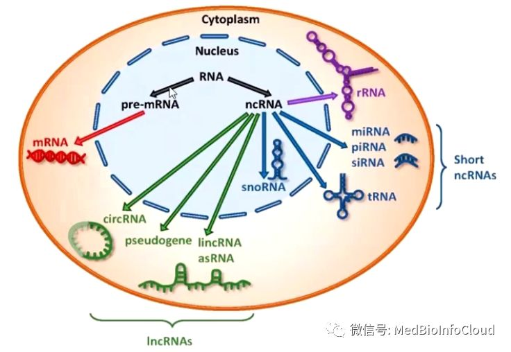

#### snRNA
snRNA 是small nuclear RNA的简称，也称作小核RNA。其功能是与蛋白因子结合形成小核核糖蛋白颗粒（small nuclear ribonucleo-protein particle，简称snRNPs），行使剪接mRNA的功能。snRNA 主要包括5 种：U1，U2，U4，U5 和U6。存在于所有snRNP 中的蛋白叫做通用蛋白，也称做sm 蛋白。通用蛋白和snRNA的结合位点已经研究清楚了。除U6 外，Sm蛋白可以结合到所有的其他snRNA 的保守序列AAU4-5GGA上，这段序列被称为Sm蛋白的结合位点，这也可以作为判断一个RNA是否是snRNA 的一个特征。

#### snoRNA
snoRNA 是最早在核仁发现的小RNA，称作小核仁RNA，最初发现它们的生物功能是用来修饰rRNA的。大多数小核仁RNA可以分为两类。一类是C Dbox snoRNA，这一类snoRNA是对RNA的碱基进行甲基化修饰的。其特点是含有4 个Box：Box C、Box D、BoxC’和BoxD’。事实上对C D box snoRNA 的预测已经有很多已经发表的软件，比如说snoscan。另一类是H/ACA box，这一类snoRNA 对RNA的碱基进行甲尿嘧啶化修饰。其特点是形成一个双stem，中间加一个loop 区，中间的loop 区中有一个boxH。而在尾部的tail 有个boxACA。由于boxH 和boxACA 的一级序列特征的界定比较松。比如BoxH 是ANANNA，很多A rich 的区域都能满足这个特征。而boxACA 是ACANNN，只有3 个碱基的明确信息。所以单单从一级序列特征上判断一个RNA 是否为snoRNA 是比较容易出错的。好在，HACA snoRNA 的二级结构是非常明确的。所以，用二级结构结合尾部的Box ACA的特征，联合判断一个RNA是否为HACA snoRNA 是切实可行的。

#### microRNA
MicroRNA 是一类21~23 nt 的小RNA，其前体大概是70~100 nt 左右，形成标准的stem 结构，加工后成为21~23 nt 的单链RNA。microRNA 的作用机制是与mRNA 互补，让mRNA 沉默或者降解。现在流行的RNAi 技术就是利用了细胞体内的这个机制，在体外人工加入类似microRNA 的smallRNA 来沉默对应的mRNA。

miRNA 结合靶基因的验证只有一个经典实验——荧光素酶报告基因实验（Luciferase Assay）， 这个实验应该算是机制研究里比较容易做的。miRNA 第一个特征是长度整齐划一， 都是 19-25 核苷酸的单链 RNA 片段。最初转录出来的 miRNA 有几百个甚至几千个碱基长，称为初级转录产物（primary miRNA，pri-miRNA），pri-miRNA 经过二次剪切加工产生约 70-90个碱基的 miRNA 前体(miRNA precursor， pre-miRNA)。加工初级转录产物到前体的核酸内切酶是 Drosha，这一步发生在细胞核内。miRNA 前体转运到胞浆再被 Dicer 酶切产生 miRNA成熟体。  

成熟的 miRNA 分子要发挥功能， 它可以跟一个或多个 mRNA分子不完全匹配的互补结合， 一旦结合上就可以下调基因的表达。miRNA 主要作用位点在靶基因的 3’-UTR， 依赖于 RISC（RNA induced silencing complex） 沉默复合体发挥作用， 这一点也跟 siRNA 一样， 在一些文章里也有报道 miRNA 作用于 5’-UTR 和 mRNA 编码区的，但是结合 3’-UTR 是主流。 

查询 miRNA 的权威数据库是 miRBase（[miRBase数据库使用教程](http://mp.weixin.qq.com/s?__biz=MzA4NDAzODkzMA==&mid=2651263437&idx=1&sn=812e19573a473abfa44ec9771d451974&chksm=841ef5b0b3697ca665b62dbdb35ac06636f893fcc253e3e1091a10ac42418e02eec5aec35d1b&scene=21#wechat_redirect)），  在预测 miRNA 靶基因方面最权威的数据库是 Targetscan([miRNA靶基因预测数据库TargetScan使用教程](http://mp.weixin.qq.com/s?__biz=MzA4NDAzODkzMA==&mid=2651263433&idx=1&sn=eff451041320801e8ac2de1ca4f27e65&chksm=841ef5b4b3697ca21d4ff3e1b58bb9d4b99743e11bdc1dfdcbe69c133cc111f1a186a419f57f&scene=21#wechat_redirect)).

如果遇到新发现的 miRNA 跟已有名称的高度同源的情况， 序列只差 1-2 个碱基， 区分开来没法体现这种序列和功能上的相似性， 那就在第一个发现的 miRNA 后加上小写的 a/b/c 这样区分。如果一条 miRNA 可以来源于不同的 DNA编码区域，也就是在基因组有平行的多个拷贝，那么还要在 a/b/c 后面加个横杠再以数字 1/2/3来表示。最后一条规则是科学家们发现 miRNA 前体是个茎环结构， 加工过程会从 3'或 5'端茎环臂产生最终成熟的 miRNA， 但是一般只有其中一条是表达量高的。以前把表达量低的加个*号， 后来发现这样不太准确， 也有会以“-s”和“-as”来命名， 最新的命名规则改用了来源于 5'端的标上 5p， 3'端标 3p。这样就形成了物种-miR-数字序号+字母-5p/3p 的名字， 一条miRNA 光看名称就包含了至少 4 条信息，  过表达的基因一般叫 over-expression， 如果文章在实验分组里出现一个基因名称或者缩写 OE 的组，就是过表达基因的， 但是 miRNA 过表达有个专用名词叫 mimics（模拟物）， 这一点有区别。同时， 做基因沉默时编码基因的分组标注一般是 si-XXX 或者用载体的 sh-XXX， 看到 si 或者 sh 你就知道作者在搞 loss of function， 而 miRNA 的沉默叫 inhibitor（抑制物）， 术语上不一样。 

miRNA 很小， 转染操作较方便， 当想用质粒或者病毒做稳定转导的时候， 跟做 shRNA 非常相似， 也是表达一个茎环结构的发卡状 RNA。一般做 miRNA 表达载体会用前体 pre-miRNA的结构， 胞内经过加工自动成为成熟的 miRNA， 而做 inhibitor 的载体就在这个茎环里放上miRNA 的反义链， 荧光素酶报告基因实验是机制研究中的一个非常经典的实验，五分以上的文章就经常看到了， 有两种主要的用途：一个用在 miRNA 靶基因验证， 一个用在研究转录因子对启动子的调控活性。用在 miRNA 和转录因子研究里的两套载体是不同的，研究 miRNA 的时候是将需要鉴定的 miRNA 靶基因的 3’-UTR 插入荧光素酶基因的 3’端，转到细胞再过表达 miRNA， 如果 miRNA 对靶基因的 3’UTR 是有结合和抑制翻译作用的，荧光素酶表达量会减少， 对底物荧光的值就会降低， 这样就能获得证据证明 miRNA 与靶基因 3’-UTR 是有结合的。  

miRNA 结合靶基因 mRNA 之后影响基因表达的方式主要是两种， 一般认为 miRNA 与 mRNA 的 3’UTR 结合后会阻碍翻译过程， 但不影响 mRNA 的稳定性， 早期发现的 miRNA 都是这种机制， 常识认为 miRNA 结合 mRNA 不影响其表达。但随着研究深入， 这种认识被颠覆掉了， 后续研究报道 miRNA 还可以降解靶基因 mRNA。当 miRNA 与mRNA 完全互补或者近乎完全互补的时候是可以引导降解 mRNA 的， 在植物中就是这样，类似于 siRNA 的机制。  

#### lncRNA
长链非编码RNA(Long non-coding RNA, lncRNA)是长度大于 200 个核苷酸的非编码 RNA。研究表明, lncRNA 在剂量补偿效应(Dosage compensationeffect)、表观遗传调控、细胞周期调控和细胞分化调控等众多生命活动中发挥重要作用，成为遗传学研究热点。

lncRNA 的研究模式， lncRNA 既然叫 long non-coding，名字就包含了两个关键特征。第一是 long，长，超过 200 个核苷酸；第二是 non-coding，不编码。 

查基因用 NCBI 的 Genebank 数据库，查 miRNA 用miRbase，查 lncRNA 序列也有一个权威数据库叫Noncode（<u>www.noncode.org</u>）。  

用 NCBI的 ORF finder 工具可以预测 ORF 。

lncRNA 现在发现可以编码形成一些短肽，这是一种比较新颖的作用机制，所以在分析 ORF 的时候发现 lncRNA 能编码短肽序列， 就算它没有同源蛋白也不要忽视，做机制的时候可能有用。 

还有一种分析非编码 RNA 序列特性的工具叫 CSF（codon substitution frequency scores） ——密码子替换频率， 它是一种对序列的分析算法， 主要是看一段序列编码的密码子在不同物种之间的保守性。非编码 RNA 有个特点，它的保守性是比较差的， 因为不编码蛋白， 错个把碱基关系不大， 所以当 CSF 评分小于 0 的时候，就可以认为它是一个非编码。 

第一步，检测基础表达，它是 RNA ，没有蛋白，就做 RNA 水平检测就好了，实时定量 RT-PCR。但是需要注意 lncRNA 表达一般比 mRNA 低，如果前面有筛选步骤，优先选择表达量高的。用送测序或者芯片的同一批样品来做二次验证， 这样验证效果最好，如果换一批样品，批次之间也有分子表达的差异，验证效果就会差一些。除了定量 PCR还有 Northern-blot 可以检测。也可以用荧光原位杂交（Fluorescence in Situ Hybridization），这个实验在很多 lncRNA文章里都用，图很漂亮，而且还能知道 lncRNA 的亚细胞定位。有不少 lncRNA 位于细胞核，参与转录调控，这些 lncRNA 后面做基因操作工具的时候就要小心。 

第二步，制备基因操作工具，具体小心什么呢，核定位的 lncRNA 你用 RNAi 做， 可能效果是很差的，因为 RNAi主要在细胞浆发挥作用。替代的方式是用现在很流行的 CRISPR 基因编辑技术， 直接把lncRNA 的基因给 knockout 掉。 

第三步， 细胞表型实验 

第四步，动物表型实验也一样。

第五步，表型的 Rescue 实验。你可以把 CRISPR 敲掉后的细胞再过表达 lncRNA 分子进去，跟功能基因的验证策略类似。 

Rescue，基本是蛋白的专属，非编码 RNA 不做。非要做，只能用 CRISPR+过表达。 

#### circularRNA
环状RNA与已知的线状RNA不同，形成一个共价闭合的连续循环。在环状RNA中，RNA分子的3'和5'末端通常是连接在一起的。这种特性赋予了环状RNA许多特性，其中许多特性是最近才被识别出来的。

许多环状RNA来源于蛋白质编码基因，但是细胞中产生的环状RNA还没有被证明可以编码蛋白质。因此它们被归类为非编码RNA。最近，一些环状RNA显示出了作为基因调节器的潜力。像许多其他非编码亚型一样，大多数环状RNA的生物学功能尚不清楚。由于环状RNA没有5'或3'端，它们对核外酶介导的降解具有抵抗性，并且可能比细胞中的大多数线性RNA更稳定。

### 相关数据库
#### Circbase 
这个数据库收集了几千条在真核细胞表达的 circRNAs,是个公共 circRNA 数据集， 有相应 circRNA 详细信息，还可以下载 circRNA 序列。（[http://cirbase.org/](http://cirbase.org/)）

#### CIRCpedia v2
CIRCpedia v2 是一个更新的综合数据库，包含来自 6 个不同物种的 180 多个 RNA-seq 数据集共 262782 条的 circRNA 注释。该数据库允许用户搜索、浏览和下载具有各种细胞类型/组织(包括疾病样本)表达特征的环状 rna。

此外，更新后的数据库包含了人类和小鼠之间环状 rna 的保守性分析。（  [http://www.picb.ac.cn/rnomics/circpedia/](http://www.picb.ac.cn/rnomics/circpedia/)）

#### Circular RNA Interactome 
该数据库预测了已知的 109 个 RNA 结合蛋白数据集与 circbase 中的 circRNA 的结合位点，并利用 Targetscan 软件预测了 miRNAs 与 circRNA 的潜在结合位点。此外， 该数据库还可以用于设计环状 RNA 引物， 针对环状 RNA 的 siRNA。([http://circinteractome.nia.nih.gov/Circular_RNA/circular](http://circinteractome.nia.nih.gov/Circular_RNA/circular)rna.html)

#### circRNADb
首个汇总编码蛋白环状 RNA 的数据库， 共收录了 32,914 个带注释的人类外显子 circRNA， 是一个完整的人类环状 RNA 分子数据库， 每条记录包含详细的基因组信息、 RNA 编辑情况、 IRES 序列元件、 预测的 ORF 等信息， 可以作为大规模研究人类 circRNA 的宝贵资源。 ([http://202.195.183.4:8000/circrnadb/circRNADb.php)](http://202.195.183.4:8000/circrnadb/circRNADb.php))

可以根据基因名、细胞类型、pubmedID和蛋白编码能力浏览：

这里展示的是有蛋白编码证据的circRNA：

#### TSCD (tissue-specific circRNA database) 
此数据库是一个系统分析组织特异性环状 RNA 数据库。包含人和小鼠 2 个物种， 16 种组织的特异性环状RNA。

比如心脏特异性表达的circRNA及预测结合的miRNA：( [http://gb.whu.edu.cn/TSCD)](http://gb.whu.edu.cn/TSCD))

#### MiOncoCirc 
由密歇根大学开发的由癌症临床样本汇编的环状 rna 数据库。在这个数据库里面可以查询到某个 circRNA 在不同癌症临床样本的表达情况：([https://mioncocirc.github.io/)](https://mioncocirc.github.io/))

CSCD（cancer-specific circRNA database） ( [http://gb.whu.edu.cn/CSCD/)](http://gb.whu.edu.cn/CSCD/))

这个数据库是由武大何春江教授发布一个全新的肿瘤特异性 circRNA 数据库。

#### exoRBase
这个外泌体环状 RNA 数据库是由复旦黄胜林教授开发的。exoRBase 数据库共收录了 58330 种 circRNAs， 15501 种 lncRNAs， 18333 种 mRNAs，它们来自 92 份血清外泌体 RNA-seq 测序样本。作者还依据GTEx project 获得组织特异性 RNA 表达特征，分析了相关 RNA分子的组织来源。（[http://www.exoRBase.org](http://www.exoRBase.org)）

#### circRNADisease
这个数据库是由武大何春江教授发布一个全新的肿瘤特异性 circRNA 数据库。  [http://cgga.org.cn:9091/circRNADisease/](http://cgga.org.cn:9091/circRNADisease/) 

#### circRNADisease
 [http://cgga.org.cn:9091/circRNADisease/](http://cgga.org.cn:9091/circRNADisease/)

### ceRNA互作 
RNA-RNA 交互的升级就是 ceRNA 的调控网络， 把两套 RNA-RNA交互作用叠加在一起就成了 ceRNA， 其中有一个 RNA 是共用的， 是 miRNA。一个 miRNA两个靶基因， 一共三个变量， 构成 ceRNA 的基本框架。 

ceRNA 概念的提出是源自 2011 年 cell 上的一篇文章， The Rosetta Stone of a hidden RNAlanguage， 题目翻译过来是一个隐藏着 RNA 语言的 Rosetta Stone。你看看， 到了 cell 这个级别， 作者的装逼能力已经突破天际。Rosetta Stone， 什么石碑， 必有典故。我跟大家一样，也不知道具体是什么典故， 所以特意去查了下。Rosetta Stone 是保存在大英博物馆的一块石碑， 制作于公元前 196 年， 上面记载着古埃及国王托勒密五世登基的诏书。这块石碑是 1799年， 拿破仑时期， 法军在占领的埃及城市 Rosetta 挖到的。在 1801 年拿破仑的军队被英国人打败， 这块石碑到了英国人手上， 从 1802 年开始收藏于大英博物馆， 被称为镇馆三宝之一。这块石碑为什么重要呢？因为它是古埃及文明的重要象征， 古埃及的文字一度失落了一千多年， 没人会解读。这块石碑上用希腊文、 古埃及文和当时的通俗文字记录了同样的内容， 为法老歌功颂德。因为希腊文是一直流传下来的， 这样的一块石碑就使考古学家有机会通过文字对照， 解读出埃及象形文的意义与结构， 从而重新掌握了这种文字。回过头来再看， 一个科学家用这样的寓意起作自己文章的题目， 装逼水平已经到了出神入化的境界。

ceRNA 本质上是 miRNA 作用机制的升级，把它从单机版变成网络版。miRNA 通过与 mRNA的 3’ UTR 结合抑制蛋白翻译表达， 这个领域从 2001 年开始， 最初也是 CNS 上报道， 随后大量发现了 miRNA 就很普遍了。后续研究证实单个 mRNA 可能受到多个 miRNA 的调控，而单个 miRNA 也能调控多个 mRNA，形成一个网状的结构。那么问题来了，如果两个 mRNA它们的 3'UTR 能结合同样的 miRNA， 它们之间会不会有调控关系呢？理论上说， A 表达多了之后， 能够竞争性结合 miRNA， 然后就导致结合 B 的同样的 miRNA 减少， 这样 B 的表达就上升了， 所以 A 和 B 之间应该存在表达的正相关性。 

ceRNA 不是指一个分子， 而是 RNA 与 RNA 之间多元调控的一种交互模型。一个 miRNA 结合的靶基因可能有上百个， 而 mRNA 的 3'UTR 和大量的非编码 RNA 上， 也有远远不止一个的 miRNA 识别元件， miRNA recognition elements(MRE)， 或者叫 miRNA binding sites， miRNA 结合位点。 

 miRNA 结合靶基因被证明是依赖于 RISC 蛋白复合体的，  RISC 复合体中有个关键催化组分蛋白叫 AGO2。有一种思路是利用 AGO2的抗体把复合物免疫沉淀下来， 再把结合在其中的 miRNA 和其他 RNA 送去测序， 这样的高通量研究就表明参与 ceRNA 调控网络的基因数量非常庞大。 

Dicer 是 miRNA 从前体加工成成熟体必须的酶， Dicer 缺陷的细胞是 miRNA 缺失的， 这也相当于是一种阻断策略。 

### 研究策略
当主变量是 miRNA， 其靶基因因变量应该是一个 RNA， 可以是编码蛋白的 mRNA 的 3’ UTR， 也可以是另外一个非编码RNA（lncRNA 或 circRNA 都可以）  另外当主变量是 lncRNA 或者 circRNA 的时候， 因变量反过来也可以是miRNA， 所以 RNA 结合 RNA 主要就是非编码 RNA 在唱戏。lncRNA 和 circRNA 都可以参与调控转录的过程， 可以竞争性结合启动子 DNA 序列导致转录因子结合不上去， 这是 RNA与 DNA 的交互 。

当主变量是 lncRNA 的时候还有一种经典分子机制模式， 就是 lncRNA 结合蛋白——RNA-蛋白相互作用。lncRNA 功能很全能， 蛋白能介导的功能的它基本都能参与。  一条 miRNA可以同时结合多个靶基因， 反之这些被结合的靶基因也可以一条 RNA 结合多个 miRNA， 形成一个网络状的调控关系。当一个 miRNA 同时结合 2 个靶基因的时候， 这两个靶基因是存在一种竞争关系的， 因为同一时间与 miRNA 配对的只能是一条， 有你没我， 这样的调控模式叫竞争性内源 RNA。英文术语 competitive endogenous RNA / competing endogenous RNA，意思一样， 缩写 ceRNA。ceRNA 不是一种分子类型， 它是一套机制模式。研究RNA时，常常需要进行过表达和沉默操作。miRNA 很小，转染操作较方便，过表达的时候可以用mimics（模拟物），沉默的时候可以用inhibitor（抑制物）。用质粒或者病毒都可以达到稳定转导的效果。但是，对于lncRNA和circRNA就不一样了。核定位的 lncRNA 如果用 RNAi 技术，可能效果是很差的，因为 RNAi主要在细胞浆发挥作用。替代的方式可以用 CRISPR 基因编辑技术，直接把lncRNA 的基因给knockout。这里需要注意的一点是，circRNA是环状RNA，虽然在研究手段和机制上面，大多和lncRNA相类似，已知的circRNA作用模式也和某些lncRNA一样，通过分子“海绵”的模式与miRNA结合来发挥作用的，但是它需要论证成环的问题。

# 第三部分：信号通路
## 一、NF-κB 信号通路
NF-κB（nuclear factor-kappa B）是 1986 年从 B 淋巴细胞的细胞核抽提物中找到的转录因子， 历史很久远了， 属于通路里的老大哥。NF-κB是一种重要的转录因子，在炎症、免疫、细胞增殖、分化以及存活过程中扮演重要角色。肿瘤微环境中潜在的炎症会造成NF-κB异常激活，更进一步促进癌症侵袭和转移。所以，NF-κB被认为是炎症和癌症之间的重要纽带。 NF 是核因子， κB 是因为它能与免疫球蛋白 kappa 轻 链基因的增强子 B 序列特异性结合， 促进κ轻链基因表达， 因此得名。 NF-κB 是一个真核细 胞转录因子家族， 有多个成员， 比较出名的是 p65 和 p50， 它们结构中都包含一个约 300 个 氨基酸同源结构域。 这个高度保守的 domain 能够使得 NF-kB 蛋白形成同源或异源二聚体， 这种结构域也是 NF-κB 与靶基因 DNA 序列的特异性结合区域。 一般情况下， 在细胞质中的NF-κB 处于失活状态， 原因是它的二聚体能与一个抑制蛋白 IkB（inhibitory protein of NF-κB） 结合成三聚体复合物。 三聚体形式下， NF-κB 没有活性。 在信号通路中， 转录因子是效应开关， 属于下游了， 那么它的上游信号是什么呢？ NF-κB 通路已知的主要上游信号是肿瘤坏死因子 TNF。 TNF 是一种糖蛋白， 有两个亚型： TNF-α与 TNF-β。 当 TNF 与细胞膜 表面的 TNF 受体结合后， 受体发生构象改变并且与胞内的下游分子发生相互作用， 招募一 些蛋白， 可以将信号传递给 IKK（IkB kinase） 激酶。 在 NF-κB 通路里 IKK 扮演了非常重要 的角色， 尽管上游信号来源有好多条， 但是最终都汇集到 IKK。 作为激酶的 IKK 能使 IkB 蛋白磷酸化， 导致它从三聚体中解离出来， NF-κB 的二聚体就能暴露出核定位序列（nuclear localization signals, NLS）， 迅速从细胞质进入细胞核内， 与核内 DNA 上的特异序列相结合， 促进相关基因的转录。但是，之前研究已发现，炎症刺激所诱导的IKK活性比NF-κB激活所持续的时间长得多，说明可能有一些未知的机制保护IκB不被上升的IKK磷酸化。 NF-kB 的下游基因包括 CyclinD1 和 c-Myc 这些与肿瘤密切相关的蛋 白， 还有 MMP-9， VEGF 等明星分子。 通路的持续激活会导致细胞生长失控， 抑制细胞凋 亡的功能， 促进肿瘤转移和血管新生， 涉及表型很多， 比较万金油。 我们记住其中的明星分 子有 p65， p50， IKK， IkB。

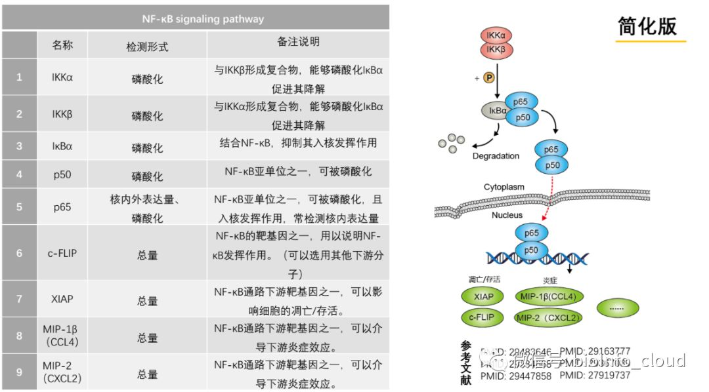

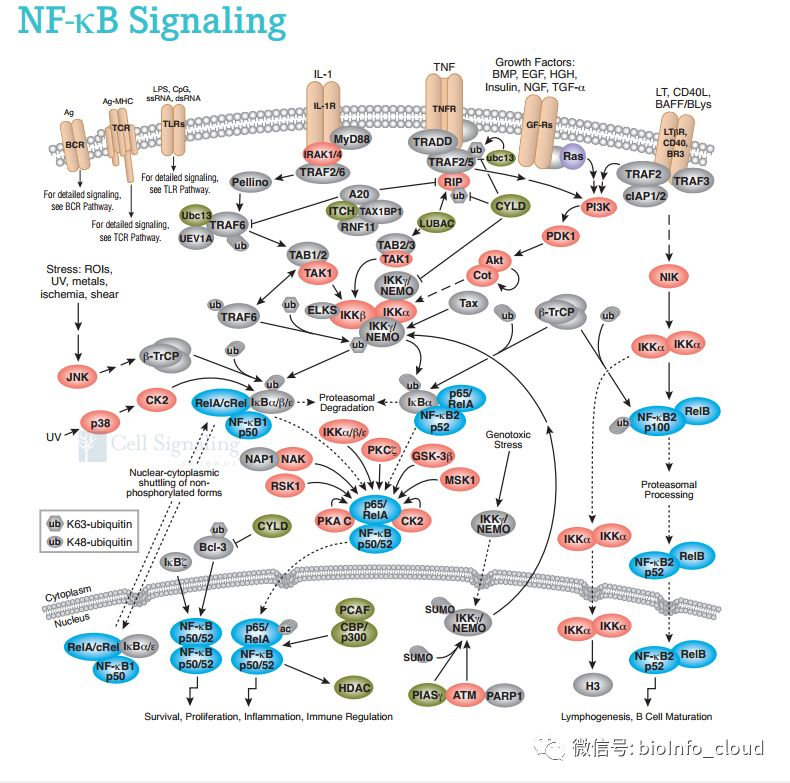

## 二、PI3K/AKT 信号通路
PI3K 是一种胞内的磷脂酰肌醇激酶，具有丝氨酸/苏氨酸激酶的活性， 大家记住它是个激酶。PI3K 也是个二聚体，由调节亚基p85 和催化亚基 p110 构成。 PI3K 上游信号一般是生长因子受体比如 EGFR，引起二聚体构象改变而被激活。 活化的 PI3K产生下一级信号， 改变 Akt的蛋白结构。 活化的 Akt 通过磷酸化作用激活或抑制下游一系列底物如凋亡相关蛋白 Bad、Caspase9 改变，从而调节细胞的增殖、分化、凋亡以及迁移等表型。 大家注意， Akt 也可以激活 IKK， 与 NF-kB 通路存在 cross-talk。Akt 激活了 IKK 就能使 NF-κB 从细胞质中释放进行核转位, 激活下游基因表达。 Akt 很重要， 磷酸化的 Akt 更重要， 所以PI3K 和 Akt 的总蛋白以及磷酸化蛋白都是通路的 Biomarker。 PI3K/AKT 的下游靶点是哺乳动物雷帕霉素靶蛋白（mTOR），也是一类丝/苏氨酸激酶， 有时候这个通路也叫 PI3K/AKT/mTOR。 mTOR的下游转录因子包括 HIF1α、 c-Myc、 FoxO 等，都是如雷贯耳的明星分子。 这里还要留意一个大名鼎鼎的抑癌蛋白 PTEN，PTEN 是一个磷酸酶， 它与 PI3K 的功能正好相反， 可去磷酸化，所以 PTEN 可减少 Akt 的活化而阻止所有由 Akt 调控的下游信号传导事件，是PI3K的负向调节因子。

mTOR既可作为单独的通路，也可与PI3K/Akt通路结合并称为PI3K/Akt/mTOR信号通路，可见其上下游关系具有公认度。该通路是自噬表型中最经典的效应途径，这几年也比较火。

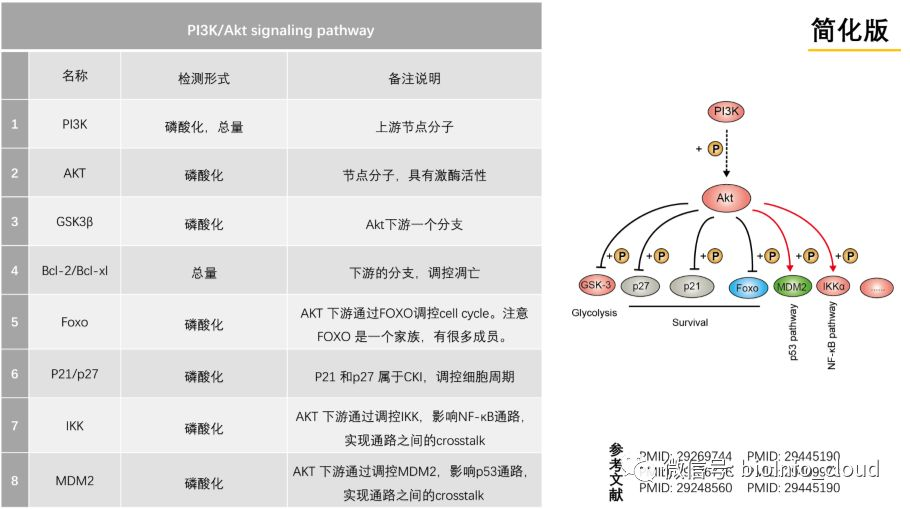

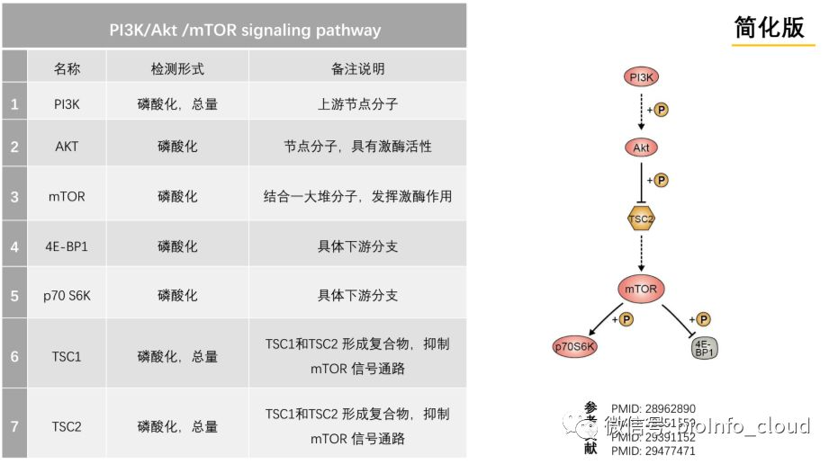

## 三、MAPK 信号通路
MAPK 翻译过来是丝裂原活化蛋白激酶（mitogen-activated protein kinase，MAPK），也是一种丝-苏氨酸蛋白激酶。 细胞因子、 神经递质、 激素等信号都可以激活 MAPK 的激酶活性。MAPK 通路有三级的信号传递过程， 像发射火箭助推点燃一样， 它是三级激酶模式： MAPK，MAPK 激酶（MAP kinase kinase， MEK 或 MKK）以及 MAPK 激酶的激酶（MAP kinase kinase kinase， MEKK 或 MKKK）。 这三种激酶能依次激活， 共同调节着细胞的生长、 分化、 应激、炎症反应等多种重要的生理/病理效应。 MAPK 是通路里最庞大的， 具体信号传导有 4 种主要的分支路线： ERK、 JNK、 p38MAPK 和 ERK5， 文章里经常看到的是前三个， ERK 最明星， ERK5 相对小众一点。 这些分支路线所使用的 MAPK， MEK 和 MEKK 蛋白都是不同的，所以你会听到有人说 ERK 通路， JNK 通路， 或者 p38MAPK 通路， 其实都属于 MAPK 通路这个大家庭。 JNK 和 p38 介导的功能相似， 跟炎症、 凋亡、 生长都有关， ERK 主要管细胞生长、 分化， 它的上游信号是著名的 Ras/Raf 蛋白。 MAPK 几个通路分支的不同激酶都是它们的 Biomarker。

MAPK通路信号传导有4个主要的分支路线：ERK、JNK、p38和ERK5，这些分支路线所使用的MAPK，MKK和MKKK蛋白是不同的，其中Ras/Raf是ERK通路的经典上游信号。

MEK（MAPK/ERK激酶）： MEK分为分子量44kD和45kD的MEK1和MEK2两种。Raf被激活后，它的C端催化区能与MEK结合，并使其催化区第Ⅷ亚区中两个Ser磷酸化，从而使MEK激活。MEK属于少有的双重特异性激酶，使Tyr和Thr两个调节位点磷酸化而激活ERK。

MAPK/ERK: MAPK/ERK是一种Ser/Thr蛋白激酶。多种激酶作用于MEK时，活化的MEK通过其N端区域与ERKs直接连接，催化ERK的亚功能区8“TEY盒”中的Tyr和Thr残基双特异性磷酸化，激活ERK。MEKs不仅仅是ERK的激活物，还可能是ERK在胞浆中的锚定器，当信号通路无活性时，它就将ERK固定在胞浆中，一旦有信号刺激ERKs磷酸化及二聚体化，它就激活ERKs并将其转移到胞核或其它活化位点，再进一步磷酸化下游底物。A.V.Khokhlatchev等人研究ERK2磷酸化后转位入核的过程，发现ERK2是通过磷酸化的ERK2和磷酸化或未磷酸化的ERK2形成同源二聚体转位入核，说明同源二聚体的形成是ERK核转位所必需的。

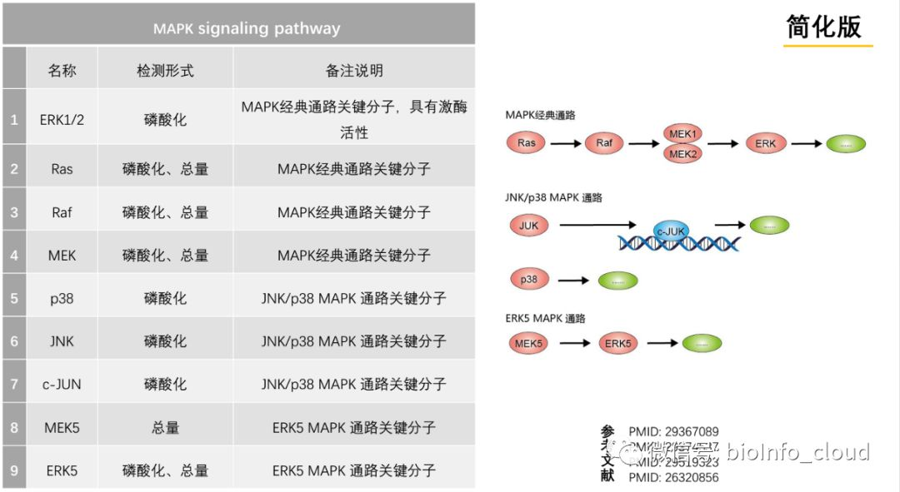

## 四、JAK-STAT 信号通路
JAK-STAT 也是个万金油， 跟细胞的增殖、 分化、 凋亡都有关系， 由三个部分组成： 接收信号的酪氨酸激酶相关受体、 传递信号的酪氨酸激酶 JAK 和产生效应的转录因子 STAT， 通路 的三元件结构很清晰。如果觉得前面几个通路比较麻烦， 先搞清楚 JAK-STAT， 是一个不错 的学习切入点。 许多细胞因子和生长因子通过 JAK-STAT 信号通路来传导信号，这包括白介素 2、 GM-CSF（粒细胞/巨噬细胞集落刺激因子）、 生长激素（GH）、 表皮生长因子（EGF）、 血小板衍生因子（PDGF） 以及干扰素（IFN） 等等。 这些细胞因子和生长因子在细胞膜上 的受体本身不具有激酶活性， 但它的胞内段都跟酪氨酸激酶 JAK 有结合位点。 这一点与其 他通路略有不同， 很多酪氨酸激酶是细胞膜受体， 而 JAK 却是一类非跨膜型的酪氨酸激酶。 当配体和受体结合后可以活化 JAK， 使其发生自身磷酸化， 活化后的 JAK 再作为激酶磷酸 化下游靶蛋白的酪氨酸残基， 实现信号转递。 转录因子 STAT 被招募并且被 JAK 磷酸化修 饰后， 就形成了活化的状态， 活化的 STAT 蛋白以二聚体的形式进入细胞核内与靶基因结合， 调控下游基因的转录。 所以在 JAK-STAT 通路中， 磷酸化的 JAK 和 STAT 蛋白表达都是重 要的 Biomarker。

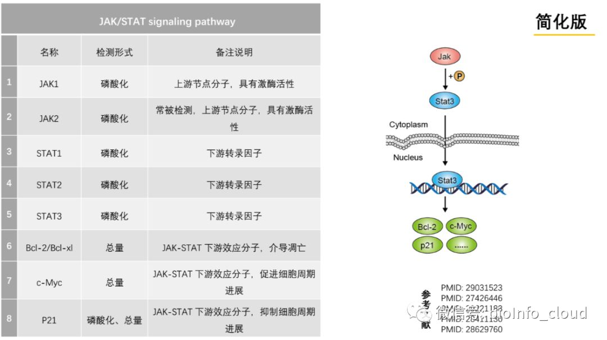

## 五、TGF-β信号通路
TGF 是转化生长因子（transforming growth factor）， TGF-β信号通路经常会称为 TGF-β/SMAD 信号通路， 为什么？ 因为 SMAD 是 TGF-β信号通路的效应转录因子， 就跟 JAK-STAT 中的 STAT 一样。 TGF-β比较复杂的地方是接收信号的 TGF-β超家族有几十个成员， 除了 TGF-β1/2/3， 还有明星分子 BMP（骨形态发生蛋白）。 这样 TGF-β通路的信号来源配体分为 两类， TGF-β和 BMP。 所以说到 BMP 通路其实是 TGF-β通路的一个分支。 TGF-β通路和很 多通路也存在 cross-talk。 要检测 TGF-β通路活性一般检测 TGF-β、 TGF-β的受体、 SMAD 或者是 BMP。

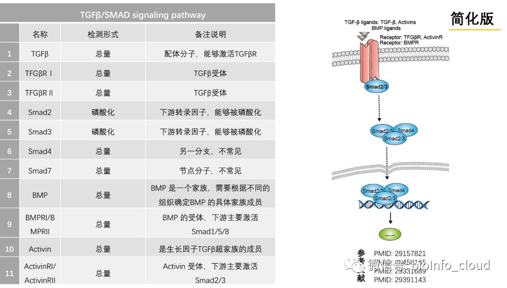

## 六、Wnt 信号通路
我记得七八年前 Wnt 还只是个小众通路， 后面随着上皮间质转化 EMT 研究的热潮， 一下子 火了起来， TGF-β和 Wnt 都是对 EMT 的调节是至关重要的通路。 Wnt 通路分为经典和非经 典两条路径， 一般提到 Wnt 信号通路主要指的是由β-Catenin 介导的经典 Wnt 信号通路。 Wnt 是一类分泌型糖蛋白， 通过自分泌或旁分泌发挥作用。接收 Wnt 信号的是跨膜受体 FZD 蛋白家族， 随后通过下游蛋白激酶的磷酸化作用影响β-Catenin 的降解； Wnt 激活的时候， β-Catenin 的降解活性受到抑制， 胞浆中稳定积累的β-Catenin 进入细胞核后结合 TCF/LEF 转录因子家族， 启动下游靶基因的转录。 所以β-Catenin 是检测 Wnt 是否激活的一个重要 Biomarker。

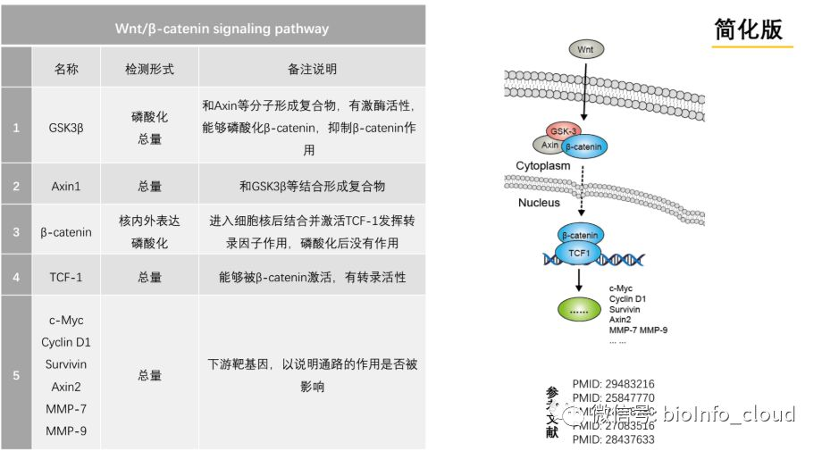

## 七、Notch 信号通路
Notch 跟前几个通路比起来算是小众。 Notch 跟前面讲的通路模式有两个显著区别： 第一， Notch 的受体和配体都是膜蛋白， 它介导的是两个细胞相互靠近接触之后的活化效应， 而不 是由分泌型的蛋白作为配体。 第二， Notch 信号途径不是通过激酶磷酸化逐步活化传递信号， 它是 Notch 通过三步蛋白酶切水解， 一步一步把有转录调节活性的 Notch 蛋白片段释放出来 实现活化。这个切完的具有核定位信号的Notch蛋白片段叫NICD（Notch intracellular domain） 或者 ICN（intracellular domain of Notch）， 翻译过来就是 Notch 的胞内结构域。 NICD 与转录 因子 CSL 结合， 调节下游基因表达。

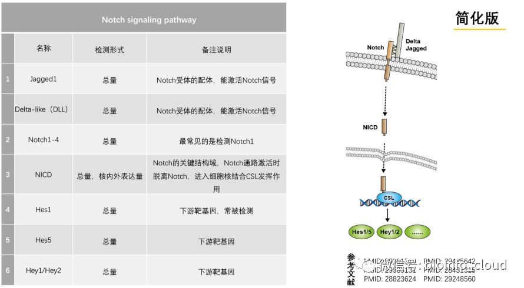

## 八、Hedgehog 信号通路
Wnt、 Notch 经常和 Hedgehog 放在一起说， 因为这三条通路的 cross-talk非常密切。 Hedgehog 通路的配体就是 Hh 蛋白， 需要经过一系列加工才有活性。Hedgehog 通路的受体有两种， 一种是 Ptc， 一种叫Smo。 这个通路的特点是内部具有反馈调节机制，正常情况下， Smo 是 正向激活转录因子， 但另一个受体 Ptc 能抑制 Smo 蛋白活性， 抑制下游通路， 实现自我调 节。 Hedgehog 通路的转录因子是Gli 蛋白家族， 有几种不同亚型， Gli1 是常见的检测对象。 这个通路的配体、 受体、 转录因子一目了然， 没有中间复杂的信号传递过程， 主要是注意它 的反馈调节特点。

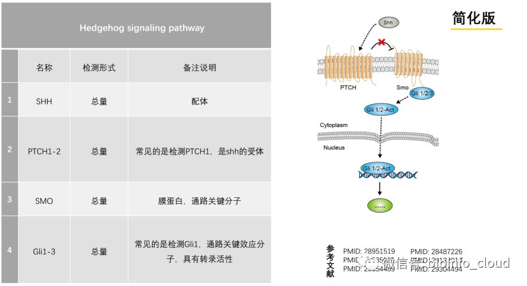

## 九、Hippo 信号通路 
Hippo 是信号通路中的新宠， 最先在果蝇中发现 Hippo 参与调控器官大小发育， 后来的研究 发现在哺乳动物的发育过程中有相似功能。现在研究已经证实这条通路还可以调控干细胞自 我更新及组织再生， 与癌症的发生也密切相关。 Hippo 通路结构也不复杂， 由一组保守的激 酶组成， 上游的膜蛋白受体感受到胞外环境的信号后， 经过一系列激酶的磷酸化反应， 最终 作用于下游效应因子 YAP 和 TAZ。 YAP/TAZ 具有转录调节功能， 能对细胞表型精细调控。 Hippo 通路调控细胞的增殖、 分化以及凋亡的机制要么直接作用于这些表型的关键分子， 要 么与其他通路发生 cross-talk， Hippo 跟 Notch、 Wnt、 MAPK 都有交集。 通路之间各种交互 影响千万要习惯， 分子调控是一种网状的形式， 并非线性的， 肯定会产生交叉。

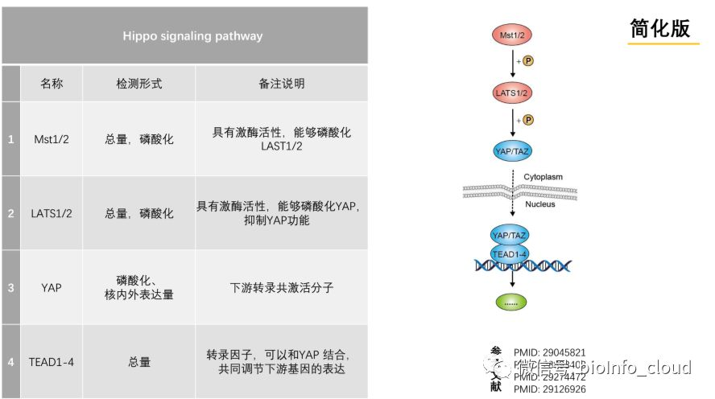

---

# 第四部分：分子修饰
## 一、蛋白磷酸化
### 蛋白磷酸化的定义及其研究简史 
蛋白质磷酸化 (phosphorylation of protein) 指将腺嘌呤核苷三磷酸(ATP)或鸟嘌呤核苷三磷酸(GTP)上的磷酸基团转移到含有羟基的底物蛋白质氨基酸残基上的过程。完成翻译后的蛋白质上，只有某些特定的氨基酸残基才会发生磷酸化：在真核生物中主要通过丝氨酸、苏氨酸和酪氨酸等氨基酸残基的磷酸化；而在细菌中则主要通过天冬氨酸（Aspartic acid， D）、谷氨酸（Glutamic acid， E）和组氨酸（Histidine， H）等残基的磷酸化。 有些蛋白质在原核生物和真核生物中都可以被磷酸化，它们的磷酸化位点通常是精氨酸（Arginine， R）、 赖氨酸（Lysine， K）和半胱氨酸（Cysteine， C）残基。

蛋白的磷酸化研究具有悠久的研究历史。早在 1888 年，就已经开展了关于偏磷酸对蛋白质的作用的研究。在 1926 年，研究报道了酪蛋白原中，磷酸和分子之间通过酯键相连接。不久之后，又有多项研究在活体酵母细胞和细菌中，发现有蛋白质磷酸化的现象。但是介导磷酸化的具体机制和磷酸化蛋白所具有的生理/病理意义，却一直不为人所知。直到 1953年，这一年在磷酸化研究历史上是一个非常重要的年份，因为在那一年，艾德蒙-费希尔（Edmond H. Fischer）在西雅图的华盛顿大学遇到了他的合作者--埃德温-克雷布斯（Edwin G. Krebs）。然后他们两人共同合作，研究糖原磷酸化酶。在研究过程中， Krebs 和 Fischer发现了一系列的生化反应。这些生化反应可以由激素或者钙离子所触发，而且有些反应可以激活这种酶，但是另一些反应却可以使酶失活。在整个的研究过程中，他们两位通力合作，发现了可逆的蛋白磷酸化过程。这项研究也使得两人在 1992 年获得了诺贝尔奖，授奖原因是因为两位学者在关于蛋白质可逆磷酸化作为一种生物调节机制方面的杰出成就。 

### 磷酸化的主要类型
根据被磷酸化的氨基酸残基的不同，可将磷酸化的蛋白分为 4 大类，分别是： O-磷酸盐蛋白质、 N-磷酸盐蛋白质、酰基磷酸盐蛋白质和 S-磷酸盐蛋白质。  

+  羟氨基酸（hydroxyl amino acid，包括酪氨酸，苏氨酸，丝氨酸）的磷酸化，形成了O-磷酸盐蛋白质；但是并不是所有的羟氨基酸的磷酸化，都能形成 O-磷酸盐蛋白质。至少到目前为止，羟脯氨酸或羟赖氨酸的磷酸化过程，仍然不太清楚。 
+ 精氨酸、赖氨酸或者组氨酸的磷酸化，形成了 N-磷酸盐蛋白质。
+ 天冬氨酸或谷氨酸的磷酸化，形成了酰基磷酸盐蛋白质。
+ 半胱氨酸的磷酸化，形成了 S-磷酸盐蛋白质。  

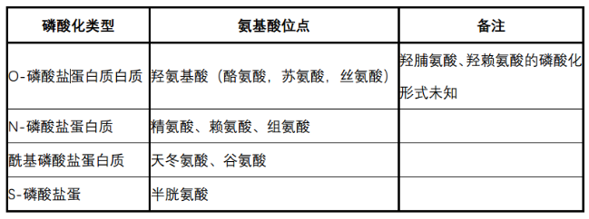

### 激酶与磷酸酶 
蛋白质磷酸化是蛋白质翻译后修饰方式中最常见的也是最重要的一种类型，参与多种信号传导和细胞代谢通路，在调节生命体活动中发挥着不可替代的作用。

蛋白质的磷酸化过程是可逆的。激酶（kinase）介导了蛋白质的磷酸化；相反，磷酸酶（phosphotase）介导了蛋白质的去磷酸化。 

#### 激酶（kinase） 
##### （1）激酶的分类
蛋白激酶负责将磷酸基团转移到特定底物蛋白上，这类酶用 ATP 或 GTP 作为磷酸基团的供体，而蛋白质中的丝氨酸、苏氨酸或酪氨酸是最常见的可以被磷酸化的氨基酸位点。目前在真核细胞内已经发现有 400 多种蛋白激酶。这些激酶可以按照不同的标准进行分类，分为不同的亚家族。

 第一种分类方式是 Hanks 等人在上个世纪 90 年代提出的，他们根据不同激酶催化区域氨基酸序列的同源性/相似性，将蛋白激酶分为五类： 1） AGC 类，包括环核苷酸依赖家族（PKA 和 PKG 家族）、蛋白激酶 C 家族、β-肾上腺素受体激酶（β-ARK）家族、核糖体S6 激酶家族和其它相关激酶等； 2） Ca MK 类，包括 Ca2+/钙调素调节的蛋白激酶家族、Snfl/AMPK 家族和其它相关蛋白激酶； 3） CMGC 类，包括细胞周期因子依赖蛋白激酶（CDK）家族、 ERK 蛋白激酶家族、糖原合成酶 3 激酶（GSK3）家族、酪蛋白激酶Ⅱ家族、 Clk 家族和其他相关激酶； 4）酪氨酸蛋白激酶类； 5）其它。（具体的分类，请参见“激酶分类”文件）激酶的第二种分类方式是按照激酶对于底物氨基酸的选择性。常见的可以磷酸化的氨基酸是丝氨酸/苏氨酸，和酪氨酸。所以，激酶又可以分为丝苏氨酸激酶和酪氨酸激酶。 

##### （2）蛋白激酶的细胞定位  
**A） 细胞膜蛋白激酶**

细胞质膜上有许多膜受体和跨膜蛋白具有蛋白激酶活性，它们分别被称为受体蛋白激酶和跨膜蛋白激酶，其中既有受体酪氨酸蛋白激酶（receptor tyrosine kinases），又有受体丝/苏氨酸蛋白激酶（receptor serine/threonine kinases）。 

**B） 细胞质蛋白激酶**

细胞质蛋白激酶也可以主要分为两类：非受体型酪氨酸激酶和非受体型丝苏氨酸激酶。 

**C）核内蛋白激酶**

核内的蛋白激酶同样可以根据底物不同，分为核内丝苏氨酸激酶和核内酪氨酸激酶。其中目前研究得比较多的是核内丝苏氨酸激酶；相对而言，核内酪氨酸激酶研究得比较少。核内丝苏氨酸激酶主要分为三类：组蛋白激酶、非组蛋白激酶和细胞周期依赖性蛋白激酶（cyclin-dependent kinase， CDK）。 

##### （3）常见蛋白激酶介绍 
**A） MAPK **

MAPKs 是一系列丝氨酸/苏氨酸蛋白激酶，可以磷酸化很多的细胞质蛋白，是酪氨酸激酶受体下游主要信号传导途径，积极参与基因表达调控和多种病理生理过程。 MAPK 功能异常与癌症、炎症、免疫系统和中枢神经系统疾病有关。 MAPKs 家族主要包括三个成员：细胞外信号调节激酶（extracellular signal-regulated kinases， ERKs）， c-Jun 氨基末端激酶/应激激活的蛋白激酶（JNKs）， p38 激酶。所有 MAPK 家族成员都可以通过苏氨酸和酪氨酸残基羟基侧链的双重磷酸化而被激活。 MAPK 家族之间具有较高的同源性，例如， p38β、 p38γ 和 p38δ 分别与 p38α 相比，它们具有的序列同源性分别是 73%、 63%和 62%。而不同的 p38 亚家族成员与其他 MAPK 家族成员的同源性，一般都可以达到 40%-45%。 

ERKs 下游可以通过磷酸化而调控的分子有很多，其中研究比较深入的是两个重要的转录因子： 1）激活蛋白 1（activator protein 1， AP-1）和 NF-κB 。 ERKs 可以诱导细胞周期蛋白 D（cyclin D）的表达。 ERKs 还可以磷酸化活化原癌基因 myc ， myc 对于细胞周期进程和肿瘤细胞增殖很重要。因此， ERK 抑制剂被认为可以阻断细胞周期进程，用作抗癌药物。 

JNK 家族主要有三个成员： JNK1、 JNK2 和 JNK3，它们由不同的基因编码。这些激酶可以被 TNFα 和 IL-1 以及其他应激和炎症刺激活化。 JNKs 可以磷酸化并激活 c-Jun，这对于 TNFα 激活 c-Jun 和 AP-1 是必需的。而且 JNK 家族成员对 Bcl-2 和 p53 诱导的细胞凋亡也很重要。 JNKs 对于免疫细胞调节尤为重要，它们可以刺激 TNFα、 IL-2、 E-selectin和基质金属蛋白酶的表达。这些蛋白都和炎症反应有关，提示 JNK 在炎症方面具有重要的作用。此外， JNK 可能在糖尿病和肥胖症中也发挥了重要的作用。 JNK 磷酸化胰岛素受体和胰岛素受体的底物，使它们失活。这抑制了胰岛素信号传导并增强了胰岛素耐受性。

激酶 p38 由四个成员组成，分别是 p38α、 p38β、 p38γ 和 p38δ 。其中 p38α 研究得最广泛。 p38α 主要在巨噬细胞和单核细胞中表达，在调节炎性细胞因子 IL-1、 IL-6 和肿瘤坏死因子 TNFα 的过程中，扮演重要角色。   

**B）****PKA **

PKA 是蛋白激酶中最早被发现的分子。目前对于 PKA 的理化性质和功能，了解得较为清楚，因此它常常被用作研究蛋白激酶的模型。

PKA 是一类丝/苏氨酸蛋白激酶。

胞内第二信使 cAMP 产生以后，可以激活 PKA。随后， PKA 再顺序磷酸化代谢途径中的一些靶蛋白中的丝氨酸或苏氨酸残基。 PKA 通过对底物的磷酸化调控靶蛋白的活性。这些被磷酸化的靶蛋白，往往是关键性的调节酶、重要功能的蛋白质或转录因子。因而可以介导细胞外信号，从而调节代谢、基因转录等细胞效应。当第二信使 cAMP 的信号终止后，靶蛋白的活性，会因为蛋白的去磷酸化作用（由磷酸酶介导）而恢复原先的状态。  

PKA 是异四聚体，全酶由 4 个亚基组成，包括 2 个催化亚基 C 和 2 个调节亚基 R。目前已经鉴定出 4 种调节亚基基因和 3 种催化亚基基因，它们可以编码出多种不同的 PKA 亚型，这些不同的亚型之间，表现出部分氨基酸顺序、 cAMP 结合能力、自主磷酸化位点以及组织特异性表达等方面的差异。

PKA 具有相当广泛的底物，包括多种酶、离子通道、结构与调节蛋白、转录因子等，而且随着研究的深入，不断有新的 PKA 的作用底物被证实。  

**C）****PKC  **

蛋白激酶 C （PKC）是由一组依赖 Ca2+和磷脂激活的丝氨酸/苏氨酸蛋白激酶，它是信号转导途径的主要介质，同时也是细胞增殖、分化、凋亡、转换等生理过程的关键调节因子。

目前发现的 PKC 家族内，共有 13 个蛋白成员。这些成员根据蛋白激酶 C 调控能力的差异，可以被分成三类：1）经典蛋白激酶 C (PKC-α、 PKC-β1、 PKC-β2、 PKC-γ) ，新型蛋白激酶 C (PKC-δ、 PKC-ε、 PKC-η、 PKC-θ) ，非典型蛋白激酶 C (PKC-ζ、 PKC-ι/λ) 。所有的蛋白激酶 C 具有类似的结构，由两个主要模块组成，包括含有膜靶向基序和Ca2+结合的 N 末端调节结构域 (regulatory domain) ，以及含有三磷酸腺苷 (ATP) 结合结构域和底物结合结构域的 C 末端催化结构域。在整个酶的主要序列中，有四个保守的 (C1-C4)区域，每个区域是一个功能模板，两侧是可变 (V) 区域。 

蛋白激酶 C 广泛存在于哺乳动物组织和细胞当中，是信号转导途径的主要介质，同时也是细胞的增殖、分化、凋亡、转换等生理过程的关键调节因子。大量研究表明，蛋白激酶C 缺乏或失调可能导致不同的机体疾病，包括：糖尿病、心力衰竭、阿尔兹海默症、帕金森病、过敏、炎症性疾病、自身免疫性疾病和癌症等。 

**D）****VEGFR **

VEGFR（vascular endothelial growth factor receptor， VEGFR）共有三种：VEGFR-1、VEGFR-2 和 VEGFR-3，它们属于酪氨酸激酶受体，由 3 个部分组成：包括 7 个免疫球蛋白样结构域、跨膜区、胞内的酪氨酸激酶活性区。 VEGF 家族成员与细胞表面的相应受体结合，使其发生二聚化及自身磷酸化而激活，从而引发一系列的信号传导过程。这三种受体在不同的组织中，介导不同的功能，它们的过度表达会引发病理性的血管或淋巴管生成过程，如VEGFR-2 在内皮细胞中的过度表达，介导肿瘤的血管生成；VEGFR-3 在淋巴管内皮细胞中的过度表达介导病理性的淋巴管生成和肿瘤的淋巴结转移。 

### 磷酸酶（phosphotase）
磷酸化是一个可逆的过程。上面提到的激酶，介导了蛋白的磷酸化过程。而接下来要介绍的磷酸酶，则介导了去磷酸化过程。 

#### 磷酸酶的分类
蛋白质磷酸酶种类很多，根据它们主要作用于底物蛋白质上氨基酸残基的不同，可以分为主要的两个大类：蛋白质丝／苏氨酸磷酸酶和蛋白质酪氨酸磷酸酶（PTP， Protein Tyrosine Phosphatases）。蛋白质丝／苏氨酸磷酸酶是含金属的酶类，它们可以通过直接攻击底物中活化水分子发挥作用，目前发现主要有 1 型（PP1）、 2A 型（PP2A）、 2B 型（PP2B）和2C 型（PP2C）等。而蛋白酪氨酸磷酸酶是非金属酶类，通过一个共价磷酸化的半胱氨酸中间体来催化底物，特异性去除酪氨酸残基上的磷酸基团。

#### 蛋白质丝／苏氨酸磷酸酶  
  磷酸酶中最大的家族是丝/苏氨酸磷酸酶家族。根据丝/苏氨酸磷酸酶对抑制剂的敏感程度、对于底物的特异性以及对金属离子的不同结合性，可以分为 1 型， 2A 型、2B 型和 2C 型，也就是文献中常见的 PP1、 PP2A、 PP2B 和 PP2C。PP1、PP2A 和 PP2B 这三类磷酸酶的序列，具有高度的同源性。PP1 的催化亚基与 PP2B的催化亚基有 40%的序列同源性； PP1 催化亚基与 PP2A 的催化亚基有 49%的序列同源性。因此， PP1、 PP2A 和 PP2B 也经常被合在一起，称为 PPP 家族（phosphoserine and phosphothreonine residues phosphotases， PPP，磷酸丝氨酸和磷酸苏氨酸残基磷酸酶）。 

#### 蛋白质酪氨酸磷酸酶 
蛋白质酪氨酸磷酸酶，也就是 PTPs（Protein Tyrosine Phosphatase），是一类不含金属的酶类。它通过一个共价的磷酸半胱氨酸中间体开始其催化过程。人类基因组分析发现的PTPs 大约有 130 种之多，已发现的 PTPs 都具有一个由 200-250 个氨基酸残基组成的蛋白质 酪 氨 酸 催 化 结 构 域 ， 并 且 在 其 活 性 中 心 含 有 一 段 保 守 的 氨 基 酸 序 列 ：(I/V)ICXXAGXXR(S/T)G （其中 X 可以是不同的氨基酸残基）。这一 PTP 催化结构域的结构及其酶活性中心的氨基酸序列和其它磷酸酶序列没有显著的同源性。 由此可见 PTPs 是一个独特的磷酸酶家族，已发现的 PTPs 可以被分为两大类：一类是跨细胞膜的受体型 PTPs，其细胞内结构含有磷酸激活位点；而另一类则是细胞内的 PTPs。

尽管蛋白质酪氨酸残基磷酸化和去磷酸化在整个细胞磷酸化过程中占到的比例不到1%，但是对于数量繁多的生物功能来讲，酪氨酸的磷酸化和去磷酸化调控都是关键的调节机制。 常见的蛋白质酪氨酸磷酸酶有 PTP1B、 TCPTP、 STEP 和 LYP 等。 

#### 双重特异性蛋白磷酸酶  
上面提到的酪氨酸磷酸酶，包括 PTP1B、 TCPTP、 STEP 和 LYP，都是常见的蛋白酪氨酸磷酸酶。还有一类被称为双重特异性蛋白磷酸酶（dual specificity protein phosphotases，DUSPs），它们则较为的特殊。因为双重特异性蛋白磷酸酶，既能使丝氨酸、苏氨酸侧链去磷酸化，又可以使酪氨酸侧链去磷酸化。不过就它们的催化机制而言，应该归属于 PTPs 家族，也就是蛋白酪氨酸磷酸酶家族。

双重特异性蛋白磷酸酶基因家族（DUSP 家族），也被称为丝裂酶原活化蛋白激酶磷酸酶（mitogen-activated protein kinase phosphotases， MKPs）。该家族包含 10 种具有催化活性的双特异性蛋白磷酸酶，可以催化 MAPK 的去磷酸化过程，使 MAPK 失活，因此 DUSP家族在 MAPK 信号通路中发挥重要的负调控作用。DUSP 家族的基因具有序列保守性，由非催化的N-末端和具有催化活性的 C-末端组成。Ｎ-末端区域包含保守的调控序列，即激酶相互作用基序（kinase interaction motif， KIM），介导不同底物的识别和结合，并且决定了分子的亚细胞定位。 C-末端包含高度保守的磷酸酶活化位点序列（I/V） HCXAGXXR(S/T/G)。

整个 DUSP 家族根据序列的保守性/同源性，亚细胞定位及底物的特异性，可以将整个家族分为三个亚家族： 1）位于细胞核，受应激或丝裂酶原诱导活化。包括， DUSP1、 DUSP2、DUSP4、 DUSP5； 2）位于细胞质且选择性作用于 ERK，包括了 DUSP6、 DUSP7、 DUSP9； 3）即可以位于细胞核，也可以位于胞质中，且选择性作用于 JNK 和 p38 丝裂原活化蛋白激酶，包括了 DUSP8、 DUSP10 和 DUSP16。

还有一个非常著名的磷酸酶分子是 PTEN。 PTEN 在 1997 年被发现。由于 PTEN 蛋白与张力蛋白 Tensin 有很高的同源性，因此 PTEN 也被称为与张力蛋白同源的磷酸酶（phosphatase and tensin homolog）。 PTEN 共含有 403 个氨基酸，蛋白结构大体可以分为 3 个结构域：磷酸酶结构域（phosphotase domain）， C2 结构域（C2 domain）和 C 末端尾部结构域（C-terminal tail）。 PTEN 的磷酸酶结构域位于分子的 N 末端，是 PTEN 酶活性的核心结构域。该结构域内含有一个酪氨酸磷酸酶和一个双特异性蛋白磷酸酶的核心序列。这说明 PTEN 同时具有双特异性蛋内磷酸酶的活性，既能介导酪氨酸残基的去磷酸化过程，也能介导丝/苏氨酸残基的去磷酸化过程。但是 PTEN 和一般的 DUSP 家族又有很大的不同，因为 PTEN 主要介导的是磷酸肌醇（phosphoinositide）的去磷酸化过程。特别是 PTEN对于 PI3K/AKT 通路的负调控作用，更是在细胞的增殖、生长和细胞周期等过程中，发挥了重要的调控作用。

在外界细胞因子的刺激下， PI3K 被激活，催化 PIP2 发生磷酸化，转变为 PIP3。随后PIP3 可以将 AKT 招募到细胞膜上。在 PDK（磷酸肌醇依赖蛋白激酶 1）的催化作用下， AKT发生磷酸化而被激活，并将信号往下传导。而 PTEN 恰恰介导了与 PI3K 相反的过程， PTEN介导了 PIP3 的去磷酸化过程，促使 PIP3 转变为 PIP2，从而抑制了 PI3K/AKT 通路。 

### 激酶/磷酸酶的调控
#### 激酶受到的调控  
##### （1）蛋白激酶的自身磷酸化（auto-phosphorylation）对于激酶活性的调控 
研究发现，很多的蛋白激酶都能发生自身磷酸化，也就是激酶能通过分子内机制催化自身的磷酸化。酪氨酸蛋白激酶自身磷酸化，发生在酶蛋白自身的酪氨酸残基，从而激括激酶本身。许多生长因子（比如 EGF、 PDGF、 FGF）的受体本身就是受体酪氨酸激酶。它们在与相应生长因子结合后，诱导受体自身酪氨酸残基磷酸化，从而激活受体酪氨酸激酶。  

我们以 EGFR 受体为例，进行详细说明。表皮生长因子受体 EGFR 家族包含了四个成员，分别是 EGFR（ERBB1）、 HER2（ERBB2）、 HER3（ERBB3）和 HER4（ERBB4），它们都属于受体酪氨酸激酶超家族。 EGFR 家族成员由胞外区（extracellular domain， ECD）、跨膜区（Transmembrane domain， TD）、胞内区（Intercellualr domain， ICD） 3 个部分构成。表皮生长因子受体 EGFR 与相应的配体 EGF 结合之后，胞内区的酪氨酸残基发生磷酸化，从而形成二聚体，生成最初的信号之后，能依次识别含有 SH2 结构域的蛋白，并将外界的各种信号转递至细胞内，并参与调控了细胞增殖、分化、细胞运动和存活等众多的细胞生理和病理过程。在整个信号传递过程中，配体 EGF 和受体 EGFR 相互结合之后，导致 EGFR 的自身磷酸化是整个信号传递的关键。 EGFR 中 1068 位、 1148 位和 1173 位的酪氨酸是发生自身磷酸化的关键位点。 

和酪氨酸激酶的自身磷酸化类似，丝/苏氨酸激酶也能发生自身磷酸化，通过对激酶自身的丝氨酸/苏氨酸残基的磷酸化，从而对激酶活性、激酶性质产生重要的调节作用。比如，PKA 的自身磷酸化，发生在调节亚基的丝氨酸残基上。在生理条件下， PKA 以非激活的全酶形式存在（催化亚基和调节亚基相互结合），在 cAMP 介入后，会导致 PKA 全酶解聚，释放出具有激酶活性的催化亚基。 PKG 是同源二聚体，每个亚基分子量为 80 KD，都能发生自身磷酸化。 PKG 每个亚基在与 cGMP 结合时，自身磷酸化能维持 PKG 催化区域底物位点的暴露，延长激酶活性。 PKC 也能通过分子内机制发生自身磷酸化。磷酸化的 PKC 对 Ca2+和佛波醇酯（PKC 的激活剂）的亲和力增加，从而获得激活。因此 PKC 自身磷酸化是各种刺激信号传递、放大的必要步骤。钙调蛋白激酶(CaMK)是多亚基的高分子量蛋白质。其中CaMKII，分子量为 630 KD，含α、β 两种亚基。已经发现， CaMKII 的α、β亚基都能发生自身磷酸化。磷酸化之后的激酶活性，由依赖 Ca2+转变为不依赖Ca2+。   

##### （2） 蛋白激酶的相互磷酸化对于激酶活性的调控 
许多生长因子受体激酶不仅能自身磷酸化，从而激活受体酪氨酸激酶的活性，而且这些生长因子受体也能被其他的丝/苏氨酸激酶（PKA 或 PKC）催化，发生丝氨酸/苏氨酸残基的磷酸化过程，从而降低受体激酶的活性。 

##### （3） 调节剂对于激酶活性的调控 
激酶除了自身磷酸化或者相互磷酸化的途径调控之外，还有很多其他的物质也都是可以调控蛋白激酶活性的。这一类的调节剂可以分为两类：一类是可以激活激酶活性的激活剂（activator）；还有一类是可以抑制激酶活性的抑制剂（inhibitor）。 

除了激活剂和抑制剂之外，激酶本身也是蛋白，很多激酶的活性依赖于激酶蛋白的磷酸化水平的高低。而磷酸酶又是介导蛋白去磷酸化的最主要的蛋白分子。所以，由磷酸酶介导的激酶的去磷酸化过程，同样是激酶功能调控的主要途径之一。细胞内还存在许多蛋白激酶的抑制蛋白，如 PKA 激酶的抑制因子，它是一种分子量为24 KD 的热稳定的蛋白质。它通过与 PKA 的催化亚基结合，从而抑制 PKA 的活性。对于激酶的抑制蛋白，最出名的要数 CKI（CDK inhibitor，细胞周期蛋白依赖性激酶抑制因子）。  

#### 磷酸酶受到的调控
##### （1） 磷酸酶丝/苏氨酸残基的磷酸化 
机体内调控磷酸酶的机制，主要是依靠翻译后的蛋白修饰方式实现。磷酸酶本身就是一种蛋白，而蛋白的磷酸化又通常是蛋白功能调控的一种重要的方式。因此，磷酸酶本身受到磷酸化作用的调控。磷酸酶蛋白上，丝氨酸/苏氨酸残基的磷酸化反应，就是磷酸酶催化活性的调控机制之一。比如，磷酸酶 PTP-PEST 中 39 位和 434 位丝氨酸残基发生 PKA 或 PKC介导的磷酸化反应之后，磷酸酶 PTP-PEST 的催化活性大大降低。另一种蛋白酪氨酸磷酸酶SHP1（Src homology region 2 domain-containing phosphotase 1， SHP1），这个磷酸酶的591 位丝氨酸发生磷酸化，也能抑制磷酸酶的催化活性。此外，磷酸酶 PTP1B 的活性，也受丝氨酸残基磷酸化的调控。研究发现， PKB 在催化 PTP1B 的 50 位丝氨酸发生磷酸化后，能促进胰岛素受体的去磷酸化过程，下调下游通路中 Akt 的活性，构成一个负反馈的调节通路。 PTP1B 的这种调控方式如果受到干扰或破坏，会导致糖尿病等疾病的发生和发展。但是，一个例外却向我们证明，世事无绝对。因为上面提到的磷酸酶 SHP1 的酶活性可以受到磷酸化的调控，可是 SHP2 的结构和 SHP1 很相似。但是 SHP2 的酶活性却不受丝氨酸磷酸化的影响。因此，我们不能狭隘地认为，磷酸酶上丝氨酸/苏氨酸的磷酸化，一定会影响酶活性。 

##### （2） 磷酸酶酪氨酸残基的磷酸化  
蛋白的常见磷酸化位点除了丝苏氨酸之外，还有一个常见的磷酸化位点就是酪氨酸。所以酪氨酸残基的磷酸化反应，也能调控磷酸酶的活性。 SHP1 分子中， 538 位或 564 位的磷酸化，能够显著提高 SHP1 的催化活性。磷酸酶分子中，不同位点的酪氨酸残基的磷酸化，会对酪氨酸的酶活性产生不同的影响。比如， PTP1B 在胰岛素的诱导下，发生酪氨酸残基的磷酸化， PTP1B 的酶活性是受到抑制的。但是 PTP1B 第 66 位酪氨酸残基，可以因为表皮细胞生长因子 EGF 的诱导而发生磷酸化。 66 位酪氨酸残基磷酸化之后， PTP1B 的酶活性反而是增强的。 

##### （3） 蛋白酶介导的蛋白水解
磷酸酶的活性也受到蛋白水解的影响。钙蛋白酶是受到钙离子浓度调控的半胱氨酸蛋白酶，它和细胞的骨架重构、运动、增殖和凋亡等多种重要的生理功能密切相关。在血小板中，细胞内钙离子浓度如果升高，钙蛋白酶介导的蛋白水解过程变得活跃，能够介导 PTP1B、SHP1 和 MEG2 分子内部，抑制酶活性区域的水解，最终促进这三种磷酸酶的催化活性。

除了钙蛋白酶之外，还有大量的其他蛋白酶也能降解磷酸酶，从而影响到磷酸酶的酶活性。比如，在利什曼虫感染过程中，表面蛋白酶 GP63 是整个过程中的关键致病因子，被证实介导了磷酸酶 PTP-PEST、 SHP1、 TCPTP 和 PTP1B 相关功能区域的蛋白水解，促进了这些磷酸酶的酶活性。

##### （4） 小类泛素化修饰（SUMOylation）
磷酸酶的活性还受到小类泛素化修饰 (small-uniquitin-related modifier, SUMO)。人体内编码了 4 种 SUMO 蛋白。这些 SUMO 蛋白通过与靶蛋白的共价连接，参与蛋白的翻译后修饰过程，从而改变蛋白亚细胞的位置、活性和稳定性。大多数发生 SUMO 修饰的靶蛋白，位于细胞核内。 PTP1B 位于内质网膜表面，是首个被发现的内质网相关的 SUMO 靶蛋白。PTP1B 在内质网膜上的定位，对于蛋白的 SUMO 化修饰非常地重要。同时表达 PTP1B 和SUMO-1 蛋白，会导致 PTP1B 出现 SUMO 修饰，去磷酸化的催化活性下降约 60%。磷酸酶的活性，除了受到 SUMO 化修饰的直接影响之外，磷酸酶还能受到 SUMO 化修饰的间接调控。比如磷酸酶 PTEN 就能通过 AKT/EGR1 信号轴间接地受到 SUMO 化修饰的调控。胰岛素生长因子受体（IGF1-R）激活后，激活下游的 AKT；随后激活的 AKT 催化早期生长应答蛋白 1 (EGR1) 发生磷酸化（EGR1 的磷酸化位点是 Ser350 和 Thr309）。激活后的 EGR1 进入细胞核，在核内 EGR1 的 272 位赖氨酸位点发生 SUMO 化修饰，从而促进了 PTEN 的表达，抑制细胞的增殖。 

###  激酶/磷酸酶的抑制剂  
#### 激酶抑制剂
蛋白激酶抑制剂，根据抑制蛋白激酶的种类，可以分为丝氨酸/苏氨酸激酶抑制剂和酪氨酸蛋白激酶抑制剂。根据抑制剂作用于激酶位点的不同，又可分为三类： 1）作用于 ATP 结合位点的抑制剂； 2）作用于激酶调节区的抑制剂； 3）靶向激酶底物的竞争性变构抑制剂。目前，作用于 ATP 结合位点的抑制剂是研究和开发得最多的。 

#### 磷酸酶抑制剂
磷酸酶在许多人类疾病中都扮演者重要角色，设计高效且专一的磷酸酶抑制剂就越来越受到关注。根据作用机制和来源，磷酸酶抑制剂可以分为以下几类： 1）非专一性的无机类磷酸酶抑制剂； 2）天然产物及其衍生物类磷酸酶抑制剂； 3）非水解的酪氨酸磷酸酯类似物。 

### 研究磷酸化的方法
#### 生物信息学方法
蛋白质磷酸化位点的预测和识别，对蛋白质磷酸化的研究至关重要。除了采用实验方法判断磷酸化位点之外，还可以通过蛋白质磷酸化位点的预测识别，对蛋白质的磷酸化作出预测。我们介绍几个常用的磷酸化预测网站 

1） Uniprot（[<u>http://www.uniprot.org/</u>](http://www.uniprot.org/)）

这是一个综合性网站。在网站内检索基因名，然后进入该基因的主页面。主页面内有PTM/Processing 一栏。 PTM 就是翻译后修饰（post-translational modification）。这一栏内有蛋白磷酸化位点的信息。

2） GPS（[<u>http://gps.biocuckoo.org/</u>](http://gps.biocuckoo.org/)）

GPS 是 Group-based prediction system 的缩写。它建立了一套很好的规则，将激酶分类到 4 层的层次聚类中。同时,网站还开发了一个简单的方法来估计理论上最大的 FPR（假阳性率， false positive rate）。这个软件可以预测人类 408 个激酶特异的磷酸化位点的层次结构。作为一个应用程序，网站进行了对 超过 13000 个哺乳动物磷酸化位点进行了高性能的预测。特别需要说明的是，这个网站不仅能进行磷酸化位点的预测，还能进行其他翻译后修饰的预测（例如，蛋白的甲基化 Protein Methylation、赖氨酸的乙酰化 lysine acetylation和蛋白的棕榈酰化 palmitoylation 等）。  

还有其他的一些免费蛋白磷酸化位点预测网站，具体信息如下：

NetPhos 3.1 Server： [http://www.cbs.dtu.dk/services/NetPhos/](http://www.cbs.dtu.dk/services/NetPhos/)

KinasePhos 2.0： [http://kinasephos2.mbc.nctu.edu.tw/](http://kinasephos2.mbc.nctu.edu.tw/)

Scansite 4.0： [https://scansite4.mit.edu/4.0/#home](https://scansite4.mit.edu/4.0/#home)

DISPHOS 1.3： [http://www.dabi.temple.edu/disphos/](http://www.dabi.temple.edu/disphos/)

PhospSitePred： [http://lin-group.cn/server/PhospSitePred/](http://lin-group.cn/server/PhospSitePred/)  

#### Western blot 方法
采用 WB 检测蛋白的磷酸化是目前最常见的技术方法。对于蛋白的磷酸化过程而言，抗磷酸化抗体的出现是一个意义重大的事件。在没有抗磷酸化抗体出现之前，蛋白质和酶的磷酸化，只能通过高危且费时的放射性实验来检测。随着抗磷酸化抗体的出现，利用抗磷酸化抗体，可以直接通过 Western Blot 或其它免疫学方法轻松地检测到磷酸化信号。如果需要检测某一个目标蛋白的某一特定位点的磷酸化状态，可以选用该蛋白特定位点的磷酸化特异性抗体。比如， ERK1/2 的磷酸化是非常常见的现象。现在市面上有很多可以直接采购的 ERK1/2 的磷酸化抗体，可供购买使用。但是如果研究的是新的磷酸化位点，或者这些蛋白特异性位点的磷酸化抗体效果不够理想，通常有两种方式可以规避： 1）自行制备或者找专业化公司制备特定位点的磷酸化抗体；2）可以使用通用型的磷酸化抗体，巧妙设计实验，也可以达到同样的检测目的。比如，要检测某个蛋白 A 的磷酸化水平。但是没有这个蛋白的特异性磷酸化抗体。可以先通过蛋白 A 的抗体（非磷酸化抗体）进行 IP（免疫沉淀， immunoprecipitation），从而获得富集的蛋白A 的总样品（该样品中既含有磷酸化的蛋白 A，也含有非磷酸化的蛋白 A）。随后进行SDS-PAGE 电泳分离，再通过“通用型磷酸化抗体”，检测蛋白 A 的总样本中发生磷酸化的蛋白 A 的含量。如果要检测的是酪氨酸残基的磷酸化，则采用通用型酪氨酸磷酸化抗体；如果要检测的是丝氨酸残基的磷酸化，则采用通用型丝氨酸磷酸化抗体。 

与做普通的 Western Blot 相比，磷酸化 Western Blot 有一些要额外需要注意的事项：

首先，由于蛋白的磷酸化是可逆的，会被磷酸酶去磷酸化，所以在样品制备和整个免疫检测过程中，需要抑制或避免细胞内源性和外源性的磷酸酶的干扰。需要在细胞裂解液中加入足量的磷酸酶抑制剂。

其次，做磷酸化 Western Blot 时，要尽量使用清洁的新鲜的溶液和新做的 SDS 聚丙烯酰胺凝胶，并且最好在样品制备完就立刻上样，当天完成 SDS-PAGE 和 Western Blot 检测。

再次，如果要使用同一块 Western blot 的胶，既要检测磷酸化的蛋白，又要进行总蛋白的检测，需要先做磷酸化蛋白的检测，再做全蛋白的检测，以尽量避免磷酸化信号的丢失。 

#### 质谱技术
 质谱技术能用于检测蛋白的磷酸化，主要是基于两个原理： 1）与非磷酸基团修饰的肽段相比，单磷酸基团修饰的肽段在相对分子质量上增加了 79.983； 2）磷酸肽还将产生一个可用于检测的片段离子，而非磷酸化修饰的肽段却没有这种现象。但是，在实际应用中，磷酸化蛋白的质谱分析，也常常会遇到较大的问题。首先，与非磷酸化形式相比，磷酸肽所占比例很低，有时甚至检测不到，因而所获得的肽谱是不完全的。其次，磷酸肽更难离子化，而且非修饰肽段还可能抑制磷酸肽的信号。所以，在应用质谱鉴定磷酸肽之前，首先应对磷酸肽进行富集，并通过 HPLC 初步分离肽段，这可以在很大程度上提高分析的成功率。还有一种更加专业化的质谱--MALDI-TOF-MS（Matrix-Assisted Laser Desorption/Ionization Time of Flight Mass Spectrometry，基质辅助激光解吸电离飞行时间质谱）。它可以用于分析完整的肽谱及对蛋白质进行鉴定。因此，如果是一个已知蛋白或通过肽谱匹配得到鉴定的蛋白，那么通过检测所得肽谱与理论肽谱中是否发生 79.983 的相对分子质量迁移，就可以很简单地鉴定磷酸肽。此外，通过碱性磷酸酶处理样品，可以使因为磷酸化而发生质量迁移的肽段，迁回至理论预测位置，这将有助于确定磷酸化的肽段。 

#### 4.NanoPro 1000 超微量蛋白分析系统 
传统的蛋白分析技术所用的蛋白量往往需要来自成千上万个细胞，所得结果的分辨率及重复性非常有限。比如，进行质谱检测 ，需要 100,000 个细胞；进行流式细胞检测，需要10,000 个细胞；进行 WB 检测，需要 5,000 个细胞。那如果样本非常地珍贵且稀少（比如，穿刺样本、显微切割组织切片或分离的干细胞样本等），该如何检测呢？美国 Protein Simple公司推出的 NanoPro1000 超微量蛋白分析系统（ultra trace protein analysis system）为蛋白功能和信号通路研究提供了一个全新的研究方案，每次分析只需要 25 个细胞。该分析系统基于毛细管的超微量免疫检测分析平台，采用等电点聚焦（Isoelectric Focusing， IEF）技术分离处于不同磷酸化状态的信号蛋白，通过固定、免疫杂交和其他相关程序进行检测。这种分析系统在肿瘤蛋白活化、蛋白磷酸化水平异构化、激酶抑制反应等方面，具有重要的应用。 

## 二、蛋白质的泛素化
蛋白翻译后修饰（post-translational modification， PTM） ， 是指在 mRNA 被翻译成蛋白之后， 对蛋白上个别氨基酸残基进行共价修饰的过程。

目前已知的蛋白质共价修饰方式多达数百种， 常见的翻译后修饰也有数十种之多， 最常见的翻译后修饰类型， 包括磷酸化、 泛素化、 乙酰化\糖基化等等。  

### 1.泛素化（ubiquitination）
在 2004 年，瑞典皇家科学院将当年的诺贝尔化学奖授予了两位以色列科学家阿龙·切哈诺沃和阿夫拉姆·赫什科以及一位美国科学家欧文-罗斯， 以表彰他们发现了泛素调节的蛋白质降解机制。阿龙·切哈诺沃和阿夫拉姆·赫什科以及欧文-罗斯在 70 年代晚期和 80 年代早期进行了一系列具有划时代意义的研究，成功地揭示了细胞内蛋白质的降解是一个多步骤反应的过程： 蛋白质先被泛素标记， 然后被分解。 通过这个需要消耗能量的过程， 细胞以高度特异性的方式对不需要的蛋白质进行降解。  

### 2.泛素-蛋白酶体（ubiquitin-proteasome system， UPS） 的关键组分
泛素化过程通常由泛素-蛋白酶体系统（ubiquitin-proteasome system， UPS） 介导。 在泛素-蛋白酶体系统中， 含有多个关键的组分： 泛素、 泛素激活酶（E1） 、 泛素结合酶（E2） 、泛素蛋白连接酶（E3） 、 去泛素化酶（DUB） 和蛋白酶体。 由于人类基因组编码的E3连接酶超过600个，E3酶的结构多样性远远超过E1和E2酶(最近的生物信息学分析表明，人类表达8个E1, 41个E2和634个E3）【[PMID: 30601939](https://pubmed.ncbi.nlm.nih.gov/35079164/)】。

#### （1）泛素
泛素是一个由 76 个氨基酸组成， 分子量仅为 8.5 kDa 的小肽， 序列高度保守， 且普遍存在于真核细胞内。 泛素分子内部含有 7 个赖氨酸残基， 分别是 K6、 K11、 K27、 K29、 K33、K48、 K63 和 1 个 N 末端甲硫氨酸残基（M1） 。 泛素分子可以通过自身的上述 7 个赖氨酸残基和 1 个 N 末端甲硫氨酸残基， 和另一个泛素分子结合。 泛素与泛素之间的结合方式，又可以分为同型的多聚泛素化修饰和异型的多聚泛素化修饰。所谓的同型的泛素化修饰指的是， 靶蛋白泛素链上的每一个泛素分子之间都通过同样一个氨基酸残基彼此相连； 所谓的异型的多聚泛素化修饰指的是，靶蛋白泛素链上的泛素分子之间存在多种类型的氨基酸残基之间的相互连接的状态。如图：A， 同型的多聚泛素化修饰； B， 异型的多聚泛素化修饰； C， 泛素的乙酰化和磷酸化。

  

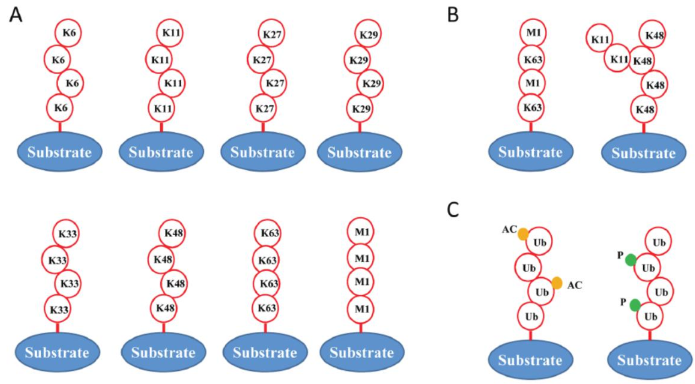            

蛋白质被泛素标记， 本身已经是一种蛋白的翻译后修饰过程了， 但是修饰蛋白的泛素， 由于它自身也是一种长度很短的小肽， 也能被翻译后修饰， 例如磷酸化或者乙酰化修饰等等。这就使得泛素化过程变得更为复杂。 

#### （2） 泛素激活酶（E1） 
  泛素激活酶 E1 是起始泛素化反应的酶， 它的主要作用是通过消耗 ATP 能量的方式和泛素结合并激活泛素分子。 具体过程是， E1 在 ATP 的作用下， 将泛素分子 C 端甘氨酸的羧基连接到 E1 自身的活性半胱氨酸的巯基侧链上， 形成高能的硫羟酸酯键。 E1 分子具有两个活性位点， 能一次性地调控和激活两个泛素分子。 

#### （3） 泛素结合酶（E2）  
泛素结合酶 E2 是泛素化反应的中间酶， 可以结合 E1 和 E3， 通常也被称为泛素载运蛋白（ubiquitin-carrier enzyme） 。 E2 酶家族经历过漫长而复杂的进化。 高等级的真核生物在 E2酶的数量上大于低等级的真核生物。 例如， 人类已鉴定有 35 个具有活性的 E2 酶， 但是酵母只鉴定有 16 个 E2 酶。E2 酶具有高度保守的结构域--泛素结合结构域（ubiquitin-conjugating domain， 缩写 UBC） 。 这个结构域通过结合在自身具有活性的半胱氨酸残基上的硫酯， 结合由 E1 激活的泛素。 泛素结合结构域 UBC 分子量是 14-16 kDa。 不同物种当中， UBC 结构域的保守性较高， 同源性大约是 35%。 泛素结合结构域 UBC 序列上， 有象征活性的半胱氨酸位点， 可以接受被 E1 激活的泛素分子， 并与泛素之间形成硫酯键。 这个反应发生之后，带有激活泛素的 E2 随后与 E3 相互结合； 最后， E2 将结合在自身的泛素分子转移到底物上，使底物蛋白完成泛素标记。 

#### （4） 泛素蛋白连接酶（E3）
在泛素化过程中， 泛素蛋白连接酶能够特异性地识别靶蛋白质。 按照表现形式分类， E3 可以分为单亚基蛋白质和多亚基复合物。 目前已鉴定的 E3 单亚基蛋白质主要包括四个家族：HECT 结构域家族、 RING 结构域家族、 U-box 结构域家族和 N-recognin 家族。 E3 的多亚基复合物主要包括 Cullin RING 和 APC/C 两类 。

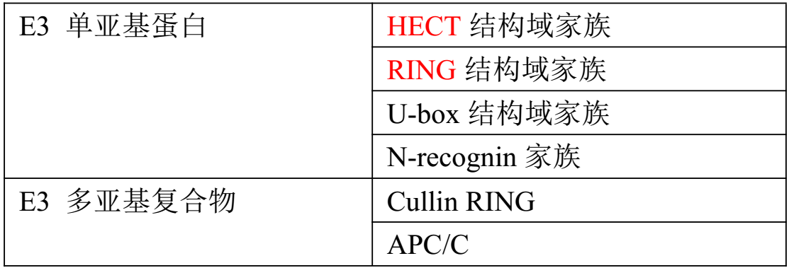

泛素蛋白连接酶 E3 是泛素化过程中最关键的酶。 底物上通常具有可被特异性识别的模体，这种模体也称为泛素化信号域。 能特异性地识别和结合底物， 指导泛素分子从 E2 转移到底物上， 共价结合特定的赖氨酸残基。 E2-E3 复合物的晶体结构显示， 泛素化中的许多反应物是围绕 E3 的活性位点展开的。 因此， E3 的功能体现了泛素化的特异性和高效性。 

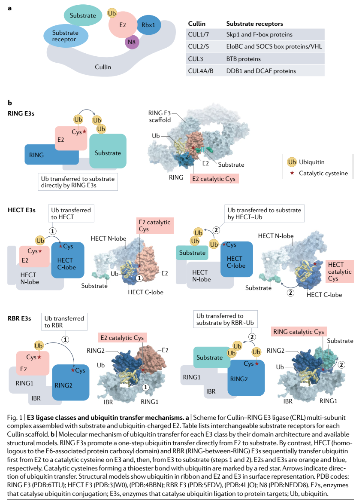

在分子水平上分析 E3 是很难的问题。 因为除 E3 外， 底物、 泛素分子、 泛素激活酶 E1 以及泛素结合酶 E2 也作用在反应体系中。 除了促进泛素分子转移到底物的赖氨酸残基上， E3还需要在它的活性位点处， 协调反应体系中其它蛋白质的作用。 

目前， HECT 和 RING 已证明是 E3 分类中最大的两个家族。 这两个家族的催化模型与序列或结构无关， 但是它们运行的机制却是截然不同的。 HECT 家族的 E3 酶利用保守的半胱氨酸接受从 E2 转移来的泛素分子形成 E3 和泛素之间的硫酯， 然后再将泛素分子由这种共价结合的 “E3-泛素” 中间体转移到底物上 。相反， RING 家族的 E3 酶将泛素分子直接从 E2-泛素复合物中转移到底物上， 在这个过程中， RING 家族的 E3 酶不与泛素分子发生结合。 所以 HECT 家族 E3 酶和 RING 家族的 E3 酶， 在介导泛素转移到底物的过程中， HECT 家族 E3 酶先和泛素形成一个 E3-泛素的中间体， 然后再将泛素转移到底物上， 是一个两步骤的过程； 而 RING 家族的 E3 酶直接介导泛素转移到底物上， 是一个一步骤的过程。 

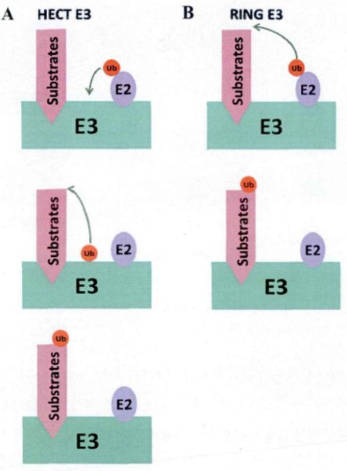

#### （5） 去泛素化酶（deubiquitination enzymes， DUB） 
人类当中有 100 多个基因编码了 DUB（去泛素化酶） 基因， 这些基因可以分为半胱氨酸蛋白酶（cysteine proteases） 和金属蛋白酶（metalloproteases） 两大类。 半胱氨酸蛋白酶主要可以分为： 1） 泛素特异性蛋白酶（ubiquitin specific proteases， USPs） ； 2） 泛素羧基端水解酶 （ubiquitin C-terminal hydrolases ， UCHs ） ； 3 ） 马 查 多 - 约 瑟 夫 结 构 域 蛋 白 酶（Machado-Josephin domain proteases，MJDs）和 4）卵巢肿瘤相关蛋白酶（ovarian tumor-related proteases， OTU） 。金属蛋白酶是具有 JAB1/Mpr1 Pad1 N-terminal+(MPN+)/Mov34 (JAMM)结构域的蛋白酶。  

去泛素化酶 DUB 在去泛素化途径中具有重要的功能。 它们能够移除蛋白质上的单聚泛素分子或多聚泛素链。当靶蛋白发生泛素化时，泛素分子通过异肽键结合到底物的赖氨酸残基上。被泛素化的分子最终的命运是通过蛋白酶体被降解。而去泛素化酶 DUBs 能通过移除这些泛素化的修饰而起到一定的拮抗作用， 进而改变蛋白质的命运。  

#### （6） 蛋白酶体 
蛋白酶体是一个多亚基蛋白酶复合体， 分布于细胞质与细胞核内， 是哺乳动物细胞中主要的中性蛋白水解酶， 可占细胞蛋白质总量的 1% 。 在真核生物进化中， 蛋白酶体高度保守。我们通常说的蛋白酶体指的是 26S 蛋白酶体形式。26S 蛋白酶体由 20S 蛋白酶体和 19S 亚复合体构成。 每个 19S 亚复合体含有多个 ATP 酶活性位点和泛素结合位点， 可以识别泛素化的靶蛋白， 而且在靶蛋白进入 20S 蛋白酶体前， 对靶蛋白进行去泛素化、 同时打开靶蛋白的结构折叠。 真核细胞的 20S 蛋白酶体含有两个α环和两个β环， 这些α环和β环共同组成一个圆筒状结构。 无论是α环还是β环， 都是由 7 个相同的亚基组成， 也就是α环内含有从α1-α7 的 7 个亚基； 类似的， β环内含有从β1-β7 的 7 个亚基。 在 20S 蛋白酶体内， α环位于外层， 主要用于底物的识别； β环位于内层， 主要负责催化底物的降解。 3 种发挥催化作用的亚基位于β环分子的内表面， 并表现出半胱氨酸蛋白酶样活性、 胰蛋白酶样活性和糜蛋白酶样活性， 分别酶解羧基端酸性、 碱性、 疏水性或芳香性氨基酸残基。 

### 3.泛素-蛋白酶体（ubiquitin-proteasome system，UPS） 的反应过程  
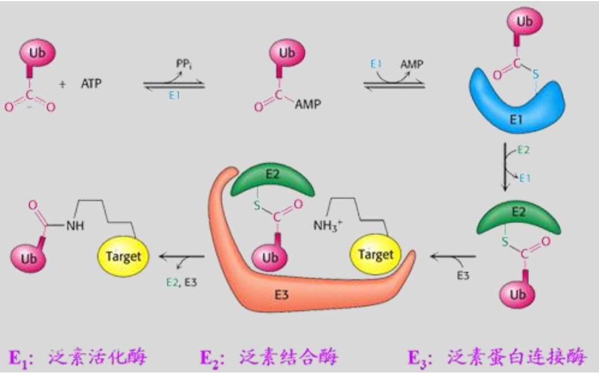  

在整个泛素化过程中， 第一步是： E1 酶激活泛素分子， 此过程需要消耗以 ATP 形式存在的能量， 同时形成 E1-泛素的中间产物；第二步是： 泛素分子从 E1 上， 被转移到 E2 酶上， 形成一个 E2-泛素的中间产物；第三步是： E3 酶先识别待降解的靶蛋白， 然后 E3 酶再识别 E2-泛素中间产物， 从而形成一个包含 E2-泛素中间产物， E3 酶和靶蛋白的复合物。 同时， 在这个复合物内， E3 介导泛素标记物从 E2 酶转移到靶蛋白上； 第四步是： E2 酶和 E3 酶， 从上述的复合物中释放， 从而形成被泛素标记的靶蛋白；第五步是： 重复上述过程， 直到蛋白质上连接的多个泛素形成一条泛素链；第六步是： 被泛素化的靶蛋白， 会被 26S 蛋白酶体识别和降解。 具体的机制是， 被泛素化的靶蛋白先被 19S 亚复合体识别。 随后， 19S 亚复合体切除靶蛋白上的泛素链。 最后 20S蛋白酶体将靶蛋白切割成小片段。 

### 4.泛素-蛋白酶体在生理过程中的重要作用
#### （1） 阻止植物的自授粉 
#### （2） 泛素化修饰与细胞周期调控 
对所有真核细胞而言，将周期相关蛋白标记上泛素，这个过程对于正确的细胞分裂至关重要。在超过 600 种 E3 泛素蛋白连接酶中，SCF（skp1–cullin1–F-box）与 APC/C (anaphase promoting complex/cyclosome) E3 酶对细胞周期调控最为重要。SCF 和 APC/C 这两种 E3 酶复合物具有相似的分子结构， SCF 中含有 cullin 作为 RING 结构域； 在 APC/C 中， 含有 cullin 相关脚手架蛋白作为 RING 结构域， SCF 和 APC/C 通过各自的 RING 结构域， 结合 E2-泛素中间产物以及底物， 从而催化泛素化反应。 

SCF 与 APC/C 可以通过促进细胞周期相关蛋白的降解，这些细胞周期相关蛋白包括 cyclins、aurora， cdc25 磷酸酶以及 CKI 等。 SCF 与 APC/C 通过降解细胞周期相关蛋白， 从而完成不可逆的细胞周期转换。相反，细胞则通过一系列调控机制，也可以反过来影响 SCF 与 APC/C，从而调控细胞周期的进程。 尽管 SCF 与 APC/C 的结构与功能高度相似， 它们的调控方式却迥然不同。 对于 SCF 而言， 底物通常都需要被磷酸化修饰之后， 才能被 SCF 识别； 如果底物的磷酸化位点发生突变， 就会导致底物不被 SCF 识别和降解， 会在细胞内产生不受限制的细胞分裂。 而大部分 APC/C 的底物， 并不需要磷酸化， 就可以被 APC/C 识别并降解。 反而是细胞通过磷酸化或其他机制调控 APC/C 本身的活性而调节细胞周期转换。 因此， SCF，APC/C 和细胞之间， 形成了一种双向调控的关系： E3 酶复合物 SCF， APC/C 等调控细胞周期的转化， 但是与此同时， 细胞也可以通过磷酸化等方式， 反过来调控了 SCF 和 APC/C 的活性。 例如， 细胞使 SCF 的底物发生去磷酸化反应， 从而抑制 SCF 对于底物的识别和降解；或者细胞通过磷酸化 APC/C 复合物， 从而抑制了它的功能。 这样一种细胞和 E3 酶之间的双向调控关系， 保证了细胞内的细胞周期可以正常持续地进展。

####  （3） 泛素化修饰与受体内化
配体诱导的跨膜受体的激活， 可启动一系列胞内信号通路而调控关键的细胞生物学过程， 如细胞增殖、 分化、 迁移与存活等。 因此受体通路的时空调控对细胞正确的生物学功能极为重要。 其中一类调控机制便是对受体的泛素化修饰， 通过促进受体内化并靶向溶酶体降解， 从而确保受体通路的及时终止。 由于受体酪氨酸激酶(receptor tyrosine kinases， RTKs) 在细胞生物学功能中的核心作用， 对 RTK 的泛素化修饰研究也最为充分， 尤其对于 EGFR， 早已成为泛素化研究领域的热点分子。 有研究发现， 超过 50%表皮生长因子受体 EGFR 连接的泛素是以 K63 泛素链形式存在的， 而且这种 K63 泛素链修饰显著促进了受体的内化和靶向溶酶体的降解过程。 研究发现， 当配体 EGF 诱导 EGFR 激活后， EGFR 很快发生泛素化，起作用的 E3 酶主要是 Cb1。Cb1 可以被招募到激活的 EGFR 胞内段的磷酸酪氨酸残基部位，促进激活的 EGFR 发生泛素化。 EGFR 的泛素化修饰过程受到配体浓度的影响。 当配体 EGF处于低浓度时， EGFR 的泛素化程度很低， 难以被检测到； 当配体 EGF 处于高浓度时， 大量 EGFR 处于泛素化状态。 尽管泛素化对 EGFR 的具体调控机制与作用还不完全清楚， 但是实验数据表明， 泛素化可以影响 EGFR 的内化程度、 内化路径， 从而调控 EGFR 的命运，最终改变整条 EGFR 信号通路。 

#### （4） 泛素化修饰与细胞凋亡 
p53 是凋亡途径中一个非常重要的抑癌基因。 p53 强大的肿瘤抑制功能， 主要是因为 p53 分子在各种细胞应激条件下， 可以作为转录因子， 调控下游一系列负责细胞周期阻滞和凋亡的靶基因的表达。 MDM2 是 p53 非常重要的一个负调控因子。 MDM2 本身也是一个 E3 酶，通过泛素化 p53， 促进 p53 的降解。 因此， 在正常细胞内， 细胞通过 MDM2 介导的泛素化过程持续降解 p53， 使得 p53 分子在正常细胞内持续保持较低的表达水平。另一类分子家族凋亡抑制因子 IAP（inhibitor of apoptosis） 家族成员， 也是 E3 酶。 IAP 家族成员可以影响 Caspase 的稳定性。 通过对凋亡不同途径和不同底物的泛素化修饰， IAP 不仅可 抑 制 线 粒 体 途 径 的 凋 亡 通 路 ， 还 可 抑 制 外 源 性 凋 亡 通 路 。 家 族 成 员 XIAP (X chromosome-linked IAP) 可以直接与 caspase 3、 7、 9 相互作用而抑制它们的酶活性， 并且介导泛素化， 促进这些 caspase 酶的降解。 在 TNF receptor 1（TNFR1） 信号通路中， IAP1和 C-IAP2 也可以通过泛素化的方式负向调控 caspase 8 的活性。 

### 5.针对泛素-蛋白酶体而进行的药物开发
#### （1） 针对去泛素化酶的药物 
由于去泛素化酶可直接拮抗识别肿瘤蛋白或肿瘤抑制因子的 E3， 近年来被视为肿瘤治疗的潜在靶点。 目前已有研究发现， 去泛素化酶在多种癌细胞中存在过表达现象， 水平明显高于正常细胞。 例如， USP1 在骨肉瘤细胞中水平明显增高， 可去泛素化并固定 DNA 结合蛋白抑制剂 ID1、 ID2 及 ID3， 从而保持骨肉瘤细胞中干细胞特性， 促进其不断分裂增殖。而 USP7在前列腺癌细胞中存在过表达现象， 可通过抑制包括 p53、 FOXO4 等肿瘤抑制因子的活性诱发肿瘤。 因此， 去泛素化酶抑制剂逐渐成为抗肿瘤药的新型研究方向。 

目前， 已发现多种去泛素化酶抑制剂对癌细胞具有抑制作用， 可能具有潜在的抗肿瘤活性。例如， WP1130 可抑制去泛素化酶 USP9X、 USP5、 USP14 及 UCH37 活性， 下调抗凋亡蛋白MCL-1 水平， 并上调肿瘤抑制因子 p53 水平， 提高细胞的抗肿瘤活性。 2017 年有研究表明，WP1130 通过抑制雌激素受体阴性乳腺癌细胞中的 USP9X，增加乳腺癌细胞对于顺铂的敏感性。 USP7 的特异性去泛素化酶抑制剂 P5091 可诱导对硼替佐米有耐药性的多发性骨髓瘤细胞的凋亡， 并抑制肿瘤细胞的增殖。 另有研究表明， USP14 的特异性抑制剂可促进氧化蛋白的降解， 增强癌细胞对氧化压力的抗性。 选择性抑制 USP14 和 UCHL5 的去泛素酶抑制剂 B-AP15 不仅可以抑制对硼替佐米耐药的多发性骨髓瘤细胞的增长， 同时还可抑制细胞周期蛋白 Cdc25c、 Cdc2 和细胞周期素 B1 的表达， 诱导癌细胞发生凋亡。 

#### （2） 针对泛素激活酶 E1 的药物
泛素激活酶 E1 是保证泛素化过程正常进行的首要前提， 有研究表明， 敲除 E1 后可导致白

血病细胞和多发性骨髓瘤细胞的凋亡， 从这一角度出发， E1 有望成为治疗白血病及多发性骨髓瘤的新靶点。自 2002 年第一个针对 E1 的小分子化合物 panepophernanthrin 被发现以来，更多的 E1 抑制剂被相继研发用于肿瘤治疗。 例如， 组蛋白脱乙酰化酶抑制剂拉格唑拉被证明能破坏泛素与 E1 腺苷酰结构域的结合， 抑制癌细胞的增殖。 具有细胞渗透性的 E1 抑制剂 PYR-41 可阻断受体相关因子 TRAF6 的泛素化， 阻止 IκBα和 p53 的泛素化降解， 且能够杀死表达 p53 的癌细胞， 是一种有效的可用于治疗癌症的 E1 抑制剂。 

#### （3） 针对泛素结合酶 E2 的药物
有研究发现， 泛素结合酶 USE1 在肺癌细胞中存在着过表达现象， 而 USE1 的 mRNA 水平在癌细胞与正常细胞中相近， 说明在肺癌细胞中 USE1 的表达后修饰出现了问题。 由于肺癌细胞中 USE1 与 E3 泛素蛋白连接酶 APC/C 结合的 D-box 结构域发生错义突变， 阻断了与APC/C 复合体中的 CDC20 和 CDH1 链接蛋白的正常结合， 导致 USE1 蛋白半衰期延长， 胞内 USE1 蛋白水平升高， 从而改变正常的细胞周期调控， 促进了癌细胞的增殖和迁移。 这一实验结果不仅为下一步的肿瘤治疗提供了研究基础， 也表明 USE1 蛋白也可作为肺癌早期临 床诊断的生物标志物。

泛素结合酶 Ubc13 能够与多个不同的泛素蛋白连接酶 E3 一起参与 K63 型的多聚泛素链的形成， 在炎症和 DNA 损伤应答途径的信号转导过程中至关重要。 2014 年， 有研究发现， Ubc13的表达是乳腺癌细胞代谢所必需的， 而且它在前列腺、 结肠、 胰腺和淋巴瘤的肿瘤组织中也存在表达水平上调的现象。目前，从海绵动物中提取出了环状肽 Leucettamol A、化合物 Manadosterols A 和 Manadosterols B， 都被证实能通过阻断 Ubc13 与 UEV1A 的相互作用， 从而抑制 Ubc13-UEV1A 复合体的形成，最终阻止 K63型多聚泛素链的形成，抑制底物降解。另有两种 Ubc13抑制剂 NSC697923和 BAY 11-7082， 被证实可以通过在 Ubc13 活性位点半胱氨酸残基上， 经过迈克尔加成反应，形成共价加合物， 分别抑制 DNA 损伤和 NF-κB 信号通路。 （迈克尔加成反应： 是指亲电的共轭体系（电子受体） 与亲核的负碳离子（电子供体） 进行的共轭加成反应。 该反应于 1887年由 A.迈克尔首先发现， 是有机合成中增长碳链的常用方法之一）。

### 6.泛素化专业信息数据库介绍 
#### （1）E3Net
韩 国 科 学 技 术 院 生 物 信 息 学 实 验 室 设 计 并 开 发 了 E3Net 数 据 库([<u>http://pnet.kaist.ac.kr/e3net/</u>](http://pnet.kaist.ac.kr/e3net/)) 。 该数据库在数据量方面较为庞大， 且界面更为友好美观， 从

数据量及注释信息的丰富程度上来说，该数据库都是当前泛素化修饰相关蛋白数据库中最为出色的。 E3Net 数据库共收录了 427 个物种中 2201 个泛素化修饰 E3 及 4896 个底物蛋白信息， 其中包含 493 个 E3 与 1277 个底物蛋白之间的 1671 个特异选择关系， 该数据库的数据来源主要是文本挖掘方法挖掘 MEDLINE 摘要得到的结果、 UniProt 相关条目注释信息、 公共泛素化数据库收录数据以及高通量实验数据。  

#### （2） hUbiquitome
hUbiquitome ([<u>http://bioinfo.bjmu.edu.cn/hubi/</u>](http://bioinfo.bjmu.edu.cn/hubi/)) 是北京大学发布的一个数据库， 旨在收录高可信度的实验验证的人类泛素化相关蛋白质， 该数据库共收录了 1 个 E1、 12 个 E2、 138 个

E3、 279 个底物蛋白以及 17 个去泛素化酶。 该数据库规模较小， 但可信度较高， 由于收录的全部为实验验证的数据， 且为人工手动录入， 提高了数据库所收录数据的可靠性， 但同时降低了数据量， 倘若加入质量控制体系， 多渠道收集数据并对数据进行打分， 将对提高数据量有所帮助。 此外， 该数据库的条目注释信息较少， 每个条目包含的相关信息不多， 但该数据库包含了数据提交功能， 更为友好的是提供了原始数据下载的功能， 这是相对于其它泛素化相关蛋白质数据库显著的优点。 

### 7.泛素化异常与神经退行性疾病
帕金森病的发病机制还不是很清楚， 但是很多的研究证据表明， 泛素-蛋白酶体系统的功能改变是帕金森病的重要发病因素。 在散发性帕金森病中存在泛素-蛋白酶体系统的功能异常。通过基因定位分析， 已经发现了多个和家族性帕金森病直接相关的基因和基因的突变， 这些基因包括α-突触核蛋白基因（α-synuclein） 、 parkin 基因（parkin 基因本身就是一个编码 E3泛素蛋白连接酶的基因）以及泛素羧基末端水解酶 1 基因（ubiquitin C-terminal hydrolase L1，UCH-L1） 。 这些基因和基因的突变都和泛素-蛋白酶体系统的功能异常密切相关。 一旦这些基因出现功能紊乱， 都会干扰泛素-蛋白酶体系统对于异常蛋白的正常降解过程。 因此， 泛素-蛋白酶体系统的功能异常， 可能是不同家族性帕金森病发病的一个共同途径。 进一步的研究发现， 在神经退行性疾病所造成的神经元死亡中， 受损线粒体的累积具有核心的作用。在正常的神经元内， 当细胞内的线粒体受损时， E3 酶会被迅速活化， 使神经元能够及时清除异常的线粒体， 从而保持神经元的正常功能。 但是在帕金森病的患者脑内， 患者的神经元细胞内的 E3 连接酶处于显著的抑制状态， 即便细胞内出现线粒体受损的现象， 患者神经元内的 E3 酶依然不能被激活， 从而无法清除受损的线粒体， 最终导致神经退行性疾病的出现。因此， 如果可以通过特定的处理， 扰乱神经元内对于 E3 酶的抑制作用， E3 连接酶就会被激活， 进而快速识别受损的线粒体。 通过这样的处理， 有望在帕金森患者中延缓疾病的进程。

亨廷顿病(Huntington’ s disease， HD)是一种以行动异常、 认知下降和精神问题为特征的常染色体显性的神经退行性疾病。亨廷顿病的发病原因是 4 号染色体上亨廷顿基因(huntingtin，HTT)中，出现非常多的三联密码子 CAG 重复，一般 CAG 的重复数量都在 35 个重复或以上，结果导致聚谷氨酰胺片段扩大， 从而产生突变型亨廷顿蛋白(mutant huntingtin， mHtt)， 这些突变的亨廷顿蛋白在神经元细胞内形成聚合体导致患者发病。 鉴于突变型亨廷顿蛋白的累积， 是其神经毒性的首要条件， 因此清除突变型亨廷顿蛋白将有助于亨廷顿病的治疗。 因此，神经元内， 通过泛素-蛋白酶体系统， 用于清除真核细胞内可溶性蛋白和短寿命蛋白的方式，以及通过自噬系统， 用于清除长寿命蛋白、 聚合蛋白和损伤细胞器的方式， 这两种清除机制，对于神经元内错误折叠蛋白的清除， 非常地重要。 研究显示， 被 K48 型和 K63 型泛素化修饰的突变型亨廷顿蛋白可以通过泛素-蛋白酶体系统被清除。 

## 三、甲基化
甲基化的研究就分为 DNA 甲基化和组蛋白甲基化两个细分问题。 它们结果是一样的， 都是影响基因的转录。广义上的DNA甲基化是指DNA序列上特定的碱基在DNA甲基转移酶（DNA methyltransferase，DNMT）的催化作用下，以s一腺苷甲硫氨酸（S—adenosyl methionine，SAM）作为甲基供体，通过共价键结合的方式获得一个甲基基团的化学修饰过程。这种DNA甲基化修饰可以发生在胞嘧啶的C一5位、腺嘌呤的N一6位及鸟嘌呤的N一7位等位点。一般研究中所涉及的DNA甲基化主要是指发生在CpG二核苷酸中胞嘧啶上第5位碳原子的甲基化过程，其产物称为5—甲基胞嘧啶（5一mC），是植物、动物等真核生物DNA甲基化的主要形式，也是目前发现的哺乳动物DNA甲基化的唯一形式。DNA甲基化作为一种对稳定的修饰状态，在DNA甲基转移酶的作用下，可随DNA的复制过程遗传给新生的子代DNA，是一种重要的表观遗传机制。

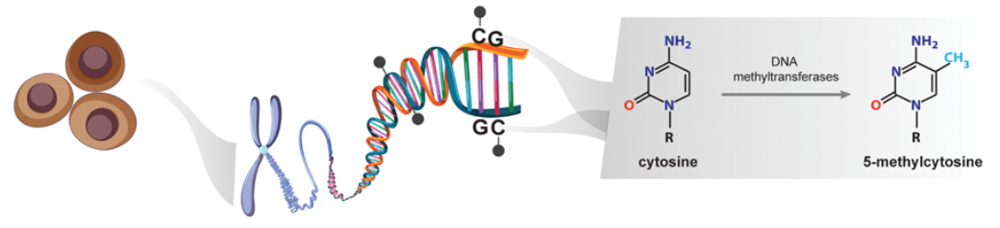

甲基化的功能主要是调控基因表达，在细胞生物学中发挥的关键作用引起了人们的广泛兴趣，调控基因表达、逆转录元件沉默、有丝分裂中着丝粒稳定性和染色体分离、X染色体失活和印迹基因的单等位基因沉默。 在胚胎发育中甲基化控制着时序性表达的基因（时序性表达即在特定时间阶段表达）， 甲基化去除之后就像基因解开封印， 用完之后再封印起来。 

在 DNA 甲基化的世界里， 大家重点搞清楚三件事： CpG 岛、 甲基化和去甲基化过程中的酶以及甲基化特异性检测方法。 

CpG 岛（CpG island） 是个术语， 是 DNA 发生甲基化的位置， CpG 里的 C 是 DNA 四种碱基之中的胞嘧啶的缩写， p 代表磷酸， G 是碱基鸟嘌呤。CpG 即指 C 后面跟一个 G 的核苷酸序列， 而 CpG 岛就是指富含 CG 序列的区域。

基因组DNA 四种碱基排列， 从概率来说， CG 这种连续序列也是常见的排布。 在人类基因组内， G和 C 的含量大约为 40%， A 和 T 比较多， 而且 GC 不是平均分布。 在某些 DNA 片段位置，GC 局部富集， 而在另一些位置出现得较少。 正常情况下， 散在的 CpG 是被甲基修饰的， 属于封印状态。在编码基因的启动子或者其他转录调控区域中，CpG 容易成簇，形成 CpG island。在健康人中 CpG 岛跟散在的 CpG 不一样， 它往往呈现非甲基化的状态， 也就是解封印， 这是转录调控的开关。 CpG 岛有严格定义， 长度至少 500bp， GC 含量超过 55%， CpG 比值大于 0.65。 CpG 比值是个参数， 有公式可以算的， 需要用到查一下。

人类基因组大概存在 4 万个 CpG 岛， 大部分位于启动子区域， 启动子 CpG 岛甲基化之后会诱发基因沉默， 所以启动子 CpG 甲基化与转录活性呈负相关。 CpG 岛的概念之所以重要， 是因为研究一个基因启动子 DNA 甲基化就是找 CpG 岛位置， 那里是一切故事起源的地方。 

第二个重要的概念是了解在甲基化和去甲基化过程中发挥作用的酶和辅助蛋白因子。甲基化是个可逆的酶促反应， 目前已知 DNA 甲基转移酶（DNA methyltransferase）有 4 种： DNMT1、DNMT2、 DNMT3a、 DNMT3b。 根据结构和功能上的差异分为两大类: 维持甲基化（maintenance methylation） 和从头甲基化（de novo methylation）。 维持甲基化以 Dnmt1 为代表， 它作用于仅有一条链甲基化的 DNA 双链使其完全甲基化， 参与 DNA 复制双链中的新合成链的甲基化。 而从头甲基化是对 DNA 链甲基化状态的重构， 不依赖于 DNA 复制，是在完全非甲基化的位点上引入甲基。 主要参与的从头甲基化酶是 Dnmt3a、 Dnmt3b。 现有研究表明 Dnmt1 与 Dnmt3a、Dnmt3b 之间还存在交互影响，并非绝对的分工关系。针对 Dnmt2的认识相对较少， 在 DNA 甲基化中不起主要作用， 所以平常研究中遇到的机会不多， 底物主要是催化 tRNA， 虽然底物不一样但催化机制类似。 除了 DNA 甲基化酶， 我们还需要注意有一类参与甲基化过程的 DNA 甲基化结合蛋白， 这类蛋白通过一种保守的结构域， 称为甲基化 DNA 结合结构域（methylated DNA-binding domain， MBD）， 结合甲基化的 CpG。MBD 家族有 MeCP2， MBD1、 2、 3、 4 五个成员。

MeCP2 是最早发现的， 甲基化与组蛋白乙酰化之间的联系就通过它。 MBD 识别甲基化位点， 负责招募阻遏蛋白， 抑制转录过程。

有些转录因子直接对甲基化位点敏感的， 有甲基化存在就不能结合启动子来影响转录。 还有一些转录因子对甲基化不敏感， 当启动子上存在 CpG 岛的甲基化， 它们的转录抑制就需要MBD 参与。 DNA 去甲基化过程比较复杂， 有脱氨酶参与的碱基切除修复途径（base excision repair， BER）， 还有直接移除甲基化 CpG 的核苷酸切除修复机制（nucleotide excision repair，NER）， 也可以在酶催化下， 氧化或者水解方式去除甲基基团。  

要知道 DNA 甲基化是增加了或是减少了涉及第三个问题： 甲基化特异性检测方法。 作为一个研究历史很长的修饰方式， 甲基化的实验检测方法非常多， 少说十几种， 不过我理了一下，主要有两类： 第一类是酶切法， 原理是有些核酸内切酶能够识别特异性的甲基化位点， 它们切割完 DNA 跑下胶鉴定结果就出来了， 再进一步可以用酶切+PCR 的方法鉴定。 如果酶切完用电泳方法分离， 再用特异性探针进行杂交， 这方法就叫 Southern Blotting， 酶切法里大家记住 Southern 就好了， 既有跑胶分离又有特异性探针的杂交， 实验精度更可靠， 一度还比较流行。 这里 Southern 是检测 DNA 的印迹杂交技术， 而检测 RNA 的印迹杂交技术叫Northern，检测蛋白的，太熟悉了叫 Western 。

第二种检测 DNA 甲基化的方法是 PCR 的衍生技术， PCR 是分子生物学的基础技术， 从这个技术衍生出来的 DNA 甲基化检测， 其群众基础就更好了， 是当前流行的方法。 第一种技术叫 MS-PCR（methylation specific PCR）， 简称 MSP——甲基化特异性 PCR。 原理是 DNA经过亚硫酸氢钠处理后， 非甲基化的胞嘧啶会转变成尿嘧啶而甲基化的保持不变， 这样设计两对特异性的引物去扩增甲基化和非甲基化的 DNA 结果就出来了。 类似的技术还有 BSP（Bisulfite sequencing PCR）： 同样用亚硫酸氢盐处理 DNA， 设计引物进行 PCR， 在扩增过程中尿嘧啶会被识别为胸腺嘧啶， DNA 序列就改变了， 对 PCR 产物进行测序就可以获得结果。 其他基于 PCR 衍生还有高分辨溶解曲线技术（High Resolution Melting， HRM）， 检测精度也很高； 还可以用带荧光标记的 Taqman 探针做 qPCR， 有试剂盒可以直接用。 这些检测技术针对的是已知的 DNA 甲基化位点； 大规模的 DNA 甲基化位点筛选也有， 有 DNA甲基化组学（Methylome）， 用基因芯片和二代测序都可以做筛选， 跟筛基因差不多。 我们比较少直接筛甲基化差异， 更多的情况是已有一个主变量， 表型做完， 上游找机制的时候考虑 DNA 甲基化， 这种策略是不需要做高通量筛选的。

具体怎么做？ 从启动子区找 CpG 岛的过程很简单， CpG 岛是一个序列特性， 不涉及复杂的生信算法， 用来搜索 CpG 岛的软件有： CpG Analyzer、 CpGcluster、 CpGFinder、 CpG Island Explorer、 CpG Island Searcher 等，另外甲基化引物设计软件 Methyl Primer Express 以及 MethPrimer 也有相应的 CpG 岛搜索功能。 找到了这些 CpG 岛的位点， 接下来用特异性甲基化检测方法比如 MSP， BSP 检测分析就好了。 在预测分析这一步， 甲基化要比转录因子简单得多， 甚至检索启动子序列的数据库也能提供相关的 CpG 岛甲基化位点信息。 

我们知道染色质是由核小体组成的， 核小体包含 4 种组蛋白 H3、 H4、 H2A、 H2B， 组装成 8 聚体的复合物。 四种组蛋白内部结合非常紧密， 但 N 端会伸向外侧， 形成各种组蛋白修饰酶的作用位点。 组蛋白修饰主要有两个作用：影响染色质结构从而调控转录， 或者作为信号招募转录因子和辅助的调控蛋白。 在所有的修饰里， 甲基化是目前研究比较清楚的一种组蛋白修饰方式， 是由组蛋白甲基化转移酶（Histone methylation transferase， HMT） 催化， 可以发生在赖氨酸和精氨酸两种氨基酸上。赖氨酸可以 1， 2， 3 甲基化， 也就是分别添加 1 个， 2 个， 3 个甲基； 而精氨酸可以 1， 2甲基化。 在文献里看到组蛋白甲基化会觉得有点烦， 位点特别多： H3K4、 H3K9、 H3K27等让你无所适从。 我跟大家讲讲规律， 这些组蛋白甲基化位点前面 H3、 H4 是组成核小体的组蛋白名称， 后面的 K 是赖氨酸缩写， 而 R 是精氨酸缩写， 氨基酸后面的数字就是第几个赖氨酸或精氨酸的序列位置。 有时候 H3K4 后面还会跟 me1， 2， 3， 这是 1 甲基化， 2 甲基化和 3 甲基化， 加一个两个三个甲基的区别。

> 更新: 2023-09-04 12:00:09  
> 原文: <https://www.yuque.com/doublehelix/bioinfonotes/bytifz84cpxhed02>