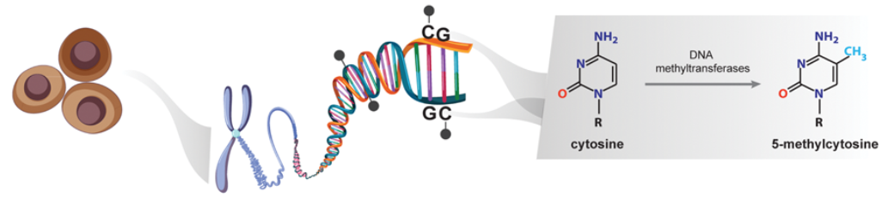

# 甲基化

甲基化的研究就分为 DNA 甲基化和组蛋白甲基化两个细分问题。它们结果是一样的，都是影响基因的转录。广义上的 DNA 甲基化是指 DNA 序列上特定的碱基在 DNA 甲基转移酶（DNA methyltransferase，DNMT）的催化作用下，以 S-腺苷甲硫氨酸（S-adenosyl methionine，SAM）作为甲基供体，通过共价键结合的方式获得一个甲基基团的化学修饰过程。这种 DNA 甲基化修饰可以发生在胞嘧啶的 C-5 位、腺嘌呤的 N-6 位及鸟嘌呤的 N-7 位等位点。一般研究中所涉及的 DNA 甲基化主要是指发生在 CpG 二核苷酸中胞嘧啶上第 5 位碳原子的甲基化过程，其产物称为 5-甲基胞嘧啶（5-mC），是植物、动物等真核生物 DNA 甲基化的主要形式，也是目前发现的哺乳动物 DNA 甲基化的唯一形式。DNA 甲基化作为一种相对稳定的修饰状态，在 DNA 甲基转移酶的作用下，可随 DNA 的复制过程遗传给新生的子代 DNA，是一种重要的表观遗传机制。

甲基化的功能主要是调控基因表达，在细胞生物学中发挥的关键作用引起了人们的广泛兴趣，调控基因表达、逆转录元件沉默、有丝分裂中着丝粒稳定性和染色体分离、X 染色体失活和印迹基因的单等位基因沉默。在胚胎发育中甲基化控制着时序性表达的基因（时序性表达即在特定时间阶段表达），甲基化去除之后就像基因解开封印，用完之后再封印起来。

在 DNA 甲基化的世界里，大家重点搞清楚三件事：CpG 岛、甲基化和去甲基化过程中的酶以及甲基化特异性检测方法。

CpG 岛（CpG island）是个术语，是 DNA 发生甲基化的位置，CpG 里的 C 是 DNA 四种碱基之中的胞嘧啶的缩写，p 代表磷酸，G 是碱基鸟嘌呤。CpG 即指 C 后面跟一个 G 的核苷酸序列，而 CpG 岛就是指富含 CG 序列的区域。

基因组 DNA 四种碱基排列，从概率来说，CG 这种连续序列也是常见的排布。在人类基因组内，G 和 C 的含量大约为 40%，A 和 T 比较多，而且 GC 不是平均分布。在某些 DNA 片段位置，GC 局部富集，而在另一些位置出现得较少。正常情况下，散在的 CpG 是被甲基修饰的，属于封印状态。在编码基因的启动子或者其他转录调控区域中，CpG 容易成簇，形成 CpG island。在健康人中 CpG 岛跟散在的 CpG 不一样，它往往呈现非甲基化的状态，也就是解封印，这是转录调控的开关。CpG 岛有严格定义，长度至少 500bp，GC 含量超过 55%，CpG 比值大于 0.65。CpG 比值是个参数，有公式可以算的，需要用到查一下。

人类基因组大概存在 4 万个 CpG 岛，大部分位于启动子区域，启动子 CpG 岛甲基化之后会诱发基因沉默，所以启动子 CpG 甲基化与转录活性呈负相关。CpG 岛的概念之所以重要，是因为研究一个基因启动子 DNA 甲基化就是找 CpG 岛位置，那里是一切故事起源的地方。

第二个重要的概念是了解在甲基化和去甲基化过程中发挥作用的酶和辅助蛋白因子。甲基化是个可逆的酶促反应，目前已知 DNA 甲基转移酶（DNA methyltransferase）有 4 种：DNMT1、DNMT2、DNMT3a、DNMT3b。根据结构和功能上的差异分为两大类: 维持甲基化（maintenance methylation）和从头甲基化（de novo methylation）。维持甲基化以 Dnmt1 为代表，它作用于仅有一条链甲基化的 DNA 双链使其完全甲基化，参与 DNA 复制双链中的新合成链的甲基化。而从头甲基化是对 DNA 链甲基化状态的重构，不依赖于 DNA 复制，是在完全非甲基化的位点上引入甲基。主要参与的从头甲基化酶是 Dnmt3a、Dnmt3b。现有研究表明 Dnmt1 与 Dnmt3a、Dnmt3b 之间还存在交互影响，并非绝对的分工关系。针对 Dnmt2 的认识相对较少，在 DNA 甲基化中不起主要作用，所以平常研究中遇到的机会不多，底物主要是催化 tRNA，虽然底物不一样但催化机制类似。除了 DNA 甲基化酶，我们还需要注意有一类参与甲基化过程的 DNA 甲基化结合蛋白，这类蛋白通过一种保守的结构域，称为甲基化 DNA 结合结构域（methylated DNA-binding domain，MBD），结合甲基化的 CpG。MBD 家族有 MeCP2，MBD1、2、3、4 五个成员。

MeCP2 是最早发现的，甲基化与组蛋白乙酰化之间的联系就通过它。MBD 识别甲基化位点，负责招募阻遏蛋白，抑制转录过程。

有些转录因子直接对甲基化位点敏感的，有甲基化存在就不能结合启动子来影响转录。还有一些转录因子对甲基化不敏感，当启动子上存在 CpG 岛的甲基化，它们的转录抑制就需要 MBD 参与。DNA 去甲基化过程比较复杂，有脱氨酶参与的碱基切除修复途径（base excision repair，BER），还有直接移除甲基化 CpG 的核苷酸切除修复机制（nucleotide excision repair，NER），也可以在酶催化下，氧化或者水解方式去除甲基基团。

要知道 DNA 甲基化是增加了或是减少了涉及第三个问题：甲基化特异性检测方法。作为一个研究历史很长的修饰方式，甲基化的实验检测方法非常多，少说十几种，不过我理了一下，主要有两类：第一类是酶切法，原理是有些核酸内切酶能够识别特异性的甲基化位点，它们切割完 DNA 跑下胶鉴定结果就出来了，再进一步可以用酶切+PCR 的方法鉴定。如果酶切完用电泳方法分离，再用特异性探针进行杂交，这方法就叫 Southern Blotting，酶切法里大家记住 Southern 就好了，既有跑胶分离又有特异性探针的杂交，实验精度更可靠，一度还比较流行。这里 Southern 是检测 DNA 的印迹杂交技术，而检测 RNA 的印迹杂交技术叫 Northern，检测蛋白的，太熟悉了叫 Western 。

第二种检测 DNA 甲基化的方法是 PCR 的衍生技术，PCR 是分子生物学的基础技术，从这个技术衍生出来的 DNA 甲基化检测，其群众基础就更好了，是当前流行的方法。第一种技术叫 MS-PCR（methylation specific PCR），简称 MSP——甲基化特异性 PCR。原理是 DNA 经过亚硫酸氢钠处理后，非甲基化的胞嘧啶会转变成尿嘧啶而甲基化的保持不变，这样设计两对特异性的引物去扩增甲基化和非甲基化的 DNA 结果就出来了。类似的技术还有 BSP（Bisulfite sequencing PCR）：同样用亚硫酸氢盐处理 DNA，设计引物进行 PCR，在扩增过程中尿嘧啶会被识别为胸腺嘧啶，DNA 序列就改变了，对 PCR 产物进行测序就可以获得结果。其他基于 PCR 衍生还有高分辨溶解曲线技术（High Resolution Melting，HRM），检测精度也很高；还可以用带荧光标记的 Taqman 探针做 qPCR，有试剂盒可以直接用。这些检测技术针对的是已知的 DNA 甲基化位点；大规模的 DNA 甲基化位点筛选也有，有 DNA 甲基化组学（Methylome），用基因芯片和二代测序都可以做筛选，跟筛基因差不多。我们比较少直接筛甲基化差异，更多的情况是已有一个主变量，表型做完，上游找机制的时候考虑 DNA 甲基化，这种策略是不需要做高通量筛选的。

具体怎么做？从启动子区找 CpG 岛的过程很简单，CpG 岛是一个序列特性，不涉及复杂的生信算法，用来搜索 CpG 岛的软件有：CpG Analyzer、CpGcluster、CpGFinder、CpG Island Explorer、CpG Island Searcher 等，另外甲基化引物设计软件 Methyl Primer Express 以及 MethPrimer 也有相应的 CpG 岛搜索功能。找到了这些 CpG 岛的位点，接下来用特异性甲基化检测方法比如 MSP，BSP 检测分析就好了。在预测分析这一步，甲基化要比转录因子简单得多，甚至检索启动子序列的数据库也能提供相关的 CpG 岛甲基化位点信息。

我们知道染色质是由核小体组成的，核小体包含 4 种组蛋白 H3、H4、H2A、H2B，组装成 8 聚体的复合物。四种组蛋白内部结合非常紧密，但 N 端会伸向外侧，形成各种组蛋白修饰酶的作用位点。组蛋白修饰主要有两个作用：影响染色质结构从而调控转录，或者作为信号招募转录因子和辅助的调控蛋白。在所有的修饰里，甲基化是目前研究比较清楚的一种组蛋白修饰方式，是由组蛋白甲基化转移酶（Histone methylation transferase，HMT）催化，可以发生在赖氨酸和精氨酸两种氨基酸上。赖氨酸可以 1、2、3 甲基化，也就是分别添加 1 个、2 个、3 个甲基；而精氨酸可以 1、2 甲基化。在文献里看到组蛋白甲基化会觉得有点烦，位点特别多：H3K4、H3K9、H3K27 等让你无所适从。我跟大家讲讲规律，这些组蛋白甲基化位点前面 H3、H4 是组成核小体的组蛋白名称，后面的 K 是赖氨酸缩写，而 R 是精氨酸缩写，氨基酸后面的数字就是第几个赖氨酸或精氨酸的序列位置。有时候 H3K4 后面还会跟 me1、2、3，这是 1 甲基化、2 甲基化和 3 甲基化，加一个两个三个甲基的区别。

> 更新: 2023-09-04 11:59:02
> 原文: <https://www.yuque.com/doublehelix/bioinfonotes/kfzveq>
