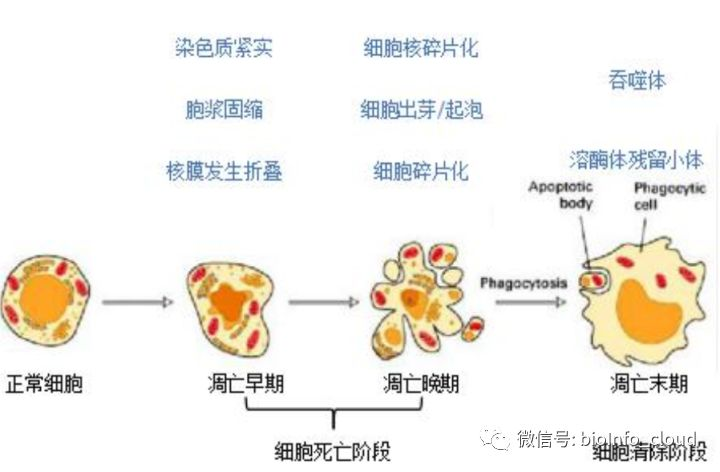
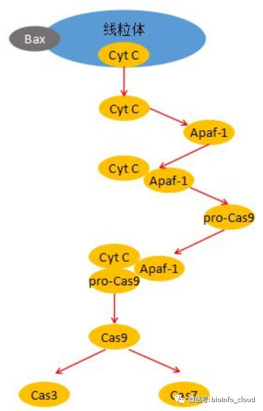
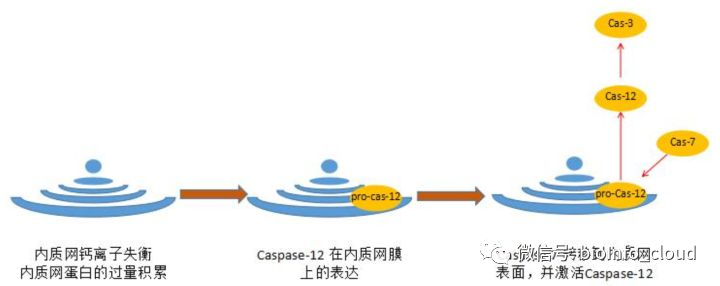
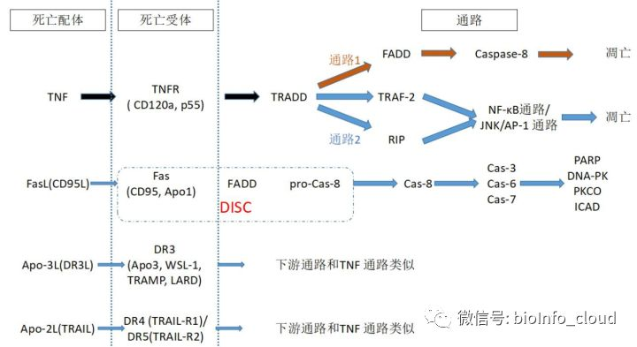
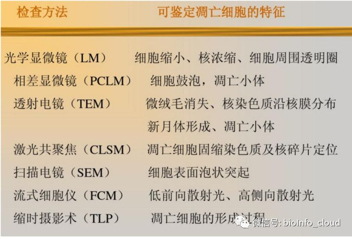

# 细胞凋亡

## 一、 凋亡概述
### 1.细胞凋亡的研究历史
细胞死亡现象， 是细胞生物学领域中的核心议题之一。 细胞死亡现象， 也是生命新陈代谢的本质问题， 例如胚胎发育、 组织更新， 在增殖的淋巴细胞群体中选择适当的细胞克隆等等。在这些生物学过程中， 都涉及到细胞的死亡现象。 这种细胞生理性死亡的现象， 是有利于动物发育的。

最早在 1956 年， 有学者在发育生物学中提出一个叫做细胞程序性死亡的概念。 细胞程序性死亡（programmed cell death， PCD） ， 指的是生理性细胞死亡， 强调的是这个过程的生理学特性， 描述在一个多细胞生物中某些细胞死亡是个体发育中的一个预定的， 并受到严格程序控制的细胞和分子生物学过程， 是正常发育过程的一部分。  

随后在 1972 年， Keer （基尔） 根据细胞发生了和坏死完全不同的死亡过程而提出了细胞凋亡（apoptosis） 的概念。 随着生物学研究的深入， 生物学家越来越意识到细胞死亡， 特别是细胞凋亡， 具有特殊的生物意义。 细胞凋亡对于维持一个多细胞生物的组织或器官的完整性和平衡性， 具有不可替代的重要作用。 在多细胞生物的生长、 发育、 存活以及死亡等过程中，都伴随着细胞凋亡的过程。 从 80 年代开始， 细胞凋亡成为医学和生物学研究的热点。 2002年， 正是由于发现了细胞凋亡的规律， 三位科学家获得了诺贝尔医学和生理学奖。 他们分别是英国的西德尼-布伦南和约翰-苏尔斯顿， 美国的罗伯特-霍维茨。  

### 2.凋亡的形态特征
在凋亡的发生过程中，细胞表现出非常明显的形态学特征。这些形态学特征主要有以下几点：  

1） 细胞丧失了表面结构， 形成光滑的轮廓， 从周围的正常细胞组织中分离了出来。

2） 细胞体积变小。 在细胞体积变小的过程中， 主要的形态学变化有： 胞浆内细胞器发生集中分布； 细胞膜出芽/起泡（bleb） ， 细胞发生皱缩。 但是在细胞体积变小的过程中， 细胞胞浆内的细胞器形态始终保持完整性。

3） 细胞核内染色质结构改变。 这是整个过程中形态学上最引人注意的形态变化。 染色质的形态学变化主要表现为： a） 染色质固缩（condensation） ； b） 染色质边缘化（margination） ；c） 细胞核内胞浆紧实（compaction） ； d） 细胞核的核膜折叠（fold） 。

4） 细胞形成凋亡小体（Apoptotic body） 。 在这一阶段， 凋亡细胞会裂解为很多由细胞膜包饶的小体。 在每一个凋亡小体内都有一簇细胞器。 由于细胞器被细胞膜包饶， 没有细胞内容物的外泄， 因此不会引起周围的炎症反应。

5） 凋亡细胞/凋亡小体被识别和被吞噬。 凋亡小体会被迅速吞噬， 形成吞噬体（phagosome），随后这些吞噬体进一步变性， 成为溶酶体残留小体（lysosomal residual body） 。  

### 3.凋亡的细胞学过程
有学者根据凋亡的整个细胞学过程， 将整个细胞凋亡的过程分为三个阶段： 早期（early phase） ， 晚期（later phase） 和末期（at last） 。 在下图中， 把整个凋亡的细胞学过程通过图表的方式， 进行了总结。

在细胞凋亡的早期阶段， 主要发生的细胞学现象是： 染色质变得紧实（compaction） ， 胞浆变得固缩（condensation） ， 细胞核的核膜发生折叠（fold） 。 在凋亡的晚期阶段， 细胞核发生碎片化现象， 细胞出现出芽/起泡（bleb） 的现象， 甚至连细胞都开始发生碎片化。 在凋亡的末期， 凋亡细胞所形成的凋亡小体， 被吞噬细胞所吞噬， 并最终完成整个细胞凋亡的过程。

通过实时影像学的研究发现， 凋亡过程开始得很突然。 在受到致死刺激之后不久， 被攻击的细胞突然出现细胞膜的皱缩， 细胞发生出芽/起泡的现象并且在细胞内激活凋亡的信号通路，这个时期仅仅持续几分钟。 然后迅速出现凋亡小体， 凋亡小体一旦形成停留在组织中被辨认出来的时间大约是 4-9 个小时。 这段时间和巨噬细胞在体内吞噬大的生物结构物并完全降解这些生物结构物所需要的时间大致相等。

由于整个细胞凋亡的过程是一个连续的细胞学行为过程， 从细胞的形态上， 有时很难把凋亡的早期和晚期非常严格地区分开， 因此， 有些学者提出把凋亡的早期和晚期合二为一， 称之为凋亡的细胞死亡阶段（the dying process） ； 把末期称之为凋亡的细胞清除阶段（the elimination process） 。

## 二、 凋亡通路和关键分子
### 1.凋亡通路核心分子家族成员
**（1）Bcl-2 家族**

Bcl-2 家族最有代表性的家族成员就是 Bcl-2 分子。 也正是因为 Bcl-2 分子研究得最为深入，也最广为人知， 因此 Bcl-2 不仅是分子的名称， 也成了家族的名称。 所以学员们在阅读文献时， 需要分清楚文章中出现的 Bcl-2 究竟指的是分子还是家族， 以免混淆。 Bcl-2 分子内含有四个同源结构域， 分别是 BH1-BH4。 家族成员根据分子内所含有的同源结构域的差异，可以分为三个不同的亚家族。

+ Bcl-2 亚家族。 属于这个亚家族的成员， 几乎都含有 BH1 和 BH2 结构域。 Bcl-2 亚家族成员对细胞凋亡起到抑制的作用。
+ Bax 亚家族。 Bax 亚家族都含有 BH3 结构域， 但是除了 BH3 结构域之外， 也含有其他的BH 结构域。 Bax 亚家族的成员所起到的作用和 Bcl-2 亚家族成员的功能， 正好相反， 它们起到促进细胞凋亡的作用。
+ BH3 亚家族。 这个亚家族内的成员， 只含有 BH3 结构域。 它们的作用也是促进细胞凋亡。

在 Bcl-2 家族内， 最明星的两个分子是 Bcl-2 分子和 Bax 分子。 当细胞内 Bax 高表达时， 细胞对死亡信号敏感， 促进了细胞发生凋亡。 当 Bcl-2 高表达时， Bcl-2 可以和 Bax 形成异源二聚体， 抑制细胞凋亡。 所以细胞内 Bcl-2/Bax 的比例对决定细胞凋亡的敏感性起到重要作用。

**（2）Caspase 家族**

Caspase 家族是一组蛋白酶， 介导即将死亡的细胞高效且特异的蛋白水解作用， 是细胞凋亡过程中非常重要的效应分子。

Caspase 蛋白水解酶有三个特征： 1） 都是半胱氨酸蛋白酶； 2） 作用位点都在天冬氨酸残基后的位点； 3） Caspase 家族成员都是以酶原的形式存在， 需要经过活化。

Caspase 家族成员， 可以按照功能分为三组：  

+ 凋亡启动亚类 Caspase 蛋白酶（apoptotic initiation） ： 这一类 Caspase 包括 Caspase-2、8、9 和 10。 它们是细胞凋亡的起始分子。  
+ 凋亡效应亚类 Caspase 蛋白酶（apoptotic execution） ： 这一类 Caspase 包括 Caspase-3、 6和 7。 它们是具体执行细胞凋亡的效应分子。 因此凋亡效应类的 Caspase 蛋白酶在信号传导的过程中始终处于凋亡启动类 Caspase 蛋白酶的下游。
+ 细胞因子激活类 Caspase 蛋白酶（cytokine activation） ： 这一类 Caspase 包括 Caspase-1、4、5 和 13。 这一类 Caspase 分子与细胞凋亡的关系不是很密切， 可能与多种炎症因子或者细胞因子的成熟有关。

### 2.细胞凋亡的机制/通路
介导凋亡的通路有三条： 分别是线粒体通路； 内质网通路和死亡受体通路。

**（1） 线粒体通路**

在脊椎动物细胞凋亡过程中， 线粒体被认为是处于凋亡调控的中心位置。 在线粒体通路中，死亡信号激活含 BH3 结构域的 Bcl-2 家族成员， 例如 Bax。 这些含 BH3 结构域的 Bcl-2 家族成员（例如 Bax） 发生寡聚化， 并插入线粒体膜， 引起线粒体膜通透性改变， 跨膜电位丢失， 释放细胞色素 C(Cyt C)和其他蛋白。  

线粒体是细胞能量代谢的中心。 细胞凋亡过程中， 对线粒体损伤后最直接的结果是线粒体正常功能的丧失。 线粒体功能障碍， 除了会直接诱导细胞凋亡外， 还会导致自由基产生增加、兴奋性氨基酸释放增多、 钙离子超载等现象。 如果细胞的损伤程度相对较轻， ATP 能提供细胞凋亡所需的能量， 则发生细胞凋亡； 若细胞的损伤程度较为严重， ATP 急剧耗竭， 则细胞发生坏死现象。

**（2） 内质网通路**

内质网是细胞内蛋白质合成的主要场所， 同时也是 Ca2+的主要储存库。 内质网在维持细胞内钙离子的稳定以及膜蛋白的合成、 修饰和折叠等方面都发挥关键性作用。 除了在蛋白合成过程中的作用外， 内质网也参与凋亡信号的处理和传递。

凋亡的内质网通路和线粒体通路或死亡受体介导的凋亡通路， 有很大的不同。 当内质网内，钙离子平衡被破坏或者内质网蛋白的过量积累， 都会诱导 Caspase-12 在内质网膜上的表达，同时内质网也介导了胞质的 Caspase-7 转移到内质网表面并激活 Caspase-12。 激活后的Caspase-12 可进一步剪切 Caspase-3， 引发细胞凋亡。

虽然由内质网功能失调引起的凋亡通路和由线粒体为靶点的凋亡信号明显不同。 但是， 内质网的功能失调在某种程度上可以影响线粒体通路的凋亡现象。 许多细胞在凋亡早期， 由于内质网中 Ca2+的释放， 会导致胞质内 Ca2+浓度迅速且持续的升高。 高浓度的 Ca2+可以激活胞质中的钙依赖性蛋白酶， 又可以作用于线粒体， 影响线粒体的通透性并导致线粒体膜电位的改变， 从而促进凋亡。 这两条通路之间是有一定的相关性的。

**（3） 死亡受体通路**

胞外的死亡信号可通过死亡受体转入胞内。 死亡受体为一类跨膜蛋白， 属于肿瘤坏死因子受体(TNFR)基因超家族。 它们胞外部分都含有一个富含半胱氨酸的区域， 胞质区有一个由同源氨基酸残基构成的结构。 这个结构具有蛋白水解功能， 被称为“死亡结构域” (death domain， DD)， 可使死亡信号得以进一步传递， 最终启动凋亡。

已知的死亡受体有五种：

+ TNFR-1 (又称 CD120a 或 p55)；
+ Fas(又称为 CD95 或 Apo1)；
+ DR3(死亡受体 3 death receptor 3， 又称 Apo3)；
+ DR4（死亡受体 4， 又被称为 TRAIL-R1）；
+ DR5（死亡受体 5， 又被称为 Apo2， TRAIL-R2)。

与死亡受体相互对应的就是死亡配体（ligand） 。 与 TNFR 对应的死亡配体是 TNF（肿瘤坏死因子） ； 和 Fas 对应的死亡配体是FasL(CD95L)； 和 DR3 对应的死亡配体是 Apo-3L(DR3L)； 和 DR4 以及 DR5 对应的死亡配体是 Apo-2L(TRAIL)。  

+ **Fas/FasL 通路**

Fas 又称为 CD95， FasL 又称为 CD95L， 因此 Fas/FasL 通路， 也被称为 CD95/CD95L 通路。Fas 死亡通路在免疫系统的发育过程中起到重要作用。 许多细胞都表达 Fas， 但是它的配体FasL 只在激活的 T 细胞和 NK 细胞中表达。 FasL 是一个同源三聚体， 每个三聚体分子结合3 个 Fas 分子， 一旦与三聚体的配体相结合， Fas 通过胞内段的 death domain（死亡结构域）招募胞质中含有死亡结构域的 Fas 相关蛋白（Fas-associated protein with death domain,FADD）。

FADD 氨基端含有一个死亡效应结构域（Death effector domain， DED 结构域） ， FADD 的DED 结构域和 Caspase-8 分子的 DED 结构域相互作用， 把 Caspase-8 募集到 Fas 区域， 从而形成 Fas、 FADD 和 Caspase-8 所组成的死亡诱导信号复合体（Death-inducing signaling complex， 缩写是 DISC） 。 Caspase-8 酶原被激活， 并自我剪切活化形成活性 Caspase-8。 活化的 Caspase-8 可激活下游的 Caspase-3、 Caspase-6、 Caspase-7。 激活后的 Casp-3、 6 和 7，又能剪切下游的很多底物， 包括 PARP、 DNA-PK、 蛋白激酶 CO（Protiein kinase CO， PKCO）和 ICAD（Inhibitor of caspase activated DNAase） 。 ICAD 剪接成 CAD 之后， 转运入核内，降解染色质 DNA。

+ **TNF-TNFR 通路**

TNF 通过 TNFR-I 和 TNFR-II 介导下游的生物学活性， 这两个 TNFR（TNF 受体） 在胞外结构域具有同源性， 但 TNFR-I 含有 DD 死亡结构域， TNFR-II 缺乏 DD 死亡结构域， 两个受体都可以介导凋亡。 研究证明， TNFRs 不具有酶解活性， 因此 TNFR 通过招募其他分子，传导 TNF-TNFR 下游的信号。

当 TNF 结合受体之后， TNFR 受体发生三聚体化， 然后招募一个衔接蛋白 TRADD（全称是 Tumor necrosis factor receptor type 1-associated DEATH domain protein ， 肿瘤坏死因子受体I 型相关死亡结构域蛋白）。 TRADD 可以再招募其他的三个衔接分子： FADD（就是 Fas/FasL通路中的 FADD 分子） 、 TRAF-2 （Tumor necrosis factor receptor-associated factor-2， 肿瘤坏死因子受体相关因子 2） 和 RIP（Receptor interactive protein， 受体相互作用蛋白）

如果 TRADD 和 RIP/TRAF-2 相互结合， 下游激活 NF-κB 通路或者 JNK/AP-1 通路； 如果TRADD 和 FADD 相互结合， 那么下游可以招募和活化 Caspases， 并激活凋亡通路。 因此，请大家要注意， 在 TNF/TNFR 通路传递到 TRADD 这里的时候， 通路开始了分叉。 如果TRADD 结合 TRAF-2/RIP， 下游激活 NF-κB 通络或者是激活 JNK/AP-1 通路； 如果 TRADD结合 FADD， 下游激活 Caspase， 从而诱导细胞发生凋亡。

+ **其他通路**

第三通路是 DR3 通路， 而第四条通路是 DR4/DR5 通路， 又被称为 TRAIL 通路。 特别需要说明的是 TRAIL 是配体， 又被称为 Apo-2L， 下游可以结合的死亡受体有两个： DR4（死亡受体 4） 和 DR5（死亡受体 5） 。 因此， 虽然有五种死亡受体， 但是只有四种死亡配体。 通路也只有四条。  

DR3/DR4/DR5 的氨基酸序列与 TNFR1 高度同源。 DR3/DR4/DR5 下游的信号通路和TNFR 类似， 也可以激活下游的 NF-κB 通路和 Caspase 介导的细胞凋亡反应。 与 TNF/TNFR 通路类似， DR3/DR4/DR5 通过 TRADD、 TRAF2 和 RIP， 激活 NF-κB 通路； 通过 TRADD、FADD，激活下游 Caspase-8， 并诱导细胞凋亡。

TNF/TNFR 通路和 DR3/DR4/DR5 通路具有极高的类似性， 那么这些通路在体内是如何发挥不同的作用的呢？ 研究发现， 主要是因为这些配体和受体的表达有明显的不同。 TNF 主要在激活的巨噬细胞和淋巴细胞中表达， 而 Apo3L 在许多正常组织中表达。 相反， TNFR1 在各种组织中广泛表达， 而 DR3 主要在脾脏、 胸腺和激活的 T 淋巴细胞中表达。 因此， 尽管信号传导机制类似， 但由于配体和受体的组织或细胞特异性表达分布， 使得 Apo3L-DR3 通路、 TRAIL-DR4/DR5 通路以及 TNF-TNFR 通路在不同的组织或器官内介导具有不同生物学功能的下游通路。

## 三、 凋亡的检测方法
凋亡检测需要解决的问题有三个： 1） 研究体系中是否有凋亡现象发生， 这是一个定性的问题； 2） 凋亡的发生率。 这是一个相对的概念， 很多时候需要结合细胞群体的增殖率来分析，这样才能更客观、 更能反应细胞群体的生长状态； 3） 了解细胞凋亡的严重程度以及凋亡的发生阶段。常见的凋亡检测方法有很多。

### 1.形态学方法
形态学检测主要是通过显微镜， 观察细胞甚至是亚细胞层面的形态变化和形态学特征。常见的有光学显微镜， 主要观察细胞缩小、 核浓缩、 细胞周围出现透明圈等现象； 相差显微镜， 主要观察细胞鼓泡， 凋亡小体的产生等现象。基于光学的显微镜，主要还局限于细胞层面的形态学研究和鉴定。如果要涉及到亚细胞形态，那就需要用到电子显微镜技术， 例如透射电镜。 通过透射电镜可以观察到细胞表面微绒毛的消失、 核染色质沿核膜分布、 新月体形成及凋亡小体的形成等现象。

### 2.流式细胞仪检测（Annexin V-PI 双染色实验）  
Annexin V-PI 双染色实验是用于检测凋亡的经典实验方法。 在正常细胞中， 磷酯酰丝氨酸只分布在细胞膜的脂质双分子层的内侧。 当细胞发生凋亡的早期阶段， 磷酯酰丝氨酸从细胞膜内侧外翻到细胞膜的外侧。

Annexin V 作为一种磷脂结合蛋白， 与磷酯酰丝氨酸有高度亲和性。 它通过细胞外侧暴露的磷酯酰丝氨酸与凋亡早期细胞的细胞膜结合。 因此， Annexin V 是检测细胞早期凋亡的灵敏指标。

PI 是一种核染料， 它不能透过完整的细胞膜。 但是在凋亡的晚期阶段或者是细胞发生坏死现象， 由于细胞膜的完整性已经遭到破坏， 使得 PI 能够透过细胞膜与细胞核发生结合。

因此， 通过 Annexin V-PI 双染色实验， 再通过流式细胞仪进行检测， 可以把细胞分为四种类型：

+ Annexin V 阴性且 PI 阴性（双阴性细胞） ， 这类细胞是活细胞；
+ Annexin V 阳性且 PI 阴性， 这类细胞是早期凋亡的细胞；
+ Annexin V 阳性且 PI 阳性（双阳性细胞） ， 这类细胞是晚期凋亡或者是坏死的细胞；
+ Annexin V 阴性且 PI 阳性， 这种情况可能是由于非特异性染色导致的。 因为 Annexin V阴性， 表示磷酯酰丝氨酸没有外翻， 说明细胞膜依然具有完整性。 PI 不能透过完整性的细胞膜和细胞核结合， 因此从理论上讲， 不存在 Annexin V 阴性而 PI 阳性的细胞。

### 3.核酸电泳检测细胞凋亡（DNA 片段检测法）
当细胞发生凋亡时， 细胞中 DNA 发生断裂， 小分子 DNA 片段不断增加， 高分子 DNA 片段不断减少， 而且在细胞的胞浆内出现 DNA 片段。 但是凋亡细胞 DNA 断裂的特点是，DNA 断裂不是随机的， 而是由于内源性的内切酶作用， 因此 DNA 的断点都是规律性的发生在核小体之间， 因此出现的 DNA 片段都是 180-200bp 的片段或者是 180-200 bp 整数倍的 DNA 片段。 在凝胶电泳中， 如果出现这种特征性的电泳条带， 就可以判断细胞发生了凋亡。

### 4.凋亡明星分子检测
通常检测明星分子， 采用的是 western blot 的方法检测蛋白。 因为， 在凋亡通路中， 线粒体通路实在是太重要了。 因此， 结合线粒体通路， 首先是检测激活的 Cas-9。 然后激活的 Cas-9再级联放大激活下游的 Cas-3， 所以 Cas-9 和 Cas-3 几乎是逃不掉的两个明星分子。 前体分子是 Pro-cas-9 和 Pro-cas-3。在检测之前，大家需要好好看看抗体的说明书。因为有些抗体只识别前体 Cas-9和前体 Cas-3，有些抗体即能检测前体 Cas-9 和前体 Cas-3， 又能检测激活后的 Cas-9 和 Cas-3。 所以， 需要看清楚抗体说明书， 免得事倍功半。 另外， Cas-3 激活后可以作用于很多的底物之上，最常检测的 Cas-3 的底物是 PARP 分子。另外， 在凋亡发生时， Bcl-2 家族成员发挥了重要的作用。 例如， 抑制凋亡的 Bcl-2 和促进凋亡的 Bax。 因此， 常常通过 western 检测 Bcl-2 和 Bax 的表达量， 通过 Bcl-2/Bax 的比值，表征细胞凋亡的程度。

对于死亡受体介导的凋亡通路， Fas、 FasL、 TNF 和 TNFR， 都是常规需要检测的明星分子。在 FasL-Fas 通路以及 TNF-TNFR 通路之下， 都涉及到 FADD 分子。 所以检测 FADD 也是非常常见的。 但是， 在 TNF-TNFR 通路之下， 由于这条通路非常地复杂， 具体检测哪个或者哪些分子， 就需要比较个性化地去选择了。

> 更新: 2023-09-04 10:04:36  
> 原文: <https://www.yuque.com/doublehelix/bioinfonotes/kmban9>