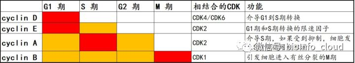

# 细胞周期

## 一.细胞周期概述
细胞周期（cell cycle） 是指细胞从一次分裂完成开始到下一次分裂结束所经历的全过程。 细胞周期是细胞生命活动的基本过程， 细胞在周期时相的变迁过程中进入增殖、 分化、 衰老和死亡等生理状态。

体外研究发现， 大多数细胞的细胞周期为 10 到 48 小时。 主要分为 4 期:

G1 期——DNA 合成前期， 是细胞周期的关键步骤。 细胞周期长短决定于 G1 期长度；

S 期——DNA 合成期；

G2 期——DNA 合成后期；

M 期——有丝分裂期。 M 期一结束， 2 个子代细胞就形成了。 这也标志着这一轮细胞周期的结束。

有些情况下， 也会把细胞周期分为 5 期。 在这种分类过程中， G1 期、 S 期、 G2 期和 M 期是相同的， 但是会增加一个 G0 期。 G0 期指的是某些细胞或某个阶段的细胞， 可从 G1 期退出细胞周期， 但是仍然存活。 这类细胞受某种刺激后仍能进入细胞周期， 继续进行 DNA 复制， 并进行有丝分裂， 这一时期被称为 G0 期。

在细胞周期的全过程中， 还有两个检查点（check-point） 。 这两个检查点分别是 G1/S期检查点和 G2/M 期检查点。 1） G1/S 期检查点， 控制着细胞从静止状态进入 DNA 合成期的调控； 2） G2/M 检查点的作用是： 决定细胞是否一分为二， 形成两个子代细胞。 如果通过 G2/M 检测点， 细胞的染色体收缩， 有丝分裂开始。 这两个检查点能够监视细胞周期调控的运作，确保基因和遗传物质准确遗传到子代细胞中。细胞周期调控是在上述检查点控制下，通过各种调控因子的激活和灭活， 使细胞依次启动和完成细胞周期循环的过程。

## 二.细胞周期过程中， 参与调控的关键分子
保罗·诺斯用遗传学和分子学方法， 识别克隆并描绘了细胞周期的一个关键调节物质 CDK（Cyclin-dependent kinase） 。 他发现 CDK 的功能在进化中被很好的保存了下来， CDK 是通过对其他蛋白质的化学修饰来驱动细胞周期的。 蒂莫西·亨特的贡献是发现了细胞周期蛋白（Cyclin） ——Cyclin 具有调节 CDK 的功能， Cyclin 和 CDK 相互配合能精准地调控细胞周期的全过程。 他发现细胞周期蛋白 Cyclin 在每次细胞分裂中都周期性地降解， 这个机制被证明对控制细胞周期的全过程都非常重要的作用。 这两类重要的蛋白， 再加上细胞周期蛋白依赖性激酶抑制因子(Cyclin dependent kinase inhibitor， CKI)。 这三类蛋白共同构成了 Cyclin—CDK—CKI 的信号调控网络，从而实现了细胞周期全过程的精确调控。

### 1.细胞周期过程的概述
首先， 生长因子与细胞表面的受体结合后， 刺激细胞由 G0 期进入细胞周期过程， 启动细胞内 fos、 jun 和 myc 等 immediate early gene 表达。 在这些 immediate early gene 作用下， 细胞开始激活 CDK 和 G1 期 Cyclin 等分子。 CDK 和 Cyclin 组装成有激酶活性的复合物，Cyclin/CDK 复合物能使 Rb 磷酸化， 使转录因子 E2F 从磷酸化的 Rb 蛋白上脱落下来， 游离的 E2F 可促使与 DNA 合成有关的一系列基因表达， 从而促使 DNA 合成， 推动细胞周期的进展。

pRb-E2F 是细胞 G1 和 S 期转换的一个经典调控途径。 参与细胞周期内源性调控的核心因子是 Cyclin 和 CDK。 其中， Cyclin 对于 CDK 的功能， 起到的是正向促进的作用， 而且 Cyclin 的周期性积累与降解对细胞周期的进程起着关键性的作用。CKI， 这个分子的名字中有一个 inhibitor， 对于 CDK起到负向的抑制作用。 CKI 能和 CDK 或 Cyclin 或 Cyclin-CDK 复合物结合， 抑制 CDK 的催化活性。 Cyclin 和 CKI 分别对 CDK 进行一正一反的调控。一旦这种正负调控的平衡被打破，细胞就可能发生异常增殖。

### 2.Cyclin 和 CDK 的介绍  
在哺乳动物细胞， Cyclin总共有 8 类， 分别是 Cyclin A-H。 其中 Cyclin D 有 D1、 D2 和 D3 三种， Cyclin B 有 B1 和B2 两种。 所以 Cyclin 连同亚类， 总共有 11 种亚类。 Cyclin 含量随细胞周期时相的变化而变化， 不同的 Cyclin 在不同的周期时相内开始表达， 或者是达到含量和活性的峰值。 而 CDK在整个细胞周期中， 表达相对恒定的。 所以在整个细胞周期的调控过程中， 有明显周期性表达的 Cyclin 和表达相对稳定的不同的 CDK 相互结合形成复合物， 从而激活 CDK 的激酶活性， 达到在不同的时相精准调控细胞周期的功能。 因为 Cyclin 要和 CDK 相互结合成复合物之后， 才能发挥调控细胞周期的功能 。

Cyclin 对细胞周期的调控， 主要表现在 G1 期和 S 期/M 期。  

#### （1）G1 期的 Cyclin 及相关 CDK
G1 期 Cyclin 在 G1 期和 G1/S 期交界处发挥重要的作用。  G1/S 期和 G2/M 期恰好是两个非常重要的check-point（检查点） 。 因此， Cyclin 是整个细胞周期过程中最核心的分子。 Cyclin 的表达调控， 不仅保证了细胞周期的精准性， 同时也介导了检查点 check-point 功能。

G1 期 Cyclin 主要包括 Cyclin D1、 D2、 D3、 E 和 C。

Cyclin D1 是发现最早也是研究最深入的 Cyclin。 CyclinD1 在 G1 早期表达， 是细胞周期启动因子， 它也是生长因子感应器。 Cyclin D1 过表达使细胞加速从 G1 到 S 期转换，细胞快速通过 G1/S 检查点， S 期缩短； 阻断或敲除 CyclinD1， 使细胞发生细胞周期阻滞，可以诱导细胞发生凋亡。 Cyclin D 能和 CDK4 或 CDK6 结合， 形成复合物(到底是结合 CDK4还是结合 CDK6， 由细胞种类决定)。 Cylin D 与 CDK4/CDK6 结合后， 能使 CDK4/6 的 172位酪氨酸残基发生磷酸化， 激活 CDK 的激酶活性。

Cyclin E 的合成开始于 G1 中期， 表达水平最高是在细胞进入 S 期， 同时 Cyclin E 的降解也发生在 S 期， 而 Cyclin E 在 G2 和 M 期不表达。 Cyclin E 主要在 G1 晚期发挥作用,是G1 期和 S 期转换的限速因子。 在 G1 期和 S 期， Cyclin E 能和 CDK2 形成复合物， 能使 Rb因磷酸化而失活， 磷酸化的 RB 与 E2F 分离， 失去对 E2F 转录活化功能的抑制， 使细胞从G1 期进入 S 期。  

#### （2）S 期/M 期的 Cyclin 及相关 CDK
S 期的 Cyclin 主要是 CyclinA， M 期 Cyclin 主要有 Cyclin B。 它们分别在 S 期以及 G2 和 M期交界处发挥作用， 诱导细胞分裂。

A） S 期的 Cyclin 主要是 CyclinA， 在 G1 晚期开始增多， 在 S 和 G2 期达到表达峰值， 并能检测出激酶活性。 如果细胞内 CyclinA 表达受到抑制， 细胞周期会停滞在 S 期。 当细胞进入S 期之后， 由于 Cyclin E 的表达水平迅速降低， 从而使 G1 期的 CyclinE-CDK2 复合物解体。游离的 CDK2 又能和 S 期高表达的 Cyclin A 结合， 从而形成 Cyclin A-CDK2 复合物。 另外，也有报道， Cyclin A 也能与 CDK1 结合， 并且在 G2 期达到活性峰值， 随后迅速降解失活。不过， 传统观点还是认为在 S 期， Cyclin A 主要和 CDK2 形成复合物， 介导细胞通过 S 期。

B） M 期 Cyclin 主要有 Cyclin B， CyclinB 在 G1 晚期开始合成， 在 S 期表达升高， 在 G2 晚期和 M 期表达达到峰值， 并进入核内与 CDK1 结合形成复合物， 从而激活 CDK1 的激酶活性。 Cyclin B-CDK1 主要在 G2 末期发挥作用， 可以引导细胞进入有丝分裂的 M 期。 当细胞退出 M 期， Cyclin B 降解， CDK1 的激酶活性失活， 底物去磷酸化， 促进染色体的凝集，核膜核仁重建， 引导细胞进入下一个细胞周期。

不同的 Cyclin 分子在细胞周期的不同时相内的表达情况， 它们所发挥的功能以及能与他们相互结合的 CDK 等信息。

### 3.CKI 的结构与功能
目前已知的 CKI（Cyclin dependent kinase inhibitor）可划分为两大类： 一类是Ink4(Inhibitor of CDK4)， 特异性抑制 CDK4-Cyclin D1 或者 CDK6-Cyclin D1 的磷酸化激酶活性； 另一类是 KIP(kinase inhibition protein)， 抑制大多数 CDK-Cyclin 的磷酸化激酶活性。

#### （1）Ink4 介绍
我们先介绍 Ink4， 现已知的 Ink4 包括 p16（Ink4a/MTS1）、 p15（Ink4b/MTS2）、p18（Ink4c）、p19（Ink4d） 。

这里有两个问题需要大家注意：

问题一： 这些基因都有很多个名称。 例如 P16、 p16INK4a、 MTS1， 指的都是同一个分子。 而且这些分子在文献中都很常见， 很难说哪个名称就比其他名称更普遍更被大家所接受。

问题二： 分子不能弄混淆。 比如我们在 NCBI 上查询 CDKN2A 这基因， 网站上会告诉你，这个基因有很多的其他名称， 例如 P16， p16INK4a， MTS1 等等， 除此之外还有其他的别称，例如 p14， p14ARF 等。 一般的读者看到这里， 都会想当然地认为 p14 和 p16 只是同一个分子的两种名称而已。 这就陷入了一种误区， 其实 p14 和 p16 是两个完全不同的蛋白， 发挥完全不同的功能。 编码 p14 和 p16 蛋白的基因都位于染色体的 9p21 位置， 编码 p14 的基因和编码 p16 的基因有共同的外显子 2 和 3， 但是它们的外显子 1 是不同的。 p14 是外显子 1β； 而p16 是外显子 1α。 由于 p14 和 p16 的外显子 1 不同， 而且发生了读码框的移位， 导致 p14和 p16 的蛋白序列也是不同的， 所以 p14 和 p16 是完全不同的两个蛋白分子， 序列不同， 参与的信号通路也不同。 p16 属于 CKI， 参与 p16-Cyclin D1/CDK4 复合物到 Rb 的信号传递，也就是调控细胞周期的 Rb 途径； 而 p14 参与 p14-MDM2-p53 信号通路的调控， 通过解除MDM2 介导的 p53 信号的抑制， 使得 p53 表达升高， 最终启动细胞周期的阻滞或凋亡。 虽然从最终的效应来看， p14 和 p16 都能导致细胞周期的阻滞， 但是它们所参与介导的信号通路是完全不同的。

Ink4 蛋白的 N 末端含有 4 个钩状重叠组成的二级结构， 和 CyclinD1 的序列有很高的同源性， 因此 Ink4 能和CyclinD1 竞争性结合 CDK4 或者 CDK6， 抑制 CyclinD-CDK4/CDK6 的复合物， 从而抑制了Rb 的磷酸化作用， 使得 E2F 与未磷酸化的 Rb 结合， 阻断了 E2F 依赖的基因转录， 最终实现抑制细胞周期进展的效果。 Ink4 失活将导致细胞周期调控紊乱， 目前已在多种肿瘤如胰腺癌、 非小细胞肺癌、 神经胶质细胞癌、 急性白血病等中发现存在 p16Ink4a 基因缺失的现象。  

#### （2）KIP 的介绍  
KIP 全称是 kinase inhibition protein， 激酶抑制蛋白。 现已知的 KIP 包括 p21cip1 (Cyclin inhibition protein 1)、 p27kip1 (kinase inhibition protein 1)及 p57kip2 三种细胞周期抑制蛋白。这三个 KIP 分子在 N 末端有结构及功能的相似性， 都含有一个保守的 80 个氨基酸序列， 能抑制 CDK4-CyclinD1、 CDK6-CyclinD1、 CDK2-CyclinE、 CDK2-CyclinA 的蛋白激酶复合物的活性。 虽然三个 KIP 分子： p21、 p27 和 p57， 在 N 末端有序列上的相似性， 但是它们 C末端区域含有各不相同的功能区。 p27kip1 C 末端有一个苏氨酸的磷酸化位点， 可以抑制 H1组蛋白的磷酸化； p21cip1 C 末端有 40 个氨基酸残基的肽段， 可以和 DNA 聚合酶δ的辅助因子 PCNA发生结合， 从而覆盖了 PCNA 的某些功能区， 使 PCNA 不能与 DNA 聚合酶δ形成复合物， 从而影响 DNA 复制。  

#### （3）小结
总结一下， CKI（细胞周期蛋白依赖性激酶抑制因子） 可以分为两大类， 一类是 Ink4， 代表分子 p16、 p15、 p18 和 p19。 Ink4 分子和 Cyclin 有结构上的相似性， 可以通过竞争性结合的方式， 阻断 CyclinD 和 CDK4/CDK6 的复合物， 从而阻断细胞周期； 另一类是 KIP（激酶抑制蛋白） ， 代表分子是 p21、 p27 和 p57。 KIP 分子也可以阻断 Cyclin 和 CDK 之间的复合物， 在这一点的功能上， KIP 和 Ink4 类似， 但是 KIP 分子的 C 末端差异很大， 从而介导了不同 KIP 分子发挥不同的特异性功能。

## 三.细胞周期调控途径及机制
细胞周期的顺利进展需要 Cyclin、CDK、CKI多因素之间相互协同作用。目前研究发现 Cyclin、CDK、 CKI 对细胞周期的作用主要通过两条途径来实现， 一条是 Rb 为主的网络调控途径；另一条是 p53 为主的调控途径。

### 1.以 Rb 为主的网络调控途径
+ 生长因子结合相应的受体， 通过信号传递， 促进 Cyclin 基因表达；
+ Cyclin 与相应 CDK 结合， 形成 Cyclin-CDK 激酶复合物,促进 Rb 蛋白磷酸化；
+ 非磷酸化的 Rb 原本和转录因子 E2F 相互结合。 在发生磷酸化之后， Rb 释放核转录因子E2F；
+ 游离的 E2F 进入核内， 结合一系列具特殊序列的基因启动子区， 促进下游基因的表达；
+ 这些基因的产物促进细胞进入细胞周期的程序。

### 2. 以 p53 为主的调控机制
哺乳动物细胞在受到 DNA 损伤后， 细胞周期的进程将会停滞于两个关键的检查点， 即 G1/S检查点和 G2/M 检查点。 抑癌基因 p53 主要在 G1 检查点上发挥重要作用。 p53 可作为转录因子， 诱导下游蛋白的产生， 从而达到调控细胞周期的作用。 常见的机制有三种：

+ p53 可诱导 p21 的表达。 p21 基因启动子区域具有 p53 结合位点。 p53 能与其结合并激活p21 基因转录。 当细胞 DNA 受损后， p21 基因在 p53 诱导下表达水平可升高， 能抑制 CDK活性， 尤其是 CyclinD-CDK4 复合物活性， 阻止细胞从 G1 期进入 S 期， 使细胞停止于 G1期， 从而有更多的时间修复 DNA 模板。 如果 DNA 损伤严重无法修复， 将导致细胞凋亡。
+ p53 可诱导 GADD45 合成。 GADD45 可以结合 PCNA， 抑制 DNA 合成， 从而抑制细胞进入 S 期。
+ 诱导 Bax 产生。 Bax 为凋亡相关基因， 与 bcl-2 相同作用， 共同调节细胞凋亡。在 p53 通路中， p53 可诱导产生 p21， 而 p21 本身就是 CKI， 在 Rb 调控机制中有重要作用。因此， Rb 调控通路与 p53 调控通路并不是完全独立分开的， 而是在某些调节子之间存在着相互作用(crosstalk)。

## 四.细胞周期相关的实验检测  
### 1.检测明星分子
看前面相关分子

### 2.PI 染色实验
检测细胞周期， 除了上面提到的检测明星分子之外， 更常用的细胞学检测方法是 PI 染色实

验。 简单介绍一下原理： 在细胞周期的整个过程中， G0/G1 期发生于 DNA 复制之前， 因此细胞内染色体表现为两倍体(2N)； 而在 S 期， DNA 发生复制， 因此 S 期的细胞染色体介于两倍体和四倍体之间（2N < 染色体< 4N） ； 在 G2/M 期， 由于 DNA 已经复制完成， 因此细胞内染色体数量是四倍体（4N） 。 PI 全称是碘化丙啶。 它是插入性核酸荧光染料， 能选择性地嵌入核酸 DNA 双链螺旋的碱基之间并发出荧光。 PI 结合的量与 DNA 的含量成正比例关系， 用流式细胞仪进行分析就可以得到细胞周期各个阶段的 DNA 分布状态， 从而计算出各个细胞周期时相的百分含量。

> 更新: 2023-09-04 10:08:44  
> 原文: <https://www.yuque.com/doublehelix/bioinfonotes/brnxv7>