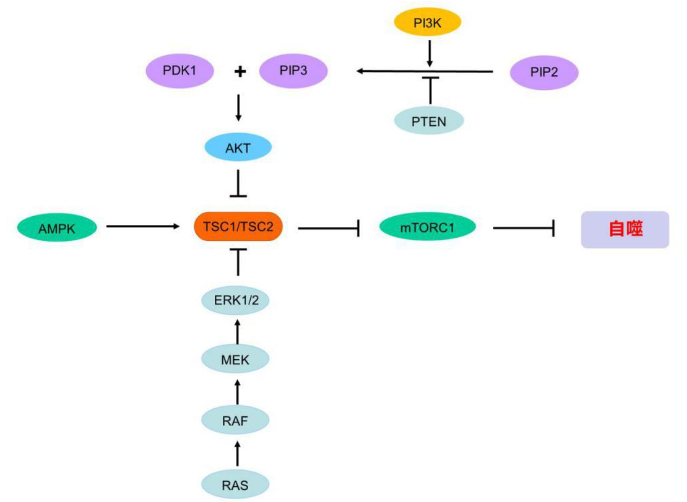
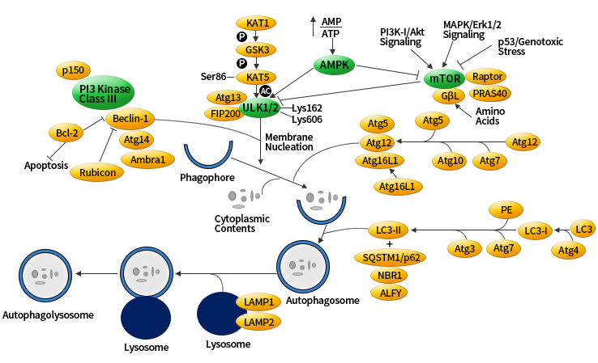
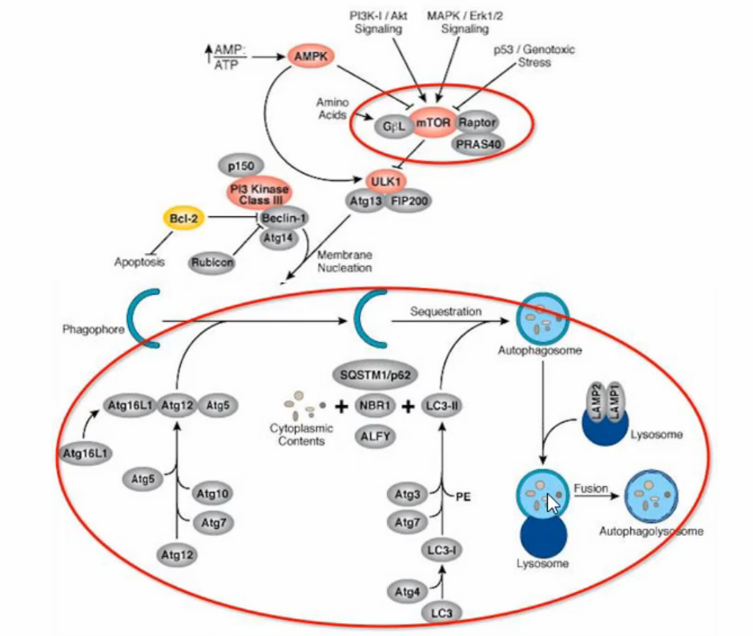
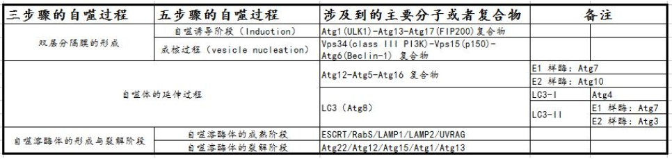
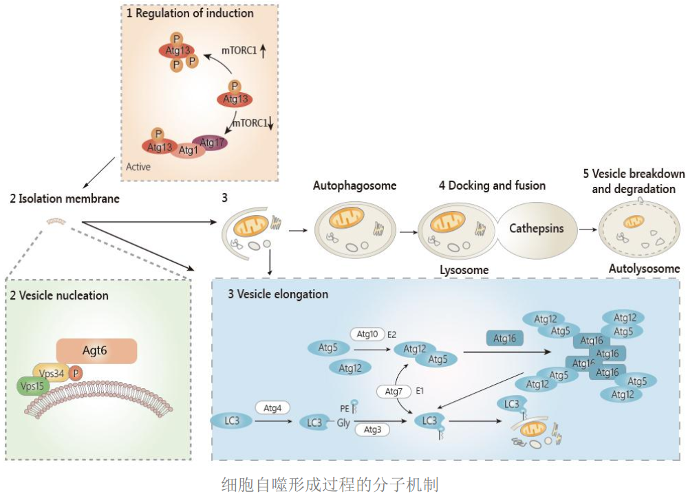
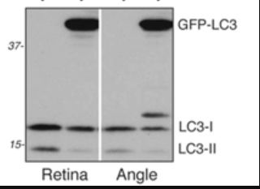

# 细胞自噬

细胞自噬是指细胞在外界环境因素的影响下，细胞利用溶酶体降解自身受损、变性或衰老的大分子物质以及细胞器的自我消化过程。自噬是细胞的一种自我保护机制，广泛存在于真核细胞内，在调节细胞生存和死亡的过程中，起着重要的作用。

当细胞发生自噬后，在自噬相关基因的调节下，细胞通过单层或双层膜，包裹待降解的细胞质或细胞器，形成囊泡状的自噬体（autophagosome）。然后自噬体再和溶酶体（lysosome）发生融合形成自噬溶酶体（autolysosome），由溶酶体内的一系列水解酶，降解自噬溶酶体内所包裹的内容物，以实现细胞对自身代谢和能量的更新。

## 1.自噬的细胞学分类及过程

根据细胞内物质运输到溶酶体的方式以及生理功能的差异，哺乳动物的细胞自噬可以分为三种类型：大自噬/宏自噬（macroautophagy），小自噬/微自噬（microautophagy）和分子伴侣介导的自噬（chaperone-mediated autophagy，CMA）。

1）大自噬/宏自噬：我们通常所说的自噬指的就是大自噬/宏自噬。在大自噬的过程中，细胞质中可溶性的大分子物质以及变性的细胞器，被内质网、线粒体来源的单层或双层膜包裹形成自噬体。接着自噬体的外膜与溶酶体膜融合，进一步形成自噬溶酶体，自噬体内的待降解物被一系列的水解酶降解，最终完成整个的自噬过程。

2）小自噬/微自噬：与大自噬过程不同，是溶酶体膜自身发生内陷，包裹和吞噬细胞内待降解的底物，并在溶酶体内发生降解。小自噬与大自噬的区别就在于，在小自噬过程中胞质成份是直接被溶酶体包裹，没有形成自噬体的过程。

3）分子伴侣介导的自噬：在分子伴侣介导发生的自噬过程中，其待降解的底物都是可溶性的蛋白质分子。分子伴侣蛋白识别带有特定氨基酸序列的底物蛋白质分子，并与之结合，然后再经溶酶体膜上的受体 Lamp2a（lysosome-associated membrane protein 2，Lamp2）转运到溶酶体；底物蛋白分子再在溶酶体内，被水解酶降解。因此，分子伴侣介导的自噬与前两者不同，在降解蛋白时具有选择性。而大自噬和小自噬现象中，一般而言，在降解蛋白时没有明显的选择性。

## 2.自噬信号通路

在自噬过程中，mTORC1 处于整个自噬过程的起点。因为在正常细胞内 mTORC1 处于激活状态，磷酸化了 ATG13，抑制了 ATG13-ATG1-ATG17 复合物的形成，也抑制了细胞的自噬过程。只有当细胞在营养和能量缺乏、蛋白质累积或者应激状态等情况下，mTORC1 的活性会受到抑制，ATG13 的磷酸化水平降低，从而导致自噬水平会迅速被诱导上调。因此，细胞内的信号通路如果可以影响到 mTORC1 的活性，那么就能调控下游自噬的过程。目前常见的可以影响 mTORC1 活性的通路有三条：1）AMPK-mTORC1 通路，2）class I PI3K/AKT/mTORC1 通路，3）Ras/Raf/MEK/ERK 通路。

1）AMPK-mTORC1 信号通路：AMPK 的激活能磷酸化结节性硬化症 TSC1/2 复合物，从而促进 mTORC1 的失活，诱导细胞自噬水平的提高。TSC1/2 复合物是异二聚体，TSC1 具有稳定作用，TSC2 能抑制 mTORC1 激活所必需的小 GTP 酶 Rheb（Ras homolog enriched in brain），实现对 mTORC1 的抑制作用。AMPK 也能直接磷酸化 Raptor（Raptor 本身也是 mTORC1 复合物中的一个关键组分蛋白），抑制 mTORC1，上调细胞自噬。

2）class I PI3K/AKT/mTORC1 通路：PI3K 根据结构的不同分为三类：class I PI3K、class II PI3K 以及 class III PI3K，在细胞增殖和存活的过程中具有重要的作用。目前研究较为广泛的是 class I PI3K，它是自噬的负调节分子。我们通常所说的 PI3K/AKT 信号通路中的 PI3K 通常都是指 class I PI3K。class I PI3K 能在细胞中产生第二信使 PIP3，PIP3 在磷脂酰肌醇依赖性蛋白激酶 1（PDK1）的协助下激活 AKT，激活的 AKT 能够抑制 TSC1/2 复合物，从而激活 mTORC1，抑制细胞自噬。另外，抑癌基因 PTEN 可以通过抑制 class I PI3K 的活性，诱导细胞自噬水平的上调。

3）Ras/Raf/MEK/ERK 通路：Ras-Raf-MEK-ERK 信号通路在肿瘤细胞中表现活跃，它与细胞自噬的具体机制还仍然待研究。但研究表明 ERK 能通过抑制 TSC1/TSC2 的活性，调节细胞自噬水平，促进肿瘤细胞的形成。另外，Ras 也能通过 class I PI3K/AKT 通路调节细胞自噬。







## 3.自噬与凋亡的关系

细胞凋亡也被称为 I 型程序性细胞死亡；自噬则被称为 II 型程序性细胞死亡。凋亡和自噬是两种显著不同的细胞死亡形式，两者在形态、生化指标以及调控细胞死亡的过程上都存在着较大的差异，但两者又不是两个完全独立的过程。许多研究表明，凋亡和自噬的作用以及功能在某些情况下也是相互影响和制约的。自噬和凋亡之间存在着三种不同类型的相互作用，而且每种类型都对应着相应的特定的细胞类型、刺激和环境。

1）自噬和凋亡互相协同，共同促进细胞死亡。两种效应之间，可以其中一种效应影响另一种效应；自噬也可以作为凋亡的上游调节因子，直接调控细胞凋亡，从而影响细胞的死亡；

2）自噬可以通过促进细胞存活而拮抗细胞的凋亡效应。比如，可以通过去除因氧化应激受损的细胞器，或降解变性的大分子物质，为饥饿的细胞提供生存所需要的营养和能量；或者通过降解未折叠的蛋白来抑制内质网应激。自噬的这些功能将会抑制促凋亡信号的产生，从而起到拮抗细胞凋亡的作用。

3）自噬有时虽然自身并没有导致细胞死亡，但却参与了细胞凋亡的过程。比如自噬参与了一些 ATP 依赖的凋亡过程。

## 4.自噬的分子机制和特征

1）自噬诱导阶段（induction）：正常生理状态下，细胞保持很低的基础自噬水平。这时细胞内能量充足，哺乳动物雷帕霉素靶蛋白复合物 1（也就是 mTOR 复合物 1，也叫做 mTORC1）处于活化的状态。活化的 mTORC1 通过磷酸化的方式使得 ATG13 发生磷酸化反应，从而抑制细胞的自噬。

当细胞在营养和能量缺乏、蛋白质累积、应激状态等情况下，mTORC1 的活性会受到抑制，ATG13 的磷酸化水平降低，从而导致自噬水平会迅速被诱导上调。哺乳动物的自噬诱导过程主要通过 ATG1 复合物来介导。ATG1 复合物除了包含有 ATG1 之外，还包含有 ATG13 和 ATG17。ATG1 复合物能形成的主要原因是，在营养和能量缺乏、应激状态等条件下，mTORC1 的活性受到抑制，使得 ATG13 的磷酸化水平降低，导致去磷酸化的 ATG13 与 ATG1 形成复合物，并与 ATG17 相互作用，产生 ATG13-ATG1-ATG17 的复合物，并诱导下游自噬体的成核（nucleation）和延伸（elongation）。

注意：ATG1 在哺乳动物中的同源蛋白是 ULK1，所以这个 ATG1 复合物也被称为 ULK1 复合物。另外，ATG17 在哺乳动物中的同源蛋白是 FIP200。

2）成核过程（vesicle nucleation）：成核过程和 Vps34-ATG6 复合物密切相关。这个复合物还包含有调节性蛋白激酶 Vps15，共同作用于膜泡的成核，介导 PAS（也就是前自噬体结构 pre-autophagosomal structure）的形成。

Vps34-ATG6 复合体还可以召集 ATG12-ATG5 和 ATG16 多聚体以及 LC3，并通过后两者促进吞噬泡的伸展扩张。Vps34 在哺乳动物中的同源蛋白是 class III PI3K；ATG6 在哺乳动物中的同源蛋白是 Beclin-1，所以 Vps34-ATG6 复合体，也被称为 PI3K-Beclin-1 复合物。

3）自噬体的延伸阶段：这个过程的分子机制是最为复杂的。哺乳动物自噬体的延伸主要依赖于两个类泛素化的系统：a）ATG12 的结合过程；b）LC3 的修饰过程。

ATG12 的结合过程是类似泛素化的过程，需泛素活化酶 E1 和 E2 的参与。ATG12 首先由 E1 样酶 ATG7 活化，再通过 E2 样酶 ATG10 转运并结合 ATG5，然后和 ATG16 结合，生成 ATG12-ATG5-ATG16 的多体复合物。这个复合物定位于前自噬体结构的外膜表面，并参与前自噬体外膜的扩张。

LC3 在酵母中的同源基因是 ATG8。LC3 的修饰过程同样需要类似泛素活化酶 E1 和 E2 的参与。LC3 前体形成后被 ATG4 加工成胞浆可溶性的 LC3-I，然后在 E1 样酶 ATG7 和 E2 样酶 ATG3 的作用下，和磷脂酰乙醇胺（PE）共价连接成为脂溶性的 LC3-PE（也就是 LC3-II），并参与膜的延伸。LC3-II 能够与新形成的膜结合，直到自噬溶酶体（autolysosome）的形成。因此，LC3-II 常用作自噬形成的标识物，也是一种重要的定位于自噬泡膜上的多信号传导调节蛋白。

哺乳动物的 ATG12-ATG5 类泛素化过程和 LC3 类泛素化过程并不是独立运行的，它们之间可以相互作用、相互调节。

 4）自噬体的成熟阶段：自噬体的成熟主要是指自噬体在微管骨架的运输下，经转运必需内吞体分选复合物（ESCRT）和小 GTP 酶 Rab5 的作用，与溶酶体融合形成自噬溶酶体的过程。参与成熟阶段的溶酶体相关蛋白还包括 LAMP1、LAMP2 和 UVRAG（紫外线抵抗相关肿瘤抑制基因）。

5）自噬体的裂解阶段：是指自噬溶酶体膜的裂解及内容物在溶酶体水解酶的作用下降解的过程。降解过程中产生的氨基酸及部分蛋白可以为细胞提供营养、能量或循环利用。





## 5.自噬诱导剂

a）Brefeldin A / Thapsigargin / Tunicamycin：模拟内质网应激

b）Carbamazepine / L-690,330 / Lithium Chloride（氯化锂）：IMPase 抑制剂（即 inositol monophosphatase，肌醇单磷酸酶）

c）Earle's 平衡盐溶液：制造饥饿

d）N-Acetyl-D-sphingosine（C2-ceramide）：class I PI3K 通路抑制剂

e）Rapamycin：mTOR 抑制剂

f）Xestospongin B/C：IP3R 阻滞剂

## 6.自噬抑制剂

a）3-Methyladenine（3-MA）：class III PI3K（hVps34）抑制剂

b）Bafilomycin A1：质子泵抑制剂

c）Hydroxychloroquine（羟氯喹）

除了选用上述工具药外，一般还需结合遗传学技术对自噬相关基因进行干预，包括反义 RNA 干扰技术（knockdown）、突变株筛选、外源基因导入等。

## 7.自噬的检测手段

自噬的评估通常采用多个自噬阶段的标志物，因为自噬小体数量的增加可能是自噬上调也可能是自噬最后阶段降解被抑制所致，所以设置合适的对照很有必要。

1. 透射电镜：观察自噬体和溶酶体的超微结构；
2. Western blot：检测标志物 LC3/Atg8 和 p62/SQSTM1；
3. 生化检测：自噬体膜标志蛋白，特别是 ATG12、ATG5 和 LC3，以及自噬底物 p62；
4. 荧光显微镜：检测 LC3 或 GFP-LC3 斑点的形成；
5. Western blot：检测 Lamps、Atg5、Atg14 和 Beclin-1；
6. 组织蛋白酶（cathepsin）活力检测；
7. 免疫荧光（IF）：检测自噬潮（autophagic flux）。

细胞经诱导或抑制后，需对自噬过程进行观察和检测，常用的策略和技术有：

（1）观察自噬体的形成

由于自噬体属于亚细胞结构，普通光镜下看不到，因此直接观察自噬体需在透射电镜下进行。自噬泡（autophagic vacuole，AV）中，Phagophore 的特征为：新月状或杯状，双层或多层膜，有包绕胞浆成分的趋势。自噬体（AV1）的特征为：双层或多层膜的液泡状结构，内含胞浆成分，如线粒体、内质网、核糖体等。自噬溶酶体（AV2）的特征为：单层膜，胞浆成分已降解。

（2）在荧光显微镜下采用 GFP-LC3 融合蛋白来示踪自噬形成

由于电镜耗时长，不利于监测（monitoring）自噬形成，人们利用 LC3 在自噬形成过程中发生聚集的现象开发出了此技术。无自噬时，GFP-LC3 融合蛋白弥散在胞浆中；自噬形成时，GFP-LC3 融合蛋白转位至自噬体膜，在荧光显微镜下形成多个明亮的绿色荧光斑点，一个斑点相当于一个自噬体，可以通过计数来评价自噬活性的高低。

（3）利用 Western blot 检测 LC3-II/I 比值的变化以评价自噬形成：自噬形成时，胞浆型 LC3（即 LC3-I）会酶解掉一小段多肽，转变为（自噬体）膜型（即 LC3-II），因此 LC3-II/I 比值的大小可估计自噬水平的高低。



（注意：LC3 抗体对 LC3-II 有更高的亲和力，会造成假阳性。需要多种检测方法结合使用，同时需考虑溶酶体活性的影响。）

（4）检测长寿蛋白的批量降解（非特异）

（5）MDC（Monodansylcadaverine，单丹磺酰尸胺）染色：包括自噬体，所有酸性液泡都被染色，故属于非特异性的。

（6）CellTrackerTM Green 染色：主要用于双染色，但其能染所有的液泡，故也属于非特异性的。

在研究自噬相关蛋白时，需对其进行定位。

由于自噬体与溶酶体、线粒体、内质网、高尔基体关系密切，为了区别，常用到一些示踪蛋白，在荧光显微镜下进行共定位：

- Lamp-2：溶酶体膜蛋白，可用于监测自噬体与溶酶体融合。

- LysoTracker 探针：有红或蓝色可选，显示所有酸性液泡。

- pDsRed2-mito：载体，转染后表达一个融合蛋白（红色荧光蛋白 + 线粒体基质定位信号），可用来检测线粒体被自噬降解的程度（mitophagy）。

- MitoTracker 探针：特异性显示活的线粒体，荧光在固定后仍能保留。

- Hsp60：定位于线粒体基质，细胞死亡时不会被释放。

- Calreticulin（钙网织蛋白）：内质网腔

（注意：这些蛋白均为胞浆蛋白，爬片或胰酶消化的细胞在做免疫荧光前需先透膜（permeabilize），可采用 0.1% SDS 处理。）

## 8.自噬研究常规思路

通常情况下，除了研究自噬现象本身，大家更多的是将自噬与各种生命活动或者疾病结合起来，把自噬作为这些方向的一个机制来研究。比如研究自噬如何参与肿瘤的发生发展、如何参与肿瘤的耐药性与复发转移、如何参与肿瘤免疫治疗的效果、如何参与炎症反应、如何参与氧化应激，如何参与自闭症、阿尔茨海默病的发生与治疗等，通常的研究模式：

1. 证明自噬参与了相关研究表型（电镜、LC3-II/I 的 Western blot、LC3 亚细胞定位、LC3 荧光示踪监测自噬流等）
2. 证明自噬在表型中起到关键作用（通过自噬抑制剂、激动剂进行关联研究）
3. 找到表型与自噬之间的桥梁分子（检测 PI3K 通路、Beclin-1、ATG 家族各成员）
4. 在基因层面通过 gain-of/loss-of function 研究该桥梁分子在自噬中的作用。

## 9.研究自噬的文献参考

[1]. Emerging Mechanisms in Initiating and Terminating Autophagy. Trends Biochem Sci. 2017 Jan;42(1):28-41.

[2]. Targeting autophagy in cancer. Nat Rev Cancer. 2017 Sep;17(9):528-542.

[3]. Autophagy: controlling cell fate in rheumatic diseases. Nat Rev Rheumatol. 2016 Sep;12(9):517-31.

[4]. Crosstalk between autophagy and inflammatory signalling pathways: balancing defence and homeostasis. Nat Rev Immunol. 2016 Nov;16(11):661-675.

[5]. Autophagy and Neurodegeneration: Pathogenic Mechanisms and Therapeutic Opportunities. Neuron. 2017 Mar 8;93(5):1015-1034.

[6]. Activating autophagy to potentiate immunogenic chemotherapy and radiation therapy. Nat Rev Clin Oncol. 2017 Apr;14(4):247-258.

[7]. Epigenetic Control of Autophagy: Nuclear Events Gain More Attention. Mol Cell.2017 Mar 2;65(5):781-785.

[8]. Pharmacological modulation of autophagy: therapeutic potential and persisting obstacles. Nat Rev Drug Discov.2017 Jul;16(7):487-511.

## 10.人自噬相关基因

来自于人自噬数据库：[<u>http://www.autophagy.lu/index.html</u>](http://www.autophagy.lu/index.html)

| **GeneId** | **Name** | **Symbol** |
| :--- | :--- | :--- |
| [<u>55626</u>](http://www.autophagy.lu/genes/55626) | autophagy/beclin-1 regulator 1 | AMBRA1 |
| [<u>8542</u>](http://www.autophagy.lu/genes/8542) | apolipoprotein L, 1 | APOL1 |
| [<u>405</u>](http://www.autophagy.lu/genes/405) | aryl hydrocarbon receptor nuclear translocator | ARNT |
| [<u>410</u>](http://www.autophagy.lu/genes/410) | arylsulfatase A | ARSA |
| [<u>411</u>](http://www.autophagy.lu/genes/411) | arylsulfatase B | ARSB |
| [<u>468</u>](http://www.autophagy.lu/genes/468) | activating transcription factor 4 (tax-responsive enhancer element B67) | ATF4 |
| [<u>22926</u>](http://www.autophagy.lu/genes/22926) | activating transcription factor 6 | ATF6 |
| [<u>83734</u>](http://www.autophagy.lu/genes/83734) | ATG10 autophagy related 10 homolog (S. cerevisiae) | ATG10 |
| [<u>9140</u>](http://www.autophagy.lu/genes/9140) | ATG12 autophagy related 12 homolog (S. cerevisiae) | ATG12 |
| [<u>55054</u>](http://www.autophagy.lu/genes/55054) | ATG16 autophagy related 16-like 1 (S. cerevisiae) | ATG16L1 |
| [<u>89849</u>](http://www.autophagy.lu/genes/89849) | ATG16 autophagy related 16-like 2 (S. cerevisiae) | ATG16L2 |
| [<u>23130</u>](http://www.autophagy.lu/genes/23130) | ATG2 autophagy related 2 homolog A (S. cerevisiae) | ATG2A |
| [<u>55102</u>](http://www.autophagy.lu/genes/55102) | ATG2 autophagy related 2 homolog B (S. cerevisiae) | ATG2B |
| [<u>64422</u>](http://www.autophagy.lu/genes/64422) | ATG3 autophagy related 3 homolog (S. cerevisiae) | ATG3 |
| [<u>115201</u>](http://www.autophagy.lu/genes/115201) | ATG4 autophagy related 4 homolog A (S. cerevisiae) | ATG4A |
| [<u>23192</u>](http://www.autophagy.lu/genes/23192) | ATG4 autophagy related 4 homolog B (S. cerevisiae) | ATG4B |
| [<u>84938</u>](http://www.autophagy.lu/genes/84938) | ATG4 autophagy related 4 homolog C (S. cerevisiae) | ATG4C |
| [<u>84971</u>](http://www.autophagy.lu/genes/84971) | ATG4 autophagy related 4 homolog D (S. cerevisiae) | ATG4D |
| [<u>9474</u>](http://www.autophagy.lu/genes/9474) | ATG5 autophagy related 5 homolog (S. cerevisiae) | ATG5 |
| [<u>10533</u>](http://www.autophagy.lu/genes/10533) | ATG7 autophagy related 7 homolog (S. cerevisiae) | ATG7 |
| [<u>79065</u>](http://www.autophagy.lu/genes/79065) | ATG9 autophagy related 9 homolog A (S. cerevisiae) | ATG9A |
| [<u>285973</u>](http://www.autophagy.lu/genes/285973) | ATG9 autophagy related 9 homolog B (S. cerevisiae) | ATG9B |
| [<u>471</u>](http://www.autophagy.lu/genes/471) | 5-aminoimidazole-4-carboxamide ribonucleotide formyltransferase/IMP cyclohydrolase | ATIC |
| [<u>573</u>](http://www.autophagy.lu/genes/573) | BCL2-associated athanogene | BAG1 |
| [<u>9531</u>](http://www.autophagy.lu/genes/9531) | BCL2-associated athanogene 3 | BAG3 |
| [<u>578</u>](http://www.autophagy.lu/genes/578) | BCL2-antagonist/killer 1 | BAK1 |
| [<u>581</u>](http://www.autophagy.lu/genes/581) | BCL2-associated X protein | BAX |
| [<u>596</u>](http://www.autophagy.lu/genes/596) | B-cell CLL/lymphoma 2 | BCL2 |
| [<u>598</u>](http://www.autophagy.lu/genes/598) | BCL2-like 1 | BCL2L1 |
| [<u>8678</u>](http://www.autophagy.lu/genes/8678) | beclin 1, autophagy related | BECN1 |
| [<u>637</u>](http://www.autophagy.lu/genes/637) | BH3 interacting domain death agonist | BID |
| [<u>332</u>](http://www.autophagy.lu/genes/332) | baculoviral IAP repeat-containing 5 | BIRC5 |
| [<u>57448</u>](http://www.autophagy.lu/genes/57448) | baculoviral IAP repeat-containing 6 | BIRC6 |
| [<u>662</u>](http://www.autophagy.lu/genes/662) | BCL2/adenovirus E1B 19kDa interacting protein 1 | BNIP1 |
| [<u>664</u>](http://www.autophagy.lu/genes/664) | BCL2/adenovirus E1B 19kDa interacting protein 3 | BNIP3 |
| [<u>665</u>](http://www.autophagy.lu/genes/665) | BCL2/adenovirus E1B 19kDa interacting protein 3-like | BNIP3L |
| [<u>60673</u>](http://www.autophagy.lu/genes/60673) | chromosome 12 open reading frame 44 | C12orf44 |
| [<u>23591</u>](http://www.autophagy.lu/genes/23591) | chromosome 17 open reading frame 88 | C17orf88 |
| [<u>10241</u>](http://www.autophagy.lu/genes/10241) | calcium binding and coiled-coil domain 2 | CALCOCO2 |
| [<u>10645</u>](http://www.autophagy.lu/genes/10645) | calcium/calmodulin-dependent protein kinase kinase 2, beta | CAMKK2 |
| [<u>821</u>](http://www.autophagy.lu/genes/821) | calnexin | CANX |
| [<u>823</u>](http://www.autophagy.lu/genes/823) | calpain 1, (mu/I) large subunit | CAPN1 |
| [<u>11132</u>](http://www.autophagy.lu/genes/11132) | calpain 10 | CAPN10 |
| [<u>824</u>](http://www.autophagy.lu/genes/824) | calpain 2, (m/II) large subunit | CAPN2 |
| [<u>826</u>](http://www.autophagy.lu/genes/826) | calpain, small subunit 1 | CAPNS1 |
| [<u>834</u>](http://www.autophagy.lu/genes/834) | caspase 1, apoptosis-related cysteine peptidase (interleukin 1, beta, convertase) | CASP1 |
| [<u>836</u>](http://www.autophagy.lu/genes/836) | caspase 3, apoptosis-related cysteine peptidase | CASP3 |
| [<u>837</u>](http://www.autophagy.lu/genes/837) | caspase 4, apoptosis-related cysteine peptidase | CASP4 |
| [<u>841</u>](http://www.autophagy.lu/genes/841) | caspase 8, apoptosis-related cysteine peptidase | CASP8 |
| [<u>6347</u>](http://www.autophagy.lu/genes/6347) | chemokine (C-C motif) ligand 2 | CCL2 |
| [<u>729230</u>](http://www.autophagy.lu/genes/729230) | chemokine (C-C motif) receptor 2 | CCR2 |
| [<u>4179</u>](http://www.autophagy.lu/genes/4179) | CD46 molecule, complement regulatory protein | CD46 |
| [<u>1026</u>](http://www.autophagy.lu/genes/1026) | cyclin-dependent kinase inhibitor 1A (p21, Cip1) | CDKN1A |
| [<u>1027</u>](http://www.autophagy.lu/genes/1027) | cyclin-dependent kinase inhibitor 1B (p27, Kip1) | CDKN1B |
| [<u>1029</u>](http://www.autophagy.lu/genes/1029) | cyclin-dependent kinase inhibitor 2A (melanoma, p16, inhibits CDK4) | CDKN2A |
| [<u>8837</u>](http://www.autophagy.lu/genes/8837) | CASP8 and FADD-like apoptosis regulator | CFLAR |
| [<u>25978</u>](http://www.autophagy.lu/genes/25978) | chromatin modifying protein 2B | CHMP2B |
| [<u>128866</u>](http://www.autophagy.lu/genes/128866) | chromatin modifying protein 4B | CHMP4B |
| [<u>1201</u>](http://www.autophagy.lu/genes/1201) | ceroid-lipofuscinosis, neuronal 3 | CLN3 |
| [<u>1508</u>](http://www.autophagy.lu/genes/1508) | cathepsin B | CTSB |
| [<u>1509</u>](http://www.autophagy.lu/genes/1509) | cathepsin D | CTSD |
| [<u>1514</u>](http://www.autophagy.lu/genes/1514) | cathepsin L1 | CTSL1 |
| [<u>6376</u>](http://www.autophagy.lu/genes/6376) | chemokine (C-X3-C motif) ligand 1 | CX3CL1 |
| [<u>7852</u>](http://www.autophagy.lu/genes/7852) | chemokine (C-X-C motif) receptor 4 | CXCR4 |
| [<u>1612</u>](http://www.autophagy.lu/genes/1612) | death-associated protein kinase 1 | DAPK1 |
| [<u>23604</u>](http://www.autophagy.lu/genes/23604) | death-associated protein kinase 2 | DAPK2 |
| [<u>1649</u>](http://www.autophagy.lu/genes/1649) | DNA-damage-inducible transcript 3 | DDIT3 |
| [<u>9077</u>](http://www.autophagy.lu/genes/9077) | DIRAS family, GTP-binding RAS-like 3 | DIRAS3 |
| [<u>10395</u>](http://www.autophagy.lu/genes/10395) | deleted in liver cancer 1 | DLC1 |
| [<u>3337</u>](http://www.autophagy.lu/genes/3337) | DnaJ (Hsp40) homolog, subfamily B, member 1 | DNAJB1 |
| [<u>4189</u>](http://www.autophagy.lu/genes/4189) | DnaJ (Hsp40) homolog, subfamily B, member 9 | DNAJB9 |
| [<u>55332</u>](http://www.autophagy.lu/genes/55332) | DNA-damage regulated autophagy modulator 1 | DRAM1 |
| [<u>9695</u>](http://www.autophagy.lu/genes/9695) | ER degradation enhancer, mannosidase alpha-like 1 | EDEM1 |
| [<u>1938</u>](http://www.autophagy.lu/genes/1938) | eukaryotic translation elongation factor 2 | EEF2 |
| [<u>29904</u>](http://www.autophagy.lu/genes/29904) | eukaryotic elongation factor-2 kinase | EEF2K |
| [<u>1956</u>](http://www.autophagy.lu/genes/1956) | epidermal growth factor receptor (erythroblastic leukemia viral (v-erb-b) oncogene homolog, avian) | EGFR |
| [<u>5610</u>](http://www.autophagy.lu/genes/5610) | eukaryotic translation initiation factor 2-alpha kinase 2 | EIF2AK2 |
| [<u>9451</u>](http://www.autophagy.lu/genes/9451) | eukaryotic translation initiation factor 2-alpha kinase 3 | EIF2AK3 |
| [<u>1965</u>](http://www.autophagy.lu/genes/1965) | eukaryotic translation initiation factor 2, subunit 1 alpha, 35kDa | EIF2S1 |
| [<u>1978</u>](http://www.autophagy.lu/genes/1978) | eukaryotic translation initiation factor 4E binding protein 1 | EIF4EBP1 |
| [<u>1981</u>](http://www.autophagy.lu/genes/1981) | eukaryotic translation initiation factor 4 gamma, 1 | EIF4G1 |
| [<u>2064</u>](http://www.autophagy.lu/genes/2064) | v-erb-b2 erythroblastic leukemia viral oncogene homolog 2, neuro/glioblastoma derived oncogene homolog (avian) | ERBB2 |
| [<u>2081</u>](http://www.autophagy.lu/genes/2081) | endoplasmic reticulum to nucleus signaling 1 | ERN1 |
| [<u>30001</u>](http://www.autophagy.lu/genes/30001) | ERO1-like (S. cerevisiae) | ERO1L |
| [<u>8772</u>](http://www.autophagy.lu/genes/8772) | Fas (TNFRSF6)-associated via death domain | FADD |
| [<u>55578</u>](http://www.autophagy.lu/genes/55578) | family with sequence similarity 48, member A | FAM48A |
| [<u>355</u>](http://www.autophagy.lu/genes/355) | Fas (TNF receptor superfamily, member 6) | FAS |
| [<u>2280</u>](http://www.autophagy.lu/genes/2280) | FK506 binding protein 1A, 12kDa | FKBP1A |
| [<u>2281</u>](http://www.autophagy.lu/genes/2281) | FK506 binding protein 1B, 12.6 kDa | FKBP1B |
| [<u>2353</u>](http://www.autophagy.lu/genes/2353) | FBJ murine osteosarcoma viral oncogene homolog | FOS |
| [<u>2308</u>](http://www.autophagy.lu/genes/2308) | forkhead box O1 | FOXO1 |
| [<u>2309</u>](http://www.autophagy.lu/genes/2309) | forkhead box O3 | FOXO3 |
| [<u>2548</u>](http://www.autophagy.lu/genes/2548) | glucosidase, alpha; acid | GAA |
| [<u>11337</u>](http://www.autophagy.lu/genes/11337) | GABA(A) receptor-associated protein | GABARAP |
| [<u>23710</u>](http://www.autophagy.lu/genes/23710) | GABA(A) receptor-associated protein like 1 | GABARAPL1 |
| [<u>11345</u>](http://www.autophagy.lu/genes/11345) | GABA(A) receptor-associated protein-like 2 | GABARAPL2 |
| [<u>2597</u>](http://www.autophagy.lu/genes/2597) | glyceraldehyde-3-phosphate dehydrogenase | GAPDH |
| [<u>2773</u>](http://www.autophagy.lu/genes/2773) | guanine nucleotide binding protein (G protein), alpha inhibiting activity polypeptide 3 | GNAI3 |
| [<u>10399</u>](http://www.autophagy.lu/genes/10399) | guanine nucleotide binding protein (G protein), beta polypeptide 2-like 1 | GNB2L1 |
| [<u>57120</u>](http://www.autophagy.lu/genes/57120) | golgi-associated PDZ and coiled-coil motif containing | GOPC |
| [<u>2894</u>](http://www.autophagy.lu/genes/2894) | glutamate receptor, ionotropic, delta 1 | GRID1 |
| [<u>2895</u>](http://www.autophagy.lu/genes/2895) | glutamate receptor, ionotropic, delta 2 | GRID2 |
| [<u>3065</u>](http://www.autophagy.lu/genes/3065) | histone deacetylase 1 | HDAC1 |
| [<u>10013</u>](http://www.autophagy.lu/genes/10013) | histone deacetylase 6 | HDAC6 |
| [<u>9146</u>](http://www.autophagy.lu/genes/9146) | hepatocyte growth factor-regulated tyrosine kinase substrate | HGS |
| [<u>3091</u>](http://www.autophagy.lu/genes/3091) | hypoxia inducible factor 1, alpha subunit (basic helix-loop-helix transcription factor) | HIF1A |
| [<u>3326</u>](http://www.autophagy.lu/genes/3326) | heat shock protein 90kDa alpha (cytosolic), class B member 1 | HSP90AB1 |
| [<u>3309</u>](http://www.autophagy.lu/genes/3309) | heat shock 70kDa protein 5 (glucose-regulated protein, 78kDa) | HSPA5 |
| [<u>3312</u>](http://www.autophagy.lu/genes/3312) | heat shock 70kDa protein 8 | HSPA8 |
| [<u>26353</u>](http://www.autophagy.lu/genes/26353) | heat shock 22kDa protein 8 | HSPB8 |
| [<u>3458</u>](http://www.autophagy.lu/genes/3458) | interferon, gamma | IFNG |
| [<u>3551</u>](http://www.autophagy.lu/genes/3551) | inhibitor of kappa light polypeptide gene enhancer in B-cells, kinase beta | IKBKB |
| [<u>9641</u>](http://www.autophagy.lu/genes/9641) | inhibitor of kappa light polypeptide gene enhancer in B-cells, kinase epsilon | IKBKE |
| [<u>11009</u>](http://www.autophagy.lu/genes/11009) | interleukin 24 | IL24 |
| [<u>345611</u>](http://www.autophagy.lu/genes/345611) | immunity-related GTPase family, M | IRGM |
| [<u>3675</u>](http://www.autophagy.lu/genes/3675) | integrin, alpha 3 (antigen CD49C, alpha 3 subunit of VLA-3 receptor) | ITGA3 |
| [<u>3655</u>](http://www.autophagy.lu/genes/3655) | integrin, alpha 6 | ITGA6 |
| [<u>3688</u>](http://www.autophagy.lu/genes/3688) | integrin, beta 1 (fibronectin receptor, beta polypeptide, antigen CD29 includes MDF2, MSK12) | ITGB1 |
| [<u>3691</u>](http://www.autophagy.lu/genes/3691) | integrin, beta 4 | ITGB4 |
| [<u>3708</u>](http://www.autophagy.lu/genes/3708) | inositol 1,4,5-triphosphate receptor, type 1 | ITPR1 |
| [<u>2548</u>](http://www.autophagy.lu/genes/2548) | glucosidase, alpha; acid | GAA |
| [<u>11337</u>](http://www.autophagy.lu/genes/11337) | GABA(A) receptor-associated protein | GABARAP |
| [<u>23710</u>](http://www.autophagy.lu/genes/23710) | GABA(A) receptor-associated protein like 1 | GABARAPL1 |
| [<u>11345</u>](http://www.autophagy.lu/genes/11345) | GABA(A) receptor-associated protein-like 2 | GABARAPL2 |
| [<u>2597</u>](http://www.autophagy.lu/genes/2597) | glyceraldehyde-3-phosphate dehydrogenase | GAPDH |
| [<u>2773</u>](http://www.autophagy.lu/genes/2773) | guanine nucleotide binding protein (G protein), alpha inhibiting activity polypeptide 3 | GNAI3 |
| [<u>10399</u>](http://www.autophagy.lu/genes/10399) | guanine nucleotide binding protein (G protein), beta polypeptide 2-like 1 | GNB2L1 |
| [<u>57120</u>](http://www.autophagy.lu/genes/57120) | golgi-associated PDZ and coiled-coil motif containing | GOPC |
| [<u>2894</u>](http://www.autophagy.lu/genes/2894) | glutamate receptor, ionotropic, delta 1 | GRID1 |
| [<u>2895</u>](http://www.autophagy.lu/genes/2895) | glutamate receptor, ionotropic, delta 2 | GRID2 |
| [<u>9711</u>](http://www.autophagy.lu/genes/9711) | KIAA0226 | KIAA0226 |
| [<u>9776</u>](http://www.autophagy.lu/genes/9776) | KIAA0652 | KIAA0652 |
| [<u>22863</u>](http://www.autophagy.lu/genes/22863) | KIAA0831 | KIAA0831 |
| [<u>3799</u>](http://www.autophagy.lu/genes/3799) | kinesin family member 5B | KIF5B |
| [<u>54800</u>](http://www.autophagy.lu/genes/54800) | kelch-like 24 (Drosophila) | KLHL24 |
| [<u>3916</u>](http://www.autophagy.lu/genes/3916) | lysosomal-associated membrane protein 1 | LAMP1 |
| [<u>3920</u>](http://www.autophagy.lu/genes/3920) | lysosomal-associated membrane protein 2 | LAMP2 |
| [<u>84557</u>](http://www.autophagy.lu/genes/84557) | microtubule-associated protein 1 light chain 3 alpha | MAP1LC3A |
| [<u>81631</u>](http://www.autophagy.lu/genes/81631) | microtubule-associated protein 1 light chain 3 beta | MAP1LC3B |
| [<u>440738</u>](http://www.autophagy.lu/genes/440738) | microtubule-associated protein 1 light chain 3 gamma | MAP1LC3C |
| [<u>5609</u>](http://www.autophagy.lu/genes/5609) | mitogen-activated protein kinase kinase 7 | MAP2K7 |
| [<u>5594</u>](http://www.autophagy.lu/genes/5594) | mitogen-activated protein kinase 1 | MAPK1 |
| [<u>5595</u>](http://www.autophagy.lu/genes/5595) | mitogen-activated protein kinase 3 | MAPK3 |
| [<u>5599</u>](http://www.autophagy.lu/genes/5599) | mitogen-activated protein kinase 8 | MAPK8 |
| [<u>9479</u>](http://www.autophagy.lu/genes/9479) | mitogen-activated protein kinase 8 interacting protein 1 | MAPK8IP1 |
| [<u>5601</u>](http://www.autophagy.lu/genes/5601) | mitogen-activated protein kinase 9 | MAPK9 |
| [<u>51360</u>](http://www.autophagy.lu/genes/51360) | membrane-bound transcription factor peptidase, site 2 | MBTPS2 |
| [<u>64223</u>](http://www.autophagy.lu/genes/64223) | MTOR associated protein, LST8 homolog (S. cerevisiae) | MLST8 |
| [<u>64419</u>](http://www.autophagy.lu/genes/64419) | myotubularin related protein 14 | MTMR14 |
| [<u>2475</u>](http://www.autophagy.lu/genes/2475) | mechanistic target of rapamycin (serine/threonine kinase) | MTOR |
| [<u>4609</u>](http://www.autophagy.lu/genes/4609) | v-myc myelocytomatosis viral oncogene homolog (avian) | MYC |
| [<u>92345</u>](http://www.autophagy.lu/genes/92345) | nuclear assembly factor 1 homolog (S. cerevisiae) | NAF1 |
| [<u>10135</u>](http://www.autophagy.lu/genes/10135) | nicotinamide phosphoribosyltransferase | NAMPT |
| [<u>4077</u>](http://www.autophagy.lu/genes/4077) | neighbor of BRCA1 gene 1 | NBR1 |
| [<u>10787</u>](http://www.autophagy.lu/genes/10787) | NCK-associated protein 1 | NCKAP1 |
| [<u>4780</u>](http://www.autophagy.lu/genes/4780) | nuclear factor (erythroid-derived 2)-like 2 | NFE2L2 |
| [<u>4790</u>](http://www.autophagy.lu/genes/4790) | nuclear factor of kappa light polypeptide gene enhancer in B-cells 1 | NFKB1 |
| [<u>159296</u>](http://www.autophagy.lu/genes/159296) | NK2 transcription factor related, locus 3 (Drosophila) | NKX2-3 |
| [<u>58484</u>](http://www.autophagy.lu/genes/58484) | NLR family, CARD domain containing 4 | NLRC4 |
| [<u>4864</u>](http://www.autophagy.lu/genes/4864) | Niemann-Pick disease, type C1 | NPC1 |
| [<u>3084</u>](http://www.autophagy.lu/genes/3084) | neuregulin 1 | NRG1 |
| [<u>9542</u>](http://www.autophagy.lu/genes/9542) | neuregulin 2 | NRG2 |
| [<u>10718</u>](http://www.autophagy.lu/genes/10718) | neuregulin 3 | NRG3 |
| [<u>5034</u>](http://www.autophagy.lu/genes/5034) | prolyl 4-hydroxylase, beta polypeptide | P4HB |
| [<u>5071</u>](http://www.autophagy.lu/genes/5071) | Parkinson disease (autosomal recessive, juvenile) 2, parkin | PARK2 |
| [<u>142</u>](http://www.autophagy.lu/genes/142) | poly (ADP-ribose) polymerase 1 | PARP1 |
| [<u>8682</u>](http://www.autophagy.lu/genes/8682) | phosphoprotein enriched in astrocytes 15 | PEA15 |
| [<u>27043</u>](http://www.autophagy.lu/genes/27043) | proline, glutamate and leucine rich protein 1 | PELP1 |
| [<u>5195</u>](http://www.autophagy.lu/genes/5195) | peroxisomal biogenesis factor 14 | PEX14 |
| [<u>8504</u>](http://www.autophagy.lu/genes/8504) | peroxisomal biogenesis factor 3 | PEX3 |
| [<u>5289</u>](http://www.autophagy.lu/genes/5289) | phosphoinositide-3-kinase, class 3 | PIK3C3 |
| [<u>30849</u>](http://www.autophagy.lu/genes/30849) | phosphoinositide-3-kinase, regulatory subunit 4 | PIK3R4 |
| [<u>65018</u>](http://www.autophagy.lu/genes/65018) | PTEN induced putative kinase 1 | PINK1 |
| [<u>23645</u>](http://www.autophagy.lu/genes/23645) | protein phosphatase 1, regulatory (inhibitor) subunit 15A | PPP1R15A |
| [<u>5564</u>](http://www.autophagy.lu/genes/5564) | protein kinase, AMP-activated, beta 1 non-catalytic subunit | PRKAB1 |
| [<u>5573</u>](http://www.autophagy.lu/genes/5573) | protein kinase, cAMP-dependent, regulatory, type I, alpha (tissue specific extinguisher 1) | PRKAR1A |
| [<u>5580</u>](http://www.autophagy.lu/genes/5580) | protein kinase C, delta | PRKCD |
| [<u>5588</u>](http://www.autophagy.lu/genes/5588) | protein kinase C, theta | PRKCQ |
| [<u>5728</u>](http://www.autophagy.lu/genes/5728) | phosphatase and tensin homolog | PTEN |
| [<u>5753</u>](http://www.autophagy.lu/genes/5753) | PTK6 protein tyrosine kinase 6 | PTK6 |
| [<u>8766</u>](http://www.autophagy.lu/genes/8766) | RAB11A, member RAS oncogene family | RAB11A |
| [<u>5861</u>](http://www.autophagy.lu/genes/5861) | RAB1A, member RAS oncogene family | RAB1A |
| [<u>53917</u>](http://www.autophagy.lu/genes/53917) | RAB24, member RAS oncogene family | RAB24 |
| [<u>83452</u>](http://www.autophagy.lu/genes/83452) | RAB33B, member RAS oncogene family | RAB33B |
| [<u>5868</u>](http://www.autophagy.lu/genes/5868) | RAB5A, member RAS oncogene family | RAB5A |
| [<u>7879</u>](http://www.autophagy.lu/genes/7879) | RAB7A, member RAS oncogene family | RAB7A |
| [<u>5879</u>](http://www.autophagy.lu/genes/5879) | ras-related C3 botulinum toxin substrate 1 (rho family, small GTP binding protein Rac1) | RAC1 |
| [<u>5894</u>](http://www.autophagy.lu/genes/5894) | v-raf-1 murine leukemia viral oncogene homolog 1 | RAF1 |
| [<u>5925</u>](http://www.autophagy.lu/genes/5925) | retinoblastoma 1 | RB1 |
| [<u>9821</u>](http://www.autophagy.lu/genes/9821) | RB1-inducible coiled-coil 1 | RB1CC1 |
| [<u>5970</u>](http://www.autophagy.lu/genes/5970) | v-rel reticuloendotheliosis viral oncogene homolog A (avian) | RELA |
| [<u>10287</u>](http://www.autophagy.lu/genes/10287) | regulator of G-protein signaling 19 | RGS19 |
| [<u>6009</u>](http://www.autophagy.lu/genes/6009) | Ras homolog enriched in brain | RHEB |
| [<u>6198</u>](http://www.autophagy.lu/genes/6198) | ribosomal protein S6 kinase, 70kDa, polypeptide 1 | RPS6KB1 |
| [<u>57521</u>](http://www.autophagy.lu/genes/57521) | regulatory associated protein of MTOR, complex 1 | RPTOR |
| [<u>56681</u>](http://www.autophagy.lu/genes/56681) | SAR1 homolog A (S. cerevisiae) | SAR1A |
| [<u>5265</u>](http://www.autophagy.lu/genes/5265) | serpin peptidase inhibitor, clade A (alpha-1 antiproteinase, antitrypsin), member 1 | SERPINA1 |
| [<u>83667</u>](http://www.autophagy.lu/genes/83667) | sestrin 2 | SESN2 |
| [<u>51100</u>](http://www.autophagy.lu/genes/51100) | SH3-domain GRB2-like endophilin B1 | SH3GLB1 |
| [<u>23411</u>](http://www.autophagy.lu/genes/23411) | sirtuin (silent mating type information regulation 2 homolog) 1 (S. cerevisiae) | SIRT1 |
| [<u>22933</u>](http://www.autophagy.lu/genes/22933) | sirtuin (silent mating type information regulation 2 homolog) 2 (S. cerevisiae) | SIRT2 |
| [<u>8877</u>](http://www.autophagy.lu/genes/8877) | sphingosine kinase 1 | SPHK1 |
| [<u>83985</u>](http://www.autophagy.lu/genes/83985) | spinster homolog 1 (Drosophila) | SPNS1 |
| [<u>8878</u>](http://www.autophagy.lu/genes/8878) | sequestosome 1 | SQSTM1 |
| [<u>6767</u>](http://www.autophagy.lu/genes/6767) | suppression of tumorigenicity 13 (colon carcinoma) (Hsp70 interacting protein) | ST13 |
| [<u>6794</u>](http://www.autophagy.lu/genes/6794) | serine/threonine kinase 11 | STK11 |
| [<u>29110</u>](http://www.autophagy.lu/genes/29110) | TANK-binding kinase 1 | TBK1 |
| [<u>10548</u>](http://www.autophagy.lu/genes/10548) | transmembrane 9 superfamily member 1 | TM9SF1 |
| [<u>81671</u>](http://www.autophagy.lu/genes/81671) | transmembrane protein 49 | TMEM49 |
| [<u>157753</u>](http://www.autophagy.lu/genes/157753) | transmembrane protein 74 | TMEM74 |
| [<u>8743</u>](http://www.autophagy.lu/genes/8743) | tumor necrosis factor (ligand) superfamily, member 10 | TNFSF10 |
| [<u>7157</u>](http://www.autophagy.lu/genes/7157) | tumor protein p53 | TP53 |
| [<u>58476</u>](http://www.autophagy.lu/genes/58476) | tumor protein p53 inducible nuclear protein 2 | TP53INP2 |
| [<u>8626</u>](http://www.autophagy.lu/genes/8626) | tumor protein p63 | TP63 |
| [<u>7161</u>](http://www.autophagy.lu/genes/7161) | tumor protein p73 | TP73 |
| [<u>7248</u>](http://www.autophagy.lu/genes/7248) | tuberous sclerosis 1 | TSC1 |
| [<u>7249</u>](http://www.autophagy.lu/genes/7249) | tuberous sclerosis 2 | TSC2 |
| [<u>286319</u>](http://www.autophagy.lu/genes/286319) | tumor suppressor candidate 1 | TUSC1 |
| [<u>8408</u>](http://www.autophagy.lu/genes/8408) | unc-51-like kinase 1 (C. elegans) | ULK1 |
| [<u>9706</u>](http://www.autophagy.lu/genes/9706) | unc-51-like kinase 2 (C. elegans) | ULK2 |
| [<u>25989</u>](http://www.autophagy.lu/genes/25989) | unc-51-like kinase 3 (C. elegans) | ULK3 |
| [<u>9100</u>](http://www.autophagy.lu/genes/9100) | ubiquitin specific peptidase 10 | USP10 |
| [<u>7405</u>](http://www.autophagy.lu/genes/7405) | UV radiation resistance associated gene | UVRAG |
| [<u>9341</u>](http://www.autophagy.lu/genes/9341) | vesicle-associated membrane protein 3 (cellubrevin) | VAMP3 |
| [<u>6845</u>](http://www.autophagy.lu/genes/6845) | vesicle-associated membrane protein 7 | VAMP7 |
| [<u>7422</u>](http://www.autophagy.lu/genes/7422) | vascular endothelial growth factor A | VEGFA |
| [<u>23001</u>](http://www.autophagy.lu/genes/23001) | WD repeat and FYVE domain containing 3 | WDFY3 |
| [<u>11152</u>](http://www.autophagy.lu/genes/11152) | WD repeat domain 45 | WDR45 |
| [<u>56270</u>](http://www.autophagy.lu/genes/56270) | WDR45-like | WDR45L |
| [<u>55062</u>](http://www.autophagy.lu/genes/55062) | WD repeat domain, phosphoinositide interacting 1 | WIPI1 |
| [<u>26100</u>](http://www.autophagy.lu/genes/26100) | WD repeat domain, phosphoinositide interacting 2 | WIPI2 |
| [<u>53349</u>](http://www.autophagy.lu/genes/53349) | zinc finger, FYVE domain containing 1 | ZFYVE1 |
```plain
AMBRA1
APOL1
ARNT
ARSA
ARSB
ATF4
ATF6
ATG10
ATG12
ATG16L1
ATG16L2
ATG2A
ATG2B
ATG3
ATG4A
ATG4B
ATG4C
ATG4D
ATG5
ATG7
ATG9A
ATG9B
ATIC
BAG1
BAG3
BAK1
BAX
BCL2
BCL2L1
BECN1
BID
BIRC5
BIRC6
BNIP1
BNIP3
BNIP3L
C12orf44
C17orf88
CALCOCO2
CAMKK2
CANX
CAPN1
CAPN10
CAPN2
CAPNS1
CASP1
CASP3
CASP4
CASP8
CCL2
CCR2
CD46
CDKN1A
CDKN1B
CDKN2A
CFLAR
CHMP2B
CHMP4B
CLN3
CTSB
CTSD
CTSL1
CX3CL1
CXCR4
DAPK1
DAPK2
DDIT3
DIRAS3
DLC1
DNAJB1
DNAJB9
DRAM1
EDEM1
EEF2
EEF2K
EGFR
EIF2AK2
EIF2AK3
EIF2S1
EIF4EBP1
EIF4G1
ERBB2
ERN1
ERO1L
FADD
FAM48A
FAS
FKBP1A
FKBP1B
FOS
FOXO1
FOXO3
GAA
GABARAP
GABARAPL1
GABARAPL2
GAPDH
GNAI3
GNB2L1
GOPC
GRID1
GRID2
HDAC1
HDAC6
HGS
HIF1A
HSP90AB1
HSPA5
HSPA8
HSPB8
IFNG
IKBKB
IKBKE
IL24
IRGM
ITGA3
ITGA6
ITGB1
ITGB4
ITPR1
KIAA0226
KIAA0652
KIAA0831
KIF5B
KLHL24
LAMP1
LAMP2
MAP1LC3A
MAP1LC3B
MAP1LC3C
MAP2K7
MAPK1
MAPK3
MAPK8
MAPK8IP1
MAPK9
MBTPS2
MLST8
MTMR14
MTOR
MYC
NAF1
NAMPT
NBR1
NCKAP1
NFE2L2
NFKB1
NKX2-3
NLRC4
NPC1
NRG1
NRG2
NRG3
P4HB
PARK2
PARP1
PEA15
PELP1
PEX14
PEX3
PIK3C3
PIK3R4
PINK1
PPP1R15A
PRKAB1
PRKAR1A
PRKCD
PRKCQ
PTEN
PTK6
RAB11A
RAB1A
RAB24
RAB33B
RAB5A
RAB7A
RAC1
RAF1
RB1
RB1CC1
RELA
RGS19
RHEB
RPS6KB1
RPTOR
SAR1A
SERPINA1
SESN2
SH3GLB1
SIRT1
SIRT2
SPHK1
SPNS1
SQSTM1
ST13
STK11
TBK1
TM9SF1
TMEM49
TMEM74
TNFSF10
TP53
TP53INP2
TP63
TP73
TSC1
TSC2
TUSC1
ULK1
ULK2
ULK3
USP10
UVRAG
VAMP3
VAMP7
VEGFA
WDFY3
WDR45
WDR45L
WIPI1
WIPI2
ZFYVE1
```

来自于：[<u>https://www.genecards.org/</u>](https://www.genecards.org/)  检索结果筛选

自噬相关基因：[<u>https://docs.qq.com/sheet/DTGxMQmtxcXJZcFhF?c=K18A0A0</u>](https://docs.qq.com/sheet/DTGxMQmtxcXJZcFhF?c=K18A0A0)

来自网站：[<u>http://thanatos.biocuckoo.org/result.php?type=simple</u>](http://thanatos.biocuckoo.org/result.php?type=simple)

| 条目 | 基因 | 物种 |
| :--- | :--- | :--- |
| [<u>ANA-HSA-111744</u>](http://thanatos.biocuckoo.org/view.php?id=ANA-HSA-111744) | ULK1; KIAA0722 | Homo sapiens (human) |
| [<u>ANA-HSA-113275</u>](http://thanatos.biocuckoo.org/view.php?id=ANA-HSA-113275) | C9orf72 | Homo sapiens (human) |
| [<u>ANA-HSA-112794</u>](http://thanatos.biocuckoo.org/view.php?id=ANA-HSA-112794) | ATG10; APG10L; PP12616 | Homo sapiens (human) |
| [<u>ANA-HSA-110991</u>](http://thanatos.biocuckoo.org/view.php?id=ANA-HSA-110991) | MAPK14; CSBP; CSBP1; CSBP2; CSPB1; MXI2; SAPK2A | Homo sapiens (human) |
| [<u>ANA-HSA-110887</u>](http://thanatos.biocuckoo.org/view.php?id=ANA-HSA-110887) | SNAP29 | Homo sapiens (human) |
| [<u>ANA-HSA-111606</u>](http://thanatos.biocuckoo.org/view.php?id=ANA-HSA-111606) | RAB33B | Homo sapiens (human) |
| [<u>ANA-HSA-111620</u>](http://thanatos.biocuckoo.org/view.php?id=ANA-HSA-111620) | RPTOR; KIAA1303; RAPTOR | Homo sapiens (human) |
| [<u>ANA-HSA-112381</u>](http://thanatos.biocuckoo.org/view.php?id=ANA-HSA-112381) | OPTN; FIP2; GLC1E; HIP7; HYPL; NRP | Homo sapiens (human) |
| [<u>ANA-HSA-112130</u>](http://thanatos.biocuckoo.org/view.php?id=ANA-HSA-112130) | UBQLN4; C1orf6; CIP75; UBIN | Homo sapiens (human) |
| [<u>ANA-HSA-113294</u>](http://thanatos.biocuckoo.org/view.php?id=ANA-HSA-113294) | DAPK1; DAPK | Homo sapiens (human) |
| [<u>ANA-HSA-113255</u>](http://thanatos.biocuckoo.org/view.php?id=ANA-HSA-113255) | PRKAA2; AMPK; AMPK2 | Homo sapiens (human) |
| [<u>ANA-HSA-112293</u>](http://thanatos.biocuckoo.org/view.php?id=ANA-HSA-112293) | PINK1 | Homo sapiens (human) |
| [<u>ANA-HSA-111438</u>](http://thanatos.biocuckoo.org/view.php?id=ANA-HSA-111438) | WIPI2; CGI-50 | Homo sapiens (human) |
| [<u>ANA-HSA-113305</u>](http://thanatos.biocuckoo.org/view.php?id=ANA-HSA-113305) | WDR6 | Homo sapiens (human) |
| [<u>ANA-HSA-111205</u>](http://thanatos.biocuckoo.org/view.php?id=ANA-HSA-111205) | WIPI1; WIPI49 | Homo sapiens (human) |
| [<u>ANA-HSA-111523</u>](http://thanatos.biocuckoo.org/view.php?id=ANA-HSA-111523) | LRRK2; PARK8 | Homo sapiens (human) |
| [<u>ANA-HSA-112937</u>](http://thanatos.biocuckoo.org/view.php?id=ANA-HSA-112937) | IRGM; IFI1; IRGM1; LRG47 | Homo sapiens (human) |
| [<u>ANA-HSA-113298</u>](http://thanatos.biocuckoo.org/view.php?id=ANA-HSA-113298) | EI24; PIG8 | Homo sapiens (human) |
| [<u>ANA-HSA-111594</u>](http://thanatos.biocuckoo.org/view.php?id=ANA-HSA-111594) | TMEM208; HSPC171 | Homo sapiens (human) |
| [<u>ANA-HSA-112135</u>](http://thanatos.biocuckoo.org/view.php?id=ANA-HSA-112135) | GOPC; CAL; FIG | Homo sapiens (human) |
| [<u>ANA-HSA-112152</u>](http://thanatos.biocuckoo.org/view.php?id=ANA-HSA-112152) | ATG5; APG5L; ASP | Homo sapiens (human) |
| [<u>ANA-HSA-112358</u>](http://thanatos.biocuckoo.org/view.php?id=ANA-HSA-112358) | PARK7 | Homo sapiens (human) |
| [<u>ANA-HSA-110859</u>](http://thanatos.biocuckoo.org/view.php?id=ANA-HSA-110859) | RB1CC1; KIAA0203; RBICC | Homo sapiens (human) |
| [<u>ANA-HSA-112997</u>](http://thanatos.biocuckoo.org/view.php?id=ANA-HSA-112997) | DRAM2; TMEM77; PSEC0031; UNQ154/PRO180 | Homo sapiens (human) |
| [<u>ANA-HSA-112682</u>](http://thanatos.biocuckoo.org/view.php?id=ANA-HSA-112682) | TMBIM6; BI1; TEGT | Homo sapiens (human) |
| [<u>ANA-HSA-112475</u>](http://thanatos.biocuckoo.org/view.php?id=ANA-HSA-112475) | SQSTM1; ORCA; OSIL | Homo sapiens (human) |
| [<u>ANA-HSA-113109</u>](http://thanatos.biocuckoo.org/view.php?id=ANA-HSA-113109) | ULK3 | Homo sapiens (human) |
| [<u>ANA-HSA-112177</u>](http://thanatos.biocuckoo.org/view.php?id=ANA-HSA-112177) | VMA21; MEAX; XMEA | Homo sapiens (human) |
| [<u>ANA-HSA-111927</u>](http://thanatos.biocuckoo.org/view.php?id=ANA-HSA-111927) | TP53INP1; P53DINP1; SIP | Homo sapiens (human) |
| [<u>ANA-HSA-112145</u>](http://thanatos.biocuckoo.org/view.php?id=ANA-HSA-112145) | S100A9; CAGB; CFAG; MRP14 | Homo sapiens (human) |
| [<u>ANA-HSA-110940</u>](http://thanatos.biocuckoo.org/view.php?id=ANA-HSA-110940) | RASIP1 | Homo sapiens (human) |
| [<u>ANA-HSA-113308</u>](http://thanatos.biocuckoo.org/view.php?id=ANA-HSA-113308) | WASH1; FAM39E | Homo sapiens (human) |
| [<u>ANA-HSA-111316</u>](http://thanatos.biocuckoo.org/view.php?id=ANA-HSA-111316) | FBXO7; FBX7 | Homo sapiens (human) |
| [<u>ANA-HSA-111972</u>](http://thanatos.biocuckoo.org/view.php?id=ANA-HSA-111972) | UVRAG | Homo sapiens (human) |
| [<u>ANA-HSA-111950</u>](http://thanatos.biocuckoo.org/view.php?id=ANA-HSA-111950) | KIF25; KNSL3 | Homo sapiens (human) |
| [<u>ANA-HSA-112974</u>](http://thanatos.biocuckoo.org/view.php?id=ANA-HSA-112974) | STX17 | Homo sapiens (human) |
| [<u>ANA-HSA-111520</u>](http://thanatos.biocuckoo.org/view.php?id=ANA-HSA-111520) | DEPP; C10orf10; FIG | Homo sapiens (human) |
| [<u>ANA-HSA-112288</u>](http://thanatos.biocuckoo.org/view.php?id=ANA-HSA-112288) | MAP1LC3A | Homo sapiens (human) |
| [<u>ANA-HSA-111264</u>](http://thanatos.biocuckoo.org/view.php?id=ANA-HSA-111264) | VAMP8 | Homo sapiens (human) |
| [<u>ANA-HSA-112325</u>](http://thanatos.biocuckoo.org/view.php?id=ANA-HSA-112325) | WDR45; WDRX1; WDRXI4; WIPI4; JM5 | Homo sapiens (human) |
| [<u>ANA-HSA-112744</u>](http://thanatos.biocuckoo.org/view.php?id=ANA-HSA-112744) | CALCOCO2; NDP52 | Homo sapiens (human) |
| [<u>ANA-HSA-111654</u>](http://thanatos.biocuckoo.org/view.php?id=ANA-HSA-111654) | ATG4D; APG4D; AUTL4 | Homo sapiens (human) |
| [<u>ANA-HSA-112350</u>](http://thanatos.biocuckoo.org/view.php?id=ANA-HSA-112350) | ATG2A; KIAA0404 | Homo sapiens (human) |
| [<u>ANA-HSA-111783</u>](http://thanatos.biocuckoo.org/view.php?id=ANA-HSA-111783) | TBK1; NAK | Homo sapiens (human) |
| [<u>ANA-HSA-112538</u>](http://thanatos.biocuckoo.org/view.php?id=ANA-HSA-112538) | ULK2; KIAA0623 | Homo sapiens (human) |
| [<u>ANA-HSA-112886</u>](http://thanatos.biocuckoo.org/view.php?id=ANA-HSA-112886) | FBXL2; FBL2; FBL3 | Homo sapiens (human) |
| [<u>ANA-HSA-112965</u>](http://thanatos.biocuckoo.org/view.php?id=ANA-HSA-112965) | ATG13; KIAA0652 | Homo sapiens (human) |
| [<u>ANA-HSA-112328</u>](http://thanatos.biocuckoo.org/view.php?id=ANA-HSA-112328) | PIM2 | Homo sapiens (human) |
| [<u>ANA-HSA-112738</u>](http://thanatos.biocuckoo.org/view.php?id=ANA-HSA-112738) | COPB1; COPB; MSTP026 | Homo sapiens (human) |
| [<u>ANA-HSA-112194</u>](http://thanatos.biocuckoo.org/view.php?id=ANA-HSA-112194) | ATG4C; APG4C; AUTL1; AUTL3 | Homo sapiens (human) |
| [<u>ANA-HSA-111695</u>](http://thanatos.biocuckoo.org/view.php?id=ANA-HSA-111695) | TLK2 | Homo sapiens (human) |
| [<u>ANA-HSA-112034</u>](http://thanatos.biocuckoo.org/view.php?id=ANA-HSA-112034) | ATG2B; C14orf103 | Homo sapiens (human) |
| [<u>ANA-HSA-112409</u>](http://thanatos.biocuckoo.org/view.php?id=ANA-HSA-112409) | TRIM5; RNF88 | Homo sapiens (human) |
| [<u>ANA-HSA-111948</u>](http://thanatos.biocuckoo.org/view.php?id=ANA-HSA-111948) | PRKAA1; AMPK1 | Homo sapiens (human) |
| [<u>ANA-HSA-112015</u>](http://thanatos.biocuckoo.org/view.php?id=ANA-HSA-112015) | VCP | Homo sapiens (human) |
| [<u>ANA-HSA-112913</u>](http://thanatos.biocuckoo.org/view.php?id=ANA-HSA-112913) | CISD2; CDGSH2; ERIS; ZCD2 | Homo sapiens (human) |
| [<u>ANA-HSA-111666</u>](http://thanatos.biocuckoo.org/view.php?id=ANA-HSA-111666) | LEP; OB; OBS | Homo sapiens (human) |
| [<u>ANA-HSA-111063</u>](http://thanatos.biocuckoo.org/view.php?id=ANA-HSA-111063) | ATG14; ATG14L; KIAA0831 | Homo sapiens (human) |
| [<u>ANA-HSA-111936</u>](http://thanatos.biocuckoo.org/view.php?id=ANA-HSA-111936) | UBQLN2; N4BP4; PLIC2; HRIHFB2157 | Homo sapiens (human) |
| [<u>ANA-HSA-110861</u>](http://thanatos.biocuckoo.org/view.php?id=ANA-HSA-110861) | GABARAPL2; FLC3A; GEF2 | Homo sapiens (human) |
| [<u>ANA-HSA-110884</u>](http://thanatos.biocuckoo.org/view.php?id=ANA-HSA-110884) | SIRT1; SIR2L1 | Homo sapiens (human) |
| [<u>ANA-HSA-113338</u>](http://thanatos.biocuckoo.org/view.php?id=ANA-HSA-113338) | SIRT2; SIR2L; SIR2L2 | Homo sapiens (human) |
| [<u>ANA-HSA-112870</u>](http://thanatos.biocuckoo.org/view.php?id=ANA-HSA-112870) | AMBRA1; KIAA1736 | Homo sapiens (human) |
| [<u>ANA-HSA-111016</u>](http://thanatos.biocuckoo.org/view.php?id=ANA-HSA-111016) | TMEM59; C1orf8; HSPC001; UNQ169/PRO195 | Homo sapiens (human) |
| [<u>ANA-HSA-112057</u>](http://thanatos.biocuckoo.org/view.php?id=ANA-HSA-112057) | MTOR; FRAP; FRAP1; FRAP2; RAFT1; RAPT1 | Homo sapiens (human) |
| [<u>ANA-HSA-112781</u>](http://thanatos.biocuckoo.org/view.php?id=ANA-HSA-112781) | TBC1D5; KIAA0210 | Homo sapiens (human) |
| [<u>ANA-HSA-111333</u>](http://thanatos.biocuckoo.org/view.php?id=ANA-HSA-111333) | MAP1LC3B; MAP1ALC3 | Homo sapiens (human) |
| [<u>ANA-HSA-112712</u>](http://thanatos.biocuckoo.org/view.php?id=ANA-HSA-112712) | GPSM1; AGS3 | Homo sapiens (human) |
| [<u>ANA-HSA-111748</u>](http://thanatos.biocuckoo.org/view.php?id=ANA-HSA-111748) | STK11; LKB1; PJS | Homo sapiens (human) |
| [<u>ANA-HSA-111007</u>](http://thanatos.biocuckoo.org/view.php?id=ANA-HSA-111007) | EVA1A; FAM176A; TMEM166; SP24 | Homo sapiens (human) |
| [<u>ANA-HSA-112170</u>](http://thanatos.biocuckoo.org/view.php?id=ANA-HSA-112170) | KIAA1324; EIG121; UNQ2426/PRO4985 | Homo sapiens (human) |
| [<u>ANA-HSA-112663</u>](http://thanatos.biocuckoo.org/view.php?id=ANA-HSA-112663) | CLEC16A; KIAA0350 | Homo sapiens (human) |
| [<u>ANA-HSA-111994</u>](http://thanatos.biocuckoo.org/view.php?id=ANA-HSA-111994) | MAP1LC3C | Homo sapiens (human) |
| [<u>ANA-HSA-112032</u>](http://thanatos.biocuckoo.org/view.php?id=ANA-HSA-112032) | PTPN22; PTPN8 | Homo sapiens (human) |
| [<u>ANA-HSA-111485</u>](http://thanatos.biocuckoo.org/view.php?id=ANA-HSA-111485) | WDFY3; KIAA0993 | Homo sapiens (human) |
| [<u>ANA-HSA-111516</u>](http://thanatos.biocuckoo.org/view.php?id=ANA-HSA-111516) | TMEM74 | Homo sapiens (human) |
| [<u>ANA-HSA-112326</u>](http://thanatos.biocuckoo.org/view.php?id=ANA-HSA-112326) | UBQLN1; DA41; PLIC1 | Homo sapiens (human) |
| [<u>ANA-HSA-112224</u>](http://thanatos.biocuckoo.org/view.php?id=ANA-HSA-112224) | ABL1; ABL; JTK7 | Homo sapiens (human) |
| [<u>ANA-HSA-112317</u>](http://thanatos.biocuckoo.org/view.php?id=ANA-HSA-112317) | ACBD5; KIAA1996 | Homo sapiens (human) |
| [<u>ANA-HSA-113152</u>](http://thanatos.biocuckoo.org/view.php?id=ANA-HSA-113152) | STAT3; APRF | Homo sapiens (human) |
| [<u>ANA-HSA-111410</u>](http://thanatos.biocuckoo.org/view.php?id=ANA-HSA-111410) | ATG3; APG3; APG3L | Homo sapiens (human) |
| [<u>ANA-HSA-112086</u>](http://thanatos.biocuckoo.org/view.php?id=ANA-HSA-112086) | PARK2; PRKN | Homo sapiens (human) |
| [<u>ANA-HSA-113175</u>](http://thanatos.biocuckoo.org/view.php?id=ANA-HSA-113175) | FNBP1L; C1orf39; TOCA1 | Homo sapiens (human) |
| [<u>ANA-HSA-113332</u>](http://thanatos.biocuckoo.org/view.php?id=ANA-HSA-113332) | BECN2; BECN1L1; BECN1P1 | Homo sapiens (human) |
| [<u>ANA-HSA-111484</u>](http://thanatos.biocuckoo.org/view.php?id=ANA-HSA-111484) | IFI16; IFNGIP1 | Homo sapiens (human) |
| [<u>ANA-HSA-113228</u>](http://thanatos.biocuckoo.org/view.php?id=ANA-HSA-113228) | ATG9B; APG9L2; NOS3AS | Homo sapiens (human) |
| [<u>ANA-HSA-111732</u>](http://thanatos.biocuckoo.org/view.php?id=ANA-HSA-111732) | PHF23 | Homo sapiens (human) |
| [<u>ANA-HSA-113318</u>](http://thanatos.biocuckoo.org/view.php?id=ANA-HSA-113318) | ATG16L1; APG16L; UNQ9393/PRO34307 | Homo sapiens (human) |
| [<u>ANA-HSA-112144</u>](http://thanatos.biocuckoo.org/view.php?id=ANA-HSA-112144) | S100A8; CAGA; CFAG; MRP8 | Homo sapiens (human) |
| [<u>ANA-HSA-112072</u>](http://thanatos.biocuckoo.org/view.php?id=ANA-HSA-112072) | ATG9A; APG9L1 | Homo sapiens (human) |
| [<u>ANA-HSA-111924</u>](http://thanatos.biocuckoo.org/view.php?id=ANA-HSA-111924) | TFEB; BHLHE35 | Homo sapiens (human) |
| [<u>ANA-HSA-111494</u>](http://thanatos.biocuckoo.org/view.php?id=ANA-HSA-111494) | RUBCN; KIAA0226 | Homo sapiens (human) |
| [<u>ANA-HSA-112718</u>](http://thanatos.biocuckoo.org/view.php?id=ANA-HSA-112718) | DAP; DAP1 | Homo sapiens (human) |
| [<u>ANA-HSA-111613</u>](http://thanatos.biocuckoo.org/view.php?id=ANA-HSA-111613) | GABARAP; FLC3B; HT004 | Homo sapiens (human) |
| [<u>ANA-HSA-113137</u>](http://thanatos.biocuckoo.org/view.php?id=ANA-HSA-113137) | BECN1; GT197 | Homo sapiens (human) |
| [<u>ANA-HSA-112621</u>](http://thanatos.biocuckoo.org/view.php?id=ANA-HSA-112621) | ATG4B; APG4B; AUTL1; KIAA0943 | Homo sapiens (human) |
| [<u>ANA-HSA-111397</u>](http://thanatos.biocuckoo.org/view.php?id=ANA-HSA-111397) | EPG5; KIAA1632 | Homo sapiens (human) |
| [<u>ANA-HSA-110935</u>](http://thanatos.biocuckoo.org/view.php?id=ANA-HSA-110935) | TBC1D17 | Homo sapiens (human) |
| [<u>ANA-HSA-111958</u>](http://thanatos.biocuckoo.org/view.php?id=ANA-HSA-111958) | WAC; KIAA1844 | Homo sapiens (human) |
| [<u>ANA-HSA-112933</u>](http://thanatos.biocuckoo.org/view.php?id=ANA-HSA-112933) | RNF185 | Homo sapiens (human) |
| [<u>ANA-HSA-113189</u>](http://thanatos.biocuckoo.org/view.php?id=ANA-HSA-113189) | SCOC; SCOCO; HRIHFB2072 | Homo sapiens (human) |
| [<u>ANA-HSA-113089</u>](http://thanatos.biocuckoo.org/view.php?id=ANA-HSA-113089) | DAPK2 | Homo sapiens (human) |
| [<u>ANA-HSA-112977</u>](http://thanatos.biocuckoo.org/view.php?id=ANA-HSA-112977) | TM9SF1 | Homo sapiens (human) |
| [<u>ANA-HSA-111145</u>](http://thanatos.biocuckoo.org/view.php?id=ANA-HSA-111145) | DRAM1; DRAM | Homo sapiens (human) |
| [<u>ANA-HSA-113229</u>](http://thanatos.biocuckoo.org/view.php?id=ANA-HSA-113229) | SH3GLB1; KIAA0491; CGI-61 | Homo sapiens (human) |
| [<u>ANA-HSA-112793</u>](http://thanatos.biocuckoo.org/view.php?id=ANA-HSA-112793) | TECPR1; KIAA1358 | Homo sapiens (human) |
| [<u>ANA-HSA-111952</u>](http://thanatos.biocuckoo.org/view.php?id=ANA-HSA-111952) | ATG7; APG7L | Homo sapiens (human) |
| [<u>ANA-HSA-112606</u>](http://thanatos.biocuckoo.org/view.php?id=ANA-HSA-112606) | HMGB1; HMG1 | Homo sapiens (human) |
| [<u>ANA-HSA-111543</u>](http://thanatos.biocuckoo.org/view.php?id=ANA-HSA-111543) | DAPK3; ZIPK | Homo sapiens (human) |
| [<u>ANA-HSA-111971</u>](http://thanatos.biocuckoo.org/view.php?id=ANA-HSA-111971) | TRIM13; LEU5; RFP2; RNF77 | Homo sapiens (human) |
| [<u>ANA-HSA-111865</u>](http://thanatos.biocuckoo.org/view.php?id=ANA-HSA-111865) | ATG101; C12orf44; PP894 | Homo sapiens (human) |
| [<u>ANA-HSA-112028</u>](http://thanatos.biocuckoo.org/view.php?id=ANA-HSA-112028) | TECPR2; KIAA0297; KIAA0329 | Homo sapiens (human) |
| [<u>ANA-HSA-111441</u>](http://thanatos.biocuckoo.org/view.php?id=ANA-HSA-111441) | PIK3CB; PIK3C1 | Homo sapiens (human) |
| [<u>ANA-HSA-112539</u>](http://thanatos.biocuckoo.org/view.php?id=ANA-HSA-112539) | MAPK8; JNK1; PRKM8; SAPK1; SAPK1C | Homo sapiens (human) |
| [<u>ANA-HSA-112219</u>](http://thanatos.biocuckoo.org/view.php?id=ANA-HSA-112219) | ATG4A; APG4A; AUTL2 | Homo sapiens (human) |
| [<u>ANA-HSA-111090</u>](http://thanatos.biocuckoo.org/view.php?id=ANA-HSA-111090) | ZKSCAN3; ZFP47; ZNF306; ZNF309; ZSCAN13 | Homo sapiens (human) |
| [<u>ANA-HSA-112070</u>](http://thanatos.biocuckoo.org/view.php?id=ANA-HSA-112070) | CDKN2A; CDKN2; MLM | Homo sapiens (human) |
| [<u>ANA-HSA-112287</u>](http://thanatos.biocuckoo.org/view.php?id=ANA-HSA-112287) | TP53INP2; C20orf110; DOR; PINH | Homo sapiens (human) |
| [<u>ANA-HSA-112878</u>](http://thanatos.biocuckoo.org/view.php?id=ANA-HSA-112878) | MFN2; CPRP1; KIAA0214 | Homo sapiens (human) |
| [<u>ANA-HSA-112885</u>](http://thanatos.biocuckoo.org/view.php?id=ANA-HSA-112885) | SUPT20H; C13orf19; FAM48A; FP757 | Homo sapiens (human) |
| [<u>ANA-HSA-112919</u>](http://thanatos.biocuckoo.org/view.php?id=ANA-HSA-112919) | ATG12; APG12; APG12L | Homo sapiens (human) |
> 更新: 2023-09-04 10:14:05
> 原文: <https://www.yuque.com/doublehelix/bioinfonotes/vpcvbb>
