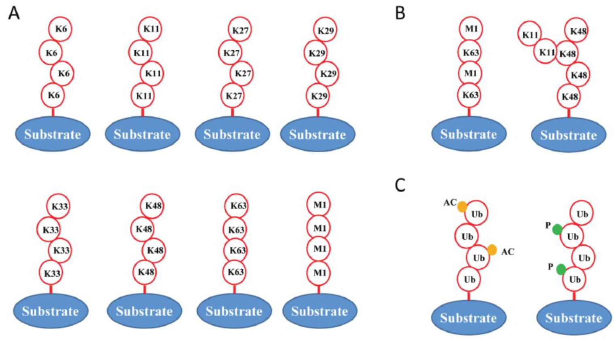
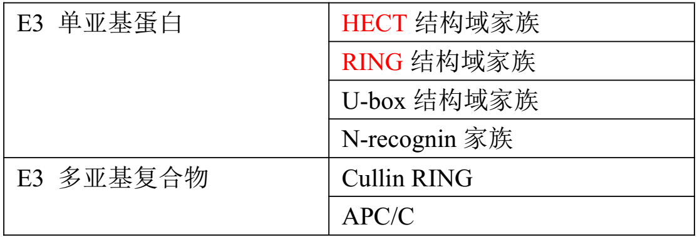
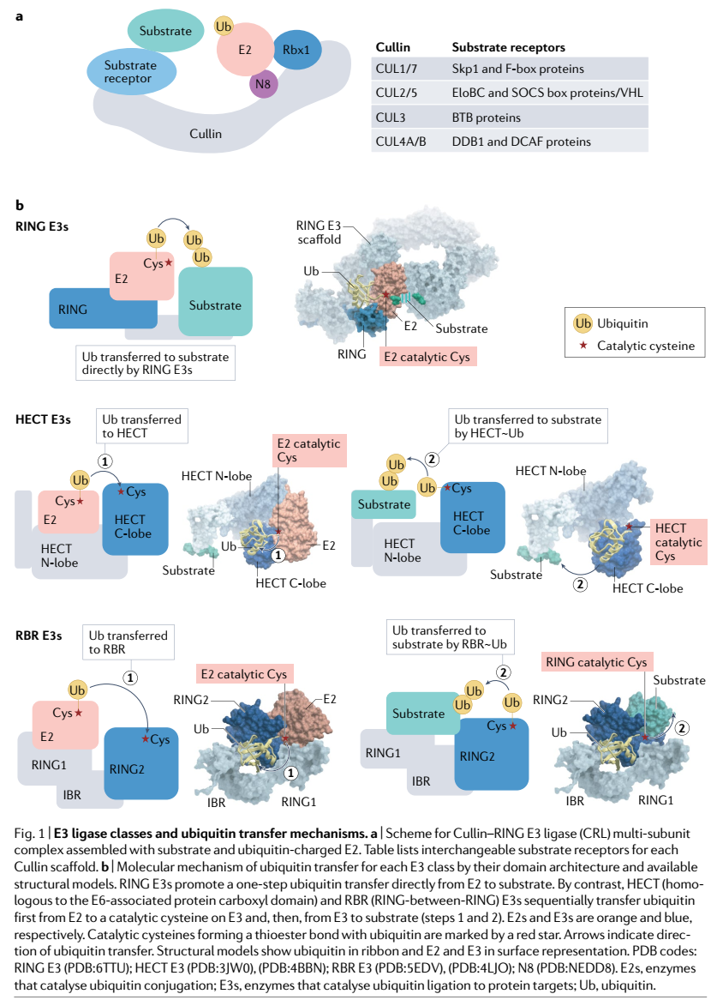
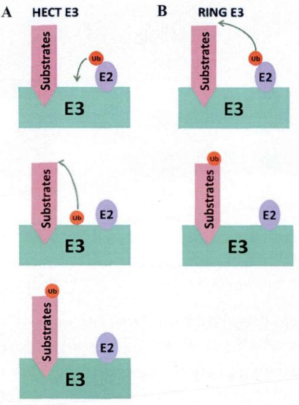
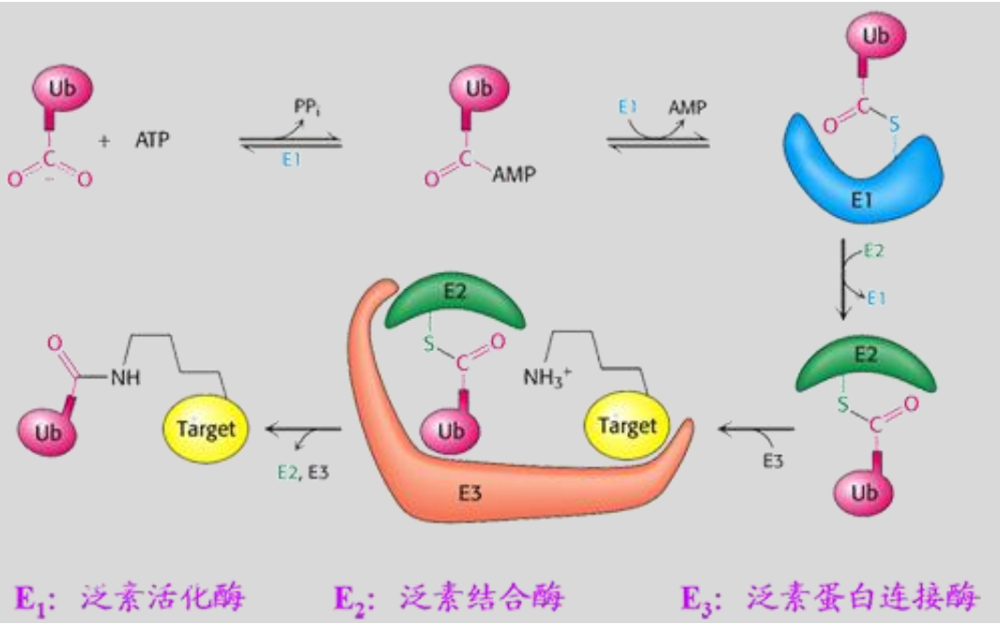

# 蛋白泛素化

蛋白翻译后修饰（post-translational modification，PTM），是指在 mRNA 被翻译成蛋白之后，对蛋白上个别氨基酸残基进行共价修饰的过程。

目前已知的蛋白质共价修饰方式多达数百种，常见的翻译后修饰也有数十种之多，最常见的翻译后修饰类型，包括磷酸化、泛素化、乙酰化、糖基化等等。

## 1.泛素化（ubiquitination）

在 2004 年，瑞典皇家科学院将当年的诺贝尔化学奖授予了两位以色列科学家阿龙·切哈诺沃和阿夫拉姆·赫什科以及一位美国科学家欧文·罗斯，以表彰他们发现了泛素调节的蛋白质降解机制。阿龙·切哈诺沃和阿夫拉姆·赫什科以及欧文·罗斯在 70 年代晚期和 80 年代早期进行了一系列具有划时代意义的研究，成功地揭示了细胞内蛋白质的降解是一个多步骤反应的过程：蛋白质先被泛素标记，然后被分解。通过这个需要消耗能量的过程，细胞以高度特异性的方式对不需要的蛋白质进行降解。

## 2.泛素-蛋白酶体（ubiquitin-proteasome system，UPS）的关键组分

泛素化过程通常由泛素-蛋白酶体系统（ubiquitin-proteasome system，UPS）介导。在泛素-蛋白酶体系统中，含有多个关键的组分：泛素、泛素激活酶（E1）、泛素结合酶（E2）、泛素蛋白连接酶（E3）、去泛素化酶（DUB）和蛋白酶体。由于人类基因组编码的 E3 连接酶超过 600 个，E3 酶的结构多样性远远超过 E1 和 E2 酶（最新的生物信息学分析表明，人类表达 8 个 E1、41 个 E2 和 634 个 E3）【[PMID: 30601939](https://pubmed.ncbi.nlm.nih.gov/35079164/)】。

### （1）泛素

泛素是一个由 76 个氨基酸组成，分子量仅为 8.5 kDa 的小肽，序列高度保守，且普遍存在于真核细胞内。泛素分子内部含有 7 个赖氨酸残基，分别是 K6、K11、K27、K29、K33、K48、K63 和 1 个 N 末端甲硫氨酸残基（M1）。泛素分子可以通过自身的上述 7 个赖氨酸残基和 1 个 N 末端甲硫氨酸残基，和另一个泛素分子结合。泛素与泛素之间的结合方式，又可以分为同型的多聚泛素化修饰和异型的多聚泛素化修饰。所谓的同型的泛素化修饰指的是，靶蛋白泛素链上的每一个泛素分子之间都通过同样一个氨基酸残基彼此相连；所谓的异型的多聚泛素化修饰指的是，靶蛋白泛素链上的泛素分子之间存在多种类型的氨基酸残基之间的相互连接的状态。如图：A，同型的多聚泛素化修饰；B，异型的多聚泛素化修饰；C，泛素的乙酰化和磷酸化。

蛋白质被泛素标记，本身已经是一种蛋白的翻译后修饰过程了，但是修饰蛋白的泛素，由于它自身也是一种长度很短的小肽，也能被翻译后修饰，例如磷酸化或者乙酰化修饰等等。这就使得泛素化过程变得更为复杂。

### （2）泛素激活酶（E1）

泛素激活酶 E1 是起始泛素化反应的酶，它的主要作用是通过消耗 ATP 能量的方式和泛素结合并激活泛素分子。具体过程是，E1 在 ATP 的作用下，将泛素分子 C 端甘氨酸的羧基连接到 E1 自身的活性半胱氨酸的巯基侧链上，形成高能的硫羟酸酯键。E1 分子具有两个活性位点，能一次性地调控和激活两个泛素分子。

### （3）泛素结合酶（E2）

泛素结合酶 E2 是泛素化反应的中间酶，可以结合 E1 和 E3，通常也被称为泛素载运蛋白（ubiquitin-carrier enzyme）。E2 酶家族经历过漫长而复杂的进化。高等级的真核生物在 E2 酶的数量上大于低等级的真核生物。例如，人类已鉴定有 35 个具有活性的 E2 酶，但是酵母只鉴定有 16 个 E2 酶。E2 酶具有高度保守的结构域——泛素结合结构域（ubiquitin-conjugating domain，缩写 UBC）。这个结构域通过结合在自身具有活性的半胱氨酸残基上的硫酯，结合由 E1 激活的泛素。泛素结合结构域 UBC 分子量是 14-16 kDa。不同物种当中，UBC 结构域的保守性较高，同源性大约是 35%。泛素结合结构域 UBC 序列上，有象征活性的半胱氨酸位点，可以接受被 E1 激活的泛素分子，并与泛素之间形成硫酯键。这个反应发生之后，带有激活泛素的 E2 随后与 E3 相互结合；最后，E2 将结合在自身的泛素分子转移到底物上，使底物蛋白完成泛素标记。

### （4）泛素蛋白连接酶（E3）

在泛素化过程中，泛素蛋白连接酶能够特异性地识别靶蛋白质。按照表现形式分类，E3 可以分为单亚基蛋白质和多亚基复合物。目前已鉴定的 E3 单亚基蛋白质主要包括四个家族：HECT 结构域家族、RING 结构域家族、U-box 结构域家族和 N-recognin 家族。E3 的多亚基复合物主要包括 Cullin RING 和 APC/C 两类。

泛素蛋白连接酶 E3 是泛素化过程中最关键的酶。底物上通常具有可被特异性识别的模体，这种模体也称为泛素化信号域。能特异性地识别和结合底物，指导泛素分子从 E2 转移到底物上，共价结合特定的赖氨酸残基。E2-E3 复合物的晶体结构显示，泛素化中的许多反应物是围绕 E3 的活性位点展开的。因此，E3 的功能体现了泛素化的特异性和高效性。

在分子水平上分析 E3 是很难的问题。因为除 E3 外，底物、泛素分子、泛素激活酶 E1 以及泛素结合酶 E2 也作用在反应体系中。除了促进泛素分子转移到底物的赖氨酸残基上，E3 还需要在它的活性位点处，协调反应体系中其它蛋白质的作用。

目前，HECT 和 RING 已证明是 E3 分类中最大的两个家族。这两个家族的催化模型与序列或结构无关，但是它们运行的机制却是截然不同的。HECT 家族的 E3 酶利用保守的半胱氨酸接受从 E2 转移来的泛素分子形成 E3 和泛素之间的硫酯，然后再将泛素分子由这种共价结合的 “E3-泛素”中间体转移到底物上。相反，RING 家族的 E3 酶将泛素分子直接从 E2-泛素复合物中转移到底物上，在这个过程中，RING 家族的 E3 酶不与泛素分子发生结合。所以 HECT 家族 E3 酶和 RING 家族的 E3 酶，在介导泛素转移到底物的过程中，HECT 家族 E3 酶先和泛素形成一个 E3-泛素的中间体，然后再将泛素转移到底物上，是一个两步骤的过程；而 RING 家族的 E3 酶直接介导泛素转移到底物上，是一个一步骤的过程。

### （5）去泛素化酶（deubiquitination enzymes，DUB）

人类当中有 100 多个基因编码了 DUB（去泛素化酶）基因，这些基因可以分为半胱氨酸蛋白酶（cysteine proteases）和金属蛋白酶（metalloproteases）两大类。半胱氨酸蛋白酶主要可以分为：1）泛素特异性蛋白酶（ubiquitin specific proteases，USPs）；2）泛素羧基端水解酶（ubiquitin C-terminal hydrolases，UCHs）；3）马查多-约瑟夫结构域蛋白酶（Machado-Josephin domain proteases，MJDs）和 4）卵巢肿瘤相关蛋白酶（ovarian tumor-related proteases，OTU）。金属蛋白酶是具有 JAB1/Mpr1 Pad1 N-terminal+(MPN+)/Mov34 (JAMM)结构域的蛋白酶。

去泛素化酶 DUB 在去泛素化途径中具有重要的功能。它们能够移除蛋白质上的单聚泛素分子或多聚泛素链。当靶蛋白发生泛素化时，泛素分子通过异肽键结合到底物的赖氨酸残基上。被泛素化的分子最终的命运是通过蛋白酶体被降解。而去泛素化酶 DUBs 能通过移除这些泛素化的修饰而起到一定的拮抗作用，进而改变蛋白质的命运。

### （6）蛋白酶体

蛋白酶体是一个多亚基蛋白酶复合体，分布于细胞质与细胞核内，是哺乳动物细胞中主要的中性蛋白水解酶，可占细胞蛋白质总量的 1%。在真核生物进化中，蛋白酶体高度保守。我们通常说的蛋白酶体指的是 26S 蛋白酶体形式。26S 蛋白酶体由 20S 蛋白酶体和 19S 亚复合体构成。每个 19S 亚复合体含有多个 ATP 酶活性位点和泛素结合位点，可以识别泛素化的靶蛋白，而且在靶蛋白进入 20S 蛋白酶体前，对靶蛋白进行去泛素化、同时打开靶蛋白的结构折叠。真核细胞的 20S 蛋白酶体含有两个α环和两个β环，这些α环和β环共同组成一个圆筒状结构。无论是α环还是β环，都是由 7 个相同的亚基组成，也就是α环内含有从α1-α7 的 7 个亚基；类似的，β环内含有从β1-β7 的 7 个亚基。在 20S 蛋白酶体内，α环位于外层，主要用于底物的识别；β环位于内层，主要负责催化底物的降解。3 种发挥催化作用的亚基位于β环分子的内表面，并表现出半胱氨酸蛋白酶样活性、胰蛋白酶样活性和糜蛋白酶样活性，分别酶解羧基端酸性、碱性、疏水性或芳香性氨基酸残基。

## 3.泛素-蛋白酶体（ubiquitin-proteasome system，UPS）的反应过程

在整个泛素化过程中，第一步是：E1 酶激活泛素分子，此过程需要消耗以 ATP 形式存在的能量，同时形成 E1-泛素的中间产物；第二步是：泛素分子从 E1 上，被转移到 E2 酶上，形成一个 E2-泛素的中间产物；第三步是：E3 酶先识别待降解的靶蛋白，然后 E3 酶再识别 E2-泛素中间产物，从而形成一个包含 E2-泛素中间产物，E3 酶和靶蛋白的复合物。同时，在这个复合物内，E3 介导泛素标记物从 E2 酶转移到靶蛋白上；第四步是：E2 酶和 E3 酶，从上述的复合物中释放，从而形成被泛素标记的靶蛋白；第五步是：重复上述过程，直到蛋白质上连接的多个泛素形成一条泛素链；第六步是：被泛素化的靶蛋白，会被 26S 蛋白酶体识别和降解。具体的机制是，被泛素化的靶蛋白先被 19S 亚复合体识别。随后，19S 亚复合体切除靶蛋白上的泛素链。最后 20S 蛋白酶体将靶蛋白切割成小片段。

## 4.泛素-蛋白酶体在生理过程中的重要作用
### （1）泛素化修饰与细胞周期调控

对所有真核细胞而言，将周期相关蛋白标记上泛素，这个过程对于正确的细胞分裂至关重要。在超过 600 种 E3 泛素蛋白连接酶中，SCF（skp1–cullin1–F-box）与 APC/C（anaphase promoting complex/cyclosome） E3 酶对细胞周期调控最为重要。SCF 和 APC/C 这两种 E3 酶复合物具有相似的分子结构，SCF 中含有 cullin 作为 RING 结构域；在 APC/C 中，含有 cullin 相关脚手架蛋白作为 RING 结构域，SCF 和 APC/C 通过各自的 RING 结构域，结合 E2-泛素中间产物以及底物，从而催化泛素化反应。

SCF 与 APC/C 可以通过促进细胞周期相关蛋白的降解，这些细胞周期相关蛋白包括 cyclins、aurora，cdc25 磷酸酶以及 CKI 等。SCF 与 APC/C 通过降解细胞周期相关蛋白，从而完成不可逆的细胞周期转换。相反，细胞则通过一系列调控机制，也可以反过来影响 SCF 与 APC/C，从而调控细胞周期的进程。尽管 SCF 与 APC/C 的结构与功能高度相似，它们的调控方式却迥然不同。对于 SCF 而言，底物通常都需要被磷酸化修饰之后，才能被 SCF 识别；如果底物的磷酸化位点发生突变，就会导致底物不被 SCF 识别和降解，会在细胞内产生不受限制的细胞分裂。而大部分 APC/C 的底物，并不需要磷酸化，就可以被 APC/C 识别并降解。反而是细胞通过磷酸化或其他机制调控 APC/C 本身的活性而调节细胞周期转换。因此，SCF，APC/C 和细胞之间，形成了一种双向调控的关系：E3 酶复合物 SCF，APC/C 等调控细胞周期的转化，但是与此同时，细胞也可以通过磷酸化等方式，反过来调控了 SCF 和 APC/C 的活性。例如，细胞使 SCF 的底物发生去磷酸化反应，从而抑制 SCF 对于底物的识别和降解；或者细胞通过磷酸化 APC/C 复合物，从而抑制了它的功能。这样一种细胞和 E3 酶之间的双向调控关系，保证了细胞内的细胞周期可以正常持续地进展。

### （2）泛素化修饰与受体内化

配体诱导的跨膜受体的激活，可启动一系列胞内信号通路而调控关键的细胞生物学过程，如细胞增殖、分化、迁移与存活等。因此受体通路的时空调控对细胞正确的生物学功能极为重要。其中一类调控机制便是对受体的泛素化修饰，通过促进受体内化并靶向溶酶体降解，从而确保受体通路的及时终止。由于受体酪氨酸激酶（receptor tyrosine kinases，RTKs） 在细胞生物学功能中的核心作用，对 RTK 的泛素化修饰研究也最为充分，尤其对于 EGFR，早已成为泛素化研究领域的热点分子。有研究发现，超过 50% 表皮生长因子受体 EGFR 连接的泛素是以 K63 泛素链形式存在的，而且这种 K63 泛素链修饰显著促进了受体的内化和靶向溶酶体的降解过程。研究发现，当配体 EGF 诱导 EGFR 激活后，EGFR 很快发生泛素化，起作用的 E3 酶主要是 Cbl。Cbl 可以被招募到激活的 EGFR 胞内段的磷酸酪氨酸残基部位，促进激活的 EGFR 发生泛素化。EGFR 的泛素化修饰过程受到配体浓度的影响。当配体 EGF 处于低浓度时，EGFR 的泛素化程度很低，难以被检测到；当配体 EGF 处于高浓度时，大量 EGFR 处于泛素化状态。尽管泛素化对 EGFR 的具体调控机制与作用还不完全清楚，但是实验数据表明，泛素化可以影响 EGFR 的内化程度、内化路径，从而调控 EGFR 的命运，最终改变整条 EGFR 信号通路。

### （3）泛素化修饰与细胞凋亡

p53 是凋亡途径中一个非常重要的抑癌基因。p53 强大的肿瘤抑制功能，主要是因为 p53 分子在各种细胞应激条件下，可以作为转录因子，调控下游一系列负责细胞周期阻滞和凋亡的靶基因的表达。MDM2 是 p53 非常重要的一个负调控因子。MDM2 本身也是一个 E3 酶，通过泛素化 p53，促进 p53 的降解。因此，在正常细胞内，细胞通过 MDM2 介导的泛素化过程持续降解 p53，使得 p53 分子在正常细胞内持续保持较低的表达水平。另一类分子家族凋亡抑制因子 IAP（inhibitor of apoptosis）家族成员，也是 E3 酶。IAP 家族成员可以影响 Caspase 的稳定性。通过对凋亡不同途径和不同底物的泛素化修饰，IAP 不仅可抑制线粒体途径的凋亡通路，还可抑制外源性凋亡通路。家族成员 XIAP（X chromosome-linked IAP） 可以直接与 caspase 3、7、9 相互作用而抑制它们的酶活性，并且介导泛素化，促进这些 caspase 酶的降解。在 TNF receptor 1（TNFR1）信号通路中，IAP1 和 C-IAP2 也可以通过泛素化的方式负向调控 caspase 8 的活性。

## 5.针对泛素-蛋白酶体而进行的药物开发
### （1）针对去泛素化酶的药物

由于去泛素化酶可直接拮抗识别肿瘤蛋白或肿瘤抑制因子的 E3，近年来被视为肿瘤治疗的潜在靶点。目前已有研究发现，去泛素化酶在多种癌细胞中存在过表达现象，水平明显高于正常细胞。例如，USP1 在骨肉瘤细胞中水平明显增高，可去泛素化并固定 DNA 结合蛋白抑制剂 ID1、ID2 及 ID3，从而保持骨肉瘤细胞中干细胞特性，促进其不断分裂增殖。而 USP7 在前列腺癌细胞中存在过表达现象，可通过抑制包括 p53、FOXO4 等肿瘤抑制因子的活性诱发肿瘤。因此，去泛素化酶抑制剂逐渐成为抗肿瘤药的新型研究方向。

目前，已发现多种去泛素化酶抑制剂对癌细胞具有抑制作用，可能具有潜在的抗肿瘤活性。例如，WP1130 可抑制去泛素化酶 USP9X、USP5、USP14 及 UCH37 活性，下调抗凋亡蛋白 MCL-1 水平，并上调肿瘤抑制因子 p53 水平，提高细胞的抗肿瘤活性。2017 年有研究表明，WP1130 通过抑制雌激素受体阴性乳腺癌细胞中的 USP9X，增加乳腺癌细胞对于顺铂的敏感性。USP7 的特异性去泛素化酶抑制剂 P5091 可诱导对硼替佐米有耐药性的多发性骨髓瘤细胞的凋亡，并抑制肿瘤细胞的增殖。另有研究表明，USP14 的特异性抑制剂可促进氧化蛋白的降解，增强癌细胞对氧化压力的抗性。选择性抑制 USP14 和 UCHL5 的去泛素酶抑制剂 B-AP15 不仅可以抑制对硼替佐米耐药的多发性骨髓瘤细胞的增长，同时还可抑制细胞周期蛋白 Cdc25c、Cdc2 和细胞周期素 B1 的表达，诱导癌细胞发生凋亡。

### （2）针对泛素激活酶 E1 的药物

泛素激活酶 E1 是保证泛素化过程正常进行的首要前提，有研究表明，敲除 E1 后可导致白血病细胞和多发性骨髓瘤细胞的凋亡，从这一角度出发，E1 有望成为治疗白血病及多发性骨髓瘤的新靶点。自 2002 年第一个针对 E1 的小分子化合物 panepophernanthrin 被发现以来，更多的 E1 抑制剂被相继研发用于肿瘤治疗。例如，组蛋白脱乙酰化酶抑制剂拉格唑拉被证明能破坏泛素与 E1 腺苷酰结构域的结合，抑制癌细胞的增殖。具有细胞渗透性的 E1 抑制剂 PYR-41 可阻断受体相关因子 TRAF6 的泛素化，阻止 IκBα和 p53 的泛素化降解，且能够杀死表达 p53 的癌细胞，是一种有效的可用于治疗癌症的 E1 抑制剂。

### （3）针对泛素结合酶 E2 的药物

有研究发现，泛素结合酶 USE1 在肺癌细胞中存在着过表达现象，而 USE1 的 mRNA 水平在癌细胞与正常细胞中相近，说明在肺癌细胞中 USE1 的表达后修饰出现了问题。由于肺癌细胞中 USE1 与 E3 泛素蛋白连接酶 APC/C 结合的 D-box 结构域发生错义突变，阻断了与 APC/C 复合体中的 CDC20 和 CDH1 链接蛋白的正常结合，导致 USE1 蛋白半衰期延长，胞内 USE1 蛋白水平升高，从而改变正常的细胞周期调控，促进了癌细胞的增殖和迁移。这一实验结果不仅为下一步的肿瘤治疗提供了研究基础，也表明 USE1 蛋白也可作为肺癌早期临床诊断的生物标志物。

泛素结合酶 Ubc13 能够与多个不同的泛素蛋白连接酶 E3 一起参与 K63 型的多聚泛素链的形成，在炎症和 DNA 损伤应答途径的信号转导过程中至关重要。2014 年，有研究发现，Ubc13 的表达是乳腺癌细胞代谢所必需的，而且它在前列腺、结肠、胰腺和淋巴瘤的肿瘤组织中也存在表达水平上调的现象。目前，从海绵动物中提取出了环状肽 Leucettamol A、化合物 Manadosterols A 和 Manadosterols B，都被证实能通过阻断 Ubc13 与 UEV1A 的相互作用，从而抑制 Ubc13-UEV1A 复合体的形成，最终阻止 K63 型多聚泛素链的形成，抑制底物降解。另有两种 Ubc13 抑制剂 NSC697923 和 BAY 11-7082，被证实可以通过在 Ubc13 活性位点半胱氨酸残基上，经过迈克尔加成反应，形成共价加合物，分别抑制 DNA 损伤和 NF-κB 信号通路。（迈克尔加成反应：是指亲电的共轭体系（电子受体）与亲核的负碳离子（电子供体）进行的共轭加成反应。该反应于 1887 年由 A.迈克尔首先发现，是有机合成中增长碳链的常用方法之一）。

## 6.泛素化专业信息数据库介绍
### （1）E3Net

韩国科学技术院生物信息学实验室设计并开发了 E3Net 数据库（<http://pnet.kaist.ac.kr/e3net/>）。该数据库在数据量方面较为庞大，且界面更为友好美观，从数据量及注释信息的丰富程度上来说，该数据库都是当前泛素化修饰相关蛋白数据库中最为出色的。E3Net 数据库共收录了 427 个物种中 2201 个泛素化修饰 E3 及 4896 个底物蛋白信息，其中包含 493 个 E3 与 1277 个底物蛋白之间的 1671 个特异选择关系，该数据库的数据来源主要是文本挖掘方法挖掘 MEDLINE 摘要得到的结果、UniProt 相关条目注释信息、公共泛素化数据库收录数据以及高通量实验数据。

### （2）hUbiquitome

hUbiquitome（<http://bioinfo.bjmu.edu.cn/hubi/>） 是北京大学发布的一个数据库，旨在收录高可信度的实验验证的人类泛素化相关蛋白质，该数据库共收录了 1 个 E1、12 个 E2、138 个 E3、279 个底物蛋白以及 17 个去泛素化酶。该数据库规模较小，但可信度较高，由于收录的全部为实验验证的数据，且为人工手动录入，提高了数据库所收录数据的可靠性，但同时降低了数据量，倘若加入质量控制体系，多渠道收集数据并对数据进行打分，将对提高数据量有所帮助。此外，该数据库的条目注释信息较少，每个条目包含的相关信息不多，但该数据库包含了数据提交功能，更为友好的是提供了原始数据下载的功能，这是相对于其它泛素化相关蛋白质数据库显著的优点。

## 7.泛素化异常与神经退行性疾病

帕金森病的发病机制还不是很清楚，但是很多的研究证据表明，泛素-蛋白酶体系统的功能改变是帕金森病的重要发病因素。在散发性帕金森病中存在泛素-蛋白酶体系统的功能异常。通过基因定位分析，已经发现了多个和家族性帕金森病直接相关的基因和基因的突变，这些基因包括α-突触核蛋白基因（α-synuclein）、parkin 基因（parkin 基因本身就是一个编码 E3 泛素蛋白连接酶的基因）以及泛素羧基末端水解酶 1 基因（ubiquitin C-terminal hydrolase L1，UCH-L1）。这些基因和基因的突变都和泛素-蛋白酶体系统的功能异常密切相关。一旦这些基因出现功能紊乱，都会干扰泛素-蛋白酶体系统对于异常蛋白的正常降解过程。因此，泛素-蛋白酶体系统的功能异常，可能是不同家族性帕金森病发病的一个共同途径。进一步的研究发现，在神经退行性疾病所造成的神经元死亡中，受损线粒体的累积具有核心的作用。在正常的神经元内，当细胞内的线粒体受损时，E3 酶会被迅速活化，使神经元能够及时清除异常的线粒体，从而保持神经元的正常功能。但是在帕金森病的患者脑内，患者的神经元细胞内的 E3 连接酶处于显著的抑制状态，即便细胞内出现线粒体受损的现象，患者神经元内的 E3 酶依然不能被激活，从而无法清除受损的线粒体，最终导致神经退行性疾病的出现。因此，如果可以通过特定的处理，扰乱神经元内对于 E3 酶的抑制作用，E3 连接酶就会被激活，进而快速识别受损的线粒体。通过这样的处理，有望在帕金森患者中延缓疾病的进程。

亨廷顿病（Huntington’s disease，HD）是一种以行动异常、认知下降和精神问题为特征的常染色体显性的神经退行性疾病。亨廷顿病的发病原因是 4 号染色体上亨廷顿基因（huntingtin，HTT）中，出现非常多的三联密码子 CAG 重复，一般 CAG 的重复数量都在 35 个重复或以上，结果导致聚谷氨酰胺片段扩大，从而产生突变型亨廷顿蛋白（mutant huntingtin，mHtt），这些突变的亨廷顿蛋白在神经元细胞内形成聚合体导致患者发病。鉴于突变型亨廷顿蛋白的累积，是其神经毒性的首要条件，因此清除突变型亨廷顿蛋白将有助于亨廷顿病的治疗。因此，神经元内，通过泛素-蛋白酶体系统，用于清除真核细胞内可溶性蛋白和短寿命蛋白的方式，以及通过自噬系统，用于清除长寿命蛋白、聚合蛋白和损伤细胞器的方式，这两种清除机制，对于神经元内错误折叠蛋白的清除，非常地重要。研究显示，被 K48 型和 K63 型泛素化修饰的突变型亨廷顿蛋白可以通过泛素-蛋白酶体系统被清除。

> 更新: 2023-09-04 11:54:59
> 原文: <https://www.yuque.com/doublehelix/bioinfonotes/rrtmwh>
