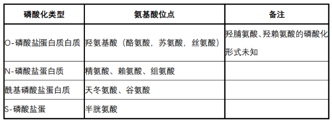

# 蛋白磷酸化

# **一. 蛋白磷酸化的定义及其研究简史 **

蛋白质磷酸化 (phosphorylation of protein) 指将腺嘌呤核苷三磷酸(ATP)或鸟嘌呤核苷三磷酸(GTP)上的磷酸基团转移到含有羟基的底物蛋白质氨基酸残基上的过程。
完成翻译后的蛋白质上，只有某些特定的氨基酸残基才会发生磷酸化：在真核生物中主要通过丝氨酸、苏氨酸和酪氨酸等氨基酸残基的磷酸化；
而在细菌中则主要通过天冬氨酸（Aspartic acid， D）、谷氨酸（Glutamic acid， E）和组氨酸（Histidine， H）等残基的磷酸化。
 有些蛋白质在原核生物和真核生物中都可以被磷酸化，它们的磷酸化位点通常是精氨酸（Arginine， R）、 赖氨酸（Lysine， K）和半胱氨酸（Cysteine， C）残基。

蛋白的磷酸化研究具有悠久的研究历史。
早在 1888 年，就已经开展了关于偏磷酸对蛋白质的作用的研究。
在 1926 年，研究报道了酪蛋白原中，磷酸和分子之间通过酯键相连接。
不久之后，又有多项研究在活体酵母细胞和细菌中，发现有蛋白质磷酸化的现象。
但是介导磷酸化的具体机制和磷酸化蛋白所具有的生理/病理意义，却一直不为人所知。
直到 1953年，这一年在磷酸化研究历史上是一个非常重要的年份，因为在那一年，艾德蒙-费希尔（Edmond H. Fischer）在西雅图的华盛顿大学遇到了他的合作者--埃德温-克雷布斯（Edwin G. Krebs）。
然后他们两人共同合作，研究糖原磷酸化酶。
在研究过程中， Krebs 和 Fischer发现了一系列的生化反应。
这些生化反应可以由激素或者钙离子所触发，而且有些反应可以激活这种酶，但是另一些反应却可以使酶失活。
在整个的研究过程中，他们两位通力合作，发现了可逆的蛋白磷酸化过程。
这项研究也使得两人在 1992 年获得了诺贝尔奖，授奖原因是因为两位学者在关于蛋白质可逆磷酸化作为一种生物调节机制方面的杰出成就。

# **二.磷酸化的主要类型**

根据被磷酸化的氨基酸残基的不同，可将磷酸化的蛋白分为 4 大类，分别是： O-磷酸盐蛋白质、 N-磷酸盐蛋白质、酰基磷酸盐蛋白质和 S-磷酸盐蛋白质。

+  羟氨基酸（hydroxyl amino acid，包括酪氨酸，苏氨酸，丝氨酸）的磷酸化，形成了O-磷酸盐蛋白质；但是并不是所有的羟氨基酸的磷酸化，都能形成 O-磷酸盐蛋白质。至少到目前为止，羟脯氨酸或羟赖氨酸的磷酸化过程，仍然不太清楚。
+ 精氨酸、赖氨酸或者组氨酸的磷酸化，形成了 N-磷酸盐蛋白质。
+ 天冬氨酸或谷氨酸的磷酸化，形成了酰基磷酸盐蛋白质。
+ 半胱氨酸的磷酸化，形成了 S-磷酸盐蛋白质。

# **三. 激酶与磷酸酶 **

蛋白质磷酸化是蛋白质翻译后修饰方式中最常见的也是最重要的一种类型，参与多种信号传导和细胞代谢通路，在调节生命体活动中发挥着不可替代的作用。

蛋白质的磷酸化过程是可逆的。激酶（kinase）介导了蛋白质的磷酸化；相反，磷酸酶（phosphotase）介导了蛋白质的去磷酸化。

## **1. 激酶（kinase） **
### **（1）激酶的分类**

蛋白激酶负责将磷酸基团转移到特定底物蛋白上，这类酶用 ATP 或 GTP 作为磷酸基团的供体，而蛋白质中的丝氨酸、苏氨酸或酪氨酸是最常见的可以被磷酸化的氨基酸位点。目前在真核细胞内已经发现有 400 多种蛋白激酶。这些激酶可以按照不同的标准进行分类，分为不同的亚家族。

第一种分类方式是 Hanks 等人在上个世纪 90 年代提出的，他们根据不同激酶催化区域氨基酸序列的同源性/相似性，将蛋白激酶分为五类： 1） AGC 类，包括环核苷酸依赖家族（PKA 和 PKG 家族）、蛋白激酶 C 家族、β-肾上腺素受体激酶（β-ARK）家族、核糖体S6 激酶家族和其它相关激酶等；
 2） Ca MK 类，包括 Ca2+/钙调素调节的蛋白激酶家族、Snfl/AMPK 家族和其它相关蛋白激酶；
 3） CMGC 类，包括细胞周期因子依赖蛋白激酶（CDK）家族、 ERK 蛋白激酶家族、糖原合成酶 3 激酶（GSK3）家族、酪蛋白激酶Ⅱ家族、 Clk 家族和其他相关激酶；
 4）酪氨酸蛋白激酶类；
 5）其它。
（具体的分类，请参见“激酶分类”文件）激酶的第二种分类方式是按照激酶对于底物氨基酸的选择性。
常见的可以磷酸化的氨基酸是丝氨酸/苏氨酸，和酪氨酸。
所以，激酶又可以分为丝苏氨酸激酶和酪氨酸激酶。

### **（2）蛋白激酶的细胞定位  **

**A） 细胞膜蛋白激酶**

细胞质膜上有许多膜受体和跨膜蛋白具有蛋白激酶活性，它们分别被称为受体蛋白激酶和跨膜蛋白激酶，其中既有受体酪氨酸蛋白激酶（receptor tyrosine kinases），又有受体丝/苏氨酸蛋白激酶（receptor serine/threonine kinases）。

**B） 细胞质蛋白激酶**

细胞质蛋白激酶也可以主要分为两类：非受体型酪氨酸激酶和非受体型丝苏氨酸激酶。

**C）核内蛋白激酶**

核内的蛋白激酶同样可以根据底物不同，分为核内丝苏氨酸激酶和核内酪氨酸激酶。其中目前研究得比较多的是核内丝苏氨酸激酶；相对而言，核内酪氨酸激酶研究得比较少。核内丝苏氨酸激酶主要分为三类：组蛋白激酶、非组蛋白激酶和细胞周期依赖性蛋白激酶（cyclin-dependent kinase， CDK）。

### **（3）常见蛋白激酶介绍 **

**A） MAPK **

MAPKs 是一系列丝氨酸/苏氨酸蛋白激酶，可以磷酸化很多的细胞质蛋白，是酪氨酸激酶受体下游主要信号传导途径，积极参与基因表达调控和多种病理生理过程。
 MAPK 功能异常与癌症、炎症、免疫系统和中枢神经系统疾病有关。
 MAPKs 家族主要包括三个成员：细胞外信号调节激酶（extracellular signal-regulated kinases， ERKs）， c-Jun 氨基末端激酶/应激激活的蛋白激酶（JNKs）， p38 激酶。
所有 MAPK 家族成员都可以通过苏氨酸和酪氨酸残基羟基侧链的双重磷酸化而被激活。
 MAPK 家族之间具有较高的同源性，例如， p38β、 p38γ 和 p38δ 分别与 p38α 相比，它们具有的序列同源性分别是 73%、 63%和 62%。
而不同的 p38 亚家族成员与其他 MAPK 家族成员的同源性，一般都可以达到 40%-45%。

ERKs 下游可以通过磷酸化而调控的分子有很多，其中研究比较深入的是两个重要的转录因子： 1）激活蛋白 1（activator protein 1， AP-1）和 NF-κB 。 ERKs 可以诱导细胞周期蛋白 D（cyclin D）的表达。 ERKs 还可以磷酸化活化原癌基因 myc ， myc 对于细胞周期进程和肿瘤细胞增殖很重要。因此， ERK 抑制剂被认为可以阻断细胞周期进程，用作抗癌药物。

JNK 家族主要有三个成员： JNK1、 JNK2 和 JNK3，它们由不同的基因编码。
这些激酶可以被 TNFα 和 IL-1 以及其他应激和炎症刺激活化。
 JNKs 可以磷酸化并激活 c-Jun，这对于 TNFα 激活 c-Jun 和 AP-1 是必需的。
而且 JNK 家族成员对 Bcl-2 和 p53 诱导的细胞凋亡也很重要。
 JNKs 对于免疫细胞调节尤为重要，它们可以刺激 TNFα、 IL-2、 E-selectin和基质金属蛋白酶的表达。
这些蛋白都和炎症反应有关，提示 JNK 在炎症方面具有重要的作用。
此外， JNK 可能在糖尿病和肥胖症中也发挥了重要的作用。
 JNK 磷酸化胰岛素受体和胰岛素受体的底物，使它们失活。
这抑制了胰岛素信号传导并增强了胰岛素耐受性。

激酶 p38 由四个成员组成，分别是 p38α、 p38β、 p38γ 和 p38δ 。其中 p38α 研究得最广泛。 p38α 主要在巨噬细胞和单核细胞中表达，在调节炎性细胞因子 IL-1、 IL-6 和肿瘤坏死因子 TNFα 的过程中，扮演重要角色。

**B）****PKA **

PKA 是蛋白激酶中最早被发现的分子。目前对于 PKA 的理化性质和功能，了解得较为清楚，因此它常常被用作研究蛋白激酶的模型。

PKA 是一类丝/苏氨酸蛋白激酶。

胞内第二信使 cAMP 产生以后，可以激活 PKA。随后， PKA 再顺序磷酸化代谢途径中的一些靶蛋白中的丝氨酸或苏氨酸残基。 PKA 通过对底物的磷酸化调控靶蛋白的活性。这些被磷酸化的靶蛋白，往往是关键性的调节酶、重要功能的蛋白质或转录因子。因而可以介导细胞外信号，从而调节代谢、基因转录等细胞效应。当第二信使 cAMP 的信号终止后，靶蛋白的活性，会因为蛋白的去磷酸化作用（由磷酸酶介导）而恢复原先的状态。

PKA 是异四聚体，全酶由 4 个亚基组成，包括 2 个催化亚基 C 和 2 个调节亚基 R。目前已经鉴定出 4 种调节亚基基因和 3 种催化亚基基因，它们可以编码出多种不同的 PKA 亚型，这些不同的亚型之间，表现出部分氨基酸顺序、 cAMP 结合能力、自主磷酸化位点以及组织特异性表达等方面的差异。

PKA 具有相当广泛的底物，包括多种酶、离子通道、结构与调节蛋白、转录因子等，而且随着研究的深入，不断有新的 PKA 的作用底物被证实。

**C）****PKC  **

蛋白激酶 C （PKC）是由一组依赖 Ca2+和磷脂激活的丝氨酸/苏氨酸蛋白激酶，它是信号转导途径的主要介质，同时也是细胞增殖、分化、凋亡、转换等生理过程的关键调节因子。

目前发现的 PKC 家族内，共有 13 个蛋白成员。
这些成员根据蛋白激酶 C 调控能力的差异，可以被分成三类：1）经典蛋白激酶 C (PKC-α、 PKC-β1、 PKC-β2、 PKC-γ) ，新型蛋白激酶 C (PKC-δ、 PKC-ε、 PKC-η、 PKC-θ) ，非典型蛋白激酶 C (PKC-ζ、 PKC-ι/λ) 。
所有的蛋白激酶 C 具有类似的结构，由两个主要模块组成，包括含有膜靶向基序和Ca2+结合的 N 末端调节结构域 (regulatory domain) ，以及含有三磷酸腺苷 (ATP) 结合结构域和底物结合结构域的 C 末端催化结构域。
在整个酶的主要序列中，有四个保守的 (C1-C4)区域，每个区域是一个功能模板，两侧是可变 (V) 区域。

蛋白激酶 C 广泛存在于哺乳动物组织和细胞当中，是信号转导途径的主要介质，同时也是细胞的增殖、分化、凋亡、转换等生理过程的关键调节因子。大量研究表明，蛋白激酶C 缺乏或失调可能导致不同的机体疾病，包括：糖尿病、心力衰竭、阿尔兹海默症、帕金森病、过敏、炎症性疾病、自身免疫性疾病和癌症等。

**D）****VEGFR **

VEGFR（vascular endothelial growth factor receptor， VEGFR）共有三种：VEGFR-1、VEGFR-2 和 VEGFR-3，它们属于酪氨酸激酶受体，由 3 个部分组成：包括 7 个免疫球蛋白样结构域、跨膜区、胞内的酪氨酸激酶活性区。
 VEGF 家族成员与细胞表面的相应受体结合，使其发生二聚化及自身磷酸化而激活，从而引发一系列的信号传导过程。
这三种受体在不同的组织中，介导不同的功能，它们的过度表达会引发病理性的血管或淋巴管生成过程，如VEGFR-2 在内皮细胞中的过度表达，介导肿瘤的血管生成；
VEGFR-3 在淋巴管内皮细胞中的过度表达介导病理性的淋巴管生成和肿瘤的淋巴结转移。

## **2.磷酸酶（phosphotase）**

磷酸化是一个可逆的过程。上面提到的激酶，介导了蛋白的磷酸化过程。而接下来要介绍的磷酸酶，则介导了去磷酸化过程。

### **（1） 磷酸酶的分类**

蛋白质磷酸酶种类很多，根据它们主要作用于底物蛋白质上氨基酸残基的不同，可以分为主要的两个大类：蛋白质丝／苏氨酸磷酸酶和蛋白质酪氨酸磷酸酶（PTP， Protein Tyrosine Phosphatases）。蛋白质丝／苏氨酸磷酸酶是含金属的酶类，它们可以通过直接攻击底物中活化水分子发挥作用，目前发现主要有 1 型（PP1）、 2A 型（PP2A）、 2B 型（PP2B）和2C 型（PP2C）等。而蛋白酪氨酸磷酸酶是非金属酶类，通过一个共价磷酸化的半胱氨酸中间体来催化底物，特异性去除酪氨酸残基上的磷酸基团。

### **（2） 蛋白质丝／苏氨酸磷酸酶  **

磷酸酶中最大的家族是丝/苏氨酸磷酸酶家族。
根据丝/苏氨酸磷酸酶对抑制剂的敏感程度、对于底物的特异性以及对金属离子的不同结合性，可以分为 1 型， 2A 型、2B 型和 2C 型，也就是文献中常见的 PP1、 PP2A、 PP2B 和 PP2C。
PP1、PP2A 和 PP2B 这三类磷酸酶的序列，具有高度的同源性。
PP1 的催化亚基与 PP2B的催化亚基有 40%的序列同源性；
 PP1 催化亚基与 PP2A 的催化亚基有 49%的序列同源性。
因此， PP1、 PP2A 和 PP2B 也经常被合在一起，称为 PPP 家族（phosphoserine and phosphothreonine residues phosphotases， PPP，磷酸丝氨酸和磷酸苏氨酸残基磷酸酶）。

### **（3）蛋白质酪氨酸磷酸酶 **

蛋白质酪氨酸磷酸酶，也就是 PTPs（Protein Tyrosine Phosphatase），是一类不含金属的酶类。
它通过一个共价的磷酸半胱氨酸中间体开始其催化过程。
人类基因组分析发现的PTPs 大约有 130 种之多，已发现的 PTPs 都具有一个由 200-250 个氨基酸残基组成的蛋白质 酪 氨 酸 催 化 结 构 域 ， 并 且 在 其 活 性 中 心 含 有 一 段 保 守 的 氨 基 酸 序 列 ：(I/V)ICXXAGXXR(S/T)G （其中 X 可以是不同的氨基酸残基）。
这一 PTP 催化结构域的结构及其酶活性中心的氨基酸序列和其它磷酸酶序列没有显著的同源性。
 由此可见 PTPs 是一个独特的磷酸酶家族，已发现的 PTPs 可以被分为两大类：一类是跨细胞膜的受体型 PTPs，其细胞内结构含有磷酸激活位点；
而另一类则是细胞内的 PTPs。

尽管蛋白质酪氨酸残基磷酸化和去磷酸化在整个细胞磷酸化过程中占到的比例不到1%，但是对于数量繁多的生物功能来讲，酪氨酸的磷酸化和去磷酸化调控都是关键的调节机制。 常见的蛋白质酪氨酸磷酸酶有 PTP1B、 TCPTP、 STEP 和 LYP 等。

### **（4）双重特异性蛋白磷酸酶  **

上面提到的酪氨酸磷酸酶，包括 PTP1B、 TCPTP、 STEP 和 LYP，都是常见的蛋白酪氨酸磷酸酶。还有一类被称为双重特异性蛋白磷酸酶（dual specificity protein phosphotases，DUSPs），它们则较为的特殊。因为双重特异性蛋白磷酸酶，既能使丝氨酸、苏氨酸侧链去磷酸化，又可以使酪氨酸侧链去磷酸化。不过就它们的催化机制而言，应该归属于 PTPs 家族，也就是蛋白酪氨酸磷酸酶家族。

双重特异性蛋白磷酸酶基因家族（DUSP 家族），也被称为丝裂酶原活化蛋白激酶磷酸酶（mitogen-activated protein kinase phosphotases， MKPs）。
该家族包含 10 种具有催化活性的双特异性蛋白磷酸酶，可以催化 MAPK 的去磷酸化过程，使 MAPK 失活，因此 DUSP家族在 MAPK 信号通路中发挥重要的负调控作用。
DUSP 家族的基因具有序列保守性，由非催化的N-末端和具有催化活性的 C-末端组成。
Ｎ-末端区域包含保守的调控序列，即激酶相互作用基序（kinase interaction motif， KIM），介导不同底物的识别和结合，并且决定了分子的亚细胞定位。
 C-末端包含高度保守的磷酸酶活化位点序列（I/V） HCXAGXXR(S/T/G)。

整个 DUSP 家族根据序列的保守性/同源性，亚细胞定位及底物的特异性，可以将整个家族分为三个亚家族： 1）位于细胞核，受应激或丝裂酶原诱导活化。包括， DUSP1、 DUSP2、DUSP4、 DUSP5； 2）位于细胞质且选择性作用于 ERK，包括了 DUSP6、 DUSP7、 DUSP9； 3）即可以位于细胞核，也可以位于胞质中，且选择性作用于 JNK 和 p38 丝裂原活化蛋白激酶，包括了 DUSP8、 DUSP10 和 DUSP16。

还有一个非常著名的磷酸酶分子是 PTEN。
 PTEN 在 1997 年被发现。
由于 PTEN 蛋白与张力蛋白 Tensin 有很高的同源性，因此 PTEN 也被称为与张力蛋白同源的磷酸酶（phosphatase and tensin homolog）。
 PTEN 共含有 403 个氨基酸，蛋白结构大体可以分为 3 个结构域：磷酸酶结构域（phosphotase domain）， C2 结构域（C2 domain）和 C 末端尾部结构域（C-terminal tail）。
 PTEN 的磷酸酶结构域位于分子的 N 末端，是 PTEN 酶活性的核心结构域。
该结构域内含有一个酪氨酸磷酸酶和一个双特异性蛋白磷酸酶的核心序列。
这说明 PTEN 同时具有双特异性蛋内磷酸酶的活性，既能介导酪氨酸残基的去磷酸化过程，也能介导丝/苏氨酸残基的去磷酸化过程。
但是 PTEN 和一般的 DUSP 家族又有很大的不同，因为 PTEN 主要介导的是磷酸肌醇（phosphoinositide）的去磷酸化过程。
特别是 PTEN对于 PI3K/AKT 通路的负调控作用，更是在细胞的增殖、生长和细胞周期等过程中，发挥了重要的调控作用。

在外界细胞因子的刺激下， PI3K 被激活，催化 PIP2 发生磷酸化，转变为 PIP3。随后PIP3 可以将 AKT 招募到细胞膜上。在 PDK（磷酸肌醇依赖蛋白激酶 1）的催化作用下， AKT发生磷酸化而被激活，并将信号往下传导。而 PTEN 恰恰介导了与 PI3K 相反的过程， PTEN介导了 PIP3 的去磷酸化过程，促使 PIP3 转变为 PIP2，从而抑制了 PI3K/AKT 通路。

# **四. 激酶/磷酸酶的调控**
## **1. 激酶受到的调控  **

1. ** 蛋白激酶的自身磷酸化（auto-phosphorylation）对于激酶活性的调控 **

研究发现，很多的蛋白激酶都能发生自身磷酸化，也就是激酶能通过分子内机制催化自身的磷酸化。酪氨酸蛋白激酶自身磷酸化，发生在酶蛋白自身的酪氨酸残基，从而激括激酶本身。许多生长因子（比如 EGF、 PDGF、 FGF）的受体本身就是受体酪氨酸激酶。它们在与相应生长因子结合后，诱导受体自身酪氨酸残基磷酸化，从而激活受体酪氨酸激酶。

我们以 EGFR 受体为例，进行详细说明。
表皮生长因子受体 EGFR 家族包含了四个成员，分别是 EGFR（ERBB1）、 HER2（ERBB2）、 HER3（ERBB3）和 HER4（ERBB4），它们都属于受体酪氨酸激酶超家族。
 EGFR 家族成员由胞外区（extracellular domain， ECD）、跨膜区（Transmembrane domain， TD）、胞内区（Intercellualr domain， ICD） 3 个部分构成。
表皮生长因子受体 EGFR 与相应的配体 EGF 结合之后，胞内区的酪氨酸残基发生磷酸化，从而形成二聚体，生成最初的信号之后，能依次识别含有 SH2 结构域的蛋白，并将外界的各种信号转递至细胞内，并参与调控了细胞增殖、分化、细胞运动和存活等众多的细胞生理和病理过程。
在整个信号传递过程中，配体 EGF 和受体 EGFR 相互结合之后，导致 EGFR 的自身磷酸化是整个信号传递的关键。
 EGFR 中 1068 位、 1148 位和 1173 位的酪氨酸是发生自身磷酸化的关键位点。

和酪氨酸激酶的自身磷酸化类似，丝/苏氨酸激酶也能发生自身磷酸化，通过对激酶自身的丝氨酸/苏氨酸残基的磷酸化，从而对激酶活性、激酶性质产生重要的调节作用。
比如，PKA 的自身磷酸化，发生在调节亚基的丝氨酸残基上。
在生理条件下， PKA 以非激活的全酶形式存在（催化亚基和调节亚基相互结合），在 cAMP 介入后，会导致 PKA 全酶解聚，释放出具有激酶活性的催化亚基。
 PKG 是同源二聚体，每个亚基分子量为 80 KD，都能发生自身磷酸化。
 PKG 每个亚基在与 cGMP 结合时，自身磷酸化能维持 PKG 催化区域底物位点的暴露，延长激酶活性。
 PKC 也能通过分子内机制发生自身磷酸化。
磷酸化的 PKC 对 Ca2+和佛波醇酯（PKC 的激活剂）的亲和力增加，从而获得激活。
因此 PKC 自身磷酸化是各种刺激信号传递、放大的必要步骤。
钙调蛋白激酶(CaMK)是多亚基的高分子量蛋白质。
其中CaMKII，分子量为 630 KD，含α、β 两种亚基。
已经发现， CaMKII 的α、β亚基都能发生自身磷酸化。
磷酸化之后的激酶活性，由依赖 Ca2+转变为不依赖Ca2+。

### **（2） 蛋白激酶的相互磷酸化对于激酶活性的调控 **

许多生长因子受体激酶不仅能自身磷酸化，从而激活受体酪氨酸激酶的活性，而且这些生长因子受体也能被其他的丝/苏氨酸激酶（PKA 或 PKC）催化，发生丝氨酸/苏氨酸残基的磷酸化过程，从而降低受体激酶的活性。

### **（3） 调节剂对于激酶活性的调控 **

激酶除了自身磷酸化或者相互磷酸化的途径调控之外，还有很多其他的物质也都是可以调控蛋白激酶活性的。这一类的调节剂可以分为两类：一类是可以激活激酶活性的激活剂（activator）；还有一类是可以抑制激酶活性的抑制剂（inhibitor）。

除了激活剂和抑制剂之外，激酶本身也是蛋白，很多激酶的活性依赖于激酶蛋白的磷酸化水平的高低。而磷酸酶又是介导蛋白去磷酸化的最主要的蛋白分子。所以，由磷酸酶介导的激酶的去磷酸化过程，同样是激酶功能调控的主要途径之一。细胞内还存在许多蛋白激酶的抑制蛋白，如 PKA 激酶的抑制因子，它是一种分子量为24 KD 的热稳定的蛋白质。它通过与 PKA 的催化亚基结合，从而抑制 PKA 的活性。对于激酶的抑制蛋白，最出名的要数 CKI（CDK inhibitor，细胞周期蛋白依赖性激酶抑制因子）。

## **2. 磷酸酶受到的调控**
### **（1） 磷酸酶丝/苏氨酸残基的磷酸化 **

机体内调控磷酸酶的机制，主要是依靠翻译后的蛋白修饰方式实现。
磷酸酶本身就是一种蛋白，而蛋白的磷酸化又通常是蛋白功能调控的一种重要的方式。
因此，磷酸酶本身受到磷酸化作用的调控。
磷酸酶蛋白上，丝氨酸/苏氨酸残基的磷酸化反应，就是磷酸酶催化活性的调控机制之一。
比如，磷酸酶 PTP-PEST 中 39 位和 434 位丝氨酸残基发生 PKA 或 PKC介导的磷酸化反应之后，磷酸酶 PTP-PEST 的催化活性大大降低。
另一种蛋白酪氨酸磷酸酶SHP1（Src homology region 2 domain-containing phosphotase 1， SHP1），这个磷酸酶的591 位丝氨酸发生磷酸化，也能抑制磷酸酶的催化活性。
此外，磷酸酶 PTP1B 的活性，也受丝氨酸残基磷酸化的调控。
研究发现， PKB 在催化 PTP1B 的 50 位丝氨酸发生磷酸化后，能促进胰岛素受体的去磷酸化过程，下调下游通路中 Akt 的活性，构成一个负反馈的调节通路。
 PTP1B 的这种调控方式如果受到干扰或破坏，会导致糖尿病等疾病的发生和发展。
但是，一个例外却向我们证明，世事无绝对。
因为上面提到的磷酸酶 SHP1 的酶活性可以受到磷酸化的调控，可是 SHP2 的结构和 SHP1 很相似。
但是 SHP2 的酶活性却不受丝氨酸磷酸化的影响。
因此，我们不能狭隘地认为，磷酸酶上丝氨酸/苏氨酸的磷酸化，一定会影响酶活性。

### **（2） 磷酸酶酪氨酸残基的磷酸化  **

蛋白的常见磷酸化位点除了丝苏氨酸之外，还有一个常见的磷酸化位点就是酪氨酸。所以酪氨酸残基的磷酸化反应，也能调控磷酸酶的活性。 SHP1 分子中， 538 位或 564 位的磷酸化，能够显著提高 SHP1 的催化活性。磷酸酶分子中，不同位点的酪氨酸残基的磷酸化，会对酪氨酸的酶活性产生不同的影响。比如， PTP1B 在胰岛素的诱导下，发生酪氨酸残基的磷酸化， PTP1B 的酶活性是受到抑制的。但是 PTP1B 第 66 位酪氨酸残基，可以因为表皮细胞生长因子 EGF 的诱导而发生磷酸化。 66 位酪氨酸残基磷酸化之后， PTP1B 的酶活性反而是增强的。

### **（3） 蛋白酶介导的蛋白水解**

磷酸酶的活性也受到蛋白水解的影响。钙蛋白酶是受到钙离子浓度调控的半胱氨酸蛋白酶，它和细胞的骨架重构、运动、增殖和凋亡等多种重要的生理功能密切相关。在血小板中，细胞内钙离子浓度如果升高，钙蛋白酶介导的蛋白水解过程变得活跃，能够介导 PTP1B、SHP1 和 MEG2 分子内部，抑制酶活性区域的水解，最终促进这三种磷酸酶的催化活性。

除了钙蛋白酶之外，还有大量的其他蛋白酶也能降解磷酸酶，从而影响到磷酸酶的酶活性。比如，在利什曼虫感染过程中，表面蛋白酶 GP63 是整个过程中的关键致病因子，被证实介导了磷酸酶 PTP-PEST、 SHP1、 TCPTP 和 PTP1B 相关功能区域的蛋白水解，促进了这些磷酸酶的酶活性。

### **（4） 小类泛素化修饰（SUMOylation）**

磷酸酶的活性还受到小类泛素化修饰 (small-uniquitin-related modifier, SUMO)。
人体内编码了 4 种 SUMO 蛋白。
这些 SUMO 蛋白通过与靶蛋白的共价连接，参与蛋白的翻译后修饰过程，从而改变蛋白亚细胞的位置、活性和稳定性。
大多数发生 SUMO 修饰的靶蛋白，位于细胞核内。
 PTP1B 位于内质网膜表面，是首个被发现的内质网相关的 SUMO 靶蛋白。
PTP1B 在内质网膜上的定位，对于蛋白的 SUMO 化修饰非常地重要。
同时表达 PTP1B 和SUMO-1 蛋白，会导致 PTP1B 出现 SUMO 修饰，去磷酸化的催化活性下降约 60%。
磷酸酶的活性，除了受到 SUMO 化修饰的直接影响之外，磷酸酶还能受到 SUMO 化修饰的间接调控。
比如磷酸酶 PTEN 就能通过 AKT/EGR1 信号轴间接地受到 SUMO 化修饰的调控。
胰岛素生长因子受体（IGF1-R）激活后，激活下游的 AKT；
随后激活的 AKT 催化早期生长应答蛋白 1 (EGR1) 发生磷酸化（EGR1 的磷酸化位点是 Ser350 和 Thr309）。
激活后的 EGR1 进入细胞核，在核内 EGR1 的 272 位赖氨酸位点发生 SUMO 化修饰，从而促进了 PTEN 的表达，抑制细胞的增殖。

# **五. 激酶/磷酸酶的抑制剂  **
## **1. 激酶抑制剂**

蛋白激酶抑制剂，根据抑制蛋白激酶的种类，可以分为丝氨酸/苏氨酸激酶抑制剂和酪氨酸蛋白激酶抑制剂。根据抑制剂作用于激酶位点的不同，又可分为三类： 1）作用于 ATP 结合位点的抑制剂； 2）作用于激酶调节区的抑制剂； 3）靶向激酶底物的竞争性变构抑制剂。目前，作用于 ATP 结合位点的抑制剂是研究和开发得最多的。

## **2.磷酸酶抑制剂**

磷酸酶在许多人类疾病中都扮演者重要角色，设计高效且专一的磷酸酶抑制剂就越来越受到关注。根据作用机制和来源，磷酸酶抑制剂可以分为以下几类： 1）非专一性的无机类磷酸酶抑制剂； 2）天然产物及其衍生物类磷酸酶抑制剂； 3）非水解的酪氨酸磷酸酯类似物。

# **六. 研究磷酸化的方法**
## **1.生物信息学方法**

蛋白质磷酸化位点的预测和识别，对蛋白质磷酸化的研究至关重要。除了采用实验方法判断磷酸化位点之外，还可以通过蛋白质磷酸化位点的预测识别，对蛋白质的磷酸化作出预测。我们介绍几个常用的磷酸化预测网站

1） Uniprot（[<u>http://www.uniprot.org/</u>](http://www.uniprot.org/)）

这是一个综合性网站。在网站内检索基因名，然后进入该基因的主页面。主页面内有PTM/Processing 一栏。 PTM 就是翻译后修饰（post-translational modification）。这一栏内有蛋白磷酸化位点的信息。

2） GPS（[<u>http://gps.biocuckoo.org/</u>](http://gps.biocuckoo.org/)）

GPS 是 Group-based prediction system 的缩写。
它建立了一套很好的规则，将激酶分类到 4 层的层次聚类中。
同时,网站还开发了一个简单的方法来估计理论上最大的 FPR（假阳性率， false positive rate）。
这个软件可以预测人类 408 个激酶特异的磷酸化位点的层次结构。
作为一个应用程序，网站进行了对 超过 13000 个哺乳动物磷酸化位点进行了高性能的预测。
特别需要说明的是，这个网站不仅能进行磷酸化位点的预测，还能进行其他翻译后修饰的预测（例如，蛋白的甲基化 Protein Methylation、赖氨酸的乙酰化 lysine acetylation和蛋白的棕榈酰化 palmitoylation 等）。

还有其他的一些免费蛋白磷酸化位点预测网站，具体信息如下：

NetPhos 3.1 Server： [http://www.cbs.dtu.dk/services/NetPhos/](http://www.cbs.dtu.dk/services/NetPhos/)

KinasePhos 2.0： [http://kinasephos2.mbc.nctu.edu.tw/](http://kinasephos2.mbc.nctu.edu.tw/)

Scansite 4.0： [https://scansite4.mit.edu/4.0/#home](https://scansite4.mit.edu/4.0/#home)

DISPHOS 1.3： [http://www.dabi.temple.edu/disphos/](http://www.dabi.temple.edu/disphos/)

PhospSitePred： [http://lin-group.cn/server/PhospSitePred/](http://lin-group.cn/server/PhospSitePred/)

## **2.Western blot 方法**

采用 WB 检测蛋白的磷酸化是目前最常见的技术方法。
对于蛋白的磷酸化过程而言，抗磷酸化抗体的出现是一个意义重大的事件。
在没有抗磷酸化抗体出现之前，蛋白质和酶的磷酸化，只能通过高危且费时的放射性实验来检测。
随着抗磷酸化抗体的出现，利用抗磷酸化抗体，可以直接通过 Western Blot 或其它免疫学方法轻松地检测到磷酸化信号。
如果需要检测某一个目标蛋白的某一特定位点的磷酸化状态，可以选用该蛋白特定位点的磷酸化特异性抗体。
比如， ERK1/2 的磷酸化是非常常见的现象。
现在市面上有很多可以直接采购的 ERK1/2 的磷酸化抗体，可供购买使用。
但是如果研究的是新的磷酸化位点，或者这些蛋白特异性位点的磷酸化抗体效果不够理想，通常有两种方式可以规避： 1）自行制备或者找专业化公司制备特定位点的磷酸化抗体；
2）可以使用通用型的磷酸化抗体，巧妙设计实验，也可以达到同样的检测目的。
比如，要检测某个蛋白 A 的磷酸化水平。
但是没有这个蛋白的特异性磷酸化抗体。
可以先通过蛋白 A 的抗体（非磷酸化抗体）进行 IP（免疫沉淀， immunoprecipitation），从而获得富集的蛋白A 的总样品（该样品中既含有磷酸化的蛋白 A，也含有非磷酸化的蛋白 A）。
随后进行SDS-PAGE 电泳分离，再通过“通用型磷酸化抗体”，检测蛋白 A 的总样本中发生磷酸化的蛋白 A 的含量。
如果要检测的是酪氨酸残基的磷酸化，则采用通用型酪氨酸磷酸化抗体；
如果要检测的是丝氨酸残基的磷酸化，则采用通用型丝氨酸磷酸化抗体。

与做普通的 Western Blot 相比，磷酸化 Western Blot 有一些要额外需要注意的事项：

首先，由于蛋白的磷酸化是可逆的，会被磷酸酶去磷酸化，所以在样品制备和整个免疫检测过程中，需要抑制或避免细胞内源性和外源性的磷酸酶的干扰。需要在细胞裂解液中加入足量的磷酸酶抑制剂。

其次，做磷酸化 Western Blot 时，要尽量使用清洁的新鲜的溶液和新做的 SDS 聚丙烯酰胺凝胶，并且最好在样品制备完就立刻上样，当天完成 SDS-PAGE 和 Western Blot 检测。

再次，如果要使用同一块 Western blot 的胶，既要检测磷酸化的蛋白，又要进行总蛋白的检测，需要先做磷酸化蛋白的检测，再做全蛋白的检测，以尽量避免磷酸化信号的丢失。

## **3.质谱技术**

质谱技术能用于检测蛋白的磷酸化，主要是基于两个原理： 1）与非磷酸基团修饰的肽段相比，单磷酸基团修饰的肽段在相对分子质量上增加了 79.983；
 2）磷酸肽还将产生一个可用于检测的片段离子，而非磷酸化修饰的肽段却没有这种现象。
但是，在实际应用中，磷酸化蛋白的质谱分析，也常常会遇到较大的问题。
首先，与非磷酸化形式相比，磷酸肽所占比例很低，有时甚至检测不到，因而所获得的肽谱是不完全的。
其次，磷酸肽更难离子化，而且非修饰肽段还可能抑制磷酸肽的信号。
所以，在应用质谱鉴定磷酸肽之前，首先应对磷酸肽进行富集，并通过 HPLC 初步分离肽段，这可以在很大程度上提高分析的成功率。
还有一种更加专业化的质谱--MALDI-TOF-MS（Matrix-Assisted Laser Desorption/Ionization Time of Flight Mass Spectrometry，基质辅助激光解吸电离飞行时间质谱）。
它可以用于分析完整的肽谱及对蛋白质进行鉴定。
因此，如果是一个已知蛋白或通过肽谱匹配得到鉴定的蛋白，那么通过检测所得肽谱与理论肽谱中是否发生 79.983 的相对分子质量迁移，就可以很简单地鉴定磷酸肽。
此外，通过碱性磷酸酶处理样品，可以使因为磷酸化而发生质量迁移的肽段，迁回至理论预测位置，这将有助于确定磷酸化的肽段。

## **4.NanoPro 1000 超微量蛋白分析系统 **

传统的蛋白分析技术所用的蛋白量往往需要来自成千上万个细胞，所得结果的分辨率及重复性非常有限。
比如，进行质谱检测 ，需要 100,000 个细胞；
进行流式细胞检测，需要10,000 个细胞；
进行 WB 检测，需要 5,000 个细胞。
那如果样本非常地珍贵且稀少（比如，穿刺样本、显微切割组织切片或分离的干细胞样本等），该如何检测呢？
美国 Protein Simple公司推出的 NanoPro1000 超微量蛋白分析系统（ultra trace protein analysis system）为蛋白功能和信号通路研究提供了一个全新的研究方案，每次分析只需要 25 个细胞。
该分析系统基于毛细管的超微量免疫检测分析平台，采用等电点聚焦（Isoelectric Focusing， IEF）技术分离处于不同磷酸化状态的信号蛋白，通过固定、免疫杂交和其他相关程序进行检测。
这种分析系统在肿瘤蛋白活化、蛋白磷酸化水平异构化、激酶抑制反应等方面，具有重要的应用。

> 更新: 2023-09-04 11:46:14
> 原文: <https://www.yuque.com/doublehelix/bioinfonotes/ge620k>
