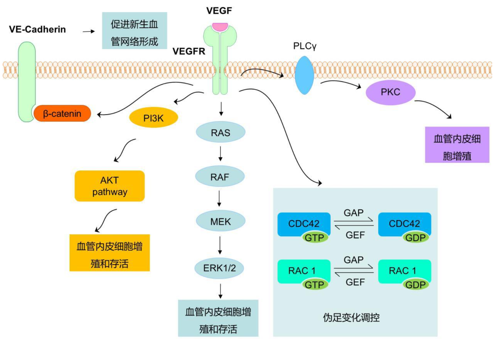

# 血管新生

## 1.三个易混概念

首先要分清楚三个词：vasculogenesis、angiogenesis 以及 arteriogenesis。这三个单词都含有词根 -genesis。“-genesis”这个词根的意思是“产生/形成”。

血管发生(vasculogenesis)，指的是在胚胎发育时由中胚层起始形成血管的过程中，由成血管细胞发育成血管内皮细胞并最终形成血管的过程。这是血管“从无到有”的一个生物学过程。

angiogenesis 的中文意思是“血管新生”。关键在于“新”字，指的是在原有的毛细血管或者微静脉基础上，通过内皮细胞的增殖、分化和迁移，以芽生或非芽生的形式生成新生的血管。因此 angiogenesis 指的是血管从“少到多”的一个生物学过程。血管新生的现象参与了很多的生理或病理过程，例如胚胎发育、女性生殖周期、胎盘发育、病理性糖尿病视网膜血管增生、创伤愈合和肿瘤血管生长等过程。

arteriogenesis 这个词的词缀是“arterio-”，表示“动脉”的意思，因此这个词的中文意思是“动脉生成”。动脉生成指新形成或原有的血管沟发生重塑，形成更大并肌组织化的小动脉和侧副管，在心肌缺血动物模型和冠状动脉疾病患者中较为常见。

## 2.诱导因子与抑制因子

常见的血管新生诱导因子有：VEGF、angiopoietin 和 FGF。

VEGF 受体（VEGFR）属于酪氨酸激酶受体，目前发现 3 个 VEGFR 受体，分别是 VEGFR1（FLT-1，fms-related tyrosine kinase）、VEGFR2（FLK-1，kinase insert domain containing receptor，KDR）和 VEGFR3（FLT-4）。其中 VEGFR1 是最有效的有丝分裂受体，VEGFR1 在病理性促炎症反应的部位，募集造血前体细胞和单核细胞的时候，起到关键作用并促进血管新生。

血管新生抑制因子的主要作用是抑制血管新生过程。常见的血管新生抑制因子主要有：Arresten、Endostatin、Angiostatin 和 MMP。

## 3.VEGF 下游信号通路

VEGF 主要通过下游 PLCγ1 通路、MAPK 通路和 PI3K-AKT 通路，促进内皮细胞增殖和存活。研究发现 VEGF 和它的受体 VEGFR 结合后，通过 PLCγ1 激活下游 PKC（protein kinase C，蛋白激酶 C）促进了血管内皮细胞的增殖。除了 PLCγ1 之外，VEGF 下游还可以激活 Ras-Raf-MEK-ERK 通路，最终通过 ERK 促进血管内皮细胞的增殖。另外，VEGF 下游通过 PI3K/AKT 通路促进内皮细胞增殖和存活，这也已成为 VEGF 下游的经典信号通路。研究显示 VEGF 通过下游 PI3K-AKT 的信号级联放大，通过 BAD 途径抑制细胞凋亡；同时又通过 mTORC2 和 FOXO1 促进内皮细胞的增殖和血管新生。

## 4.检测模型

检测血管新生的模型可以分为体内模型和体外模型。体外模型包括：内皮细胞增殖实验、内皮细胞迁移实验和小管形成实验。体内实验包括：角膜微囊实验、鸡胚绒毛尿囊膜实验、圆盘血管新生系统实验和基质胶栓实验。需要学员们注意的是，每一种体内或者体外的模型都有其技术的局限性，需要大家根据自己的研究选取合适的实验模型。

> 更新: 2023-09-04 10:31:42
> 原文: <https://www.yuque.com/doublehelix/bioinfonotes/gvyzcm>
