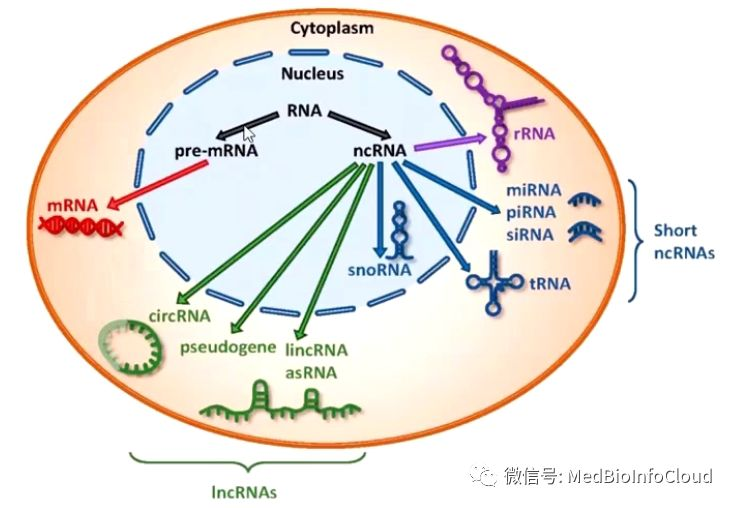

# 非编码RNA

## 一.非编码RNA的分类和基本概念

非编码RNA（Non-coding RNA）是指不编码蛋白质的RNA。
其中包括rRNA，tRNA，snRNA，snoRNA 和microRNA 等多种已知功能的 RNA，还包括未知功能的RNA。
这些RNA的共同特点是都能从基因组上转录而来，但是不翻译成蛋白，在RNA 水平上就能行使各自的生物学功能了。
非编码RNA 从长度上来划分可以分为3类：小于50 nt，包括microRNA，siRNA，piRNA；
50 nt到500 nt，包括rRNA，tRNA，snRNA，snoRNA，SLRNA，SRPRNA 等等；
大于500 nt，包括长的mRNA-like 的非编码RNA，长的不带polyA 尾巴的非编码RNA等等。

## 1.snRNA

snRNA 是small nuclear RNA的简称，也称作小核RNA。其功能是与蛋白因子结合形成小核核糖蛋白颗粒（small nuclear ribonucleo-protein particle，简称snRNPs），行使剪接mRNA的功能。snRNA 主要包括5 种：U1，U2，U4，U5 和U6。存在于所有snRNP 中的蛋白叫做通用蛋白，也称做sm 蛋白。通用蛋白和snRNA的结合位点已经研究清楚了。除U6 外，Sm蛋白可以结合到所有的其他snRNA 的保守序列AAU4-5GGA上，这段序列被称为Sm蛋白的结合位点，这也可以作为判断一个RNA是否是snRNA 的一个特征。

## 2.snoRNA

snoRNA 是最早在核仁发现的小RNA，称作小核仁RNA，最初发现它们的生物功能是用来修饰rRNA的。
大多数小核仁RNA可以分为两类。
一类是C Dbox snoRNA，这一类snoRNA是对RNA的碱基进行甲基化修饰的。
其特点是含有4 个Box：Box C、Box D、BoxC’和BoxD’。
事实上对C D box snoRNA 的预测已经有很多已经发表的软件，比如说snoscan。
另一类是H/ACA box，这一类snoRNA 对RNA的碱基进行甲尿嘧啶化修饰。
其特点是形成一个双stem，中间加一个loop 区，中间的loop 区中有一个boxH。
而在尾部的tail 有个boxACA。
由于boxH 和boxACA 的一级序列特征的界定比较松。
比如BoxH 是ANANNA，很多A rich 的区域都能满足这个特征。
而boxACA 是ACANNN，只有3 个碱基的明确信息。
所以单单从一级序列特征上判断一个RNA 是否为snoRNA 是比较容易出错的。
好在，HACA snoRNA 的二级结构是非常明确的。
所以，用二级结构结合尾部的Box ACA的特征，联合判断一个RNA是否为HACA snoRNA 是切实可行的。

## 3.microRNA

MicroRNA 是一类21~23 nt 的小RNA，其前体大概是70~100 nt 左右，形成标准的stem 结构，加工后成为21~23 nt 的单链RNA。microRNA 的作用机制是与mRNA 互补，让mRNA 沉默或者降解。现在流行的RNAi 技术就是利用了细胞体内的这个机制，在体外人工加入类似microRNA 的smallRNA 来沉默对应的mRNA。

miRNA 结合靶基因的验证只有一个经典实验——荧光素酶报告基因实验（Luciferase Assay）， 这个实验应该算是机制研究里比较容易做的。
miRNA 第一个特征是长度整齐划一， 都是 19-25 核苷酸的单链 RNA 片段。
最初转录出来的 miRNA 有几百个甚至几千个碱基长，称为初级转录产物（primary miRNA，pri-miRNA），pri-miRNA 经过二次剪切加工产生约 70-90个碱基的 miRNA 前体(miRNA precursor， pre-miRNA)。
加工初级转录产物到前体的核酸内切酶是 Drosha，这一步发生在细胞核内。
miRNA 前体转运到胞浆再被 Dicer 酶切产生 miRNA成熟体。

成熟的 miRNA 分子要发挥功能， 它可以跟一个或多个 mRNA分子不完全匹配的互补结合， 一旦结合上就可以下调基因的表达。miRNA 主要作用位点在靶基因的 3’-UTR， 依赖于 RISC（RNA induced silencing complex） 沉默复合体发挥作用， 这一点也跟 siRNA 一样， 在一些文章里也有报道 miRNA 作用于 5’-UTR 和 mRNA 编码区的，但是结合 3’-UTR 是主流。

查询 miRNA 的权威数据库是 miRBase（[miRBase数据库使用教程](http://mp.weixin.qq.com/s?__biz=MzA4NDAzODkzMA==&mid=2651263437&idx=1&sn=812e19573a473abfa44ec9771d451974&chksm=841ef5b0b3697ca665b62dbdb35ac06636f893fcc253e3e1091a10ac42418e02eec5aec35d1b&scene=21#wechat_redirect)），  在预测 miRNA 靶基因方面最权威的数据库是 Targetscan([miRNA靶基因预测数据库TargetScan使用教程](http://mp.weixin.qq.com/s?__biz=MzA4NDAzODkzMA==&mid=2651263433&idx=1&sn=eff451041320801e8ac2de1ca4f27e65&chksm=841ef5b4b3697ca21d4ff3e1b58bb9d4b99743e11bdc1dfdcbe69c133cc111f1a186a419f57f&scene=21#wechat_redirect)).

如果遇到新发现的 miRNA 跟已有名称的高度同源的情况， 序列只差 1-2 个碱基， 区分开来没法体现这种序列和功能上的相似性， 那就在第一个发现的 miRNA 后加上小写的 a/b/c 这样区分。
如果一条 miRNA 可以来源于不同的 DNA编码区域，也就是在基因组有平行的多个拷贝，那么还要在 a/b/c 后面加个横杠再以数字 1/2/3来表示。
最后一条规则是科学家们发现 miRNA 前体是个茎环结构， 加工过程会从 3'或 5'端茎环臂产生最终成熟的 miRNA， 但是一般只有其中一条是表达量高的。
以前把表达量低的加个*号， 后来发现这样不太准确， 也有会以“-s”和“-as”来命名， 最新的命名规则改用了来源于 5'端的标上 5p， 3'端标 3p。
这样就形成了物种-miR-数字序号+字母-5p/3p 的名字， 一条miRNA 光看名称就包含了至少 4 条信息，  过表达的基因一般叫 over-expression， 如果文章在实验分组里出现一个基因名称或者缩写 OE 的组，就是过表达基因的， 但是 miRNA 过表达有个专用名词叫 mimics（模拟物）， 这一点有区别。
同时， 做基因沉默时编码基因的分组标注一般是 si-XXX 或者用载体的 sh-XXX， 看到 si 或者 sh 你就知道作者在搞 loss of function， 而 miRNA 的沉默叫 inhibitor（抑制物）， 术语上不一样。

miRNA 很小， 转染操作较方便， 当想用质粒或者病毒做稳定转导的时候， 跟做 shRNA 非常相似， 也是表达一个茎环结构的发卡状 RNA。
一般做 miRNA 表达载体会用前体 pre-miRNA的结构， 胞内经过加工自动成为成熟的 miRNA， 而做 inhibitor 的载体就在这个茎环里放上miRNA 的反义链， 荧光素酶报告基因实验是机制研究中的一个非常经典的实验，五分以上的文章就经常看到了， 有两种主要的用途：一个用在 miRNA 靶基因验证， 一个用在研究转录因子对启动子的调控活性。
用在 miRNA 和转录因子研究里的两套载体是不同的，研究 miRNA 的时候是将需要鉴定的 miRNA 靶基因的 3’-UTR 插入荧光素酶基因的 3’端，转到细胞再过表达 miRNA， 如果 miRNA 对靶基因的 3’UTR 是有结合和抑制翻译作用的，荧光素酶表达量会减少， 对底物荧光的值就会降低， 这样就能获得证据证明 miRNA 与靶基因 3’-UTR 是有结合的。

miRNA 结合靶基因 mRNA 之后影响基因表达的方式主要是两种， 一般认为 miRNA 与 mRNA 的 3’UTR 结合后会阻碍翻译过程， 但不影响 mRNA 的稳定性， 早期发现的 miRNA 都是这种机制， 常识认为 miRNA 结合 mRNA 不影响其表达。但随着研究深入， 这种认识被颠覆掉了， 后续研究报道 miRNA 还可以降解靶基因 mRNA。当 miRNA 与mRNA 完全互补或者近乎完全互补的时候是可以引导降解 mRNA 的， 在植物中就是这样，类似于 siRNA 的机制。

## 4. lncRNA

长链非编码RNA(Long non-coding RNA, lncRNA)是长度大于 200 个核苷酸的非编码 RNA。研究表明, lncRNA 在剂量补偿效应(Dosage compensationeffect)、表观遗传调控、细胞周期调控和细胞分化调控等众多生命活动中发挥重要作用，成为遗传学研究热点。

lncRNA 的研究模式， lncRNA 既然叫 long non-coding，名字就包含了两个关键特征。第一是 long，长，超过 200 个核苷酸；第二是 non-coding，不编码。

查基因用 NCBI 的 Genebank 数据库，查 miRNA 用miRbase，查 lncRNA 序列也有一个权威数据库叫Noncode（<u>www.noncode.org</u>）。

用 NCBI的 ORF finder 工具可以预测 ORF 。

lncRNA 现在发现可以编码形成一些短肽，这是一种比较新颖的作用机制，所以在分析 ORF 的时候发现 lncRNA 能编码短肽序列， 就算它没有同源蛋白也不要忽视，做机制的时候可能有用。

还有一种分析非编码 RNA 序列特性的工具叫 CSF（codon substitution frequency scores） ——密码子替换频率， 它是一种对序列的分析算法， 主要是看一段序列编码的密码子在不同物种之间的保守性。非编码 RNA 有个特点，它的保守性是比较差的， 因为不编码蛋白， 错个把碱基关系不大， 所以当 CSF 评分小于 0 的时候，就可以认为它是一个非编码。

第一步，检测基础表达，它是 RNA ，没有蛋白，就做 RNA 水平检测就好了，实时定量 RT-PCR。
但是需要注意 lncRNA 表达一般比 mRNA 低，如果前面有筛选步骤，优先选择表达量高的。
用送测序或者芯片的同一批样品来做二次验证， 这样验证效果最好，如果换一批样品，批次之间也有分子表达的差异，验证效果就会差一些。
除了定量 PCR还有 Northern-blot 可以检测。
也可以用荧光原位杂交（Fluorescence in Situ Hybridization），这个实验在很多 lncRNA文章里都用，图很漂亮，而且还能知道 lncRNA 的亚细胞定位。
有不少 lncRNA 位于细胞核，参与转录调控，这些 lncRNA 后面做基因操作工具的时候就要小心。

第二步，制备基因操作工具，具体小心什么呢，核定位的 lncRNA 你用 RNAi 做， 可能效果是很差的，因为 RNAi主要在细胞浆发挥作用。替代的方式是用现在很流行的 CRISPR 基因编辑技术， 直接把lncRNA 的基因给 knockout 掉。

第三步， 细胞表型实验

第四步，动物表型实验也一样。

第五步，表型的 Rescue 实验。你可以把 CRISPR 敲掉后的细胞再过表达 lncRNA 分子进去，跟功能基因的验证策略类似。

Rescue，基本是蛋白的专属，非编码 RNA 不做。非要做，只能用 CRISPR+过表达。

## 5.circularRNA

环状RNA与已知的线状RNA不同，形成一个共价闭合的连续循环。在环状RNA中，RNA分子的3'和5'末端通常是连接在一起的。这种特性赋予了环状RNA许多特性，其中许多特性是最近才被识别出来的。

许多环状RNA来源于蛋白质编码基因，但是细胞中产生的环状RNA还没有被证明可以编码蛋白质。因此它们被归类为非编码RNA。最近，一些环状RNA显示出了作为基因调节器的潜力。像许多其他非编码亚型一样，大多数环状RNA的生物学功能尚不清楚。由于环状RNA没有5'或3'端，它们对核外酶介导的降解具有抵抗性，并且可能比细胞中的大多数线性RNA更稳定。

### Circbase

这个数据库收集了几千条在真核细胞表达的 circRNAs,是个公共 circRNA 数据集， 有相应 circRNA 详细信息，还可以下载 circRNA 序列。（[http://cirbase.org/](http://cirbase.org/)）

### CIRCpedia v2

CIRCpedia v2 是一个更新的综合数据库，包含来自 6 个不同物种的 180 多个 RNA-seq 数据集共 262782 条的 circRNA 注释。该数据库允许用户搜索、浏览和下载具有各种细胞类型/组织(包括疾病样本)表达特征的环状 rna。

此外，更新后的数据库包含了人类和小鼠之间环状 rna 的保守性分析。（  [http://www.picb.ac.cn/rnomics/circpedia/](http://www.picb.ac.cn/rnomics/circpedia/)）

### Circular RNA Interactome

该数据库预测了已知的 109 个 RNA 结合蛋白数据集与 circbase 中的 circRNA 的结合位点，并利用 Targetscan 软件预测了 miRNAs 与 circRNA 的潜在结合位点。此外， 该数据库还可以用于设计环状 RNA 引物， 针对环状 RNA 的 siRNA。([http://circinteractome.nia.nih.gov/Circular_RNA/circular](http://circinteractome.nia.nih.gov/Circular_RNA/circular)rna.html)

### circRNADb

首个汇总编码蛋白环状 RNA 的数据库， 共收录了 32,914 个带注释的人类外显子 circRNA， 是一个完整的人类环状 RNA 分子数据库， 每条记录包含详细的基因组信息、 RNA 编辑情况、 IRES 序列元件、 预测的 ORF 等信息， 可以作为大规模研究人类 circRNA 的宝贵资源。 ([http://202.195.183.4:8000/circrnadb/circRNADb.php)](http://202.195.183.4:8000/circrnadb/circRNADb.php))

可以根据基因名、细胞类型、pubmedID和蛋白编码能力浏览：

这里展示的是有蛋白编码证据的circRNA：

### TSCD (tissue-specific circRNA database)

此数据库是一个系统分析组织特异性环状 RNA 数据库。包含人和小鼠 2 个物种， 16 种组织的特异性环状RNA。

比如心脏特异性表达的circRNA及预测结合的miRNA：( [http://gb.whu.edu.cn/TSCD)](http://gb.whu.edu.cn/TSCD))

### MiOncoCirc

由密歇根大学开发的由癌症临床样本汇编的环状 rna 数据库。在这个数据库里面可以查询到某个 circRNA 在不同癌症临床样本的表达情况：([https://mioncocirc.github.io/)](https://mioncocirc.github.io/))

CSCD（cancer-specific circRNA database） ( [http://gb.whu.edu.cn/CSCD/)](http://gb.whu.edu.cn/CSCD/))

这个数据库是由武大何春江教授发布一个全新的肿瘤特异性 circRNA 数据库。

根据肿瘤细胞查找circRNA：

### exoRBase

这个外泌体环状 RNA 数据库是由复旦黄胜林教授开发的。exoRBase 数据库共收录了 58330 种 circRNAs， 15501 种 lncRNAs， 18333 种 mRNAs，它们来自 92 份血清外泌体 RNA-seq 测序样本。作者还依据GTEx project 获得组织特异性 RNA 表达特征，分析了相关 RNA分子的组织来源。（[http://www.exoRBase.org](http://www.exoRBase.org)）

### circRNADisease

这个数据库是由武大何春江教授发布一个全新的肿瘤特异性 circRNA 数据库。  [http://cgga.org.cn:9091/circRNADisease/](http://cgga.org.cn:9091/circRNADisease/)

### circRNADisease

 [http://cgga.org.cn:9091/circRNADisease/](http://cgga.org.cn:9091/circRNADisease/)

## ceRNA互作

RNA-RNA 交互的升级就是 ceRNA 的调控网络， 把两套 RNA-RNA交互作用叠加在一起就成了 ceRNA， 其中有一个 RNA 是共用的， 是 miRNA。一个 miRNA两个靶基因， 一共三个变量， 构成 ceRNA 的基本框架。

ceRNA 概念的提出是源自 2011 年 cell 上的一篇文章， The Rosetta Stone of a hidden RNAlanguage， 题目翻译过来是一个隐藏着 RNA 语言的 Rosetta Stone。
你看看， 到了 cell 这个级别， 作者的装逼能力已经突破天际。
Rosetta Stone， 什么石碑， 必有典故。
我跟大家一样，也不知道具体是什么典故， 所以特意去查了下。
Rosetta Stone 是保存在大英博物馆的一块石碑， 制作于公元前 196 年， 上面记载着古埃及国王托勒密五世登基的诏书。
这块石碑是 1799年， 拿破仑时期， 法军在占领的埃及城市 Rosetta 挖到的。
在 1801 年拿破仑的军队被英国人打败， 这块石碑到了英国人手上， 从 1802 年开始收藏于大英博物馆， 被称为镇馆三宝之一。
这块石碑为什么重要呢？
因为它是古埃及文明的重要象征， 古埃及的文字一度失落了一千多年， 没人会解读。
这块石碑上用希腊文、 古埃及文和当时的通俗文字记录了同样的内容， 为法老歌功颂德。
因为希腊文是一直流传下来的， 这样的一块石碑就使考古学家有机会通过文字对照， 解读出埃及象形文的意义与结构， 从而重新掌握了这种文字。
回过头来再看， 一个科学家用这样的寓意起作自己文章的题目， 装逼水平已经到了出神入化的境界。

ceRNA 本质上是 miRNA 作用机制的升级，把它从单机版变成网络版。
miRNA 通过与 mRNA的 3’ UTR 结合抑制蛋白翻译表达， 这个领域从 2001 年开始， 最初也是 CNS 上报道， 随后大量发现了 miRNA 就很普遍了。
后续研究证实单个 mRNA 可能受到多个 miRNA 的调控，而单个 miRNA 也能调控多个 mRNA，形成一个网状的结构。
那么问题来了，如果两个 mRNA它们的 3'UTR 能结合同样的 miRNA， 它们之间会不会有调控关系呢？
理论上说， A 表达多了之后， 能够竞争性结合 miRNA， 然后就导致结合 B 的同样的 miRNA 减少， 这样 B 的表达就上升了， 所以 A 和 B 之间应该存在表达的正相关性。

ceRNA 不是指一个分子， 而是 RNA 与 RNA 之间多元调控的一种交互模型。一个 miRNA 结合的靶基因可能有上百个， 而 mRNA 的 3'UTR 和大量的非编码 RNA 上， 也有远远不止一个的 miRNA 识别元件， miRNA recognition elements(MRE)， 或者叫 miRNA binding sites， miRNA 结合位点。

 miRNA 结合靶基因被证明是依赖于 RISC 蛋白复合体的，  RISC 复合体中有个关键催化组分蛋白叫 AGO2。有一种思路是利用 AGO2的抗体把复合物免疫沉淀下来， 再把结合在其中的 miRNA 和其他 RNA 送去测序， 这样的高通量研究就表明参与 ceRNA 调控网络的基因数量非常庞大。

Dicer 是 miRNA 从前体加工成成熟体必须的酶， Dicer 缺陷的细胞是 miRNA 缺失的， 这也相当于是一种阻断策略。

## 研究策略

当主变量是 miRNA， 其靶基因因变量应该是一个 RNA， 可以是编码蛋白的 mRNA 的 3’ UTR， 也可以是另外一个非编码RNA（lncRNA 或 circRNA 都可以）  另外当主变量是 lncRNA 或者 circRNA 的时候， 因变量反过来也可以是miRNA， 所以 RNA 结合 RNA 主要就是非编码 RNA 在唱戏。lncRNA 和 circRNA 都可以参与调控转录的过程， 可以竞争性结合启动子 DNA 序列导致转录因子结合不上去， 这是 RNA与 DNA 的交互 。

当主变量是 lncRNA 的时候还有一种经典分子机制模式， 就是 lncRNA 结合蛋白——RNA-蛋白相互作用。
lncRNA 功能很全能， 蛋白能介导的功能的它基本都能参与。
  一条 miRNA可以同时结合多个靶基因， 反之这些被结合的靶基因也可以一条 RNA 结合多个 miRNA， 形成一个网络状的调控关系。
当一个 miRNA 同时结合 2 个靶基因的时候， 这两个靶基因是存在一种竞争关系的， 因为同一时间与 miRNA 配对的只能是一条， 有你没我， 这样的调控模式叫竞争性内源 RNA。
英文术语 competitive endogenous RNA / competing endogenous RNA，意思一样， 缩写 ceRNA。
ceRNA 不是一种分子类型， 它是一套机制模式。
研究RNA时，常常需要进行过表达和沉默操作。
miRNA 很小，转染操作较方便，过表达的时候可以用mimics（模拟物），沉默的时候可以用inhibitor（抑制物）。
用质粒或者病毒都可以达到稳定转导的效果。
但是，对于lncRNA和circRNA就不一样了。
核定位的 lncRNA 如果用 RNAi 技术，可能效果是很差的，因为 RNAi主要在细胞浆发挥作用。
替代的方式可以用 CRISPR 基因编辑技术，直接把lncRNA 的基因给knockout。
这里需要注意的一点是，circRNA是环状RNA，虽然在研究手段和机制上面，大多和lncRNA相类似，已知的circRNA作用模式也和某些lncRNA一样，通过分子“海绵”的模式与miRNA结合来发挥作用的，但是它需要论证成环的问题。

> 更新: 2022-06-07 16:42:01
> 原文: <https://www.yuque.com/doublehelix/bioinfonotes/qhfvri>
