# scRNASeq

## 一.单细胞转录组简介

单细胞 RNA 测序（Single cell RNA sequencing，scRNA-seq）是一种在单细胞水平上利用 RNA 测序对特定细胞群体进行基因表达谱定量的高通量实验技术。待测组织经过单细胞分离、RNA 提取、逆转录、文库构建和测序，便可利用数据分析获得多个细胞的基因表达谱。

### 1.单细胞测序与普通转录组测序的区别

普通转录组使用细胞混合物组成的样品进行测序，因此只能估计基因在细胞群中的平均表达水平，没有考虑样本中各个细胞的基因表达的异质性。无法分析早期发育组织或复杂组织的异质系统（如大脑组织等）。为克服这一限制，开发了单细胞水平的转录组测序技术（scRNA-seq）。

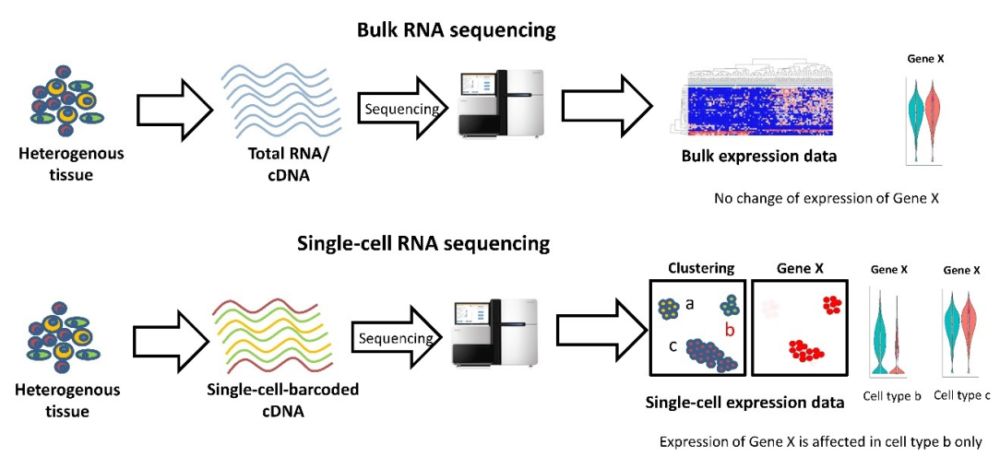

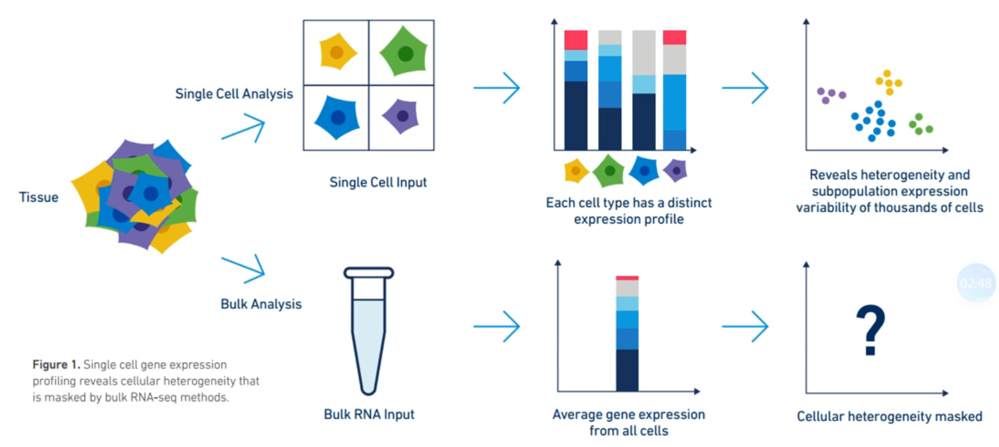

### 2.单细胞测序的原理

单细胞测序技术以单个细胞作为对象，通过对单个细胞遗传物质均匀扩增，标记建库后进行测序，最后对单个细胞基因组或转录组展开数据分析，其技术原理主要包括单细胞分离、扩增测序和数据分析3方面。

单细胞分离：主要包括荧光激活细胞分选法（ flow- activated cell sorting ，FACS） 以及微流控分选法（ microfluidics） 等。市场上，较成熟的商业单细胞测序公司主要有 10X Genomis 公司 的Chromium( 液滴法) 及 BD 公司的Ｒhapsody( 微孔法)。

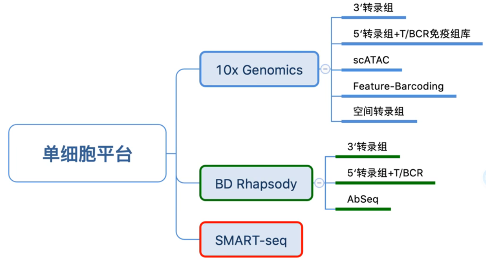

#### (1) 10×genomics技术

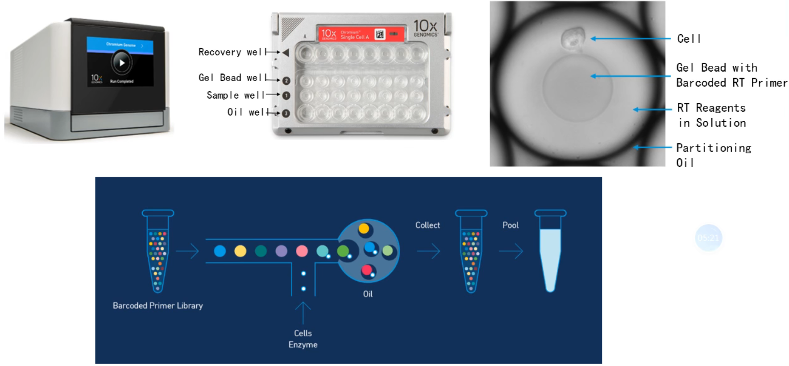

首先在凝胶微珠上种上特定的DNA片段，DNA片段由三部分组成：Barcode、UMI、PolyT组成。Barcode是16个碱基的长度。一共有400万种Barcode，一个微珠是对应于一种Barcode，通过这400万种Barcode，可以把凝胶微珠给区分开。UMI是一段随机序列，也就是说每一个DNA分子，都有自己的UMI序列。10个碱基长的UMI，有100万种序列的变化（4^10 = 1,048,576），UMI的作用是为了区分哪些哪些reads是来自于一个原始cDNA分子，区分基因片段重复还是duplication及区分是真实的SNP位点还是PCR产生的突变。

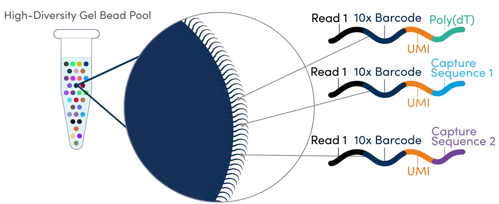

##### 3'端文库的构建

通过10×genomics仪器将单个细胞与单个凝胶微珠通过油相混在一起，形成油包水的小微滴，接下来把细胞膜破掉，让细胞当中的mRNA游离出来。游离出来的mRNA与小液滴中的水相混合，也就是和逆转录酶、结合在凝胶微珠上的核酸引物、以及dNTP底物相接触。接着，发生逆转录反应。mRNA与凝胶微珠上带标签的DNA分子相结合，在逆转录酶的作用下，逆转录出cDNA来。

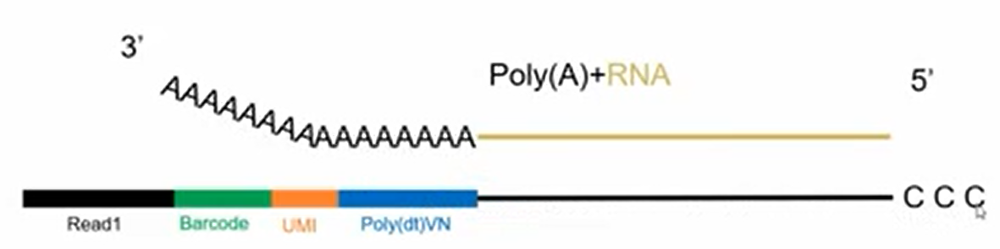

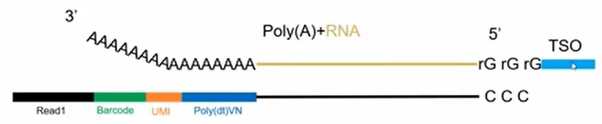

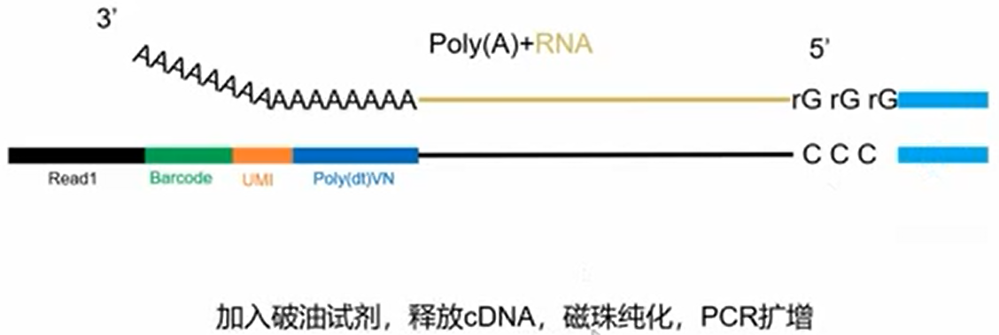

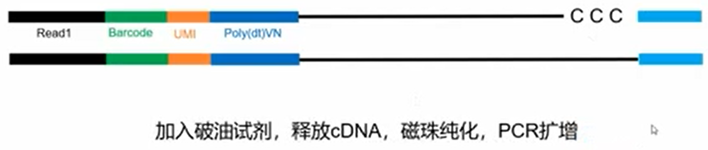

把这个乳浊液当中所有的水相抽出来，也就是把所有带了标签的cDNA分子都抽出来，再把这些cDNA分子都加上接头，经过PCR扩增，做成illumina的测序文库，放到Illumina的测序仪上进行测序。

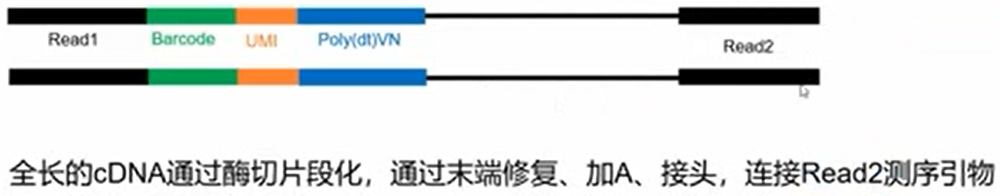

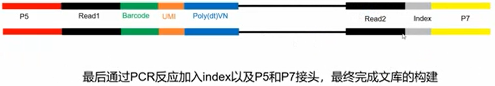

##### 5'端文库的构建

与3’端文库的构建过程相似

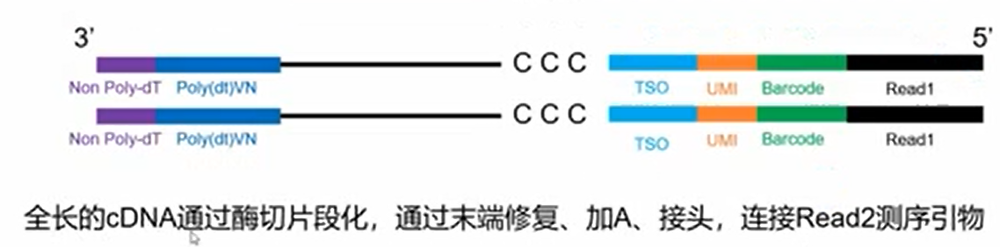

**小提示：**barcode和UMI是单细胞中常见的名词，barcode就像是每个凝胶微珠的身份证号码；而UMI则像是每个DNA标签分子的身份证号码。

使用scRNA-seq，可以估计基因在细胞群的表达水平分布。

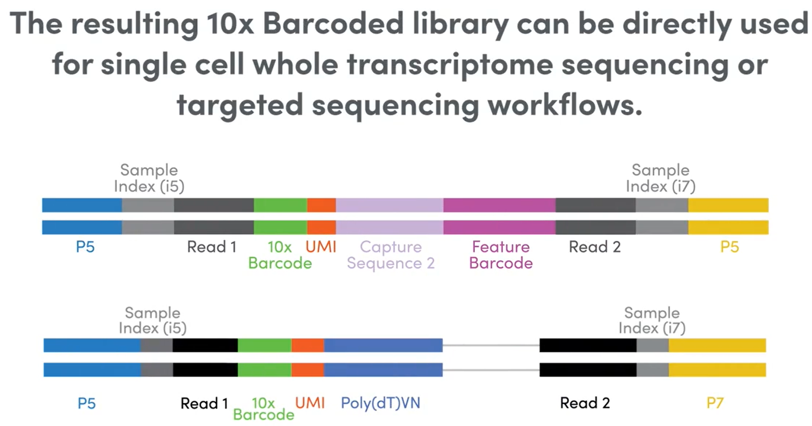

scRNA-seq 非常适合研究细胞群的异质性。例如，识别组织的细胞类型，定义不同细胞类型的"转录指纹"，研究细胞分化，探索疾病或环境因素导致的细胞组成变化等。

单细胞测序的经典流程：分离单细胞（核），将RNA转换为cDNA，准备测序文库（illumina）后测序。

SMART-seq2是一种低通量单细胞测序法，提供全长转录组的定量，适合研究小细胞组（如差异isoform使用，低表达转录本的特征）。

10x Chromium是一种高通量方法，使用UMIs进行定量，适合研究高度异质组织和大量的细胞样本。

## 二. 如何开始单细胞RNA测序数据分析

在过去的 5 年中，单细胞方法能够在一次实验中监测数千个单个细胞的基因和蛋白质表达、遗传和表观遗传变化。随着测量的改进以及反应和测序成本的降低，这些数据集的大小正在迅速增加。关键瓶颈仍然是对单细胞实验产生的大量信息的分析。在这篇评论中，我们对分析管道进行了简化概述，因为它们通常在当今的现场使用。我们的目标是让研究人员从单细胞分析起步，以了解挑战和最常用的分析工具。此外，我们希望使其他人能够了解单细胞数据集的典型读数如何在已发表的文献中呈现。

### 1.背景

基于下一代测序的单细胞基因表达分析在1992年首次被描述。2015年，开发了基于encapsulation和barcode的分析。在过去的5年里，单细胞分析变得大众化，大多数学术机构都有专门的核心设施来进行单细胞表达、表观基因组或其他分析。新的统计分析方法得到了迅速发展。一些分析平台也已经开发出来，如Seurat，它是用R 语言写的（<https://satijalab.org/seurat/get_started.> html） ，用Python写的Scanpy (<https://scanpy.readthedocs.io/en/> stable/tutorials.html)。在这里，我们回顾了基本的分析工具和概念。我们关注于10× Genomics数据，因为它们更常用（图1）。本文主要基于两个案例研究教程(<https://www.> github.com/theislab/single-cell-tutorial 和<http://scrnaseqcourse.cog.sanger.>ac.uk/website/index.html)。

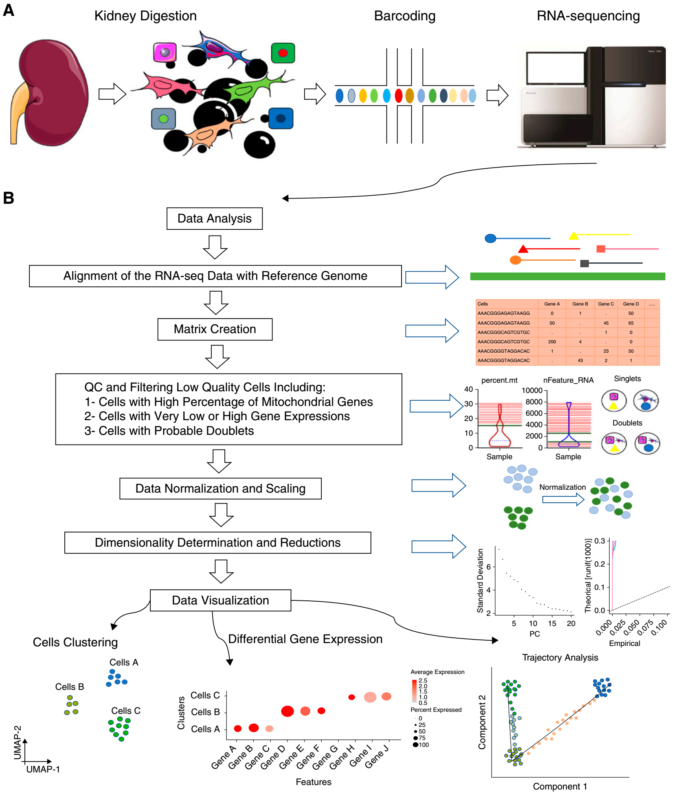

### 2.数据矩阵生成和质量控制

单细胞分析的一个关键技术进步是barcode的发展，它允许大规模并行化，同时保持成本最低。barcode被添加到

在逆转录过程中的RNA分子，允许识别单个细胞和独特的分子。分析的第一步是生成一个数据矩阵，由转录本数据库从原始测序文件生成一个barcode(细胞)。对于10×基因组学数据，CellRanger（表1总结了文中提到的工具，方法和数据库）是最常用的管道，包括测序读数与基因组的注释和比对，将比对的读数注释到基因，和量化基因。替代方案包括，例如唯一分子标识（unique molecular identifier , UMI）工具、zUMIs、kallisto、STAR和STARsolo (<https://github.com/>alexdobin/STAR/blob/master/docs/STARsolo.md)。

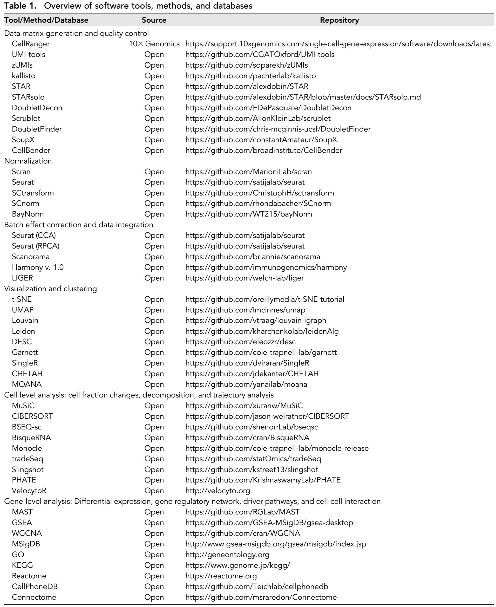

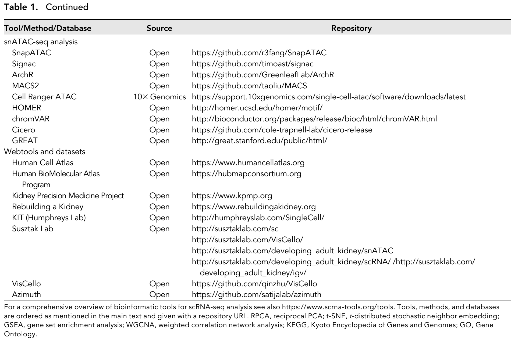

每个barcode可以代表一个单细胞。一个doublets，或者一个不含细胞，但含有周围RNA的“空”液滴。需要提到的一个重要问题是，标准的测序管道将测序数据与转录组进行比对，例如处理后的成熟mRNA。然而，单核RNA数据或表观基因组数据（通过测序测定转座酶可获得的染色质，ATAC-seq）应与全基因组比对，因为细胞核主要含有premRNA，其包括内含子区域。Raw read计数通常也会过滤掉在极少数细胞中检测到的基因，从而有效地减少数据矩阵的大小。分析管道的下一步是质量控制（QC），例如识别每个barcode的counts数，每个barcode的基因数，以及每个barcode的线粒体基因counts 的比例（图2）。

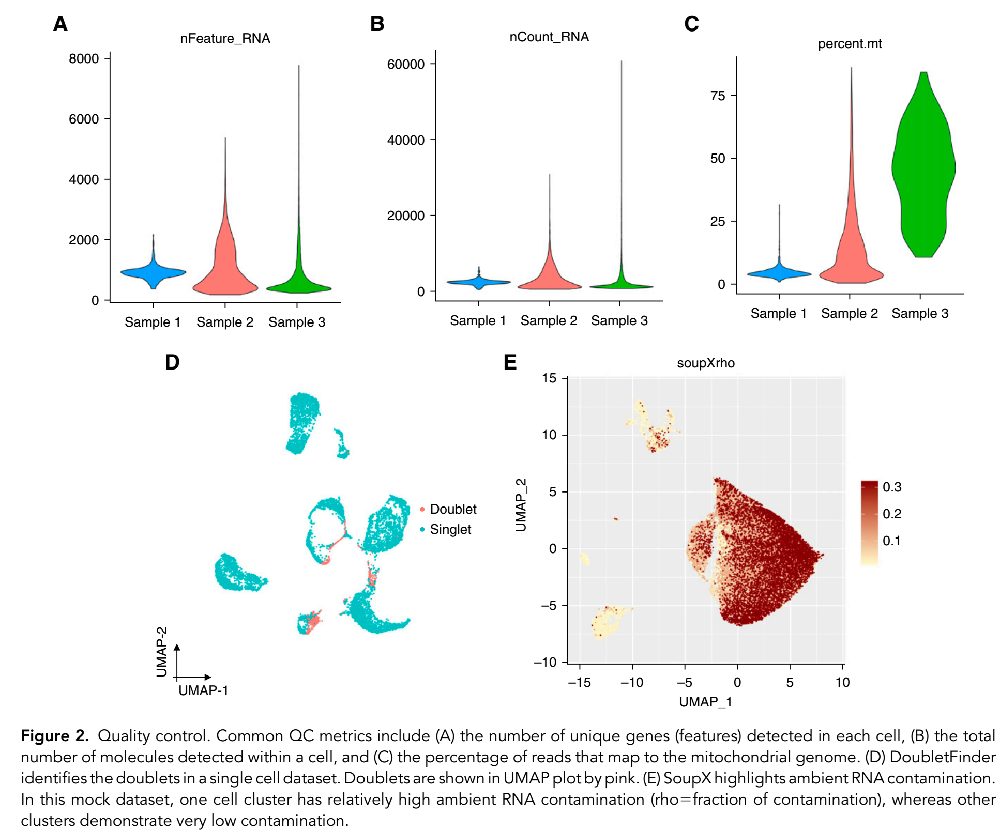

低基因数量和高比例的线粒体reads通常表明细胞质量差。然而，一些细胞，包括肾近端和远端曲小管细胞，含有丰富的线粒体。异常高的read和基因count可能代表doublets。现在有几种doublet检测工具可用，包括DoubletDecon，Scrublet和DoubletFinder（图2）。然而，doublet检测中的关键问题是含有来自例如上皮和间充质来源的标记基因的过渡细胞可能被标记为doublet，有时导致假阳性检测。此外，这些工具只能识别低同型的双链体，即转录相似的细胞在基因表达空间中聚集在复合细胞类型单链体之间形成的双链体。控制环境RNA污染也很重要。环境RNA是存在于单细胞溶液中的RNA，在包裹过程中被整合到油滴中。我们通常使用SoupX，它可以从空液滴中估计周围的RNA污染（图2）。另一个包是CellBender，它可以消除来自周围环境的RNA分子和随机barcode交换的count(原始)基于UMI的单细胞RNA测序（scRNA-seq）的count 矩阵。

### 3.标准化

单细胞数据需要不同类型和级别的标准化（图1）。例如，总测序read count会改变原始count，因此基因count应该按总count深度调整。一种常用的方法假设每个细胞具有相同的转录本初始数量，简单地将数据规范化为每百万分数。Scran使用基于pooling的大小因子估计和线性回归来对数据进行归一化，除了Seurat使用的简单对数归一化之外，它也是最流行的方法之一。其他方法已经开发，如SCtransform, SCnorm和BayNorm。归一化后，数据进行log（x + 1）转换。通常从数据中回归出与细胞周期相关的变化，它包含在Seurat或Scanpy的标准分析平台中。该平台还允许其他技术或生物学变异的回归。

### 4.批处理效果校正和数据集成

大多数情况下，会生成多个数据集，需要额外的批处理和数据集成方法（图3）。包含多个不同实验和不同方法的大型数据集通常使用非线性方法进行集成。在Seurat中，有一个基于参考的集成选项，它使用典型相关分析或互反主成分分析（PCA）。Scanorama是Scanpy中使用的另一种流行且性能良好的方法。最近，Harmony越来越受欢迎，并迅速成为单细胞数据集最常用的集成方法。第一步，利用PCA衍生的嵌入矩阵和批处理元数据进行缩放，使每个单元都有一个长度参数。然后，利用正则k-means聚类对尺度数据初始化聚类质心。最后，通过迭代地将特定于批次的质心拉到聚类质心，直到收敛，消除批效应。基因组实验关系的LinkedInference 通过整合非负矩阵分解识别共享的和数据集特定的因素。通过UMI的数量归一化后，基因表达被缩放但不居中。不同的集成方法可能会显示不同的结果。一般情况下，我们期望不同实验的相同细胞类型能够整合在一起，特别是控制细胞应该与多个实验保持一致。感兴趣的读者可以参考Tran等人和Chen等人最近发表的两篇优秀论文，它们提供了一些支持基因组和谐、关联推理的最佳证据实验关系和Seurat关于批效应校正。

### 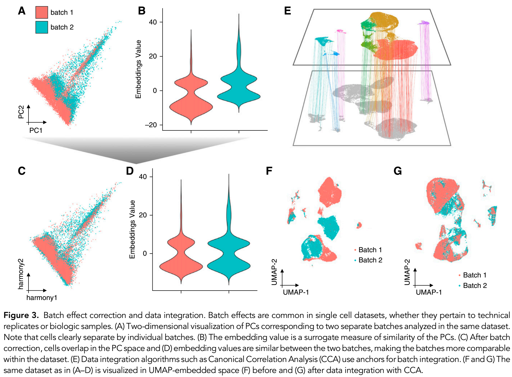5.可视化和聚类

可视化的第一步是在保留信息基因（1000–5000）并过滤掉其他基因时进行特征选择，这在Seurat和Scanpy中均已实现（图4和5）。可视化是在低维空间中总结数据集以观察模式的一种尝试。通常，降维是通过线性和非线性方法来实现的。PCA是聚类和轨迹推理的基础，是一种线性变换，在完整的PCA中保持细胞之间的欧氏距离。在常用的Seurat管道中，PCA用于预处理阶段。可以将PC投影到技术和生物协变量中以了解其性能。使用基于置换测试的jackstraw方法，对top PC和通过“elbow”启发式方法选择的PC数量汇总了PCA（图4）。

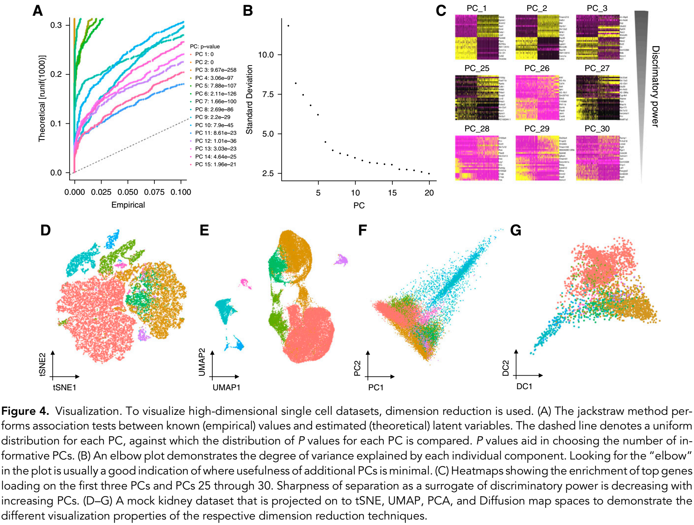

单细胞数据可视化主要使用其他非线性降维方法，如t分布随机邻域嵌入。该方法专注于以全局结构为代价捕获局部相似性。均匀近似和投影（UMAP）方法由于其速度而受到欢迎。UMAP似乎能更好地捕捉底层数据结构，并能在两个维度以上总结数据;因此，它现在最常用于单细胞数据可视化。UMAP和t分布随机邻域嵌入的一个关键限制是它们对用户自定义参数有很强的依赖性，并且结果对这些参数有很高的敏感性。最需要注意的是，这两种可视化都不能保持细胞-细胞之间的距离，因此结果嵌入不应该被下游分析直接使用（图4）。

根据基因表达的相似性形成的细胞群是分析的第一个直接结果。细胞聚类允许根据基因表达的相似性分组细胞来推断细胞类型。聚类是一种基于距离矩阵的无监督机器学习过程。community中默认的聚类方法是使用单细胞K近邻方法进行Louvain community检测。单元在图中表示为节点。每个细胞与它的K个最相似的细胞相连接，这些细胞通常是使用pc简化表达式空间上的欧氏距离获得的。单元格在图中表示为节点。每个单元格连接到其K个最相似的单元格，这些单元格通常使用PC缩减表达式空间上的欧几里得距离获得。一个关键问题是，用户决定Louvain聚类的分辨率，而分辨率决定数据集中识别的簇或单元类型的数量。我们建议执行子聚类，例如从初始数据集设置某些聚类，然后在不使用其他单元类型的情况下重新聚类。这允许在细胞类型内出现更精细，更细粒度的数据结构。包含在Leidenbase软件包中的Leiden  community检测算法是Louvain算法的替代方案，在Monocle轨迹分析中用作默认值（见下文）。新的聚类方法使用神经网络和人工智能，例如，单细胞聚类的深度嵌入使用深度神经网络，网络权值和初始聚类从一个自动编码器获得。Clusters（簇）并不一定意味着细胞类型。这一点非常重要，因为用户定义的集群解析参数决定了观察到的集群的数量。注释和聚类是强链接的。聚类和注释以迭代方式进行，这是耗时的。目前，关于最佳聚类参数尚未达成共识。因此，可以接受多个版本的聚类和相同数据的解释。Wilcoxon 秩和检验用于通过组间表达差异对基因进行排序。经典的单元类型注释使用外部数据集，该数据集被认为是基本事实。越来越多的肾脏细胞类型注释外部数据集包括Susztak Lab，Humphreys Lab,Tabula Muris, Human Cell Atlas, Renal Epithelial Cell Ontology webpage, 和 ImmGen Consortium。最近，自动化细胞注释工具已经开发出来，如Garnett、SingleR、CHETAH和MOANA，他们提供了一种更全面和概率的细胞身份标注方法。相同细胞类型的标记基因在不同的数据集可能不同。

### 6.细胞水平分析：细胞组分变化，分解和轨迹分析

细胞组分的变化（数据集中每种细胞类型的比例）与疾病状态有很强的相关性，这是单细胞分析最简单的结果之一。这些数字可以提供条件之间的相对估计，但由于单细胞库制备过程中细胞捕获的偏差，从单细胞数据推断的细胞分数可能不准确。此外，来自肾皮质的样本中，近端小管细胞的比例比来自髓质的样本高。为了推断bulk RNA-seq数据的细胞类型组成，MuSiC是最近开发的一种以单细胞表达数据为参考的批量组织细胞类型反卷积方法。MuSiC使用加权非负最小二乘回归估计细胞类型比例。可供选择的方法包括CIBERSORT、BSEQ-sc和BisqueRNA。对样本之间的细胞识别簇比例变化的统计检验是相互依赖的，而且，因为当一个细胞识别簇的比例变化时，所有其他细胞识别簇的比例也会变化。或者，基于排列的统计测试方法可以用于差异比例分析，其中cluster比例与总细胞的随机比例进行比较。

细胞多样性不能充分地描述一个离散的分类系统，如聚类。轨迹分析捕捉转变期间细胞的显著特征，例如沿着几个时间点的器官发育期间，或疾病状态、细胞历史或拓扑信息之间的变化。驱动观察到的异质性的生物过程是连续的。因此，捕捉细胞特性、分支分化过程或生物学功能的渐进、不同步变化之间的转变需要基因表达的动态模型。Monocle是一种机器学习方法，用于重建每个细胞从一种状态转换到另一种状态时必须执行的基因表达变化序列。它基于逆图嵌入，一种高度可扩展的非线性流形学习技术。在该方法学习转换（ transition）路径或轨迹之后，它将每个细胞沿着它放置在正确的位置，这被称为伪时间，即细胞在生物过程中移动多远的度量。一种分析细胞历史的新方法在最近开发的RNA速度分析中得到了应用，如包velocyto。RNA速度是基因表达状态的时间衍生物，可以通过在常见的scRNAseq协议中区分未剪接和剪接的mRNA来直接估计。RNA速度是一种高维向量，以小时为时间尺度预测单个细胞的未来状态。TradeSeq基于称为Slingshot的先前方法，在简单轨迹分析方面优于其他方法。另一个有用的软件包是PHATE，它是一种可视化方法，使用数据点之间的信息几何距离捕捉局部和全局非线性结构。推断出的轨迹不一定代表一个生物过程，应该收集进一步的证据来源来解释从这些方法得到的轨迹（图6）。

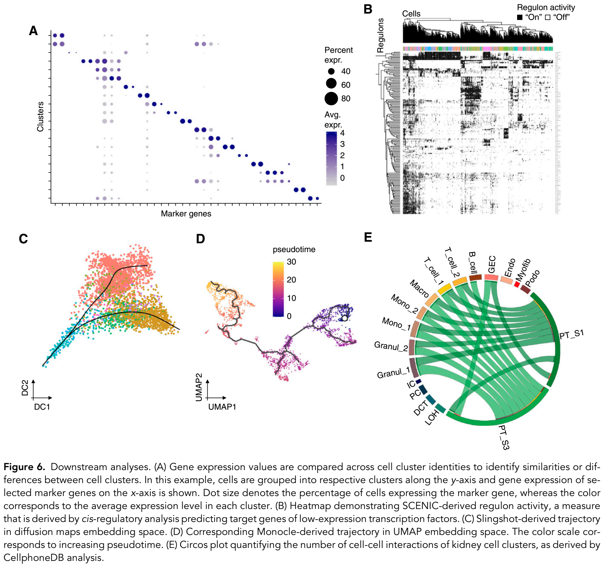

### 7. 基因水平分析：差异表达，基因调控网络，驱动途径和细胞-细胞相互作用

差异表达（DE）分析是通过包括技术和生物协变量的未校正数据进行的。Seurat使用不同的模型进行DE分析（图6）。MAST使用障碍模型来解释辍学。为了将scRNA-seq数据集信息与其他表型变量相关联，基于回归的模型可以组合几个样本及其相关的表型特征，以将某些细胞类型（例如近端肾小管细胞）中的基因表达变化与相应的定量测量表型（例如GFR，Albuminuria）。尽管DE测试工具通常允许用户灵活地合并混杂器，但用户必须警惕哪些变量被添加到模型中。例如，在大多数单细胞实验设置中，样本和条件协变量是混淆的，因为在多种条件下获得单个样本几乎不可能。基因水平分析还可以与基因集富集分析方法相结合，例如基因集富集分析或加权相关网络分析。

为了解释DE结果，我们通常根据参与共同生物过程的基因进行分组。生物过程标签存储在数据库中，例如MSigDB，基因本体论或《京都议定书》的基因和基因组百科全书以及Reactome数据库。尽管我们需要记住，某些通路成员的基因表达富集可能并不一定与通路活性相关，但基因列表上注释的富集可以使用大量工具进行测试，这些工具已经在其他地方进行了审查和比较。单细胞分析领域的最新发展是使用配对基因标签来进行配体-受体分析。在这里，细胞群之间的相互作用是从受体及其同源配体的表达推断。配体-受体对标签可以从最近的数据库获得，例如CellPhoneDB或Connectome，并用于使用统计模型解释跨簇的高表达基因。

### 8.单细胞分辨率下的基因调控

通过测序获得转座酶可及染色质的单核分析（snATAC-seq）可以通过染色质可及性图谱分析单细胞的表观基因组景观（图7）。已经为snATAC-seq分析开发了多种工具。最着名的是Ren实验室开发的SnapATAC，Satija实验室开发的Signac和Greenleaf实验室开发的ArchR。我们更喜欢SnapATAC，这是一种非线性降维方法。在CellRanger中通过barcode-by-cell 矩阵生成barcode之后，我们通过使用SnapATAC将片段二值化为均匀大小的逐个cell-by-bin来预处理矩阵。QC步骤包括过滤读深过低或过高的低质量细胞或doublet，并移除基因组黑名单区中的读码。重要的QC标准是转录起始位点的富集、峰中reads的比例和启动子区reads的比例。SnapATAC利用扩散图识别异质组织中的细胞类型。从扩散图中得到的低维嵌入作为输入，以消除批处理效应。然后用Louvain算法进行聚类，选取k个最近邻算法中的k个值作为输入。为了进行聚类注释，从选定的肾细胞类型特异性标记基因中生成细胞基因活性评分矩阵。预定义的启动子区域，(例如，来自Ensembl调控构建)或基因体12kb区域用于整合所有与基因转录本重叠的片段。为了从每种细胞类型调用峰，将从相同细胞类型获得的所有片段聚合以构建伪批量ATAC数据集和MACS2，分别针对每种细胞类型进行。ArchR实现了一种改进的方法，在独立样本上调用峰值，然后保留可重现的峰值。Fisher在edgeR中的精确测试在细胞簇之间进行测试，以揭示每种细胞类型的不同可访问区域。为了鉴定不同细胞类型中富集的基序，HOMER或chromVAR可用于snATAC-seq数据的转录因子分析，尽管遗传背景将严重影响哪些转录因子基序富集。

为了研究开放染色质变化如何与细胞分化和细胞命运决定相关联，使用Monocle3进行轨迹分析，通过使用潜在语义索引和UMAP可视化来减少维度。为了了解开放染色质和目的基因的表达变化，通过分析在Cicero中实现的两个峰的可达性，进行了峰-峰相关性研究。该策略聚合相似的单元以获得一组“元单元”，并解决snATAC-seq数据中的稀疏性问题。或者，可以将峰推算到GREAT中以识别最近的基因。

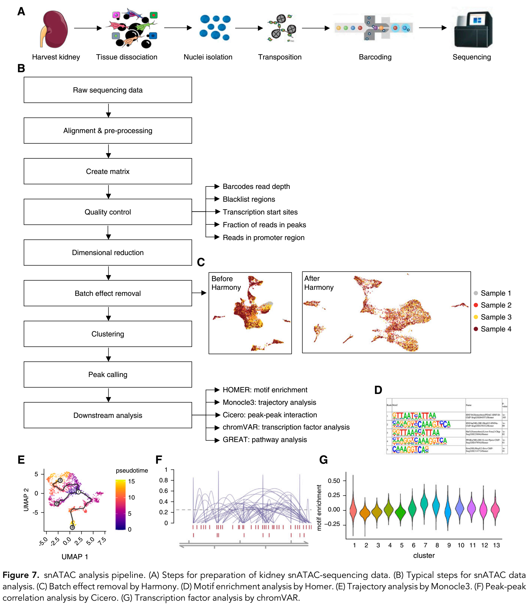

### 9.Webtools和数据集

在过去的几年中，已经生成了大量的人类和小鼠肾脏数据集。原始数据集通常可从GEO下载。作为人类细胞图谱项目和人类生物分子图谱计划的一部分，将提供大量综合参考人类肾脏注释。肾脏精准医学项目旨在为各种人类肾脏疾病状况生成数据集。重建肾脏联盟将分析开发的人类肾脏样本和体外分化的肾脏类器官。此外，一些研究人员已经为小型单个实验数据集生成了可视化工具。Humphreys实验室的工具包站点允许快速可视化他们广泛的数据([http://humphreyslab.com/SingleCell/)](http://humphreyslab.com/SingleCell/).)。McMahon和Kim实验室使用VisCello将发育和成年小鼠的数据可视化，同时比较雄性和雌性小鼠的差异。使用VisCello平台，我们的实验室可视化开发，成人，健康和疾病小鼠模型数据([http://susztaklab.com/VisCello/)](http://susztaklab.com/VisCello/)35)和开放的染色质表观基因组数据，这也是可用于相同的时间点([http://susztaklab.com/developing_adult_kidney/igv/)](http://susztaklab.com/developing_adult_kidney/igv/).)。这些站点不允许进行全面分析，并且聚类参数（有些主观）是固定的，但它们对于查找和比较非常有用。数据分析自动化的另一个重要发展是Satija实验室的独立分析应用程序([http://azimuth.satijalab.org/app/azimuth)](http://azimuth.satijalab.org/app/azimuth))，允许将单个数据集投影到参考数据集，其中已在单个细胞中同时测量了RNA和表面蛋白表达。研究者可以上传本地生成的数据集，该软件包自动执行上述所有步骤，并与人体血液参考数据聚类。

## 三. 单细胞转录组的上游分析

### 1.从BCL到FASTQ

#### (1) 软件安装和介绍

Cellranger mkfastq 管道可用于将 BCL 文件解码为单个库的 FASTQ 文件。如果测序提供程序已经完成了这一步，则可以直接使用每个库的 FASTQ 文件进行数据分析。cellranger mkfastq的本质是调用bcl2fastq生成bcl2fastq，并生成额外的10x样本信息。Bcl2fastq是 illumina开发的bcl到fastq的转换程序。cellranger下载安装地址如下：

<https://support.10xgenomics.com/single-cell-gene-expression/software/downloads/latest?>

安装cellranger

参考：<https://support.10xgenomics.com/single-cell-gene-expression/software/pipelines/latest/using/tutorial_in>

```r
tar -xzf cellranger-6.1.1.tar.gz
```

```r
echo 'export PATH=~/softwares/cellranger-6.1.2:$PATH' >> ~/.bashrc

source ~/.bashrc
```

```shell
cellranger testrun --id=tiny
```

在conda环境中安装bcl2fastq，因为Cellranger依赖于bcl2fastq。

```shell
#https://anaconda.org/dranew/bcl2fastq
conda install -c dranew bcl2fastq
```

#### (2) 案例

公司提供的bcl原始测序文件，本次教学使用使用cellranger的测试数据

```shell
curl -O https://cf.10xgenomics.com/supp/cell-exp/cellranger-tiny-bcl-1.2.0.tar.gz
curl -O https://cf.10xgenomics.com/supp/cell-exp/cellranger-tiny-bcl-simple-1.2.0.csv
```

```shell
tar -zxvf cellranger-tiny-bcl-1.2.0.tar.gz
tree -L 2 cellranger-tiny-bcl-1.2.0/
```

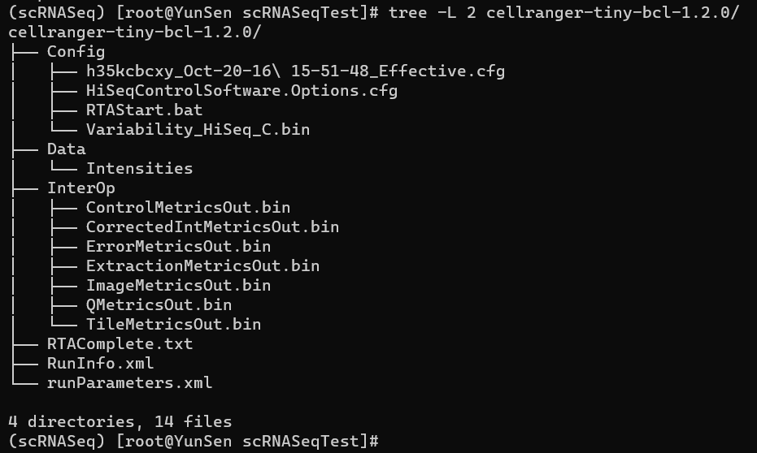

您的数据可能看起来有点不同，这取决于测序仪器使用。查看目录的前几个级别是检查完整性的好方法。如果您没有看到 RTAComplete.txt、 RunInfo.xml 和 runParameters.xml 文件，那么管道很可能会失败。如果缺少任何这些文件，请与您的测序提供程序联系，并要求获得完整的运行目录。

```shell
cat cellranger-tiny-bcl-simple-1.2.0.csv
```

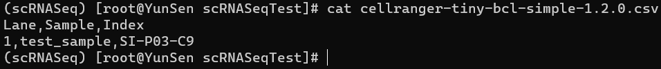

• Lane：要处理flowcell的哪个通道。 可以是单个泳道（1）、范围（例如 2-4）或flowcell中所有泳道（\*）。\
• Sample：样本名称。 所有生成的 FASTQ 表头前缀，对应于所有下游 10x 管道中的 --sample 参数。样本名称只允许使用字母、数字、下划线_和-；不允许使用其他符号，包括点（“.” ）。\
• Index：用于文库构建的 10x 样本索引，例如 SI-TT-D9 或 SI-GA-A1。

***

查看帮助文档

```shell
cellranger mkfastq --help
```

```shell
cellranger mkfastq --id=tiny-bcl --run=cellranger-tiny-bcl-1.2.0 --csv=cellranger-tiny-bcl-simple-1.2.0.csv
```

• --id： mkfastq命令输出FASTQ文件的文件夹名称

• --run： BCL（Base CALL）所在文件夹名称（该文件为illumina测序的下机文件）

• --csv：对应BCL文件的样本信息表，用于描述如何在 Illumina flow 单元上对样本进行索引。

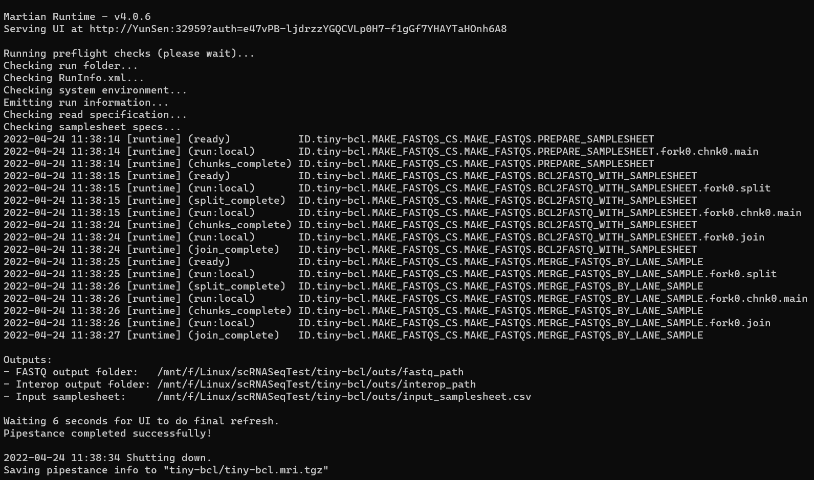

查看输入：`tree -L 2 tiny-bcl/`

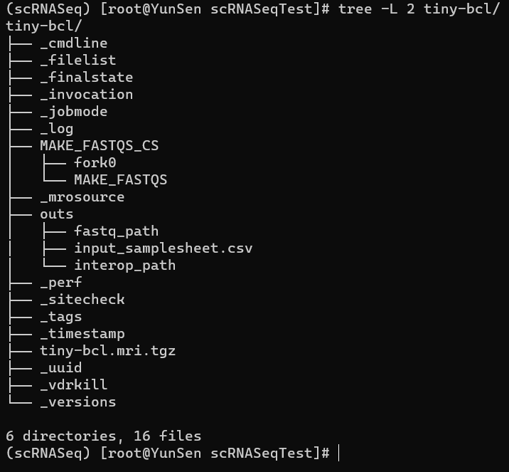

运行时间根据系统资源的不同而不同，但是它不应该占用多于几分钟的时间。现在转到 fastq \_ path 目录。

```shell
 cd tiny-bcl/outs/fastq_path/
```

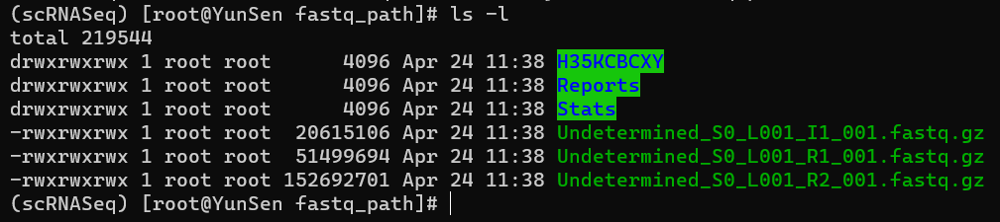

具有有效排序索引的Demultiplexed FASTQ 文件可以在以 flow cell id 命名的目录下找到，在本例中为 H35KCBCXY。

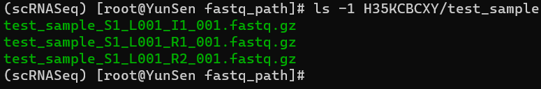

这些来自 `cellranger mkfastq` 管道的输出作为  `cellranger count`的输入。

### 2. 从SRA到FASTQ

#### (1) 软件安装和介绍

SRAtoolkit是NCBI提供的SRA文件处理工具集， SRA文件是NCBI的SRA数据库数据的储存格式，许多公开的scRNA-seq数据都会上传到该数据库。SRAtoolkit将NCBI的SRA数据库中SRA文件转换为FastQ文件。

在conda的环境中安装SRAtoolkit，地址：<https://anaconda.org/daler/sratoolkit>

```shell
conda install -c daler sratoolkit
```

在线下载后安装地址：<https://trace.ncbi.nlm.nih.gov/Traces/sra/sra.cgi?view=software>

```shell
curl -O https://ftp-trace.ncbi.nlm.nih.gov/sra/sdk/3.0.0/sratoolkit.3.0.0-centos_linux64.tar.gz
tar zxf sratoolkit.3.0.0-centos_linux64.tar.gz
##注意解压位置
echo 'export PATH=~/sratoolkit.3.0.0-centos_linux64/bin:$PATH' >> ~/.bashrc
source ~/.bashrc
```

安装后进行配制

```shell
vdb-config -i
```

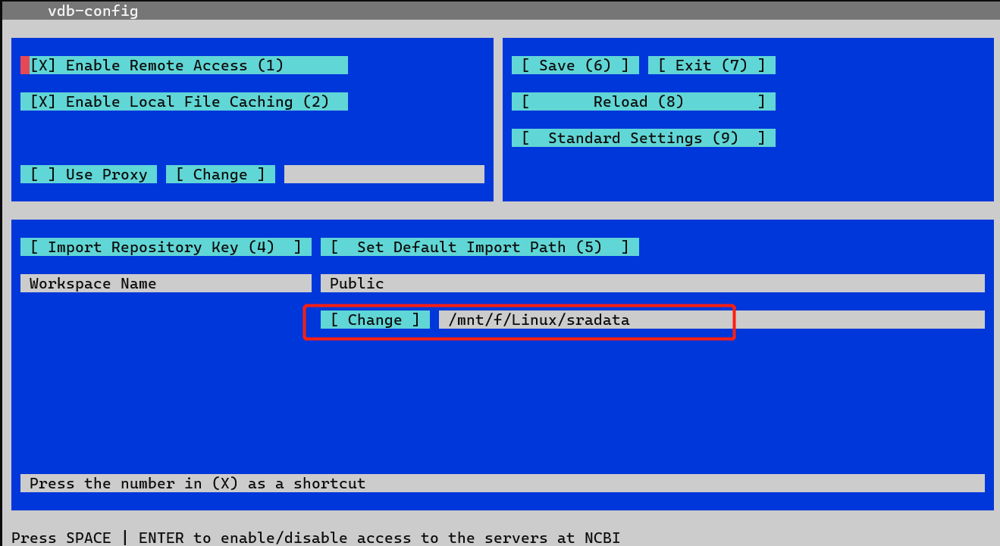

#### (2) 案例

数据地址：<https://www.ncbi.nlm.nih.gov/Traces/study/?acc=PRJNA483959&o=acc_s%3Aa>

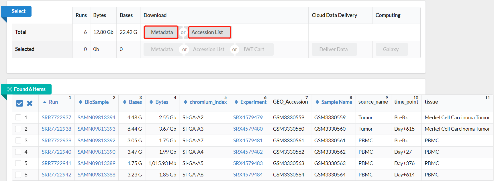

点击Total的“Accession List”下载整个研究的SRA文件编号；

点击Total的“Metadata”下载网页中SRA文件描述。

```shell
cd /mnt/f/Linux/scRNASeqTest/
mkdir sra_data
cd sra_data/
```

下载的文件放在：sra_data目录下。

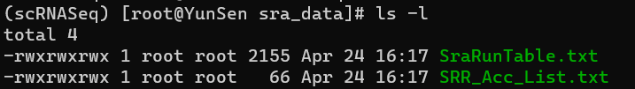

SRR_Acc_List.txt：整个研究的SRA文件编号；\
SraRunTable.txt： SRA文件描述。\
下载数据：

```shell
curl -O https://sra-pub-run-odp.s3.amazonaws.com/sra/SRR7722937/SRR7722937
curl -O https://sra-pub-run-odp.s3.amazonaws.com/sra/SRR7722938/SRR7722938
curl -O https://sra-pub-run-odp.s3.amazonaws.com/sra/SRR7722939/SRR7722939
curl -O https://sra-pub-run-odp.s3.amazonaws.com/sra/SRR7722940/SRR7722940
curl -O https://sra-pub-run-odp.s3.amazonaws.com/sra/SRR7722941/SRR7722941
curl -O https://sra-pub-run-odp.s3.amazonaws.com/sra/SRR7722942/SRR7722942
```

可以写一个循环进行下载，也可以使用[prefetch](https://trace.ncbi.nlm.nih.gov/Traces/sra/sra.cgi?view=toolkit_doc\&f=prefetch)下载。

下载后的数据使用`fastq-dump`命令可将sra数据转换成fastq。

```shell
fastq-dump --gzip --split-files -X 25000 -O fastqs_path data/SRR7722937
```

• --gzip：输出gz压缩格式的fastq文件

• --split-files：分隔为上传时的多个fastq文件

• -X：输出的fastq的记录数目，这里为了教学，输出前25000条记录，实际分析时，不要设置此参数

• -O： fastq文件输出的文件夹

• data/SRR7722937： SRA文件所在路径

```shell
fastq-dump --gzip --split-files -O fastqs_path data/SRR7722937
fastq-dump --gzip --split-files -O fastqs_path data/SRR7722938
fastq-dump --gzip --split-files -O fastqs_path data/SRR7722939
fastq-dump --gzip --split-files -O fastqs_path data/SRR7722940
fastq-dump --gzip --split-files -O fastqs_path data/SRR7722941
fastq-dump --gzip --split-files -O fastqs_path data/SRR7722942
```

cellranger count进行运算需要按照一定格式的形式命名，转换后的fastq文件进行重命名。

```shell
for i in `cat SRR_Acc_List.txt`
	do
	mv fastqs_path/${i}_1.fastq.gz fastqs_path/${i}_S1_L001_I1_001.fastq.gz
	mv fastqs_path/${i}_2.fastq.gz fastqs_path/${i}_S1_L001_R1_001.fastq.gz
	mv fastqs_path/${i}_3.fastq.gz fastqs_path/${i}_S1_L001_R2_001.fastq.gz
done
```

参考：<https://trace.ncbi.nlm.nih.gov/Traces/sra/sra.cgi?view=toolkit_doc>

### 3.从FASTQ到count矩阵

cellranger计数管道将FASTQ文件中的测序结果与参考转录组进行比对，并生成一个`.cloupe`文件，用于在Loupe Browser中进行可视化和分析，同时还生成了一些与其他公开工具兼容的输出，用于进一步分析。

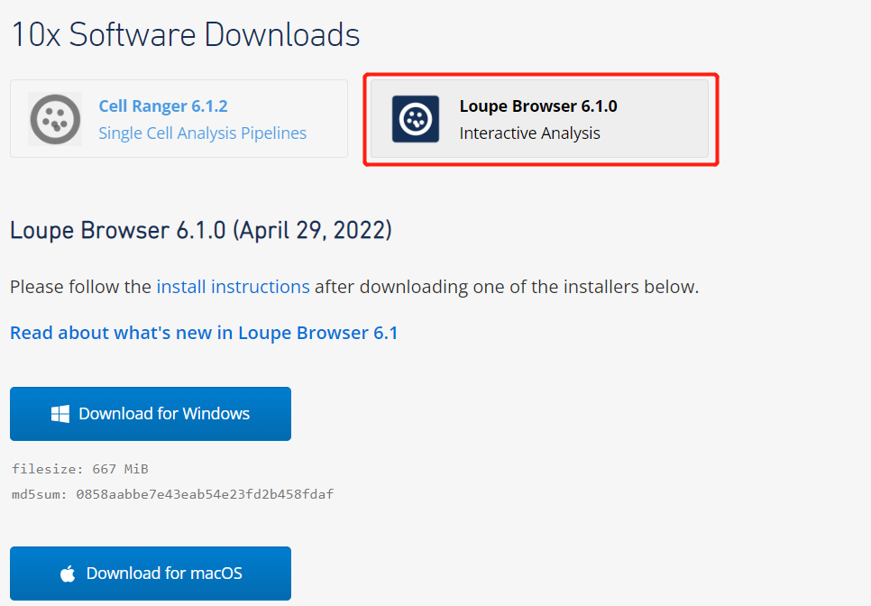

接下来，需要一个参考基因组数据。从FASTQ文件的下载页面可以看到这些是人类细胞。在10x Genomics支持网站上有几个预构建的人类参考转录组包。下载最新的包并解压缩它。

```shell
#人
curl -O https://cf.10xgenomics.com/supp/cell-exp/refdata-cellranger-GRCh38-3.0.0.tar.gz
#小鼠
curl -O https://cf.10xgenomics.com/supp/cell-exp/refdata-gex-mm10-2020-A.tar.gz
```

解压下载的基因组文件：

```shell
  tar zxvf refdata-gex-GRCh38-2020-A.tar.gz
```

接下来使用来自人类外周血单个核细胞（PBMC）的1000个 PBMC 数据集，包括淋巴细胞（t 细胞、 b 细胞和 NK 杀伤细胞）和单核细胞。

```shell
curl -O https://cf.10xgenomics.com/supp/cell-exp/refdata-gex-mm10-2020-A.tar.gz
```

这个数据集的大小是5.17 g，下载需要几分钟。

因为这是一个 tar 文件而不是 tar.gz 文件，所以您不需要使用前面的教程中使用的 -z 参数来提取它。

```shell
tar -xvf pbmc_1k_v3_fastqs.tar
```

```shell
pbmc_1k_v3_fastqs/
pbmc_1k_v3_fastqs/pbmc_1k_v3_S1_L001_R2_001.fastq.gz
pbmc_1k_v3_fastqs/pbmc_1k_v3_S1_L002_I1_001.fastq.gz
pbmc_1k_v3_fastqs/pbmc_1k_v3_S1_L001_R1_001.fastq.gz
pbmc_1k_v3_fastqs/pbmc_1k_v3_S1_L002_R1_001.fastq.gz
pbmc_1k_v3_fastqs/pbmc_1k_v3_S1_L002_R2_001.fastq.gz
pbmc_1k_v3_fastqs/pbmc_1k_v3_S1_L001_I1_001.fastq.gz
```

现在你有了一个包含两组 FASTQ 文件的目录，可以看到它们是根据 bcl2fastq 变数命名原则命名的: Sample_S1_L00X_R1_001.fastq.gz。这些文件的名称表明它们都来自同一个名为 pbmc \_ 1k \_ v3的样本，并且这个库在两个lanes上运行，Lane 1: L001 和 lane 2: L002.。

一旦你有了 FASTQ 文件和参考转录组，你就可以运行`cellranger count`了。

```shell
cellranger count --id=run_count_1kpbmcs \
--fastqs= /mnt/f/Linux/run_cellranger_count/pbmc_1k_v3_fastqs \
--sample=pbmc_1k_v3 \
--transcriptome= /mnt/f/Linux/genomeAnno/hsa/refdata-gex-GRCh38-2020-A \
--expect-cells=1000 \
--localcores=6 \
--localmem=8 \
--nosecondary
```

• --id：输出文件夹名

• --transcriptome：参考基因组所在文件夹

• --fastqs： fastq文件所在文件夹名，如下图所示

• --sample：用于分析的文件名

• --expect-cells：预计的细胞数，软件会根据实际情况进行估算

• --localcores：使用的线程数

• --localmem：使用的内存数

• --nosecondary：不进行下游聚类分析

```shell
cellranger count --id=cellranger_count \
--transcriptome=/mnt/f/Linux/genomeAnno/hsa/refdata-gex-GRCh38-2020-A \
--fastqs=fastq_path/H35KCBCXY/test_sample \
--sample=test_sample \
--expect-cells=1000 \
--localcores=6 \
--localmem=8 \
--nosecondary
```

```shell
cellranger count --id=cellranger_count \
--transcriptome=/mnt/f/Linux/genomeAnno/hsa/refdata-gex-GRCh38-2020-A \
--fastqs=/mnt/f/Linux/sradata/sra_data/fastqs_path \
--sample=SRR7722937 \
--expect-cells=1000 \
--localcores=6 \
--localmem=8 \
--nosecondary
```

### 4.STAR/STARsolo：单细胞FastQ文件比对

STAR是一款用于高通量转录组比对的软件，是Encode计划和TCGA计划使用的官方比对软件，基于STAR分析转录组的流程，通常称为STAR Method， STARsolo是STAR专门用于单细胞转录组定量的模块，原理类似于cellranger count， STAR官方宣称速度比cellranger快10倍。

安装：<https://anaconda.org/bioconda/star>

在conda环境中安装

```shell
#要使用 conda 安装此包，请运行以下命令之一
conda install -c bioconda star
conda install -c bioconda/label/cf201901 star
```

STAR比对需要索引， cellranger软件的索引包含基因组注释，这里可以直接使用这些数据来构建STAR

比对的索引。**注意：不同STAR软件版本构建的索引是不通用的，更换软件版本后需要重新构建索引。**

```shell
STAR --runMode genomeGenerate \
--genomeDir star_hg38_index \
--genomeFastaFiles refdata-gexGRCh38-2020-A/fasta/genome.fa \
--runThreadN 8
--sjdbGTFfile refdata-gex-GRCh38-2020-A/genes/genes.gtf
```

• --runMode：设置运行模式为构建STAR索引

• --genomeDir： STAR索引输出文件夹名

• --genomeFastaFiles： Fasta格式的基因组序列

• --runThreadN：服务器使用的线程数

• --sjdbGTFfile： gtf格式的基因注释文件

基因组fasta下载地址： <https://asia.ensembl.org/Homo_sapiens/Info/Index>

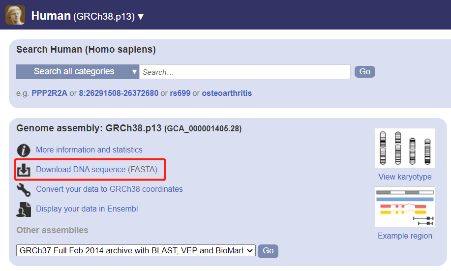

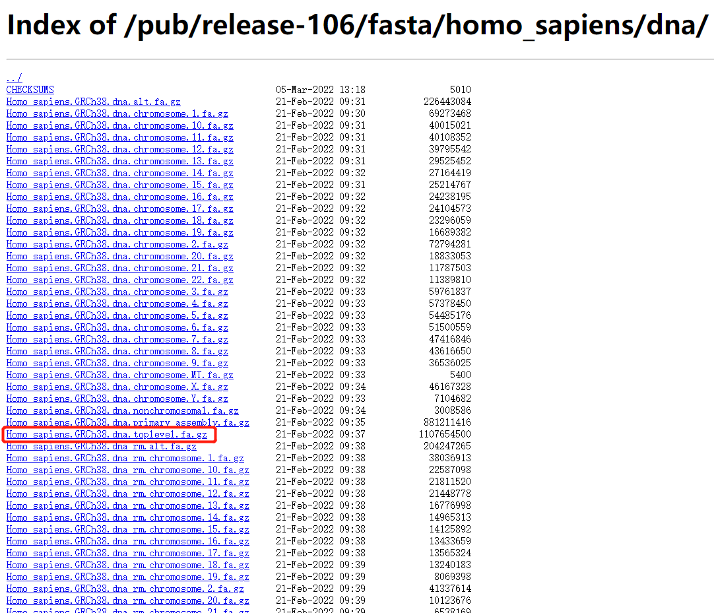

基因注释gtf下载地址： <https://asia.ensembl.org/Homo_sapiens/Info/Index>

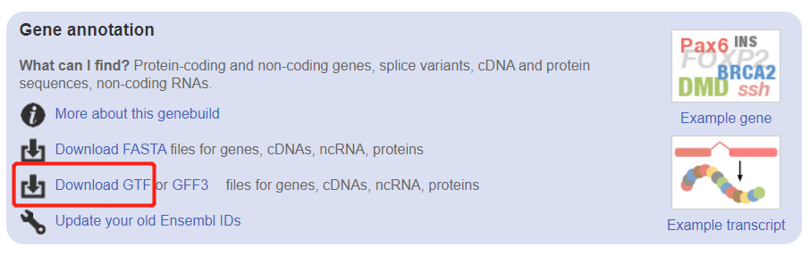

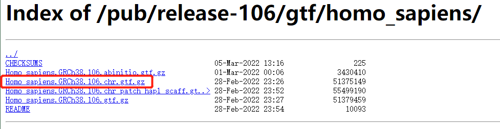

以SRR7722939为例

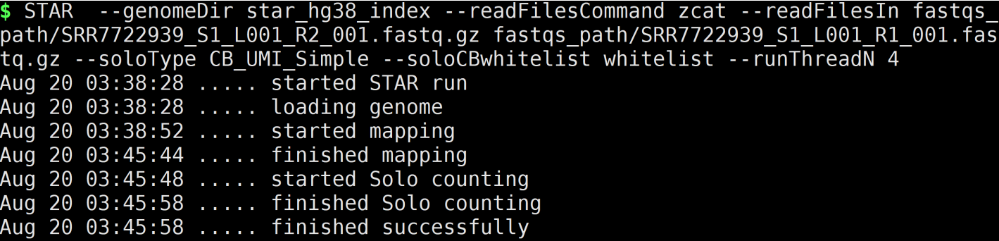

• --genomeDir： STAR索引所在目录\
• --readFilesCommand zcat：使用zcat读取gz压缩格式文件\
• --readFilesIn：读入fastq文件的路径，首先是R2，然后是R1\
• --soloOutFileNames：输出文件夹名\
• --soloType CB_UMI_Simple：文库类型\
• --soloCBwhitelist：所有使用的barcode序列\
• --runThreadN：服务器使用的线程数

STARsolo的结果与cellranger count的结果相同， cellranger count也是调用STAR进行比对。STARsolo的运行速度比cellranger count快10倍。

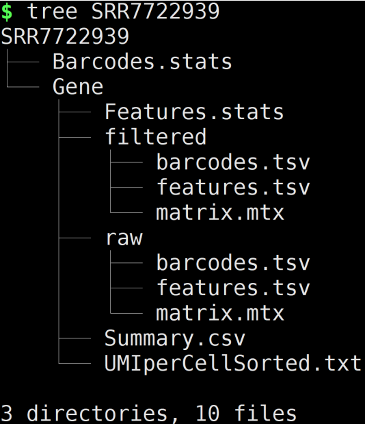

• Barcodes.stats：对Barcode代码的统计。

• Features.stats：特征统计。

• Filtered：过滤后的表达矩阵，过滤方法与cellranger

count 相同（用于下游分析，最主要）。

• Raw：未过滤的数据。

• Summary.csv：比对汇总。

• UMIperCellSorted.txt： UMI统计信息。

### 5.Salmon/Alevin：对FastQ文件进行基因定量

Salmon是一款不基于比对的定量软件，可用于转录组数据的快速定量，准确性高，其中Alevin功能

专门用于单细胞转录组定量【PMID: 28263959】。

安装

```shell
#要使用 conda 安装此包，请运行以下命令之一
conda install -c bioconda salmon
conda install -c bioconda/label/cf201901 salmon
```

使用Salmon定量前需要首先构建索引，从ensembl数据库中下载cdna序列：

以人类cdna下载为例： <https://asia.ensembl.org/Homo_sapiens/Info/Index#>

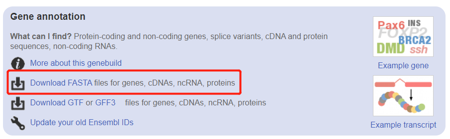

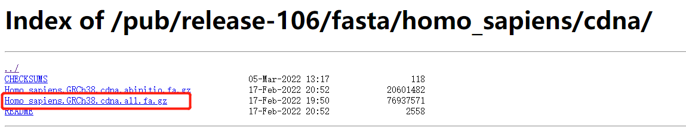

构建salmon索引：

```shell
time salmon index -t Homo_sapiens.GRCh38.cdna.all.fa.gz -i hg38_salmon
```

index：运行salmon索引构建程序； -t：之前下载的cdna序列； -i：输出索引文件夹的名称。

进行salmon定量之前还需要基因名和转录本名的对应关系，同样是从Ensembl网站获取。

以人类GRCh38为例： <https://asia.ensembl.org/Homo_sapiens/Info/Index#>

点击该页面导航栏的“BioMart”，进入BioMart数据库.

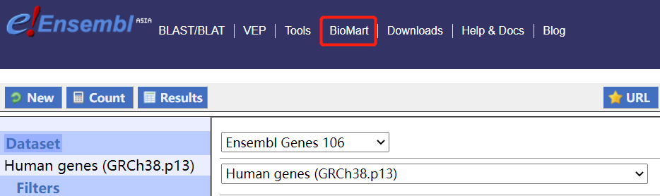

在打开的页面中，选择数据库，一般选择第一个选项， Ensembl Genes 106， 106是当前数据库的版本号，以后可能会更新，显示如107， 108等等。

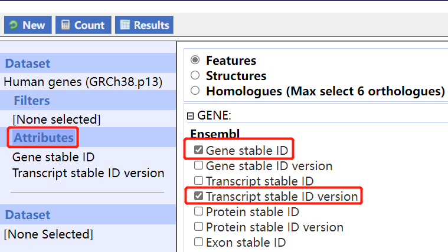

勾选上“Unique results only”选项，点击“Go”下载文件。

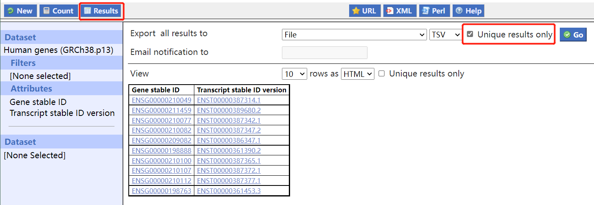

下载好的文件名为mart_export.txt，内容如左图，修改mart_export.txt文件名为txp2gene.tsv。

## 四.单细胞下游分析

### 1.数据读入

Cell Ranger生成的主要表格文件主要包括3个文件，分别是barcodes, features, matrix三个表格文件，其中barcodes文件存储的是细胞的信息，features存储的是基因的名称信息，matrix存储的是表达量的信息。还有一种数据是作者在GEO数据库直接提供表达矩阵（csv或txt）

#### (1).读入csv文件的表达矩阵构建Seurat对象

Seurat需要的输入信息为表达量矩阵，矩阵行为基因，列为细胞。使用Seurat提供的Read10X函数可以很方便的将10x结果读入到R矩阵中。使用CreateSeuratObject生成Seurat对象，后续分析都是在该对象上进行操作。

```r
rm(list=ls())
options(stringsAsFactors = F)
library(Seurat)
# Load data
dir='./'
Sys.time()
raw.data <- read.csv(paste(dir,"Data_input/csv_files/S01_datafinal.csv", sep=""), header=T, row.names = 1)
Sys.time()
dim(raw.data)
raw.data[1:4,1:4]
head(colnames(raw.data))
# Load metadata
metadata <- read.csv(paste(dir,"Data_input/csv_files/S01_metacells.csv", sep=""), row.names=1, header=T)
head(metadata)

# Find ERCC's, compute the percent ERCC, and drop them from the raw data.
erccs <- grep(pattern = "^ERCC-", x = rownames(x = raw.data), value = TRUE)
percent.ercc <- Matrix::colSums(raw.data[erccs, ])/Matrix::colSums(raw.data)
fivenum(percent.ercc)
ercc.index <- grep(pattern = "^ERCC-", x = rownames(x = raw.data), value = FALSE)
raw.data <- raw.data[-ercc.index,]
dim(raw.data)
```

有了表达矩阵，直接使用 CreateSeuratObject 函数即可，然后慢慢添加这个表达矩阵的一些其它外部属性，全部代码如下：

```r
# Create the Seurat object with all the data (unfiltered)
main_tiss <- CreateSeuratObject(counts = raw.data)
# add rownames to metadta
row.names(metadata) <- metadata$cell_id
# add metadata to Seurat object
main_tiss <- AddMetaData(object = main_tiss, metadata = metadata)
main_tiss <- AddMetaData(object = main_tiss, percent.ercc, col.name = "percent.ercc")
# Head to check
head(main_tiss@meta.data)

# Calculate percent ribosomal genes and add to metadata
ribo.genes <- grep(pattern = "^RP[SL][[:digit:]]", x = rownames(x = main_tiss@assays$RNA@data), value = TRUE)
percent.ribo <- Matrix::colSums(main_tiss@assays$RNA@counts[ribo.genes, ])/Matrix::colSums(main_tiss@assays$RNA@data)
fivenum(percent.ribo)
main_tiss <- AddMetaData(object = main_tiss, metadata = percent.ribo, col.name = "percent.ribo")
main_tiss

# Filter cells so that remaining cells have nGenes >= 500 and nReads >= 50000
main_tiss_filtered <- subset(x=main_tiss, subset = nCount_RNA > 50000 & nFeature_RNA > 500)
main_tiss_filtered
```

我们得到了main_tiss_filtered这个变量，是一个Seurat对象，就可以follow我们的教程后后续分析流程啦。参考代码仍然是：

* [祖传的单个10x样本的seurat标准代码](https://mp.weixin.qq.com/s?__biz=MzAxMDkxODM1Ng==\&mid=2247495635\&idx=1\&sn=b80a060573dfc266fe9d4c7773c88c7f\&scene=21#wechat_redirect)
* [祖传的单个10x样本的seurat标准代码（人和鼠需要区别对待）](https://mp.weixin.qq.com/s?__biz=MzAxMDkxODM1Ng==\&mid=2247495646\&idx=1\&sn=b24b77c21e99f11793ae8166be9ad02f\&scene=21#wechat_redirect)
* [seurat标准流程实例之2个10x样本的项目（GSE135927数据集）](https://mp.weixin.qq.com/s?__biz=MzAxMDkxODM1Ng==\&mid=2247495874\&idx=1\&sn=1189c08b96ce1ea2c70964db93f480d6\&scene=21#wechat_redirect)

#### (2).读入10X标准输出的3个文件和融合多个样本数据

这三个文件指的是：barcodes.tsv, features.tsv, matrix.mtx。这个情况就比较好处理了，barcodes.tsv就是 cell id，features.tsv就是 gene id，matrix.mtx就是计数 counts 矩阵。

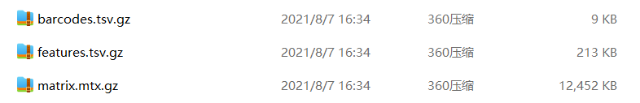

例如：

```r
############### 10X标准输出的3个文件 ##############
# 列出当前目录下所有开头是GSM的文件
fs <- list.files('./data/GSE106273_RAW/','^GSM')

# 然后获取四个样本信息
library(stringr)
samples <- str_split(fs,'_', simplify = T)[,1]

# 设置一个循环，对每个样本信息做同样的事：
#（1）找到包含这个样本的文件(用grepl)
# (2)设置对应的目录名（str_split+paste）然后创建目录（用dir.create）
# (3)将文件放到对应目录(采用的是file.rename)并重命名文件
setwd("data/GSE106273_RAW/")
library(R.utils)

lapply(unique(samples),function(x){
  y <- fs[grepl(x,fs)]
  folder <- paste(str_split(y[1],'_',simplify = T)[,2:3],
               collapse = '')
  # 创建文件夹
  dir.create(folder, recursive = T)
  # 文件重命名：
  file.rename(y[1],file.path(folder,"barcodes.tsv.gz"))
  file.rename(y[2],file.path(folder,"genes.tsv.gz"))
  file.rename(y[3],file.path(folder,"matrix.mtx.gz"))
  # 解压，其实不解压也行
  sapply(paste0(folder,c("/barcodes.tsv.gz","/genes.tsv.gz","/matrix.mtx.gz")),
         gunzip)
})
# 批量读取成10X对象:
# 因为Read10X函数需要对目录进行操作，所以先把目录名提取出来
folders=list.files('./',pattern='[12]$')
folders
# [1] "G1"  "G2"  "L1"  "L2"  "NP1" "NP2" "PI1" "PI2"

# 然后使用lapply进行循环(之前出过一期apply系列函数教程，可以查阅一下，
# lapply是对列表或向量进行循环，而apply是对数据框或矩阵操作)
library(Seurat)
sceList <- lapply(folders,function(folder){
  CreateSeuratObject(counts = Read10X(folder),
                     project = folder )
})

# 此时的sceList是一个包含8个10X对象的集合，下一步需要将其合并
sceList
# 合并：
sce_big <- merge(sceList[[1]],
                 y = c(sceList[[2]],sceList[[3]],sceList[[4]],
                       sceList[[5]],sceList[[6]],
                       sceList[[7]],sceList[[8]]),
                 add.cell.ids = folders,
                 project = "mouse8")

table(sce_big$orig.ident)
# G_1  G_2  L_1  L_2 NP_1 NP_2 PI_1 PI_2
# 2915 3106 5906 3697 2249 2127 1500 4306

# 保存：
save(sce_big,file = 'sce_big.Rdata') # 保存的数据
```

在如：

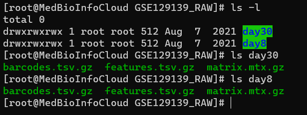

```r
###### step1:导入数据 ######
rm(list=ls())
options(stringsAsFactors = F)
library(Seurat)
library(ggplot2)
library(clustree)
library(cowplot)
library(dplyr)

library(data.table)
samples=list.files('GSE129139_RAW//')
samples
sceList = lapply(samples,function(pro){
  #pro=samples[1]
  folder=file.path('GSE129139_RAW',pro )
  print(pro)
  print(folder)
  print(list.files(folder))
  print( Sys.time() )
  sce=CreateSeuratObject(counts = Read10X(folder),
                         project = pro )
  print( Sys.time() )
  return(sce)
})
sceList
samples
sce.all = merge(sceList[[1]], y = sceList[-1],
                add.cell.ids = samples,
                merge.data = TRUE)
as.data.frame(sce.all@assays$RNA@counts[1:10, 1:2])
head(sce.all@meta.data, 10)
table(sce.all@meta.data$orig.ident)
library(stringr)
table(sce.all$orig.ident)
```

#### (3).读入h5格式文件

```r
############### h5格式文件 ##############
# 读取单个
sce <- Read10X_h5(filename = "GSM4107899_LH16.3814_raw_gene_bc_matrices_h5.h5")
sce <- CreateSeuratObject(counts = sce)

# 批量读取并合并：
library(hdf5r)
setwd("../GSE138433_RAW/")
files <- list.files('./')
files
names <- str_split(files,'_', simplify = T)[,2]

# 批量读取：
sceList <- lapply(files, function(files){
  CreateSeuratObject(counts = Read10X_h5(files),
                     project = names)
})

# 合并：
sce_big <- merge(sceList[[1]],
                 y = c(sceList[[2]],sceList[[3]],sceList[[4]],
                       sceList[[5]],sceList[[6]]),
                 add.cell.ids = names)

table(sce_big$orig.ident)
# LH16.3814 LH17.3222 LH17.3554  LH17.364  LH17.530  LH18.277
# 737280    737280    737280    737280    737280    737280

# 保存：
save(sce_big,file = 'sce_big.Rdata') # 保存的数据
```

#### (4). h5ad格式

需要安装SeuratDisk包，先将后h5ad格式转换为h5seurat格式，再使用LoadH5Seurat()函数读取Seurat对象。

```r
############### h5ad格式文件 ##############
setwd("../GSE153643_RAW/")
# remotes::install_github("mojaveazure/seurat-disk")
library(SeuratDisk)

# 先将后`h5ad`格式转换为`h5seurat`格式:
Convert("GSM4648565_liver_raw_counts.h5ad", "h5seurat",
        overwrite = TRUE, assay = "RNA")

# 再使用`LoadH5Seurat()`函数读取Seurat对象。sce <- LoadH5Seurat("GSM4648565_liver_raw_counts.h5seurat")
```

### 2.数据质控

可参考：<https://mp.weixin.qq.com/s/g_tAhFQfr2IhFyHxzcFRTg>

质控的目的是去除掉低质量的数据，包括破损或死亡的细胞、没捕获到细胞的empty droplet和捕获到2个以上细胞的doublets。一般低质量的细胞或者empty droplet通常含有很少的基因，而doublets容易测到更多的基因。另一方面，低质量或者死亡细胞会测到更多的线粒体基因表达的RNA。

使用PercentageFeatureSet函数评估每个细胞中的线粒体表达比例：

```r
###### step2:QC质控 ######
dir.create("./1-QC")
setwd("./1-QC")
# sce.all=readRDS("../sce.all_raw.rds")
#计算线粒体基因比例
# 人和鼠的基因名字稍微不一样


mito_genes=rownames(sce.all)[grep("^mt-", rownames(sce.all))]
mito_genes #13个线粒体基因
sce.all=PercentageFeatureSet(sce.all, "^mt-", col.name = "percent_mito")
#计算核糖体基因比例
ribo_genes=rownames(sce.all)[grep("^Rp[sl]", rownames(sce.all))]
ribo_genes
sce.all=PercentageFeatureSet(sce.all, "^Rp[sl]", col.name = "percent_ribo")
#计算红血细胞基因比例
rownames(sce.all)[grep("^Hb[^(p)]", rownames(sce.all))]
sce.all=PercentageFeatureSet(sce.all, "^Hb[^(p)]", col.name = "percent_hb")

#可视化细胞的上述比例情况
feats <- c("nFeature_RNA", "nCount_RNA", "percent_mito", "percent_ribo", "percent_hb")
feats <- c("nFeature_RNA", "nCount_RNA")
p1=VlnPlot(sce.all, group.by = "orig.ident", features = feats, pt.size = 0.01, ncol = 2) +
    NoLegend()
p1
library(ggplot2)
ggsave(filename="Vlnplot1.pdf",plot=p1)
ggsave(filename="Vlnplot1.png",plot=p1)
feats <- c("percent_mito", "percent_ribo", "percent_hb")
p2=VlnPlot(sce.all, group.by = "orig.ident", features = feats, pt.size = 0.01, ncol = 3, same.y.lims=T) +
    scale_y_continuous(breaks=seq(0, 100, 5)) +
	NoLegend()
p2
ggsave(filename="Vlnplot2.pdf",plot=p2)

p3=FeatureScatter(sce.all, "nCount_RNA", "nFeature_RNA", group.by = "orig.ident", pt.size = 0.5)
ggsave(filename="Scatterplot.pdf",plot=p3)
#根据上述指标，过滤低质量细胞/基因
#过滤指标1:最少表达基因数的细胞&最少表达细胞数的基因
selected_c <- WhichCells(sce.all, expression = nFeature_RNA > 300)
selected_f <- rownames(sce.all)[Matrix::rowSums(sce.all@assays$RNA@counts > 0 ) > 3]

sce.all.filt <- subset(sce.all, features = selected_f, cells = selected_c)
dim(sce.all)
dim(sce.all.filt)
table(sce.all@meta.data$orig.ident)
table(sce.all.filt@meta.data$orig.ident)
#  可以看到，主要是过滤了基因，其次才是细胞

# par(mar = c(4, 8, 2, 1))
C=sce.all.filt@assays$RNA@counts
dim(C)
C=Matrix::t(Matrix::t(C)/Matrix::colSums(C)) * 100
# 这里的C 这个矩阵，有一点大，可以考虑随抽样
C=C[,sample(1:ncol(C),1000)]
most_expressed <- order(apply(C, 1, median), decreasing = T)[50:1]
pdf("TOP50_most_expressed_gene.pdf",width=14)
boxplot(as.matrix(Matrix::t(C[most_expressed, ])),
        cex = 0.1, las = 1,
        xlab = "% total count per cell",
    col = (scales::hue_pal())(50)[50:1],
    horizontal = TRUE)
dev.off()
rm(C)

#过滤指标2:线粒体/核糖体基因比例(根据上面的violin图)
selected_mito <- WhichCells(sce.all.filt, expression = percent_mito < 15)
selected_ribo <- WhichCells(sce.all.filt, expression = percent_ribo > 3)
selected_hb <- WhichCells(sce.all.filt, expression = percent_hb < 0.1)
length(selected_hb)
length(selected_ribo)
length(selected_mito)


sce.all.filt <- subset(sce.all.filt, cells = selected_mito)
sce.all.filt <- subset(sce.all.filt, cells = selected_ribo)
sce.all.filt <- subset(sce.all.filt, cells = selected_hb)
dim(sce.all.filt)

table(sce.all.filt$orig.ident)
#可视化过滤后的情况
feats <- c("nFeature_RNA", "nCount_RNA")
p1_filtered=VlnPlot(sce.all.filt, group.by = "orig.ident", features = feats, pt.size = 0.1, ncol = 2) +
    NoLegend()
ggsave(filename="Vlnplot1_filtered.pdf",plot=p1_filtered)

feats <- c("percent_mito", "percent_ribo", "percent_hb")
p2_filtered=VlnPlot(sce.all.filt, group.by = "orig.ident", features = feats, pt.size = 0.1, ncol = 3) +
    NoLegend()
ggsave(filename="Vlnplot2_filtered.pdf",plot=p2_filtered)

dim(sce.all.filt)
```

pattern = "^MT-"表示线粒体基因的匹配模式，人的线粒体基因以MT-为前缀，小鼠的以Mt-为前缀。

Seurat对象在生成时，已经将每个细胞表达的基因数和reads数记录在meta.data的nFeature_RNA和nCount_RNA中。我们使用VlnPlot函数将nFeature_RNA、nCount_RNA和percent.mt三个指标进行可视化。

### 3.数据标准化

基因的表达矩阵需要经过标准化后才能进行后续的分析。使用NormalizeData函数进行标准化，normalization.method：标准化方法，可选项，

```
-  logNormalize： log(每个细胞的特征counts/细胞count总数*scale.factor)
- CLR：中心化对数标准化
- RC：相对计数，计算公式同logNormalize，不取log，计算CPM表达量，设置scale.factor=1e6
```

课选择LogNormalize：

```r
sce.all.filt = NormalizeData(sce.all.filt)
```

### 4.细胞周期分析

A cell cycle is a series of events that takes place in a cell as it grows and divides.即描述细胞生长、分裂整个过程中细胞变化过程。最重要的两个特点就是DNA复制、分裂成两个一样的子细胞。

如下图，一般分成4个阶段

* G1(gap1)：Cell increases in size(Cellular contents duplicated)
* S(synthesis) ：DNA replication, each of the 46 chromosomes (23 pairs) is replicated by the cell
* G2(gap2)：Cell grows more，organelles and proteins develop in preparation for cell division，为分裂做准备
* M(mitosis)：'Old' cell partitions the two copies of the genetic material into the two daughter cells. And the cell cycle can begin again.

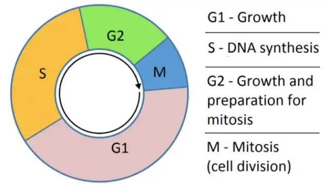

在分析单细胞数据时，同一类型的细胞往往来自于不同的细胞周期阶段，这可能对下游聚类分析，细胞类型注释产生混淆；由于细胞周期也是通过cell cycle related protein 调控，即每个阶段有显著的marker基因；通过分析细胞周期有关基因的表达情况，可以对细胞所处周期阶段进行注释；

在单细胞周期分析时，通常只考虑三个阶段：G1、S、G2M。(即把G2和M当做一个phase)

主要学习两种来自scran与Seurat包鉴定细胞周期的方法介绍与演示。

#### (1).Seurat包

Seurat包CellCycleScoring较scran包cyclone函数最主要的区别是直接根据每个cycle，一组marker基因表达值判断。

```r
library(Seurat)
str(cc.genes)
```

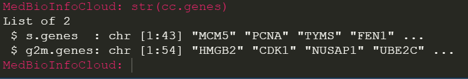

如上是Seurat包提供的人的细胞中分别与S期、G2M期直接相关的marker基因。

CellCycleScoring即根据此，对每个细胞的S期、G2M期可能性进行打分；具体如何计算的，暂时在Seurat官方文档中没有提及。在satijalab的github([https://github.com/satijalab/seurat/issues/728)](https://github.com/satijalab/seurat/issues/728))中，作者这样回复类似的提问：

As we say in the vignette, the scores are computed using an algorithm developed by Itay Tirosh, when he was a postdoc in the Regev Lab (Science et al., 2016). The gene sets are also taken from his work.

You can read the methods section of [https://www.ncbi.nlm.nih.gov/pmc/articles/PMC4944528/](https://www.ncbi.nlm.nih.gov/pmc/articles/PMC4944528/) to see how the scoring works, but essentially the method scores cells based on the expression of each gene in a signature set - after controlling for the expected expression of genes with similar abundance.

结合一些中文教程（https://www.jianshu.com/p/e4a5b5c67de1)的介绍，认为就是根据每个细胞的S期（或者G2/M期）基因集是否显著高表达，对应的score就是表示在该细胞中，S期（或者G2/M期）基因集高表达的程度（如果是负数，就认为不属于该phase）。

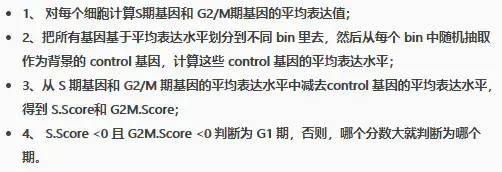

区别于scran包的另外重要的一点就是Seurat包仅提供了人类细胞有关的cell cycle related gene，没有小鼠的。对此，作者这样回复：<code>Thanks. We don't provide different capitalizations because this gene list was developed on a human dataset, and we don't want to create ambiguity by suggesting its created from a mouse reference dataset. **In practice however, we've found it works quite well for mouse also, and recommend the solution above.**</code>

简言之，作者认为可以将对应人的cc.gene转换为鼠对应的基因名，当做后者的cell cycle related gene（因为鼠和人类基因的高度相似性）。提到的solution就是采用biomaRt包转换一下。这在我之前的教程中有介绍。

```r
convertHumanGeneList <- function(x){
  require("biomaRt")
  human = useMart("ensembl", dataset = "hsapiens_gene_ensembl")
  mouse = useMart("ensembl", dataset = "mmusculus_gene_ensembl")
  genesV2 = getLDS(attributes = c("hgnc_symbol"), filters = "hgnc_symbol", values = x , mart = human, attributesL = c("mgi_symbol"), martL = mouse, uniqueRows=T)
  humanx <- unique(genesV2[, 2])
  # Print the first 6 genes found to the screen
  print(head(humanx))
  return(humanx)
}
m.s.genes <- convertHumanGeneList(cc.genes$s.genes)
m.g2m.genes <- convertHumanGeneList(cc.genes$g2m.genes)
```

但是biomaRt包网络不是很稳定，有人也直接提供了转换后的结果（<https://github.com/satijalab/seurat/issues/462>），直接下载导入到R里即可，下面演示的代码就是用的该结果。

```r
sce.all.filt = NormalizeData(sce.all.filt)##数据标准化
mouse.cc.gene=readRDS("H:/MedBioInfoCloud/analysis/base_files/GeneSet/mouse_cell_cycle_genes/mouse_cell_cycle_genes/mouse_cell_cycle_genes.rds")

sce.all.filt=CellCycleScoring(object = sce.all.filt,
                              g2m.features = mouse.cc.gene$g2m.genes,
                              s.features = mouse.cc.gene$s.genes)
p4=VlnPlot(sce.all.filt, features = c("S.Score", "G2M.Score"), group.by = "orig.ident",
           ncol = 2, pt.size = 0.1)


ggsave(filename="Vlnplot4_cycle.pdf",plot=p4)

sce.all.filt@meta.data  %>% ggplot(aes(S.Score,G2M.Score))+geom_point(aes(color=Phase))+
  theme_minimal()

ggsave(filename="cycle_details.pdf" )
# S.Score较高的为S期，G2M.Score较高的为G2M期，都比较低的为G1期
dim(sce.all.filt@meta.data)
head(sce.all.filt@meta.data[,7:9])
plot(sce.all.filt$S.Score,sce.all.filt$G2M.Score,
     col=factor(sce.all.filt$Phase),
     main="CellCycleScoring")
legend("topleft",inset=.05,
       title = "cell cycle",
       c("G1","S","G2M"), pch = c(1),col=c("black","green","red"))
```

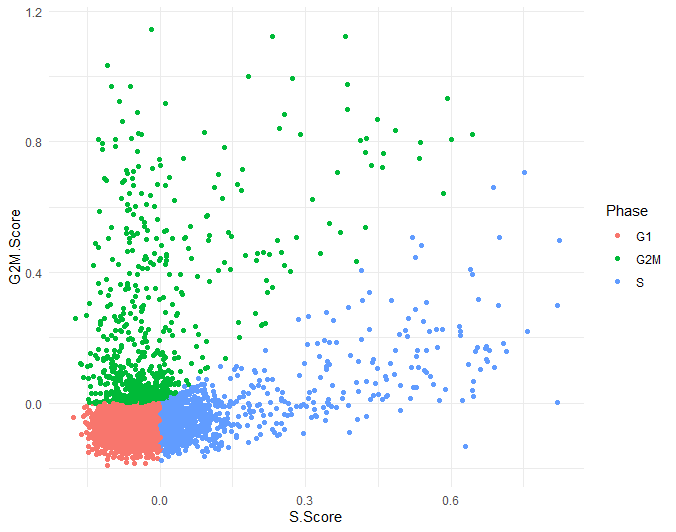

#### (2).scran包

<http://bioconductor.org/packages/release/bioc/manuals/scran/man/scran.pdf>

scran包cyclone函数是利用‘marker基因对’表达来对细胞所在周期阶段进行预测的方法Scialdone (2015)

“maker基因对”由作者根据训练集细胞（已注释了cell cycle）的基因表达特征产生，我们可以直接使用。对于每一细胞周期阶段（人/鼠）都有一组“maker基因对”集合。

```r
# BiocManager::install("scran")
library(scran)
mm.pairs <- readRDS(system.file("exdata", "mouse_cycle_markers.rds",
                                package="scran"))

str(mm.pairs)
head(mm.pairs$G1)
```

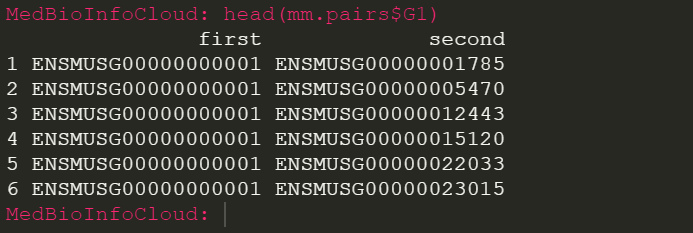

如上图，具体来说，即比较某个细胞的ENSMUSG00000000001基因表达值是否大于ENSMUSG00000001785基因表达值。

如果对于所有G1期marker基因对，某个细胞的“first”列基因表达量大于对应的“second”基因的情况越多，则越有把握认为该细胞就是处于G1期（因为越符合训练集特征）。

而cyclone则是通过计算score，即对于某个细胞，符合上述比较关系的marker基因对数占全部marker基因对数的比值。

这里默认提供marker基因对是ensemble格式，如果表达数据提供的是其它类类型的基因ID，比如：SYMBOL，那么我们需要转化一下ID。

```r
###基因转换
library(clusterProfiler)
library(org.Mm.eg.db)
# x <- names(mm.pairs)[1]
trs <- lapply(names(mm.pairs), function(x){
  df <- mm.pairs[[x]]
  first <- bitr(mm.pairs[[x]][,1],
                   fromType= "ENSEMBL", toType="SYMBOL",
                   OrgDb="org.Mm.eg.db")

  second <- bitr(mm.pairs[[x]][,2],
                    fromType= "ENSEMBL", toType="SYMBOL",
                    OrgDb="org.Mm.eg.db")
  df <- df[first$ENSEMBL %in% df$first,]
  df <- df[second$ENSEMBL %in% df$second,]

  df$first <-  lapply(df$first, function(x){
    first[first$ENSEMBL == x,2][1]
  })  %>% unlist()

  df$second <-  lapply(df$second, function(x){
    second[second$ENSEMBL == x,2][1]
  })  %>% unlist()

  return(df)
})
names(trs) <- names(mm.pairs)
```

```r

# BiocManager::install("scran")
library(scran)
hs.pairs <- readRDS(system.file("exdata", "human_cycle_markers.rds",
                                package="scran"))

str(hs.pairs)
head(hs.pairs$G1)

###基因转换
library(clusterProfiler)
library(org.Hs.eg.db)
# x <- names(hs.pairs)[1]
htrs <- lapply(names(hs.pairs), function(x){
  df <- hs.pairs[[x]]
  first <- bitr(hs.pairs[[x]][,1],
                fromType= "ENSEMBL", toType="SYMBOL",
                OrgDb="org.Hs.eg.db")

  second <- bitr(hs.pairs[[x]][,2],
                 fromType= "ENSEMBL", toType="SYMBOL",
                 OrgDb="org.Hs.eg.db")
  df <- df[first$ENSEMBL %in% df$first,]
  df <- df[second$ENSEMBL %in% df$second,]

  df$first <-  lapply(df$first, function(x){
    first[first$ENSEMBL == x,2][1]
  })  %>% unlist()

  df$second <-  lapply(df$second, function(x){
    second[second$ENSEMBL == x,2][1]
  })  %>% unlist()

  return(df)
})
names(htrs) <- names(hs.pairs)

```

下面是计算三个周期阶段的scores：

```r
assigned <- cyclone(sce.all.filt@assays[["RNA"]]@data, pairs=trs)
head(assigned$scores)
```

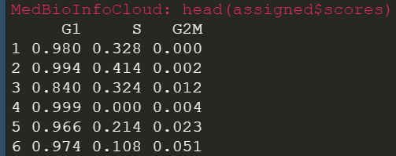

根据每一个细胞对于三个周期阶段的scores，可进行判断；具体规则为 **G1或G2M评分高于0.5的细胞分别被分配到G1期或G2M期**。若G1 or G2M phases均小于0.5，则可判断为S期（虽然可以直接看S期的score）；若G1 or G2M phases均大于0.5，则 the higher score is used for assignment。

### 5.检测doublets

```r
#检测doublets
sce.all.filt = FindVariableFeatures(sce.all.filt)
sce.all.filt = ScaleData(sce.all.filt,
                         vars.to.regress = c("nFeature_RNA", "percent_mito"))
sce.all.filt = RunPCA(sce.all.filt, npcs = 20)
sce.all.filt = RunTSNE(sce.all.filt, npcs = 20)
sce.all.filt = RunUMAP(sce.all.filt, dims = 1:10)
# define the expected number of doublet cellscells.
```

### 6.单细胞多样本整合

CCA和RPCA整合方法都是Seurat包内置并推荐使用的。区别在于：

CCA 方法非常适合在细胞类型保守的情况下识别锚点，但在不同实验处理下基因表达存在非常大的差异，

* 简而言之，CCA适合多个样本具有大致相似的细胞类型分布，也适合跨物种的多样本整合。
* 值得注意的是，CCA方法可能会导致整合过度，即可能会消除多样本间的生物学差异；

而RPCA方法的整合运行速度更快，整合的力度较CCA弱一些（更保守），

* 适合多个样本有不同的细胞类型分布情况；
* 建议多样本数据均是来自同一个平台的，例如要整合的目的样本均来自10X测序平台；
* 如大样本量的单细胞数据集整合。

```r
###### step3:合并2个数据集######
setwd('../')
dir.create("2-int")
getwd()
setwd("2-int")
# sce.all=readRDS("../1-QC/sce.all_qc.rds")
sce.all=sce.all.filt
sce.all
#拆分为*个seurat子对象
sce.all.list <- SplitObject(sce.all, split.by = "orig.ident")
sce.all.list

for (i in 1:length(sce.all.list)) {
	print(i)
    sce.all.list[[i]] <- NormalizeData(sce.all.list[[i]], verbose = FALSE)
    sce.all.list[[i]] <- FindVariableFeatures(sce.all.list[[i]], selection.method = "vst",
        nfeatures = 2000, verbose = FALSE)
}
```

FindIntegrationAnchors函数中的reduction参数进行设置：

Dimensional reduction to perform when finding anchors. Can be one of:

* cca: Canonical correlation analysis
* rpca: Reciprocal PCA
* rlsi: Reciprocal LSI

```r
#CCA
alldata.anchors <- FindIntegrationAnchors(object.list = sce.all.list, dims = 1:30,
    reduction = "cca")
#Perform dataset integration using a pre-computed AnchorSet.
sce.all.int <- IntegrateData(anchorset = alldata.anchors, dims = 1:30, new.assay.name = "CCA")
names(sce.all.int@assays)
#[1] "RNA" "CCA"
sce.all.int@active.assay
#[1] "CCA"
sce.all.int=ScaleData(sce.all.int)
sce.all.int=RunPCA(sce.all.int, npcs = 30)
sce.all.int=RunTSNE(sce.all.int, dims = 1:30)
sce.all.int=RunUMAP(sce.all.int, dims = 1:30)
names(sce.all.int@reductions)
names(sce.all@reductions)
colnames(sce.all@meta.data)

p1.compare=plot_grid(ncol = 3,
  DimPlot(sce.all, reduction = "pca", group.by = "orig.ident")+NoAxes()+ggtitle("PCA raw_data"),
  DimPlot(sce.all, reduction = "tsne", group.by = "orig.ident")+NoAxes()+ggtitle("tSNE raw_data"),
  DimPlot(sce.all, reduction = "umap", group.by = "orig.ident")+NoAxes()+ggtitle("UMAP raw_data"),

  DimPlot(sce.all.int, reduction = "pca", group.by = "orig.ident")+NoAxes()+ggtitle("PCA integrated"),
  DimPlot(sce.all.int, reduction = "tsne", group.by = "orig.ident")+NoAxes()+ggtitle("tSNE integrated"),
  DimPlot(sce.all.int, reduction = "umap", group.by = "orig.ident")+NoAxes()+ggtitle("UMAP integrated")
)
p1.compare
ggsave(plot=p1.compare,filename="Before&After_int.pdf")

colnames(sce.all@meta.data)
```

整合前后：


### 7.聚类

```r
###### cluster######
sce.all.int
sce.all
sce.all=sce.all.int
sce.all@active.assay
sce.all=FindNeighbors(sce.all, dims = 1:30, k.param = 60, prune.SNN = 1/15)
#设置不同的分辨率，观察分群效果(选择哪一个？)
for (res in c(0.01, 0.05, 0.1, 0.2, 0.3, 0.5,0.8,1)) {
    sce.all=FindClusters(sce.all, graph.name = "CCA_snn", resolution = res, algorithm = 1)
}
apply(sce.all@meta.data[,grep("CCA_snn_res",colnames(sce.all@meta.data))],2,table)


p1_dim=plot_grid(ncol = 3, DimPlot(sce.all, reduction = "umap", group.by = "CCA_snn_res.0.01") +
    ggtitle("louvain_0.01"), DimPlot(sce.all, reduction = "umap", group.by = "CCA_snn_res.0.1") +
    ggtitle("louvain_0.1"), DimPlot(sce.all, reduction = "umap", group.by = "CCA_snn_res.0.2") +
    ggtitle("louvain_0.2"))
ggsave(plot=p1_dim, filename="Dimplot_diff_resolution_low.pdf",width = 14)

```


```r
p1_dim=plot_grid(ncol = 3, DimPlot(sce.all, reduction = "umap", group.by = "CCA_snn_res.0.8") +
                   ggtitle("louvain_0.8"), DimPlot(sce.all, reduction = "umap", group.by = "CCA_snn_res.1") +
                   ggtitle("louvain_1"), DimPlot(sce.all, reduction = "umap", group.by = "CCA_snn_res.0.3") +
                   ggtitle("louvain_0.3"))
ggsave(plot=p1_dim, filename="Dimplot_diff_resolution_high.pdf",width = 18)

```


```r

p2_tree=clustree(sce.all@meta.data, prefix = "CCA_snn_res.")
ggsave(plot=p2_tree, filename="Tree_diff_resolution.pdf")

```


```r
#接下来分析，按照分辨率为0.8进行
sel.clust = "CCA_snn_res.0.8"
sce.all <- SetIdent(sce.all, value = sel.clust)
table(sce.all@active.ident)
saveRDS(sce.all, "sce.all_int.rds")
```

### 8.细胞类型注释

```r
setwd('../')
dir.create("3-cell")

setwd("3-cell")
#sce.all=readRDS( "../2-int/sce.all_int.rds")
sce.all
sce.all
DimPlot(sce.all, reduction = "umap", group.by = "seurat_clusters",label = T)
DimPlot(sce.all, reduction = "umap", group.by = "CCA_snn_res.0.8",label = T)
ggsave('umap_by_CCA_snn_res.0.8.pdf')
```


```r
# T Cells (CD3D, CD3E, CD8A),
# B cells (CD19, CD79A, MS4A1 [CD20]),
# Plasma cells (IGHG1, MZB1, SDC1, CD79A),
# Monocytes and macrophages (CD68, CD163, CD14),
# NK Cells (FGFBP2, FCG3RA, CX3CR1),
# Photoreceptor cells (RCVRN),
# Fibroblasts (FGF7, MME),
# Endothelial cells (PECAM1, VWF).
# epi or tumor (EPCAM, KRT19, PROM1, ALDH1A1, CD24).
# immune (CD45+,PTPRC), epithelial/cancer (EpCAM+,EPCAM),
# stromal (CD10+,MME,fibo or CD31+,PECAM1,endo)

library(ggplot2)
genes_to_check = c('PTPRC', 'CD3D', 'CD3E', 'CD4','CD8A','CD19', 'CD79A', 'MS4A1' ,
                   'IGHG1', 'MZB1', 'SDC1',
                   'CD68', 'CD163', 'CD14',
                   'TPSAB1' , 'TPSB2',  # mast cells,
                   'MKI67','TOP2A','KLRC1',
                   'RCVRN','FPR1' , 'ITGAM' ,
                   'FGF7','MME', 'ACTA2',
                   'PECAM1', 'VWF',
                   'KLRB1','NCR1', # NK
                   'EPCAM' , 'KRT19', 'PROM1', 'ALDH1A1',
                   'MKI67' ,'TOP2A' )
library(stringr)
genes_to_check=str_to_title(unique(genes_to_check))
genes_to_check
p_all_markers <- DotPlot(sce.all, features = genes_to_check,
             assay='RNA'  )  + coord_flip()

p_all_markers
ggsave(plot=p_all_markers, filename="check_all_marker_by_seurat_cluster.pdf")
```


```r
genes_to_check = c('PTPRC', 'CD3D', 'CD3E', 'CD4','CD8A',
                   'CCR7', 'SELL' , 'TCF7','CXCR6' , 'ITGA1',
                   'FOXP3', 'IL2RA',  'CTLA4','GZMB', 'GZMK','CCL5',
                   'IFNG', 'CCL4', 'CCL3' ,
                   'PRF1' , 'NKG7')
library(stringr)
genes_to_check=str_to_title(genes_to_check)
genes_to_check
p <- DotPlot(sce.all, features = genes_to_check,
             assay='RNA'  )  + coord_flip()

p
ggsave(plot=p, filename="check_Tcells_marker_by_seurat_cluster.pdf")
```


```r
# mast cells, TPSAB1 and TPSB2
# B cell,  CD79A  and MS4A1 (CD20)
# naive B cells, such as MS4A1 (CD20), CD19, CD22, TCL1A, and CD83,
# plasma B cells, such as CD38, TNFRSF17 (BCMA), and IGHG1/IGHG4
genes_to_check = c('CD3D','MS4A1','CD79A',
                   'CD19', 'CD22', 'TCL1A',  'CD83', #  naive B cells
                   'CD38','TNFRSF17','IGHG1','IGHG4', # plasma B cells,
                   'TPSAB1' , 'TPSB2',  # mast cells,
                   'PTPRC' )
library(stringr)
genes_to_check=str_to_title(genes_to_check)
genes_to_check
p <- DotPlot(sce.all, features = genes_to_check,
             assay='RNA'  )  + coord_flip()

p
ggsave(plot=p, filename="check_Bcells_marker_by_seurat_cluster.pdf")
```


```r
genes_to_check = c('CD68', 'CD163', 'CD14',  'CD86','C1QA',  'C1QB',  # mac
                   'S100A9', 'S100A8', 'MMP19',# monocyte
                   'LAMP3', 'IDO1','IDO2',## DC3
                   'MRC1','MSR1','ITGAE','ITGAM','ITGAX','SIGLEC7',
                   'CD1E','CD1C', # DC2
                   'XCR1','CLEC9A','FCER1A',# DC1
                   'GZMB','TCF4','IRF7')
library(stringr)
genes_to_check=str_to_title(genes_to_check)
genes_to_check
p <- DotPlot(sce.all, features = unique(genes_to_check),
             assay='RNA'  )  + coord_flip()

p
ggsave(plot=p, filename="check_Myeloid_marker_by_seurat_cluster.pdf")
```


```r
# epi or tumor (EPCAM, KRT19, PROM1, ALDH1A1, CD24).
# - alveolar type I cell (AT1; AGER+)
# - alveolar type II cell (AT2; SFTPA1)
# - secretory club cell (Club; SCGB1A1+)
# - basal airway epithelial cells (Basal; KRT17+)
# - ciliated airway epithelial cells (Ciliated; TPPP3+)

genes_to_check = c(  'EPCAM' , 'KRT19', 'PROM1', 'ALDH1A1' ,
                     'AGER','SFTPA1','SCGB1A1','KRT17','TPPP3',
                     'KRT4','KRT14','KRT8','KRT18',
                     'CD3D','PTPRC' )
library(stringr)
genes_to_check=str_to_title(genes_to_check)
genes_to_check
p <- DotPlot(sce.all, features = unique(genes_to_check),
             assay='RNA'  )  + coord_flip()

p
ggsave(plot=p, filename="check_epi_marker_by_seurat_cluster.pdf")

```


```r
genes_to_check = c('TEK',"PTPRC","EPCAM","PDPN","PECAM1",'PDGFRB',
                   'CSPG4','GJB2', 'RGS5','ITGA7',
                   'ACTA2','RBP1','CD36', 'ADGRE5','COL11A1','FGF7', 'MME')
library(stringr)
genes_to_check=str_to_title(genes_to_check)
genes_to_check
p <- DotPlot(sce.all, features = unique(genes_to_check),
             assay='RNA'  )  + coord_flip()

p
ggsave(plot=p, filename="check_stromal_marker_by_seurat_cluster.pdf")
```


```r
p_all_markers
p_umap=DimPlot(sce.all, reduction = "umap",  label = T)
library(patchwork)
p_all_markers+p_umap
ggsave('markers_umap.pdf',width = 22)
```


```r
sce=sce.all
table(Idents(sce))
sce.markers <- FindAllMarkers(object = sce, only.pos = TRUE, min.pct = 0.25,
                              thresh.use = 0.25)
DT::datatable(sce.markers)
pro='basic_seurat'
write.csv(sce.markers,file=paste0(pro,'_sce.markers.csv'))
library(dplyr)
top10 <- sce.markers %>% group_by(cluster) %>% top_n(10, avg_log2FC)
DoHeatmap(sce,top10$gene,size=3)
```


```r
p <- DotPlot(sce, features = unique(top10$gene),
             assay='RNA'  )  + coord_flip()

p
ggsave(paste0(pro,'DotPlot_check_top10_markers_by_clusters.pdf'),height = 11)
```


```r
library(dplyr)
top3 <- sce.markers %>% group_by(cluster) %>% top_n(3, avg_log2FC)
DoHeatmap(sce,top3$gene,size=3)
ggsave(paste0(pro,'DoHeatmap_check_top3_markers_by_clusters.pdf'))
p <- DotPlot(sce, features = unique(top3$gene),
             assay='RNA'  )  + coord_flip()

p
ggsave(paste0(pro,'DotPlot_check_top3_markers_by_clusters.pdf'),height = 11)
save(sce.markers,file = paste0(pro,'sce.markers.Rdata'))
```


***

```r
sce.all=readRDS( "../2-int/sce.all_int.rds")

# T Cells (CD3D, CD3E, CD8A),
# B cells (CD19, CD79A, MS4A1 [CD20]),
# Plasma cells (IGHG1, MZB1, SDC1, CD79A),
# Monocytes and macrophages (CD68, CD163, CD14),
# NK Cells (FGFBP2, FCG3RA, CX3CR1),
# Photoreceptor cells (RCVRN),
# Fibroblasts (FGF7, MME),
# Endothelial cells (PECAM1, VWF).
# epi or tumor (EPCAM, KRT19, PROM1, ALDH1A1, CD24).
#   immune (CD45+,PTPRC), epithelial/cancer (EpCAM+,EPCAM),
# stromal (CD10+,MME,fibo or CD31+,PECAM1,endo)


# TH17 cells (C-12, CCR6+ and RORC)
# type 1 helper T cells (TH1; C-17, CXCR3+ and IFNG and TBX21)
# heterogeneous continuum of intermediate TH1/TH17 states (C-13, C-16 and C-19)
# with varying degrees of CXCR3, CCR6, CCR5 and CD161 surface protein expression and RORC and TBX21 expression
# CD161+ subset of type 2 helper T (TH2) cells (C-14),
# described as pathogenic, with higher expression of allergy-associated HPGDS and IL17RB
# naive (LEF1, SELL, TCF7),
# effector (IFNG),
# cytotoxicity (GZMB, PRF1),
# early and general exhaustion (PDCD1, CTLA4, ENTPD1 ) .
# antigen presentation (CD74, HLA-DRB1/5, HLA-DQA2)
# FCGR3A (FCGR3A+ Monocyte), KLRF1 (NK), FCER1A (DC), and PF4 (MP/platelets).

library(ggplot2)
genes_to_check = c('PTPRC', 'CD3D', 'CD3E', 'CD4','CD8A',
                   'LEF1', 'SELL' , 'TCF7', # naive
                   'FOXP3',
                   'CCR6', 'RORC' ,  # 几乎不表达 TH17 cells
                   'TBX21', 'CXCR3', 'IFNG', # 微弱表达  type 1 helper T cells
                   'CCR3','CCR4',
                   'PDCD1',  'CTLA4','ENTPD1', # early and general exhaustion
                   'GZMB', 'GZMK','PRF1', # cytotoxicity
                   'IFNG',   'CCL3' ,'CXCR6' , 'ITGA1',  # effector
                   'NKG7','KLRF1','MKI67','PF4','FCER1A','FCGR3A')

library(stringr)
genes_to_check=str_to_title(genes_to_check)
genes_to_check
p_all_markers <- DotPlot(sce.all, features = unique(genes_to_check),
                         group.by = "CCA_snn_res.0.8",assay='RNA'  )  + coord_flip()

p_all_markers
ggsave(plot=p_all_markers, filename="check_all_marker_by_CCA_snn_res.0.8.pdf")
colnames(sce.all@meta.data)
```


```r
p_umap=DimPlot(sce.all, reduction = "umap",
               group.by = "CCA_snn_res.0.8",label = T)
p_umap
ggsave('umap_by_CCA_snn_res.0.8.pdf',width = 15)
```


```r
library(patchwork)
p_all_markers+p_umap
ggsave('umap_and_all_markers_by_CCA_snn_res.0.8.pdf',width = 15)

#  CXCR6 (TRM marker), IFIT3 (IFN response marker),
#  NME1 (activation marker), PRF1 (cytotoxic marker),
```


```r
celltype=data.frame(ClusterID=0:8,
                    celltype='cytotoxic')
celltype[celltype$ClusterID %in% c( 2,6 ),2]='naive'
head(celltype)
celltype
table(celltype$celltype)
sce.all@meta.data$celltype = "NA"
for(i in 1:nrow(celltype)){
  sce.all@meta.data[which(sce.all@meta.data$CCA_snn_res.0.8 == celltype$ClusterID[i]),'celltype'] <- celltype$celltype[i]}
table(sce.all@meta.data$celltype)


DimPlot(sce.all, reduction = "umap", group.by = "celltype",label = T)
ggsave('umap_by_celltype.pdf')
```


```r
tab.1=table(sce.all@meta.data$celltype,sce.all@meta.data$CCA_snn_res.0.8)
library(gplots)
tab.1
pro='cluster'
pdf(file = paste0(pro,'  celltype VS  res.0.8.pdf'),width = 12)
balloonplot(tab.1, main =" celltype VS  res.0.8 ", xlab ="", ylab="",
            label = T, show.margins = F)
dev.off()
```


```r
library(patchwork)
th=theme(axis.text.x = element_text(angle = 45,
                                    vjust = 0.5, hjust=0.5))
p_all_markers=DotPlot(sce.all, features = unique(genes_to_check),
                      assay='RNA' ,group.by = 'celltype' )  + coord_flip()+ th
p_umap=DimPlot(sce.all, reduction = "umap", group.by = "celltype",label = T)
p_all_markers+p_umap
ggsave('markers_umap_by_celltype.pdf',width = 13)
```


```r
sce=sce.all
Idents(sce)=sce$celltype
table(Idents(sce))
sce.markers <- FindAllMarkers(object = sce, only.pos = TRUE, min.pct = 0.25,
                              thresh.use = 0.25)
DT::datatable(sce.markers)
pro='celltype_deg'
write.csv(sce.markers,file=paste0(pro,'_sce.markers.csv'))
library(dplyr)
top10 <- sce.markers %>% group_by(cluster) %>% top_n(10, avg_log2FC)
DoHeatmap(sce,top10$gene,size=3)
```


```r
p <- DotPlot(sce, features = unique(top10$gene),
             assay='RNA'  )  + coord_flip()

p
ggsave(paste0(pro,'DotPlot_check_top10_markers_by_clusters.pdf'),height = 11)
```


```r
library(dplyr)
top3 <- sce.markers %>% group_by(cluster) %>% top_n(3, avg_log2FC)
DoHeatmap(sce,top3$gene,size=3)
ggsave(paste0(pro,'DoHeatmap_check_top3_markers_by_clusters.pdf'))
```


```r
p <- DotPlot(sce, features = unique(top3$gene),
             assay='RNA'  )  + coord_flip()

p
ggsave(paste0(pro,'DotPlot_check_top3_markers_by_clusters.pdf'),height = 11)
save(sce.markers,file = paste0(pro,'sce.markers.Rdata'))

```


> 更新: 2022-10-03 17:20:29
> 原文: <https://www.yuque.com/doublehelix/bioinfonotes/oq1km1>
