# 甲基化分析

# 一. 甲基化测序原理
## 1.基本概念
**DNA 甲基化(Methylation)**：是指在 DNA 甲基转移酶(DNMT)的作用下，基因组 DNA 上特定的碱基通过共价键的方式结合一个甲基的化学修饰过程。

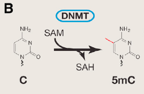

这种方式可以在不修改 DNA 序列的情况下，抑制潜在的有害遗传元件表达。其作为一种相对稳定的修饰状态，可随 DNA 复制遗传给子代 DNA，在维持正常细胞的功能、雌性个体X染色体失活、寄生DNA序列的抑制、基因组结构稳定、遗传印记、胚胎发育、及肿瘤和疾病的发生、发展紧密相关，具有至关重要的作用。5mC可以导致基因沉默或基因表达水平降低，因此，肿瘤抑癌基因的过甲基化或原癌基因的低甲基化在多种肿瘤中被发现。DNA甲基化是最早被发现、也是研究最深入的表观遗传调控机制之一。第一个被发现的5-甲基胞嘧啶(5mC)是研究最多的修饰碱基，它在从基因调控到正常发育的广泛生物过程中发挥着重要作用，被认为是第五个碱基。

### 羟甲基化
**5-羟甲基胞嘧啶(5hmC)：**是由5mC经过TET家族酶氧化而来，在神经元细胞含量较高，被认为是第六碱基。而5hmC作为去甲基化过程的第一步，则会导致基因激活或基因表达水平增高，研究表明DNA的5hmC在多种肿瘤中有明显降低。因此，分析基因组的5mC和5hmC水平具有重要的临床意义。

已经甲基化的  在 TET 酶的作用下氧化成 5-羟甲基胞嘧啶，其不仅参与染色体重编程、基因表达的转录调控，而且在 DNA 去甲基化过程中发挥重要作用。研究表明其与肿瘤的发生也是密切相关。

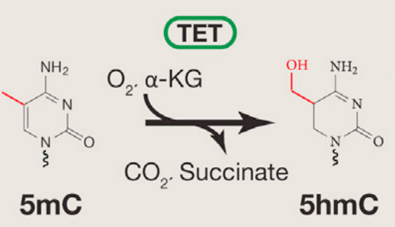

### CpG 岛
CpG 岛指一类 300-3kbp 的 DNA 片段，含有大量相联的 C-G 碱基(p 即为两者间磷酸二酯键)，主要位于基因启动子和第一外显子区域。哺乳动物中，CpG 序列在基因组中出现的频率仅有 1%，大多散列在 DNA 中，易被淘汰；但在基因组上述区域，CpG 序列密度很高，形成所谓的 CpG 岛。目前所发现的哺乳动物唯一的 DNA 甲基化形式就是 CpG 二核苷酸中 C 的 5'端碳原子转变为甲基，生成 5-甲基胞嘧啶。有文献指出肿瘤样本 CpG 岛差异多发于**CpG 岛岸**。

### 分类
**de novo methylation：**从头甲基化，是表观遗传学（epigenetic）中的一个重要生理过程，是指不依赖已有的甲基化DNA链而在一个新位点将DNA链中胞嘧啶C5甲基化，与维持甲基化（maintenance methylation）对应。指 2 条链均未甲基化的 DNA 被甲基化，同时由维持甲基化酶维持稳定的 DNA 甲基化状态。

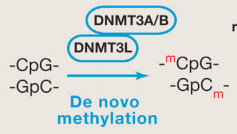

**maintenance methylation：**维持甲基化，若双链 DNA 的其中一条链已存在甲基化(DNA 半保留复制过程)，将另一条未甲基化的链甲基化。

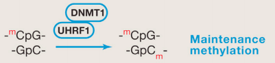

## 2.DNA甲基化研究测序方法
目前表观遗传学DNA甲基化研究测序方法常见的有：(1)全基因组重亚硫酸盐甲基化测序[WGBS]; (2)精准DNA甲基化和羟甲基化测序[oxBS-seq]; (3)优化版简化甲基化测序[RRBS/dRRBS/XRBS]; (4)单/微量细胞全基因组甲基化测序[scWGBS]; (5)扩增子（羟）甲基化测序; (6)（羟）甲基化DNA免疫共沉淀测序[(h)MeDIP-seq]等6种，适用于不同DNA甲基化研究方向的解决方案。

### (1) 全基因组重亚硫酸盐甲基化测序（WGBS）
全基因组重亚硫酸盐甲基化测序（WGBS）可以在全基因组范围内精确的检测所有单个胞嘧啶碱基（C碱基）的甲基化水平，是DNA甲基化研究的金标准。WGBS能为基因组DNA甲基化时空特异性修饰的研究提供重要技术支持，能广泛应用在个体发育、衰老和疾病等生命过程的机制研究中，也是各物种甲基化图谱研究的首选方法。

常规全基因组甲基化测序技术通过T4-DNA连接酶，在超声波打断基因组DNA片段的两端连接接头序列，连接产物通过重亚硫酸盐处理将未甲基化修饰的胞嘧啶C转变为尿嘧啶U，进而通过接头序列介导的 PCR 技术将尿嘧啶U转变为胸腺嘧啶T。

在弱酸性条件下，没有甲基化/羟甲基化的 C 碱基的 6 位碳会结合亚硫酸氢根。

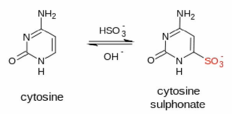

再用碱处理，使其脱去氨基和亚硫酸氢根，生成 U 碱基。

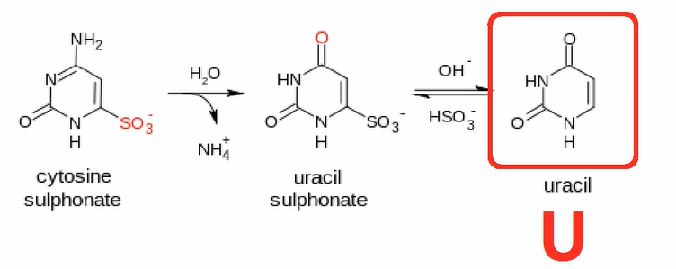

甲基化/羟甲基化的 C 则保持不变。

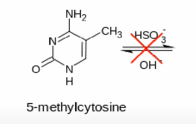

这种方法的转化效率可达 99%，也就是理论上 99%的 C 可转化成 U，让我们可以通过后续高通量测序精确地看到单个碱基的甲基化水平。

在 PCR 新合成的链中，U 碱基对应位置就会替换成 T，说明该位置碱基未被甲基化；而甲基化/羟甲基化的 C 测序的结果仍为 C，说明该位置碱基已被甲基化。

#### Truseq DNA 建库
在 illumina Truseq DNA 建库试剂盒当中，其接头上的 C 已经经过甲基化修饰，因此，用这些接头建库后，在上述转化过程中，接头上的C不会被转化成 U。

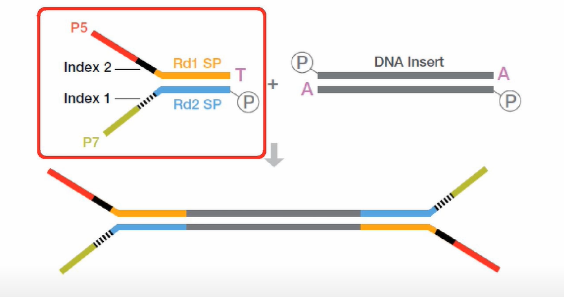

转化后在使用 HiSeq 等测序仪进行测序即可得出结果。但是，该建库方法的缺点也是很明显的——在用亚硫酸氢盐处理 DNA 文库时，90%以上的 DNA 链会断掉，也就是说文库的丰富度就会损失 90%以上；当然，由于建库所需 PCR 循环较少，所引起的 PCR bias 也偏少。

#### EpiGnome 甲基化建库
为了解决上述建库方法的缺陷，EpiCentre 公司(现已被 illumina 收购)开发了 EpiGnome 甲基化建库方案。

用重亚硫酸氢盐处理 DNA，将未甲基化的 C 都转成 U。

把带标签 1 的随机引物 1 加入，进行第一次的复制，得到第 1 条的复制链。

消化掉过量的引物 1。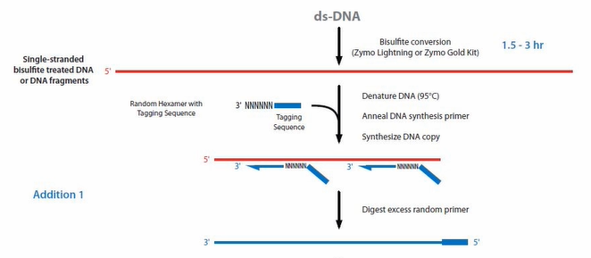

加入带末端终止碱基、并带标签 2 的随机引物 2。从而让第一复制链延伸且加上标签 2，同时使 PCR 得以正常进行。

加入建库的 PCR 引物，进行 PCR。通过 PCR，把 Index 序列和成簇引物序列加入到链的两侧，得到测序可用的文库。

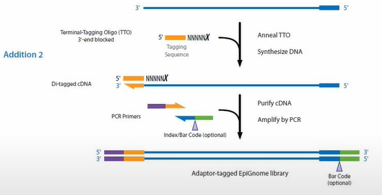

这个方案先进行重亚硫酸氢盐处理再建库，虽直接地解决丰富度的问题，但是由于其更多的 PCR 循环，使得 PCR bias 增大。因此，两种方案各有得失，实际操作中往往根据项目需要进行具体选择。

#### 碱基不平衡
因为甲基化文库中经过重亚硫酸氢盐处理，绝大多数的 C 都变成了 T。所以，这个文库中是严重地缺少 C 碱基的，也就是四种碱基的比例是严重不平衡的。这样在用 HiSeq 2000 或 2500 测序仪来测甲基化文库的过程当中，文库测序得到的数据质量就较差。并且经过 PF 过滤得到的有效的数据产量也会较低。

#### 技术优势
应用范围广：适用于人和大多数动植物研究（参考基因组已知）；

全基因组覆盖：最大限度地获取完整的全基因组甲基化信息，精确绘制甲基化图谱；

单碱基分辨率：可精确分析每一个C碱基的甲基化状态。

#### 研究案例
Whole-Genome Bisulfite Sequencing of Two Distinct Interconvertible DNA Methylomes of Mouse Embryonic Stem Cells. 两种状态的小鼠胚胎干细胞的甲基化组学研究。

### (2) 精准DNA甲基化和羟甲基化测序（oxBS-seq）
DNA羟甲基化是近年发现的一种新的DNA修饰并迅速成为研究热点。随着研究的深入，发现之前被认为是检测DNA甲基化“金标准”的重亚硫酸盐测序并不能区分DNA甲基化（5mC）和DNA羟甲基化（5hmC）。化学氧化法结合重亚硫酸盐转化的测序技术（oxidative bisulfite sequencing, oxBS-Seq）不仅可以精确检测DNA甲基化，排除DNA羟甲基化的影响，还可以双文库结合同时单碱基分辨率精确检测DNA羟甲基化。

#### 技术原理
通过高钌酸钾氧化羟甲基化的 C，将其转化成甲酰化的 5fC。甲酰化的 C 碱基，可以被重亚硫酸氢盐转化成 U；而甲基化的 C，不会被转化成 U。这样就把 5hmC 和 5mC 给区分开来了。oxBS-Seq将5hmC氧化5fC，后者可以被Bisulfite转为U，从而实现5mC的精准检测；同时，经过与常规Bisulfite结果比较可以实现对5hmC的准确检测。

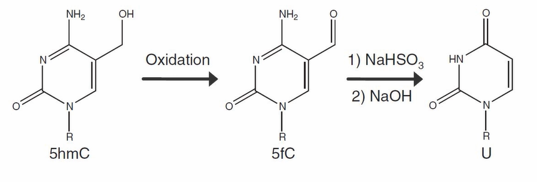

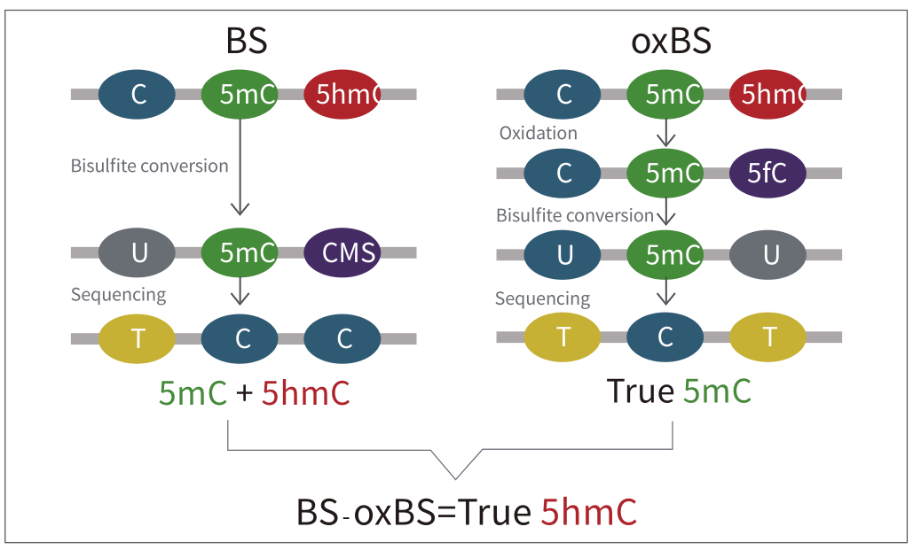

a. 先用糖基把 5hmC 保护起来，变成 5gmC。

b. 再用 TET 酶把 5mC 转变成 5hmC，再转化成 5fC 和羧基化的 5caC。甲酰化的 C 和羧基化的 C 都可以被重亚硫酸氢盐转化成 U。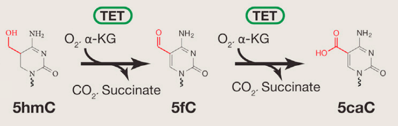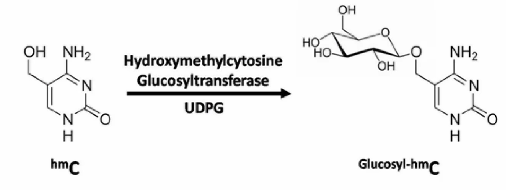

c. 之前被糖基化保护起来的 5hmC，则不会被 TET 蛋白转化成甲酰化的 C 或者羧基化的 C。在重亚硫酸氢盐的处理过程中，它还保持是 C，从而将 5hmC 和 5mc 区分开来。

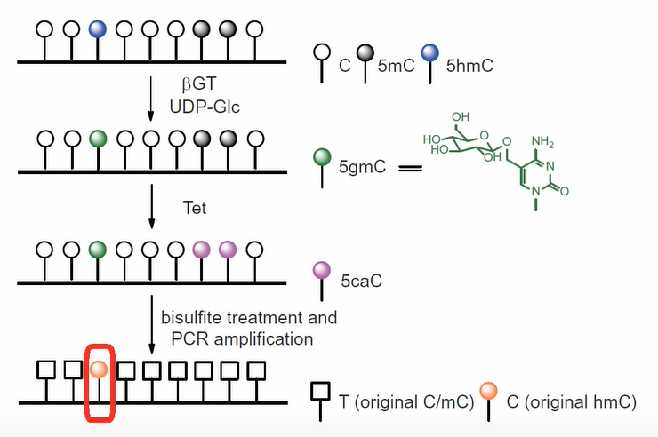

这个方法，没有甲基化的 C，99.6%都被转化成了 U；甲基化的 C，97.7%都被转化成了 U；而羟甲基化的 C，只有 8%被化成了 U。也就是说本法理论转化效率能达到 92%。

#### 技术优势
DNA甲基化检测全新的“金标准”；

全基因组单碱基检测DNA羟甲基化修饰；

多重标准验证高氧化效率和高Bisulfite转换率；

实验偏好性低，重复性高（R²>0.98）；

可满足多种测序应用需求：简化基因组氧化甲基化测序（oxRRBS），目标区域氧化甲基化测序（Target-oxBS）。

#### 研究案例
Quantitative sequencing of 5-methylcytosine and 5-hydroxymethylcytosine at single-base resolution （oxBS 技术单碱基检测5mC和5hmC在鼠胚胎干细胞中的水平）。

### (3)简化甲基化测序（RRBS/dRRBS/XRBS）
简化甲基化测序(Reduced Representation Bisulfite Sequencing,RRBS)是利用限制性内切酶对基因组进行酶切，富集启动子及CpG岛等重要的表观调控区域并进行重亚硫酸盐测序。该技术显著提高了高CpG区域的测序深度，在CpG岛、启动子区域和增强子元件区域可以获得高精度的分辨率，是一种准确、高效、经济的DNA甲基化研究方法，在大规模临床样本的研究中具有广泛的应用前景。为了适应科研技术的需要，我们进一步开发了可在更大区域内捕获CpG位点的双酶切RRBS(dRRBS)，可研究更广泛区域的甲基化，包括CGI shore等区域。

#### 技术优势
精确度高：在其覆盖范围内可达到单碱基分辨率；

重复性好：多样本的覆盖区域重复性可达到85%-95%，适用于多样本间的差异分析；

性价比高：测序区域针对高CpG区域，数据利用率更高。

#### 研究案例
DNA Methyltransferase Inhibition Reverses Epigenetically Embedded Phenotypes in Lung Cancer Preferentially Affecting Polycomb Target Genes DNA甲基化的改变对癌症细胞侵袭能力的影响

### (4) 单/微量细胞全基因组甲基化测序（scWGBS）
单细胞及微量样本的DNA甲基化组学研究很大程度上受制于建库测序技术。传统的文库构建方法或类似于基因组DNA的单细胞扩增技术很难应用到甲基化实验过程中。

单细胞及微量珍稀样本的甲基化研究主要应用于肿瘤发生机制，癌症研究，胚胎植入前诊断，胚胎早期发育，生殖细胞重组，干细胞及细胞异质性等研究领域。应用的样本包括单细胞、微量细胞等。

#### 技术优势
超低起始量：单细胞或超低的建库DNA起始量；

测序覆盖度高 ：最大限度地获取完整的全基因组甲基化信息，精确绘制甲基化图谱；

单碱基分辨率：可精确分析每一个C碱基的甲基化状态。

#### 研究案例
Single-cell DNA methylome sequencing of human preimplantation embryos. 人类植入前胚胎发育的单细胞DNA甲基化组图谱。

### (5) 扩增子（羟）甲基化测序
扩增子（羟）甲基化技术针对基因组上特定的DNA序列设计甲基化特异性扩增引物（如感兴趣的基因等），基因组DNA进行（氧化）重亚硫酸盐处理后，PCR扩增检测片段，扩增产物通过二代高通量测序，更精准的检测基因区域的甲基化状态。

#### 技术优势
准确性高：可满足几个到上百个基因/CpG 位点的检测，其覆盖范围内可达到单碱基分辨率，覆盖深度超高（位点平均覆盖深度>300X）；

性价比高：低成本、周期短，超高性价比；

针对性强：适用于特定基因或者位点甲基化状态的检测；

应用广泛：广泛用于临床样本多位点的甲基化 Biomarker 筛选、验证及临床转化应用。

#### 研究案例
Vitamin C Prevents Offspring DNA Methylation Changes Associated with Maternal Smoking in Pregnancy扩增子甲基化测序验证补充维C可减少后代因母亲妊娠期吸烟而发生的DNA甲基化变化。

### (6) (羟)甲基化DNA免疫共沉淀测序(h)MeDIP-seq
5hmC是新发现的一种的修饰碱基，由TET家族的酶通过氧化5mC产生的。5hmC不仅能够降低MeCP蛋白的甲基化结合结构域(MBD) 与甲基化DNA的亲和性，具有潜在的参与基因表达调控的转录调节功能，而且参与了DNA去甲基化过程。

羟甲基化DNA免疫沉淀测序（Hydroxymethylated DNA Immunoprecipitation Sequencing，hMeDIP-Seq）是通过运用5'-羟甲基胞嘧啶特异性抗体富集羟甲基化的DNA片段，然后结合高通量测序技术在全基因组水平上以较小的数据量，快速、高效地寻找羟甲基化区域。可广泛应用于羟甲基化与疾病关系研究以及羟甲基化在胚胎发育过程中的研究。

#### 技术优势
检测范围广：全基因组范围鉴定甲基化修饰区域；

针对性强：针对性检测基因组内具有甲基化修饰的区域；

成本低：大大降低了测序数据量，测序成本低。

#### 研究案例
Genome-wide analysis of 5-hydroxymethylcytosine distribution reveals its dual function in transcriptional regulation in mouse embryonic stem cells 小鼠胚胎干细胞的羟甲基化研究。

## 3.原始数据处理
如果将甲基化测序结果直接与基因组测序结果进行对比，因为绝大部分的 C 都被转化成了 T，显然是无法比对的。

### C->T
我们尝试直接将基因组序列上所有 C 替换成 T，再与甲基化测序序列进行比对，但是只有样本链单链能比对出碱基的甲基化修饰。

### G->A
因为原样本链互补链上的绝大部分的 G 都被转化成了 A，因此我们再将基因组序列上 G 替换成 A，终于，我们看到了哪些碱基没有被转化，看到了基因组的甲基化修饰情况。

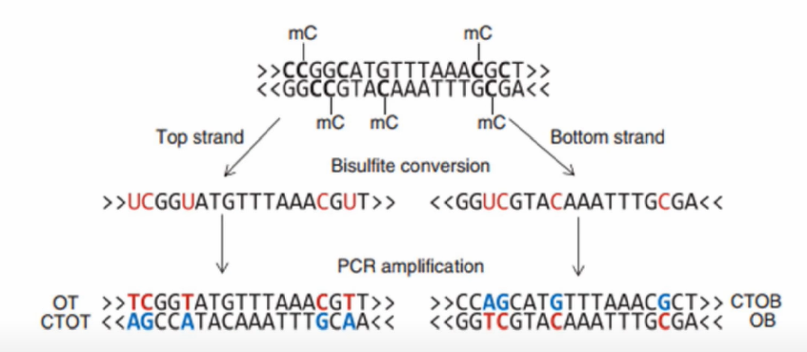

具体分析后面为大家介绍，敬请期待！

## 4.新技术——TAPS 测序
**TAPS**[3](TET-assisted pyridine borane sequencing)，中文可译为 TET 辅助吡啶硼烷测序。

用 TET 酶将 5mC 和 5hmC 转化为 5caC。

用吡啶硼烷将 5caC 还原为 DHU。

PCR 使 DHU 转化为 T。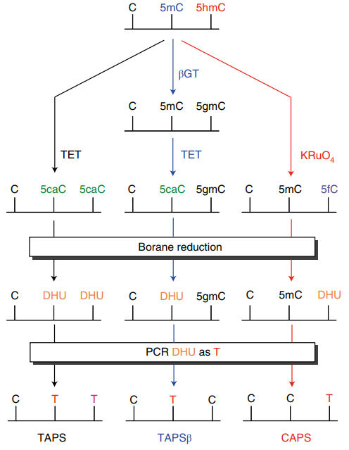

这种方法以高灵敏度和特异性直接检测甲基化修饰，而不会影响未修饰的 C，而且可以保留 10 kb 以上的 DNA 片段，更便于检测血液中循环的无细胞 DNA 等的甲基化情况。同时还能降低甲基化测序所需时间及金钱成本。

# 二.甲基化芯片
关于DNA甲基化检测手段介绍，我觉得[Make Decision: DNA甲基化检测方法，哪一款适合你？](https://mp.weixin.qq.com/s?__biz=MzIxMjA0NzU0OA==&mid=2650983484&idx=1&sn=5386066548d8e218e5087ca2ff3e8554&scene=21#wechat_redirect) 写的就足够好了。同样的，早期研究以芯片为主，从成本的角度来看，也是芯片为主，但是测序数据更丰富。

可选的甲基化芯片产品就少很多，绝大部分是illumina公司产品的，从27K到450K到850K甲基化芯片。比较好的介绍是：Illumina  琪先生的 [一文了解 MethylationEPIC 850K 甲基化芯片](https://mp.weixin.qq.com/s?__biz=MzI2MDA4NTYzOA==&mid=2649533250&idx=1&sn=1875eb152f5bda3db0b24c3ee2c8c9d7&scene=21#wechat_redirect)

Infinium MethylationEPIC BeadChip芯片包含了原先的Infinium Methylation450 BeadChip芯片90%以上的内容，这种选择可提供一种广泛、全面的甲基化组图谱。而且还靶定了ENCODE计划中确定为潜在增强子的区域，还有FANTOM5计划在各种组织类型中确定出的增强子。

目前我们进行甲基化分析常规使用的是Illumina HumanMethylation450 BeadChip，也就是我们常说的450K芯片。送检的每个样本均在单独的阵列（包含红色和绿色两种通道）上进行测量，每一个阵列包含450,000个CpG位点。每一个位点具有两种不同的测量值：甲基化以及非甲基化测量值。

而这两种值是通过“Type I”或“Type II”中的一种方式进行测量。“Type I”用来只测量一种的颜色，而在这一个颜色通道种包括两个不同的探针来分别测量甲基化以及未甲基化值。而“Type II”只有一个探针，但包括双色通道来测量甲基化与未甲基化的值。我们需要注意的是在芯片种探针与CpG位点并非一一对应的，450K芯片一共有48万多个探针，而所包含的CpG位点差不多在45万个左右。这一点我们之后还会再提及。

实际上一个芯片（slide）包括12个阵列(array)，而每一个阵列能够分析一个样本，机器可以同时分析8张芯片，所有，一次性可以没有批次的分析96个样本。

## M值和β值
首先在我们之前的分析中我们知道450K甲基化芯片能够对应一个CpG位点测出甲基化测量信号强度（M， methylated value）值和非甲基化信号强度（U，unmethylated value）。β值则等于M/(M + U + offset)，这里的offset是偏移量，以防止出现分母为0的情况。而M值则等于log2 (M/U)，也就是根据荧光信号进行log化。

在我们常规分析中，β值更加适合进行甲基化水平的定量，能够阐明生物学意义，任何等于或大于0.6的β值都被认为是完全甲基化的。

任何等于或小于0.2的β值被认为是完全未甲基化的。

β值在0.2和0.6之间被认为是部分甲基化的。

而M值更适合用于进行下游统计分析。介绍完理论知识之后，

参考资料：

[https://mp.weixin.qq.com/s/cF43uwJ0Dx0Ot8wOgNfJ-A](https://mp.weixin.qq.com/s/cF43uwJ0Dx0Ot8wOgNfJ-A)

[https://mp.weixin.qq.com/s/lHnzbZPVsK8SoufKoPV9Hw](https://mp.weixin.qq.com/s/lHnzbZPVsK8SoufKoPV9Hw)

> 更新: 2022-06-08 09:07:16  
> 原文: <https://www.yuque.com/doublehelix/bioinfonotes/blzkex>