# PyMOL的使用教程

文章来源：<http://pymol.chenzhaoqiang.com/intro/startManual.html>

## 入门教程

主要讲述PyMOL中常见的图形界面（鼠标）操作

### PyMOL软件界面介绍

PyMOL 软件界面如下图所示，主要由2部分组成。第一部分是菜单窗口和第二部分是显示窗口。 PyMOL2 和PyMOL1一个明显区别: 在PyMOL2中，这2部分默认是一个整体，在PyMOL1中这2部分是分开的。 在Display->Toggle Floating 可以拆分这2个窗口，快捷键是Ctrl+E, 刚开始PyMOL的界面主要是通过tkinter实现的，在PyMOL2中逐渐采用PyQT技术实现。 和PyMOL1 相比，PyMOL2 表现能力更强，功能更多，本教程以PyMOL2为例进行讲解，大部分 内容也适用于PyMOL1.

窗口1：整合了PyMOL的各个功能，主要包含如下部分

1.1 菜单窗口 1.2 操作记录显示窗口 1.3 命令输入窗口 1.4 常用命令集成面板

窗口2：分子操作和显示窗口，主要包括如下部分：

2.1 可视化窗口 2.2 命令输入窗口 2.3 分子对象列表窗口 2.4 模式窗口

<!-- 图：PyMOL 界面示意图（缺图） -->

注解

本节教程是有顺序的。

### PyMOL内置的超强可视化示例

打开PyMOL,点击1.1菜单窗口的Wizard菜单，然后点击Demo->Representations 然后在2.3 对象窗口 和 2.4模式窗口之间会出现各种示例：

1. Representations
2. Cartoon Ribbons
3. Roving Detail
4. Roving Density
5. Transparency
6. Ray Tracing
7. Sculpting
8. Scripted Animation
9. Electrostatics
10. CGOs
11. Molscript/R3D Input
12. End Demonstration 关闭示例

从中我选择了几个示例图片展示下：

| 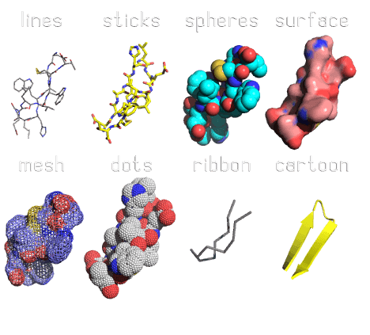 Fig 1. Representations | 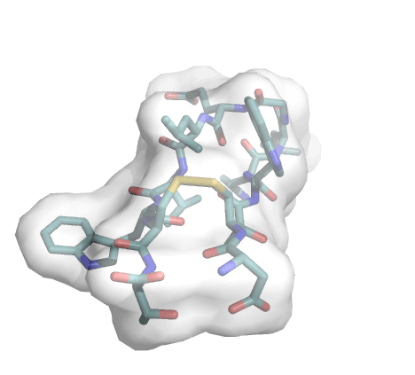 Fig 2. Transparency |
| --- | --- |
| 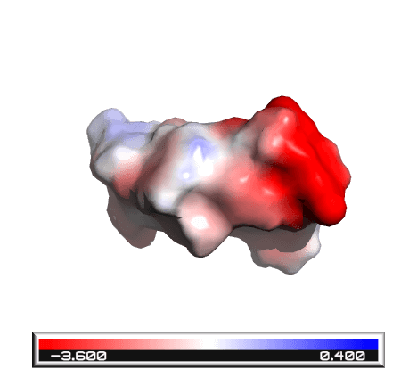 Fig 3. Electrostatics | 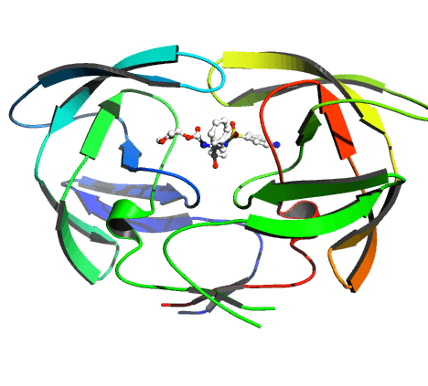 Fig 4. R3D |

从这些示例中，我们可以感受到PyMOL的强大表现能力。

### 设置和查看工作路径

点击1.1菜单窗口 File->Working Directory->Change 可以查看现在的工作目录在哪里，也可以设置新的路径作为工作目录。

工作目录的作用：默认文件的打开和保存都是从该文件开始。下载文件的保存位置也是在工作目录。

工作目录设置习惯

建议： 1. 不同项目设置不同的工作目录

2. 设置一个默认工作目录
3. 不要把工作目录设置在软件安装目录

* 双击PDB文件打开PyMOL,会自动切换工作目录到该PDB文件所在目录。
* 从软件安装处打开PyMOL, 则工作目录为软件安装目录

这里我设置工作目录为 D:\PyMOLstartedManual

### 下载蛋白

从PDB网站上下载蛋白，如 4hbk.pdb, 也可以直接通过PyMOL 下载蛋白，点击菜单栏中的 File->Get PDB,如下图图所示, 在PDB ID 对应的框中填入PDB的编号就可以了，不要包含后缀.pdb 。

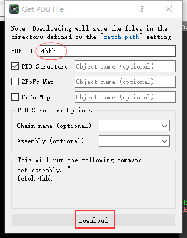

点击Download，你会发现PyMOL会自动加载该蛋白，在工作路径 D:\PyMOLstartedManual 下面出现 4hbk.cif 文件，随着PDB解析的结构越来越大，PDB格式文件的局限性就暴露出来，不能超过9999个原子，因此正在逐渐用cif 格式取代pdb 格式。

### 蛋白的展现形式(show)

在2.3对象列表窗口中，我们可以看到现在有2个object 名字，

* 1个是all, all 不是真实的object,它代表了所有的object
* 1个是4hbk, 4hbk 就是我们刚刚载入的蛋白

每个object 都有对应的A S H L C操作,如下图所示：

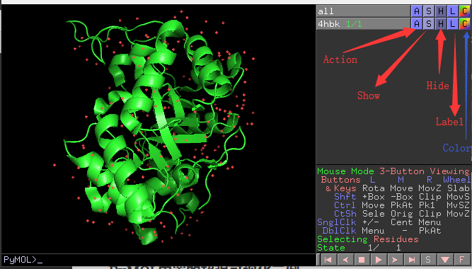

* Action 主要包含了对object的常用操作的集合，如 复制、删除object,对object加氢，展示Object等，

更多详情参见蛋白对象的Action操作。 - Show 将object 渲染成cartoon 、line、stick lines sphere surface mesh dots ribbon 等模式 - Hide 根据object的状态或者描述进行相应的掩藏 - Label 显示object中残基 原子等名称或者属性 - Color 对Object 进行着色

下面对Show 着重讲解： show 有2类操作方法：

* show as 分别点击S->as->cartoon 和S->as->stick,我们可以观察到AS模式是把原有的渲染模式抹除后再重新渲染，经过上述操作后仅仅显示stick形式
* show 点击S->as->cartoon 再点击S->stick;我们可以观察到SHOW方法，是保留原有的渲染，再添加新的渲染。

我们先对4hbk object点击 S->as->cartoon,然后点击S->as->stick,效果如图Fig5

我们先对4hbk object点击 S->as->cartoon,然后点击S->stick,效果如图Fig6

| 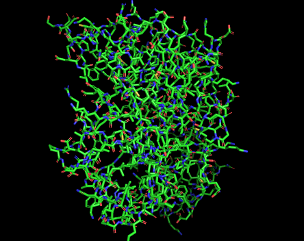 Fig 5. as stick | 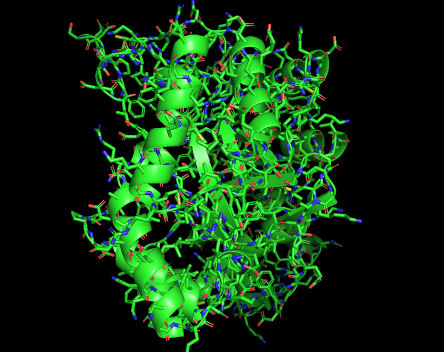 Fig 6. stick |
| --- | --- |

大家可以下载demo1的示例蛋白文件 demo1_pp.pdb，点此 <code>[pdb](http://pymol.chenzhaoqiang.com/_downloads/demo1_pp.pdb)</code> 下载。

然后在PyMOL中点击File -> Open-> demo1_pp.pdb 打开该文件。

1. 点击 S->as->lines
2. 点击 S->as->sticks
3. 点击 S->as->spheres
4. 点击 S->as->surface
5. 点击 S->as->mesh
6. 点击 S->as->dots
7. 点击 S->as->ribbon
8. 点击 S->as->cartoon

观察该分子对象的不同形态,如图1所示。

### 蛋白对象的简单平移、旋转、缩放

**首先将鼠标移动到2.1可视化窗口**

* 平移，按住鼠标中键不放，然后上下左右移动，进行体会，蛋白会随着鼠标而移动
* 旋转，按住鼠标左键不放，然后上下左右移动鼠标，蛋白会进行旋转
* 缩放，按住鼠标右键不放，然后上下移动，蛋白会进行缩放
* 切割 滚动鼠标中键， 建议将蛋白渲染成surface模式，然后滚动鼠标中键

当软件不能正常使用上述操作，可以点击

* File->Reinitialize->Original Settings (推荐)
* File->Reinitialize->Everything 注意的是该操作会删除当前所有的Object,

### 蛋白对象的action操作

对于4HBK体系里面没有小分子，一些相互作用操作不方便演示,我会在在后面进行更详细的讲解。

第一部分： 常用显示操作

* 点击 A->preset->simple 显示蛋白的简单形式
* 点击 A->preset->ball and stick 显示球棍模型

效果如下图所示：

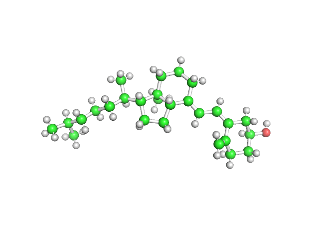

* 点击 A->preset->b-factor putty 基于bfactor数值显示蛋白的柔性
* 点击 A->preset->publication 高质量出版标准

第二部分 对象的操作

* 删除水分子 A->remove waters

该操作属于红色警告操作，不可逆操作。删除水分子后，无法通过Ctrl-Z进行撤销。

* 增加删除氢原子在line和stick 模式下面可以看到H原子，cartoon模式下面看不到氢原子 因此在line或者stick模式下，执行下述操作。
* A->Hydrogens->remove 删除所有氢原子
* A->Hydrogens->add 增加所有氢原子
* A->Hydrogens->remove non polar 删除所有非极性氢原子，我们可以看到C上的氢原子全部被删除
* A->Hydrogens->remove 再次删除所有氢原子
* A->Hydrogens->add polar 增加极性氢原子

第三部分 对象的复制 剪切 删除 重命名

* 复制 A->Copy to object->new

我们会得到一个名为new的object,为了和4hbk object 进行区分。

对4hbk 的obect 点击C->cyan 和S->AS ->cartoon

对obj01 点击 C->green 和S->as->stick

* 重命名 obj01-> 4hbk_02对obj01 点击A->rename object
* 删除 A->delete object
* 剪切 适合选中的对象 A->Extract

我们可以通过剪切的操作把配体和蛋白分开，首先选中配体，然后点击A->extract object 就可以了， 原来结构中的配体就跑到obj01中了，这样就分开了蛋白和配体。

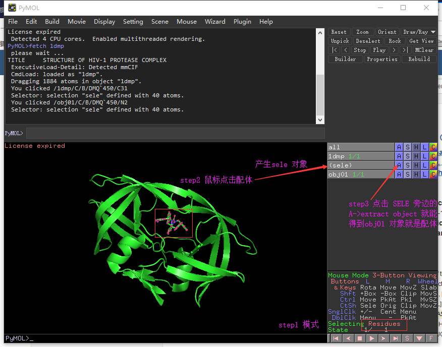

第四部分 Action->generate 操作

* 显示蛋白的静电势图 Action->generate->vacuum_electrostatics->protein contact potential 就可以了

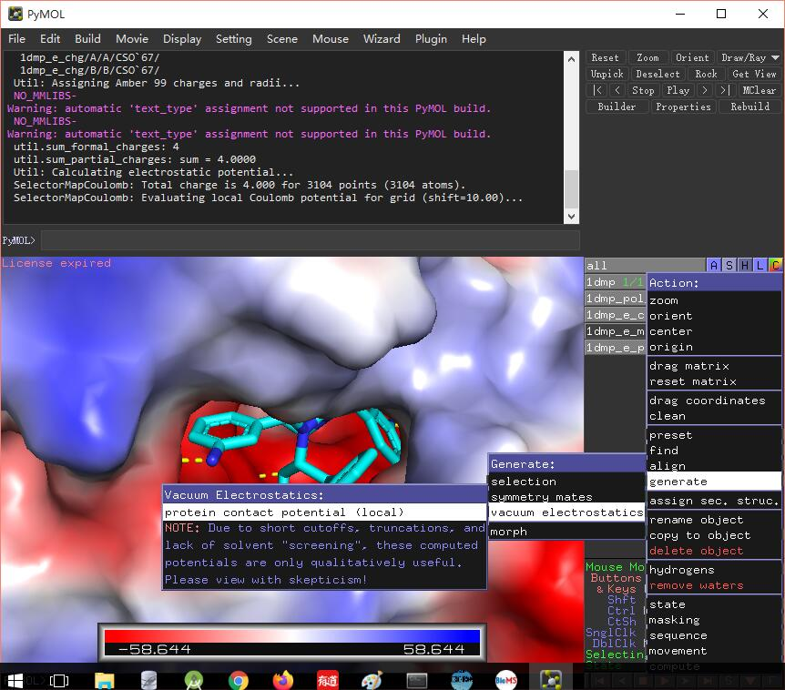

### 查看小分子和蛋白的氢键作用

由于4hbk 蛋白中没有小分子，这里我以 PDB id: 为例演示。 点击 A->preset->ligand sites 效果如图所示，其中黄色的虚线就是氢键。

对标注的氢键，查看距离和角度，进一步确定氢键的合理性和强度。

查看小分子和蛋白的相互作用，推荐软件 schrodinger中ligand interaction。 制作相互作用的二维图，根据提示，然后再在pymol确认并绘制这些相互作用。

### 蛋白对象的Hide操作

和remove delete 操作相比，hide操作更加温和， 把不需要的东西暂时掩藏起来，通过Show 可以重现显示出来。 我们先上述方法，构建4hbk 和4hbk_02 两个object， 这一次把4hbk 设置成cyan 颜色的cartoon, 4hbk_02设置成green颜色的ribbon，如图所示。 如果要掩藏4hbk_02,有2种方法 - 对4hbk_02 点击H->ribbOn - 直接点击4hbk_02的名字

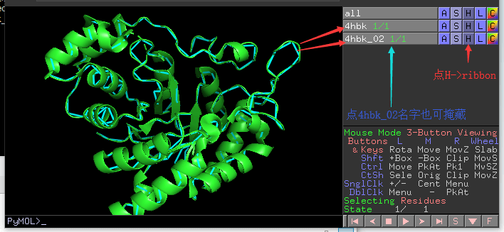

### 查看该结构的序列(Sequence)

点击左下角的S，即可显示蛋白的序列信息，如图所示,再点击一次S，则掩藏序列信息。 S是单词Sequece的缩写。

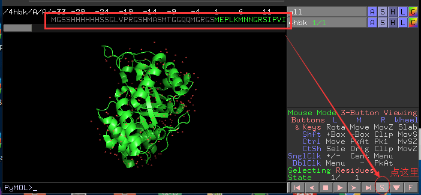

### 选择蛋白的特定残基

我们通过软件 [D3Pockets](https://www.d3pharma.com/D3Pocket/page_upload.php) 可以确定4hbk中口袋中氨基酸残基的组成：

ILE15-TRP20, TYR39, ASP43-ALA45, VAL47, TYR48, LYS77, TRP79, ASN80,

LEU108, HIS110, TRP111, LEU115, PHE122, LEU130, SER159, ASN160, GLN181,

GLU183, HIS185, 185 207 208 209

210 211 222 223 240 241 243 244

255 256 257 258 263 264 266 267

270 292 293 294 295 298 306

我们点击Sequence,并将Selecting模式切换为residues,然后基于残基编号进行选择。

把上述残基选中以后会临时保存在sele的object中，我们把它复制到obj01的Object中，

并重名为Pocket,然后对Pocket的Object，显示其表面，结果如图所示。

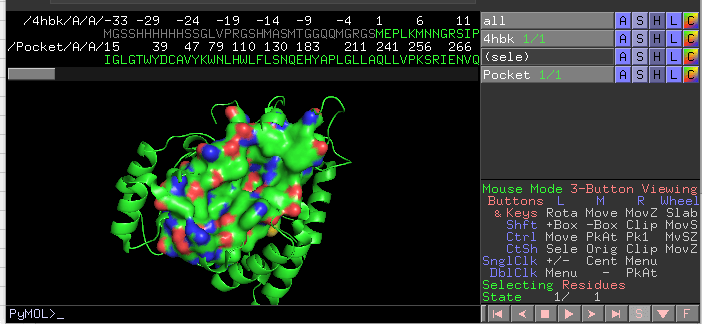

### 蛋白对象的着色操作

pymol中内置了多种不同的着色方案,如图所示：

* 按照原子类型着色\
  点击object上的 C按钮 -> by element
* 按照二级结构着色
* 按照b-factor着色
* 按照整体着色

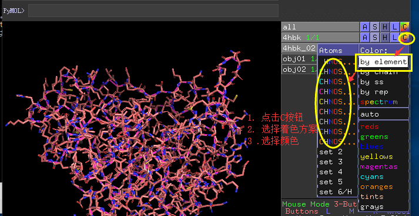

### 设置背景颜色

背景颜色默认是黑色的，发表文章的时候背景颜色通常设置为白色。 | 点击菜单栏中的 Display->background->white 如图所示：

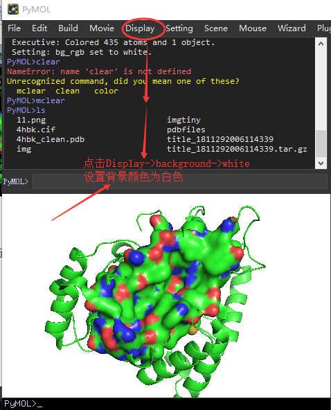

### 制作b-factor-value 图

点击A->preset->b-factor putty， 如下图所示：

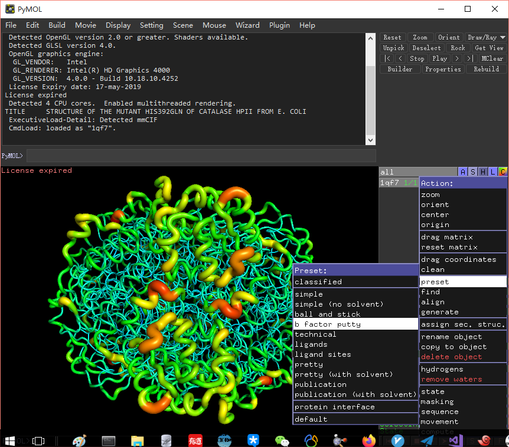

### 对象的Label操作

选择需要Label的对象 | 然后点击对象上的L按钮，根据需要，可以标记残基的名字，原子的名字，范德华半径、元素的名字等。

1. L->residue 在α碳原子上标记其残基名字和编号 （常用）

2. L->residue name 在所有原子上标记残基名字 （不常用）

3. L->clear 删除该对象上所有的Label

4. L->element symbol 显示对象上所有原子的元素名字

5. L->vdw radius 产看原子的范德华半径

对于蛋白醛糖还原酶（PDB ID: 4HBK）,我们在UniProt 数据库中查询得到，其口袋中的重要残基有： TYR48、LYS77 和 HIS110。

我们对这三个残基展示其为stick模式,并掩藏主链，并通过label按钮标注其氨基酸残基的名字。 移动Label，使其更加清晰可见。具体操作流程如下:

1. 载入4hbk 蛋白

2. 在4hbk object 上点击 S->as cartoon

3. 点击右下角的sequence开关按钮，选择 TYR48 LYS77 HIS110 三个残基，得到sele 临时object

4. 在sele object 上点击 S->stick, H->main chain

5. 在sele object 上点击 L->residue

6. 设置背景为白色，点击菜单栏中 Display->background->white

7. 点击Mouse Mode 切换为 editing 模式

8. 按住ctrl键不放，然后将鼠标移动到残基标签上方，并按下鼠标左键不放，然后移动鼠标，就可以调整标签的位置。

9. 调整结束后，点击Mouse Mode 切换为 view 模式

效果如下图所示：

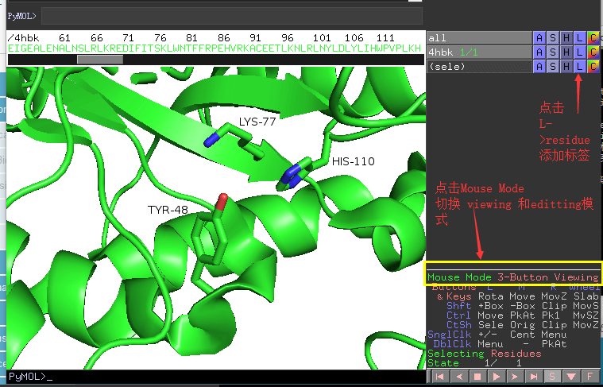

### 移动标签label

以PDB ID: 1w22蛋白为例，为其中的锌离子添加标签。

注意

注解

sphere模式下不能添加label；借用PS中复制图层的概念。为锌离子添加label。

step1 选中锌离子；

step2 复制锌离子；仅仅显示该object,并显示为lincore模式

step3 添加label; 进入edit模式，按住ctrl移动label.

step4 显示所有的object.

操作如下面的动画所示。

[点击查看动画教程](http://pymol.chenzhaoqiang.com/_images/move_label2020-07-19_210947.166280.gif)

### 调整配体的位置

pymol中包含配体和蛋白，如何调整配体和蛋白的相对位置。

以PDB ID: 1hkv 为例，其中配体小分子为PLP

step1 打开蛋白文件，定位到想要移动的配体。

step2 extract 操作，提取配体为新的object。

step3 对蛋白进行固定（最大化窗口），

step4 在edit模式下，按住shit 就可以通过鼠标移动配体。

操作如下面的动画所示。

[点我查看教程动画](http://pymol.chenzhaoqiang.com/_images/move_ligand2020-07-19_213557.789218.gif)

### 测量距离

点击菜单栏中的Wizard->Measurement 就可以进行距离测量。然后分别选择两个2个原子就可以显示这2个原子的距离。

比如我们想测定TYR48中侧链上的O原子到Lys77侧链N原子的距离，如下操作即可：

1. 点击Wizard->Measurement；打开了Measurement 面板，位于object list面板下方；

2. 鼠标点击TYR48侧链上的O原子 和 LYS77 侧链上面的N原子；

3. 如要测定其他2个原子的距离，鼠标继续点击选择2个原子就可以了；

4. 测定完成后，点击Measurement 面板中的done 就可以了。

效果如图所示：

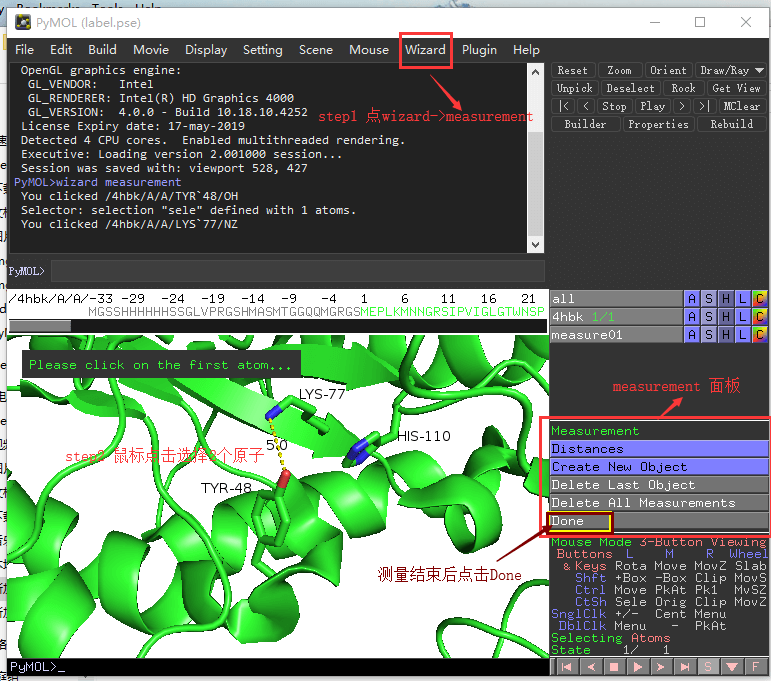

作业：

1. 测定TYR48的α碳原子和LYS77的α碳原子的距离？ 答案是11.6A

默认测定的距离是保留1位小数，如果想要显示2位小数，可点击菜单栏中的Setting->Edit All, 然后搜索label_digits，找到该索引，并把后面的数值设置为2就可以了。如图所示：

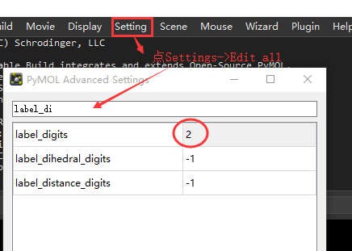

### 测量角度

点击菜单栏中的Wizard->Measurement，打开measurement 面板，默认是测量距离的模式。

点击Measuremnet 面板中Distances按钮，将Measurement Mode从Distances 模式切换到Angles模式。

然后依次选择3个原子，如ABC,则可以测出角度\<ABC的角度。

比如我们想测定Lys77侧链CE、NZ原子和的TYR48中侧链上的O原子的角度，如下操作即可：

1. 点击Wizard->Measurement；打开了Measurement 面板，位于object list面板下方；

2. 点击Measuremnet 面板中Distances按钮,切换到Angles按钮；

3. 鼠标依次点击 LYS77 侧链上面的CE原子、N原子和TYR48侧链上的O原子，完成测定

4. 测定完成后，点击Measurement 面板中的done 就可以了。

5. 调整Label的位置，保存图片。

效果如图所示：

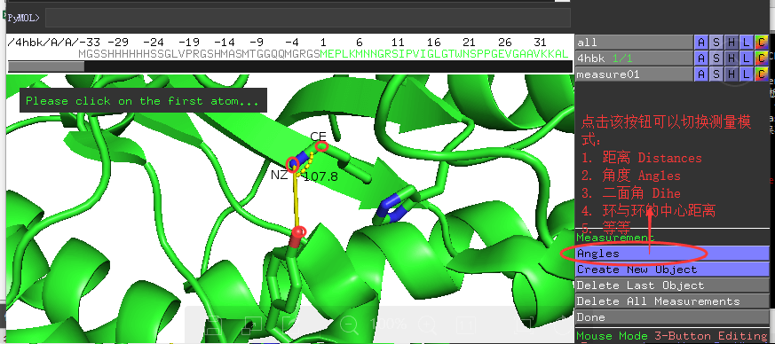

### 测量二面角

同测量距离和角度的操作，只需要将测量模式切换为Dihedrals。

### 测量环的距离

同测量距离和角度的操作，只需要将测量模式切换为Dihedrals。

该模式是用来测量两个环中心的距离，所以选择的2个原子必须位于环上，如苯环、环己烷、N杂环等。否则将按照Distances模式进行处理。

### 突变氨基酸残基

如把4hbk 中的arg-40 突变成 lys-40,

1. 在菜单中点击wizard->mutagenesis->protein

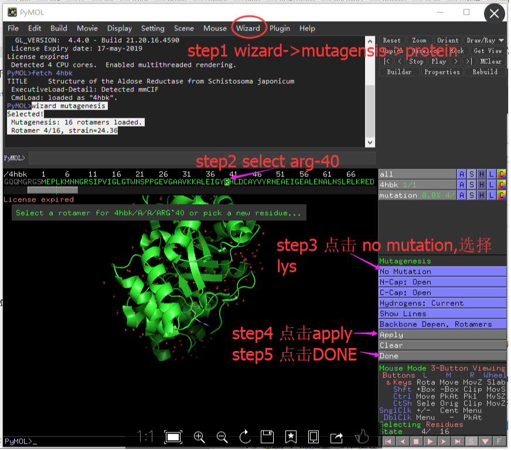

### 设置透明度

鼠标操作只能基于显示模式进行设置，如：cartoon surface sphere stick等

1. 将cartoon 设置成透明的，透明度50%；点击菜单栏中的Setting->Transparency->cartoon->50%;

2. 将Surface 设置成透明的，透明度50%；点击菜单栏中的Setting->Transparency->surface->50%;

3. 将Stick 设置成透明的，透明度50%；点击菜单栏中的Setting->Transparency->stick->50%;

4. 将sphere 设置成透明的，透明度50%；点击菜单栏中的Setting->Transparency->sphere->50%;

除了可以设置透明度外，还可以设置透明的方式，有如下几种透明模式：

1. Uni-layer; 点击菜单栏中的Setting->Transparency->Uni-layer

2. Multi-Layer; 点击菜单栏中的Setting->Transparency->Multi-Layer

3. Multi-Layer(real time oit); 点击菜单栏中的Setting->Transparency->Multi-layer(real time oit)

4. Fast-ugly; 点击菜单栏中的Setting->Transparency->Fast-ugly

在Label操作中，我们将整个蛋白展示为cartoon,并将HIS 等3个残基展示为stick模式; 这时候我们设置cartoon为透明50%，用4种不同的透明模式渲染，效果如下：

| 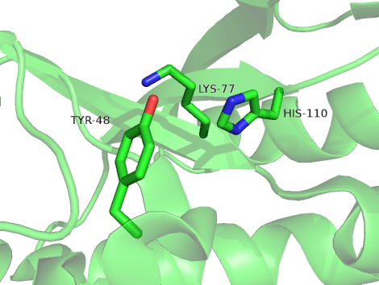 Fig 1. Uni-layer 透明效果 | 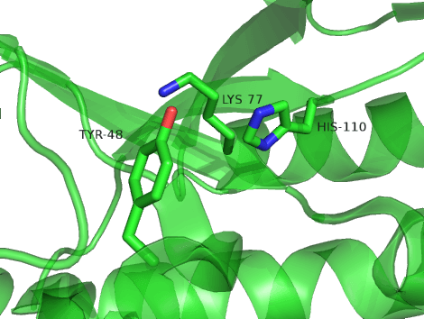 Fig 2. Multi-Layer 透明效果 |
| --- | --- |
| 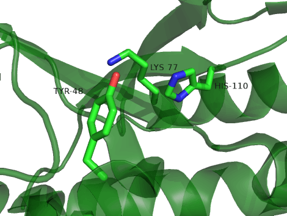 Fig 3. Multi-Layer(real time oit) |  Fig 4. Fast-ugly |

### 雾化(fogging)处理

PyMOL中支持各种雾化处理，保证depth_cue是开启的。

前面清晰，后面雾化可通过滚动鼠标中键进行调节。

向上滚动，雾化程度减轻；向上滚动，雾化程度加深。

| 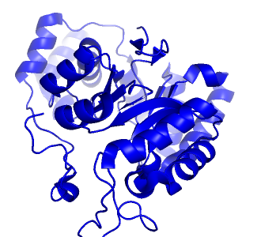 Fig 1. fogging 效果 | 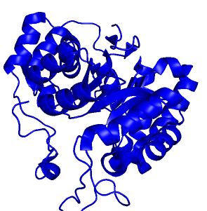 Fig 2. unfogging 效果 |
| --- | --- |

完全不想要雾化处理，可以点击 Display->Depth cue (Fogging) 取消。

或者使用命令关闭。

set depth_cue, 0

### 设置不同的光照模式

PyMOL2 中内置5种不同的光照模式：default, metal(金属), plastic(塑料), rubber(橡胶), X-ray。

点击Plugin->lighting Settings进行设置不同的光照,如下图所示图。

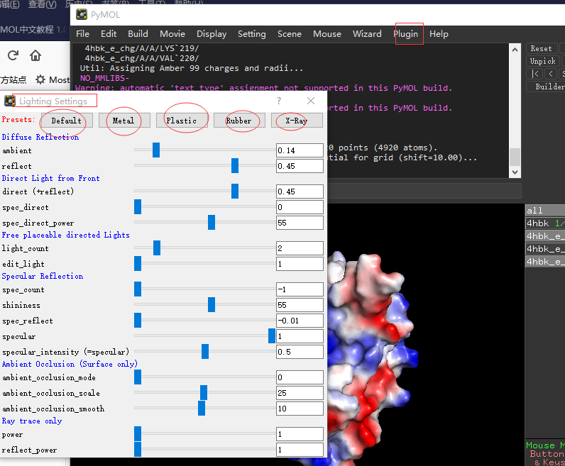

除了默认的5种模式外，你也可以通过设置光源的参数，达到自己想要的效果。

下面，我们查看蛋白的静电势表面在不同光照模式下的效果。

| 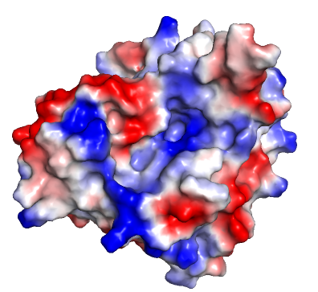 Fig 1. Default光照效果 | 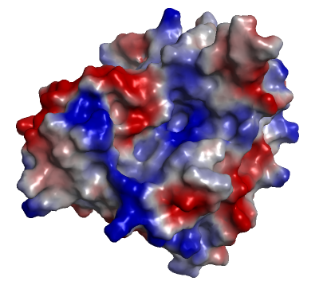 Fig 2. Metal光照效果 |
| --- | --- |
| 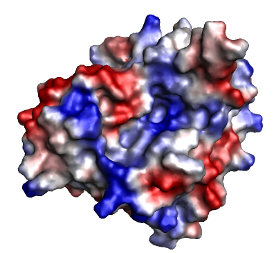 Fig 3. Rubber光照效果 | 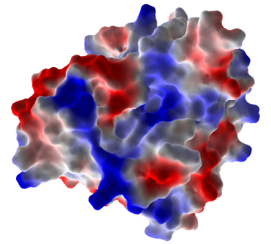 Fig 4. Xray光照效果 |

### 选择模式：

根据不同的需求，切换到不同的选择模式，快速选择自己想要的原子：

1. Residues 残基选择模式

2. Atoms 原子选择模式

3. Molecules 分子选择模式

4. chain 链选择模式

5. Objects 模式

6. C-alphas α碳原子模式

7. Segments 片段模式

我们先将蛋白Show->as wire;然后把MET-1第一个氨基酸残基show stick;如图所示，

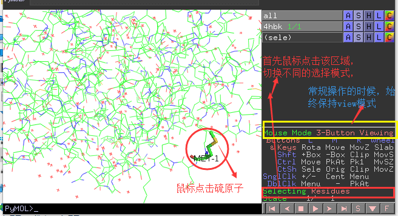

我们切换到不同的模式，选择甲硫氨酸上的硫原子。

| 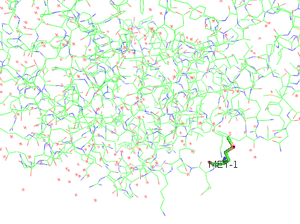 Fig 1. atoms模式下点击硫原子的效果 | 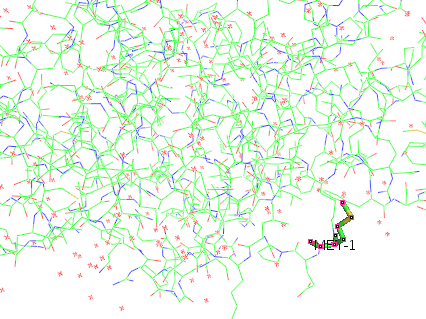 Fig 2. res模式下点击硫原子 |
| --- | --- |
| 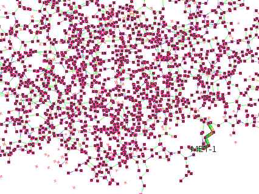 Fig 3. chain模式下点击硫原子 | 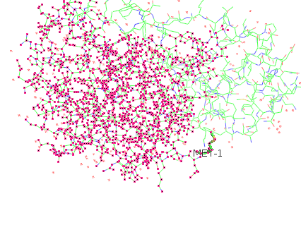 Fig 4. mol模式下点击硫原子 |

从上图我们也可以看到，不同模式的区别。这里我简单解释下:

res模式：我们点击的是硫原子，硫原子所在的res是MET-1,因此选中的是MET-1

chain模式：我们点击的是硫原子，硫原子所在的chain A,因此选中的是所有属于chain A的原子。

mol 模式： 我们点击的是硫原子，pymol 中是通过共价键来区分是否属于一个分子，4hbk 蛋白中间缺失了部分残基，整个蛋白分成了2部分。这里选择的是硫原子所在的那一部分。

### 保存或者导出结果

PyMOL 和 PhotoShop 有点类似，PyMOL中的Object 类似于 PhotoShop中的图层。

1. PyMOL 可以将会话保存为pse文件，File->Save Session；pse 文件类似于PS中的psd文件，方便修改调整。

2. PyMOL 可以将object 导出为结构文件，File->export molecule，然后从selection的下拉框中选择需要导出的object, all 代表所有的object; enable 代表的可见的object;

3. 保存图片，File->export image as->png; 在新版本的，可以使用右上角的Ray/Trace按钮，设置图片大小 分辨率，进行保存图片。

4. 保存动画，File->export movie as->mpeg; PyMOL仅仅内置了 mpeg_encode 编码视频方式，默认只能保存mpg格式的动画。 可自行下载ffmpeg,从而可以保存为多种格式，如gif,mov,mpg等

> 设置pse的版本号，建议版本为0.99， 这样PyMOL 和 PyMOL2都可以打开pse 文件

set export_pse_version,0.99

### 删除蛋白的一条链，然后保存为pdb

step1. 切换到chain模式

step2. 点击需要需要删除的Chain就可以选中chain

step3. 对新产生的sele object进行删除。

## 基础教程

主要讲述PyMOL常见的命令操作。

注解

1.本节教程是有顺序的。 2.建议先阅读入门教程，再阅读基础教程。 3.所有的命令都支持tab键补全，提高效率。 4. 主要的示例以Bace-1蛋白6EQM为例，里面含有配体小分子BUH。

### 命令输入窗口

PyMOL中有2个地方可供命令输入，如下图所示，根据自己的爱好，选择一处输入命令就可以了。

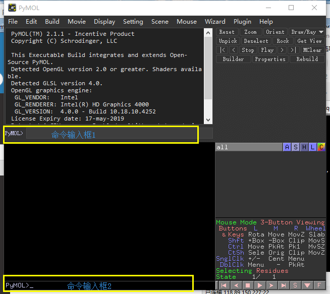

笔者倾向于使用命令框1，下面我将讲解一些常用的命令：

### 查看切换工作路径(pwd)

默认打开和保存文件，都是在工作路径中。因此设定合适的工作路径，可以提供效率。 建议分子文件格式，如mol2,pdb等格式，全部关联到PyMOL软件，不要关联到DS，Maestro等软件。

双击PDB文件，打开PyMOL软件，会自动调整工作路径为PDB文件所在路径。

1. 命令 pwd; 查看工作路径；
2. 命令 cd D:/test; 切换工作路径到D盘下面的test文件夹。在执行命令前，确保D盘下面有test 文件夹。

如图所示：

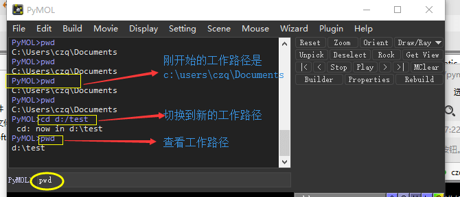

### 下载蛋白(fetch)

fetch 命令可以根据PDB ID编号下载蛋白结构到工作路径，并载入到PyMOL中显示,在PyMOL中的object的名字默认是PDB ID,可通过name参数进行修改。 从PyMOL 1.8开始，默认的格式是cif,可通过type参数修改文件的格式，也支持根据配体ligand ID的编号下载小分子。

示例:

1. fetch 6FYZ # 下载编号是6FYZ的蛋白，文件格式是cif。
2. fetch EBE # 下载编号是EBE的配体小分子，文件格式是cif。
3. fetch 6MVD,name=”test”,type=pdb # 下载文件格式为pdb的6MVD的蛋白，载入PyMOL中设置名字为test.

**type后面的参数不是字符串，不能加引号**

type 支持的文件格式有：

type = cif|mmtf|pdb|pdb1|2fofc|fofc|emd|cid|sid|cc

默认是从pdb网站上下载数据的，可通过设置fetch_host 修改下载源。

set fetch_host,pdb set fetch_host,pdbe set fetch_host,pdbj

pdb 数据库有2个镜像库，一个是欧洲的pbde,另一个是日本的pdbj。 如果其中一个源不能使用的时候，可以尝试切换到其他源。

### 载入蛋白（load）

从PDB网站上下载蛋白，如 4hbk.pdb。 工作路径中已经存在PDB文件，如4hbk.pdb。 可通过load 命令进行加载。 命令：

load 4hbk.pdb load filename.pdb

load 和 fetch 的区别，load 是指定文件的名字，而fetch是分子的ID号。

### 设置背景颜色（bg_color）

设置背景颜色为白色：

bg_color white

### 设置surface的颜色（cartoon_color）

设置surface的颜色为red

set surface_color,red

注解

注意颜色是有优先级的，默认设置的是atom的颜色，如果没有设置surface的颜色，则继承atom的颜色

体验下

set surface_color,red

color blue

unset surface_color

### 绘制蛋白截面图clip

需要ray后才能看到截面的效果。

as surface

clip near,-10

ray

注解

为了获得想要的效果，多次尝试clip的数值。 也可以通过滚动数据获得切面

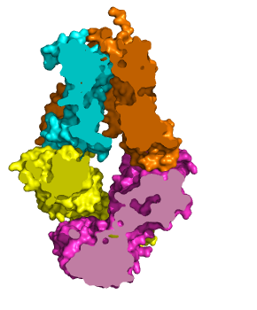

### 设置截面的颜色

set ray_interior_color, grey

set ray_interior_color, grey,obj01

### 开关单双键模式 valence

set valence,1 开启双键模式。

set valence,0 关闭双键模式。

示例 打开PyMOL fetch BUH bg_clor white set valence,1 set valence,0

效果如下：

| 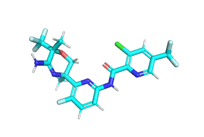 Fig 1. 双键模式 | 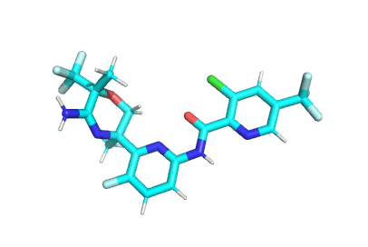 Fig 2. 普通模式 |
| --- | --- |

### 开启球棍模型ball-stick

set stick_ball,1

set stick_ball_ratio,1.7

as stick

效果如下图所示：

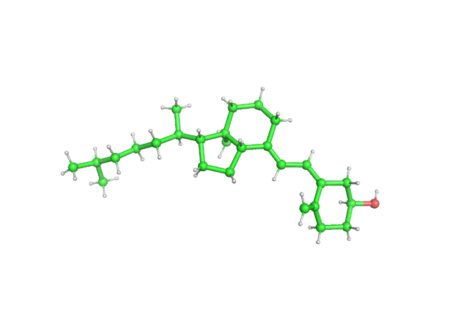

### 开启球棍模型ball-stick

点击 Action -> preset -> ball and stick

效果如下图所示：

### 设置相互作用的样式

1. 怎么像这样把相互作用的线调粗？

set dash_radius, 0.3

2. 把虚线变成实线？

set dash_gap,0

3. 设置实线区域的长度

set dash_length, 0.8

### 保存图片（png)

png filename.png 我建议使用该命令进行快捷保存图片

下面我将以Bace-1蛋白6EQM为例，里面含有配体小分子BUH。

### 高清图片（ray）

制作高清图片， 制作完图片后输入ray命令，然后保存图片。

### 设置两个光源 two_sided_lighting

set two_sided_lighting,1

当蛋白表面有破损的时候，ray的时候可能会出现黑洞现象，如下图所示。

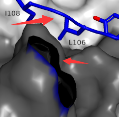

使用上述命令，设置两个光源就可以消除黑洞现象。

### 批量修改氨基酸残基的编号

使得残基的编号增加61。 alter (all),resi=str(int(resi)+61); sort;

### 设置label的小数位数

默认距离和角度是1位，通过下面命令可以修改，显示的位数。

set label_digits,2

set label_distance_digits,2

set label_dihedral_digits,2

set label_angle_digits, 2

### 设置label的字体大小

label字体的默认大小是14pt, 单位是pt。

set label_size,20

除了使用pt单位，也可以使用Angstrom 单位，如设置字体大小为 1.2 Angstrom。

set label_size,-1.2

### 删除object

delete objectName

delete all

### 保存object

cmd.save(filename\[, selection\[, state\[, format]]])

save file \[,(selection) \[,state \[,format]] ]

PyMOL>save 01.pdb, ONLYprotein,

Save: wrote “01.pdb”.

PyMOL>cmd.save(“0.pdb”,”ONLYprotein”)

### 掩藏object-disable

disable objectName

### 掩藏representation

hide stick hide cartoon

### 切换编辑模式

edit_mode

### 计算phi-psi角度

phi_psi objectName phi_psi selection

phi_psi 4hbk phi_psi resi 100

***

### 蛋白的展现形式(show,as)

命令如下:

as cartoon

show cartoon,objectname

as stick,all

as stick,objectname

as stick,selection express

as stick,resn arg

默认的object name是all。

示例讲解： 打开pymol, 依次执行下面命令。 1. cd d:PyMOLstartedManualpse 切换到工作路径 2. fetch 6EQM 下载蛋白 3.

### 调整 mesh 粗细

set mesh_radius,0.2

ray

ray 方可看到调整后的状态。

### 设置双键的显示形式 valence

set valence, 0  #关闭双键显示

set valence, 1  #开启双键显示

### 设置小球的大小 sphere_scale

默认sphere_scale 是1，通过调整sphere_scale来调整 小球的大小

set sphere_scale,0.5

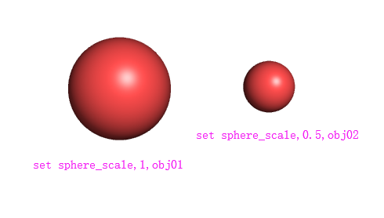

### 重新计算二级结构(dss)

dss

### 选择中的关键词和缩略

1. organic org. Non-polymer organic compounds (e.g. ligands, buffers)
2. inorganic ino. Non-polymer inorganic atoms/ions
3. solvent sol. Water molecules
4. polymer pol. Protein or Nucleic Acid
5. polymer.protein Protein (New in PyMOL 2.1)
6. polymer.nucleic Nucleic Acid (New in PyMOL 2.1)
7. guide Protein CA and nucleic acid C4\*/C4’
8. hetatm Atoms loaded from PDB HETATM records
9. hydrogens h. Hydrogen atoms
10. backbone bb. Polymer backbone atoms (new in PyMOL 1.6.1)
11. sidechain sc. Polymer non-backbone atoms (new in PyMOL 1.6.1)
12. metals Metal atoms (new in PyMOL 1.6.1)
13. donors don. Hydrogen bond donor atoms
14. acceptors acc. Hydrogen bond acceptor atoms

### cartoon 模式

pymol 中内置了10种cartoon 模式：

1. skip (-1) 不显示
2. automatic (0) (use ss property) 默认模式
3. loop (1)
4. rectangle (2)
5. oval (3)
6. tube (4)
7. arrow (5)
8. dumbbell (6) (see also cartoon_fancy_helices)
9. putty (7) (b-factor scaling)
10. dash (8) (new in PyMOL 1.8.2)

在命令行窗口输入下面的命令对各种模式进行感受。 .. code-block:: console

> cartoon loop cartoon tube cartoon putty

### cartoon helix 模式

在cartoon automaic 模式下 pymol 中内置了3种cartoon helix模式：

1. 默认default模式
2. Fancy Helices 模式 两端是尖尖
3. Cylindrical Helices 模式 圆柱体

开启 Fancy 模式

set cartoon_fancy_helices, 1

开启 cylindrcal 模式

set cartoon_cylindrical_helices, 1

设置圆柱的粗细：

set cartoon_helix_radius,0.9

set cartoon_helix_radius,2.5

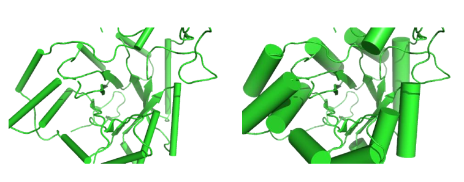

启用默认 default 模式

set cartoon_fancy_helices, 0

set cartoon_cylindrical_helices, 0

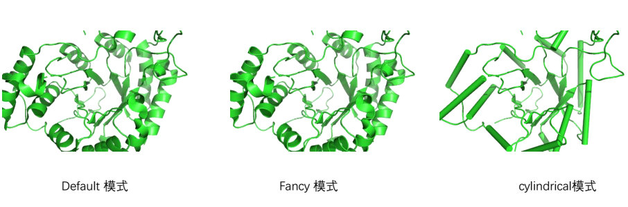

### 定义fancy 和default模式下的α-helix

命令：

set cartoon_oval_length , 0.8 # default is 1.20

set cartoon_oval_width , 0.2  # default is 0.25

示例：

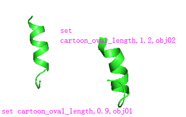

### 着色(color)

color red,object name

### 设置透明度(transparency)

所有的命令

### 选择，残基(select)

选择所有的碳原子： select catoms, elem C

选择蛋白：select protein, (byres polymer & name CA)

选择核酸： select nucleic, (byres polymer & name P)

选择RNA: select rna, (byres polymer & name O2’)

选择DNA: select dna, (nucleic & !rna)

### 查看蛋白中的二硫键

show sticks, (cys/ca+cb+sg) and byres (cys/sg and bound_to cys/sg)

### 显示蛋白的口袋的静电势表面

step1. 显示整个蛋白蛋白的静电势表面；A->generate->vacuum electrostatic->potential

step2  设置口袋的中心，一般以其中的配体作为中心；

set surface_carve_selection, ligand

step3  设置口袋的大小

set surface_carve_cutoff, 5

step4 设置口袋的表面的透明度

set transparency,0.3, 1azm_e_chg

step5 切换为溶剂可接触表面

set surface_solvent, 1

### 删除配体分子5A以外的水分子

remove resn hoh and (resi 307 gap 5)

### 叠合两个object(super)

参考： <https://pymolwiki.org/index.php/Super>

自动进行全局叠合

super 会把两个object进行叠合，和align的区别主要是

1. super 主要是基于机构进行叠合；
2. align 主要是基于序列进行叠合。

当两个蛋白的序列相似度较低的时候，使用super叠合的效果比align叠合的效果好。

super p1, p2

指定叠合部分

super p1 & alt A+'', p2 & alt B+''

实战

super obj03  & resi 2-191 & chain K, obj04  & resi 2-191 & chain C

### 分组（group)

group efHand, 1cll 1ggz 1sra

group efHand, open

group efHand, close

创建嵌套的组

group target,pdbid

group surf, *_e_*

group target,surf

### 排序object (order)

order object

### 颜色的名字

PyMOL 中内置超过<code>100种颜色 <[https://pymolwiki.org/index.php/Color_Values](https://pymolwiki.org/index.php/Color_Values)></code>\_，

aquamarine    0.5     1.0     1.0

      black   0.0     0.0     0.0

      blue    0.0     0.0     1.0

      bluewhite       0.85    0.85    1.00

      br0     0.1     0.1     1.0

      br1     0.2     0.1     0.9

      br2     0.3     0.1     0.8

      br3     0.4     0.1     0.7

      br4     0.5     0.1     0.6

      br5     0.6     0.1     0.5

      br6     0.7     0.1     0.4

      br7     0.8     0.1     0.3

      br8     0.9     0.1     0.2

      br9     1.0     0.1     0.1

      brightorange    1.0     0.7     0.2

      brown   0.65    0.32    0.17

      carbon  0.2     1.0     0.2

      chartreuse      0.5     1.0     0.0

      chocolate       0.555   0.222   0.111

      cyan    0.0     1.0     1.0

      darksalmon      0.73    0.55    0.52

      dash    1.0     1.0     0.0

      deepblue        0.25    0.25    0.65    deep

      deepolive       0.6     0.6     0.1

      deeppurple      0.6     0.1     0.6

      deepsalmon      1.0     0.5     0.5     duplicated?

      deepsalmon      1.00    0.42    0.42

      ... ...

violetpurple  0.55    0.25    0.60

warmpink      0.85    0.20    0.50

wheat         0.99    0.82    0.65

white         1.0     1.0     1.0

yellow        1.0     1.0     0.0

yelloworange  1.0     0.87    0.37

### 设置二级结构的颜色

PyMOL中内置了3种二级结构着色策略。

helix       sheet   loop

red         yellow  green   （策略1）

cyan        magenta         salmon （策略2）

cyan        red     magenta     （策略3）

除了上述内置的着色策略，我们还可以自定义二级结构的颜色。

方法一：

选定二级结构对应的氨基酸残基，然后设置颜色。

方法二（推荐）：

color red, ss h

color yellow, ss s

color green, ss l+''

推荐一套配色策略，感觉比内置的好看一点。

PyMOL>color yellow,ss s

PyMOL>color grey,ss l+''

PyMOL>color teal,ss h

### 设置颜色 (set xx_color)

set

## 进阶教程

主要讲述如何用PyMOL 绘制精美图片的案例，以及制作动画。

注解

动画更加形象生动，做PPT的时候加入一些动画，更能引起听众的兴趣和注意力！

### 简单规则

对于缺少美感的人来说，如何绘制精美图片，有如下规则和方法： 1. 参考文献中图片，进行绘制 2. 文献中蛋白的颜色通常设置为灰白色。 3. 氢原子往往掩藏，尤其是非极性氢原子。

如何制作动画，有如下规则： 1. 平时注意积累动画库 2. 模仿别人制作的动画

#### 安装ffmpeg方便直接导出mp4 和 gif 格式

安装方法一：

1. step1 到 [ffmpeg官网](https://ffmpeg.org/download.html) 下载ffmpeg，这里我以 [windows为例](https://ffmpeg.zeranoe.com/builds/win64/static/ffmpeg-20190604-d81913e-win64-static.zip) 。
2. step2 解压文件，将bin文件下的所有exe 程序拷贝的PATH路径下，或者将bin路径添加到PATH 环境变量中。
3. step3 打开PyMOL,File->save move movie 选择ffmpeg 就可以保存动画。

安装方法2：

\*\*>>> \*\*conda install -c menpo ffmpeg

#### 制作分子对接示例动画

1. 准备材料(选定蛋白体系，配体)
2. 分子对接，保留制作动画用的配体小分子构象
3. 制作动画

> 3.1 导入蛋白，
>
> 3.2 通过命令导入小分子，并设置object的名字为lig

load conf1name.mol2, lig

load conf2name.mol2,lig

... ...

> 3.3 美化，调整角度，颜色，显示模式，动画速度等
>
> 3.4 mplay 播放动画
>
> 3.5 导出动画 ；
>
> file->export movie as -> 选择ffmpeg/gif 保存动画为gif格式 或者 选择ffmpeg/mpeg4 保存动画为mp4 格式。
>
> **mp4格式的文件更小**

这里我以蛋白 **1ki2** 为例制作动画，免费下载 [素材](http://pymol.chenzhaoqiang.com/_static/material_demo1.zip) 。

素材包含： 1. 蛋白构象；2. 小分子10个构象；3. mov.pml

打开pymol,执行如下命令，就可以创建动画了

load 1ki2_rec.pdb,rec

load ligconf01.mol2,lig

load ligconf02.mol2,lig

load ligconf03.mol2,lig

load ligconf04.mol2,lig

load ligconf05.mol2,lig

load ligconf06.mol2,lig

load ligconf07.mol2,lig

load ligconf08.mol2,lig

load ligconf09.mol2,lig

load ligconf10.mol2,lig

set movie_fps, 3

mplay

或者将上述命令写入到mov.pml 文件中，双击mov.pml 就可以。

我制作的动画如下

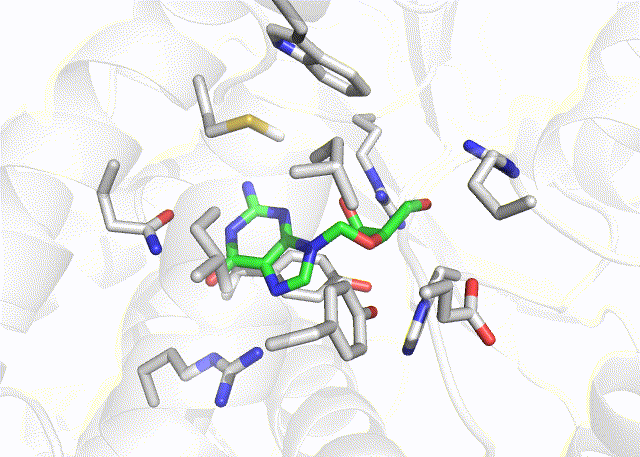

#### 制作小分子进入蛋白口袋的动画

> 这次我主要通过保存关键的frame 进行制作。
>
> 首先我们在脑海中构建几个关键图像，

1. 蛋白是空的。

2. 在蛋白外部出现小分子

4. 小分子慢慢进入口袋

帧和帧之间PYMOL会自动平滑过渡。 设置所有的帧的数目： mset 1 x300;

设置第一帧的图像，frame 1; 调整得到自己想要的视角；mview store；

在frame 100设置第二副图像，frame 100; 调整得到自己想要的视角；mview store；

在frame 200设置第二副图像，frame 200; 调整得到自己想要的视角；mview store；

mplay 播放动画。

注意： 这种方法不能改变蛋白的形态。

## 高级教程

主要讲述PyMOL中脚本的编写、命令的自定义、插件的编写。

### PyMOL脚本、命令、插件

PyMOL支持Python 编程语言，故可以借助python让pymol无所不能，pymol除了显示软件，也能成为计算软件。

脚本：把pymol作为一个模块，实现一些计算功能。 命令：pymol中内置了一些命令，如color、dist等，我们也可以自定义新的命令。 插件：pymol中内置了一些插件，如apbs-pdb2pqr等，我们也可以自定义插件。

注解

编写PyMOL脚本、命令、插件，需要有一定的python基础。python教程：HOW2PY

#### 安装PyMOLwiki中的命令

这里我以这个命令 [`FocalBlur<https://pymolwiki.org/index.php/FocalBlur>`\_](http://pymol.chenzhaoqiang.com/intro/advanceManual.html#id8) 为例进行演示。

1. 下载 focal_blur.py脚本，<https://raw.githubusercontent.com/Pymol-Scripts/Pymol-script-repo/master/focal_blur.py> 比如下载到D盘根目录下面 d:/focal_blur.py
2. 打开pymol,在命令窗口输入run d:/focal_blur.py 就完成了安装。
3. 运行命令 FocalBlur aperture=4,samples=400,ray=0

FocalBlur一共有5个参数：

* aperture
* samples
* ray
* width
* height

该命名和单反的光圈相关，控制景深的。 **需要开启ray=1 才能看到光圈景深的效果**

#### 命令

这里我举一个例子: 计算两个苯环之间的距离或者五元环和苯环之间的距离。

拓展：计算2个object的中心距离。

首先我们为命令起名字，要求是简洁高效，通过命令就能猜测到这个命令的功能。 这里我起的脚本名 dist_center。 核心是在python 脚本中定义这个函数，并cmd.extend拓展命令。 框架如下

| 1 2 3 4 | **from** **pymol** **import** cmd **def** dist_center(obj1="obj01",obj2="obj02",showflag=True):     **pass** cmd.extend("dist_center", dist_center) |
| --- | --- |

完整代码(dist_center_2obj.py)如下：

|  1  2  3  4  5  6  7  8  9 10 11 12 13 14 15 16 17 18 19 20 21 22 23 24 25 26 27 28 29 30 31 32 33 34 35 36 37 38 39 40 41 42 43 44 45 46 47 48 49 50 51 52 53 54 55 56 57 58 59 60 61 62 63 64 65 66 | *"""* *DESCRIPTION* *measure the distance between the centers of two objects* *the object usually is  benzene, pyridine and other cyclo object* *more information at: \_ [*http://pymol.chenzhaoqiang.com/intro/advanceManual.html*](http://pymol.chenzhaoqiang.com/intro/advanceManual.html)  *AUTHOR* *Zhaoqiang Chen, 2017* *Please inform me if you use/improve/like/dislike/publish with this script.* *email: 744891290@qq.com* *"""* **from** **pymol** **import** cmd,math  **def** getcenterofatoms(atoms):     *'''* \_    '''*     x=0     y=0     z=0     **for** atm **in** atoms:         x+=atm.coord\[0]         y+=atm.coord\[1]         z+=atm.coord\[2]     numatm=float(len(atoms))     x=x/numatm     y=y/numatm     z=z/numatm     **return** \[x,y,z] **def** getdist(cen1,cen2):     *'''* \_    '''\_     dx=cen1\[0]-cen2\[0]     dy=cen1\[1]-cen2\[1]     dz=cen1\[2]-cen2\[2]     dist=dx*dx+dy*dy+dz\*dz     **return** math.sqrt(dist) **def** dist_center(obj1="obj01",obj2="obj02",showflag=True):     *'''* \_    usage1:\_ \_    dist_center obj01,obj02 \_ \_    usage2:\_ \_    dist_center obj01,obj02,1 \_ \_    usage3:\_ \_    dist_center obj01,obj02,0\_ \_    usage1 is equal to usage2!\_ \_    '''\_     obj1atoms=cmd.get_model(obj1).atom     obj2atoms=cmd.get_model(obj2).atom     obj1center=getcenterofatoms(obj1atoms)     obj2center=getcenterofatoms(obj2atoms)     dist = getdist(obj1center,obj2center)     **print**("distance: *%.2f*"%(dist ))     **if** showflag:         cmd.pseudoatom('cen1', pos=obj1center)         cmd.pseudoatom('cen2', pos=obj2center)         cmd.distance("dist","cen1","cen2")          cmd.extend("dist_center", dist_center) |
| --- | --- |

演示如下：

载入蛋白，运行run dist_center_2obj.py命令； 把TRY-72侧链苯环6个原子保存为obj01; 把HIS-351侧链咪唑环的5个原子保存为obj02; 运行命令 dist_center obj01,obj02 即可测量距离。

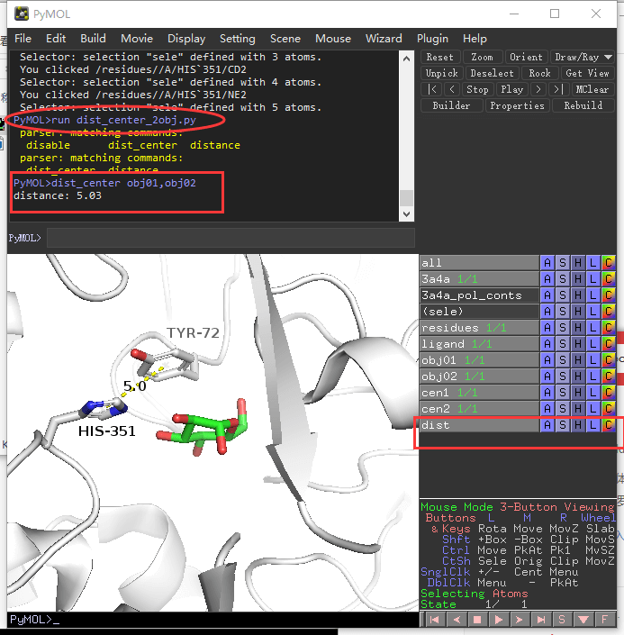

#### 显示蛋白残基之间的盐桥

思路：

1. 先定位带负电荷的氨基酸上的羧基上的氧原子；
2. 然后定位正电荷氨基的Lys 上的带正电荷的N原子；
3. 最后显示这两类原子在4A范围之内的配对情况。

方法1 命令行版本

注解

PyMOL>select negative, (resn ASP+Glu and name OD\*+OE\*)

PyMOL>select positive, (resn Lys and name NZ) or (resn arg and name NE+NH\*)

PyMOL>distance saltbridge, (negative ), (positive ), 4.0, 0

PyMOL>select negative, (resn ASP+Glu and name OD\*+OE\*)

PyMOL>select positive, (resn Lys and name NZ) or (resn arg and name NE+NH\*)

PyMOL>distance saltbridge, (negative ), (positive ), 4.0, 0

方法2 拓展成一个命令 saltbridge.py

**from** **pymol** **import** cmd

**def** show_saltbridge(dist=4.0):

    cmd.select("negative","resn ASP+Glu and name OD\*+OE\*")

    cmd.select("positive","(resn Lys and name NZ) or (resn arg and name NE+NH\*)")

    cmd.distance("saltbridge","negative","positive",dist,0)

cmd.extend("show_saltbridge", show_saltbridge)

使用命令

PyMOL>run saltbridge.py

PyMOL>show_saltbridge 3

PyMOL>show_saltbridge

用法如图所示：

两个氨基酸之间存在黄色虚线，说明这个氨基酸存在盐桥。

#### 把蛋白装入盒子中，并可视化长宽高

计算蛋白的长宽高，并可视化。 下载脚本(右击另存为) <code>[addproteinBox.py](http://pymol.chenzhaoqiang.com/_downloads/addproteinBox2020-05-12_232157.616761.py)</code> 。

在PyMOL 命令行，运行下述命令，就可以该蛋白添加盒子，并显示长宽高。

PyMOL>run addproteinBox.py

PyMOL>add_proteinbox 4hbk

#### 左下角显示XYZ坐标

VMD左下角默认会显示XYZ坐标，PyMOL也可以做到。 下载脚本(右击另存为) <code>[axes.py](http://pymol.chenzhaoqiang.com/_downloads/axes.py)</code> 。

在PyMOL 命令行，运行下述命令，就可以添加XYZ坐标了。

PyMOL>run axes.py

PyMOL>axes

#### 加载坐标颜色文件

文件(test.xyzrgb)格式如下

> <code>[test.xyzrgb](http://pymol.chenzhaoqiang.com/_downloads/axes.py)</code>

x y z r g b

下载笔者编写的脚本 <code>[loadxyzrgb_sub.py](http://pymol.chenzhaoqiang.com/_downloads/loadxyzrgb_sub.py)</code>

在 PyMOL 命令行，运行下述命令，就可以可视化坐标颜色文件了。

PyMOL>run loadxyzrgb_sub.py

PyMOL>loadxyzrgb test.xyzrgb

#### 提取配体周围的位点

**from** **pymol** **import** cmd

**from** **pymol** **import** util

*# example 6SP6 KJK    A*

**def** extractSiteByLig(pdbid,ligid,radius=4,chainid=None):

    *'''*

\_    '''\_

    cmd.delete('all')

    cmd.fetch(pdbid)

    **if** **not**  chainid:

        cmd.select("ligall","resn *%s*"%ligid)

        atms_lig = cmd.get_model("ligall").atom

        chains_lig = \[    atom.chain     **for** atom **in** atms_lig ]

        chains_lig = list(set(chains_lig))

        chainid = chains_lig\[0]

    cmd.select("lig\_*%s*"%chainid," chain *%s* and resn *%s* "%(chainid,ligid))

    cmd.select("site","byres (lig\_*%s* expand *%s*)"%(chainid,radius))

    cmd.create("pocket","site")

    cmd.disable("all")

    cmd.enable("pocket")

    cmd.do("as sticks,pocket")

    util.cba(144,"pocket")

    util.cba(120,"pocket and resn *%s*"%ligid)

    newfile="*%s***%s\_**%s\_**%s\_.pdb"%(pdbid,ligid,chainid,radius)

    cmd.save(newfile,"site")

*# extractSiteByLig 6SP6, KJK*

cmd.extend("extractSiteByLig",extractSiteByLig)

pdbid = '6SP6'

ligid = 'KJK'

extractSiteByLig(pdbid,ligid)

#### PyMol的宏录制

点击 File->Log File-> Open File 填写宏的名字 xxx.pml 然后操作PyMOL， 操作完成后点击 File->Log File-> close; 文本编辑器（如vscode）打开宏文件就可以查看里面的命令。

> 更新: 2021-01-31 11:41:30
> 原文: <https://www.yuque.com/doublehelix/bioinfonotes/zbzrds>
